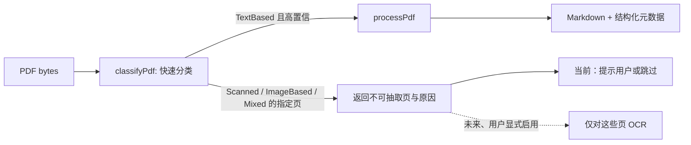

# `pdf-inspector` 接入调研：以原生 PDF 文本解析替代 OCR 依赖

> 调研日期：2026-08-03。外部资料固定到上游 commit
> [`a15ec2d`](https://github.com/firecrawl/pdf-inspector/tree/a15ec2d68d51dbe6a39d1da688ec7a3f642d846c)，避免 README 或 API 继续演进后结论漂移。

## 结论

[`firecrawl/pdf-inspector`](https://github.com/firecrawl/pdf-inspector) 适合作为 Cortex **有原生文本层 PDF 的本地默认解析器**：它直接读取 PDF content stream、字体与布局，输出 Markdown 和页面级路由信息，不调用 OCR、模型或外部服务。对于报告、论文、合同、财务表格等非扫描 PDF，这能替换当前 `officeparser`/`pdfjs-dist` 的“平铺纯文本”路径，并保留列顺序、表格和排版语义。

但它**不能让扫描件、图片型 PDF 或矢量化文字变得可读**。因此，“不依靠 OCR”应落实为：Cortex 不内置或不自动调用 OCR；遇到工具明确标识的不可提取页，返回结构化的“此页没有可提取文本层”状态和页号。若产品未来承诺读取扫描件，仍必须提供用户显式启用的、按页执行的 OCR fallback；不能把 `pdf-inspector` 描述成 OCR 的完全替代品。

## 上游能力与工作方式

上游将其定义为纯 Rust 的 PDF 分类、位置感知文本抽取和 Markdown 转换库；没有 ML 模型或外部服务，PDF 只在本机进程内处理。它以 `lopdf` 解析 PDF，并利用字体、坐标、content stream、矩形绘制操作和布局规则推导阅读顺序、标题、列表、样式及表格。[README：定位、能力和依赖](https://github.com/firecrawl/pdf-inspector/blob/a15ec2d68d51dbe6a39d1da688ec7a3f642d846c/README.md#L6-L19)；[架构图](https://github.com/firecrawl/pdf-inspector/blob/a15ec2d68d51dbe6a39d1da688ec7a3f642d846c/README.md#L338-L381)。



分类器会检测 `Tj`/`TJ` 文本操作符与图像/矢量内容；`TextBased`、`Scanned`、`ImageBased`、`Mixed` 四类结果带有 `confidence` 和应 OCR 的页号。具体的检测和采样策略见[上游实现](https://github.com/firecrawl/pdf-inspector/blob/a15ec2d68d51dbe6a39d1da688ec7a3f642d846c/src/detector.rs#L1-L114)。完整解析只加载一次文档，随后共享给检测、抽取与 Markdown 转换，避免重复 I/O。[内存输入的统一处理入口](https://github.com/firecrawl/pdf-inspector/blob/a15ec2d68d51dbe6a39d1da688ec7a3f642d846c/src/lib.rs#L297-L320)

## Node/Electron 可用接口与输出契约

最适合 Cortex 的是 Node N-API 包：`@firecrawl/pdf-inspector`。输入是本机读取出的 `Buffer`，所以不需要把文件上传给 Firecrawl 或第三方服务。上游提供 `processPdf(buffer, pages?)`、`detectPdf(buffer)`、`classifyPdf(buffer)`；它们是同步的 native 调用，调用点不得位于 renderer 或 Electron 主进程事件循环。[Node 快速开始](https://github.com/firecrawl/pdf-inspector/blob/a15ec2d68d51dbe6a39d1da688ec7a3f642d846c/README.md#L52-L67)，[N-API 导出](https://github.com/firecrawl/pdf-inspector/blob/a15ec2d68d51dbe6a39d1da688ec7a3f642d846c/napi/src/lib.rs#L205-L258)。

| 调用 | 用途 | 关键输出 |
| --- | --- | --- |
| `classifyPdf(buffer)` | 在完整抽取前路由 | `pdfType`、`pageCount`、`confidence`、`pagesNeedingOcr` |
| `processPdf(buffer, pages?)` | 原生文本层 → Markdown | 上述信息加 `markdown`、`processingTimeMs`、`title`、表格/分栏页、`hasEncodingIssues`、逐页原因 |
| `extractTextWithPositions(buffer, pages?)` | 需要引用坐标或二次切块时 | 文本、字体、x/y、宽高、页号、链接/表单项类型 |
| `extractTextInRegions(buffer, regions)` | 已有版面区域时的局部抽取 | 每个区域的 `text` 和 `needsOcr` |

完整结果字段可核对 [N-API `PdfResult`](https://github.com/firecrawl/pdf-inspector/blob/a15ec2d68d51dbe6a39d1da688ec7a3f642d846c/napi/src/lib.rs#L34-L68)，位置文本与区域抽取见[同一绑定实现](https://github.com/firecrawl/pdf-inspector/blob/a15ec2d68d51dbe6a39d1da688ec7a3f642d846c/napi/src/lib.rs#L260-L320)。有一个必须测试覆盖的索引差异：`classifyPdf().pagesNeedingOcr` 是 **0-based**，而完整 `processPdf()` 结果的 `pagesNeedingOcr` 是 **1-based**。[分类接口注释](https://github.com/firecrawl/pdf-inspector/blob/a15ec2d68d51dbe6a39d1da688ec7a3f642d846c/napi/src/lib.rs#L242-L258)；[完整接口注释](https://github.com/firecrawl/pdf-inspector/blob/a15ec2d68d51dbe6a39d1da688ec7a3f642d846c/napi/src/lib.rs#L34-L48)。

## 与当前 Cortex 实现的差异

当前聊天附件通道的 `apps/desktop/src/main/capabilities/doc-extract/extract.ts` 对 `.pdf`、`.docx`、`.xlsx`、`.pptx` 统一调用 `officeparser`，且明确传入 `ocr: false`；空 PDF 文本层仅返回“可能为扫描件”的说明。其 runner 在 Electron 主进程内执行，30 秒超时只能 reject，不能真正终止卡住的解析。

Research Worker 的 `apps/desktop/src/worker/research/extract/pdf.ts` 则是 `pdfjs-dist` 的逐页文本抽取，已有页数/字符上限与 `isEvalSupported: false`，但输出仍是页文本而非 Markdown/布局语义。这两个入口都可受益于同一层“PDF 原生结构抽取”能力，但不应各自直接依赖 N-API 包：应新增 desktop main 侧的单一适配器，再由聊天附件与 Research Worker 复用它的 IPC/子进程契约。

## 建议的接入设计

### 1. 保持文档类型边界，替换仅限 `.pdf`

`officeparser` 继续处理 DOCX/XLSX/PPTX；在 `extractDocText` 中按扩展名将 PDF 分支交给新的 `pdf-inspector` 适配器。它的标准输出应是 Cortex 自己的稳定 DTO，而非直接暴露上游对象，例如：

```ts
type PdfNativeExtraction =
  | {
      ok: true
      markdown: string
      pageCount: number
      pages: Array<{ page: number; text: string }>
      confidence: number
      truncated: boolean
    }
  | {
      ok: false
      code: "no_native_text" | "unsupported_platform" | "encrypted" | "invalid_pdf" | "timeout" | "resource_limit" | "internal_error"
      pageCount?: number
      pagesNeedingTextRecognition?: Array<{ page: number; reason: string }>
      message: string
    }
```

这里用 `pagesNeedingTextRecognition` 而非 `pagesNeedingOcr` 作为应用层名称，避免 Cortex 在当前“不使用 OCR”的产品模式下误导用户为已经执行了 OCR。适配器必须统一为 1-based 页号，并在转换处写测试，封死上游两种 API 的索引差异。

### 2. 先分类，再按策略处理

1. 主进程仅在文件身份、允许目录、真实路径和大小校验完成后读取 `Buffer`；复用现有附件授权约束，绝不暴露任意路径给 renderer。
2. 在受限解析子进程中运行 `classifyPdf`。`TextBased` 且 `confidence` 达到经 fixture 验证的阈值（首版建议不自行猜测，先记录分布）后，调用 `processPdf`。
3. `Mixed` 允许抽取原生文本页，但必须把未可读页和原因随结果返回；不要把“整份 PDF 已读完”写入 agent prompt。
4. `Scanned`、`ImageBased`、`hasEncodingIssues`、`vector_text`、`suspected_garbled_text` 或空 Markdown：当前模式返回 `no_native_text` 和页级原因；未来仅在用户启用 OCR 后，将**指定页**交给 OCR。
5. 输出 Markdown 用既有页级切块/字符预算做二次切分，保留 `<!-- Page N -->` 或 Cortex `page` metadata，保证引用可追溯。

上游自身也将该模型定位为 hybrid routing：扫描、图片、混合页、矢量文字、可疑乱码都会生成 OCR 页/原因；不能提取时不是“已识别”。[分类实现中的页级判定](https://github.com/firecrawl/pdf-inspector/blob/a15ec2d68d51dbe6a39d1da688ec7a3f642d846c/src/detector.rs#L379-L461)；[乱码和稀疏文本时清空 Markdown 并建议 OCR 的保护](https://github.com/firecrawl/pdf-inspector/blob/a15ec2d68d51dbe6a39d1da688ec7a3f642d846c/src/lib.rs#L3784-L3855)。

### 3. 隔离不可信 PDF，避免阻塞 Electron

N-API 调用是同步且包含原生 Rust 代码。解析器虽然捕获部分 Rust panic，但其安全政策明确把 crafted PDF 可触发的 panic、越界、未定义行为和 DoS 列为安全范围，说明调用方仍应将其当作不可信输入处理。[N-API panic 转错误](https://github.com/firecrawl/pdf-inspector/blob/a15ec2d68d51dbe6a39d1da688ec7a3f642d846c/napi/src/lib.rs#L155-L192)，[上游安全范围](https://github.com/firecrawl/pdf-inspector/blob/a15ec2d68d51dbe6a39d1da688ec7a3f642d846c/SECURITY.md#L16-L27)。

故实现应使用一个专门的 Node/Electron utility process（或可被主进程硬杀的独立 Node 子进程），通过 bytes/path token 的受控协议返回 DTO；主进程设置并实际执行以下限制：

- 输入文件大小、页数、总输出字符数、wall-clock 超时和并发数上限；超时必须 kill 子进程，而不是只 `Promise.race`。
- 每次请求后释放 `Buffer` 和 worker；对反复超时/崩溃的文件返回有限错误，避免重启风暴。
- 不向 renderer 暴露 `processPdf`、文件路径或 native Node 能力；预加载只暴露经过 IPC 验证的窄接口。
- 解析器内虽有每页 1,000,000 个 PDF operation 的跳过上限，Cortex 仍不能把它当成完整资源隔离。[上游 content-stream 上限](https://github.com/firecrawl/pdf-inspector/blob/a15ec2d68d51dbe6a39d1da688ec7a3f642d846c/src/extractor/content_stream.rs#L243-L254)

### 4. 打包先过平台门槛

NPM 包通过 optional dependency 拉取预编译 native binary；上游当前只列出 Linux x64、macOS ARM64、Windows x64。[分发平台清单](https://github.com/firecrawl/pdf-inspector/blob/a15ec2d68d51dbe6a39d1da688ec7a3f642d846c/napi/package.json#L36-L55)。Cortex 现有 macOS x64 发布链因此**没有可用上游 binary**，不能在未补齐该资产前宣布全平台接入。

实施前需要确认并自动化：

- arm64 macOS、x64 Windows 与 Linux x64 各自从干净安装到 Electron packaged app 都能加载 native `.node`；将主包和 `@firecrawl/pdf-inspector-<platform>` 都纳入 `asarUnpack`，因为 native module 不能从 asar 直接加载。
- macOS x64 的明确产品策略：等待/贡献上游预编译包，或由 Cortex 自建 Rust CLI/二进制并在发布链编译签名。仅在 ARM64 构建机交叉打包不能解决“npm 没有 x64 binary”。
- 版本固定、lockfile 变更、依赖漏洞扫描、每个平台 fixture smoke test；用恶意/损坏/加密/超大/扫描/混合/CID 字体 PDF 覆盖失败语义。

其上游核心 crate 使用 MIT 许可证；Node 分发包同为 MIT。[许可证](https://github.com/firecrawl/pdf-inspector/blob/a15ec2d68d51dbe6a39d1da688ec7a3f642d846c/LICENSE)，[核心依赖清单](https://github.com/firecrawl/pdf-inspector/blob/a15ec2d68d51dbe6a39d1da688ec7a3f642d846c/Cargo.toml#L24-L56)。接入时仍需按 Cortex 的第三方声明流程更新发布物归属信息。

## 验收建议

在写业务代码前建立一组可公开分发的 fixture，并同时跑当前 `pdfjs-dist` 与新解析器：

| 样本 | 期望 |
| --- | --- |
| 单栏原生文本 PDF | 成功，Markdown、页码和正文完整 |
| 双栏论文、带表格报告 | 成功，阅读顺序和表格不退化为无序平铺文本 |
| 文本封面 + 扫描附件的混合 PDF | 成功返回原生文本页；不可读页明确标记，不伪称全文可读 |
| 纯扫描/图片 PDF | `no_native_text`，给出页号和用户可理解提示，不调用 OCR |
| CID/损坏编码/矢量文字 PDF | 返回有限失败或页级不可读原因，不输出乱码作为证据 |
| 加密、损坏、超大、超时 PDF | 不崩溃、不阻塞主进程、不泄露路径/内容；子进程可被回收 |
| 打包态 arm64 macOS、x64 Windows、macOS x64 | 前两者真实加载 native module；后者在未有 binary 前明确降级或阻止启用 |

只有这些验收通过，才可把聊天附件和 Research Engine 的 PDF 抽取默认切换到该适配器。扫描件支持则是一个需要用户授权、隐私声明和独立供应商评估的后续能力，不能混入本次“原生 PDF 解析替代 OCR 依赖”的范围。
