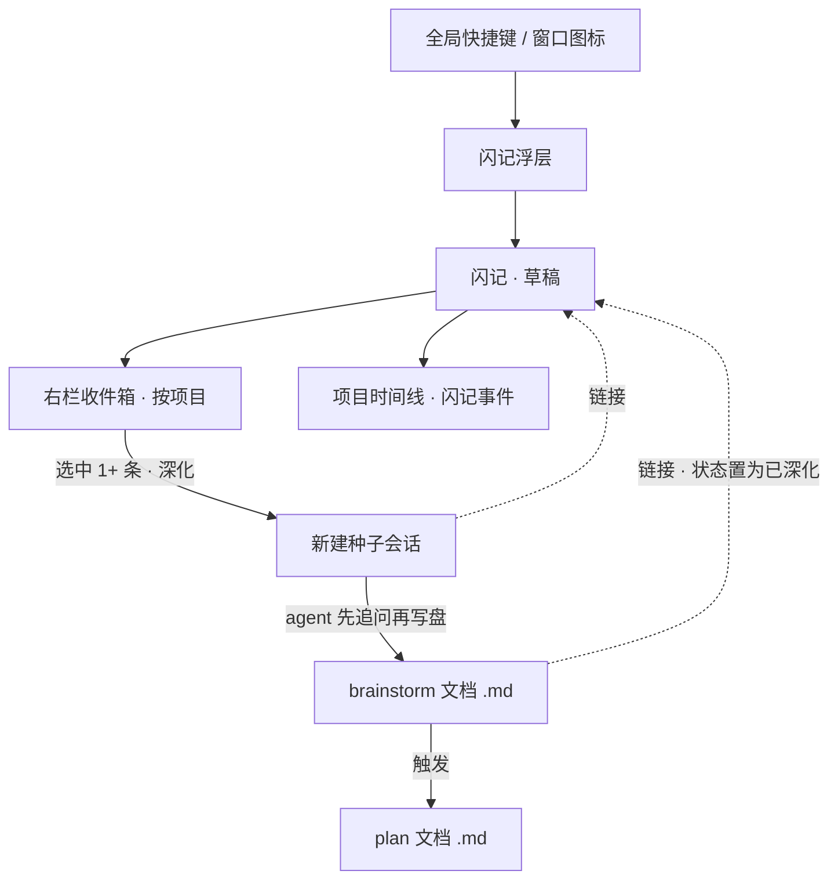

# 闪记(Flash Notes)需求

## 摘要

为项目会话窗口加一个「闪记」:用全局快捷键或窗口图标唤起浮层,随时记下想法而不打断当前会话。闪记按项目归集成一个收件箱、并在项目时间线里可回看。选中后可「深化」——以它为种子开一个新会话,让 agent 把它孵化成 brainstorm 文档,再到 plan 文档。

---

## 问题背景

在 Cortex 的项目会话里,想法常常在你正和 agent 协作时冒出来——一个待办、一个产品点子、一句「回头研究下 X」。这些往往不是给当前 agent 的指令。

今天要接住它,只有三条路,都有代价:打字进会话会污染上下文、打断节奏;切到外部笔记会离开心流、和项目脱节;不记就让它溜走。更深一层的损耗是:即便记下了,想法也大多停在原地——没有从「一句灵感」走到「可执行计划」的顺手通道。

闪记要解决的正是这两件事:出现的那一刻不打断地接住它,以及让它能长大。

---

## 关键决策

- **项目级归属**(而非会话级或全局):想法多与项目相关,深化产出的 brainstorm/plan 也是项目级;且天然复用按 `projectId` 存储的现有时间线。会话级会把同一串想法切散,全局收集箱则和深化目标脱节。
- **收件箱式独立实体,而非时间线原生事件**:让「草稿 → 已深化 → 链接文档」的生命周期、回收整理、以及与文档/会话的链接关系都立得住。代价是多一块右栏 UI;但时间线原生方案会让深化与回收变别扭,削弱主线价值。
- **捕捉走全局快捷键 + 窗口图标浮层**:满足「随时随地、不打断」。全局入口带来的「归到哪个项目」张力,用「当前/最近活跃项目 + 未归类兜底」消解。
- **深化 = 以闪记为种子开新会话**:复用现有会话/CLI 引擎,天然不碰当前会话,也省得另造一套深化器。交互上借鉴 Kun「先问几个关键问题再产出」的渐进式套路。
- **v1 的写作面用现有 markdown 视图过渡**:完整 Kun 写作台(富文本、双模 ghost text、选区改写、RAG、语音、导出)风险高、价值靠后,作为目标形态后置,不进 v1。
- **闪记人类私有**:把「不影响会话主功能」落实为——闪记不自动进入任何会话的 agent 上下文,只有深化时被选中的闪记才显式喂入新会话。

下图是整体生命周期,帮助先建立心智模型再看细节:

---

## 需求

**捕捉闪记**

- R1. 用户可用全局快捷键从任何位置唤起闪记浮层;也可在会话窗口里通过一个图标入口唤起同一浮层。
- R2. 在浮层输入文字并回车(或显式保存)即创建一条闪记;创建后浮层关闭,当前会话的焦点与内容不变。
- R3. 闪记内容为文本/markdown;每条自动记录创建时间与来源上下文(所属项目,以及若在某会话内唤起则记下该会话)。

**归属与存储**

- R4. 每条闪记归属于一个项目;全局唤起时默认归到当前/最近活跃项目,浮层顶部提供项目切换器可即时改归属。
- R5. 完全没有活跃项目时,闪记落入「未归类」收件箱,用户事后可把它归档到某个项目。
- R6. 闪记持久化在本地,App 重启后不丢;存储遵循现有个人工作区的本地方式。

**回看与整理:收件箱 + 时间线**

- R7. 闪记是独立实体,拥有稳定 id、状态(至少「草稿 / 已深化」)、可选标签,以及到来源会话与产出文档的链接。
- R8. 会话窗口右栏提供「闪记」收件箱视图,按项目列出闪记,支持回看、编辑、删除与多选。
- R9. 每条闪记同时在所属项目的时间线上呈现为一类事件,可回看并回链到该闪记;时间线支持只看闪记的筛选。

**深化成文档**

- R10. 用户可选中一条或多条闪记触发「深化」;深化以这些闪记为种子新建一个独立的项目会话,不影响任何现有会话。
- R11. 深化会话中,agent 先就想法提出若干关键问题,再把内容孵化成一份 brainstorm 文档(.md)写入项目;用户可随时介入对话。
- R12. brainstorm 文档可进一步触发生成 plan 文档(.md);两份文档都落在项目内,可在现有 markdown 视图中查看与编辑。
- R13. 深化后,源闪记状态推进为「已深化」,并链接到新建的会话与产出的文档,便于回溯。

**不干扰会话**

- R14. 闪记默认只对用户可见,不自动进入任何会话的 agent 上下文;只有深化时,被选中的闪记才作为种子喂给新会话。
- R15. 捕捉与回看闪记的任何操作都不得修改、打断或污染当前会话的消息流与运行状态。

---

## 主要流程

- F1. 速记捕捉(不打断)
  - **Trigger:** 用户在任意位置按全局快捷键,或点会话窗口的闪记图标。
  - **Steps:** 浮层即时出现并聚焦输入 → 用户输入文字 → 回车保存 → 浮层关闭,焦点回到原处。
  - **Outcome:** 一条闪记入库,归属当前/最近活跃项目(或未归类);当前会话毫无变化。
  - **Covers:** R1, R2, R3, R4, R5, R15

- F2. 回看与整理
  - **Trigger:** 用户打开右栏「闪记」收件箱,或打开项目时间线。
  - **Steps:** 收件箱按项目列出闪记,可编辑/删除/多选;时间线上闪记作为事件出现,可筛选只看闪记并回链。
  - **Outcome:** 用户能快速找回并整理想法。
  - **Covers:** R7, R8, R9

- F3. 深化:闪记 → brainstorm → plan
  - **Trigger:** 用户在收件箱选中一条或多条闪记,点「深化」。
  - **Steps:** 系统以这些闪记为种子新建独立项目会话 → agent 先追问关键问题 → 边对话边把 brainstorm.md 写入项目 → 用户满意后触发生成 plan.md → 源闪记状态置「已深化」并链接到会话与文档。
  - **Outcome:** 想法沉淀为可执行的 brainstorm/plan 文档,且可回溯来源。
  - **Covers:** R10, R11, R12, R13, R14

---

## 验收示例

- AE1. 无项目时的捕捉
  - **Covers:** R4, R5
  - **Given:** 用户没有打开任何项目。
  - **When:** 全局快捷键唤起浮层并保存一条闪记。
  - **Then:** 该闪记进入「未归类」收件箱,事后可归档到某个项目。

- AE2. 捕捉不打断进行中的会话
  - **Covers:** R2, R15
  - **Given:** 当前会话正在流式输出 agent 回复。
  - **When:** 用户唤起浮层记一条并保存。
  - **Then:** 会话输出不中断、消息流无新增、保存后焦点回到会话输入框。

- AE3. 已深化闪记的回溯
  - **Covers:** R9, R13
  - **Given:** 一条已深化的闪记。
  - **When:** 用户在时间线或收件箱查看它。
  - **Then:** 显示「已深化」状态,并可跳转到对应会话与 brainstorm/plan 文档。

- AE4. 闪记不进会话上下文
  - **Covers:** R14
  - **Given:** 一条闪记存在于当前项目。
  - **When:** 用户在当前会话里继续与 agent 对话。
  - **Then:** 该闪记不出现在 agent 的上下文里,除非用户显式深化。

- AE5. 多选深化
  - **Covers:** R10
  - **Given:** 用户多选 3 条闪记并点深化。
  - **When:** 新会话创建。
  - **Then:** 3 条闪记一并作为种子注入该新会话,现有会话不受影响。

---

## 成功标准

- **捕捉感觉「即时」**:从触发到可输入几乎无延迟;记录—保存—回到原处全程不打断手头的事。
- **零污染**:捕捉与回看从不改动当前会话的消息流或运行状态。
- **不丢**:闪记跨 App 重启稳定留存。
- **深化产出可用**:生成的 brainstorm/plan 文档结构清晰,可直接在 markdown 视图继续编辑,或交给 `ce-plan` 不需返工。

---

## 范围边界

**后置(会做,但不在 v1)**

- Kun 全套写作台:Tiptap 富文本、双模 ghost text 续写、选区浮动改写、本地 RAG、语音输入、导出(html/pdf/doc/docx)。
- 捕捉时打「去向标」(灵感 / 待办 / 想深化)给收件箱分流。
- 从会话消息一键「摘取」成闪记(带原文引用)。

**本功能不做**

- 跨项目/全局闪记收集箱——归属已定为项目级。
- Web 端闪记——桌面专属;Web 下 `DesktopBridge` 为 `null`,v1 不呈现闪记入口。

---

## 依赖与假设

- **复用现有桌面基础设施**(均已对照源码确认存在):`recordTimelineEvent` 与 `TimelineView`(时间线追加与渲染)、`oneshotCli` 与 `startCli`(深化调 agent)、`createTaskFile` 与本地 fs IPC(写文档)、共享 `MarkdownView` / `MonacoViewer`(查看与编辑)。
- **桌面专属**:闪记能力经注入的 `DesktopBridge` 暴露;Web 宿主(bridge 为 `null`)v1 不提供闪记。
- **假设**:「当前/最近活跃项目」可从现有个人工作区状态可靠得到,用作全局捕捉的默认归属。

---

## 待解问题

以下均不阻塞规划,留待 `ce-plan` 阶段结合代码定夺:

- **存储形态**:闪记元数据并入 `PersistedState.notes?` + 内容文件,还是仿 `chats/`、`timelines/` 独立成 `notes/<id>.json`;闪记与时间线 `kind:"note"` 事件如何协调(单一来源,还是双写并维护一致性)。
- **深化产出文档的落点**:项目内 `docs/brainstorms/` + plan 目录?复用 `tasks/` 风格目录?还是新目录。
- **深化的提示词来源**:直接复用 `ce-brainstorm` / `ce-plan` 的提示词与产物约定,还是内置一套更轻的追问模板。
- **多选深化的种子组织**:多条闪记如何排序或合并成种子上下文。
- **全局浮层的唤起方式**:具体快捷键与跨平台全局热键注册。

---

## 参考来源

**cortex-work(复用点,仓库相对路径)**

- `apps/desktop/src/main/ipc/timeline.ts`、`packages/core/personal/timeline.ts`、`packages/views/cortex-desktop/personal/TimelineView.tsx` — 时间线的存储/追加/按 `kind` 渲染,是闪记呈现与回看的复用点。
- `packages/core/desktop/bridge.ts`(`oneshotCli` / `startCli` / `createTaskFile`)、`packages/core/desktop/types.ts`(`TimelineEvent` / `PersistedState`)— 桥接契约与持久化数据结构。
- `packages/views/cortex-desktop/personal/PersonalWorkspace.tsx`、`PersonalComposer.tsx`、`packages/core/store/personal.ts`(`rightView` 枚举)— 会话窗口三栏布局、slash 入口、右栏视图扩展点。
- `packages/views/cortex-desktop/personal/TodosView.tsx` + `apps/desktop/src/main/ipc/fs.ts`(`createTaskFile`)— 「列表项 + markdown 详情文件」的成熟样板。
- `packages/views/cortex-desktop/personal/MarkdownView.tsx`、`MonacoViewer.tsx` — 文档查看/编辑(v1 写作面)。

**Kun(外部参考仓库 `/Users/mike/source/ai/Kun`,深化与写作体验借鉴)**

- `docs/tiptap-migration.md`、`src/renderer/src/write/tiptap/WriteRichEditor.tsx` — Tiptap 富文本主、CodeMirror 兜底(写作台目标形态)。
- `locales/zh/common.json` 的 `writeStartAskAiPrompt`(「先问我 3 个关键问题,再给可扩写的 Markdown 大纲」)— brainstorm→outline 的预置提示词套路,深化最值得借鉴。
- `docs/WRITE_INLINE_COMPLETION_MODES.zh-CN.md`、`docs/WRITE_RETRIEVAL_RAG.zh-CN.md` — 双模 ghost text、本地 RAG(后置能力参考)。
