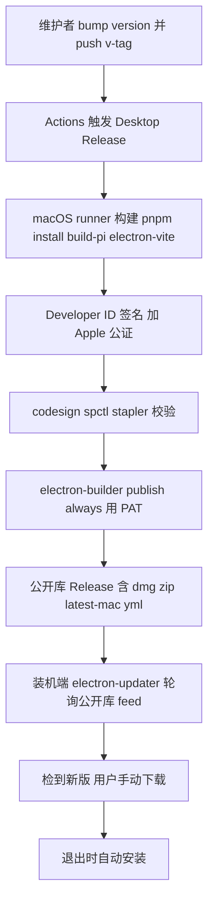

# Desktop 发布自动化（私有源码 → 公开库 release + 自动升级）

## Summary

用 GitHub Actions 把 Cortex Desktop 的发布做成闭环：私有库打 `v<version>` tag 即自动编译、Developer ID 签名、Apple 公证，并由 electron-builder 跨库把 arm64 产物发到一个**新建的专用公开库**；装机端 electron-updater 从该公开库匿名读取 feed 自动升级。

---

## Problem Frame

现有发布链是半成品且多处断裂：workflow 从不安装 `bun`，而 `build:pi`（`scripts/build-pi-binary.mjs`，产物 `resources/pi` 被 gitignore）必须在 CI 现场用 bun 编译，故构建会失败；workflow 只做 `upload-artifact`、`permissions` 仅 `contents: read`，从不创建 GitHub Release；`scripts/dist-dmg.sh`（存在，但走 `dist:dmg` = 仅 dmg + `--publish never`）只适合本地出 dmg，产不出自动更新所需的 zip + `latest-mac.yml` 也不发布；`electron-builder.yml` 的 `publish` 指向私有源码库 `rambocode/cortex-work`，导致内嵌进 app 的 `app-update.yml` 也指向私有库。

根因在于约束本身：源码库私有，而 electron-updater 必须有一个**公开可读**的更新源。私有库的 release 需要 token 才能读，装机端无法匿名拉取。当前现实是只能手动替换安装，且 `electron-builder.yml` 注释已写明——未签名时 electron-updater 在下载/校验阶段直接报错。这套断裂状态让「打 tag 就发版 + 用户自动升级」无法成立。

---

## Key Decisions

1. **公开库做唯一分发源。** 私有源码 + 自动更新只能这么解；代价是二进制对所有人公开可下载（已接受）。
2. **新建专用公开库 `rambocode/cortex-desktop`，不复用 cortex-site。** 与营销站、源码彻底隔离；跨库 token 权限收到最小；Release 列表只含版本、不被该库提交/issue 混杂。
3. **electron-builder `--publish always` 跨库直发。** 把 `latest-mac.yml`/blockmap 的正确性交给工具——自动更新最易翻车的就是这份清单；放弃手工搬运能换来的 release 定制能力。
4. **Fine-grained PAT 跨库授权。** 默认 `GITHUB_TOKEN` 无法写另一个库；PAT 权限仅限公开库 Contents，爆炸半径最小。代价：绑个人账号、最长 1 年需轮换。
5. **签名改 env 驱动。** `CSC_LINK` 等 secret 存在才签名/公证，本地无证书自动跳过；取代当前在 `electron-builder.yml` 里硬编码 `identity` 的来回手改（本地未提交的 `identity: null` 改动不应作为最终态提交）。
6. **全自动出正式 release。** 用户要「自动化」，tag 推送即上线、装机端立即可检到。若首期想要人工安全门，可改为发 draft、手动 publish 才上线——此为可回退选项，默认全自动。
7. **仅 arm64。** `build-pi-binary.mjs` 产出的是按架构编译的 bun 自包含二进制；加 Intel 需双倍构建 + x64 版 pi，现阶段不做。

---

## Requirements

**公开库与更新源**

- R1. 新建专用公开 GitHub 库 `rambocode/cortex-desktop`，仅承载编译产物（dmg / zip / blockmap）与更新清单 `latest-mac.yml`，不含任何源码。
- R2. `electron-builder.yml` 的 `publish.owner` / `publish.repo` 指向该公开库，使打包内嵌的 `app-update.yml` 指向公开库的 release feed。
- R3. 装机端 electron-updater 匿名读取公开库 release（无需 token），沿用现有检查 / 下载 / 安装 UX 与检查节奏。

**CI 构建与签名**

- R4. push `v*` tag 与 `workflow_dispatch` 触发 Desktop Release workflow，在 macOS runner 上先安装 `bun`（`build:pi` 编译 pi 二进制所需），再依次跑 `pnpm install` → `build:pi` → `electron-vite build` → `electron-builder`。
- R5. 构建用 Developer ID 签名 + Apple 公证，且 env 驱动：`CSC_LINK` 等 secret 存在才签名/公证，本地无证书时自动跳过、出未签名包而不报错。
- R6. 保留签名校验：`codesign --verify --deep --strict` / `spctl --assess` / `xcrun stapler validate`（app 与 dmg），任一失败即 fail。

**跨库发布**

- R7. 发布不走现有 `scripts/dist-dmg.sh`（它是本地 dmg-only、`--publish never` 的辅助脚本），改为在 workflow 内用完整 mac target（zip + dmg）调 electron-builder 完成构建 + 签名 + 发布；`dist-dmg.sh` 可保留作本地用途。
- R8. 用 Fine-grained PAT（权限仅限公开库 Contents: Read+Write）作为 `GH_TOKEN` 跨库发布，存为私有库 secret（如 `RELEASE_GH_TOKEN`）；workflow 默认 `GITHUB_TOKEN` 维持本库 `contents: read`，不用于跨库写。
- R9. 发布走 `electron-builder --publish always`，把 arm64 的 dmg / zip / blockmap / `latest-mac.yml` 发到公开库的**正式 release**（非 draft）。

**发版流程**

- R10. 发版动作约定为：先 bump `apps/desktop/package.json` 的 `version` → commit → 打同名 `v<version>` tag → push；tag 与 `package.json` 版本必须一致。
- R11. release secrets（含 PAT、Apple ID / App-specific password / Team ID、CSC_LINK / CSC_KEY_PASSWORD）缺失即 fail-fast（沿用并扩展现有 Verify release secrets 步骤）。

**app 侧（最小改动）**

- R12. `apps/desktop/src/main/ipc/update.ts` 中 `UPDATE_FEED_CONFIGURED` 相关注释更新为指向新公开库；更新逻辑无需改动（更新源完全由 `app-update.yml` 驱动）。

---

## Key Flows

- F1. 发版到自动升级闭环
  - **Trigger:** 维护者 bump version 并 push `v<version>` tag。
  - **Steps:** Actions 触发 → macOS runner 装依赖、`build:pi`、`electron-vite build` → Developer ID 签名 + Apple 公证 → codesign/spctl/stapler 校验 → `electron-builder --publish always`（以 PAT 作 `GH_TOKEN`）把产物 + `latest-mac.yml` 发到公开库正式 release → 装机端 electron-updater 轮询公开库 feed → 检到新版本、用户手动下载 → 退出时自动安装。
  - **Outcome:** 用户从公开库无感升级到签名 + 公证后的新版本。
  - **Covered by:** R1, R2, R3, R4, R5, R9。

---

## Acceptance Examples

- AE1. **Covers R5.** Given CI 配好 `CSC_LINK` / `APPLE_*` secrets，When 构建运行，Then 产物经 Developer ID 签名并公证；Given 本地无 `CSC_LINK`，When 跑 `pnpm dist`，Then 跳过签名、出未签名包且不报错。
- AE2. **Covers R9, R10.** Given `package.json` version = `0.2.0` 且 push tag `v0.2.0`，When workflow 跑完，Then 公开库出现 `v0.2.0` 正式 release，含 dmg / zip / `latest-mac.yml`，且 `latest-mac.yml` 的版本为 `0.2.0`。
- AE3. **Covers R10.** Given tag `v0.2.0` 但 `package.json` version = `0.1.0`，When 构建，Then `latest-mac.yml` 写成 `0.1.0` 与 tag 不符——视为发版错误，需靠流程约定规避。
- AE4. **Covers R3.** Given 用户装的是 `0.1.0` 且公开库已有 `0.2.0`，When app 启动约 6s 后检查，Then 报告有更新可下载；Given 公开库无更新，Then 静默无提示。

---

## Scope Boundaries

- 仅 arm64 macOS；不做 Intel x64 / universal、Windows、Linux。
- 公开库 release 不做下载门控/鉴权——二进制公开可下载（分发源的固有代价）。
- 不做 beta / 灰度 channel（electron-updater prerelease 分流）——后续再说。
- app 侧自动更新 UX 不改——状态机、IPC、检查节奏沿用现有实现。
- 不重建 `scripts/dist-dmg.sh`，也不引入额外的打包脚本层。

---

## Dependencies / Assumptions

- 需先手动创建公开 GitHub 库 `rambocode/cortex-desktop`。
- 需创建 Fine-grained PAT（仅公开库 Contents: Read+Write）并在私有库配置为 secret。
- 假设现有 Apple Developer ID 证书、App-specific password、Team ID 与 identity `Jiangwei Lan (HQ537XMLJY)` 有效（workflow 已引用）。
- 假设 `macos-15` runner 可用、额度足够（签名 + 公证耗时，timeout 60 min）。
- 假设现有 electron-updater 接线（`update.ts` / `update-state.ts`）正确，本次无需改逻辑。
- `electron-builder.yml` 中已有的体积排除项（monaco / mermaid 等 renderer 依赖）为既有改动，与本方案无冲突，应保留。

---

## Outstanding Questions

**Deferred to Planning**

- PAT 用个人账号还是机器人账号（影响轮换策略与归属）。
- 公证所需 entitlements 是否已满足（现 `hardenedRuntime: true`、`gatekeeperAssess: false`）。
- 版本一致性是否要在 workflow 内加一道断言（tag 名与 `package.json` version 对比，不符即 fail），还是仅靠流程约定（R10）。

---

## Success Criteria

- 一次 push `v<version>` tag 即产出公开库正式 release，含签名 + 公证后的 arm64 dmg / zip 与正确的 `latest-mac.yml`，全程无需人工干预。
- 私有库源码不泄漏到公开库——公开库只含编译产物与更新清单。
- 已装应用能从公开库自动检到并完成升级，electron-updater 不报签名/校验错误。
- 本地 `pnpm dist` 在无证书环境仍可出未签名包，不被 CI 的签名配置卡住。

---

## Sources / Research

- `.github/workflows/desktop-release.yml` — 现有半成品 workflow（未装 bun、只 upload-artifact、经 `dist-dmg.sh` 走 dmg-only `--publish never`、`contents: read`）。
- `scripts/dist-dmg.sh` — 本地签名 + 公证 dmg 辅助脚本（`dist:dmg` = dmg-only + `--publish never`，不适合 CI 发布）。
- `apps/desktop/electron-builder.yml` — publish / 签名 / target 配置（publish 现指私有库；本地未提交改动关掉了签名）。
- `apps/desktop/src/main/ipc/update.ts`、`apps/desktop/src/main/ipc/update-state.ts` — electron-updater 接线与状态机。
- `apps/desktop/scripts/build-pi-binary.mjs` — 用 bun 按架构产出 pi 自包含二进制（`--target bun-darwin-arm64`，arm64 限制根因；产物 `resources/pi` 被 gitignore，CI 须装 bun 现场生成）。
- `apps/desktop/package.json` — `dist` 脚本链与 electron-updater / electron-builder 版本。
