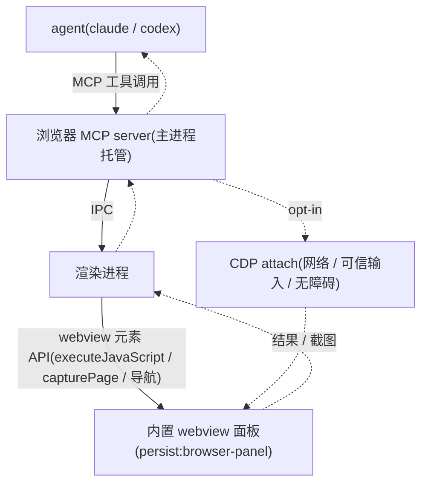

# 让 agent 控制内置浏览器(浏览器控制 MCP 工具)

## Summary

让 agent(v1:claude / codex)通过一组 cortex 第一方「浏览器控制 MCP 工具」,驱动用户正在查看的内置 `<webview>` 面板——导航、点击、填表、截图、读 DOM、抓控制台——服务本地开发自测。网络抓取与可信输入收在 opt-in 的「完整 CDP·风险升高」开关后。工具经新三层 IA 的 MCP 入口暴露并在启用时自动注入;pi 暂不支持(无 MCP 通道)。

---

## Problem Frame

cortex 已有内置浏览器面板(Electron `<webview>`)和多 agent(claude / codex / pi),但两者割裂:agent 看不到、也驱动不了面板。用户只能人肉搭桥——手动打开页面、点选、截图、把 URL 和控制台报错复述回会话。刚上线的截图 / 标注闭环是单向的(用户把页面反馈给 agent),反过来 agent 不能操作浏览器。

本地前端自测尤其痛:改完一个页面,要人工打开 localhost、点几下、截图、再贴回给 agent 核对。Codex 的「Browser」能力已经树立了「agent 能开并控制内置浏览器」的预期。

master 刚合入的新插件系统能跨 agent 注入插件的 `skills/`(prose 指令),但它**只读、不执行工具**,且明确把 codex-runtime 专属能力(Computer Use 等)划出产品身份、不做跨 agent 搬运。所以「浏览器控制」这类**工具**不会被插件系统自动提供,必须 cortex 自建并以工具形态暴露。

---

## Key Decisions

- KD1. 走 MCP 工具,不做「插件 / skill」。 浏览器控制是可执行动作(navigate / click / type / screenshot),不是 prose 指令。团队既定原则是「工具一律走 MCP(单一来源)」;新插件系统只读注入 skill、不执行工具。MCP 是当前唯一的跨 agent 工具通道,因此浏览器控制以 cortex 第一方 MCP 工具落地。

- KD2. agent 驱动同一个可见面板,不是隐藏的自动化上下文。 本地自测的价值在于「看它跑、随时接管」,并复用已上线的截图 / 标注闭环。代价是 agent 操作与用户手动操作存在焦点争用(接管 UX 见 Outstanding Questions)。

- KD3. 机制分层:轻量层默认开,CDP 收进 opt-in 开关。 高频的导航 / 点击 / 输入 / 截图 / 读 DOM / 控制台用 webview 现成原语(`executeJavaScript` / `capturePage` / `console-message`、合成事件)实现,低风险、起步快。网络观测、可信输入、无障碍树这类需要 Chrome DevTools Protocol 的能力,收在一个 opt-in 的「完整 CDP·风险升高」开关后——风险由用户自控,且与 Codex 的设置心智一致。

- KD4. 浏览器 MCP server 由主进程托管,经 IPC 桥接到渲染端 webview。 主进程够不到 webview 的 DOM,控制路径必然是:agent → MCP server(主进程) → IPC → 渲染进程 → `<webview>` 元素 API。master 上没有「主进程自起 + spawn 前自动注入一个内置 MCP server」的先例(`od` 只是指向外部进程的 UI 预设按钮),所以这个 server 是净新基建;但它向 claude `.mcp.json` / codex `-c` 的注入接线可直接复用,注入层零改。

- KD5. v1 覆盖 claude + codex,pi 延后。 pi 的 `mcpInjection` 为 `none`,吃不到 MCP server;pi 的浏览器控制需另走 pi 扩展形态,留作后续。

- KD6. cortex 第一方浏览器控制独立呈现,不依赖也不「激活」`~/.agents/plugins/` 里的 OpenAI「Browser」插件。 因目录与 codex 互通,该插件可能出现在 cortex 列表里,但它在 cortex 内工具是死的(只读注入 skill)。v1 把第一方浏览器控制作为独立能力呈现,避免让用户以为那个外部插件可用。

---

## Actors

- A1. Agent(claude / codex)—— 工具调用方,经 MCP 调浏览器工具完成自测。
- A2. 用户 —— 旁观者兼可接管方;掌控总开关、CDP 开关与非本地导航审批。
- A3. cortex 桌面端 —— 既是浏览器运行时(webview 面板),又是工具宿主(主进程 MCP server + IPC 桥)。

---

## Key Flows

- F1. 启用浏览器控制
  - **Trigger:** 用户在 MCP sub-tab 打开「允许 agent 控制内置浏览器」总开关。
  - **Steps:** cortex 记录启用态;下一轮会话装配时,把浏览器 MCP server 注入 claude / codex 的 MCP 配置;agent 会话中出现浏览器工具。
  - **Outcome:** agent 可调用浏览器工具;关闭开关则下一轮起不再注入。
  - **Covers:** R8, R9, R11.

- F2. 一次本地自测闭环
  - **Trigger:** 用户让 agent「打开 localhost:3000 核对结账页,顺手看有没有报错」。
  - **Steps:** agent 调 navigate(localhost) → 调 screenshot 回传 → 视觉核对 → 调 click / type 走一遍表单 → 调 read-console 看控制台。
  - **Outcome:** agent 不离开会话即完成自测,并把截图与发现回报。
  - **Covers:** R1, R2, R3, R4, R5, R15.

- F3. 开 CDP 抓网络
  - **Trigger:** 用户需要 agent 帮看某个请求,打开「完整 CDP·风险升高」开关。
  - **Steps:** cortex 把 CDP attach 到面板 guest;网络观测 / 可信输入 / 无障碍工具变为可用;agent 调网络观测工具列出请求。
  - **Outcome:** agent 可观测网络;关闭开关则 detach,工具回落到轻量层。
  - **Covers:** R6, R7, R13.

---

## Requirements

### 工具面 — 轻量层(默认开)

- R1. agent 可令面板导航到给定 URL,本地优先(localhost / 127.0.0.1 / `file://`);非本地 URL 见 R12。
- R2. agent 可截取当前页面,并把图像作为工具结果回传(复用 webview `capturePage`)。
- R3. agent 可对页面元素执行点击与文本输入 / 填表;轻量层用注入脚本派发合成事件(可信输入见 R7)。
- R4. agent 可读取页面 DOM / 可见文本 / 按选择器查询元素(复用标注系统已有的选择器拾取)。
- R5. agent 可读取页面控制台输出(`console-message` 事件;见假设 A1-assumption)。

### 工具面 — CDP 层(opt-in)

- R6. 开启「完整 CDP」后,agent 可观测网络请求(URL / 方法 / 状态 / 头 / 时序;响应体尽力而为)。
- R7. 开启「完整 CDP」后,点击 / 输入升级为可信输入事件,并可读取无障碍树。

### 暴露与注入

- R8. 浏览器控制工具由一个主进程托管的 MCP server 提供,其工具处理经 IPC 桥接到渲染端 webview 元素 API(主进程够不到 webview DOM)。
- R9. 启用浏览器控制后,该 server 自动注入到 claude(`.mcp.json`)与 codex(`-c mcp_servers`),复用现有 MCP 注入接线,无需用户手动添加 server。
- R10. 浏览器控制在三层 IA 的 MCP sub-tab 呈现(与 `od` 预设、pi 原生扩展同层),含启用状态与简要说明。

### 权限与安全

- R11. 提供总开关「允许 agent 控制内置浏览器」,默认关;关闭时不注入任何浏览器工具,行为与现状一致。
- R12. 导航到非本地 URL 需用户审批;本地(localhost / 127.0.0.1 / `file://`)免审批。
- R13. CDP 为独立 opt-in 开关,默认关,UI 标注「风险升高」;关闭时 R6 / R7 工具不可用。
- R14. 浏览器工具仅作用于 `persist:browser-panel` 分区的面板,不触及应用的其它 webContents。

### 呈现与覆盖

- R15. agent 驱动的是用户正在查看的同一面板;用户可旁观,并可随时接管手动操作。
- R16. v1 覆盖 claude 与 codex;pi 因无 MCP 通道暂不支持(见 Scope Boundaries)。

---

## Acceptance Examples

- AE1. **Covers R11.** **Given** 总开关关闭,**When** 新会话启动,**Then** claude / codex 的 MCP 配置不含浏览器 server,agent 无浏览器工具。
- AE2. **Covers R9, R11.** **Given** 总开关开启,**When** 下一轮会话启动,**Then** 浏览器 server 出现在 claude `.mcp.json` / codex `-c`,agent 可调用导航、截图等工具。
- AE3. **Covers R12.** **Given** agent 请求导航到 `https://example.com`(非本地),**When** 工具执行,**Then** 先向用户请求审批;通过才导航,拒绝则工具返回「被拒」。
- AE4. **Covers R12.** **Given** agent 请求导航到 `http://localhost:3000`,**When** 工具执行,**Then** 直接导航,无需审批。
- AE5. **Covers R6, R13.** **Given**「完整 CDP」开关关闭,**When** agent 调用网络观测工具,**Then** 该工具不可用,返回「需先开启 CDP」的提示。
- AE6. **Covers R15.** **Given** agent 正在面板操作,**When** 用户点击页面,**Then** 用户接管该面板(并发 / 锁定的具体 UX 见 Outstanding Questions)。

---

## Scope Boundaries

### Deferred for later(以后可能做,但不在 v1)

- pi 的浏览器控制(需 pi 扩展形态,非 MCP)。
- CDP 深度调试套件(响应体改写、性能 trace、heap 快照等)——超出本地自测需要。
- 把浏览器控制打包成 `~/.agents/plugins/` 第一方「Browser」插件(捆绑 mcp + skill,对标 Codex 终局形态)。
- per-site 细粒度权限(对标 Codex 设置页的站点专属权限);v1 用「总开关 + 非本地导航审批」的轻权限替代。

### Outside this product's identity(定位上明确不做)

- 通用外网自动化 / 登录 / 抓取:不同场景、权限模型更重;本特性的身份是「在你正看着的浏览器里做本地开发自测」。
- 让 OpenAI 的「Browser」插件在 cortex 内真正执行:cortex 提供第一方浏览器控制,不去复刻 / 激活外部插件的运行时期待。
- 把 cortex 改成 daemon,或引入 puppeteer / playwright 等外部自动化栈来驱动浏览器。

---

## Dependencies / Assumptions

- A1-assumption. webview `console-message` 事件可用于轻量层抓控制台报错。该事件是 Electron `<webview>` 标准事件,但本仓当前未使用——实现期需验证(若不可用,控制台读取回落到注入脚本包裹 `console`)。
- A2-assumption. 轻量层用注入脚本派发的合成 DOM 事件,对本地自测页面的点击 / 填表足够;需要可信输入的场景才升级到 CDP(R7)。
- A3-assumption. CDP attach 到面板 guest 的 webContents 在主进程可达(需在 webview 挂载时拿到 guest webContents)。本仓当前不碰 guest webContents,属净新接入,实现期验证其与 DevTools 的互斥处理。
- A4-dependency. 复用现有能力:webview 的 `executeJavaScript` / `capturePage`、`persist:browser-panel` 分区、MCP 注入接线(claude `.mcp.json` / codex `-c`)。

---

## Outstanding Questions

### Deferred to Planning(规划 / 实现期定)

- 浏览器 MCP server 的 transport:主进程起一个本地 stdio 子进程 server,还是在主进程内跑 127.0.0.1 的 http / sse server。两者都能复用现有注入接线。
- 启用注入的触发:总开关开启即自动注入(推荐,开关本身即 gate),还是仿 `od` 做一个 MCP 预设按钮。倾向自动注入。
- 轻量层 click / type 的合成事件是否够用,还是 v1 就接 CDP / `sendInputEvent` 做可信输入;倾向先合成、不够再升。
- 截图回传形态:作为 MCP image content 直接返回,还是存盘给路径让 agent 自读。
- 同一面板焦点争用的 UX:agent 操作时是否锁定用户输入,或提供显式「接管 / 交还」切换;v1 默认 agent 操作、用户旁观可接管。
- 非本地导航审批复用既有 agent 审批模式(`docs/plans/2026-06-20-001-feat-agent-permission-modes-plan.md`)还是浏览器专属审批。

---

## Sources / Research

- 浏览器实现(可复用原语):`packages/views/cortex-desktop/personal/BrowserView.tsx`(Electron `<webview>`、`executeJavaScript` 类型声明在 `:45`、partition `persist:browser-panel` 在 `:27`)、`packages/views/cortex-desktop/personal/useBrowserCapture.ts`(`capturePage` 在 `:24`)。
- 主进程浏览器 IPC 现状(仅三条,无控制通道):`apps/desktop/src/main/ipc/browser.ts`。
- agent 注入能力位(pi 无 MCP):`apps/desktop/src/main/agents/pi.ts:55-59`(`mcpInjection: "none"`)、`apps/desktop/src/main/agents/{claude,codex}.ts`、`apps/desktop/src/main/agents/index.ts`。
- MCP 注入与「内置 server」先例分析:`apps/desktop/src/main/ipc/mcp-config.ts`(`buildClaudeMcpJson` / `buildCodexMcpArgs`)、`packages/views/cortex-desktop/personal/McpSection.tsx:13-28`(`od` 预设是 UI 按钮、指向外部进程,非主进程自注册)。
- 新插件系统(只读、不执行工具):`apps/desktop/src/main/ipc/plugin-types.ts:13-29`、`apps/desktop/src/main/ipc/plugins.ts:12-15`、`packages/core/personal/skill-injection.ts`、`packages/views/cortex-desktop/personal/PluginManagePage.tsx:20`(四 sub-tab 插件 / MCP / 技能 / 市场);计划 `docs/plans/2026-06-22-002-feat-plugin-three-layer-ia-read-enable-plan.md`。
- 相关上下文:`docs/brainstorms/2026-06-21-agent-extension-surfaces-consolidation-requirements.md`(工具走 MCP 原则)、`docs/plans/2026-06-20-005-feat-embedded-browser-panel-plan.md`(webview 面板)、`docs/plans/2026-06-21-005-feat-browser-panel-annotate-screenshot-error-plan.md`(截图 / 标注 / 错误页)、`docs/plans/2026-06-20-001-feat-agent-permission-modes-plan.md`(审批模式)。
- 外部参考:Codex「Browser」插件(in-app 浏览器控制,capabilities = Interactive / Read / Write)与 Codex 浏览器设置(总开关 / 审批 / 站点权限 / 完整 CDP·风险升高)。
