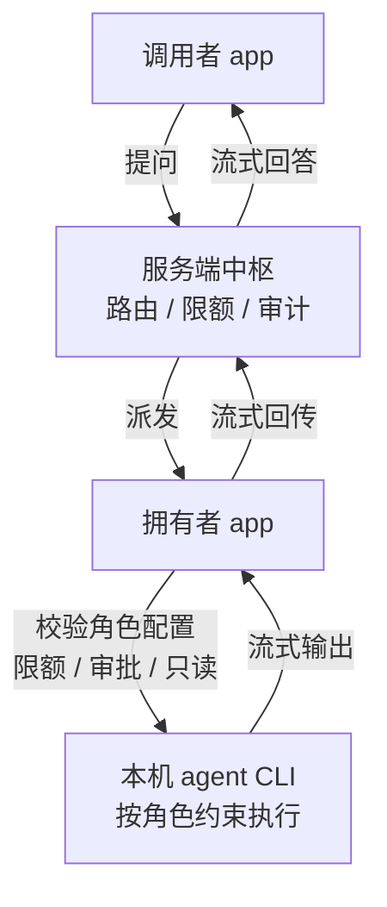

# 团队工作区:数字分身(共享角色)调用 — 需求文档

## Summary

把团队工作区从 mock 变成真实的「分身通讯录」:成员把个人工作区里的角色(如 codex)共享到团队,同事在通讯录里看到「真人 → 分身」层级并直接向分身提问;提问经服务端路由到拥有者电脑上执行,只读回答流式返回。首版兑现的核心价值:不打扰真人,就能拿到他环境里的项目资料和答案。

---

## Problem Frame

公司每位成员的电脑上都装有本应用,个人工作区已相对成熟:本地 agent(claude/codex/pi)、圆桌角色、可访问本机项目资料的 skill 配置。但这些能力锁死在个人电脑上——典型场景是项目经理的 agent 配好了 skill、能访问项目资料,团队其他成员需要这些资料时,只能去找真人沟通索要。

团队工作区一侧至今没有真实功能:通讯录、群组、组织全部走 mock 数据,近期全部工程投入都在个人侧,历史 plan 文档对团队侧只有「不触碰、零回归」的排除声明。团队协作的诉求真实存在,但载体缺位。

---

## Key Decisions

- **执行发生在拥有者的电脑上,而非云端。** 拥有者的桌面 app 是执行节点,用他本机的 agent CLI、账号和资料环境。换来零凭证托管和真实环境(配好的 skill、本地资料直接可用);代价是拥有者离线即分身不可用,因此在线状态是一等公民。
- **首版产品形态是「分身进通讯录」。** 复用现有团队侧 IM 骨架:通讯录列出真实成员,成员下挂共享分身,点开即对话。备选形态(分身目录视图、远程分身注入个人工作区圆桌)后置,但调用路由层的设计应使三种形态共用同一套。
- **真人只做兑底,不做人际 IM。** 任务和消息只面向分身;人与人沟通继续走微信等既有工具。分身搞不定时「转交真人」是二期能力,首版分身明确回复无法回答即可。
- **能力边界、审批策略、限额逐角色配置。** 拥有者在定义角色时逐个决定该分身能做什么、是否需要逐次审批、每日调用上限多少。角色的定义、共享开关与全部配置归属个人工作区;团队工作区只做发现与调用。
- **首版能力硬约束为只读。** 无论角色如何配置,首版分身只能读取授权资料并回答,不能写文件、不能执行危险命令。可读写能力留给后续版本按角色配置放开。
- **成本归属透明。** 调用消耗拥有者的 LLM 额度与电脑资源,首版通过「拥有者可设限额 + 调用记录可见」处理,不做计费或额度转移。
- **建团走「管理员建团 + 邀请码」。** 任意成员可创建团队成为管理员并生成邀请码,其他人凭码加入;不做后台名录同步。
- **首版仅桌面端。** 调用侧与拥有者侧都只在 Electron 桌面 app 实现,符合仓库当前 desktop 优先的阶段规范;Web 端调用界面后置。

---

## Actors

- A1. 调用者 — 团队成员,在团队工作区通讯录里发现并向分身提问。
- A2. 拥有者 — 分身背后的真人(主角色),在个人工作区定义、共享和管理角色,电脑是分身的执行节点。
- A3. 共享分身 — 拥有者定义的角色在其电脑上以受限配置运行的 agent 实例,团队侧以「拥有者 → 角色名」的身份出现。
- A4. 服务端中枢 — 在现有账号/组织基础上扩展,承担分身注册、在线状态、调用路由、流式回传、限额与审计。

---

## Requirements

**角色与共享**

- R1. 成员可在个人工作区将已有角色标记为「共享到团队」;共享后该角色成为团队可见的分身,取消共享后立即从团队侧消失。
- R2. 角色共享配置包含能力边界、审批策略与限额(每日调用次数/用量上限),均在角色定义处逐角色设置。
- R3. 数据模型按「主角色(真人)→ 多个共享角色」组织;首版界面允许只支持每人共享一个角色。

**团队通讯录与调用**

- R4. 团队工作区通讯录展示来自后端组织的真实成员,成员条目下挂其共享分身,层级形如「nesocks → codex」。
- R5. 分身的在线状态实时可见;拥有者 app 离线时分身明确展示为不可用,提问入口禁用。
- R6. 调用者可点开分身发起对话式提问,回答流式返回;会话按「调用者 × 分身」维度保存,可回看历史。
- R7. 真人条目在通讯录中可见但不可发消息,展示明确的降级提示(引导走既有沟通工具),避免呈现为残缺的 IM。

**执行与路由**

- R8. 提问经服务端路由到拥有者电脑,由其桌面 app 用本机 agent CLI 在角色配置约束下执行,结果流式回传给调用者。
- R9. 首版执行严格只读:分身只能读取该角色被授权的资料范围,拒绝写文件与危险命令。
- R10. 分身无法回答时,向调用者明确返回「无法回答」,不静默失败。

**控制与可见性**

- R11. 拥有者可在自己的 app 中查看分身的调用记录:谁、何时、问了什么、消耗多少。
- R12. 超出限额的调用被拒绝,调用者收到明确的超限提示。
- R13. 配置为逐次审批的角色,每次调用需拥有者确认后才执行;拒绝时调用失败并告知调用者。

**服务端**

- R14. 服务端在现有账号/组织基础上扩展:共享分身的注册/注销、在线状态维护、调用路由与流式回传通道、限额计数与调用审计。

**团队创建与加入**

- R15. 任意成员可创建团队并成为管理员,生成邀请码/链接;其他成员凭邀请码加入团队。

---

## Key Flows

- F1. 共享角色
  - **Trigger:** 拥有者在个人工作区为某个角色打开「共享到团队」。
  - **Actors:** A2, A4
  - **Steps:** 配置能力边界/审批策略/限额 → 服务端注册分身 → 团队通讯录中该成员条目下出现分身。
  - **Covers:** R1, R2, R4
- F2. 提问与回答
  - **Trigger:** 调用者在通讯录点开一个在线分身并提问。
  - **Actors:** A1, A2, A3, A4
  - **Steps:** 服务端校验限额并路由 → 拥有者 app 按角色配置校验(审批型角色等待确认)→ 本机 agent 只读执行 → 结果流式回传 → 会话保存,审计留痕。
  - **Covers:** R6, R8, R9, R11, R13
- F3. 拥有者离线
  - **Trigger:** 拥有者 app 关闭或断网。
  - **Steps:** 服务端将其全部分身标记离线 → 通讯录显示不可用,提问入口禁用;不提供排队或兜底。
  - **Covers:** R5

---

## Acceptance Examples

- AE1. **Covers R5.** Given 拥有者 app 未运行,When 调用者打开团队通讯录,Then 该成员的分身显示离线且无法发起提问。
- AE2. **Covers R9.** Given 调用者要求分身修改某个文件,Then 分身拒绝执行并说明自己只读的能力边界。
- AE3. **Covers R12.** Given 某分身当日限额已用尽,When 新调用到达,Then 调用被拒绝,调用者看到超限提示,拥有者的调用记录中留痕。
- AE4. **Covers R7.** Given 调用者点开通讯录中的真人条目,Then 没有消息输入框,只有降级提示。
- AE5. **Covers R10.** Given 提问超出分身可访问的资料范围,Then 分身明确回复无法回答,而非编造或静默超时。
- AE6. **Covers R13.** Given 角色配置为逐次审批,When 调用到达,Then 调用处于等待状态直至拥有者确认;拥有者拒绝后调用者收到失败原因。

---

## Success Criteria

- 核心场景闭环:同事向项目经理的分身提出项目资料类问题,在不打扰真人的前提下得到基于其本机资料的回答。
- 团队工作区的通讯录与分身会话不再依赖 mock 数据。

---

## Scope Boundaries

**Deferred for later(二期及以后)**

- 任务看板与任务派发:把任务指派给分身、异步执行、产出物回填(目标主干形态,首版砍掉)。
- 转交真人兑底:分身搞不定时升级为待办,送达拥有者的个人工作区。
- 可读写/可执行的分身能力(按角色配置放开)。
- 多角色管理界面与分身目录视图(方案 B 的补充视图)。
- 远程分身注入个人工作区圆桌(方案 C 方向;路由层预留)。
- 群组场景(群里 @ 分身)。
- Web 端(`apps/web`)的调用界面。

**Outside this product's identity(定位排除)**

- 人与人 IM:不重建聊天工具,人际沟通继续走微信等。
- 云端托管执行与离线兜底:与「零凭证托管、真实本机环境」的核心定位冲突。
- 跨组织/对外共享分身:仅限公司团队内部。

---

## Dependencies / Assumptions

- **前置依赖:** 服务端(独立仓库 `../server`)已有账号/组织基础,需按 R14 扩展;前后端需同步设计。
- **假设:** 公司内部互信环境,限额 + 审计足以约束滥用,首版不做更强的安全隔离。
- **假设:** 工作时段成员电脑普遍在线,「拥有者在线才可用」可接受。
- **假设(耐久性):** 价值建立在「资料与 agent 配置分散在个人电脑」的现状上;若公司资料全面迁入统一云端知识库,分身问答的价值会被削弱。
- **命名注意:** `DesktopBridge` 已有一组 `members*` 方法,属于个人工作区 IFocus 式项目管理的「成员/岗位标签」概念(`packages/core/desktop/bridge.ts:393-396`),与团队工作区的成员概念无关,新概念命名需与之区分。

---

## Outstanding Questions

**Deferred to Planning**

- 调用路由与流式回传的通道形态(长连接协议、断线重连语义)。
- 逐次审批的交互形态(弹窗、通知、超时策略)。
- 分身会话的存储位置(服务端集中 vs 调用者本地)。

---

## Sources / Research

以下代码事实经独立核验确认,是本文档判断的依据:

- 工作区双轨概念已存在:`packages/core/store/ui.ts:13` 的 `WorkspaceKind = "team" | "personal"`。
- 「角色」抽象已存在:个人工作区圆桌的 `RoleConfig`(label + 绑定 agent + persona prompt,`packages/core/desktop/types.ts:15-24`),`DesktopBridge` 已有角色 CRUD(`packages/core/desktop/bridge.ts:166-170`,持久化 `roles.json`)——R1/R2 的共享开关与配置可建立在其上。
- 后端共享 agent 雏形:`packages/core/api/types.ts` 中 `Agent.visibility: "workspace" | "private"` 与 `owner_id`;`IssueAssigneeType` 已含 `"member" | "agent" | "squad"` 三态。
- 团队侧现状全 mock:`packages/core/cortex/queries.ts:6` 的 organizations/contacts/conversations 全部 import 自 `packages/core/mock/api`;`packages/core/api/client.ts` 现有真实端点仅覆盖 issues/agents/dashboard,无 team/org/member/conversation 端点。
- 执行节点基础设施已备:`apps/desktop/src/main/agents/` 有 claude/codex/pi 三个适配器,`agent-profiles.ts` 支持用户派生 agent profile——R8 的本机执行可直接复用。
- 历史文档无团队侧规划:`docs/plans/` 70+ 份 plan 全部为个人工作区主题,团队侧仅作为「零回归」排除项出现。
