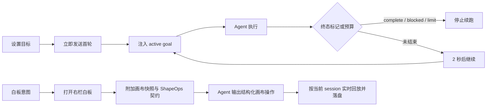

# 会话目标与白板

## 业务背景

个人会话同时支持两类跨消息协作：目标模式让 Agent 持续推进一个长期目标；白板让用户与 Agent 在同一会话里共同维护架构图、流程图和草图。两者均以会话为边界，切换会话不会串状态。

## 核心规则

- `SessionMeta.goal` 是目标唯一持久态，字段与 Kun `ThreadGoal` 对齐。
- 创建或替换目标会立即发起首轮；恢复一个空闲目标会立即继续。
- 只有 `active` 目标进入 Agent system prompt。暂停、清除、完成、阻塞或达到预算后都不会自动续跑。
- 每轮结束解析隐藏的 goal 终态标记，并累计耗时与 token。未结束时延迟 2 秒继续，最多自动续跑 5 轮，防止失控循环。
- 白板文档按 `sessionId` 存放在 `<workspace>/.cortex-canvas/code-<sessionId>/canvas.json`（旧目录 `.kun-canvas` 只在读取时兜底）；画布 UI 与选择复用 Design canvas 内核，文件读写显式注入 Cortex `DesktopBridge`，不调用宿主全局端口。
- 白板打开时的编辑指令，以及明确的架构图、流程图、依赖图等意图，会附加当前画布快照和 ShapeOps 契约，并自动打开右栏白板。个人会话没有注册 Design 工作台的 `design_*` 专用工具，因此 Agent 必须在原始消息中输出 fenced `design_canvas` 块，由渲染端流式回放；聊天 Markdown 层会隐藏该内部协议块，只展示用户可读正文，不得提示 Agent 调用不存在的工具。
- `PersonalWhiteboardPanel` 只回放当前 run、当前 session 的完整 `design_canvas`/`shapeops` block；`documentKey` 防止跨会话画布污染。

## 流程

## 关键实现

- 目标领域：`packages/core/personal/goal.ts`
- 目标持久态：`packages/core/desktop/types.ts`、`packages/core/store/personal.ts`
- 目标发送与续跑：`packages/core/personal/messages.ts`、`PersonalChatArea.tsx`
- 目标 UI：`ComposerShell.tsx`
- 白板入口与容器：`PersonalRightRail.tsx`、`PersonalRightPanel.tsx`
- 白板会话桥：`PersonalWhiteboardPanel.tsx`、`personal/whiteboard/file-port.ts`
- 白板路由与上下文：`packages/core/design/canvas/code-canvas*.ts`、`design-turn-prompt/html-and-canvas.ts`

## 边界与失败恢复

- 白板需要有效 workspace；无项目会话使用创建时固定的 `noProjectDir`，旧会话缺失该字段时通过 `ensureNoProjectDir` 补建并回写。
- 会话白板不调用 `cortexGuiPort`。当前 Cortex 桥没有白板图片选择契约，因此代码画布隐藏本地图片上传入口；已有图片形状仍可通过 `imageReadAny` 读取和显示。
- 画布操作解析失败会写入 session-scoped feedback，下一轮上下文带回给 Agent 自纠。
- 自动续跑 timer 触发前会重新读取目标与运行态；期间暂停、清除或手动启动新一轮都会取消该次续跑。
- 应用退出或组件卸载时清理待执行 timer，不留下孤儿任务。
