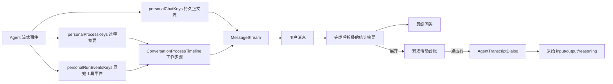

# 会话过程时间线

## 背景

个人会话的 reasoning 与工具调用原本只进入瞬态过程缓存，再由中栏右侧入口打开详情弹层。用户在消息流里只能看到一条 typing 摘要，问题、执行过程与最终回答之间缺少直接的阅读关系。

当前交互采用轻量活动台账：最新一轮的思考和工具调用放在用户消息与 Agent 回答之间。运行中自动展开台账，完成后折叠为耗时、读取文件数、命令数和其他工具数；聊天流不再内联终端、input JSON、完整 output 或 reasoning 正文。

## 领域概念与规则

- **持久消息流**：`personalChatKeys.detail(sessionId)`，只保存用户/Agent 正文及允许回看的业务卡片。
- **瞬态过程流**：`personalProcessKeys.detail(sessionId)`，保存本轮 `reasoning`、`agentLog` 和 `stageTitle`，永不落盘。
- **活动台账**：`buildProcessPresentation()` 将本轮 reasoning、工具调用和阶段标题投影为可扫描的 Activity Row；原始事件只用来补全调用身份和详情。
- **分类统计**：读取文件按成功路径去重；命令与其他工具分开统计。`tool_search` 不进聊天流，`todo_write` 只保留最近一次状态；失败读取不与成功读取合并。
- **展示顺序**：渲染层把过程段插到最新用户消息之后，不改变两个 query cache 的数据结构。
- **折叠语义**：运行开始时自动展开活动台账，结束时自动折叠整段；整轮状态以 `runningBySession` 为准，单条 reasoning/tool 的 `active` 只作无 session 场景的回退，避免步骤切相时反复收起和展开。点击活动行请求 `ProcessPanelTarget`，完整过程面板按 `runId + toolCallId + initialTab` 聚焦；目标已裁剪时安全退回 overview。
- **事件边界**：`personalRunEventsKeys` 跨轮累积，内联过程只读取最新 `runId`，且只为已存在的过程摘要补充 input/output，不主动添加列表项；这样两条独立节流流到达顺序不同时不会重建同一工具行。完整跨轮筛选和统计继续复用 `AgentTranscriptDialog`。
- **滚动边界**：过程流贴底签名只包含消息数、步骤数和运行态；reasoning 逐 token 更新由实际尺寸观察处理，不重复触发同步 `scrollTop`。

## 业务流程

## 关键实现

- `packages/views/cortex-desktop/personal/chat/processTimeline.ts`：`buildProcessPresentation()` 负责路径相对化、read 聚合、状态与稳定 key；这是唯一的聊天流展示投影层。
- `packages/views/cortex-desktop/personal/chat/ConversationProcessTimeline.tsx`：渲染紧凑台账和完成态折叠，点击活动行只请求完整过程面板。
- `packages/views/cortex-desktop/ChatArea.tsx`：在不污染持久消息的前提下合成展示序列，并去重 typing 活动行。
- `packages/views/cortex-desktop/personal/chat/PersonalChatArea.tsx`：订阅当前会话过程流，并把过程变化纳入自动贴底签名。
- `packages/core/store/personal.ts`：`ProcessPanelTarget` 是不持久化的精确详情请求。
- `packages/views/cortex-desktop/personal/chat/PersonalProcessPanel.tsx`：消费聚焦请求并作为完整运行详情弹层宿主，不再渲染第二个独立状态入口。
- `packages/views/cortex-desktop/personal/chat/AgentTranscriptDialog.tsx`：实时 ring 已裁剪指定 `runId` 时，从持久过程归档重建最小只读工具事件，保留同一详情入口。

## 限制

过程流的实时事件仍是内存态，但轮末过程归档继续保留已有的受限 input/output 快照。归档没有对应实时事件时，活动行仍可展示；若精确定位目标已被裁剪，详情面板退回 overview，不制造错误。

## Pi 上下文 checkpoint

gateway 会话的原始上下文在工具批次结束后超过 `contextWindow - reserveTokens` 时，本地 Pi fork 以
`agent_end.reason="context-checkpoint"` 结束当前内部 loop。renderer 收到 `willRetry=true` 后保留同一
用户 run；AgentSession 自动 compaction 成功便 `continue()`，失败则回传明确错误并结束该 run。oneshot
没有长驻历史，不启用这条路径。模型最终以 `length` 截断且未自动恢复时，持久化提示行提供“继续生成”
按钮，它以同一 Pi JSONL 会话发送明确的续写请求，不会把提示文本本身重复喂给模型。
