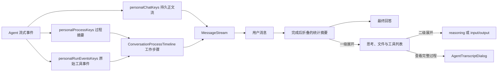

# 会话过程时间线

## 背景

个人会话的 reasoning 与工具调用原本只进入瞬态过程缓存，再由中栏右侧入口打开详情弹层。用户在消息流里只能看到一条 typing 摘要，问题、执行过程与最终回答之间缺少直接的阅读关系。

当前交互对齐 Kun：最新一轮的思考和工具调用在消息流中归组为“工作过程”，放在最新用户消息与 Agent 回答之间。运行中自动展开调用列表，轮次结束后自动折叠为总步数、读取文件数和其他工具调用数；每个思考或工具项再独立展开详情。

## 领域概念与规则

- **持久消息流**：`personalChatKeys.detail(sessionId)`，只保存用户/Agent 正文及允许回看的业务卡片。
- **瞬态过程流**：`personalProcessKeys.detail(sessionId)`，保存本轮 `reasoning`、`agentLog` 和 `stageTitle`，永不落盘。
- **工作过程**：`ConversationProcessTimeline` 把本轮 reasoning、工具调用和阶段标题组成有序步骤，并把当前轮原始 tool start/end 配成一次调用。
- **分类统计**：总步数是 reasoning 与工具调用项之和；读取文件按已识别路径去重，缺路径的读取各算一次；“调用工具”统计非读取类调用。
- **展示顺序**：渲染层把过程段插到最新用户消息之后，不改变两个 query cache 的数据结构。
- **折叠语义**：运行开始时自动展开一级列表，结束时自动折叠整段；整轮状态以 `runningBySession` 为准，单条 reasoning/tool 的 `active` 只作无 session 场景的回退，避免步骤切相时反复收起和展开。一级展开只显示项目，点击单项后才显示 reasoning 或 input/output。
- **事件边界**：`personalRunEventsKeys` 跨轮累积，内联过程只读取最新 `runId`，且只为已存在的过程摘要补充 input/output，不主动添加列表项；这样两条独立节流流到达顺序不同时不会重建同一工具行。完整跨轮筛选和统计继续复用 `AgentTranscriptDialog`。
- **滚动边界**：过程流贴底签名只包含消息数、步骤数和运行态；reasoning 逐 token 更新由实际尺寸观察处理，不重复触发同步 `scrollTop`。

## 业务流程

## 关键实现

- `packages/views/cortex-desktop/personal/chat/ConversationProcessTimeline.tsx`：当前轮事件配对、分类统计、完成态折叠与逐项详情。
- `packages/views/cortex-desktop/ChatArea.tsx`：在不污染持久消息的前提下合成展示序列，并去重 typing 活动行。
- `packages/views/cortex-desktop/personal/chat/PersonalChatArea.tsx`：订阅当前会话过程流，并把过程变化纳入自动贴底签名。
- `packages/views/cortex-desktop/personal/chat/PersonalProcessPanel.tsx`：作为完整运行详情弹层宿主，不再渲染第二个独立状态入口。

## 限制

过程流仍是内存态：应用重启或下一轮开始后不会作为历史内容恢复。这与现有隐私和存储边界一致；若未来需要跨重启回顾，必须先单独定义 reasoning/tool 的持久化、脱敏和容量策略。
