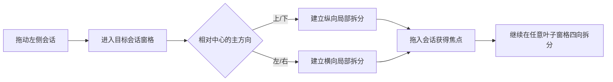

# 会话拆分窗格

## 业务背景

个人工作区需要同时观察或操作多条 Agent 会话，例如一边等待长任务、一边继续其它工作。拆分入口保持轻量：直接把左侧会话拖到目标会话窗格的上、下、左、右，不增加常驻菜单或独立模式。

## 领域概念与核心规则

- **活动会话**：当前获得焦点的窗格。顶部会话头、执行过程区和既有右侧工具面板都跟随它。
- **拆分窗格**：数量不设上限；每个窗格各自保留消息滚动、输入框和运行状态。布局超出可视区时支持横向或纵向滚动，保证每个窗格仍可操作。
- **四向 drop target**：只接受 `application/x-cortex-session-id`。指针相对目标窗格中心所在的主方向决定上、下、左、右，外部文件或普通文本拖放不会触发拆分。
- 拖入单窗格时，以当前会话为目标建立首个拆分；已有拆分时，可在任意叶子窗格旁继续局部拆分。已打开的会话只获得焦点，不重复添加。
- 点击任一窗格会激活它；随后在侧栏点击其它会话，只替换活动窗格。
- 关闭任一窗格后，剩余会话回到单窗格。删除会话或项目时，失效窗格也会自动收回。
- 拆分布局是 renderer 窗口内的瞬态 UI，不持久化；会话消息和 Agent 运行仍沿用既有按 `sessionId` 隔离的存储与执行链。

## 业务流程

## 关键实现

- `conversation-layout.ts` 用不可变二叉树描述横向/纵向分支，负责插入、替换、删除和失效会话清理；删除叶子后会自动折叠单子节点分支。
- `ConversationSplitView.tsx` 持有瞬态拆分树和最后聚焦窗格，并协调四向命中提示与全局 `activeSessionId`。
- `PersonalChatArea.tsx` 支持显式 `sessionId`，使多个实例能独立读取消息和发送；自动打开浏览器等全局副作用只允许活动窗格触发。
- `PersonalComposer.tsx` 只允许活动窗格消费全局 `composerInsert` 并镜像 skill，防止“发送到 Chat”或场景入口同时写入多个输入框。
- `PersonalSidebar.tsx` 的会话行只写入 session id；drop 时再次从 store 验证 id 存在，避免信任拖放 payload 中的派生数据。
