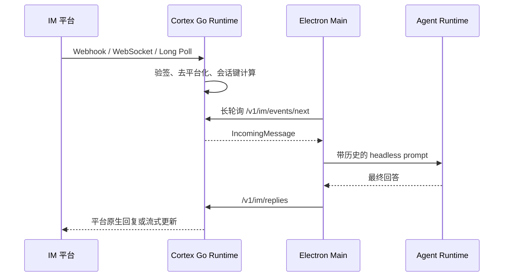

# IM 渠道与 Cortex Go Runtime

## 业务背景

Cortex 需要在用户不打开聊天窗口时继续接收企业微信、飞书等平台消息，并把消息交给个人或团队工作区 Agent。平台连接和协议解析由随 Desktop 安装的本地 Go Runtime 承载；原有独立 `../server` 不参与该能力。

## 领域概念

- **Runtime**：Desktop 管理生命周期的本地 Go 进程，仅监听随机 `127.0.0.1` 端口。
- **Channel**：一个平台机器人连接，包含平台、连接模式、输出模式、会话策略和工作区目标。
- **Workspace target**：`personal` 或 `team`，可附带 workspace、project 和 agent 标识。
- **IM session**：按 `channel + user/chat/thread` 映射的连续对话历史。
- **Adapter**：屏蔽各平台验签、消息格式、连接和回复差异的内部实现。

## 核心规则

1. Runtime 不持久化凭据；Electron 使用 `safeStorage` 加密后写入 `userData/im-channels.json`，启动时解密并热同步。
2. renderer 只能读取 `hasCredentials`，永远拿不到明文或密文。
3. 渠道配置整批原子替换；任一 adapter 校验或启动失败时保留旧代连接。
4. Runtime 控制接口必须携带每次启动随机生成的 256 位 Bearer token。
5. Webhook 回调由平台 adapter 自行验签。Runtime 仅监听 loopback，需要 Webhook 时由用户配置可信隧道或反向代理。
6. 入站队列有界；会话历史最多保留最近 20 轮，避免上下文无限增长。
7. Desktop 退出会先停止事件泵和所有 adapter，再优雅关闭 Runtime；超时后强制回收。

## 业务流程

## 平台

Runtime 对齐 WeKnora 的企业微信、飞书、Lark、Slack、Telegram、钉钉、Mattermost、微信、QQ Bot 与云之家 adapter。平台支持的连接模式和必填凭据由 `/v1/im/platforms` 返回，设置页按该契约生成表单。

## 关键实现

- `apps/desktop/runtime/internal/im/`：统一 interface、Supervisor、平台 adapter 与原子 Manager。
- `apps/desktop/scripts/prepare-cortex-runtime.mjs`：按 Electron 目标交叉编译无 CGO 二进制。
- `apps/desktop/src/main/cortex-runtime.ts`：定位、启动、ready frame、健康状态和退出回收。
- `apps/desktop/src/main/ipc/im-channels.ts`：凭据加密、CRUD 和 Runtime 配置同步。
- `apps/desktop/src/main/im-runtime-pump.ts`：会话历史、Agent 执行和回复回送。
