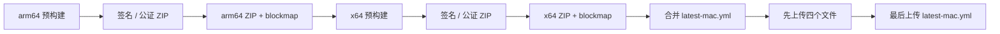

# macOS 发布与自动更新

## 背景

Cortex Desktop 使用 `electron-updater` 的 `MacUpdater`（Squirrel.Mac）完成自动更新。该运行时会从
`latest-mac.yml` 的 `files[]` 中选择 ZIP；缺少 ZIP 时会以
`ERR_UPDATER_ZIP_FILE_NOT_FOUND` 拒绝更新。DMG 只提供人工拖拽安装，不参与当前自动更新链。

因此正式 GitHub Release 采用 ZIP-only 合同，不再构建或上传 DMG。保留 `dist:dmg` 仅供开发者
明确需要人工安装镜像时本地使用，它不属于正式发布入口。

## 发布资产合同

每个 macOS Release 必须且只应包含以下五个资产：

- `Cortex-<version>-arm64.zip`
- `Cortex-<version>-arm64.zip.blockmap`
- `Cortex-<version>-x64.zip`
- `Cortex-<version>-x64.zip.blockmap`
- `latest-mac.yml`

`latest-mac.yml` 的 `files[]` 必须恰好覆盖 arm64 与 x64 ZIP，不得出现 DMG 或单架构清单；顶层
`path` / `sha512` 继续指向 arm64 ZIP，兼容仍读取旧顶层字段的客户端。blockmap 用于差分下载，
不能因为 ZIP 本体存在就省略。

## 发布流程



两架构仍按现有断点续跑状态机串行构建。`latest-mac.yml` 必须最后上传：清单一旦公开，客户端
就会认为该版本可用；若 ZIP 尚未完整上传，抢先更新会直接得到 404。

本地发布入口：

```bash
pnpm release:ui
# 或
bash scripts/local-release-mac.sh
```

## 验收与失败语义

- 签名、公证与 staple 验证针对 ZIP 内的 `.app`，不再验证 DMG 容器。
- `merge-mac-update-manifest.mjs --verify` 同时检查双架构与 ZIP-only。
- 上传完成必须逐项核对资产名称、字节大小和 GitHub `state=uploaded`。
- 任何 `starter` 资产、大小不一致、缺 blockmap、清单含 DMG 或只含单架构都视为发布失败。

实现依据：electron-builder 官方的 [Auto Update](https://www.electron.build/docs/features/auto-update/)
说明 macOS Squirrel 更新要求 ZIP；`MacUpdater` 源码也固定查找 ZIP 并以 ZIP 启动下载。
