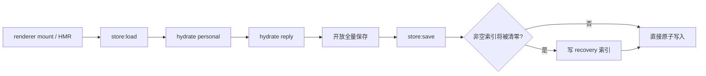

# 个人工作区持久化与恢复

## 背景

个人工作区的项目和会话元数据保存在 `~/.cortex-desktop/personal-workspace.json`，消息正文按会话拆分在 `chats/<sessionId>.json`。renderer 通过 `usePersonalPersistence` hydrate Zustand 状态，并将多个持久化分片合并为同一份全量快照交给 Electron main 原子写入。

全量快照的关键风险是生命周期不同步：HMR 或 renderer 重载时，某个辅助 store 可能已经 hydrate，而 personal store 仍是空初始态。辅助分片若在此期间触发保存，就会把空的 `projects/sessions` 一并覆盖到权威文件。

## 核心规则

- `loadState()` 完成且 personal、reply 两个分片都 hydrate 之前，任何 store 变化都不得触发全量保存。
- hydrate 自身只是装填权威快照，不是用户变更，不需要原样回写。
- side 子会话不得进入普通会话列表。兼容恢复会以 UUID 聊天内 `subagent-task-<callId>` 的内部消息 UID 识别误分类记录；只有父会话时间窗候选唯一时才补父级导航，不能仅凭 UUID 猜测。
- main 在写入会清空非空项目或会话数组的快照前，生成只含 `projects/sessions` 的 `personal-workspace.recovery.json`；不得把 Provider、Reply 或其它设置密钥复制进恢复点。
- 正常删除会话必须同步删除对应 chat 文件。恢复时仅把仍有非空 chat 正文的近期孤立索引视为可恢复会话。

## 数据流



## 事故恢复

恢复脚本默认只预演，不修改用户数据：

```bash
node apps/desktop/scripts/recover-personal-workspace.mjs
```

确认汇总后执行：

```bash
node apps/desktop/scripts/recover-personal-workspace.mjs --apply
```

执行时会先把当前权威文件原样复制到 `~/.cortex-desktop/recovery-backups/`，然后保留当前所有设置，只替换项目与会话索引。恢复来源为旧 `.bak` 元数据和备份时间之后仍有非空 chat 文件的会话；早于备份但不在备份索引中的孤儿、空聊天壳不会自动复活。恢复脚本与 renderer hydrate 使用同一识别口径，确保子代理聊天重建为 `side`，不会出现在左侧普通会话列表。

## 关键实现

- `packages/core/desktop/usePersonalPersistence.ts`：renderer hydrate 完成门控与合并保存。
- `apps/desktop/src/main/ipc/store.ts`：权威快照原子写入和破坏性写入前恢复点。
- `apps/desktop/scripts/recover-personal-workspace.mjs`：只恢复索引、不覆盖当前设置的事故恢复工具。
- `packages/core/desktop/usePersonalPersistence.race.test.tsx`：HMR 生命周期错位回归测试。
