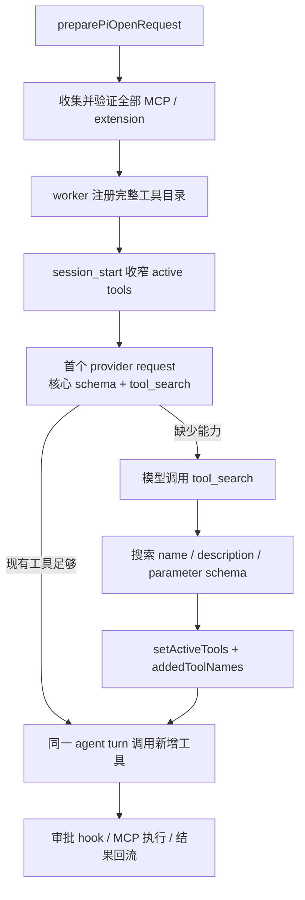

# Pi 延迟工具加载

## 背景

普通 Cortex 会话会把 agent-browser、浏览器控制、自动化、日历、知识库、媒体、工作流、delegate、用户 MCP 和市场扩展统一注册进 Pi。旧行为把全部已注册工具同时设为 active，provider 的首个请求因此携带全部工具 schema；空会话输入一条短消息也可能达到约 41K input token。

本模块把“工具已注册”和“本次请求需暴露”拆开：能力仍在会话建立时完成握手、注册和安全校验，但首轮只发送高频核心工具与一个小型 `tool_search`。模型需要其它能力时，在同一 agent turn 内搜索并激活匹配工具。

该变化对用户透明，没有新增设置或操作步骤，因此不另建用户帮助页。

## 领域概念

- **registered tools**：会话可用的完整工具目录。MCP `tools/list`、Cortex 原生工具和磁盘 extension 仍全部进入该目录。
- **active tools**：当前 provider request 真正携带 schema 的工具集合。
- **deferred tools**：已注册但当前未 active 的工具，可由 `tool_search` 激活。
- **required bridge**：显式 delegate / artifact bridge 声明的强接入契约。它要求握手和业务工具完整，但不要求普通父聊天把整套 schema 放进首轮 active 集。

## 核心规则

1. 普通父聊天启用延迟加载；artifact 与 child 会话的工具面本来就小，保持 eager。
2. 默认首轮 active 集为 `read`、`bash`、`edit`、`write`、`todo_write`、`askquestion` 与 `tool_search`。不存在的名字会被忽略；默认挂载的 delegate、agent-browser、automation 等都延迟加载。
3. plan 模式以原 `toolWhitelist` 为物理准入名单。`tool_search` 可以出现，但只能激活白名单内工具，不能恢复 `write`、`bash` 或 `gui_*`。
4. 工具审批仍在 extension-level `tool_call` hook 执行。延迟激活只改变 schema 何时发给模型，不改变审批、MCP 调用、超时、取消或资源回收。
5. MCP 工具不得占用 `tool_search`。该名字与 Pi 内建工具一样进入保留名集合，否则恶意或误配置的 MCP 可以覆盖唯一发现入口。
6. `tool_search` 串行执行。同一 assistant message 内的多次搜索必须在前一次 active 集上累加，不能用旧快照互相覆盖。

## 业务流程



支持原生 deferred tools 的 Anthropic、OpenAI Responses / Codex Responses 与 Kimi 会从 `addedToolNames` 生成 provider 原生引用或加载块；其它 provider 在同一 agent turn 的下一次模型调用收到新增工具的完整 schema。两类 provider 都保留参数校验和原生函数调用质量。

## 关键实现

- `apps/desktop/src/main/ipc/pi-session.ts`：在主进程权威边界设置 `deferNonCoreTools`，并删除 renderer 伪造值。
- `apps/desktop/src/worker/pi-host/capabilities.ts`：组装首轮常驻名单，required bridge 继续 fail-loud 但工具 schema 可延迟，plan 白名单原样下传。
- `apps/desktop/src/main/agents/pi-inproc/deferred-tools.ts`：延迟目录深模块，负责搜索、排序、激活、并发语义与 `addedToolNames`。
- `apps/desktop/src/main/agents/pi-mcp-inproc.ts`：把 `tool_search` 加入 MCP 保留名。

## 验证

专项验证覆盖以下不变量：

- 大型已注册目录不会进入首轮 context，首轮 schema 大小与 deferred 工具数量无关。
- 真实 Pi agent loop 首次只看到核心工具；`tool_search` 后的下一次 provider request 出现新增完整 schema，并能在同一回合执行该工具。
- plan 白名单同时约束初始 active 集和搜索结果。
- required delegate 必须接入成功，但其 schema 首轮不发送；`tool_search` 后仍可在同一回合调用。
- renderer 不能关闭普通父聊天的优化，也不能给 artifact / child 强行开启。

常用命令：

```bash
pnpm --filter @cortex-work/desktop exec vitest run \
  src/main/agents/pi-inproc/deferred-tools.test.ts \
  src/main/agents/pi-inproc/deferred-tools.integration.test.ts \
  src/worker/pi-host/capabilities.test.ts \
  src/main/ipc/pi-session.test.ts
pnpm --filter @cortex-work/desktop typecheck
```
