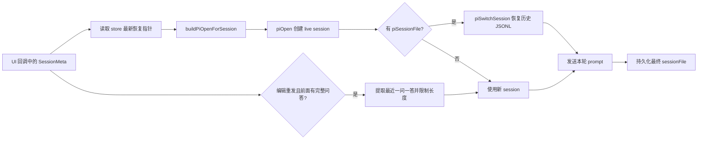

# Pi 历史会话续接

## 背景

个人会话同时保存两套数据：聊天区的 `Message[]` 用于展示，Pi 的 JSONL session 用于模型原生
上下文。重新打开历史会话时，界面能看到旧消息不代表模型已经恢复；真正的续接依据是
`SessionMeta.piSessionFile`，由 `ensurePiSession()` 在新进程建立后调用 `switchSession()`。

## 核心规则

1. 普通发送优先使用 Pi JSONL 原生恢复，避免截断、重复和角色漂移；编辑重发是有意的例外，
   只带入编辑点之前最近一个完整问答，避免完整历史和工具轨迹触发本地模型 prefill 内存上限。
2. `piSessionFile` 与 `artifactSessionIds` 会被预热、恢复、fork 等异步流程更新。React 回调传入的
   `SessionMeta` 可能已经过期；预热和正式发送在 open 前必须从 `usePersonalStore` 重读这两个指针。
3. Agent、模型、Provider、权限等本轮配置仍使用调用方快照。只合并恢复指针，不能让一次已经开始的
   发送在中途改变执行配置。
4. 有历史指针时先 `piOpen` 建 live session，再 `piSwitchSession(history.jsonl)`；恢复成功后继续沿用
   历史路径，不能把 `piOpen` 产生的新空文件写回 `SessionMeta`。
5. 首轮真正没有历史指针时才持久化新文件。预热失败保持静默，正式发送仍按原错误路径向用户报告。
6. 历史会话的“编辑重发”不是普通发送：从 UI 截断结果中只提取最近一个完成的
   `用户问题 + Agent 回答`，分别限制为 2,000 / 8,000 字符；长回答保留头尾。随后关闭旧 Pi
   句柄、清除原生指针，以 fresh session 发送 `最近问答 + 当前修改内容`，不再恢复整段 JSONL。

## 流程

## 关键实现与验证

- `packages/core/personal/messages.ts`：`withLatestPiResumePointers()` 只把 store 中最新的恢复指针合并到本轮快照；
  `prewarmPiSession()` 与 `sendPiTurn()` 共用该规则。
- `packages/core/personal/pi-session.ts`：`ensurePiSession()` 负责 open、switch、getState 校准和 live handle。
- `packages/core/personal/messages.test.ts`：模拟调用方持有旧对象、store 已有历史路径的真实竞态；预热和
  正式发送都必须调用 `piSwitchSession(history.jsonl)`，且不得被 fresh JSONL 覆盖；同时验证最近问答
  提取会忽略更早历史与尾部未回答消息。
- `packages/views/cortex-desktop/personal/chat/PersonalChatArea.test.tsx`：覆盖冷历史会话的编辑重发，
  断言不调用 `switchSession/getForkMessages/fork`，新 prompt 只含最近一个完整问答和修改后正文。
