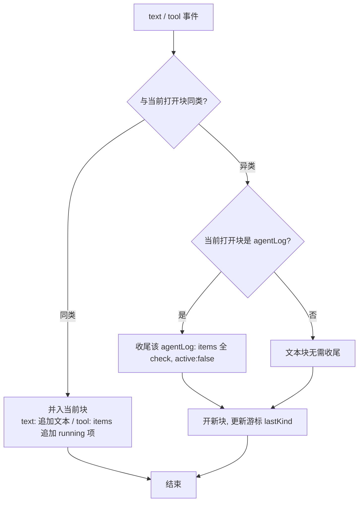

# fix: 流式消息按到达顺序交替分块

## Summary

个人工作区会话里，agent（claude / codex）的流式回复当前**永远只渲染成两块且顺序写死**：一个合并了全部文本增量的 text 块在前，一个合并了全部工具调用的 agentLog 块在后。无论真实时序如何「文本→工具→文本→工具」交错，UI 都先把文本在原位不断 append、再把工具堆在后面，交互观感错乱。

根因在前端聚合逻辑 `packages/core/personal/messages.ts` 的 `handleCliEvent`：每个 run 只维护**一对单例句柄** `textUid` / `logUid`，文本增量永远原地改同一个 text 块、工具永远塞进同一个 agentLog，到达顺序被丢弃。`CliStreamEvent`（`init/text/tool/result`，无 id/序号/时间戳）本身只靠到达顺序携带时序，而聚合层把这唯一的时序信号丢了。

本计划把聚合改成**按到达顺序的尾部折叠（tail-fold）**：抽出一个纯函数对 `Message[]` 缓存的尾块做「同类则并入、异类则开新块」的折叠（语义对齐参考实现 open-design 的 `buildBlocks`），让 text 块与 agentLog 块按时间交替成多个独立块，同时保留「连续工具合并进同一张 agentLog 卡片」的既有分组行为。改动收敛在 `messages.ts` 聚合层 + 单测，**不改 CLI 协议、不改主进程解析、不改 `CliStreamEvent` 类型、不改渲染层、不迁移已落盘消息**。

---

## Problem Frame

- **现象**：流式回复中文本与工具不按时间交替；文本一直在原位 append，工具调用整体堆在文本之后。
- **影响面**：所有经 `handleCliEvent` 聚合的个人工作区会话（claude / codex / pi）。
- **根因（代码证据）**：
  - `packages/core/personal/messages.ts:90-108` — `RunState` 持有单例 `textUid?` / `logUid?` / 全轮 `buffer`。
  - `packages/core/personal/messages.ts:309-322` — text 事件：首个增量建一个 text 块 append 到数组末尾（位置就此固定），其后所有增量命中 `else` 分支原地改这同一个块，永不新建第二个 text 块。
  - `packages/core/personal/messages.ts:276-307` — tool 事件：首个工具建一个 agentLog 块 append，其后所有工具塞进同一个 `items[]`，永不新建。
  - 因 text 块先于 agentLog 块被创建，agentLog 永远排在 text 之后，最终数组恒为「[合并文本][合并工具]」两块。
  - `packages/views/cortex-desktop/ChatArea.tsx:418-439` — 渲染层只按数组顺序 `map` + `switch(kind)`，无任何重排逻辑；render 顺序 == 聚合写入顺序，故渲染层无辜。
- **参考实现**：`/Users/mike/source/ai/open-design` 用「单一扁平事件流按到达顺序追加 + 渲染前 `buildBlocks` 只与紧邻上一块同类合并、否则开新块」实现正确交替。本计划在本仓的等价落地是：直接对持久化的 `Message[]` 缓存尾部折叠（`Message[]` 已能用 append 顺序表达有序交错块，无需引入独立 events 存储）。

---

## Requirements

- **R1** 流式聚合必须保留 text / tool 事件的到达顺序：交错时序产出按时间交替的多个独立块。
- **R2** 连续的工具事件（中间无文本）仍合并进**同一张** agentLog 卡片（保留既有分组行为，对齐 open-design 的 tool-group）。
- **R3** 连续的文本增量（中间无工具）仍合并进**同一个** text 块（claude 逐 token 增量不得碎成多块）。
- **R4** 当文本打断一组工具时，被打断的 agentLog 卡片必须收尾（运行中 item 翻 `check`、卡片置 `active:false/completed`），不得遗留永久 spinner。
- **R5** 不回归既有行为：`buffer`（全轮文本累加，供 TTS 与时间线 summary）、`result` 收尾、错误兜底文本、`!sawText && result.text` 兜底、typing 占位移除、watchdog、HMR 恢复路径均保持原语义。
- **R6** 不改 `CliStreamEvent` 类型、主进程解析、渲染层、持久化结构；不迁移已落盘的历史会话。
- **R7** 交错折叠核心以**纯函数**实现并导出，可在 `messages.test.ts` 用「喂事件序列、断言 `Message[]` 结构」的既有测试风格覆盖，无需 mock React Query / Zustand。

---

## Key Technical Decisions

- **KTD1：折叠作用在 `Message[]` 缓存尾部，而非引入独立 events 存储。**
  open-design 维护原始 `events[]` 再渲染前 `buildBlocks`。本仓持久化与渲染契约都是 `Message[]`，且 `Message[]` 用 append 顺序已能表达有序交错块。直接对 `Message[]` 尾块折叠，可获得相同折叠语义，同时**零数据模型变更、零渲染层变更、零落盘迁移**。引入 events 存储反而要改类型、改渲染、迁移历史会话，收益为负。

- **KTD2：用「折叠游标 `FoldCursor`」取代单例 `textUid/logUid`，允许每轮 N 个 text 块 + N 个 agentLog 块。**
  游标记录「当前打开的块」：`lastKind` + 当前 text 块 uid + 当前 agentLog uid + 当前 text 块已累加文本。类型切换时，对侧块即被「关闭」（其 uid 不再被 append），下一个同类事件开新块。这是 open-design「只与紧邻上一块同类合并」规则的命令式等价。

- **KTD3：抽出纯函数 `foldCliEvent(messages, ev, cursor, ctx) → { messages, cursor }` 承载交错逻辑。**
  对齐现有 `messages.test.ts` 只测纯函数的约定（如 `truncateForEdit` / `splitPersonalMessages` 直接断言 `Message[]`）。`ctx` 注入 `{ agent, time, newUid }`，其中 `newUid` 工厂便于测试用确定性 uid（生产仍用现有 `uid()`，内部 `Math.random` 在测试中不可控，故经 ctx 注入）。副作用（pet store、typing 移除、timeline、watchdog、`buffer` 累加、TTS）留在命令式 `handleCliEvent` 包装层。

- **KTD4：`buffer` 与 `sawText` 维持「全轮」语义，独立于块拆分。**
  文本虽拆成多块，`run.buffer += ev.delta` 仍累加整轮全部文本（TTS 朗读、时间线 summary 依赖之，见 `messages.ts:402-403,412,420`）。`result` 的兜底条件 `!run.textUid && ev.text`（`messages.ts:350`）改判为「本轮从未产出文本」——用 `run.sawText` 布尔（text 分支置真）替代已失效的单例 `textUid` 判断。

- **KTD5：codex 整段 agent_message 的合并取舍。**
  codex 的 text 事件是整段 `agent_message`（非逐 token）。两条连续 agent_message（中间无工具）会按 R3 合并进同一个 text 块——可接受（罕见且读感正常）。如需「每条 agent_message 独立成块」需 `CliStreamEvent` 携带消息边界，超出本次范围，记入 Deferred。

---

## High-Level Technical Design

同一段到达序列 `text, text, tool, tool, text, tool` 的聚合结果对比（方向性示意，非实现规格）：

```
事件到达：  T  T  Φ  Φ  T  Φ        (T=text 增量, Φ=tool)

当前（单例句柄，顺序写死）：
  [ text: T+T+T 合并 ]           ← textUid 原地 append，位置固定在最前
  [ agentLog: Φ,Φ,Φ 合并 ]       ← logUid 永远排在 text 之后
  ⇒ 永远两块，时序丢失

本计划（尾部折叠，按到达顺序）：
  [ text: T+T ]                   ← lastKind=text
  [ agentLog: Φ,Φ ]              ← 异类→开新块；连续工具并入同卡片 (R2)
  [ text: T ]                     ← 工具打断后→开新文本块 (R1)；前一 agentLog 收尾 (R4)
  [ agentLog: Φ ]                ← 再次开新卡片
  ⇒ 按时间交替的 4 块
```

折叠决策（每个 text/tool 事件）：



---

## Implementation Units

### U1. 将 `handleCliEvent` 聚合改为按到达顺序的尾部折叠

**Goal**：用「折叠游标 + 纯折叠函数」替换单例 `textUid/logUid` 聚合，使 text 块与 agentLog 块按事件到达顺序交替成多个独立块，并保留连续工具的卡片分组与既有收尾/兜底语义。

**Requirements**：R1, R2, R3, R4, R5, R6, R7。

**Dependencies**：无。

**Files**：
- `packages/core/personal/messages.ts`（修改：`RunState`、`handleCliEvent`；新增导出纯函数与类型）

**Approach**（方向性指引，非实现规格）：
- 新增并导出折叠游标类型与纯函数：
  - `FoldCursor`：`{ lastKind?: "text" | "tool"; textUid?: string; logUid?: string; segmentText: string }`。
  - `foldCliEvent(messages: Message[], ev: CliStreamEvent, cursor: FoldCursor, ctx: { agent: AgentKind; time: string; newUid: (prefix: string) => string }): { messages: Message[]; cursor: FoldCursor }`，仅处理 `text` / `tool`：
    - text：若 `cursor.lastKind !== "text"` → 先 `finalizeAgentLog`（若上一块是 agentLog）、再开新 text 块（`segmentText = ev.delta`）；否则 `segmentText += ev.delta` 并原地更新当前 text 块。更新游标 `lastKind="text"`、清 `logUid`。
    - tool：若 `cursor.lastKind !== "tool"` → 开新 agentLog 块（`items:[{ic:"running",text:itemText}]`, `active:true`）；否则把当前 agentLog 既有 items 翻 `check`、追加新 `running` 项。更新游标 `lastKind="tool"`、清 `textUid`。
  - `finalizeAgentLog(messages: Message[], logUid: string): Message[]`（纯）：该 agentLog 全部 items 翻 `check`、`active:false, completed:true, title:"Agent 执行完成"`（复用于 U1 的 text 打断收尾与 `result` 收尾，对齐现 `messages.ts:328-335`）。
- 改写命令式 `handleCliEvent`：
  - `RunState` 用 `cursor: FoldCursor` 取代 `textUid` / `logUid`；新增 `sawText: boolean`；`buffer` 保留全轮累加语义（KTD4）。
  - text / tool 分支：保留副作用（`usePetStore.set`、`dropMsg(typingUid)`、`extractChangedFile` 记变更文件、`run.buffer += ev.delta`、`run.sawText = true`），块写入改为 `setMessages(qc, sessionId, (prev) => foldCliEvent(prev, ev, run.cursor, ctx).messages)` 并回写 `run.cursor`。`itemText` 拼接逻辑（`ev.detail ? \`${ev.name} · ${ev.detail}\` : ev.name`）下沉进 fold 或经 ctx 传入。
  - `result` 分支：`run.cursor.lastKind === "tool" && run.cursor.logUid` 时 `finalizeAgentLog`；错误兜底文本块不变；兜底条件 `!run.textUid && ev.text` 改为 `!run.sawText && ev.text`（KTD4）。
  - `init` / HMR 恢复 / watchdog / `handleCliExit` / `clearTransient` / `sanitizeForSave` 不改逻辑（`clearTransient` 与 `sanitizeForSave` 已按 `kind==="agentLog" && active` 批量收尾，天然兼容多 agentLog）。

**Patterns to follow**：
- 纯函数 + 命令式包装的拆分，对齐文件内 `splitPersonalMessages` / `truncateForEdit` 等纯导出函数风格。
- agentLog 收尾形态对齐现 `messages.ts:328-335` 与 `clearTransient`（`messages.ts:235-243`）。

**Test scenarios**：见 U2（核心折叠逻辑集中在 U2 覆盖）。本单元自身：
- Test expectation: 行为由 U2 的纯函数测试 + 全量 `pnpm --filter @cortex-work/core test` 回归保证；本单元不单独新增测试文件。

**Verification**：
- `pnpm --filter @cortex-work/core typecheck` 通过；`pnpm --filter @cortex-work/desktop typecheck` 通过（preload / desktop 共用类型未破）。
- 既有 `messages.test.ts` 全绿（未回归 resume id / hidden history / truncate 等）。

---

### U2. 交错折叠单元测试

**Goal**：以「喂 `CliStreamEvent` 序列、断言产出 `Message[]` 块结构」覆盖交错折叠核心，锁住按到达顺序分块、连续同类合并、打断收尾、全轮兜底等行为。

**Requirements**：R1, R2, R3, R4, R7（并间接验证 R5 兜底分支）。

**Dependencies**：U1。

**Files**：
- `packages/core/personal/messages.test.ts`（修改：新增 `describe("流式交错折叠")`）

**Approach**：用注入的确定性 `newUid`（如 `(p) => \`${p}-${n++}\``）驱动 `foldCliEvent` / `finalizeAgentLog`，对返回的 `Message[]` 断言 `kind` 序列、各块文本 / `items` 内容与 `ic` 状态、`active/completed`。

**Test scenarios**：
- **交替分块（R1）**：序列 `text("A") tool(t1) text("B")` → 三块 `[text "A"][agentLog items=[t1]][text "B"]`，顺序严格按到达。
- **连续文本合并（R3）**：`text("Hel") text("lo")` 无工具间隔 → 单个 text 块 `text==="Hello"`。
- **连续工具合并进同卡片（R2）**：`tool(t1) tool(t2) tool(t3)` → 单个 agentLog，`items` 为 3 项，末项 `ic:"running"`、前两项 `ic:"check"`。
- **工具打断后开新文本块 + 旧卡片收尾（R1+R4）**：`text("A") tool(t1) tool(t2) text("B")` → `[text "A"][agentLog active:false,completed:true,items 全 check][text "B"]`；被打断的 agentLog 不遗留 `running`。
- **多轮交错（R1+R2）**：`text tool tool text tool` → `[text][agentLog 2 项][text][agentLog 1 项]` 共 4 块。
- **以工具起手**：`tool(t1) text("A")` → `[agentLog][text]`，首块为 agentLog（无前置空 text 块）。
- **codex 整段合并（KTD5 既定行为）**：连续两条整段 `text("段一") text("段二")` 无工具间隔 → 合并为单块 `text==="段一段二"`（记录为既定行为，非缺陷）。
- **finalizeAgentLog 幂等/正确**：对含 `running` 项的 agentLog 调用 → 全 `check` 且 `active:false, completed:true, title:"Agent 执行完成"`。

**Verification**：
- `pnpm --filter @cortex-work/core test -- run packages/core/personal/messages.test.ts` 全绿。
- `pnpm --filter @cortex-work/core lint` 通过。

---

## Scope Boundaries

### In scope
- `packages/core/personal/messages.ts` 流式聚合（text/tool 交错折叠 + 收尾/兜底适配）。
- `packages/core/personal/messages.test.ts` 折叠单测。

### Deferred to Follow-Up Work
- codex「每条 agent_message 独立成块」：需 `CliStreamEvent` 携带消息边界字段，属协议层增强（KTD5）。
- 引入独立块类型（如 thinking 块、独立 tool_result 卡片）以更贴近 open-design 的富块模型——当前 `text` + `agentLog` 已满足交替需求，按需再议。
- 旧落盘会话的历史顺序不回填（历史为静态记录，不重排）。

### Out of scope（非目标）
- CLI 协议 / 主进程 `agents/*` 解析 / `ipc/cli.ts` 流式管线。
- 渲染层 `ChatArea.tsx`（已验证无需改动）。
- 持久化结构与迁移。

---

## System-Wide Impact

- **受影响**：个人工作区所有流式会话的渲染观感（claude / codex / pi 共用同一聚合路径）。
- **不受影响**：团队侧 `MessageStream` 复用同组件但不经 `handleCliEvent`；持久化文件格式不变，新旧客户端互读兼容。
- **下游依赖核对**：`buffer` 全轮语义维持 → TTS（`messages.ts:402-403`）与时间线 summary（`messages.ts:412,420`）不回归。

---

## Risks & Dependencies

- **R-风险1：打断收尾把 agentLog 过早标记 completed**。缓解：仅在「文本确实打断工具组」时收尾；同组连续工具仍并入同卡片（R2 测试守住）。
- **R-风险2：`result` 兜底从 `!textUid` 改判 `!sawText` 引入回归**（无文本仅工具的轮次）。缓解：U2 不直接测 result 分支，但 U1 verification 跑全量 core 测试；如现有用例不足，U2 可补一条「仅工具 + result.text 兜底」断言（经命令式路径或对 `sawText` 逻辑做小纯函数封装）。
- **依赖**：无新增第三方依赖；纯 TS 改动。

---

## Verification Strategy

1. **自动化（Claude 负责）**：`pnpm --filter @cortex-work/core test`、`pnpm --filter @cortex-work/core typecheck`、`pnpm --filter @cortex-work/desktop typecheck`、`pnpm --filter @cortex-work/core lint` 全绿。
2. **手动 UI 验证（用户负责，见个人约定）**：`pnpm dev:desktop` 启动，向 claude / codex 发一个会触发「先说话→调工具→再说话」的请求，确认气泡按时间交替分块、连续工具并入一张卡片、无遗留 spinner、刷新后历史顺序稳定。

---

## Sources & Research

- 当前实现根因定位：`packages/core/personal/messages.ts:90-108, 276-322, 324-355`；`packages/core/desktop/types.ts:454`（`CliStreamEvent`）；`apps/desktop/src/main/ipc/types.ts:193-197`。
- 渲染层无重排证据：`packages/views/cortex-desktop/ChatArea.tsx:418-439`。
- 测试约定（纯函数、断言 `Message[]`）：`packages/core/personal/messages.test.ts`。
- 参考实现 open-design（折叠语义来源）：`apps/web/src/components/AssistantMessage.tsx:2714-2792`（`buildBlocks`：只与紧邻上一块同类合并）、`apps/web/src/components/ProjectView.tsx:3142-3144`（非文本事件 push 前 `flush` 文本封口）、`apps/daemon/src/json-event-stream.ts:383-506`（codex `--json` 归一化）。
