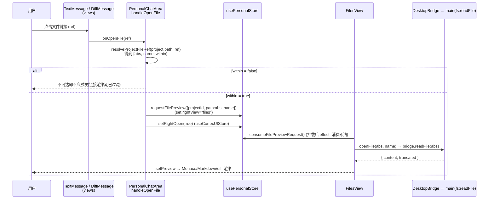
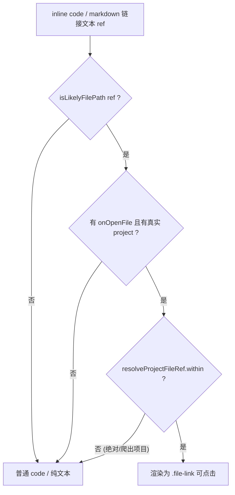

# feat: 个人工作区会话消息中文件链接点击 → 右栏复用预览

## Summary

个人工作区 session 会话视图里，Agent 回复消息中的文件路径（如 `packages/core/personal/messages.ts`、`docs/plans/x.md`）目前只渲染成不可点击的 inline `<code>`。本计划让这些「项目内文件路径」变成可点击链接，点击后**完全复用现有的右栏 `FilesView` 预览器**（Monaco / Markdown / diff 视图，经 `DesktopBridge.readFile` 读真实文件）展示该文件。

接线方式严格照抄仓库已有的两个「请求 + 消费即清」跨组件范式（`requestTaskDetail` / `requestGitDiff`）：新增一个 `filePreviewRequest` store 字段，点击时切右栏到 `files` 视图、展开右栏并存入请求；`FilesView` 挂载后消费请求并调用其现有 `openFile()`。**不新增任何主进程 IPC**（`fs:readFile` 已就绪），**不改动团队工作区**那套独立的 mock 预览。

---

## Problem Frame

- **现状**：`TextMessage`（`packages/views/cortex-desktop/ChatArea.tsx`）的 Agent markdown 渲染 `<Markdown remarkPlugins={[remarkGfm]}>{m.text}</Markdown>` **未传 `components`**，反引号路径只是普通 `<code>`，无 `onClick`、无 `href`、纯文本。
- **现有可复用资产**：右栏「文件」视图 `FilesView`（`packages/views/cortex-desktop/personal/FilesView.tsx`）已是完整的文件/diff 预览器——`openFile(path, name)`（L180）`await bridge.readFile(path)` 后 `setPreview(...)`，渲染分支自动选 `MonacoViewer` / `MarkdownView` / diff，二进制/超大文件已有占位与截断处理。
- **现有触发范式**：`requestTaskDetail`（首页点 Task → `TodosView` 消费打开文件详情）与 `requestGitDiff`（GitBar 点 ± → `FilesView` 消费打开聚合 diff）是「点击某处 → 右栏打开某文件预览」的黄金先例（`packages/core/store/personal.ts` L391-407）。
- **缺口**：缺一条把「消息里的文件路径点击」接到「右栏预览」的链路 —— 即本计划要补的连线。

---

## Scope Boundaries

**In scope**
- Agent 文本消息里被识别为「项目内文件路径」的 inline code 与相对路径 markdown 链接 → 可点击。
- 点击 → 右栏切到 `files` 视图、展开右栏、`FilesView` 复用 `openFile()` 渲染预览。
- 顺带把 `DiffMessage` diff 卡片里当前接成空函数（`onSelectFile={() => {}}`，`PersonalChatArea.tsx` L244）的文件行接到同一预览处理器（这是 Phase 0.7 call-out 的确认结果）。
- 纯函数路径识别与解析（在 `packages/core/personal/`，带单测）。

**Out of scope（非目标）**
- 团队工作区的独立 mock 预览（`packages/views/cortex-desktop/RightPanel.tsx`，用 `FILE_DIFFS` 常量）—— 不触碰。
- 新增/修改主进程 fs IPC —— `fs:readFile` 与 `assertAllowed` 已满足需求。
- 用户自己消息（`m.who === "me"`）里的路径 —— 仅 Agent 回复内的路径可点（`renderMd` 已限定 `m.who !== "me"`）。
- 行内跳转/高亮某一行、点击打开外部编辑器 —— 现有 `FilesView` 已有「发送到终端/Chat」等能力，不在本次扩展。

### Deferred to Follow-Up Work
- 无项目会话（synthetic `__noproject__`，`activeProjectId` 为空）里的文件链接预览 —— 见 U2 边界处理，本次渲染为纯文本不可点；若后续需要，需让 `FilesView` 支持无项目根的临时预览。
- 绝对路径指向项目**外**但仍在 `assertAllowed` 白名单（如 `~/Documents/cortex`）的文件 —— 本次按「项目内」收口，白名单外不可点。

---

## Key Technical Decisions

**KTD1 — 复用 `requestX` / `consumeX`「消费即清」范式，新增 `filePreviewRequest`，不引入「当前预览文件」全局态。**
仓库无全局「当前预览文件」状态，`FilesView.preview` 是组件 local state；跨组件打开靠「set 请求 + `rightView` 切换 + 消费即清」三件套。沿用此范式可让代码风格一致，并天然解决「右栏未挂载时点击」的时序（请求保留到 `FilesView` 挂载后被消费），这正是 `requestGitDiff` 注释（`personal.ts` L54-55）选择「消费即清而非 nonce」的原因。

**KTD2 — 路径「是否可点」在渲染期用纯静态规则判定（项目内 = 可点），白名单外/解析失败 → 纯文本。**
渲染期无法同步查询主进程 `assertAllowed`。由于 `project.path` 本身就是白名单根，采用静态代理规则：`ref` 是相对路径且规范化后不爬出 `project.path`（无 `../` 逃逸），**或**是以 `project.path` 开头的绝对路径 → 判定为项目内、可点；否则渲染为普通 `<code>`/纯文本。这与 Phase 0.7 确认的「项目外/解析失败保持纯文本」一致，且规避了「点了才报错」的体验。

**KTD3 — 识别 + 解析逻辑放在 `packages/core/personal/`（纯函数、带单测），渲染组件放在 `views`。**
路径识别（`isLikelyFilePath`）与解析（`resolveProjectFileRef`）是纯字符串逻辑，符合 core 层「无 react-dom / localStorage / process.env」约束，便于 vitest 表驱动测试与跨组件复用。`views` 只做 react-markdown `components` 接线。

**KTD4 — markdown 自定义 `components` 仅在「个人区且提供了 `onOpenFile`」时启用；团队侧行为零变更。**
`MessageStream` / `TextMessage` 为个人+团队共用。新增**可选** `onOpenFile?` prop 向下穿透，仅个人区传入处理器；团队侧不传 → 走原有纯渲染路径，无回归。markdown 链接（`a`）的外链行为复用现有 `MarkdownView.MdLink` 思路（`http(s)` → `bridge.openExternal`），相对路径 → 走文件预览。

**KTD5 — 点击处理器在 `PersonalChatArea` 组装，配对调用 `requestFilePreview` + `setRightOpen(true)`。**
照抄 `HomeView.openTaskDetail`（`requestTaskDetail(...)` + `setRightOpen(true)`）与 GitBar 的写法：`rightOpen` 属于另一个 store（`useCortexUIStore`），request 动作（`usePersonalStore`）只负责 `rightView`，开关右栏由调用方补。

---

## High-Level Technical Design

点击 → 预览的跨组件数据流（5 段，跨 4 个组件 + 2 个 store + 主进程）：

链接「是否渲染为可点」的判定（渲染期，纯静态）：

---

## Implementation Units

### U1. 纯函数：文件路径识别与项目内解析

**Goal**：提供渲染期可用的纯函数，判断一段文本是否「像项目内文件路径」并解析为绝对路径。

**Requirements**：支撑 KTD2、KTD3；为 U2/U3/U4 提供判定与解析基础。

**Dependencies**：无。

**Files**
- `packages/core/personal/filePaths.ts`（新建）
- `packages/core/personal/filePaths.test.ts`（新建）
- `packages/core/package.json`（如需，新增子路径 `exports`）

**Approach**
- `isLikelyFilePath(text: string): boolean` —— 命中规则（保守）：去空白后非空、不含空格、含 `/` 或带常见文件扩展名（`.ts/.tsx/.js/.md/.go/.json/.css/...`）、非 URL（不以 `http(s)://`、`mailto:` 开头）、非纯数字/版本号（如 `1.5`）。宁缺勿滥：识别不到只是退化为纯文本，不会破坏渲染。
- `resolveProjectFileRef(projectPath: string, ref: string): { abs: string; name: string; within: boolean }` —— POSIX 风格 join + 规范化（折叠 `.`、`//`，解析 `..`）：相对 `ref` 拼到 `projectPath`；绝对 `ref` 原样；判定规范化结果是否以 `projectPath`（带分隔符）为前缀得 `within`；`name` 取 basename。不依赖 node `path`（views 同被 web 打包），用纯字符串实现。

**Patterns to follow**：core/personal 既有纯工具（如 `personal.ts` 的 `baseName`、`partitionProjects`）的无副作用风格；`messages.ts` 的纯函数 + 表驱动测试。

**Test scenarios**（`filePaths.test.ts`）
- `isLikelyFilePath` 正例：`packages/core/personal/messages.ts`、`docs/plans/x.md`、`src/a.ts`、`server/main.go` → true。
- `isLikelyFilePath` 反例：`hello world`（空格）、`https://example.com`（URL）、`npm run test`（空格）、`1.5`（版本号）、`e.g.`、`README`（无扩展无斜杠）→ false。
- `resolveProjectFileRef` 相对路径：`/proj` + `src/a.ts` → `{abs:/proj/src/a.ts, name:a.ts, within:true}`。
- `resolveProjectFileRef` 绝对在项目内：`/proj` + `/proj/src/a.ts` → `within:true`。
- `resolveProjectFileRef` 绝对在项目外：`/proj` + `/etc/passwd` → `within:false`。
- `resolveProjectFileRef` 相对爬出项目：`/proj` + `../../etc/passwd` → `within:false`。
- `resolveProjectFileRef` 末尾分隔符 / `./` 归一：`/proj/` + `./src/a.ts` → `abs:/proj/src/a.ts`。
- 前缀误判防护：`/proj` + 解析到 `/project-other/a.ts` 形态 → `within:false`（必须按分隔符边界匹配，非纯字符串 startsWith）。

---

### U2. Store：新增 `filePreviewRequest` 请求 + 消费动作

**Goal**：在个人 store 增加「文件预览请求」字段与 `requestFilePreview` / `consumeFilePreviewRequest`，照抄 `taskDetail` / `gitDiff` 范式。

**Requirements**：支撑 KTD1、KTD5。

**Dependencies**：无（与 U1 并行）。

**Files**
- `packages/core/store/personal.ts`（修改：`PersonalState` 接口加字段与方法、实现）
- `packages/core/store/personal.test.ts`（新建或追加）

**Approach**
- 接口加：`filePreviewRequest?: { projectId: string; path: string; name: string }`（注释说明：`path` 为已解析的**绝对路径**；消费即清，不持久化，不进 `toPersistedState`）。
- 方法加：`requestFilePreview(req)` → `set({ filePreviewRequest: req, rightView: "files" })`；`consumeFilePreviewRequest()` → 取值后 `set({ filePreviewRequest: undefined })` 返回（仿 `consumeGitDiffRequest` L393-397）。
- 不改 `toPersistedState`（该请求是瞬态，与 `gitDiffRequest`/`taskDetailRequest` 一致不持久化）。

**Patterns to follow**：`personal.ts` L391-407 的 `requestGitDiff/consumeGitDiffRequest`、`requestTaskDetail/consumeTaskDetailRequest`。

**Test scenarios**（`personal.test.ts`）
- `requestFilePreview({projectId,path,name})` 后：`filePreviewRequest` 等于入参且 `rightView === "files"`。
- `consumeFilePreviewRequest()` 首次返回该请求；调用后 `filePreviewRequest === undefined`。
- 连续二次 `consumeFilePreviewRequest()` 第二次返回 `undefined`（消费即清不重复触发）。
- `toPersistedState` 输出不含 `filePreviewRequest`（瞬态不持久化）。

---

### U3. views：聊天 markdown 自定义 components（code + a 可点击）

**Goal**：提供个人区聊天专用的 react-markdown `components`，把项目内文件路径的 inline code 与相对链接渲染为可点击元素。

**Requirements**：支撑 KTD2、KTD4；消费 U1 的纯函数。

**Dependencies**：U1。

**Files**
- `packages/views/cortex-desktop/personal/chatMarkdown.tsx`（新建）
- `packages/views/cortex-desktop/personal/chatMarkdown.test.tsx`（新建）

**Approach**
- 导出工厂 `chatMarkdownComponents({ onOpenFile, projectPath, bridge })`：
  - `code`：仅 inline（无 `language-*` className）时，若 `isLikelyFilePath(text)` 且 `projectPath` 存在且 `resolveProjectFileRef(projectPath, text).within` → 渲染 `<code className="file-link" role="button" tabIndex={0} title={text} onClick/onKeyDown>` 调 `onOpenFile(text)`；否则原样 `<code>`。
  - `a`：复用 `MarkdownView.MdLink` 思路 —— `http(s)` 外链 → `e.preventDefault()` + `bridge.openExternal`；否则若 `href` 经判定为项目内文件路径 → `onOpenFile(href)`；其余保持纯文本/默认阻止导航。
- 点击热区覆盖整段文本（见 lessons：视觉区 = 命中区），不要把 `onClick` 只挂在居中小目标上。

**Patterns to follow**：`packages/views/cortex-desktop/personal/MarkdownView.tsx` 的 `MdLink`（L13-32，`e.preventDefault()` + bridge 外链范式）、`MD_COMPONENTS`（L45）。

**Test scenarios**（`chatMarkdown.test.tsx`，Testing Library + jsdom）
- inline code 为项目内路径（`packages/core/x.ts`）→ 渲染带 `.file-link`，点击触发 `onOpenFile("packages/core/x.ts")`。
- inline code 非路径（`const x`）→ 普通 code，无 `.file-link`，点击无 `onOpenFile`。
- inline code 为项目外绝对路径（`/etc/passwd`）→ 普通 code，不可点。
- markdown 链接 `[doc](docs/a.md)` 相对路径 → 点击触发 `onOpenFile("docs/a.md")`，不触发 `openExternal`。
- markdown 链接 `[site](https://x.com)` → 点击触发 `bridge.openExternal`，不触发 `onOpenFile`。
- 键盘可达：`.file-link` 上 Enter/Space 触发 `onOpenFile`（无障碍 + lessons 命中区）。

---

### U4. views：`MessageStream` / `TextMessage` 穿透 `onOpenFile`，`PersonalChatArea` 组装处理器并接线 diff

**Goal**：把 `onOpenFile` 处理器从 `PersonalChatArea` 穿透到文本渲染与 diff 卡片，完成点击 → 请求的接线。

**Requirements**：支撑 KTD4、KTD5；交付主交互。

**Dependencies**：U1、U2、U3。

**Files**
- `packages/views/cortex-desktop/ChatArea.tsx`（修改：`MessageStream` 与 `TextMessage` 增加可选 `onOpenFile` prop，仅在 `markdownBodies && onOpenFile && projectPath` 时给 `<Markdown>` 注入 U3 的 `components`）
- `packages/views/cortex-desktop/personal/PersonalChatArea.tsx`（修改：组装 `handleOpenFile`，传给 `MessageStream` 的 `onOpenFile` 与 `onSelectFile`）

**Approach**
- `MessageStream` 新增可选 props：`onOpenFile?: (ref: string) => void`、`projectPath?: string`；向下透传给 `TextMessage`。团队侧不传 → `TextMessage` 走现有无 `components` 渲染，零回归（KTD4）。
- `TextMessage`：`renderMd` 分支里，若有 `onOpenFile && projectPath` → `<Markdown remarkPlugins={[remarkGfm]} components={chatMarkdownComponents({...})}>`；否则维持现状。
- `PersonalChatArea`：
  - `handleOpenFile(ref)`：`const { abs, name, within } = resolveProjectFileRef(project.path, ref); if (!within || !realProject) return;`（无项目会话不预览，见 Scope）`requestFilePreview({ projectId: project.id, path: abs, name }); setRightOpen(true);`
  - 取 `requestFilePreview = usePersonalStore(s => s.requestFilePreview)`、`setRightOpen = useCortexUIStore(s => s.setRightOpen)`。
  - `<MessageStream ... onOpenFile={handleOpenFile} projectPath={realProject ? project.path : undefined} onSelectFile={handleOpenFile} />`（把原 `() => {}` 换成 `handleOpenFile`，diff 文件行复用同处理器；`DiffMessage` 传入的 `f.path` 同样经 `resolveProjectFileRef` 归一，绝对/相对均可）。

**Execution note**：先为 `handleOpenFile` 的解析 + 派发写一条组件级测试再接线（确保 within=false 与无项目会话被正确短路），避免回归团队侧。

**Patterns to follow**：`HomeView.openTaskDetail`（`requestTaskDetail` + `setRightOpen(true)`，HomeView L114-118）；`MessageStream` 既有可选 props（`markdownBodies`/`renderTextTail`）的穿透方式（ChatArea L351-365）。

**Test scenarios**（`PersonalChatArea.test.tsx` 或就近）
- 点击 Agent 文本中的项目内路径 → 调 `requestFilePreview`（projectId=当前项目、path=解析后的绝对路径、name=basename）且调 `setRightOpen(true)`。
- 项目外/爬出项目的 ref → `handleOpenFile` 不调 `requestFilePreview`（短路）。
- 无项目会话（synthetic project）→ `projectPath` 传 `undefined`，文本中的路径不可点；即便强制调用 `handleOpenFile` 也短路不派发。
- diff 卡片文件行点击（`DiffMessage.onSelectFile`）→ 同样触发 `requestFilePreview`。
- 团队侧 `MessageStream`（不传 `onOpenFile`）渲染文本消息 → 无 `.file-link`、无回归（happy path 保障）。

---

### U5. `FilesView` 消费 `filePreviewRequest` 并复用 `openFile`

**Goal**：`FilesView` 挂载/请求变化时消费 `filePreviewRequest`，调用现有 `openFile()` 渲染预览。

**Requirements**：闭环主交互；100% 复用现有预览渲染。

**Dependencies**：U2（store 字段）。

**Files**
- `packages/views/cortex-desktop/personal/FilesView.tsx`（修改：新增一个消费 effect）

**Approach**
- 仿 `gitDiffRequest` 的消费 effect（FilesView L151-170）新增：
  - `const filePreviewRequest = usePersonalStore(s => s.filePreviewRequest); const consume = usePersonalStore(s => s.consumeFilePreviewRequest);`
  - effect 依赖 `[filePreviewRequest, bridge, project, consume]`：当 `filePreviewRequest && project && filePreviewRequest.projectId === project.id` → `consume()` 后 `void openFile(filePreviewRequest.path, filePreviewRequest.name)`。项目不匹配则不消费（等切到对应项目，与 gitDiff effect 一致）。
- 注意与既有 `useEffect(() => { setPreview(null); refresh() }, [refresh])`（L128）的挂载顺序：该清空 effect 声明在前先跑，消费 effect 在后跑设上 preview，最终态正确（同 gitDiff 现状）。`openFile` 已处理二进制/超大截断/读取失败 toast，无需额外分支。

**Patterns to follow**：`FilesView` 的 `gitDiffRequest` 消费 effect（L149-170）；`openFile`（L180-196）。

**Test scenarios**（`FilesView.test.tsx`，可用 mock bridge）
- `filePreviewRequest` 项目匹配 → 调 `bridge.readFile(abs)` 并渲染 preview（name 正确）；请求被消费清空。
- `filePreviewRequest` 项目不匹配（projectId ≠ 当前 project.id）→ 不消费、不调 `readFile`。
- 二进制文件名（如 `.png`）→ 走 `isBinaryLike` 占位分支，不调 `readFile`（复用现有行为）。
- `bridge.readFile` 抛错 → 触发 `onToast` 读取失败提示（复用现有 catch）。
- 整合：模拟「右栏原本关闭」→ 请求保留 → `FilesView` 首次挂载即消费并打开（验证「消费即清」对未挂载场景成立）。

---

### U6. 样式：`.file-link` 视觉与命中区，className↔CSS 对账

**Goal**：为可点击文件链接加视觉样式（hover/focus），确保点击热区覆盖整段文本。

**Requirements**：交互可发现性 + 无障碍；落实 lessons 的 className↔CSS 与命中区教训。

**Dependencies**：U3（产出 `.file-link` className）。

**Files**
- `packages/views/cortex-desktop/cortex-desktop.css`（修改：新增 `.md-body .file-link` 规则）

**Approach**
- `.file-link`：`cursor: pointer`、复用主题色（参考既有 `.path` / 链接色 token，如 `--accent` 系），hover 下划线/底色，`:focus-visible` 可见焦点环；保持 inline 排版不破坏行内代码间距。
- 命中区覆盖整段文本（lessons：视觉区 = 命中区）；`role="button"` 元素勿被外层裁剪。

**Patterns to follow**：`cortex-desktop.css` 既有 `.dc-file`、`.path`、`.md-body` 选择器写法与主题 token。

**Test expectation**: none —— 纯 CSS 视觉，自动化测试不覆盖。**收尾必做**（lessons 2026-06-14）：写完后 `grep -rn "file-link" packages/views/cortex-desktop/cortex-desktop.css packages/views/cortex-desktop/personal/chatMarkdown.tsx` 双向对账（组件每个 class 在 CSS 有定义、CSS 选择器确有组件在用，token 完整匹配 `file-link` ≠ `file-link-x`），并交用户手动验证 hover/点击/焦点。

---

## Risks & Dependencies

- **R1 — `assertAllowed` 路径白名单时序（lessons 2026-06-11，high）**：点击读文件经主进程 `assertAllowed`，它读**落盘的** persisted state（renderer 持久化有 ~500ms 节流）。本计划只读**已存在项目**目录内的文件（`project.path` 早已落盘白名单），不新增/即时变更白名单切片，故**不触发**该竞态。但实现/验证时须确认：解析出的绝对路径确实落在 `project.path` 内（U1 的 `within` 保障），避免越权读被拒。
- **R2 — `MessageStream` 团队侧回归**：组件共用。缓解：`onOpenFile`/`projectPath` 为可选，未传时严格走原渲染路径；U4 含团队侧无回归断言。
- **R3 — 路径识别误报/漏报**：`isLikelyFilePath` 过宽会把普通 code 变可点（点击解析 within=false 已二次拦截，最坏是 hover 态多余），过窄会漏识别。缓解：保守规则 + U1 表驱动测试覆盖正反例；宁可漏识别（退化纯文本）也不误触发预览。
- **R4 — 无项目会话**：`activeProjectId` 为空时无预览根。缓解：U4 对 `realProject` 缺失短路、`projectPath` 传 `undefined` 使链接不可点（Deferred 记录）。

---

## Verification

- `pnpm --filter @cortex-work/core test`（U1、U2 单测全绿）。
- `pnpm --filter @cortex-work/views test`（U3、U4、U5 单测全绿）。
- `pnpm typecheck` 全仓类型检查通过（含 desktop node + web 两套）。
- `pnpm lint` 通过。
- U6 的 className↔CSS `grep` 双向对账无悬挂类。
- 手动验证（用户）：个人区某 session 里点 Agent 回复的文件路径 → 右栏自动展开并显示该文件预览（Monaco/Markdown 按类型）；点 diff 卡片文件行同样打开预览；项目外/非路径文本不可点；团队工作区聊天无变化。

---

## Sources & Research

- 现有预览机制与触发范式：`packages/views/cortex-desktop/personal/FilesView.tsx`（`openFile`、`gitDiffRequest` 消费 effect）、`packages/core/store/personal.ts`（`requestGitDiff`/`requestTaskDetail`）、`packages/views/cortex-desktop/personal/HomeView.tsx`（`openTaskDetail` 的 request + `setRightOpen` 配对）。
- markdown 自定义渲染范式：`packages/views/cortex-desktop/personal/MarkdownView.tsx`（`MdLink`/`MdPre`）。
- 消息渲染管线：`packages/views/cortex-desktop/ChatArea.tsx`（`MessageStream`/`TextMessage`/`DiffMessage`）、`packages/views/cortex-desktop/personal/PersonalChatArea.tsx`。
- 主进程读文件与白名单：`apps/desktop/src/main/ipc/fs.ts`（`fs:readFile`、`assertAllowed`）、`packages/core/desktop/bridge.ts`（`readFile`）。
- 历史教训：`tasks/lessons.md`（2026-06-11 白名单时序、2026-06-14 className↔CSS 对账、2026-06-12 命中区几何）。
