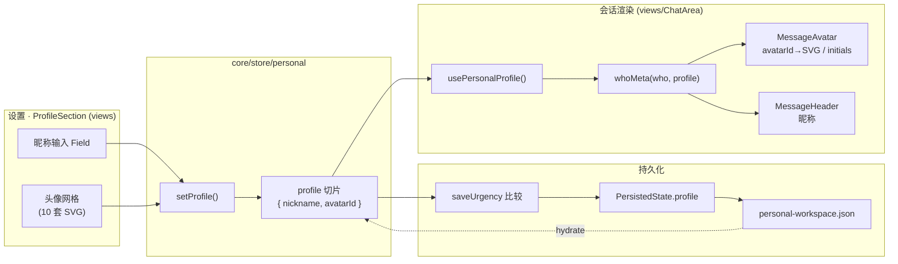
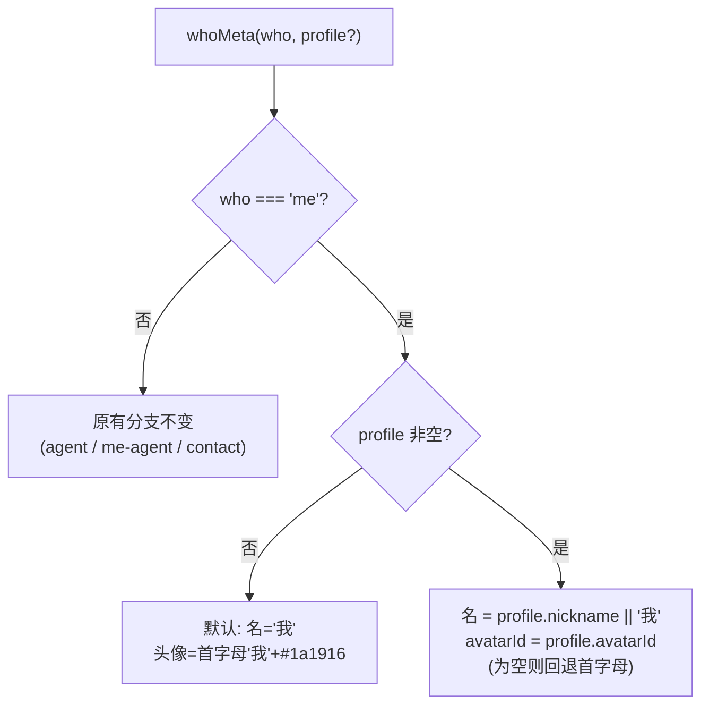

# feat: 个人资料 — 自定义昵称与内置 SVG 头像

## Summary

在桌面端「个人工作区」的设置中新增「个人资料」入口，允许用户修改自己的**昵称**并从**系统内置的 10 套 SVG 插画头像**中选择一套。设置后，会话气泡中所有「用户本人」(`who="me"`) 的消息使用用户设定的昵称与头像渲染（不影响 agent、`me-agent`、团队联系人）。配置随个人工作区状态落盘（`~/.cortex-desktop/personal-workspace.json`），主进程通道无需改动（全量 JSON 透明转发）。

当前会话里「用户本人」的昵称恒为「我」、头像恒为首字母「我」+ 深色底，全部硬编码在 `whoMeta("me")`。本计划把这一段从「读常量」改为「读用户 profile」，并把头像渲染层从「仅首字母 + 背景色」扩展到「可选内置 SVG 头像」。

---

## Problem Frame

**现状**
- 「当前用户」身份解析权威是 `packages/core/mock/data.ts` 的纯函数 `whoMeta("me")`，返回写死的 `{ name: "我", avatar: { initials: "我", bg: "#1a1916" } }`。
- `CoreProvider` 注入的 `identity { userId, name }`（`packages/core/provider.tsx:11`）在 `App.tsx` 写死为 `{ userId: "me", name: "我" }`，且**全仓未被任何会话渲染消费**——它不是真源。
- 头像渲染只支持「首字母 + 背景色」(`Avatar { initials, bg }`，`packages/core/types/index.ts:6`)，无图片/SVG 头像组件。会话气泡头像由 `ChatArea.tsx` 的 `MessageAvatar` 内联渲染。
- 设置 UI（`packages/views/cortex-desktop/personal/SettingsMenu.tsx`）有 宠物 / 外观 / Agent / 时间线 / 推送 / 语音 六个 Tab，**没有「个人资料」Tab**。

**目标**
- 用户能在设置中改昵称、选 10 套内置 SVG 头像之一。
- 会话中 `who="me"` 的气泡用用户 profile 渲染昵称 + SVG 头像。
- 配置持久化、跨重启保留。

**非目标**：见 Scope Boundaries。

---

## Requirements

- **R1** — 设置中新增「个人资料」入口，可编辑昵称（文本）。
- **R2** — 设置中提供 10 套系统内置 SVG 头像供选择，单选。
- **R3** — 用户设定的昵称与头像在会话中 `who="me"` 的消息气泡（头像 + 头部昵称）生效。
- **R4** — 昵称/头像配置随个人工作区状态落盘并在重启后恢复。
- **R5** — 未设置 profile 时回退到现有默认（昵称「我」+ 首字母头像），保持向后兼容。
- **R6** — 作用范围仅限 `who="me"`；agent、`me-agent`、团队联系人渲染不变。

---

## Key Technical Decisions

### KTD1 — `whoMeta` 显式注入 profile，而非内部读 store

`whoMeta` 是 `core/mock/` 下的**纯函数**，被生产渲染路径依赖。让它读 profile 有两条路：

- (A) 函数内 `usePersonalStore.getState().profile` ——最小改动，但让 `core/mock` 依赖 `core/store`，违背「mock 不依赖 store」的分层直觉。
- (B) **（选定）** 给 `whoMeta` 增加可选参数 `whoMeta(who, profile?)`；渲染组件（`MessageAvatar` / `MessageHeader`）通过新 hook `usePersonalProfile()` 读取 profile 并注入。`whoMeta` 保持纯函数、分层不变，`"me"` 分支在收到 profile 时用 `profile.nickname`（非空时）覆盖 `name`、用 `profile.avatarId` 填充 `avatar.avatarId`。

选 (B)：保持纯函数可测试性与现有分层边界，注入点集中在两个渲染组件，改动面可控。

### KTD2 — `Avatar` 类型增加可选 `avatarId`，渲染层按 id 分支

扩展为 `Avatar { initials: string; bg: string; avatarId?: string }`。`avatarId` 存在时渲染内置 SVG，否则沿用 `initials + bg`。向后兼容：所有现有 `whoMeta` 分支（agent/contact）不带 `avatarId`，渲染不变（满足 R5/R6）。

### KTD3 — SVG 头像资源放 `views`，`core` 只存 id 字符串

`core` 受「不得依赖 `react-dom`」约束，不能放 JSX/SVG。因此：
- `core` 侧只持有**内置头像 id 的字符串常量数组**（纯数据），供 store 默认值与校验用。
- `views` 侧 `personal/avatars.tsx` 持有 `id → { name, Render }` 的 SVG 渲染映射（仿 `pet/designs.tsx` 的 `PET_DESIGNS` 范式）。
- 会话渲染与设置网格都从 `views` 的清单按 `avatarId` 取 SVG。

### KTD4 — profile 作为 `PersonalState` 新切片，复用现有持久化管线

`PersistedState`（`core/desktop/types.ts`）新增 `profile?: { nickname?: string; avatarId?: string }`；`PersonalState`（`core/store/personal.ts`）新增 `profile` 切片 + `setProfile`；`hydrate` / `toPersistedState` 两端读写；`saveUrgency`（`usePersonalPersistence.ts`）增加 profile 比较。主进程 `store.ts` / preload / `register.ts` 因通道为全量 JSON 透明转发，且校验只查 `version/projects/sessions`，**无需改动**。

---

## High-Level Technical Design

数据流：设置写入 → store 落盘 → 会话渲染读取。

`whoMeta` 决策（仅 `who="me"` 受 profile 影响）：

---

## Implementation Units

### U1. 数据契约与持久化切片

**Goal** — 在类型、store、持久化三处打通 `profile { nickname, avatarId }`，使其可读、可写、可落盘、可恢复。

**Requirements** — R4, R5。

**Dependencies** — 无。

**Files**
- `packages/core/types/index.ts` — `Avatar` 增加可选 `avatarId?: string`（KTD2）。
- `packages/core/desktop/types.ts` — `PersistedState` 增加 `profile?: { nickname?: string; avatarId?: string }`。
- `packages/core/store/personal.ts` — `PersonalState` 增加 `profile` 切片与 `setProfile(p)`；`hydrate` 读入 `state.profile`；`toPersistedState` 写出 `profile`。
- `packages/core/desktop/usePersonalPersistence.ts` — `saveUrgency` 增加 `s.profile !== prev.profile` 比较（归入 throttled 一档，非紧急）。
- `packages/core/store/personal.test.ts` — 测试。

**Approach** — profile 切片初始值 `{}`（或 `{ nickname: undefined, avatarId: undefined }`）。`setProfile` 做浅合并（允许只改昵称或只改头像）。`hydrate` 对缺失 `profile` 字段容错（旧存档无该字段 → 保持默认）。主进程通道不动（KTD4）。

**Patterns to follow** — 仿现有 `timelineSettings` / `pushSettings` 切片在 `personal.ts` 的 setter、`hydrate`、`toPersistedState` 三处的对称写法；`saveUrgency` 仿 timeline/push 的非紧急比较分支。

**Test scenarios**
- `setProfile({ nickname: "阿伟" })` 后 store `profile.nickname === "阿伟"`，`avatarId` 不受影响（浅合并）。
- `setProfile({ avatarId: "fox" })` 只改头像，保留已有昵称。
- `hydrate` 传入含 `profile` 的 `PersistedState` → store profile 被填充。
- `hydrate` 传入**不含** `profile` 字段的旧存档 → 不抛错，profile 保持默认空值（R5 向后兼容）。
- `toPersistedState` 输出包含当前 `profile` 切片，可与 `hydrate` round-trip 一致。
- `saveUrgency`：仅 `profile` 变化时返回非紧急（throttled）档位，与 timeline 变化行为一致。

**Verification** — `pnpm --filter @cortex-work/core test -- run packages/core/store/personal.test.ts` 全绿；`pnpm typecheck` 通过。

---

### U2. 内置 10 套 SVG 头像清单

**Goal** — 提供 10 套内置 SVG 插画头像：`core` 侧 id 常量 + `views` 侧 SVG 渲染映射。

**Requirements** — R2。

**Dependencies** — 无（可与 U1 并行）。

**Files**
- `packages/core/personal/avatars.ts`（新建）— 导出 `BUILTIN_AVATAR_IDS: readonly string[]`（10 个 kebab id，纯字符串，无 JSX）与默认 id 常量。`core` 不依赖 react-dom（KTD3）。
- `packages/views/cortex-desktop/personal/avatars.tsx`（新建）— 导出 `BUILTIN_AVATARS: { id: string; name: string; Render: (props) => JSX.Element }[]`，10 套内联 SVG；并提供 `renderAvatar(avatarId)` 查找辅助。
- `packages/core/personal/avatars.test.ts`（新建）— 测试。

**Approach** — 仿 `packages/views/cortex-desktop/pet/designs.tsx` 的 `PET_DESIGNS` 结构（每项 `name` + 内联 SVG `Parts` 组件）。SVG 用纯几何/扁平插画风格，固定 viewBox，可随容器缩放，背景色内置在 SVG 内或由外层 `m-avatar` 容器提供。`views` 的 `id` 列表必须与 `core` 的 `BUILTIN_AVATAR_IDS` 逐一对应（一致性测试守护）。

**Patterns to follow** — `pet/designs.tsx`（SVG 资源清单 + 网格选择范式）、`packages/ui/icons/index.tsx`（SVG 组件导出约定）。

**Test scenarios**
- `BUILTIN_AVATAR_IDS` 长度恰为 10、id 唯一、均为合法 kebab 字符串。
- 默认 avatar id 包含在 `BUILTIN_AVATAR_IDS` 中。
- （views）`BUILTIN_AVATARS` 的 id 集合与 `core` 的 `BUILTIN_AVATAR_IDS` 完全一致（防止两侧漂移）——可在 views 的测试或 core 测试中交叉断言。

**Verification** — `pnpm --filter @cortex-work/core test`；`pnpm typecheck`；设置面板网格能渲染 10 个头像（U4 后人工验证）。

---

### U3. 身份解析：`whoMeta` 接受 profile + `usePersonalProfile` hook

**Goal** — 让 `whoMeta("me", profile)` 在有 profile 时返回用户昵称与 `avatarId`，并提供组件侧读取 profile 的 hook。

**Requirements** — R1, R3, R5, R6。

**Dependencies** — U1（profile 切片）。

**Files**
- `packages/core/mock/data.ts` — `whoMeta` 签名增加可选第二参 `profile?: { nickname?: string; avatarId?: string }`；仅 `"me"` 分支在 `profile` 非空时用 `profile.nickname || "我"` 覆盖 `name`、把 `profile.avatarId` 写入 `avatar.avatarId`（其余分支与 `me-agent`/contact/agent 完全不变，满足 R6）。
- `packages/core/store/personal.ts` — 导出 `usePersonalProfile()`（select `profile` 切片的 zustand selector hook），供 views 使用。
- `packages/core/mock/data.test.ts`（新建或追加）— `whoMeta` 测试。

**Approach** — `whoMeta` 的 `"me"` 默认分支（profile 为空/未传）保持现有返回，保证未接入处与旧行为一致（R5）。`avatarId` 为空时渲染层回退首字母（U5 处理）。`usePersonalProfile` 为窄 selector，避免无关 store 变化触发会话重渲染。

**Patterns to follow** — `personal.ts` 中现有 selector hook 的写法；`whoMeta` 现有分支结构。

**Test scenarios**
- `whoMeta("me")`（不传 profile）→ 返回默认 `{ name: "我", avatar: { initials: "我", bg: "#1a1916" } }`，无 `avatarId`（R5）。
- `whoMeta("me", { nickname: "阿伟", avatarId: "fox" })` → `name === "阿伟"`，`avatar.avatarId === "fox"`。
- `whoMeta("me", { nickname: "" })` → 空昵称回退为「我」（不渲染空名）。
- `whoMeta("me", { avatarId: "fox" })`（无昵称）→ name 仍为「我」，avatarId 生效。
- `whoMeta("claude", profile)` / `whoMeta("me-agent", profile)` / contact → **不受 profile 影响**，与不传时完全一致（R6 回归）。

**Verification** — `pnpm --filter @cortex-work/core test`；`pnpm typecheck`。

---

### U4. 设置「个人资料」Tab + ProfileSection

**Goal** — 在设置弹层新增「个人资料」Tab，包含昵称输入与 10 套头像网格选择，写入 `setProfile`。

**Requirements** — R1, R2。

**Dependencies** — U1（`setProfile` / `usePersonalProfile`）、U2（`BUILTIN_AVATARS`）。

**Files**
- `packages/views/cortex-desktop/personal/SettingsMenu.tsx` — `SettingsTab` 联合类型与 `TABS` 数组新增 `"profile"`（建议置于列表首位）；新增 `ProfileSection()` 组件；在 `SettingsDialog` 的 tab 分支渲染。
- `packages/views/cortex-desktop/cortex-desktop.css`（或设置相关样式文件）— 如需头像网格/SVG 缩放样式，复用或微调 `pw-pet-grid` / `pw-pet-card`。

**Approach** — `ProfileSection` 用 `usePersonalProfile()` 读当前值、`usePersonalStore` 的 `setProfile` 写回：
- 昵称：复用现有 `Field`（`SettingsMenu.tsx:240`），`onChange` → `setProfile({ nickname })`（可加 trim/长度上限的轻校验）。占位符显示默认「我」。
- 头像：复用 `pw-pet-grid` / `pw-pet-card` 网格范式，遍历 `BUILTIN_AVATARS` 渲染 SVG 预览，选中态 `is-active`，点击 → `setProfile({ avatarId })`。

**Patterns to follow** — `SettingsMenu.tsx` 中 `PetSection` 的网格选择 + `TimelineSection` 的「读切片 / 写 setter」对称结构；`Field` 组件。

**Test scenarios** — 本单元为纯 UI/交互，按团队约定（实现 + 自动化测试由 Claude，UI 表现由用户手动验证）。`Test expectation: none -- 纯 UI 装配，逻辑（setProfile / 解析）已在 U1/U3 测试覆盖；交互表现由用户手动验证`。

**Verification** —（人工）打开设置 → 个人资料 Tab：改昵称、选不同头像，网格选中态正确；切到其他 Tab 再回来值保留。`pnpm typecheck` 通过。

---

### U5. 会话渲染接入用户 profile

**Goal** — 会话气泡中 `who="me"` 的头像与头部昵称改用用户 profile 渲染：有 `avatarId` 渲染内置 SVG，否则回退首字母。

**Requirements** — R3, R5, R6。

**Dependencies** — U2（SVG 清单）、U3（`whoMeta` + `usePersonalProfile`）。

**Files**
- `packages/views/cortex-desktop/ChatArea.tsx` — `MessageAvatar` / `MessageHeader` 通过 `usePersonalProfile()` 取 profile 并传入 `whoMeta(who, profile)`；`MessageAvatar` 在 `meta.avatar.avatarId` 存在时用 `BUILTIN_AVATARS` 渲染 SVG，否则保留现有「`m-avatar` 首字母 + bg」渲染。
- `packages/views/cortex-desktop/cortex-desktop.css` — `m-avatar` 容纳 SVG 子元素的样式（裁剪/居中/尺寸），不破坏首字母回退。

**Approach** — 仅在解析为 `isMe`（或返回带 `avatarId`）时走 SVG 分支；agent/contact 因 `whoMeta` 不返回 `avatarId`，自然走原首字母分支（R6）。注意 `PersonalChatArea.tsx` 的会话头部 `ch-avatar` 用的是 agent 的 `contact.avatar`，**不在本单元范围**（本计划只改用户本人气泡，R6）。

**Patterns to follow** — `ChatArea.tsx` 现有 `MessageAvatar` / `MessageHeader` 结构；U2 的 `renderAvatar(avatarId)` 辅助。

**Test scenarios**（渲染逻辑层；视图组件测试可选，UI 表现人工验证）
- 给定 profile `{ nickname: "阿伟", avatarId: "fox" }`，`MessageAvatar`/`MessageHeader` 对 `who="me"` 渲染昵称「阿伟」与 fox SVG（可对 `whoMeta` 返回值做断言，已在 U3 覆盖；组件层可加一条快照/查询断言）。
- profile 为空 → `who="me"` 仍渲染「我」+ 首字母头像（R5 回归）。
- `who="claude"` / `me-agent` → 渲染不受 profile 影响（R6 回归）。
- `Test expectation: 渲染分支断言可在组件测试覆盖；像素级 UI 表现由用户手动验证`。

**Verification** —（人工）设置头像/昵称后，自己在会话中发一条消息，气泡头像为所选 SVG、头部昵称为所设昵称；agent 消息不变；重启应用后仍生效（R4 端到端）。

---

## Scope Boundaries

**In scope**
- 个人工作区设置中的昵称编辑、10 套内置 SVG 头像选择。
- 会话中 `who="me"` 气泡的昵称 + 头像渲染。
- 配置落盘与重启恢复。

**Out of scope（本产品当前不做）**
- 用户上传自定义图片头像（仅内置 10 套）。
- 修改 agent / 联系人 / `me-agent` 的昵称或头像。
- 会话**头部** `ch-avatar`（对方 agent 头像）的改动。
- 跨设备/服务端同步用户资料（仅本地 `personal-workspace.json`）。
- `CoreProvider.identity` 重构为单一真源（现状未被消费，本计划不触碰）。

### Deferred to Follow-Up Work
- 若后续需要「用户头像也出现在侧栏/会话头部」，再扩展 `ch-avatar` 与相关组件。
- 自定义图片上传头像（需主进程 fs + 资源管理，独立 PR）。

---

## Risks & Dependencies

- **分层耦合**：`whoMeta` 注入 profile 后，调用点必须由能用 hook 的组件注入；非组件调用点（若有）需排查传参。缓解：U3 保持默认分支不变，未注入处行为不退化（R5）。开始 U3 前用 `rg "whoMeta\("` 全仓核对调用点。
- **两侧 id 漂移**：`core` 的 `BUILTIN_AVATAR_IDS` 与 `views` 的 `BUILTIN_AVATARS` 须一致。缓解：U2 交叉断言测试。
- **旧存档兼容**：已有用户的 `personal-workspace.json` 无 `profile` 字段。缓解：U1 `hydrate` 容错 + 回退默认测试。
- **依赖顺序**：U4/U5 依赖 U1–U3；U1、U2 可并行，U3 依赖 U1。

---

## Sources & Research

- 身份解析权威：`packages/core/mock/data.ts` `whoMeta`（`:539`）。
- 渲染入口：`packages/views/cortex-desktop/ChatArea.tsx` `MessageAvatar`/`MessageHeader`（`:80`/`:89`）。
- 设置 UI 范式：`packages/views/cortex-desktop/personal/SettingsMenu.tsx`（`TABS` `:60`、`Field` `:240`、`pw-pet-grid` `:149`）。
- SVG 资源范式：`packages/views/cortex-desktop/pet/designs.tsx`（`PET_DESIGNS`）。
- 持久化管线：`packages/core/store/personal.ts`（`PersonalState` `:34`、`hydrate` `:174`、`toPersistedState` `:452`）、`packages/core/desktop/types.ts` `PersistedState`、`packages/core/desktop/usePersonalPersistence.ts` `saveUrgency`（`:16`）。
- 主进程 store 通道（无需改）：`apps/desktop/src/main/ipc/store.ts`、落盘 `~/.cortex-desktop/personal-workspace.json`。
- 类型：`packages/core/types/index.ts` `Avatar`（`:6`）、`Message`/`who`（`:75`）。
