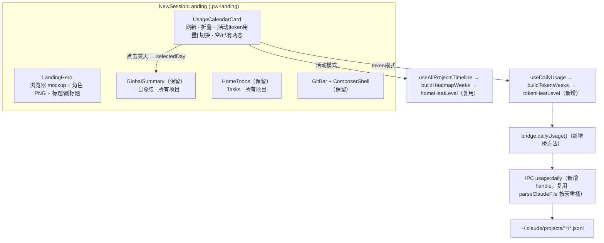
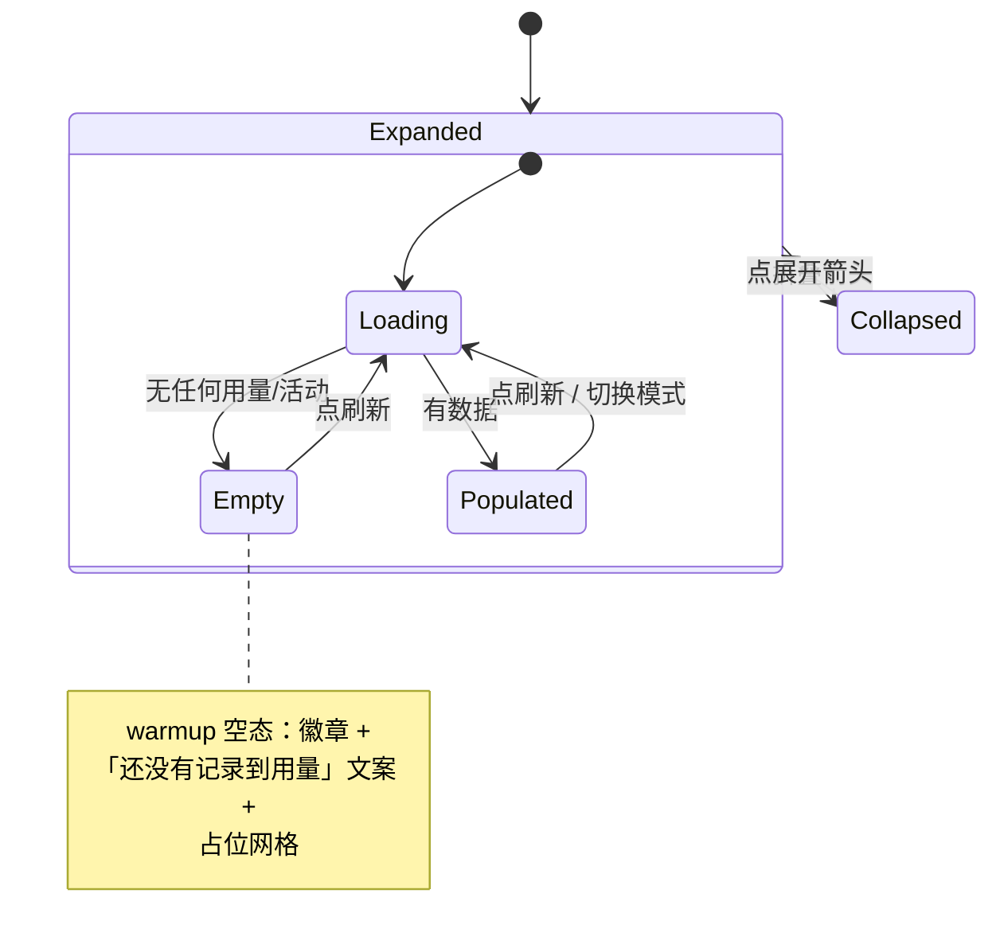

# feat: 个人工作区落地页借鉴 kun（Hero 插画 + 按天用量日历）

## Summary

把个人工作区落地页（`NewSessionLanding` → `HomeBoard`）重做成 kun 那种观感：顶部 **Hero 区**（浏览器窗口 mockup + 角色插画 + 「开始你的智能体节奏」标题 + 副标题），下方一张 **用量日历卡片**（刷新 / 折叠 + 空·已有用量两态 + 可在「活动」与「token 用量」之间切换的热力日历）替换现有「活动热力图」section，再保留现有「一日总结 · 所有项目」与「Tasks · 所有项目」。复用 cortex 既有的真实本地数据通道与手写 CSS 体系，不引入 Tailwind。新增唯一一条真实数据：按天 token 用量序列（复用 `usage.ts` 的逐事件解析，按天重桶）。

**借鉴源（只读参考，不在本仓）：** `/Users/mike/source/ai/kun` —— `InitialSessionUsageHeatmap.tsx`、`KunHeroStage.tsx`、`AnimatedWorkLogo.tsx`、`use-daily-usage.ts`、`base-shell.css`。

---

## Problem Frame

当前落地页是功能性看板：26 周活动热力图 + 一日总结 + 跨项目 Tasks，进入即见、但缺乏「首屏品牌感 / 节奏感」的引导态。kun 的落地页用一个睡觉角色插画 + 大标题 + 用量日历空态，把「还没开始用」表达成一个有温度的 onboarding 钩子，并在产生用量后自然过渡到按天用量日历。

本计划要在**不破坏**现有看板能力（一日总结、Tasks、点击某天联动）的前提下，给落地页加上 kun 的 Hero 与用量日历观感，并让用量日历同时承载「活动」（既有 timeline 数据）与「token 用量」（新增按天聚合）两种语义。

---

## Scope Boundaries

**In scope**
- 落地页顶部新增 Hero 区（浏览器 mockup + 角色插画 + 标题/副标题），直接借用 kun 的角色 PNG 作占位资源。
- 用一张「用量日历卡片」替换 `HomeBoard` 现有「活动热力图」section：刷新按钮、折叠/展开、空态（warmup）、已有用量态、「活动 / token 用量」模式切换。
- 新增按天 token 用量数据通道（主进程 IPC + 桥接 + 类型 + core hook + 热力纯函数）。
- 保留并继续联动现有「一日总结 · 所有项目」「Tasks · 所有项目」（点击日历某天仍驱动当天总结）。
- 文案适配为 Cortex 语境（去掉「Kun」字样）。

**Out of scope（非目标）**
- 不改会话页、左栏 `UsagePanel`、automation、timeline 项目视图。
- 不改 Web 端落地体验：Web 端 `PersonalWorkspace` 仍走「仅桌面端可用」降级态，本计划组件只在桌面端渲染。
- 不做 Codex 历史按天 token 序列（Codex rollout 只有 `rate_limits` 快照，无逐日 token 历史）；token 用量日历的数据源以 Claude Code 的 `~/.claude/projects/**/*.jsonl` 为准。

**Deferred to Follow-Up Work**
- 折叠态的跨会话持久化（先用组件内 `useState`，默认展开）。
- 角色插画替换为 Cortex 自有形象（先借 kun PNG 占位）。
- 模型分项用量（kun 的 models 选项卡）—— 本期只做「活动 / token 用量」总量两态切换。
- token 用量的成本（$）换算展示 —— 本期日历只用 token 总量定档，成本展示延后。

---

## Key Technical Decisions

- **用量日历卡片替换「活动热力图」section，而非并列两个热力图。** 决策来自范围对齐：保留看板 + 用量日历两态可切换。两个热力图并列会冗余且割裂；改为一张卡片内用 segmented 切换「活动 / token 用量」，复用同一套 `.pw-hm` 网格 DOM，只换数据源与定档函数。
- **按天 token 聚合复用 `usage.ts` 的 `parseClaudeFile`，新增 `usage:daily` handle。** 既有 `usage:agent` 产出的是时间窗分桶（近5h/今日/本周），不含逐日序列；但 `parseClaudeFile` 已把每条 assistant usage 解析成 `{t,in,out,cc,cr}` 事件并带文件级增量缓存。新增 handle 复用同一解析、按 `dayKey(t)` 重桶为「日 → token 总量」，避免重写解析逻辑。
- **活动模式直接复用既有数据层。** 「活动」模式沿用 `useAllProjectsTimeline` + `buildHeatmapWeeks` + `homeHeatLevel`，零改动；新增的只是 token 模式的并行数据路径（`useDailyUsage` + `tokenHeatLevel` + `buildTokenWeeks`）。
- **角色插画走静态 PNG import（borrow kun）。** 借用 kun 的 `kun_sleep.png` 等放入 views 包资源目录，组件内静态 `import` 由打包器处理。因 `packages/views` 同时被 Next（web）与 electron-vite（desktop）打包，PNG 必须用**静态 import**（两套打包器都支持），不可用 `process.env`/Node 路径拼接。
- **不引入 Tailwind。** 新增样式追加到 `packages/views/cortex-desktop/cortex-desktop.css`，沿用 `--accent`/`--text-1`/`color-mix` 与 `.pw-*` 前缀；Hero mockup 与折叠/动效借鉴 kun `base-shell.css` 的 CSS 实现思路（纯 div + CSS），不照搬其 `ds-*` token。

---

## High-Level Technical Design

落地页组装（自上而下）与数据来源：



模式切换与卡片状态机（用量日历卡片内部）：



---

## Output Structure

```
packages/
  core/
    personal/
      usage-calendar.ts        # 新增：useDailyUsage + tokenHeatLevel + buildTokenWeeks
      usage-calendar.test.ts   # 新增
    desktop/
      bridge.ts                # 改：DesktopBridge 增 dailyUsage()
      types.ts                 # 改：DailyUsage / DailyUsagePoint 类型
  views/
    cortex-desktop/
      personal/
        LandingHero.tsx        # 新增：Hero 区
        UsageCalendarCard.tsx  # 新增：用量日历卡片（替换活动热力图 section）
        UsageCalendarCard.test.tsx  # 新增
        HomeView.tsx           # 改：HomeBoard 接入 Hero + 卡片，保留总结/Tasks
        assets/
          mascot-sleep.png     # 新增：借自 kun（占位）
      cortex-desktop.css       # 改：追加 .pw-hero / .pw-usagecal
apps/desktop/src/main/
  ipc/
    usage.ts                   # 改：新增 dailyClaudeBuckets + usage:daily handle
    usage.test.ts              # 新增：按天聚合纯函数测试
    types.ts                   # 改：DailyUsage 契约
  preload/index.ts             # 改：暴露 personal.dailyUsage
```

---

## Implementation Units

### U1. 按天 token 用量数据通道（主进程 IPC + 类型）

**Goal:** 新增一条 `usage:daily` IPC，返回近 N 周（默认 26 周）的「日 → token 总量」序列，复用既有逐事件解析。
**Dependencies:** 无。
**Files:**
- `apps/desktop/src/main/ipc/usage.ts`（新增按天聚合函数 + `ipcMain.handle("usage:daily", …)`）
- `apps/desktop/src/main/ipc/usage.test.ts`（新增）
- `apps/desktop/src/main/ipc/types.ts`（新增 `DailyUsage` / `DailyUsagePoint` 契约）
- `apps/desktop/src/main/ipc/register.ts`（`registerUsageHandlers` 已注册，无需新增注册项；如拆函数则在此确认）

**Approach:**
- 抽出一个**纯函数** `bucketEventsByDay(events: UsageEvent[], weeks: number, now: number): DailyUsagePoint[]`，把 `parseClaudeFile` 产出的 `{t,in,out,cc,cr}` 事件按 `dayKey(t)`（YYYY-MM-DD，本地时区，与 `core/personal/timeline.ts` 的 `dayKey` 同语义）累加为每日 `tokens = in+out+cc+cr`，覆盖范围为今天往前 `weeks*7` 天，无活动的天省略（前端补零）。
- `usage:daily` handle：复用 `claudeTokenBuckets` 同一套文件扫描（`~/.claude/projects/**/*.jsonl`、8 天 mtime 截断对按天 26 周不够，需放宽扫描窗口到 `weeks*7 + 1` 天）→ `parseClaudeFile` → `bucketEventsByDay`。沿用 30s `resultCache` 思路（独立缓存键）。
- 返回 `{ at: number; days: DailyUsagePoint[] }`，`DailyUsagePoint = { day: string; tokens: number; msgs: number }`。Claude 未安装/无日志时 `days: []`。

**Patterns to follow:** `apps/desktop/src/main/ipc/usage.ts` 现有 `parseClaudeFile` / `claudeTokenBuckets` / `resultCache` / `mkBucket`；`dayKey` 取 `packages/core/personal/timeline.ts`（主进程侧复制等价实现，避免跨包依赖）。
**Execution note:** 先为 `bucketEventsByDay` 写失败的纯函数测试，再接 IPC。
**Test scenarios:**
- 跨 3 天的事件 → 每天 token 总量正确累加（in+out+cc+cr）。
- 同一天多条事件 → 合并到同一 `day` 桶。
- 日界（本地零点前后各一条）→ 落入正确的两天，不串桶。
- 超出 `weeks*7` 天的旧事件 → 不进结果。
- 空事件数组 / Claude 目录不存在 → `days: []`，不抛错。

---

### U2. core 数据层：`useDailyUsage` + token 热力纯函数

**Goal:** 在 core 暴露按天用量 hook 与 token 定档/周列构建纯函数，供视图层 token 模式使用。
**Dependencies:** U1。
**Files:**
- `packages/core/personal/usage-calendar.ts`（新增）
- `packages/core/personal/usage-calendar.test.ts`（新增）
- `packages/core/desktop/bridge.ts`（`DesktopBridge` 接口新增 `dailyUsage?(weeks: number): Promise<DailyUsage>`）
- `packages/core/desktop/types.ts`（新增 `DailyUsage` / `DailyUsagePoint`，与 `main/ipc/types.ts` 形状一致）
- `packages/core` 的 `exports` / barrel（导出新 hook 与纯函数）

**Approach:**
- `useDailyUsage(weeks = 26)`：React Query，`queryKey: ["personal","daily-usage",weeks]`，`enabled: !!bridge?.dailyUsage`，`staleTime: 60_000`；`refresh()` 经递增 `refreshKey` 或 `queryClient.invalidateQueries` 实现（与卡片刷新按钮对接）。机器级数据，**不带 wsId**（与既有 `usage`/`agent-projects` 一致）。
- `tokenHeatLevel(tokens: number): 0..4`：按 token 量级定阈（如 0 / ≤2万 / ≤10万 / ≤50万 / 更多；阈值在实现时据真实数据微调，注释说明）。
- `buildTokenWeeks(weeks, points, today): HeatWeek[]`：复用 `home.ts` 的 `HeatWeek`/`HeatCell` 结构与 `buildHeatmapWeeks` 的周列排布（周一起始、今天所在周为末列），把 `DailyUsagePoint.tokens` 映射进 `cell`，便于卡片复用同一套 `.pw-hm` 渲染。可直接调用 `buildHeatmapWeeks` 的日期骨架再覆盖每格的 token 值，避免重写日期游标逻辑。

**Patterns to follow:** `packages/core/personal/home.ts` 的 `useAllProjectsTimeline`（useQuery + `enabled:!!bridge`）、`buildHeatmapWeeks`、`homeHeatLevel`；`packages/core/personal/timeline.ts` 的 `dayKey`。
**Execution note:** `tokenHeatLevel`、`buildTokenWeeks` 先测后写。
**Test scenarios:**
- `tokenHeatLevel`：边界值（0、刚好各档阈值、超大值）→ 落到预期档位。
- `buildTokenWeeks`：给定若干天 token → 对应 cell 命中正确 `day` 且携带 token；缺失天补零（level 0）；末列含今天。
- `useDailyUsage`：`bridge.dailyUsage` 缺失（Web/旧壳）→ 不请求、返回空且不报错。

---

### U3. Hero 区组件（浏览器 mockup + 角色插画 + 标题）

**Goal:** 新增 `LandingHero`，呈现 kun 风格的浏览器窗口 mockup + 角色插画 + 「开始你的智能体节奏」标题与副标题。
**Dependencies:** 无（可与 U1/U2 并行）。
**Files:**
- `packages/views/cortex-desktop/personal/LandingHero.tsx`（新增）
- `packages/views/cortex-desktop/personal/assets/mascot-sleep.png`（新增，借自 kun `src/renderer/src/asset/img/kun_sleep.png`）
- `packages/views/cortex-desktop/cortex-desktop.css`（追加 `.pw-hero*`）

**Approach:**
- 纯展示组件：浏览器窗口 mockup（标题栏红/黄/绿三点 + 侧栏占位条 + 画布 + 角色插画居中）借鉴 kun `KunHeroStage` 的纯 div + CSS 结构，不照搬 `ds-*` class，改用 `.pw-hero-*`。
- 角色图静态 `import mascotSleep from "./assets/mascot-sleep.png"`（打包器处理，web/desktop 双打包均支持）。
- 标题 `开始你的智能体节奏`，副标题去 Kun 化：`完成第一轮对话后，这里会自动变成按天累计的用量日历。`
- 无 props 或仅一个 `className`；不接数据。

**Patterns to follow:** kun `KunHeroStage.tsx`（DOM 结构）；cortex 现有 `.pw-*` 命名与 CSS 变量主题。
**Test scenarios:**
- 渲染出标题、副标题文案与角色 `img`（alt 文案存在，无障碍可读）。
- 无 props 即可渲染，不依赖 bridge/数据。

---

### U4. 用量日历卡片（刷新 / 折叠 / 活动·token 切换 / 空态）

**Goal:** 新增 `UsageCalendarCard`，替换 `HomeBoard` 的「活动热力图」section：内含模式切换、刷新、折叠、空·已有两态，复用 `.pw-hm` 网格。
**Dependencies:** U2（token 数据/纯函数），U5 把它装进 HomeBoard。
**Files:**
- `packages/views/cortex-desktop/personal/UsageCalendarCard.tsx`（新增）
- `packages/views/cortex-desktop/personal/UsageCalendarCard.test.tsx`（新增）
- `packages/views/cortex-desktop/cortex-desktop.css`（追加 `.pw-usagecal*`）

**Approach:**
- props：`{ selectedDay, onPickDay }`（与现有 `Heatmap` 一致，点击某天上抛给 HomeBoard 驱动一日总结）。
- 内部状态：`mode: "activity" | "tokens"`（segmented 切换）、`collapsed`（`useState`，默认展开）。
- 活动模式：从 HomeBoard 传入的 `groups`（或在卡片内调 `useAllProjectsTimeline`）→ `buildHeatmapWeeks` + `homeHeatLevel`，与现状一致。token 模式：`useDailyUsage` → `buildTokenWeeks` + `tokenHeatLevel`。两模式共用一套 `.pw-hm` 网格渲染（按 `data-heat` 上色），仅 title/legend/tooltip 文案随模式变。
- 头部：左 segmented（活动 / token 用量）、右「刷新」按钮（`RefreshCw`，活动模式 invalidate timeline、token 模式 `useDailyUsage.refresh`）+ 折叠箭头（`ChevronUp/Down`）。
- 空态（warmup）：当前模式无任何数据时，展示徽章（`智能体用量` / `Cortex 用量`，去 Kun 化）+「还没有记录到用量」+ 占位网格（灰格 + 图例），文案 `发送一个请求并完成一轮回复后，第一个活跃日会自动出现在这里。`
- 折叠态：仅留头部一条（参考 kun `CollapsedCalendarCard`）。

**Patterns to follow:** kun `InitialSessionUsageHeatmap.tsx` 的卡片/warmup/toggle/refresh 结构；cortex `HomeView.tsx` 现有 `Heatmap` 组件与 `.pw-hm`/`.pw-hm-legend`；图标取 `@cortex-work/ui/icons`（如无 `RefreshCw`/`Chevron`，用 `Icon.*` 现有等价图标，实现时确认）。
**Test scenarios:**
- 默认渲染活动模式 + 既有网格；折叠箭头点一次 → 仅剩头部（网格隐藏）。
- 切到 token 模式 → 数据源切换为 `useDailyUsage`（mock bridge.dailyUsage 返回若干天 → 网格按 token 上色）。
- token 模式且 `dailyUsage` 返回空 → 渲染 warmup 空态（徽章 + 「还没有记录到用量」+ 占位网格），不渲染真实网格。
- 点击某天 cell → 调用 `onPickDay(day)`。
- 点「刷新」→ 触发当前模式的数据重取（断言 refetch/invalidate 被调用）。
- 活动 / token 模式切换不丢失 `collapsed`、`selectedDay`。

---

### U5. 落地页组装（HomeBoard 接入 Hero + 卡片，保留总结 / Tasks）

**Goal:** 改 `HomeBoard`：顶部渲染 `LandingHero`，用 `UsageCalendarCard` 替换原「活动热力图」section，保留「一日总结」「Tasks」并维持点击某天联动。
**Dependencies:** U3、U4。
**Files:**
- `packages/views/cortex-desktop/personal/HomeView.tsx`（改 `HomeBoard` 组装；移除内联 `Heatmap` 或保留其纯渲染供卡片复用）
- `packages/views/cortex-desktop/personal/NewSessionLanding.tsx`（如需调整 `.pw-landing-board` 容器/滚动，最小改动）
- `packages/views/cortex-desktop/cortex-desktop.css`（落地页布局微调）

**Approach:**
- `HomeBoard` 仍持有 `selectedDay`/`setSelectedDay` 与 `useAllProjectsTimeline`（活动 `groups`/`entries`），把 `groups`+`selectedDay`+`onPickDay` 传给 `UsageCalendarCard`（活动模式复用），token 模式由卡片自取。
- 渲染顺序：`<LandingHero/>` → `<UsageCalendarCard/>`（替换原热力图 section）→ `<GlobalSummary/>`（保留）→ `<HomeTodos/>`（保留）。
- 点击日历某天仍 `setSelectedDay` → 一日总结同步刷新（活动/ token 模式皆驱动总结，总结仍按项目活动渲染）。
- 把原 `Heatmap` 内联组件抽成可复用渲染（卡片活动模式调用），避免逻辑两份。

**Patterns to follow:** 现有 `HomeView.tsx` 的 `HomeBoard` section 结构与 `selectedDay` 流转。
**Test scenarios:**
- 落地页渲染出 Hero + 用量日历卡片 + 一日总结 + Tasks 四块，顺序正确。
- 在卡片里点某天 → 一日总结切到当天（断言 `GlobalSummary` 收到新 `day`）。
- 既有「一日总结 / Tasks」行为不回归（生成总结按钮、Tasks 空态/列表仍在）。

---

### U6. 样式与文案收尾（CSS 主题适配 + 折叠动画 + 去 Kun 化）

**Goal:** 把 Hero 与用量日历卡片的视觉打磨到位：贴合 cortex 主题变量、折叠/切换动效、空态排版，全部文案去除「Kun」字样。
**Dependencies:** U3、U4、U5。
**Files:**
- `packages/views/cortex-desktop/cortex-desktop.css`（`.pw-hero*`、`.pw-usagecal*`、折叠/segmented 状态样式收尾）
- 相关组件内文案最终校对（`LandingHero` / `UsageCalendarCard`）

**Approach:**
- 用 `--accent`/`--text-1`/`--bg-app` 与 `color-mix` 出 kun 那种浅蓝调，复用既有 `data-heat` 色阶；浏览器 mockup 三色点与侧栏占位条用现有 token。
- 折叠用高度/透明度过渡；segmented 切换有选中态；warmup 占位网格用降饱和灰阶。
- 全量校对：标题/副标题/徽章/空态文案均为 Cortex/智能体语境，无「Kun」。
**Test expectation:** none — 纯样式与文案打磨，行为已在 U3/U4/U5 覆盖；以人工 UI 验证为准（见 Verification）。

---

## Risks & Dependencies

- **共享 views 包的 PNG import 必须双打包器可用。** `packages/views` 被 Next（web）与 electron-vite（desktop）同时打包；角色 PNG 必须静态 `import`，禁用 `process.env`/Node 路径。落地页虽仅桌面端渲染，但 web 构建仍会编译该模块，import 不可破坏 web build。**缓解：** 实现后 `pnpm build`（web + desktop）双跑确认。
- **kun PNG 资源版权/占位定位。** 借用 kun 角色图为**临时占位**，已在 Deferred 标注后续替换为 Cortex 自有形象。
- **按天扫描窗口放大带来的解析成本。** `usage:daily` 需把 mtime 截断从 8 天放宽到 ~183 天，扫描文件更多。**缓解：** 复用 `parseClaudeFile` 的文件级增量缓存 + handle 级 30s 结果缓存；首次冷启动可接受。
- **Codex 无逐日 token 历史。** token 用量日历只覆盖 Claude Code 数据；需在 legend/tooltip 注明口径，避免用户以为含全部 agent。
- **`dayKey` 时区一致性。** 主进程聚合与前端周列构建必须用同一「本地零点」语义，否则日界串桶。已在 U1/U2 显式约束复用同一 `dayKey`。

## Verification

- `pnpm --filter @cortex-work/core test`、`pnpm --filter @cortex-work/desktop test`、相关 views 测试全绿。
- `pnpm typecheck` 全仓通过；`pnpm build`（web + desktop）双通过（验证 PNG import 不破坏 web）。
- 人工 UI（桌面端 `pnpm dev:desktop`，用户验证）：落地页见 Hero + 用量日历卡片 + 总结 + Tasks；折叠/展开、活动↔token 切换、刷新、点某天联动总结均工作；无数据账号见 warmup 空态；有 Claude 用量账号 token 模式见按天热力。
