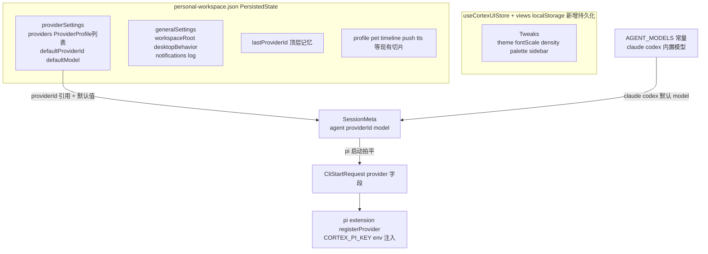
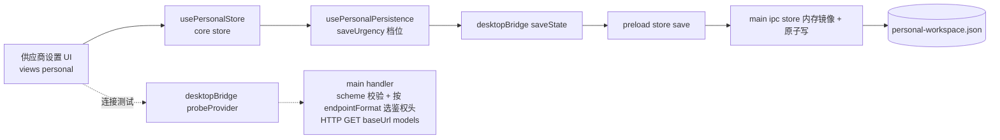

> **执行结果（2026-06-14，分支 `feat/settings-provider-alignment`）**
> - 12 个实现单元全部落地，4 个提交：Provider 抽象迁移（U1/U2/U6/U12）、供应商 UI + Agent 重构（U3/U5）、连接测试（U4）、通用设置渲染层（U7/U8）、通用设置主进程能力（U9/U10/U11）。
> - 质量门全绿：全仓 typecheck 5/5、test（core 181 / views 163 / desktop 150 / ui 3）、lint 8/8。
> - **执行期决策**：(1) `closeToTray` 默认置 `true` 以保留现有「关窗隐藏到托盘」行为（关闭则关窗即退出）；(2) `enabled` 字段保留（会话/自动化模型下拉过滤，非多注册）；(3) 迁移 helper 放 `core/desktop/providers.ts`（保持 types.ts 纯类型，便于主进程镜像）；(4) Tweaks 持久化为新建（仿 pet 的 views 层 localStorage）；(5) 字号经 `.app-frame zoom` 全局缩放，明暗主题铺基础 token、逐组件视觉为迭代项。
> - **延后（计划已声明）**：语言/i18n（应用级重构）；非 chat_completions 协议运行期接入；timeline/voice 端点改引用 Provider；apiKey keychain 加密；暗色全量视觉打磨。
> - **待用户手动验证（UI）**：供应商列表+详情 CRUD/连接测试/密钥显隐/删除确认；Agent 默认供应商联动；通用设置主题切换（含跟随系统）/字号缩放；开机自启/关闭托盘/启动最小化/回合通知；日志目录打开；旧 `personal-workspace.json` 升级后会话/自动化选型不丢。

# feat: 通用设置界面与 kun 风格 Provider/Agent 设置对齐

## Summary

参考 `kun`（`/Users/mike/source/ai/kun`，单 agent 桌面应用）的设置形态，给 Cortex Desktop 个人工作区做两件事：(1) 新增「通用设置」分区并把现有「外观」并入其中，补齐字号、明暗主题、默认工作目录、桌面行为（开机自启/启动最小化/关闭到托盘/原生通知）与日志管理；(2) 引入 kun 风格的顶层「供应商(Provider)」数据模型，把现有只服务 Pi 的 `PiChannel` 升级为通用 Provider，新增对齐 kun 的「供应商」设置界面（左列表 + 右详情 + 预置 + 连接测试），并重构 Agent 设置分区改为引用 Provider。claude/codex/pi 三 agent 架构保留不变。

## Problem Frame

当前个人工作区设置（唯一文件 `packages/views/cortex-desktop/personal/SettingsMenu.tsx`）只有 7 个 Tab（个人资料/宠物/外观/Agent/时间线/推送/语音），没有「通用设置」入口，常规桌面应用该有的语言、启动行为、日志、默认工作目录等都缺位。Agent 分区把「LLM 端点配置」耦合在 Pi 通道里，没有跨场景复用的顶层「供应商」抽象——`PiChannel` 只被 Pi 消费，Claude/Codex 不复用，且设置界面是平铺卡片而非 kun 的「列表+详情」形态。本计划对齐 kun 的成熟设置组织，把「供应商」提升为一等概念，并补齐通用设置。

---

## Requirements

### Provider 抽象与数据模型

- R1. 存在顶层 `ProviderProfile` 数据模型，字段对齐 kun 的 `ModelProviderProfileV1` 核心子集：`id`、`name`、`baseUrl`、`apiKey`、`endpointFormat`、`models`、`enabled`。
- R2. 现有 `PiChannel` 升级为 `ProviderProfile`（破坏性改名、非并存）；改名波及全仓所有 `piChannelId` / `lastPiChannelId` / `piSettings` / `piChannel` 消费点（见 KTD1 改名波及面清单），旧存档在 hydrate 时安全迁移为新结构，迁移失败回退空 provider 列表而非崩溃。
- R3. `endpointFormat` 取值对齐 kun（`chat_completions` / `responses` / `messages` / `custom`），默认 `chat_completions`；运行期当前仅落地 OpenAI 兼容（`chat_completions`），其余协议 UI 可选但运行期接入延后。
- R4. Provider 注册表支持增、删、改、查与「自定义新增」（草稿态不落盘，提交后写入），并提供 kun 风格预置模板（沿用现有 deepseek/kimi/qwen/zhipu/siliconflow/openai/custom 七项，补 `endpointFormat`）。
- R5. 提供「连接测试 / 拉取模型」能力：经主进程对 `{baseUrl}/models` 发起请求，按 `endpointFormat` 选鉴权头（`chat_completions`/`responses` 用 Bearer，`messages` 用 `x-api-key`+`anthropic-version`，`custom` 不支持 probe）；返回成功/失败与可选模型列表；不在 renderer 直连第三方端点。

### Agent 设置

- R6. Agent 设置分区改为「引用 Provider」：Pi 选择默认 Provider + 默认模型（来自 Provider 注册表的 `defaultProviderId`/`defaultModel`），Claude/Codex 保留内置 `AGENT_MODELS` 常量的模型选择与探测式可用性。
- R7. Provider 端点配置从 Agent 分区移出，统一落在新「供应商」分区；Agent 分区不再承载端点/key 表单；所有指向「设置 → Agent 配通道」的引导文案改指「设置 → 供应商」。
- R8. 会话发起时按所选 Provider（替代旧 `piChannelId`）拍平进 `CliStartRequest`，Pi 启动链路（pi extension `registerProvider`）行为与现状等价，apiKey 仍经 `$CORTEX_PI_KEY` env 注入、不写入 pi extension 文件。

### 通用设置（渲染层 / 外观）

- R9. 新增「通用设置」Tab，移除独立「外观」Tab，将 `density` / `palette` / `sidebar` 三项并入通用设置。
- R10. 通用设置新增全局字号 `fontScale`（影响 `document.documentElement` 的 `--font-scale` CSS 变量），取值如 `small` / `medium` / `large`，作用于全局 UI 缩放。
- R11. 通用设置新增明暗主题 `theme`（`system` / `light` / `dark`）：`system` 跟随 `matchMedia(prefers-color-scheme)`，切换即时生效于根节点。
- R12. 外观项（theme/fontScale/density/palette/sidebar）的持久化为**新增能力**：现有 `Tweaks`（`useCortexUIStore`）是纯内存态、重启即重置；本计划新增其持久化（views 层 localStorage，仿 pet 模块），旧存档缺字段回退默认值。

### 通用设置（主进程能力 / generalSettings）

- R13. 新增默认工作目录（`generalSettings.workspaceRoot`）配置：可设置/选择目录，agent 启动未显式传 cwd 时以此为兜底，覆盖 `cli.ts`（oneshot）与 `automation/runner.ts` 两条启动路径当前的 `homedir()` 兜底。
- R14. 桌面行为（`generalSettings.desktopBehavior`）：开机自启（`openAtLogin`，经 `setLoginItemSettings`）、启动最小化（`startMinimized`）、关闭到托盘（`closeToTray`，受控开关现有的关窗隐藏行为）。
- R15. 原生回合完成通知（`generalSettings.notifications.turnComplete`）：开启后 agent 回合结束触发系统通知。
- R16. 日志管理（`generalSettings.log`）：主进程文件日志器（落盘到固定日志目录）、保留天数清理、「打开日志目录」入口、`enabled` 开关。
- R17. 凡被主进程消费的 `generalSettings` 切片（`workspaceRoot` / `desktopBehavior`）变更须立即落盘绕过 500ms 持久化节流，主进程持内存镜像即时读，避免读到旧值。

---

## Key Technical Decisions

- KTD1 — Provider 为顶层抽象，PiChannel 破坏性改名升级，全链路一次到位。把 `PiChannel`→`ProviderProfile`、`PiSettings`→`ProviderSettings`、`SessionMeta.piChannelId`→`providerId`、`PersistedState.lastPiChannelId`→`lastProviderId`、`PI_CHANNEL_TEMPLATES`→`PROVIDER_PRESETS` 改名，并在 `hydrate` 写向后兼容迁移。**改名波及面清单（按归属 Unit）**：

  | 文件 | 引用形态 | 归属 Unit |
  |---|---|---|
  | `packages/core/desktop/types.ts` | 类型定义 + `SessionMeta.piChannelId` + `PersistedState.lastPiChannelId` + `SpotlightIntent.piChannelId`(482) + `AutomationMeta.piChannelId`(649) + `AutomationInput.piChannelId`(670) | U1 |
  | `apps/desktop/src/main/ipc/types.ts` | 上述镜像(28/61/110/355/375) | U1 |
  | `packages/core/index.ts` | 公开导出 `PiSettings`/`PiChannel`/`PiModelOption`/`PiChannelTemplate`(48-51) + `DEFAULT_PI_SETTINGS`/`PI_CHANNEL_TEMPLATES`(108-109) | U1 |
  | `packages/core/store/personal.ts` | `providerSettings` 切片 + `lastProviderId`(89/201/306/483) + `initialModelDraft`(526-540) + `createSession`(280-306) | U2 |
  | `packages/core/desktop/usePersonalPersistence.ts` | `saveUrgency` 比较 `lastPiChannelId`(29) | U2 |
  | `packages/core/personal/messages.ts` | 会话拍平 `piChannel`(710-732) | U6 |
  | `apps/desktop/src/main/agents/pi-providers.ts` | extension 渲染入参 | U6 |
  | `apps/desktop/src/main/agents/pi.ts` | adapter 引用(66) | U12 |
  | `apps/desktop/src/main/automation/runner.ts` | `resolvePiChannel`(43) + `meta.piChannelId`(118) + cwd 兜底(108) | U12（cwd 兜底见 U10） |
  | `apps/desktop/src/main/automation/ipc.ts` | 透传 `input.piChannelId`(49) | U12 |
  | `apps/desktop/src/renderer/src/SpotlightBar.tsx` | pi 通道草稿/选型整块(18/36/54/88/96-99/117) | U12 |
  | `packages/core/personal/spotlightHandoff.ts` | 透传 `piChannelId`(54) | U12 |
  | `packages/views/cortex-desktop/personal/AutomationDialog.tsx` | 读 `piSettings.channels`(77/107) + `piChannelId` state(92/110/123/133) + 死链 hint(198) | U12 |
  | `packages/views/cortex-desktop/personal/ComposerShell.tsx` | 读 `piSettings.channels`(92/97-103) + 死链 option「去设置 → Agent」(420) | U12 |
  | `packages/views/cortex-desktop/personal/PersonalComposer.tsx` | 引用(42) | U12 |
  | `packages/views/cortex-desktop/personal/NewSessionLanding.tsx` | 取默认通道/写 piChannelId(40-53/120-128) | U12 |
  | `packages/views/cortex-desktop/personal/PersonalChatArea.tsx` | 引用(198-203/386) | U12 |
  | `packages/views/cortex-desktop/personal/SettingsMenu.tsx` | 供应商/Agent 分区 | U3/U5/U7 |

  理由：并存两套会长期割裂数据源；hydrate 迁移是本仓既有范式。一次性改名要求上表无遗漏，否则 typecheck 失败或旧用户会话/定时任务选型静默丢失。

- KTD2 — 保留多 agent；Provider 主要服务可配端点的 agent（Pi）。Claude/Codex 是探测式 CLI、不接受 baseUrl/apiKey 端点配置，不强行塞进 `providerId` 引用，其默认模型走 `AGENT_MODELS` 常量。`ProviderProfile.enabled` 保留（相对 kun 的有意分歧），用途是**在会话发起与自动化的模型选择器中过滤可选 provider**（`ComposerShell`/`AutomationDialog` 的 `.filter(c => c.enabled)` 下拉级开关，关闭项不出现在下拉）——**不是**「多注册 pi provider」（spawn 时只把单个选中 provider 渲染成 extension）。

- KTD3 — `endpointFormat` 入模型对齐 kun，但运行期先只落地 `chat_completions`。理由：数据模型对齐保证未来可扩展且 UI 与 kun 一致；但 Pi runtime 对 anthropic `messages` / openai `responses` 协议的实际支持需真机验证，运行期接入非 `chat_completions` 协议延后（见 Open Questions）。连接测试（U4）按 `endpointFormat` 分支处理鉴权头与可用性，避免对非 `chat_completions` provider 误报失败。

- KTD4 — apiKey 维持现状落盘策略。Provider 的 `apiKey` 继续随 `personal-workspace.json` 明文落盘（与现状 `PiChannel.apiKey` 及 kun 的明文策略一致）；pi extension 文件继续用 `$CORTEX_PI_KEY` 占位 + 运行时 env 注入，不把 key 写进 `.js`。系统 keychain（`safeStorage`）加密为延后改进。注意本轮新增的 probe（U4）会把明文 key 经网络发往用户自填端点，扩大了 key 的暴露面（见 Risks），缓解项为 U4 的 scheme 白名单 + 超时。

- KTD5 — 通用设置走两套既有持久化通道，不新建第三套 store，但需修正「外观项已持久化」的错误前提。
  - **主进程相关项**（`generalSettings.workspaceRoot/desktopBehavior/notifications/log`）：作为 `PersistedState` 内的嵌套容器 `generalSettings`，走既有 `usePersonalStore` → `saveState` → `personal-workspace.json` 单文件通道（五处对称改动：`PersistedState` 加字段 + store 切片/setter + `hydrate`/`toPersistedState` + `saveUrgency` + `SettingsMenu` Tab）。
  - **外观项**（`theme/fontScale/density/palette/sidebar`）：留在 `Tweaks`（`useCortexUIStore`）。**现状该 store 无持久化（裸 `create`，重启重置）**，本计划新增其持久化（views 层 localStorage hydrate+write，仿 `packages/views/cortex-desktop/pet/*` 的 `ln` 范式，遵守 core 不直接用 localStorage 的硬边界）。

- KTD6 — 主进程消费的设置立即落盘绕过节流。`generalSettings.workspaceRoot`/`desktopBehavior` 等被主进程读取的切片，变更时 `saveUrgency` 返回紧急档立即落盘；并让主进程持内存镜像，`store:save` 一到即同步。理由：renderer 持久化有 500ms 节流，主进程决策若依赖 persisted state 会读到旧值（本仓既有教训）。

- KTD7 — 语言/i18n 整体延后。本仓零 i18n 基础设施、UI 全硬编码中文，「语言切换」需应用级字符串抽取 + 框架引入，与「通用设置功能」严重不成比例。本计划不含语言项，作为独立 initiative 延后（见 Scope Boundaries）。

- KTD8 — 连接测试走主进程 `probeProvider`。新增 `DesktopBridge.probeProvider` + preload + 主进程 handler，对 `{baseUrl}/models` 发起请求，入口校验 baseUrl scheme（仅 `http`/`https`）。理由：renderer 直连第三方端点有 CORS 与 key 暴露问题；沿用「主进程做网络、renderer 拍平传参」惯例。

---

## High-Level Technical Design

### 设置数据模型关系（目标态，跨两套存储）

外观项在 `Tweaks`（`useCortexUIStore` + 新增 views 层 localStorage），其余设置在 `personal-workspace.json`（`PersistedState`）。Provider 为顶层注册表，Agent 默认与会话经 `providerId` 引用；Claude/Codex 默认走 `AGENT_MODELS` 常量。

### Provider 设置数据流与连接测试

外观项走 Tweaks/localStorage 旁路（不在此图）；Provider 与 generalSettings 走 saveState 单文件通道。

### 设置 Tab 信息架构（前后对比）

「通用」Tab 内部读写两套存储（外观项→Tweaks，其余→generalSettings），分节顺序见 U7。

| 顺序 | 现状（7） | 目标（8） |
|---|---|---|
| 1 | 个人资料 profile | 个人资料 profile |
| 2 | 宠物 pet | 通用 general（外观 + 主题/字号 + 工作目录 + 桌面行为 + 通知 + 日志） |
| 3 | 外观 appearance | 供应商 providers（新） |
| 4 | Agent agent | Agent agent（改为引用 Provider） |
| 5 | 时间线 timeline | 宠物 pet |
| 6 | 推送 push | 时间线 timeline |
| 7 | 语音 voice | 推送 push |
| 8 | — | 语音 voice |

「外观」Tab 移除，内容并入「通用」；新增「通用」「供应商」两个分区。

---

## Scope Boundaries

### 本计划包含

- 顶层 Provider 数据模型 + 供应商设置界面（kun 风格）+ 连接测试 + 预置模板。
- `PiChannel`→`Provider` 破坏性改名的全链路消费点改写（见 KTD1 清单）。
- Agent 设置分区重构为引用 Provider；Pi 启动链路迁移到 Provider；死链引导文案修正。
- 通用设置分区：合并外观、字号、明暗主题（+ 新增 Tweaks 持久化）、默认工作目录、桌面行为、日志管理。
- 旧存档向后兼容 hydrate 迁移。

### 延后到后续工作（Deferred）

- 语言切换 / i18n 国际化：需引入 i18n 框架并抽取全应用硬编码中文，属应用级独立 initiative，不在本计划（见 KTD7）。**此项偏离用户「完整移植」初衷，是基础设施缺失导致的取舍，可在评审时要求纳入。**
- 非 `chat_completions` 协议（anthropic `messages` / openai `responses`）的运行期接入：数据模型与 UI 先就位，runtime 实际支持待真机验证后另行接入（见 KTD3 / Open Questions）。
- 时间线（summary model）、语音（TTS）端点配置改为引用 Provider：当前各自独立的 OpenAI 兼容端点配置不在本次统一范围。
- apiKey 系统 keychain 加密（`safeStorage`）：本计划维持现状明文落盘（见 KTD4 / Risks）。
- 明暗主题的全量视觉覆盖：本计划落地主题切换机制 + 基础 token，逐组件 light 模式视觉打磨为迭代项（见 U8）。

### 明确不做

- 不改动 claude/codex 的 CLI 适配器契约（`buildArgs`/`parseLine`）与 spawn 管线。
- 不引入 kun 的单 agent runtime（port/binaryPath/sandbox/dataDir 等 kun-runtime 专属字段不照搬）。

---

## Implementation Units

工作分三阶段：**Phase A（Provider 抽象，数据+改名+UI）→ Phase B（通用设置外观层）→ Phase C（通用设置主进程能力）**。Phase A 的类型/store/改名是后续引用基础。

### U1. Provider 数据模型与类型迁移

- **Goal**: 定义 `ProviderProfile` / `ProviderSettings` / `EndpointFormat` / `ProviderModelOption`，把 `PiChannel`/`PiSettings`/`PiModelOption`/`PI_CHANNEL_TEMPLATES` 改名升级为 Provider 体系，`SessionMeta.piChannelId`→`providerId`、`PersistedState.lastPiChannelId`→`lastProviderId`、`SpotlightIntent`/`AutomationMeta`/`AutomationInput` 的 `piChannelId`→`providerId`，同步 `index.ts` 公开导出，并镜像到主进程类型。
- **Requirements**: R1, R3, R4。
- **Dependencies**: 无。
- **Files**:
  - `packages/core/desktop/types.ts`（新增 Provider 类型；重命名 Pi 体系；改 `SessionMeta`(41-65)/`SpotlightIntent`(482)/`AutomationMeta`(649)/`AutomationInput`(670)/`PersistedState`(322-340) 的 pi 字段；`PI_CHANNEL_TEMPLATES`→`PROVIDER_PRESETS` 补 `endpointFormat`；`CliStartRequest.piChannel`→`provider`）
  - `apps/desktop/src/main/ipc/types.ts`（镜像形状 28/61/110/355/375，`satisfies` 对齐）
  - `packages/core/index.ts`（48-51、108-109 导出标识同步改名——破坏性改名，本仓无外部消费者）
  - `packages/core/desktop/types.test.ts`（迁移/规范化 helper 测试）
- **Approach**: `ProviderProfile = { id, name, baseUrl, apiKey?, endpointFormat, models: ProviderModelOption[], enabled }`；`ProviderSettings = { providers, defaultProviderId?, defaultModel? }`。提供纯函数 `normalizeProviderProfile` / `migratePiChannelToProvider`（旧→新）供 store hydrate 复用。预置模板从 `PI_CHANNEL_TEMPLATES` 平移并加 `endpointFormat: "chat_completions"`。`index.ts` 导出名随之更新（属公开 API 破坏性改名，一次到位）。
- **Patterns to follow**: 现有 `PiChannel`/`PiSettings`（types.ts 155-246）类型组织；core↔main `satisfies` 镜像约定。
- **Test scenarios**:
  - `migratePiChannelToProvider` 把 `{id,label,baseUrl,apiKey,models,enabled}` 映射为 `{id,name,baseUrl,apiKey,models,enabled,endpointFormat:"chat_completions"}`（`label`→`name`，补默认 `endpointFormat`）。
  - `normalizeProviderProfile` 对缺 `endpointFormat` 回退 `chat_completions`；对 `models` 去重排序。
  - `PROVIDER_PRESETS` 每项均含合法 `endpointFormat`。
- **Verification**: `pnpm --filter @cortex-work/core typecheck` 与 main 侧 typecheck 通过；helper 单测通过。

### U2. Provider store 切片、持久化与向后兼容 hydrate 迁移

- **Goal**: `usePersonalStore` 把 `piSettings` 切片升级为 `providerSettings`，`lastPiChannelId`→`lastProviderId`，提供 CRUD setter，`hydrate`/`toPersistedState` 两端读写并迁移旧 `piSettings`/`piChannelId`/`lastPiChannelId`/`defaultChannelId`；`createSession`/`initialModelDraft` 同步改名。
- **Requirements**: R2, R4。
- **Dependencies**: U1。
- **Files**:
  - `packages/core/store/personal.ts`（切片重命名 + `addProvider`/`updateProvider`/`removeProvider`/`setProviderDefaults` + `hydrate` 迁移(201) + `toPersistedState`(483) + `createSession`(280-306) + `initialModelDraft`(526-540)）
  - `packages/core/desktop/usePersonalPersistence.ts`（`saveUrgency`(29) `lastPiChannelId`→`lastProviderId`，provider 切片档位）
  - `packages/core/store/personal.test.ts`（hydrate 迁移 + CRUD 测试）
- **Approach**: `hydrate` 读旧档：`piSettings.channels` 经 U1 `migratePiChannelToProvider` 转 `providerSettings.providers`，`defaultChannelId`→`defaultProviderId`，会话 `piChannelId`→`providerId`，顶层 `lastPiChannelId`→`lastProviderId`；新档直接读。缺字段回退空 provider 列表。`initialModelDraft`/`createSession` 据 `lastProviderId` + `defaultProviderId` 选默认。provider 切片走普通落盘档（不被主进程即时消费）。
- **Patterns to follow**: 个人资料/Pi 两次切片改造的对称写法与 hydrate 容错；`addPiChannel`/`updatePiChannel`/`removePiChannel`/`setPiDefaults`（personal.ts 248-268）CRUD 范本。
- **Test scenarios**:
  - hydrate 旧档（`piSettings.channels` 两条 + `defaultChannelId`）→ `providerSettings.providers` 两条、`defaultProviderId` 正确。
  - hydrate 旧会话 `SessionMeta.piChannelId="x"` → `providerId="x"`。
  - hydrate 旧档顶层 `lastPiChannelId="x"` → `lastProviderId="x"`。
  - hydrate 更旧档（无 `piSettings`/`providerSettings`）→ `providers` 为空、不抛。
  - `addProvider`/`removeProvider`/`updateProvider` 改变 `providers` 且 `toPersistedState` 含新结构。
  - 删除被 `defaultProviderId` 引用的 provider → 默认引用回退（空或第一个）。
- **Verification**: store 单测全绿；旧 `personal-workspace.json` 启动不丢配置/会话选型（手动验证留执行者）。

### U3. 供应商（Provider）设置界面

- **Goal**: 新增「供应商」Tab，kun 风格「左列表 + 右详情表单」：列表显示 provider 卡片（名称/徽标/模型数），详情含 name/id/baseUrl/apiKey（带显隐切换的密钥输入）/endpointFormat/models 编辑，支持预置模板添加与自定义新增（草稿提交后落盘）、两段式删除确认。
- **Requirements**: R4, R7。
- **Dependencies**: U2。
- **Files**:
  - `packages/views/cortex-desktop/personal/SettingsMenu.tsx`（`SettingsTab` 增 `providers`、`TABS` 增项、移除 `appearance` 项、新增 `ProvidersSection`）
  - `packages/views/cortex-desktop/personal/ProvidersSection.tsx`（建议抽出，含详情表单 + 密钥显隐控件）
  - `packages/views/cortex-desktop/personal/ProvidersSection.test.tsx`
- **Approach**: 列表+详情布局（参考 kun `settings-section-providers.tsx` 的 `lg:grid-cols-[280px_1fr]`）。「添加」下拉列出 `PROVIDER_PRESETS` + 自定义；草稿态本地 state 不入 store，点「添加」才 `addProvider`。`endpointFormat` 用 select。**注意：本仓无 `SecretInput` 组件、现有 apiKey 仅 `type="password"` 无显隐切换，删除按钮(SettingsMenu ChannelCard:462)直删无确认**——故密钥显隐输入与删除确认均为新增工作：密钥控件新建带 reveal 切换的输入；删除复用 `ProjectMenu.tsx:182-185` 的两段式 `confirming` 范式（非 SettingsMenu）。
- **Patterns to follow**: 现有 `ChannelCard` 字段编辑（SettingsMenu.tsx 442-492）；`ProjectMenu.tsx`(182-185) 两段式删除确认；kun 列表+详情布局为视觉参照（外部参考）。
- **Test scenarios**:
  - 渲染列出 `providerSettings.providers` 每项为列表卡片；空列表渲染空态不崩溃。
  - 选预置模板「添加」→ `addProvider` 新 provider 含模板 `baseUrl`/`endpointFormat`/`models`。
  - 编辑详情 name/baseUrl/apiKey → `updateProvider` 对应字段。
  - 「自定义」新增创建草稿，未提交不调 `addProvider`；提交后调用一次。
  - 删除首次点击进入「确认删除？」态，二次点击才 `removeProvider`。
  - 密钥输入默认掩码，点显隐切换可见。
- **Verification**: 组件测试全绿；`pnpm --filter @cortex-work/views typecheck` 通过。

### U4. Provider 连接测试与模型拉取

- **Goal**: 新增 `DesktopBridge.probeProvider`，主进程校验 scheme 后按 `endpointFormat` 选鉴权头对 `{baseUrl}/models` 发请求，返回 `{ ok, models?, error? }`；详情面板「测试连接 / 拉取模型」按钮含四态反馈（请求中/成功回填/失败内联/前置禁用）。
- **Requirements**: R5。
- **Dependencies**: U1, U3。
- **Files**:
  - `packages/core/desktop/bridge.ts`（新增 `probeProvider?(input): Promise<ProviderProbeResult>`，Web 端为 null）
  - `packages/core/desktop/types.ts` + `apps/desktop/src/main/ipc/types.ts`（`ProviderProbeInput`/`ProviderProbeResult` 镜像）
  - `apps/desktop/src/preload/index.ts`（`personal` 暴露 `probeProvider` → `invoke("provider:probe", input)`）
  - `apps/desktop/src/main/ipc/provider.ts`（新 handler）+ `apps/desktop/src/main/ipc/register.ts`（注册 `provider` 域）
  - `apps/desktop/src/main/ipc/provider.test.ts`
  - `packages/views/cortex-desktop/personal/ProvidersSection.tsx`（接线测试按钮 + 四态 UI）
- **Approach**: handler 入口校验 `/^https?:\/\//i.test(baseUrl)`，非法返回 `{ok:false}`。按 `endpointFormat` 分支（对齐 kun `provider-connection.ts`）：`chat_completions`/`responses` 用 `Authorization: Bearer <apiKey>`；`messages` 用 `x-api-key: <apiKey>` + `anthropic-version`；`custom` 禁用 probe，返回提示「手动填模型」。用 Node `fetch` + `AbortController`(10s) GET `{baseUrl.replace(/\/+$/,"")}/models`，解析 `{data:[{id}]}` 为模型 id 列表，失败返回 `{ok:false,error}` 不抛。renderer 拍平传 baseUrl/apiKey/endpointFormat。四态 UI 参照 `VoiceSection` 的 `testing`/`loadingVoices`（SettingsMenu.tsx 899/944-946）：请求中按钮 disabled+「测试中…」，成功「连接成功，N 个模型」并支持回填，失败内联 error，baseUrl/apiKey 空时前置禁用。
- **Patterns to follow**: `apps/desktop/src/main/ipc/llm.ts`（renderer 拍平惯例）；`register.ts`(18-33) 域注册；`VoiceSection` 测试态范式；kun `provider-connection.ts`（外部参考，scheme 校验 + messages 头部 + custom 拒绝）。
- **Test scenarios**:
  - mock fetch `{data:[{id:"m1"},{id:"m2"}]}` → `{ok:true, models:["m1","m2"]}`。
  - mock fetch 401 → `{ok:false, error}`，不抛。
  - baseUrl 末尾多斜杠规范化（`https://x.com/`→ `https://x.com/models`）。
  - 非 `http(s)` scheme（如 `file://`）→ `{ok:false}` 校验错误。
  - `endpointFormat="messages"` → 请求头用 `x-api-key`+`anthropic-version` 而非 Bearer。
  - `endpointFormat="custom"` → 不发请求，返回「手动填模型」提示。
  - 超时（AbortController）→ `{ok:false}` 不挂起。
  - 空 baseUrl/apiKey → 按钮前置禁用（renderer）/ handler 返回校验错误。
- **Verification**: handler 单测全绿；桌面端四态可见（手动验证留执行者）。

### U5. Agent 设置分区重构为引用 Provider

- **Goal**: `AgentSection` 去掉端点/通道编辑（迁至供应商分区），改为：Pi 选择默认 Provider + 默认模型（来自注册表）；Claude/Codex 保留 `AGENT_MODELS` 模型选择与可用性展示。
- **Requirements**: R6, R7。
- **Dependencies**: U2, U3。
- **Files**:
  - `packages/views/cortex-desktop/personal/SettingsMenu.tsx`（重写 `AgentSection` 494-579）
  - `packages/views/cortex-desktop/personal/SettingsMenu.test.tsx`
- **Approach**: Pi 区域用 `providerSettings.providers`（`enabled` 项）填「默认 Provider」下拉，选中后用该 provider 的 `models` 填「默认模型」；写 `setProviderDefaults`。Claude/Codex 沿用 `AGENT_MODELS`/`DEFAULT_MODEL` 与 `agentsAvailable` 探测展示，复用现有「（未设置）」占位（SettingsMenu.tsx:559）。移除原通道 CRUD（已在 U3）。
- **Patterns to follow**: 现有 `AGENT_MODELS`/`DEFAULT_MODEL`（types.ts 544-570）下拉；`AGENT_LABEL`（SettingsMenu.tsx 315）；「（未设置）」占位(559)。
- **Test scenarios**:
  - Pi「默认 Provider」下拉只列 `enabled` 的 provider。
  - 选默认 Provider 后「默认模型」选项 = 该 provider 的 `models`。
  - 改默认调 `setProviderDefaults({defaultProviderId, defaultModel})`。
  - `defaultProviderId` 指向已删除/已禁用（被 enabled 过滤）provider 时，下拉回退「（未设置）」且不报错。
  - Claude/Codex 区仍渲染 `AGENT_MODELS` 选项且无端点/key 输入。
- **Verification**: 组件测试全绿。

### U6. Pi 启动链路接入 Provider（messages 拍平 + extension 渲染）

- **Goal**: `messages.ts` 会话发起按所选 Provider（替代 `piChannelId`）拍平进 `CliStartRequest.provider`，主进程 pi extension 渲染与现状等价。
- **Requirements**: R8。
- **Dependencies**: U1, U2。
- **Files**:
  - `packages/core/personal/messages.ts`（710-732：选 provider 拍平进 `CliStartRequest.provider`）
  - `apps/desktop/src/main/agents/pi-providers.ts`（`renderPiExtension`/`writePiExtension` 入参从 channel 改 provider 形状，行为等价）
  - `apps/desktop/src/main/agents/pi-providers.test.ts`
  - `packages/core/personal/messages.test.ts`
- **Approach**: 依 `SessionMeta.providerId`（或 Pi 默认）从 `providerSettings.providers` 取 provider，拍平 `{id, baseUrl, apiKey, models}` 进请求；主进程渲染逻辑不变，apiKey 仍 `$CORTEX_PI_KEY` env 注入、不写入 `.js`。注：其余会话发起入口（Spotlight/新建/换 agent/自动化）在 U12 统一改写。
- **Patterns to follow**: 现有 `CliStartRequest.piChannel` 拍平（messages.ts 710-732）；`pi-providers.ts`(57-61) 的 `$CORTEX_PI_KEY` 注入与 0600 写入。
- **Test scenarios**:
  - `SessionMeta.providerId` 命中 provider → `CliStartRequest.provider` 含其 `baseUrl`/`models`，extension 文件内容不含明文 key（仅占位符）。
  - 选中 provider 不存在/被删 → 安全回退（默认 provider 或不注入），不抛。
  - `renderPiExtension` 对新 provider 形状产出与旧 channel 等价的 extension（字段断言/快照）。
- **Verification**: core + main 相关单测全绿。

### U12. 改名波及面：renderer / automation / spotlight 消费点全链路改写

- **Goal**: 把 KTD1 清单中 U1/U2/U6 之外的全部 `piChannelId`/`piSettings`/`.channels` 消费点改走 `providerSettings`/`providerId`，并修正两处指向「设置 → Agent」的死链引导文案为「设置 → 供应商」。
- **Requirements**: R2, R7, R8。
- **Dependencies**: U1, U2。
- **Files**:
  - `apps/desktop/src/renderer/src/SpotlightBar.tsx`（pi 通道草稿/选型整块 18/36/54/88/96-99/117）
  - `packages/core/personal/spotlightHandoff.ts`（透传 54）
  - `packages/views/cortex-desktop/personal/NewSessionLanding.tsx`（取默认通道/写选型 40-53/120-128）
  - `packages/views/cortex-desktop/personal/ComposerShell.tsx`（读 `piSettings.channels` 92/97-103；死链 option:420「未配置通道（去设置 → Agent）」→「（去设置 → 供应商）」、术语「通道」→「Provider」）
  - `packages/views/cortex-desktop/personal/PersonalComposer.tsx`（42）
  - `packages/views/cortex-desktop/personal/PersonalChatArea.tsx`（198-203/386）
  - `packages/views/cortex-desktop/personal/AutomationDialog.tsx`（读 `piSettings.channels` 77/107、`piChannelId` state 92/110/123/133、死链 hint:198「请先在设置中配置 Pi 的 LLM 通道」→指向供应商）
  - `apps/desktop/src/main/automation/runner.ts`（`resolvePiChannel`→`resolveProvider` 43、`meta.piChannelId`→`meta.providerId` 118）
  - `apps/desktop/src/main/automation/ipc.ts`（透传 49）
  - `apps/desktop/src/main/agents/pi.ts`（66）
  - 对应入口的回归测试（automation runner provider 解析、AutomationDialog 选型、Spotlight 选型）
- **Approach**: 逐文件把 store 选择器从 `s.piSettings.channels` 改为 `s.providerSettings.providers`、字段 `piChannelId`→`providerId`、本地 setter/状态名同步；automation `runner.ts` 的 `resolvePiChannel` 改 `resolveProvider`（从 `state.providerSettings.providers` 解析）。死链文案改指「供应商」分区、术语统一为「Provider」。改写后全仓 `pnpm typecheck` 应无残留 pi 字段引用。
- **Patterns to follow**: 各文件现有的 `.filter(c => c.enabled)` 下拉过滤与 `piChannelId` 透传写法，逐一平移到 provider 命名。
- **Test scenarios**:
  - automation `resolveProvider(meta.providerId)` 从 `providerSettings.providers` 正确解析出 provider 拍平体；providerId 不存在 → 安全回退/跳过不崩。
  - `AutomationDialog` 模型下拉来源为 `providerSettings.providers`（enabled），提交写 `providerId`。
  - `SpotlightBar` 选型读 `providerSettings` 并透传 `providerId`。
  - `ComposerShell` 空 provider 时 option 文案为「（去设置 → 供应商）」。
  - 全仓 typecheck 无 `piChannelId`/`piSettings`/`.channels` 残留（可加一条 grep 守卫断言或在验证步骤执行）。
- **Verification**: 相关单测全绿；`pnpm typecheck` 全仓通过（改名零残留）。

### U7. 通用设置 Tab 骨架、合并外观、字号与 Tweaks 持久化

- **Goal**: 新增「通用」Tab，移除独立「外观」Tab，把 `density`/`palette`/`sidebar` 并入；新增全局字号 `fontScale`（`documentElement` 的 `--font-scale`）；**新增 Tweaks 持久化**（现状无）。给出 GeneralSection 内部分节顺序。
- **Requirements**: R9, R10, R12。
- **Dependencies**: 无（与 Phase A 并行）。
- **Files**:
  - `packages/core/types/index.ts`（`Tweaks` 接口 159-167 增 `fontScale`、`theme`(U8)）
  - `packages/core/store/ui.ts`（`DEFAULT_TWEAKS` 41-45 增 `fontScale: "medium"`、`theme: "system"`(U8)）
  - `packages/views/cortex-desktop/personal/`（**新增 Tweaks 持久化模块**：启动 hydrate + `setTweak` 同步写 localStorage，仿 `pet/*` 的 `ln` 范式；core 不直接用 localStorage）
  - `packages/views/cortex-desktop/personal/SettingsMenu.tsx`（`SettingsTab` 增 `general` 去 `appearance`、`TABS` 调整、`GeneralSection` 合并原 `AppearanceSection`(259-281) + 字号控件）
  - `apps/web`/`apps/desktop` 渲染根或 `CortexDesktopView` 容器（应用 `--font-scale` 到 `documentElement`）
  - 对应组件 + 持久化测试
- **Approach**: `Tweaks` 增 `fontScale`；`GeneralSection` 用现有 `twk-sect` 分节，分组顺序：**外观（density/palette/sidebar）｜主题与字号（theme/fontScale）｜默认工作目录｜启动与窗口行为｜通知｜日志**（高频项靠前，主进程行为类聚合；工作目录/行为/通知/日志由 U8-U11 落位到此契约）。字号经 `document.documentElement.style.setProperty("--font-scale", ratio)` 应用（挂 `documentElement` 以覆盖 Spotlight/Pet 等 `.app-frame` 外子树）。**Tweaks 持久化为新增**：views 层 localStorage hydrate（启动读）+ 写（`setTweak` 时），缺字段回退 `DEFAULT_TWEAKS`。
- **Patterns to follow**: 现 `AppearanceSection`(259-281)、`twk-sect` 分节(265/271/273)；`packages/views/cortex-desktop/pet/*` 的 `ln` localStorage 持久化范式；现有 `data-density/palette/sidebar` 写在 `CortexDesktopView.tsx`(96-98)。
- **Test scenarios**:
  - 「通用」Tab 渲染 density/palette/sidebar/字号控件；Tab 列表不再含「外观」。
  - 改字号调 `setTweak("fontScale", ...)` 且 `documentElement` 的 `--font-scale` 更新。
  - Tweaks 持久化：设置后写入 localStorage；重启（重新 hydrate）后保留；缺 `fontScale` 旧值回退 `medium`。
- **Verification**: 组件 + 持久化测试全绿；typecheck 通过。

### U8. 明暗主题（system / light / dark）

- **Goal**: 通用设置新增主题 `theme`，`system` 跟随系统、`light`/`dark` 强制；切换即时作用于 `documentElement` 的 `data-theme`，并铺设基础明暗 token。
- **Requirements**: R11, R12。
- **Dependencies**: U7（含 Tweaks 持久化）。
- **Files**:
  - `packages/core/types/index.ts`（`Tweaks.theme: "system"|"light"|"dark"`）
  - `packages/core/store/ui.ts`（`DEFAULT_TWEAKS.theme: "system"`）
  - `packages/views/cortex-desktop/personal/SettingsMenu.tsx`（`GeneralSection`「主题与字号」分节增主题控件）
  - 主题应用钩子（`documentElement` 设 `data-theme` + `matchMedia` 监听）
  - 基础明暗 token 层（CSS 变量分组），位置依现有 palette token 实现而定
  - 对应测试
- **Approach**: `theme==="system"` 用 `matchMedia("(prefers-color-scheme: dark)")` 解析并监听变化；`light`/`dark` 直接设 `documentElement.dataset.theme`（与字号同挂 `documentElement`）。铺最小明暗 token（背景/前景/边框基础变量），与现有 palette（品牌色）正交。**全量逐组件 light 视觉覆盖为迭代项**（Scope Boundaries 已声明）。主题随 Tweaks 持久化（U7）。可选经主进程同步 `nativeTheme.themeSource`（非必须）。
- **Patterns to follow**: 现有 palette token 应用（`SettingsMenu.tsx` 51-56）；U7 的 Tweaks 持久化。
- **Test scenarios**:
  - `theme="dark"` → `documentElement` `data-theme="dark"`。
  - `theme="system"` + matchMedia 返回 dark → 解析 dark；mock matchMedia 切换触发更新。
  - 改主题调 `setTweak("theme", ...)`；持久化后重启保留；旧档缺 `theme` 回退 `system`。
- **Verification**: 组件/解析逻辑单测全绿；手动切换三态留执行者验证。

### U9. 桌面行为（开机自启 / 启动最小化 / 关闭到托盘 / 原生通知）

- **Goal**: 新增 `generalSettings.desktopBehavior`（`openAtLogin`/`startMinimized`/`closeToTray`）与 `generalSettings.notifications.turnComplete`，主进程据此行动。
- **Requirements**: R14, R15, R17。
- **Dependencies**: U7（GeneralSection 骨架与分节契约）。
- **Files**:
  - `packages/core/desktop/types.ts` + `apps/desktop/src/main/ipc/types.ts`（`generalSettings` 嵌套容器入 `PersistedState`：`{ desktopBehavior, notifications, workspaceRoot(U10), log(U11) }` 镜像）
  - `packages/core/store/personal.ts`（`generalSettings` 切片 + setter + hydrate/toPersistedState）
  - `packages/core/desktop/usePersonalPersistence.ts`（`desktopBehavior` 切片 `saveUrgency` 紧急档，R17）
  - `packages/core/desktop/bridge.ts` + `apps/desktop/src/preload/index.ts`（`applyDesktopBehavior` / `notify` 等方法，按需）
  - `apps/desktop/src/main/index.ts`（关窗隐藏 57-62 受 `closeToTray` 控制；启动最小化；`setLoginItemSettings`）
  - `apps/desktop/src/main/ipc/`（登录项 / 原生通知 handler）+ `register.ts`
  - `packages/views/cortex-desktop/personal/SettingsMenu.tsx`（`GeneralSection`「启动与窗口行为」「通知」分节）
  - 对应测试（mock electron `app`/`BrowserWindow`/`Notification`）
- **Approach**: `openAtLogin` 经 IPC 调 `app.setLoginItemSettings({openAtLogin, openAsHidden: startMinimized})`；`closeToTray` 受控现有 `mainWindow.on("close")`(57-62) 隐藏分支（false 则真正退出）；`startMinimized` 窗口创建后按设置 `minimize()`/不 show。回合完成通知：agent 回合结束（renderer 已知该事件）经桥/IPC 触发主进程 `new Notification(...).show()`（优先主进程统一，见 Open Questions）。R17：`desktopBehavior` 立即落盘，主进程持内存镜像即时读。开机自启仅 win32/darwin 可用（对齐 kun gating）。
- **Patterns to follow**: 现有 `automation/tray.ts`(5,30)、`index.ts` 关窗隐藏(57-62)/`isQuitting`(21)/window-all-closed(132-136)；`register.ts` 域注册。
- **Test scenarios**:
  - `openAtLogin=true` 调 `setLoginItemSettings({openAtLogin:true,...})`（mock 断言）。
  - `closeToTray=true` 关窗 `preventDefault`+hide；`=false` 不阻止关闭。
  - `startMinimized=true` 启动后窗口最小化/不 show。
  - `notifications.turnComplete=true` 回合结束触发一次 Notification；`=false` 不触发。
  - `desktopBehavior` 变更触发即时落盘（`saveUrgency` 紧急档）。
- **Verification**: 主进程逻辑单测（mock electron）全绿；跨平台 gating 正确。

### U10. 默认工作目录（workspaceRoot，覆盖 cli + automation 两条路径）

- **Goal**: 新增 `generalSettings.workspaceRoot`，agent 启动未显式传 cwd 时以此兜底，替代 `cli.ts`（oneshot）与 `automation/runner.ts` 的 `homedir()` 兜底。
- **Requirements**: R13, R17。
- **Dependencies**: U7, U9（共用 `generalSettings` 容器与切片）。
- **Files**:
  - `packages/core/desktop/types.ts`（`generalSettings.workspaceRoot`）
  - `packages/core/store/personal.ts`（setter + hydrate/toPersistedState）
  - `packages/core/desktop/usePersonalPersistence.ts`（紧急档，R17——被主进程消费）
  - `packages/core/desktop/bridge.ts` + `apps/desktop/src/preload/index.ts`（目录选择器 `pickDirectory`，若无则新增）
  - `apps/desktop/src/main/ipc/cli.ts`（285/291 的 `req.cwd ?? homedir()` → `req.cwd ?? workspaceRoot ?? homedir()`）
  - `apps/desktop/src/main/automation/runner.ts`（108 `meta.cwd || homedir()` → `meta.cwd || workspaceRoot || homedir()`，经内存镜像读 workspaceRoot）
  - `apps/desktop/src/main/ipc/`（目录选择 handler，若需要）
  - `packages/views/cortex-desktop/personal/SettingsMenu.tsx`（`GeneralSection`「默认工作目录」分节：输入 + 选择/恢复默认按钮）
  - 对应测试
- **Approach**: 主进程读 workspaceRoot 须有内存镜像（R17 即时落盘 + store:save 即时同步）。`cli.ts`（oneshot）与 `runner.ts`（automation）两处兜底均纳入。目录选择走 `dialog.showOpenDialog`。校验目录存在性，无效回退默认。
- **Patterns to follow**: `cli.ts` cwd 兜底(208/285/291)；`runner.ts` cwd(108)；kun workspace 选择（外部参考）。
- **Test scenarios**:
  - 设 `workspaceRoot` 后 oneshot 启动且 `req.cwd` 缺省 → spawn cwd = workspaceRoot。
  - automation 启动且 `meta.cwd` 缺省 → cwd = workspaceRoot（非 homedir）。
  - `req.cwd`/`meta.cwd` 存在时优先之（workspaceRoot 不覆盖）。
  - 均缺省 → 回退 `homedir()`。
  - workspaceRoot 变更触发即时落盘。
- **Verification**: `cli.ts` 与 `runner.ts` cwd 解析单测全绿；主进程读到最新值。

### U11. 日志管理（文件日志器 + 保留清理 + 打开目录）

- **Goal**: 新增主进程文件日志器，落盘到固定日志目录，按 `generalSettings.log.retentionDays` 清理过期日志，提供「打开日志目录」入口与 `log.enabled` 开关。
- **Requirements**: R16。
- **Dependencies**: U7（GeneralSection 分节）。
- **Files**:
  - `apps/desktop/src/main/logger.ts`（新文件：写 `~/.cortex-desktop/logs/`，按日切分，启动清理超期）
  - `apps/desktop/src/main/paths.ts`（15-17 附近新增 `logsDir()`）
  - `apps/desktop/src/main/index.ts` 及现有 `console.error` 关键点（接入 logger，最小侵入）
  - `packages/core/desktop/types.ts`（`generalSettings.log = { enabled, retentionDays }`）
  - `packages/core/store/personal.ts`（切片 + hydrate/toPersistedState）
  - `packages/core/desktop/bridge.ts` + preload + `apps/desktop/src/main/ipc/`（`openLogsDir` → `shell.openPath`）
  - `packages/views/cortex-desktop/personal/SettingsMenu.tsx`（`GeneralSection`「日志」分节）
  - `apps/desktop/src/main/logger.test.ts`
- **Approach**: logger 用 `fs.appendFile`/`createWriteStream` 写 `logs/YYYY-MM-DD.log`；启动按 `retentionDays` 删更早文件。`enabled=false` 跳过落盘（仍 console）。「打开日志目录」走 `shell.openPath(logsDir())`。retentionDays 选项对齐 kun（1/2/3/5/7，默认 2）。**日志不得写入 apiKey 等敏感信息**（写盘前对已知敏感字段脱敏）。log 切片非主进程即时决策，普通落盘档即可。
- **Patterns to follow**: `paths.ts`(15-17) 目录约定；现有散落 `console.error`（paths.ts:84、ipc/store.ts:53 等）接入点。
- **Test scenarios**:
  - 日志写入 `logs/<date>.log` 且含写入行（临时目录隔离）。
  - retention=2 删 3 天前文件、留 2 天内。
  - `enabled=false` 不写文件。
  - 写入内容对 apiKey 形态字段脱敏（不出现明文 key）。
  - `openLogsDir` 调 `shell.openPath(logsDir())`。
- **Verification**: logger 单测（临时目录）全绿；「打开日志目录」桌面端可达（手动验证留执行者）。

---

## Risks & Dependencies

- **改名波及面（高）**: `piChannelId`/`lastPiChannelId`/`piSettings` 改名触及 14+ 非测试文件（automation/spotlight/composer/agents/index 导出，见 KTD1 清单）。任一遗漏致 typecheck 失败或旧用户会话/定时任务选型静默丢失。U12 的验证步骤须含「全仓 typecheck 零残留」守卫；U2 须以真实旧 `personal-workspace.json` 手动验证迁移（用户验证）。
- **跨进程时序（高）**: `generalSettings.workspaceRoot`/`desktopBehavior` 被主进程消费，受 500ms 节流影响——必须 R17 即时落盘 + 主进程内存镜像，否则「改完设置立即生效」读到旧值（本仓既有教训 `tasks/lessons.md` 2026-06-11）。
- **Tweaks 持久化为新增而非沿用（中）**: 现 `useCortexUIStore` 无任何持久化（裸 `create`），主题/字号若按「沿用现有」实现会重启即丢。U7 须把持久化作为新增工作落实（已修正）。
- **apiKey 明文落盘 + probe 出网暴露面（中）**: Provider apiKey 随 `personal-workspace.json` 明文存储（与现状/kun 一致，本计划不改）；本轮新增 probe 将明文 key 经网络发往用户自填端点，**扩大暴露面**。缓解：U4 的 scheme 白名单 + 超时；keychain 加密延后。评审需知晓。
- **endpointFormat 运行期支持未验证（中）**: 数据模型/UI 含 `messages`/`responses`/`custom`，Pi runtime 是否支持非 OpenAI 协议未经真机验证——运行期接入延后，probe 已按格式分支避免误报（见 U4）。
- **明暗主题视觉债（中）**: 现有颜色多为品牌 palette/局部硬编码，light 模式全量覆盖是迭代工程；U8 仅铺机制 + 基础 token。
- **i18n 缺口（范围风险）**: 「语言」项被延后，偏离用户「完整移植」初衷；若评审要求纳入，需单独立项，工作量远超本计划其余各项之和。
- **外部参考依赖**: 视觉/数据模型对齐以 `kun`（`/Users/mike/source/ai/kun`）为参照，该仓为只读参考、不构建依赖。

## Open Questions

- 非 `chat_completions` 协议（anthropic `messages` / openai `responses`）是否需要本轮就让 Pi runtime 实际支持？默认：仅运行期落地 `chat_completions`，其余 UI 可选、运行期延后（probe 已按格式分支）。
- 回合完成通知触发点放 renderer（Notification API）还是主进程（`new Notification`）？默认：优先主进程统一，经桥/IPC 触发；若 renderer 已有现成回合结束钩子且权限可用，可改 renderer 直发。
- `generalSettings` 嵌套容器与外观 `Tweaks` 分属两套存储（PersistedState vs localStorage），「通用」Tab 跨两 store 读写——是否可接受？默认：接受（外观本就在独立 store，强行合并到 PersistedState 改动更大）；若要单一数据源，可在后续把外观迁入 PersistedState。

## Sources & Research

参考仓库 `kun` 位于 `/Users/mike/source/ai/kun`（只读外部参考，路径为该仓相对路径）：
- Provider 数据模型：`kun: src/shared/app-settings-types.ts:134-152`（`ModelProviderProfileV1`/`ModelProviderSettingsV1`）。
- Agent(runtime) 配置与 provider 引用关系：`kun: src/shared/app-settings-types.ts:174-217`、`kun: src/shared/app-settings-provider.ts:816`。
- 供应商设置 UI（列表+详情、预置、probe）：`kun: src/renderer/src/components/settings-section-providers.tsx`；probe + scheme 校验 + messages 头部 + custom 拒绝：`kun: src/main/provider-connection.ts:18-44`。
- 通用设置内容：`kun: src/renderer/src/components/settings-section-general.tsx`。

本仓（cortex-work）关键锚点：
- 设置 UI：`packages/views/cortex-desktop/personal/SettingsMenu.tsx`（`SettingsTab` 60、`TABS` 62-70、`AppearanceSection` 259-281、`AgentSection`/`ChannelCard` 442-579、`twk-sect` 265/271/273、`VoiceSection` 测试态 899/944-946、「（未设置）」占位 559）。
- 两段式删除确认范式：`packages/views/cortex-desktop/personal/ProjectMenu.tsx:182-185`。
- agent/provider 类型：`packages/core/desktop/types.ts`（`AgentKind` 4、`SessionMeta` 41-65、`PiChannel`/`PiSettings`/`PI_CHANNEL_TEMPLATES` 155-246、`SpotlightIntent` 482、`AutomationMeta` 649、`AutomationInput` 670、`PersistedState`/`lastPiChannelId` 322-340/339、`AGENT_MODELS` 544-570），镜像 `apps/desktop/src/main/ipc/types.ts`(28/61/110/355/375)；公开导出 `packages/core/index.ts`(48-51/108-109)。
- 状态/持久化：`packages/core/store/personal.ts`（piSettings 切片 83、CRUD 248-268、`lastPiChannelId` 89/201/306/483、`initialModelDraft` 526-540、`createSession` 280-306、`toPersistedState` 468-485）、`packages/core/store/ui.ts`（**裸 create 无 persist** 23/41-45）、`packages/core/types/index.ts`（`Tweaks`/Density/Palette/SidebarMode 159-167）、`packages/core/desktop/usePersonalPersistence.ts`（`saveUrgency` 29）。Tweaks 渲染：`CortexDesktopView.tsx`(96-98)。外观持久化范式参照：`packages/views/cortex-desktop/pet/*`（`ln` localStorage 助手）。
- 改名消费点：`apps/desktop/src/renderer/src/SpotlightBar.tsx`、`packages/core/personal/spotlightHandoff.ts:54`、`NewSessionLanding.tsx`、`ComposerShell.tsx`(死链 420)、`PersonalComposer.tsx`、`PersonalChatArea.tsx`、`AutomationDialog.tsx`(死链 198)、`apps/desktop/src/main/automation/runner.ts`(resolvePiChannel 43、meta.piChannelId 118、cwd 108)、`automation/ipc.ts:49`、`apps/desktop/src/main/agents/pi.ts:66`。
- Pi 启动链路：`packages/core/personal/messages.ts`(拍平 710-732)、`apps/desktop/src/main/agents/pi-providers.ts`(`$CORTEX_PI_KEY` 注入 57-61)、`apps/desktop/src/main/agents/index.ts`(AgentAdapter 9-26)。
- 桌面行为基础：`apps/desktop/src/main/index.ts`(关窗隐藏 57-62、isQuitting 21、window-all-closed 132-136、tray 105)、`apps/desktop/src/main/automation/tray.ts`(5,30)、`apps/desktop/src/main/ipc/cli.ts`(cwd 208/285/291)、`apps/desktop/src/main/paths.ts`(15-17)。
- 既有经验：`docs/plans/2026-06-14-004-feat-personal-profile-nickname-avatar-plan.md`（设置切片五处对称改动）、`tasks/2026-06-13-project-menu-pi-agent.md`（Pi 多通道 = provider 雏形）、`tasks/lessons.md` 2026-06-11（跨进程落盘节流时序）。

基础设施现状核实（决定「扩展现有 vs 从零新建」，已 rg 复核）：i18n 不存在（语言项延后）；Tray + 关窗隐藏已有可扩展；`useCortexUIStore` 无 persist（Tweaks 持久化为新建）；`setLoginItemSettings`/原生 `Notification`/桌面文件日志/明暗主题/`fontScale`/`workspaceRoot` 均从零新建。
