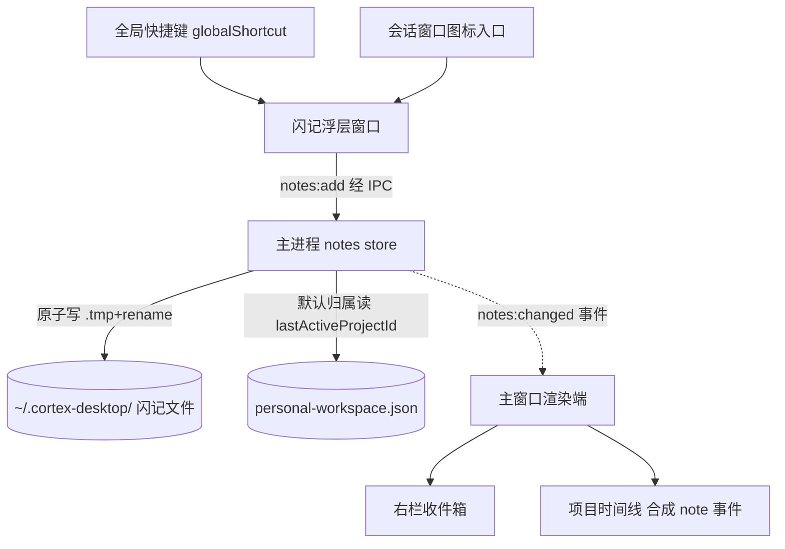
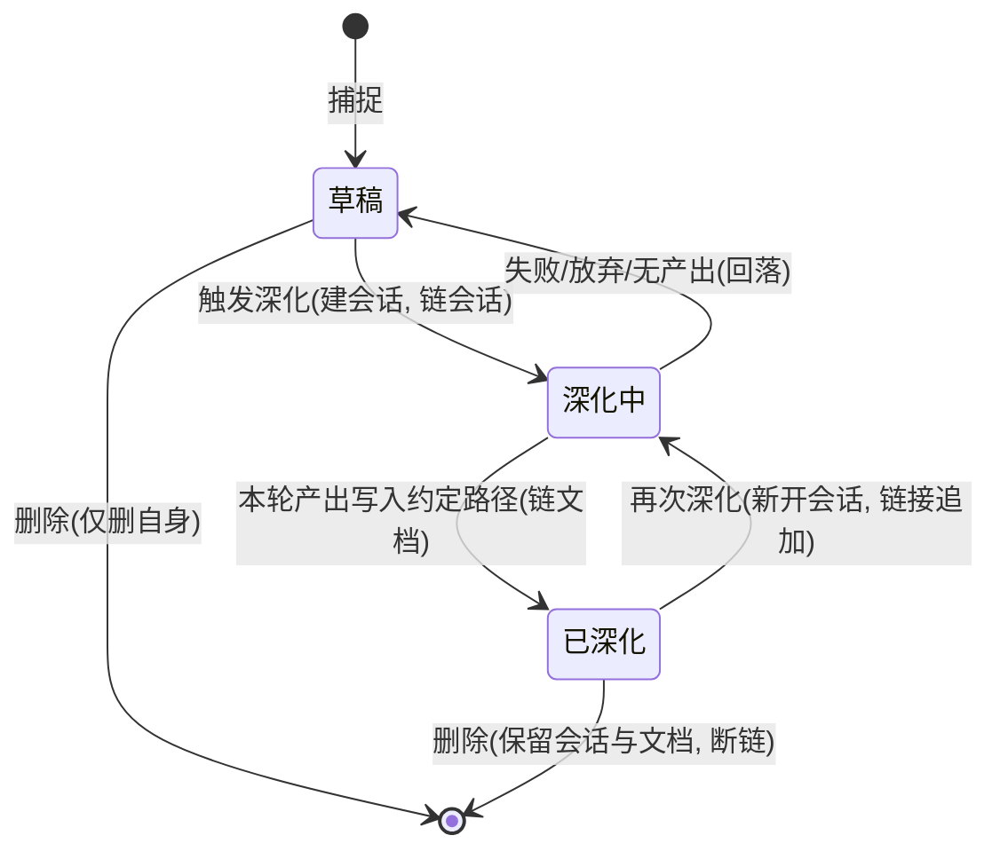

# feat: 闪记(Flash Notes)

## 摘要

在 Cortex Desktop 实现「闪记」:全局快捷键或会话窗口图标唤起独立浮层,随时记下文字而不打断当前会话。闪记是**主进程拥有**的项目级独立实体,在右栏收件箱与项目时间线里回看;选中一条或多条可「深化」——复用现有「建会话即发」管线开一个新会话,让 agent 把想法孵化成 `brainstorm`、再到 `plan` 文档,产出文档以约定路径落盘并回链源闪记。v1 写作面复用现有 markdown 视图,Kun 全套写作台后置。

---

## 问题背景

想法常在与 agent 协作时冒出,而它们多半不是给 agent 的指令。今天接住它只能打字进会话(污染上下文)、切外部笔记(脱离项目)、或任其溜走;即便记下也大多停在原地,没有从灵感到可执行计划的通道。详见 origin 文档的问题背景。

规划期研究还暴露了 brainstorm 未料到的硬约束:全局浮层是**独立窗口**,够不到主窗口的 Zustand;而「当前活跃项目」是不持久化的内存态,主窗口关到托盘后即失——现有 Spotlight 浮层正因此默认「不使用项目」。这决定了闪记的存储与归属必须由主进程拥有(见 KTD1/KTD2)。

---

## 需求

来源为 origin 文档 R1-R15;R16-R18 是规划期研究新增的健壮性需求。

**捕捉**
- R1. 可用全局快捷键从任意位置、或会话窗口内的图标入口唤起同一闪记浮层。
- R2. 浮层内输入文字回车(或显式保存)即创建闪记;创建后浮层关闭。窗口内图标入口保证焦点回到会话输入框;全局热键入口只保证浮层关闭,焦点归还交给 OS(见 KTD2 焦点契约拆分)。
- R3. 闪记为文本/markdown;每条记录创建时间与来源上下文(所属项目;若在某会话内唤起则记下该会话)。

**归属与存储**
- R4. 每条闪记归属一个项目;全局唤起默认归到最近活跃项目,浮层顶部项目切换器可即时改归属。
- R5. 无任何活跃项目时落入「未归类」,事后可在收件箱归档到某项目。
- R6. 闪记落地本地、重启不丢;主窗口关到托盘期间捕捉同样能持久化(见 KTD1)。

**回看与整理**
- R7. 闪记是独立实体,有稳定 id、状态(草稿 / 深化中 / 已深化)、可选标签,以及到来源会话与产出文档的链接(链接为数组,支持再深化)。
- R8. 右栏「闪记」收件箱按项目列出,支持回看、编辑、删除、多选。
- R9. 每条闪记在所属项目时间线呈现为一类事件,可回看回链;时间线支持只看闪记的筛选。

**深化成文档**
- R10. 选中一条或多条闪记可触发深化;深化以这些闪记为种子新建一个独立项目会话,不影响任何现有会话。
- R11. 深化会话中 agent 先提关键问题、再把内容孵化成 `brainstorm` 文档写入项目;用户可随时介入。
- R12. `brainstorm` 文档可进一步触发生成 `plan` 文档;两份文档落在项目内,可在现有 markdown 视图查看与编辑。
- R13. 深化产出文档后,源闪记状态推进为「已深化」并链接到会话与文档,便于回溯。

**不干扰会话**
- R14. 闪记默认只对用户可见,不自动进入任何会话的 agent 上下文;只有深化时被选中的闪记才作为种子喂给新会话。
- R15. 捕捉与回看的任何操作都不修改、打断或污染当前会话的消息流与运行状态。

**健壮性(规划期新增)**
- R16. 全局快捷键注册失败时,静默降级到仅窗口图标入口,并提示用户改键。
- R17. 深化失败、被放弃或 agent 未产出文档时,源闪记不停在「已深化」(回落到草稿),不留悬挂文档链接。
- R18. 删除闪记只删其自身,保留已产出的会话与文档(仅断链)。

---

## 关键技术决策

- KTD1. **存储为主进程 owner**(仿 automation):闪记元数据与内容由主进程拥有并落盘到 `~/.cortex-desktop/` 下,经 `notes` IPC 域做 CRUD,变更经事件推回渲染端刷新。理由:全局浮层是独立窗口,够不到主窗口 Zustand 的 `store:save`;且主窗口关到托盘也要能记且不丢(R6)。复用 `store.ts` 的「写 .tmp + rename 原子落盘 + 串行 writeQueue + 内存镜像」;闪记目录走 `paths.ts` 的 `.cortex-desktop/` 专用子目录(仿 `timeline.ts`,免 `assertAllowed` 白名单);**而深化产出文档写入项目目录,路径必须落在 `fs.ts` 的 `assertAllowed` 白名单内**。
- KTD2. **新增 `lastActiveProjectId` 持久化字段** + 焦点契约拆分:在 `setActiveSession` / `activateProject` 时写入、归档/删除项目时若等于该 id 一并清空;浮层经 `loadState()` 读它推导默认归属,读后校验该项目仍在 `projects` 中,失效则回落「未归类」。**该字段必须立即落盘**(纳入 `saveUrgency` 的 immediate 档,不走 ~500ms 节流)——否则浮层读的是主进程 `cached` 镜像里切换前的旧值,亚秒级捕捉会归错项目(`tasks/lessons.md` 2026-06-11 同款竞态)。理由:`activeProjectId` / `activeSessionId` 是不持久化的内存态(`toPersistedState` 不含),关窗即失,R4 否则不可实现。焦点恢复按入口拆分(R2):窗口内入口可还焦到 composer,全局入口由 OS 决定、best-effort。
- KTD3. **全局快捷键用 Electron `globalShortcut`**(全仓首次):在 `app.whenReady` 注册、在现有 `before-quit` 处(与 `destroySpotlight()` 同处,仓库无 `will-quit` handler)`unregisterAll`;注册返回 false 即降级,并经 toast 提示用户该热键被占用、可改键(R16)。理由:仓库零先例,Spotlight 靠托盘点击唤起;跨平台组合键会与其它 App 冲突,必须可降级且让用户可感知。
- KTD4. **深化复用「建会话即发」管线**(`spotlightHandoff` 两段挂载):闪记内容作种子 → `createSession` + `send`;首条消息**必须**走 `qc.ensureQueryData` 与会话 `useQuery` 共享同一 queryKey 去重,否则复现「首条用户消息被空历史覆盖」(提交 `1e0f2e7`);沿用 `result` 后 `scheduleResultExitFallback` 宽限收尾(提交 `214f4e2`),不假设 `cli:exit` 必达。
- KTD5. **深化状态机 草稿 → 深化中 → 已深化**:触发深化置「深化中」并链接新会话;产出文档落到确定性约定路径,以**「本轮 run 的 `changedFiles` 含该约定路径」判定**「已深化」(经 `extractChangedFile`),「文件存在」仅作兜底——否则再深化/放弃时旧同名文件会被误判为已深化;比对前把路径归一(agent 可能写绝对路径,见 U9)。深化中失败/放弃则回落到草稿,不留僵尸闪记(R17)。理由:深化=跑 agent,失败分支多(spawn 失败、鉴权失败、超时、用户中途关闭),且「文件存在」无法区分本轮新产出。
- KTD6. **收件箱与时间线单一来源**:闪记实体为真相,时间线里的闪记事件在读取时合成(与 `session.created` 同构,不落盘)。理由:时间线只追加、无单事件删除能力,双写会在编辑/删除闪记时漂移。`groupEventsByDay` 统计需顺带处理 `note` 类。
- KTD7. **多选种子用附件包裹模式**:复用 `buildAttachmentSystemPrompt` 的思路,每条闪记一个 `<note>` 块、按创建时间升序,首条提示 agent「这些是同一批想法的种子」。单条正文超长按一个**正文级上限**截断(`clipSummary` 的 200 字仅适合摘要、不可用于正文);多选条数设上限,超限给提示(具体数值见 Open Questions)。
- KTD8. **v1 写作面 = textarea + `MarkdownView`**(`TodosView` 的 MarkdownDetail 样板):预览用 `react-markdown`,编辑用受控 textarea(`Cmd/Ctrl+S` 存、`Esc` 取消)。不引入 Tiptap;`monaco-editor` 已在仓库,作代码级编辑的备选。
- KTD9. **状态边界**:收件箱与时间线的闪记数据**走 React Query**(key 以 `projectId` 命名,非 `wsId`——个人工作区桌面端无团队 `wsId` 概念);`notes:changed` 事件只触发 `invalidateQueries`、不直接 setState(遵 CLAUDE.md「事件只触发 invalidation」),并在窗口重新获焦时 refetch 兜底事件丢失。纯客户端态(浮层草稿、收件箱多选、`rightView`)走 Zustand(`core/store/personal.ts`);打开右栏由调用方补 `setRightOpen(true)`(在 `useCortexUIStore`,非 personal store)。

- KTD10. **闪记浮层走 `window.desktopAPI` 直连,不用 React Query hooks**:浮层是独立 BrowserWindow 的裸 React root(仿 `spotlight.tsx`,无 `CoreProvider`/`QueryClientProvider`),直接调 `window.desktopAPI.personal` 的 notes 方法、并 `loadState()` 读默认归属(仿 `SpotlightBar`);`core/personal/notes.ts` 的 React Query 封装只服务主窗口的收件箱/时间线。理由:在浮层里调 React Query hook 会因无 QueryClient 直接崩溃。

---

## 高层技术设计

### 捕捉的进程边界与数据流

浮层是独立 BrowserWindow,经 IPC 直达主进程的 notes store;主窗口在场时由事件推送刷新收件箱/时间线,主窗口缺席时纯主进程落盘——这是「主窗口关到托盘也能记」的关键。

### 闪记状态机

---

## 实现单元

### Phase A — 数据与存储底座

#### U1. 闪记数据模型与主进程 notes 存储域

- **Goal**:建立闪记的数据结构与主进程拥有的持久化通道(CRUD + 变更事件),作为整个功能的底座。
- **Requirements**:R3, R6, R7;支撑 R5。
- **Dependencies**:无。
- **Files**:
  - `apps/desktop/src/main/ipc/notes.ts`(新建,仿 `apps/desktop/src/main/ipc/timeline.ts`)
  - `apps/desktop/src/main/paths.ts`(加闪记存储目录/文件路径)
  - `apps/desktop/src/main/ipc/register.ts`(注册 `registerNotesHandlers`)
  - `apps/desktop/src/main/ipc/types.ts` 与 `packages/core/desktop/types.ts`(镜像 `NoteMeta` / `NoteContent` 契约)
  - `apps/desktop/src/preload/index.ts`(`personal` 对象加 `notes*` 方法 + `onNotesChanged` 订阅)
  - `packages/core/desktop/bridge.ts`(`DesktopBridge` 加可选 `notes*` 方法)
  - `packages/core/personal/notes.ts`(新建,React Query/读写封装)
  - 测试:`apps/desktop/src/main/ipc/notes.test.ts`、`packages/core/personal/notes.test.ts`
- **Approach**:`NoteMeta { id; projectId?; status: "draft"|"deepening"|"deepened"; tags?; sourceSessionId?; conversationIds?: string[]; docPaths?: string[]; createdAt; updatedAt }`;内容短则内联在元数据,见 Open Questions 的单文件/分文件取舍。IPC:`notes:list(projectId?)` / `notes:add` / `notes:update` / `notes:delete`,主进程持内存镜像 + 串行写队列 + tmp+rename;`notes:changed` 事件经 `onNotesChanged` 在渲染端触发 React Query `invalidateQueries`(不直接 setState,KTD9)。`bridge` 新方法一律标 `?:` 可选(web 端 bridge 为 null)。新增对外模块同步 `packages/core/package.json` 的 `exports`。
- **Execution note**:核心读写与序列化先写失败测试(原子写、并发 add 串行、缺 bridge 降级)。
- **Patterns to follow**:`apps/desktop/src/main/ipc/timeline.ts`(分文件原子写)、`apps/desktop/src/main/ipc/store.ts`(内存镜像+串行队列)、`SpotlightIntent` 双份镜像契约。
- **Test scenarios**:
  - happy:add 后 list 能取回;update 改字段后持久化;delete 后 list 不含。
  - 边界:并发两次 add 不交错、不丢;无 projectId 的闪记可存取(未归类)。
  - 错误:写盘 tmp 失败不破坏原文件;`bridge` 为 null 时 core 封装安全降级。
  - 集成:`Covers AE6.` 主窗口不在场时 add 仍落盘,重启后 list 仍在。
- **Verification**:主进程重启后闪记仍可读;并发写不损坏文件。

#### U2. 「最近活跃项目」持久化

- **Goal**:让浮层在主窗口缺席时也能推导默认归属。
- **Requirements**:R4;支撑 R6。
- **Dependencies**:无(可与 U1 并行)。
- **Files**:
  - `packages/core/store/personal.ts`(`PersistedState` 加 `lastActiveProjectId?`;`setActiveSession`/`activateProject` 写入;`toPersistedState`/`hydrate` 对称处理;归档项目跳过)
  - `packages/core/desktop/types.ts`(`PersistedState` 镜像加字段)
  - 测试:`packages/core/store/personal.test.ts`
- **Approach**:仿 `profile`/`timelineSettings` 切片的 `hydrate`/`toPersistedState` 对称三处写法。「最近活跃项目」= 最后被 `setActiveSession` 的会话所属项目,回退 `activateProject`;归档项目不记。**该字段须立即落盘**(纳入 `saveUrgency` immediate 档,不走节流),否则浮层读到旧值。`removeProject`/归档时若 `lastActiveProjectId` 等于该 id 一并清空。浮层侧默认归属推导沿用 `TodosView` 的 `currentProjectId = 当前会话.projectId ?? activeProjectId`,主窗口缺席时回退到持久化的 `lastActiveProjectId`,并校验该项目仍在 `projects` 中、失效回落未归类。
- **Execution note**:先写「切会话→落盘→重启读回」的失败测试。
- **Patterns to follow**:`packages/core/store/personal.ts` 的 `profile` 持久化切片(plan `2026-06-14-004` U1)。
- **Test scenarios**:
  - happy:`setActiveSession` 到项目 A 的会话后,`lastActiveProjectId` = A 并持久化。
  - 边界:切到无项目会话不覆盖为 undefined(保留上一个有效项目);归档/删除 A 后不再返回 A。
  - 竞态:切会话后立即(不等节流)经主进程读到新 `lastActiveProjectId`;指向的项目被删 → 浮层回落未归类。
  - `Covers AE6.` 重启后(activeProjectId 已空)仍能从 `lastActiveProjectId` 取回默认归属。
- **Verification**:关窗重启后浮层默认归属为上次活跃项目。

---

### Phase B — 捕捉(浮层 + 全局热键)

#### U3. 闪记浮层窗口

- **Goal**:复刻 Spotlight 造一个独立的无边框置顶浮层窗口承载速记输入。
- **Requirements**:R1;支撑 R15。
- **Dependencies**:无(与 Phase A 并行,但联调依赖 U1)。
- **Files**:
  - `apps/desktop/src/main/notes-overlay.ts`(新建,仿 `apps/desktop/src/main/spotlight.ts`)
  - `apps/desktop/src/renderer/notes.html` + `apps/desktop/src/renderer/src/notes-overlay.tsx` + `apps/desktop/src/renderer/src/notes-overlay.css`(新建,仿 spotlight 三件套)
  - `apps/desktop/electron.vite.config.ts`(`rollupOptions.input` 加 `notes` 入口)
  - `apps/desktop/src/main/index.ts`(接线 show/hide/destroy;`app.on("activate")` 排除该窗口;`before-quit` 销毁)
- **Approach**:照搬 spotlight 窗口配方——`frame:false` + `transparent:true` + `setAlwaysOnTop(…,"screen-saver")` + macOS `type:"panel"` + `setVisibleOnAllWorkspaces`,复用主窗口同一 preload(`window.desktopAPI` 直接可用),按光标所在屏定位、renderer 实测高度回传,失焦自隐。
- **Patterns to follow**:`apps/desktop/src/main/spotlight.ts` 整文件;`electron.vite.config.ts` 现有 `{ main, spotlight }` 多入口。
- **Test scenarios**:`Test expectation: none -- 窗口创建/定位为主进程 Electron 行为,按项目惯例由人工验证(显示位置、置顶、失焦自隐)`。
- **Verification**:浮层能在任意屏唤起、置顶、失焦自动隐藏。

#### U4. 全局快捷键注册与窗口图标入口

- **Goal**:用 `globalShortcut` 唤起浮层,并在会话窗口提供图标入口;注册失败可降级。
- **Requirements**:R1, R16。
- **Dependencies**:U3。
- **Files**:
  - `apps/desktop/src/main/index.ts`(`whenReady` 注册 `globalShortcut`、在现有 `before-quit` 处注销;失败回报)
  - `apps/desktop/src/main/ipc/types.ts` / `packages/core/desktop/types.ts`(若需把「热键注册结果」回报渲染端)
  - `packages/views/cortex-desktop/personal/PersonalComposer.tsx` 或 `TitleBar.tsx`(图标入口按钮)
  - `apps/desktop/src/preload/index.ts`(图标入口触发 show 的方法)
  - 测试:热键降级逻辑的纯函数部分 `apps/desktop/src/main/*.test.ts`(若拆出可测单元)
- **Approach**:`globalShortcut.register(accel, toggleNotesOverlay)`,返回 false → 不抛错、标记降级、经 toast 提示用户热键被占用并可改键(R16);窗口内图标入口直接调 show,降级后仍可用。改键入口随热键配置一并后置(见 Open Questions)。浮层 toggle 语义见 U5(打开时再按热键保持打开聚焦、不丢草稿)。
- **Execution note**:把「注册失败 → 降级状态」抽成可测纯函数先写测试;`globalShortcut` 本身的系统行为人工验证。
- **Patterns to follow**:`apps/desktop/src/main/automation/tray.ts` + `index.ts` 的 `onToggleSpotlight` 接线(唤起回调形态)。
- **Test scenarios**:
  - happy:注册成功后,触发回调能 show 浮层。
  - 错误:`Covers R16.` `register` 返回 false 时不抛错,降级标记置位、toast 提示出现、窗口图标入口仍可用。
- **Verification**:热键唤起浮层;占用冲突时不崩、图标入口仍能用。

#### U5. 浮层捕捉交互、默认归属与项目切换器

- **Goal**:浮层内完成「输入→存→关」,带默认归属、项目切换器、未归类兜底与焦点契约。
- **Requirements**:R2, R3, R4, R5, R14, R15。
- **Dependencies**:U1, U2, U3。
- **Files**:
  - `apps/desktop/src/renderer/src/notes-overlay.tsx`(输入 UI、项目切换器、保存;经 `window.desktopAPI.personal` 直连)
  - `packages/core/personal/notes.ts`(归属推导**纯函数**,供浮层与测试复用)
  - `apps/desktop/src/renderer/src/SpotlightBar.tsx`(参考其项目下拉、submit 守卫与直连写法)
  - 测试:`packages/core/personal/notes.test.ts`(归属推导、空内容守卫)
- **Approach**:浮层经 `window.desktopAPI.personal` 直连(KTD10,无 React Query),`loadState()` 读 `lastActiveProjectId` + 当前态推默认归属 = `currentProjectId`(当前会话.projectId ?? activeProjectId ?? lastActiveProjectId);都没有 → 未归类。归属推导抽成纯函数便于测试。顶部项目切换器仿 `SpotlightBar` 下拉即时改归属。空内容回车不创建、浮层保持打开(对齐 `SpotlightBar.submit` 的空守卫)。`notes:add` 失败时浮层不关、保留草稿、就地报错可重试;成功才关并执行焦点契约(按入口拆分,KTD2)。闪记仅写入 notes store,**不进任何会话上下文**(R14)。
- **Execution note**:归属推导、空内容守卫先写失败测试。
- **Patterns to follow**:`SpotlightBar.tsx` 的项目下拉(第204-219行)与 `submit` 空守卫(第119行)。
- **Test scenarios**:
  - happy:有当前项目时保存 → 闪记归该项目、状态 `draft`。
  - 边界:`Covers AE1.` 无任何活跃项目时保存 → 归「未归类」;空内容回车不创建、浮层不关。
  - 边界:`Covers AE11.` 当前项目为 A,切换器选 B,保存 → 归 B。
  - 错误:`notes:add` reject → 浮层不关、草稿保留、显示错误、可重试。
  - 集成:`Covers AE2.` 当前会话流式输出中保存闪记 → 会话消息流无新增、输出不中断。
- **Verification**:三种归属路径正确;捕捉期间当前会话无任何变化。

---

### Phase C — 回看(收件箱 + 时间线)

#### U6. 收件箱右栏视图(NotesView)

- **Goal**:在右栏新增「闪记」视图,按项目列出闪记,支持回看/编辑/删除/多选与未归类归档。
- **Requirements**:R5, R8, R18;支撑 R10(多选入口)。
- **Dependencies**:U1。
- **Files**:
  - `packages/core/store/personal.ts`(`rightView` 联合加 `"notes"`,两处声明 `:67`/`:152`;镜像 `requestFilePreview`/`consumeFilePreviewRequest` 出一套 `requestNoteDetail`/`consumeNoteDetailRequest`,不进 `toPersistedState`)
  - `packages/views/cortex-desktop/personal/PersonalRightPanel.tsx`(加 `notes` 分支)
  - `packages/views/cortex-desktop/TitleBar.tsx`(菜单加「闪记」项 + `pick` 类型加 `"notes"`)
  - `packages/views/cortex-desktop/personal/NotesView.tsx`(新建,仿 `TodosView.tsx`)
  - 测试:`packages/views/cortex-desktop/personal/NotesView.test.tsx`
- **Approach**:仿 `TodosView` 用 `useDesktopBridge()` + React Query notes 封装取数(KTD9);编辑用 textarea + `MarkdownView` 预览(KTD8);多选**限同项目内**(跨项目不可同时选,与 U8 单一 cwd 一致),用于深化触发(交 U8)。删除只删闪记自身(R18)。提供加载态、整体空态、「未归类」无内容时隐藏该分组(仿 `TodosView` 空态文案)。已深化徽标与跳转入口由本单元统一拥有(U10 复用、不重复实现)。未归类分组提供「移到项目」归档动作(归档后该闪记进目标项目的收件箱与时间线)。打开右栏调用方补 `setRightOpen(true)`。
- **Patterns to follow**:`TodosView.tsx`(列表+详情+删除+request/consume 三件套)。
- **Test scenarios**:
  - happy:按项目渲染闪记;编辑保存写回;同项目内多选 N 条。
  - 状态:加载中态;整体空态给引导文案;「未归类」无内容时不显示该分组标题。
  - 边界:`Covers AE12.` 未归类闪记归档到项目 C 后出现在 C 的收件箱。
  - 行为:`Covers AE9.` 删除一条已深化闪记 → 列表移除该闪记,其产出文档与会话仍在(仅断链)。
- **Verification**:增删改多选与未归类归档均正确;删除不波及文档。

#### U7. 时间线单一来源合成与闪记卡片

- **Goal**:闪记在项目时间线呈现为一类事件(读取时合成、不落盘),支持只看闪记筛选,并随闪记编辑/删除自动反映。
- **Requirements**:R9;支撑 R7。
- **Dependencies**:U1。
- **Files**:
  - `packages/core/desktop/types.ts`(`TimelineEventKind` 加 `"note"`)
  - `packages/core/personal/timeline.ts`(读取时从 notes 合成 `note` 事件,仿 `session.created` 的合成路径;`groupEventsByDay` 统计加 `note` 类)
  - `packages/views/cortex-desktop/personal/TimelineView.tsx`(`EventCard` 加 `note` 分支 + 只看闪记筛选)
  - 测试:`packages/core/personal/timeline.test.ts`
- **Approach**:**不**对 `recordTimelineEvent` 双写;合成点在 `useProjectTimeline`(现 `[...stored, ...sessionCreated, ...git]` 合并处)新增一个项目级 notes React Query 并 merge `...noteEvents`——注意闪记是异步主进程态,不像 `sessions` 同步在 Zustand,故须订阅 notes query(KTD9)而非读 store 切片。编辑/删除闪记天然反映到时间线(单一来源,KTD6)。「只看闪记」是**新增**筛选 UI(现 `TimelineView` 无 kind 级筛选,非复用),筛选后保持 `groupEventsByDay` 统计一致。卡片可回链到收件箱对应闪记(经 `requestNoteDetail`)。
- **Execution note**:合成与筛选先写失败测试(含「编辑闪记后合成事件内容更新」「删除后不再出现」)。
- **Patterns to follow**:`timeline.ts` 中 `session.created` 的读取期合成与 `useProjectTimeline` 合并点;`TimelineView` 现有 `kind` 分支(筛选 UI 为新增,无现成)。
- **Test scenarios**:
  - happy:某项目有 3 条闪记 → 时间线出现 3 条 `note` 事件,按天分组正确。
  - 行为:`Covers AE10.` 编辑闪记内容后合成事件显示新内容;删除后该事件消失。
  - 边界:筛选「只看闪记」时仅剩 `note` 事件;`groupEventsByDay` 统计含闪记计数。
- **Verification**:时间线与收件箱永远一致(无双写漂移);筛选正确。

---

### Phase D — 深化(闪记 → brainstorm → plan)

#### U8. 深化触发与种子会话

- **Goal**:把选中的闪记拼成种子,复用「建会话即发」开一个新的独立项目会话,不影响现有会话。
- **Requirements**:R10, R11, R14。
- **Dependencies**:U1, U6。
- **Files**:
  - `packages/core/personal/notes.ts`(深化编排:拼种子 → 建会话 → 发首条)
  - `packages/core/personal/spotlightHandoff.ts`(参考其 router/handoff 两段挂载与 hydrate 守卫)
  - `packages/core/store/personal.ts`(`createSession` 复用)
  - `packages/core/personal/messages.ts`(`send`;首条防丢 `ensureChatLoaded`;`result/exit` 兜底)
  - 测试:`packages/core/personal/notes.test.ts`(种子拼装)、`packages/core/personal/messages.test.ts`(首条不丢回归)
- **Approach**:多选闪记(限同项目)按创建时间升序、各包一个 `<note>` 块、单条超长按正文级上限截断(非 `clipSummary` 200 字,KTD7),合成种子 system prompt / 首条 prompt。cwd 由 projectId 推导,无项目走 `ensureNoProjectDir`(与 `spotlightHandoff` 一致)。**首条消息必须走共享 queryKey 去重**(KTD4),并沿用 `result` 兜底收尾。触发后自动切到新会话(复用 `setActiveSession`,与建会话即发一致),源闪记置「深化中」。新建会话不触碰任何现有会话。
- **Execution note**:先写「建会话即发首条不丢」回归测试(对照 `1e0f2e7`),作为深化路径基线。
- **Patterns to follow**:`spotlightHandoff.ts`;`messages.ts` 的 `buildAttachmentSystemPrompt`(`:44-59`)与 `ensureChatLoaded`(`:685`)。
- **Test scenarios**:
  - happy:`Covers AE5.` 多选 3 条深化 → 新会话创建、3 条按序作为种子注入、现有会话不受影响。
  - 边界:单条深化;无项目闪记深化走无项目目录。
  - 集成:`Covers AE5.` 即建即发首条用户消息不被空历史覆盖(`ensureChatLoaded` 生效)。
- **Verification**:种子完整注入新会话;首条消息稳定不丢;现有会话无副作用。

#### U9. 深化状态机、文档落点与链接

- **Goal**:实现 草稿→深化中→已深化 状态机,产出文档以约定路径落盘并回链,失败回落。
- **Requirements**:R7, R12, R13, R17。
- **Dependencies**:U8。
- **Files**:
  - `packages/core/personal/notes.ts`(状态机、文档落点约定、链接数组、失败回落)
  - `packages/core/personal/messages.ts`(从 run 事件的 `changedFiles`/`extractChangedFile` 确认产出文件)
  - `apps/desktop/src/main/ipc/fs.ts`(产出文档写入项目目录,确认路径在 `assertAllowed` 白名单内)
  - 测试:`packages/core/personal/notes.test.ts`(状态迁移、失败回落、再深化链接追加)
- **Approach**:触发深化即置「深化中」并把新会话 id 入 `conversationIds`;收件箱/时间线对该闪记显示「深化中」徽标并禁用再次深化(防重复触发)。深化 system prompt 里把**确定性产出路径**喂给 agent(项目内 brainstorm 目录 + 按闪记 id 命名),要求写到该处;以**本轮 run 的 `changedFiles` 含该约定路径**判定「已深化」(经 `extractChangedFile`;比对前归一化绝对/相对路径,因 agent 可能写绝对路径、或主进程截断长路径返回 undefined),文件存在仅兜底,然后把路径入 `docPaths`(KTD5)。`brainstorm` 之上由用户显式触发生成 `plan`(见 Open Questions)。失败/放弃(spawn 失败、鉴权失败、超时、用户关闭且无产出)→ 回落到草稿,不置已深化、不留悬挂链接(R17)。再深化新开会话、用带会话 id 的新路径、链接数组追加(R7)。
- **Execution note**:状态迁移与失败回落先写失败测试——这是本功能 ROI 最高的健壮性保障。
- **Patterns to follow**:`messages.ts` 的 `extractChangedFile`(`:424`)抓写类工具 `file_path`;`fs.ts` 的 `assertAllowed`(定义 `:25`,写入校验调用见 `:330`)。
- **Test scenarios**:
  - happy:本轮 run 的 changedFiles 含约定路径 → 状态置「已深化」,`docPaths` 含该路径。
  - 错误:目标路径已存在但本轮 run 未写入 → 不置已深化(防再深化/旧文件误判)。
  - 错误:`Covers AE7.` CLI 启动即失败(agent 未装 / pi 未配 provider)→ 源闪记回落草稿,无悬挂链接。
  - 错误:`Covers AE8.` agent 尚未写出文档,用户关闭/放弃会话 → 闪记回落(不显示已深化)。
  - 行为:再深化一条已深化闪记 → 新会话 id 与新文档路径追加进数组,不覆盖旧链接。
- **Verification**:无「已深化但无文档」的僵尸;链接随再深化累加。

#### U10. 深化产出的查看与轻量编辑(v1 写作面)

- **Goal**:从闪记跳转查看/编辑其产出的 brainstorm/plan 文档与来源会话(复用现有 markdown 视图)。
- **Requirements**:R12, R13。
- **Dependencies**:U6, U9。
- **Files**:
  - `packages/views/cortex-desktop/personal/NotesView.tsx`(已深化闪记展示状态徽标 + 跳转入口)
  - `packages/views/cortex-desktop/personal/MarkdownView.tsx`(复用预览)
  - `packages/views/cortex-desktop/personal/TodosView.tsx`(参考 MarkdownDetail 的 textarea+预览编辑)
  - 测试:`packages/views/cortex-desktop/personal/NotesView.test.tsx`
- **Approach**:已深化闪记显示「已深化」徽标,提供跳转到 `brainstorm`/`plan` 文档(右栏文件预览/`MarkdownView` + textarea 编辑,KTD8)与来源会话。文档为磁盘 `.md`,编辑走现有 fs 写(白名单内)。
- **Test scenarios**:
  - happy:`Covers AE3.` 点已深化闪记 → 显示「已深化」并可跳转到产出文档与来源会话。
  - 边界:再深化产生多份文档/多个会话时列出全部;其一被外部删除时其余仍可达、缺失项给友好提示(链接悬挂降级)。
- **Verification**:从闪记能可靠到达产出文档与会话;文档可在 markdown 视图编辑。

---

## 验收示例

- AE1. 无项目捕捉 → 未归类。**Given** 没有活跃项目 **When** 浮层保存一条 **Then** 进「未归类」,事后可归档。(R5)
- AE2. 捕捉不打断会话。**Given** 当前会话流式输出中 **When** 浮层记一条并保存 **Then** 消息流无新增、输出不中断;窗口内入口保存后焦点回 composer。(R2, R15)
- AE3. 已深化回溯。**Given** 一条已深化闪记 **When** 在收件箱/时间线查看 **Then** 显示「已深化」并可跳到会话与 brainstorm/plan 文档。(R13)
- AE4. 闪记不进会话上下文。**Given** 一条闪记存在于当前项目 **When** 用户在当前会话继续与 agent 对话 **Then** 该闪记不出现在 agent 上下文,除非用户显式深化。(R14)
- AE5. 多选深化。**Given** 多选 3 条 **When** 深化 **Then** 3 条按序作种子注入新会话,现有会话不受影响。(R10)
- AE6. 主窗口关闭仍能记。**Given** 主窗口已关到托盘 **When** 全局热键唤起浮层保存 **Then** 落盘成功,重启后仍在。(R6)
- AE7. 深化失败不留僵尸。**Given** 选一条深化 **When** CLI 启动即失败 **Then** 源闪记不停在「已深化」、无悬挂文档链接。(R17)
- AE8. 深化中途放弃。**Given** agent 尚未写出文档 **When** 用户关闭/放弃会话 **Then** 闪记回落,不跳空文档。(R17)
- AE9. 删除已深化闪记。**Given** 一条已深化闪记 **When** 删除它 **Then** 其文档与会话仍在(仅断链),无文档被误删。(R18)
- AE10. 编辑/删除同步时间线。**Given** 一条闪记在时间线有事件 **When** 编辑内容/删除闪记 **Then** 时间线对应事件更新内容/消失。(R9, KTD6)
- AE11. 归属纠正。**Given** 当前项目为 A **When** 浮层切换器选 B 保存 **Then** 闪记归 B。(R4)
- AE12. 未归类事后归档。**Given** 未归类闪记 **When** 在收件箱归档到项目 C **Then** 它出现在 C 的收件箱与 C 的时间线。(R5)

---

## 范围边界

**后置(brainstorm 既定,非本计划)**
- Kun 全套写作台:Tiptap 富文本、双模 ghost text 续写、选区浮动改写、本地 RAG、语音输入、导出(html/pdf/doc/docx)。
- 捕捉时打「去向标」分流;从会话消息一键摘取成闪记。

**本功能不做**
- 跨项目/全局闪记收集箱(归属定为项目级)。
- Web 端闪记(桌面专属;Web 下 `DesktopBridge` 为 `null`)。

### Deferred to Follow-Up Work
- 闪记全文搜索与标签管理 UI。
- 多选深化的高级排序/合并策略(v1 固定创建时间升序)。
- 把「`globalShortcut` 首次接入」与「浮层即建即发的去重/落盘竞态」用 `/ce-compound` 固化为正式学习条目。

---

## 风险与依赖

- **首条消息丢失竞态**(高):深化即建即发若不走共享 queryKey 去重,必复现「只见 agent 回复、看不到用户首条」(提交 `1e0f2e7`)。以 U8 回归测试为基线。
- **`result`/`cli:exit` 丢失**:部分 agent `cli:exit` 不达,本轮卡「运行中」(提交 `214f4e2`);深化沿用 `scheduleResultExitFallback` 兜底。
- **浮层即记 → 主进程立即读 的 500ms 节流竞态**(`tasks/lessons.md` 2026-06-11):主进程 owner(KTD1)规避此坑;`lastActiveProjectId` 这类影响主进程决策的切片不要依赖 renderer 节流落盘。
- **`globalShortcut` 跨平台冲突**:组合键可能被占用,注册返回 false 必须降级(R16)。
- **`fs.assertAllowed` 白名单**:深化产出文档写入项目目录的路径必须在白名单内;闪记自身存储走 `.cortex-desktop/` 专用子目录(免白名单)。
- **CSS 命中区纪律**(`tasks/lessons.md` 2026-06-12/06-14):新组件写完即做 className↔CSS 双向对账、`getBoundingClientRect` 量「视觉区=命中区」。
- **依赖既有先例**:`spotlight.ts`、`spotlightHandoff.ts`、`createSession`、`send`、`recordTimelineEvent`/`TimelineView`、`store.ts` 原子写、`MarkdownView`/`TodosView`。

---

## 待解问题(留待实现期)

- 闪记存储用单文件 `notes.json`(元数据 + 短内容内联)还是分文件 `notes/<id>.json`——倾向单文件(闪记短、量级小),实现期按内容长度上限定。
- 深化产出 `plan.md` 的触发:用户显式点按钮 vs agent 链式自动——倾向显式,降低失控与失败耦合。
- 深化产出文档的确切目录与命名 slug 规则(项目内 brainstorm/plan 目录;按闪记 id + slug)。
- 时间线 `note` 合成事件对 `groupEventsByDay` 统计口径(是否计入「当日事件数」徽标)。
- 全局热键的默认键位与可配置改键入口(跨平台默认 + 用户改键 + 降级提示承载位置)。
- 多选深化的条数上限与单条正文截断字数(避免撑爆 system prompt 或砍残正文)。
- 时间线闪记「读取期合成」在闪记量大时的性能口径(是否需上限/分页)。

---

## 参考来源

- 浮层窗口先例:`apps/desktop/src/main/spotlight.ts`、`apps/desktop/src/renderer/notes` 三件套对标 `spotlight.html`/`.tsx`/`.css`、`apps/desktop/electron.vite.config.ts` 多入口。
- 建会话即发管线:`packages/core/personal/spotlightHandoff.ts`、`packages/core/store/personal.ts`(`createSession`)、`packages/core/personal/messages.ts`(`send`/`ensureChatLoaded`/`scheduleResultExitFallback`/`buildAttachmentSystemPrompt`/`extractChangedFile`)。
- 存储与白名单:`apps/desktop/src/main/ipc/timeline.ts`、`apps/desktop/src/main/ipc/store.ts`、`apps/desktop/src/main/ipc/fs.ts`(`assertAllowed`)、`apps/desktop/src/main/paths.ts`。
- 列表+详情样板与右栏扩展:`packages/views/cortex-desktop/personal/TodosView.tsx`、`PersonalRightPanel.tsx`、`packages/views/cortex-desktop/TitleBar.tsx`、`packages/core/store/personal.ts`(`rightView`、request/consume 三件套)。
- 时间线:`packages/core/personal/timeline.ts`、`packages/views/cortex-desktop/personal/TimelineView.tsx`。
- IPC 端到端样板与镜像契约:`apps/desktop/src/main/ipc/register.ts`、`apps/desktop/src/main/ipc/types.ts` ↔ `packages/core/desktop/types.ts`、`apps/desktop/src/preload/index.ts`、`packages/core/desktop/bridge.ts`。
- 状态管理约定:`CLAUDE.md`「状态管理(关键约定)」;`tasks/lessons.md`(2026-06-11 跨进程时序、06-12/06-14 CSS 纪律)。
- 需求来源:`docs/brainstorms/2026-06-15-shanji-notes-requirements.md`。
- 写作体验目标形态(后置参考):`docs/brainstorms/2026-06-15-shanji-notes-requirements.md` 的 Kun 借鉴小节。
