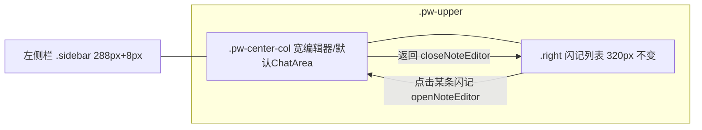
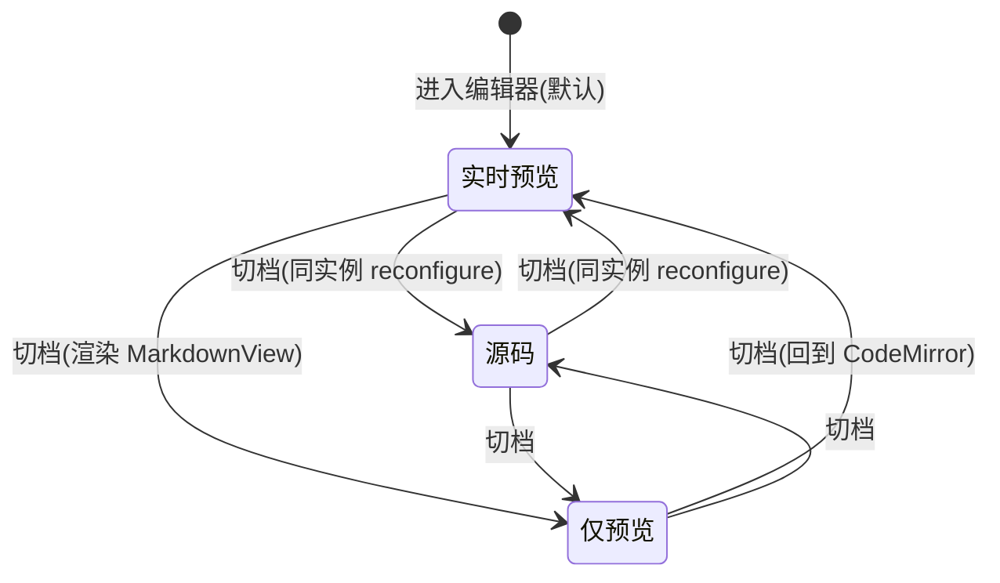
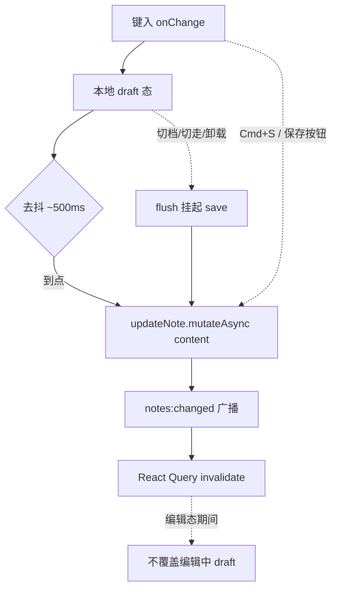

# feat: 闪记实时预览写作面

## 摘要

把闪记的编辑面从右栏窄详情(textarea + `MarkdownView` + 手动 `Cmd+S`)升级为占据主内容区的宽写作面:点击某条闪记 → 编辑器在 `.pw-center-col` 打开并向左延伸到侧栏右缘,支持「实时预览 / 仅预览 / 源码」三档切换 + 去抖自动保存,返回即回到右栏列表(列表宽度不变)。技术栈移植 `/Users/mike/source/ai/Kun` 的 CodeMirror 6 行内 Live 预览(`markdown-live-preview`),「仅预览」复用 cortex 既有 `MarkdownView`,只新增 `@codemirror/*` + `@lezer/highlight` 依赖。

---

## 问题背景

闪记当前只能在右栏 ~320px 的窄面板里用 `wrap="off"` 的受控 textarea 编辑(`NotesView.tsx` 的 `NoteDetail`),软换行与行号对齐做不到(见 `tasks/2026-06-11-todo-detail-style.md`),也没有边写边渲染的手感。Kun 的写作台用 CodeMirror 6 解决了这两点:同一编辑器内,非光标行把 markdown 标记渲染成成品、光标行还原源码,正是「实时预览」的体验。本计划把这套能力引到闪记,并给一个真正能展开的写作区域。

---

## 需求

来源为用户需求 + 规划期与 Kun 源码、cortex 布局/契约的对照研究。

**入口与布局**
- R1. 点击右栏闪记列表里某条具体闪记,进入占据主内容区的宽编辑器;编辑器从左侧浮动侧栏右缘起向右铺满到右栏。
- R2. 右栏闪记列表保持原有宽度与分组不变;编辑器为中心区独立视图,不挤占列表。
- R3. 从编辑器「返回」回到列表态(中心区恢复进入前的视图);切到别的闪记/会话/项目时编辑器正确让位。

**三档写作面**
- R4. 提供「源码 / 实时预览 / 仅预览」三档可切换,切档不重建编辑器、不丢光标与滚动位置。
- R5. 「实时预览」= CodeMirror 6 行内渲染:标题/粗斜体/列表/引用/任务勾选/分割线/表格/代码块在非光标行渲染为成品,光标进入该行还原源码可编辑。
- R6. 「仅预览」= 只读渲染,复用 cortex 既有 `MarkdownView`(含 frontmatter 折叠、callout、代码块语言角标、外链走 `openExternal`)。
- R7. 「源码」= 等宽字体的纯 markdown 文本编辑(无行内渲染)。

**保存**
- R8. 去抖自动保存:停止输入约 500ms 后自动写回,带可见保存状态(编辑中 / 保存中 / 已保存)。
- R9. 保留手动保存:`Cmd/Ctrl+S` 与显式保存按钮立即落盘。
- R10. 切档、切走闪记、卸载编辑器时,挂起的自动保存必须 flush,不丢最后一次输入。
- R11. 外部 `notes:changed` 触发的 React Query invalidation/refetch,不得回灌覆盖正在编辑的草稿。

**移植边界**
- R12. 闪记正文保存仍走 `bridge.notesUpdate(id, { content })`→主进程 `notes.json`(非磁盘 md),沿用现有 `useUpdateNote` 与「事件只 invalidate 不双写 Zustand」约定。
- R13. 不引入 Kun 的续写(inline-completion)、术语联动、图片粘贴、选区浮动工具条、infographic、html-embed、TipTap 富文本;新增依赖最小化。

---

## 关键技术决策

- KTD1. **三档 = CM6 Live + 复用 MarkdownView + CM6 source**:实时预览移植 Kun 的 `markdown-live-preview`(CodeMirror 6 行内渲染);**仅预览不移植** Kun 的 `WriteMarkdownPreview`,直接复用 cortex 既有 `packages/views/cortex-desktop/personal/MarkdownView.tsx`(react-markdown + remark-gfm + frontmatter/callout/`openExternal`);源码 = 同一 CodeMirror 编辑器 `appearance: 'source'`。理由:既对齐 Kun 截图的 Live 手感,又复用 cortex 已成熟的预览管线,避免引入 `rehype-harden`/`unified` 第二套渲染栈与「两套预览观感漂移」。
- KTD2. **砍掉 shiki**:Kun 的 `CodeBlockWidget` 依赖 shiki 做代码高亮;本计划把它简化为 `<pre>` + 语言角标,与 `MarkdownView` 现有「无高亮、仅 CSS 角标」风格一致。理由:避免重型异步依赖,且消除「实时预览(shiki)vs 仅预览(无高亮)」代码块观感分裂。后续若要高亮见 Open Questions。
- KTD3. **CodeMirror 走动态 import + 测试 alias 隔离**:`@codemirror/*` 在 `useEffect` 内动态 `import()`,绝不顶层静态 import;`vitest` 加 `resolve.alias`。理由:`packages/views` 被 web(Next.js)与 desktop 双打包,顶层引入会污染 web 产物——完全平移 `MonacoViewer.tsx` 的既有隔离范式(见 `tasks/2026-06-12-preview-adaptive-resizable.md`)。
- KTD4. **中间区接管 = 新增 personal store 中心视图态**:新增 `noteEditorId?: string` 与 `openNoteEditor(id)`/`closeNoteEditor()`,仿现有 `homeOpen`/`automationOpen`/`timelineProjectId` 的互斥清理写法,在 `PersonalWorkspace.tsx` 的中心视图三元链插一支。**不复用 `activeSession` 的某种 mode**(会纠缠 chat send 管线、queryKey、CLI run 态)。编辑器占 `.pw-center-col`,右栏列表 320px 不变。
- KTD5. **保存通道与竞态**:正文走 `bridge.notesUpdate(id, { content })`(主进程 `notes.json` 权威落盘,串行 writeQueue + 内存镜像,本身不踩 `tasks/lessons.md` 2026-06-11 的 renderer 节流竞态);去抖 ~500ms + 保留手动;切档/切走/卸载必 flush(`setTimeout` + cleanup,仿 `FilesView.tsx:167-193`);`notes:changed` invalidate 回来的新 `content` 不得覆盖编辑中草稿——沿用 `NoteDetail` 现有「按 `note.id` 复位、编辑态期间不被动态拉回」的处理(`NotesView.tsx:194-198`)。
- KTD6. **剥离 Kun 耦合**:移植时删 inline-completion/term-propagation/image-paste/selection-toolbar+handle/infographic/html-embed/TipTap;`window.kunGui.*` 与 `@shared/write-*` 全部剥离。`ImageWidget` 图片解析降级:http(s)/data URI 内联渲染,本地相对路径降级为占位或链接(不接 workspace 图片解析)。
- KTD7. **「250px」的现实落点**:代码中无字面 250px;左边界 = `.sidebar` 288px + `--pw-float-gap` 8px。编辑器占 `.pw-center-col` 即自然从侧栏右缘起延伸,无需新增偏移量(除非明确要硬性 250px,见 Open Questions)。

---

## 高层技术设计

### 中心区接管:状态驱动的视图切换

中间区已有「automationOpen > homeOpen > timelineProjectId > 默认 ChatArea」的互斥视图链(`PersonalWorkspace.tsx:91-99`)。新增 `noteEditorId` 作为同级一支,编辑器占满 `.pw-center-col`,右栏 `NotesView` 列表仍在并保持宽度。

### 三档与编辑器组件的关系

「源码/实时预览」共用同一个 CodeMirror 实例(`appearance` + livePreview 经 `Compartment` 热切换,切档不重建);「仅预览」切到只读 `MarkdownView`。

### 自动保存的数据流与 flush 点

---

## 实现单元

### Phase A — 编辑器内核移植(无 UI 接线)

#### U1. 引入 CodeMirror 依赖与 web/测试隔离

- **Goal**:把 `@codemirror/*` + `@lezer/highlight` 加入工作区,并建立与 Monaco 同款的 web 产物隔离与测试 alias,作为后续单元的底座。
- **Requirements**:支撑 R5, R7;R13(依赖最小化)。
- **Dependencies**:无。
- **Files**:
  - `packages/views/package.json`(加 `@codemirror/state`、`@codemirror/view`、`@codemirror/commands`、`@codemirror/language`、`@codemirror/lang-markdown`、`@codemirror/language-data`、`@lezer/highlight` 到 `dependencies`)
  - `packages/views/vitest.config.ts` 或根 `vitest` 配置(若 CodeMirror 包解析不到 `main`/`module` 需加 `resolve.alias`,仿 monaco 现状)
- **Approach**:依赖加在 `packages/views`(与 `monaco-editor`/`react-markdown` 同处);**不新建子包**(编辑器是绑定闪记数据的业务视图,且 `packages/ui` 禁止引 `@cortex-work/core`)。`@lezer/highlight` 是 `@codemirror/language` 的传递依赖,**必须显式声明**(Kun 的 package.json 未直接列它)。`exports` 字段无需改动——新组件作为 `personal/*` 内部文件被相对引入,不跨包边界。
- **Execution note**:无行为代码,先确认 `pnpm install` 后 `pnpm --filter @cortex-work/views typecheck` 与一个最小动态 import 烟雾测试通过。
- **Patterns to follow**:`MonacoViewer.tsx`(动态 `await import` + worker `new URL`)、`monacoLang.ts`(纯字符串映射不引编辑器)、`tasks/2026-06-12-preview-adaptive-resizable.md`(vitest 对 monaco 的 `resolve.alias`)。
- **Test scenarios**:`Test expectation: none -- 纯依赖与构建配置;由 U2/U3 的单测与 pnpm build(web+desktop)间接验证`。
- **Verification**:`pnpm build` web 与 desktop 均通过,web 产物未顶层打入 CodeMirror。

#### U2. 移植 markdown 实时预览扩展(剥离 Kun 耦合)

- **Goal**:把 Kun 的行内 Live 预览扩展与 widget 集移植为 cortex 内部模块,删除 Kun 特有耦合并简化重型 widget。
- **Requirements**:R5;R13。
- **Dependencies**:U1。
- **Files**:
  - `packages/views/cortex-desktop/personal/editor/markdownLivePreview.ts`(新建,移植自 Kun `src/renderer/src/write/markdown-live-preview.ts`)
  - `packages/views/cortex-desktop/personal/editor/markdownLiveWidgets.ts`(新建,移植自 Kun `markdown-live-widgets.ts`)
  - 测试:`packages/views/cortex-desktop/personal/editor/markdownLivePreview.test.ts`(移植 Kun `markdownLivePreviewTestInternals` 那套)
- **Approach**:保留 `HeaderMark`/`Emphasis`/`Code`/`Strikethrough`/`Link`/`Quote` 的隐藏-揭示逻辑、`writeMarkdownHighlight` 语法高亮、`markdownBlockPreviewField` 块缓存快路径。**删除** infographic(`InfographicPendingWidget` + `parsePendingInfographicImage`)与 html-embed(`HtmlEmbedWidget` + `isHtmlEmbedSrc`)分支及其 import。`CodeBlockWidget` 简化为 `<pre>` + 语言角标(去 shiki,KTD2)。`ImageWidget` 图片解析降级(http(s)/data URI 内联,本地相对路径占位,去 `window.kunGui.readWorkspaceimage`,KTD6)。保留 `markdownLivePreviewTestInternals` 导出以便测试。
- **Execution note**:先把 Kun 的 `markdown-live-preview.test.ts` 移过来跑红,再逐步剥离使其转绿——确保剥离没破坏核心隐藏/揭示/块缓存逻辑。
- **Patterns to follow**:Kun `markdown-live-preview.ts`(整体结构)、`markdown-live-widgets.ts`(保留 Hr/ListBullet/TaskCheckbox/Table/CodeBlock(+Toolbar))。
- **Test scenarios**:
  - happy:非光标行的 `# 标题`/`**粗**`/`- 列表` 产出隐藏标记+渲染装饰;光标移入该行揭示原始标记。
  - 边界:代码块/表格块缓存快路径——非结构性编辑只平移缓存范围、不全文重扫(`blockStructureMayHaveChanged`)。
  - 边界:空文档、仅空行、超长单行不抛错。
  - 剥离回归:含 `` 的行降级为占位/不崩;含原 html-embed 语法的行按普通文本处理(不再触发已删 widget)。
- **Verification**:移植后的扩展在 jsdom 单测下与 Kun 行为一致(除被砍的 infographic/html-embed/shiki)。

#### U3. 移植/精简 CodeMirror 编辑器组件

- **Goal**:把 Kun 的 `WriteMarkdownEditor` 精简为一个受控的 `NoteCodeMirrorEditor`:source/live 外观 + `Compartment` 热切换 + value/onChange + 保存快捷键回调。
- **Requirements**:R4, R5, R7;R9(Cmd+S 回调);R13。
- **Dependencies**:U1, U2。
- **Files**:
  - `packages/views/cortex-desktop/personal/editor/NoteCodeMirrorEditor.tsx`(新建,移植自 Kun `components/write/WriteMarkdownEditor.tsx`)
  - `packages/views/cortex-desktop/cortex-desktop.css`(移植 `write-editor.css` 里 `cm-write-live-preview` / `cm-write-md-*` / `.write-codemirror-host` 关键类,改用 `.pw-` 命名前缀)
  - 测试:`packages/views/cortex-desktop/personal/editor/NoteCodeMirrorEditor.test.tsx`
- **Approach**:动态 `import()` CodeMirror(KTD3);保留 `appearance: 'source' | 'live'` + `livePreviewEnabled` 经 `Compartment.reconfigure` 热切换、`EditorView.lineWrapping`、外部 value 同步(`externalValueSyncAnnotation` 比较避免回灌)、`Mod-s` keymap 回调。**删除**:inline-completion 整段、term-propagation、image-paste `domEventHandlers`、`WriteMarkdownEditorHandle`(`applyRangeReplacement`/`setBlockType`)、selection 上报。CSS 类逐个 `rg` 双向对账(`tasks/lessons.md` 2026-06-14)。
- **Execution note**:外部 value 同步与切档 reconfigure 先写失败测试(防回灌、防切档丢光标)。
- **Patterns to follow**:Kun `WriteMarkdownEditor.tsx`(Compartment/value-sync/keymap 骨架)、`MonacoViewer.tsx`(动态 import 生命周期与卸载清理)。
- **Test scenarios**:
  - happy:受控 `value` 渲染;键入触发 `onChange` 输出新文本;`Cmd/Ctrl+S` 触发保存回调。
  - 切档:source↔live 切换不重建实例(同一 `EditorView`)、不丢光标/滚动。
  - 防回灌:外部传入与当前文档相同的 `value` 不重置光标;不同则同步且 clamp 选区。
  - 卸载:组件卸载销毁 `EditorView`,无残留监听。
- **Verification**:三类编辑(source/live)与 Cmd+S 行为正确;切档与外部同步不丢状态。

---

### Phase B — 三档写作面 + 自动保存

#### U4. FlashNoteEditor 容器与三档切换

- **Goal**:组装写作面容器:头部(返回 / 标题 / 状态徽标 / 三档切换 / 保存状态 / 删除 / 深化产物入口)+ 主体(源码/实时预览走 `NoteCodeMirrorEditor`,仅预览走 `MarkdownView`)。
- **Requirements**:R1, R4, R6;R7;承载 R3 的返回入口。
- **Dependencies**:U3(+ 复用 `MarkdownView`)。
- **Files**:
  - `packages/views/cortex-desktop/personal/FlashNoteEditor.tsx`(新建)
  - `packages/views/cortex-desktop/personal/MarkdownView.tsx`(复用,仅预览档)
  - `packages/views/cortex-desktop/cortex-desktop.css`(写作面布局 + 三档切换工具条样式)
  - 测试:`packages/views/cortex-desktop/personal/FlashNoteEditor.test.tsx`
- **Approach**:三档状态本地化(`'source' | 'live' | 'preview'`,默认 `live`),映射逻辑仿 Kun `WriteWorkspaceView` 的 `editorAppearance`/`previewVisible`:source/live → `NoteCodeMirrorEditor` 不同 `appearance`;preview → 只读 `MarkdownView`。工具条仿 Kun `WriteWorkspaceToolbar`(主按钮 + chevron 菜单或三个分段按钮,命中区先量 `getBoundingClientRect`,见 `tasks/2026-06-12-todo-row-clickable-height.md`)。把 `NoteDetail` 现有的状态徽标/删除/「深化产物」链接区(`docPaths`/`conversationIds`/生成 plan)迁入头部或底部,行为不变(删除仅作用于闪记自身,不级联删除深化产物会话/文档,仅断链)。
- **Patterns to follow**:Kun `WriteWorkspaceView.tsx`(模式→props 映射)、`WriteWorkspaceToolbar.tsx`(文件头+模式下拉);cortex `NotesView.tsx` 的 `NoteDetail`(状态/删除/深化产物链接,迁移而非重写)。
- **Test scenarios**:
  - happy:默认进实时预览;切到「仅预览」渲染 `MarkdownView` 只读;切到「源码」走等宽编辑。
  - 边界:空白闪记进编辑器可直接输入;三档切换不丢已输入内容。
  - 行为:头部「返回」触发关闭回调;删除触发 `useDeleteNote` 并返回列表;已深化闪记展示「深化产物」链接可达。
  - 命中区:三档切换按钮可点区域铺满视觉区(回归 hit-area 教训)。
- **Verification**:三档渲染与切换正确;深化产物/删除入口迁移后行为与原 `NoteDetail` 一致。

#### U5. 去抖自动保存与保存状态

- **Goal**:实现去抖自动保存 + 保留手动保存 + 可见保存状态,并处理 flush 与 invalidate 回灌竞态。
- **Requirements**:R8, R9, R10, R11, R12。
- **Dependencies**:U4。
- **Files**:
  - `packages/views/cortex-desktop/personal/FlashNoteEditor.tsx`(接 autosave)
  - `packages/views/cortex-desktop/personal/useNoteAutosave.ts`(新建,去抖+flush 纯逻辑,便于单测)
  - `packages/core/personal/notes.ts`(复用 `useUpdateNote`;若需暴露立即写工具)
  - 测试:`packages/views/cortex-desktop/personal/useNoteAutosave.test.ts`
- **Approach**:`useNoteAutosave` 持 `draft` + `setTimeout(~500ms)` 去抖,到点调 `updateNote.mutateAsync({ id, patch: { content } })`;暴露 `flush()` 供切档/切走/卸载时同步落盘;保存态机 `idle → dirty → saving → saved`。手动保存(Cmd+S / 按钮)立即 `flush()`。**防回灌**:编辑态期间不因 `note.content` 变化(invalidate refetch)重置 `draft`,仅在 `note.id` 切换时复位(对齐 `NotesView.tsx:194-198`)。正文走 `bridge.notesUpdate`,不接 `readFile`/`writeFile`(R12)。
- **Execution note**:去抖到点保存、flush-on-unmount 不丢尾字、invalidate 不覆盖 draft 三条先写失败测试——本单元 ROI 最高的健壮性保障。
- **Patterns to follow**:`FilesView.tsx:167-193`(`setTimeout` + `cancelled` 守卫 + cleanup);`NotesView.tsx` 现有 `note.id` 复位 effect。
- **Test scenarios**:
  - happy:连续输入仅在停止 ~500ms 后触发一次 `mutateAsync`,内容为最终值。
  - flush:去抖未到点即卸载/切走 → `flush()` 落最后一次输入,不丢。
  - 回灌:编辑中触发一次 `notes:changed` invalidate(模拟 refetch 返回旧/异内容)→ `draft` 不被覆盖。
  - 手动:`Cmd+S` / 保存按钮立即落盘并置「已保存」。
  - 错误:`mutateAsync` reject → 置错误态、保留 draft、可重试。
- **Verification**:自动保存只在静默后触发、切走必 flush、编辑中不被外部回灌覆盖。

---

### Phase C — 布局接管(中间区)

#### U6. 新增 personal store 中心视图态

- **Goal**:在 personal store 增加「闪记编辑器占据中心区」的视图态与互斥开关,供 `PersonalWorkspace` 接线。
- **Requirements**:R1, R2, R3。
- **Dependencies**:无(可与 Phase A/B 并行)。
- **Files**:
  - `packages/core/store/personal.ts`(加 `noteEditorId?: string` + `openNoteEditor(id)` / `closeNoteEditor()`;在 `setActiveSession`/`openHome`/`openAutomation`/`openTimeline` 里互斥清空 `noteEditorId`;反之 `openNoteEditor` 清空 `homeOpen`/`automationOpen`/`timelineProjectId`)
  - `packages/core/desktop/types.ts`(若该态需镜像/持久化判断,对称处理;`noteEditorId` 为瞬态,不进 `toPersistedState`)
  - 测试:`packages/core/store/personal.test.ts`
- **Approach**:仿现有 `homeOpen`/`automationOpen`/`timelineProjectId` 的互斥清理写法(`personal.ts:453-466`、`539-549`)。`noteEditorId` 是瞬态视图态(不持久化);删除/归档闪记时若等于该 id 一并清空(防指向失效)。
- **Execution note**:互斥清理(开编辑器清其他中心视图;开其他中心视图清编辑器)先写失败测试。
- **Patterns to follow**:`packages/core/store/personal.ts` 现有中心视图 flag 与 opener 的互斥写法。
- **Test scenarios**:
  - happy:`openNoteEditor(id)` 置 `noteEditorId`、清 `homeOpen`/`automationOpen`/`timelineProjectId`。
  - 互斥:`setActiveSession`/`openTimeline`/`openHome` 清空 `noteEditorId`。
  - 边界:`closeNoteEditor()` 复位;删除/归档当前编辑闪记 → `noteEditorId` 清空。
  - 持久化:`toPersistedState` 不含 `noteEditorId`(重启不残留)。
- **Verification**:中心视图互斥正确;编辑闪记失效时不残留指向。

#### U7. PersonalWorkspace 接线、列表跳转与布局收尾

- **Goal**:把编辑器接到中心区,改右栏列表点击为「开中心编辑器」,返回回列表,并完成布局 CSS。
- **Requirements**:R1, R2, R3。
- **Dependencies**:U4, U6(理想含 U5)。
- **Files**:
  - `packages/views/cortex-desktop/personal/PersonalWorkspace.tsx`(中心视图三元链插 `noteEditorId ? <FlashNoteEditor .../>` 一支)
  - `packages/views/cortex-desktop/personal/NotesView.tsx`(列表 `onOpen` 改为 `openNoteEditor(noteId)`;右栏不再开 in-panel `NoteDetail`,或保留为降级)
  - `packages/views/cortex-desktop/cortex-desktop.css`(编辑器占 `.pw-center-col` 的布局;复核 `.pw-upper`/`.right` 不被挤)
  - `docs/flash-notes-impl-contract.md`(同步 §6.2:编辑面从右栏迁到中心区视图)
  - 测试:`packages/views/cortex-desktop/personal/PersonalWorkspace.test.tsx`、`NotesView.test.tsx`(更新点击行为断言)
- **Approach**:`FlashNoteEditor` 渲染在 `.pw-center-col`,天然从侧栏右缘延伸到右栏(KTD7,无需新偏移)。`NotesView` 列表行点击 → `openNoteEditor(noteId)`(右栏列表与宽度不变,R2);`FlashNoteEditor` 头部「返回」→ `closeNoteEditor()`(中心区恢复进入前视图,R3)。跨栏 `requestNoteDetail` 消费改为开中心编辑器。同步契约文档说明此偏离。className↔CSS 双向对账。
- **Execution note**:无(组合接线为主;子单元已各自测过)。
- **Patterns to follow**:`PersonalWorkspace.tsx:91-99` 中心视图三元链;`tasks/2026-06-12-files-view-enhance.md` 的 `:has()` + 状态类接管布局先例。
- **Test scenarios**:
  - happy:`noteEditorId` 置位时中心区渲染 `FlashNoteEditor`、不再渲染默认 ChatArea;右栏列表仍在且宽度不变。
  - 行为:列表点某条 → 中心区进该闪记编辑器;头部返回 → 回列表态。
  - 互斥:编辑器开启时切到会话/时间线/Home,编辑器让位。
  - 布局:编辑器宽度从侧栏右缘铺到右栏左缘,右栏未被挤压(测试环境用 `||` 兜底 `getBoundingClientRect` 0 宽)。
- **Verification**:点击进编辑器、返回回列表、与其他中心视图互斥均正确;右栏列表宽度不变。

---

## 范围边界

**本计划做**
- 闪记单条的「实时预览 / 仅预览 / 源码」三档写作面 + 去抖自动保存,占据中心区。

**本计划不做**
- 捕捉浮层 / 全局热键 / 会话图标入口(已有)。
- 收件箱分组、多选、未归类归档、时间线合成、深化触发与状态机(已有;仅把深化产物链接入口迁入新编辑器头部,行为不变)。
- Kun 的续写(ghost text)、术语联动、选区浮动改写、图片粘贴、本地 RAG、语音、导出、TipTap 富文本所见即所得、infographic、html-embed。
- Web 端闪记编辑器(桌面专属;Web 下 `DesktopBridge` 为 `null`)。

### Deferred to Follow-Up Work
- 代码块 shiki 高亮(v1 用 `<pre>`+角标,与 `MarkdownView` 一致)。
- 实时预览内的本地/workspace 图片解析(v1 仅 http(s)/data URI)。
- 编辑器宽度可拖拽 / 「专注写作」全屏(可复用 `preview-adaptive-resizable` 拖拽范式)。
- 把「CM6 三档 + 去抖自动保存 flush/invalidate 处理」用 `/ce-compound` 固化为正式学习条目(知识库现无)。

---

## 风险与依赖

- **`packages/views` 双打包(web+desktop)污染**(高):CodeMirror 顶层 import 会进 Next.js 产物。必须动态 import + vitest alias(KTD3),平移 Monaco 经验。引入依赖后 `pnpm build` web 与 desktop 双跑验证。
- **自动保存丢尾字 / invalidate 回灌覆盖**(高):去抖未 flush 或 `notes:changed` refetch 覆盖编辑中草稿。以 U5 的 flush/防回灌失败测试为基线。
- **契约偏离**:`docs/flash-notes-impl-contract.md` §6.2 把编辑面定在右栏;本计划迁到中心区视图,需同步契约(U7),否则后续按契约改 NotesView 的人会冲突。
- **CSS 命中区/类名失配**(`tasks/lessons.md` 2026-06-12/06-14):新组件大量新 className + CodeMirror 自带类混用。每写一个类立即 `rg` 双向对账;命中区改前先量 `getBoundingClientRect`。
- **基线 typecheck 噪声**:`master` 上 `messages.test.ts` 有既存 `noUncheckedIndexedAccess` 报错(`tasks/2026-06-14-chat-file-link-preview-build.md`);验证时 `git stash` 比对基线,别给已有错背锅。
- **依赖既有先例**:`MonacoViewer.tsx`(动态 import)、`MarkdownView.tsx`(仅预览复用)、`FilesView.tsx`(去抖)、personal store 中心视图 flag、`useUpdateNote`/`notes:changed`、Kun `markdown-live-preview`/`WriteMarkdownEditor`。

---

## 待解问题(留待实现期)

- 三档切换 UI 形态:Kun 那种「主按钮 Live + chevron 菜单」 vs 三个分段按钮——按命中区与视觉一致性定。
- 编辑器左边界是否要严格 250px(当前自然落点是 288px 侧栏 + 8px gap ≈ 304px);若设计要硬性 250px 需新增偏移。
- 「深化产物链接 / 删除 / 状态徽标」放编辑器头部还是底部;以及右栏 in-panel `NoteDetail` 是保留为降级还是移除。
- 实时预览的代码块/表格 widget 在窄内容宽度下的换行与横向滚动表现。
- 自动保存去抖时长(暂定 500ms)与「保存中/已保存」指示的呈现位置。

---

## 参考来源

- 现有闪记编辑面与保存通道:`packages/views/cortex-desktop/personal/NotesView.tsx`(`NoteDetail` 编辑/删除/深化产物,`:194-198` 复位 effect、`:205-217`/`:329-335` 手动保存)、`packages/core/personal/notes.ts`(`useAllNotes`/`useUpdateNote`)、`docs/flash-notes-impl-contract.md` §6.1/§6.2/§9。
- 布局与中心视图切换:`packages/views/cortex-desktop/personal/PersonalWorkspace.tsx:84-106`(三栏组装 + 中心视图三元链)、`packages/core/store/personal.ts`(中心视图 flag 与 opener `:453-466`/`:539-549`)、`packages/views/cortex-desktop/cortex-desktop.css`(`.sidebar` 288px `:314`、`--pw-float-gap` 8px `:48`、`.pw-upper`/`.pw-center-col` `:3958-3963`、`.pw-prompts` 320px `:3115`、`is-fileopen` 3/7 接管 `:3147-3150`)。
- 编辑器/动态 import/去抖先例:`packages/views/cortex-desktop/personal/MonacoViewer.tsx`、`monacoLang.ts`、`MarkdownView.tsx`、`FilesView.tsx:167-193`。
- Kun 移植源:`src/renderer/src/write/markdown-live-preview.ts`、`write/markdown-live-widgets.ts`、`components/write/WriteMarkdownEditor.tsx`、`components/write/WriteWorkspaceView.tsx`(模式→props 映射 `:818-869`)、`components/write/WriteWorkspaceToolbar.tsx`(文件头+模式下拉)、`styles/write-editor.css`(`cm-write-live-preview`/`cm-write-md-*` 类)。
- 经验教训:`tasks/lessons.md`(2026-06-11 跨进程节流、2026-06-12/06-14 CSS 对账与命中区)、`tasks/2026-06-12-files-view-enhance.md`(`:has()` 接管 + Monaco 隔离)、`tasks/2026-06-12-preview-adaptive-resizable.md`(拖拽 + vitest alias + jsdom `||` 兜底)、`tasks/2026-06-11-todo-detail-style.md`(textarea 行号/软换行痛点,迁移动因)、`tasks/2026-06-14-chat-file-link-preview-build.md`(基线 typecheck 噪声)。
