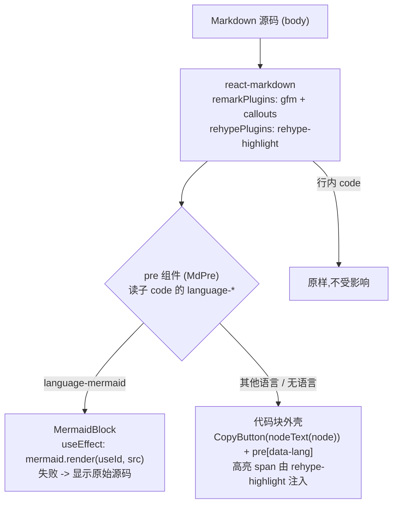
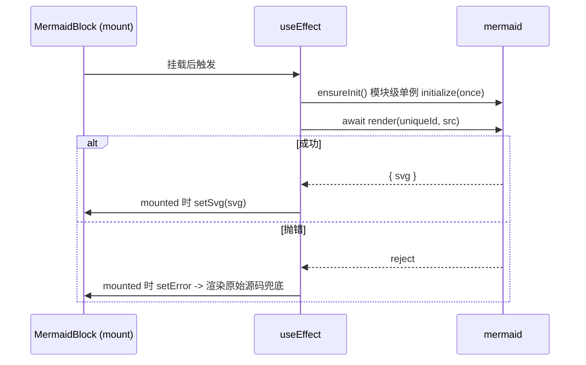

# feat: 文件面板 Markdown 预览支持代码高亮 / 一键复制与 mermaid 渲染

## Summary

给「右侧面板 → 文件面板」的 `.md` 预览增加三项能力:代码块**语法高亮**、代码块**一键复制**、以及把 ```` ```mermaid ```` 代码块渲染成**图**。改动集中在 Web/Desktop 共用的渲染组件 `packages/views/cortex-desktop/personal/MarkdownView.tsx` 与同包样式 `cortex-desktop.css`,新增依赖 `rehype-highlight`、`mermaid` 到 `packages/views/package.json`。

因 `MarkdownView` 同时被 tasks 详情(`TodosView`)与文件预览(`FilesView`)复用,本次改动天然惠及两处;Web 端经 Next.js App Router 渲染(组件链路在 `"use client"` 边界内),mermaid 的渲染调用必须放在客户端 effect。

---

## Problem Frame

当前 `MarkdownView` 基于 `react-markdown@10` + `remark-gfm`,代码块只做了一个纯 CSS 的「语言角标」(`MarkdownView.tsx:37-45` 的 `MdPre` + `cortex-desktop.css` 的 `pre[data-lang]::after`),**没有语法高亮、没有复制按钮**;```` ```mermaid ```` 代码块只会以纯文本源码呈现,**不会渲染成图**。仓库当前**没有任何高亮库,也没有 mermaid 依赖**。

目标是在不破坏既有排版(`.pw-todo-md`)、不改动写作面 CodeMirror 独立 widget、不引入 SSR 报错的前提下补齐这三项预览能力。

---

## Requirements

- **R1** 代码围栏块按语言渲染语法高亮;无语言/未知语言时原样不报错、不吞内容。
- **R2** 每个代码围栏块右上角提供「复制」按钮,点击把代码原文写入剪贴板,并给出已复制反馈;mermaid 块不带复制壳。
- **R3** ```` ```mermaid ```` 围栏块渲染为 SVG 图;渲染失败时降级为显示原始源码,不致整页崩溃。
- **R4** 行内代码(单行 `` `code` ``)不受高亮/复制影响。
- **R5** Web(Next.js,纸白底)与 Desktop(Electron renderer)两端表现一致,且不引入 SSR/构建期错误。
- **R6** 既有 frontmatter 折叠、callout、外链改走系统浏览器等行为保持不变。

成功判定:在文件面板打开含多语言代码块与一个 mermaid 图的 `.md`,代码块高亮且可一键复制,mermaid 图正常显示;两端构建与单测通过。

---

## Key Technical Decisions

- **KTD1 — 语法高亮选用 `rehype-highlight`(highlight.js/lowlight)**,以 `rehypePlugins` 一行接入 `react-markdown`,体积小、与现有生态契合。放弃 shiki(体积大,且仓库 CSS 多处刻意标注「无 shiki」)与 prism(需自定义 `code` 组件替换渲染,较重)。*(用户决策)*
- **KTD2 — 高亮主题颜色手写进 `cortex-desktop.css`(scoped 在 `.pw-todo-md`),不从库内 `import 'highlight.js/styles/*.css'`。** 理由:① 保持本包「单一 CSS 文件、apps 经 `styles.css` import」的既有约定;② 避免在库包里从 `.tsx` import 第三方 CSS 在 Next.js 与 Vite 两套构建器下表现不一致;③ 便于按纸白底/暗色主题精调 token。**因此不需要单独安装 `highlight.js`**(`rehype-highlight` 已自带 lowlight)。
- **KTD3 — mermaid 采用静态 `import`** *(用户决策)*,但 **`mermaid.render` 调用置于 `useEffect`(仅客户端)**:模块级 `initialize` 单例 guard 只初始化一次,`useId()` 生成唯一渲染 id,组件持 `mounted` 标志避免卸载后 setState。静态 import 仅决定打包方式(进主 bundle),不改变「渲染必须客户端化」这一正确性要求。
- **KTD4 — 在 `pre` 组件层拦截 mermaid。** `react-markdown@10` 已移除 `inline` prop;`pre` 只包围栏块,是区分块级/行内的可靠层。在 `MdPre` 内读取子 `code` 的 `language-mermaid` 类名 → 改渲染 `<MermaidBlock>`(不套高亮/复制壳);其余块套复制壳。
- **KTD5 — 代码原文从 hast `node` 递归提取,而非读 children/DOM。** 接入高亮后 `<code>` 的 children 变成嵌套 `<span>`,直接拼字符串不可靠;`react-markdown` 传入的 `node`(hast)是稳定文本来源,用一个小递归 `nodeText(node)` 取原文,供复制与 mermaid 源码共用。
- **KTD6 — 复制用 `navigator.clipboard.writeText`**:浏览器与 Electron renderer(Chromium,安全上下文)均原生可用;`navigator.clipboard` 不可用时静默失败(或 `document.execCommand` 兜底),不抛错。

---

## High-Level Technical Design

渲染管线与代码块分流(`MarkdownView` 内部):



mermaid 渲染时序(单图):



---

## Implementation Units

### U1. 新增 rehype-highlight 与 mermaid 依赖

- **Goal**: 在共享视图包声明并安装两项新依赖。
- **Requirements**: R1, R3
- **Dependencies**: 无
- **Files**:
  - `packages/views/package.json`(新增 `rehype-highlight ^7`、`mermaid ^11` 到 `dependencies`)
  - `pnpm-lock.yaml`(安装后更新)
- **Approach**: 仅声明依赖并 `pnpm install`。**不安装 `highlight.js`**——`rehype-highlight` 已传递依赖 lowlight,高亮主题由 U3 手写 CSS 提供(见 KTD2)。版本以 `pnpm` 解析到的当前稳定版为准(`rehype-highlight@^7.0.x`、`mermaid@^11.x`)。
- **Patterns to follow**: 现有 `react-markdown`/`remark-gfm` 在 `packages/views/package.json:28-29` 的声明方式。
- **Test scenarios**: Test expectation: none — 纯依赖声明,无行为变化;由 U2/U4/U5 的功能测试间接覆盖。
- **Verification**: `pnpm install` 成功;`pnpm --filter @cortex-work/views typecheck` 仍通过;两个新包可被 import 解析。

---

### U2. 代码块语法高亮 + 一键复制

- **Goal**: 接入 `rehype-highlight`,并把普通代码围栏块包进带「复制」按钮的外壳。
- **Requirements**: R1, R2, R4
- **Dependencies**: U1
- **Files**:
  - `packages/views/cortex-desktop/personal/MarkdownView.tsx`(加 `rehypePlugins=[rehypeHighlight]`;改写 `MdPre`;新增 `nodeText(node)` 递归取文本辅助;新增 `CopyButton` 内部组件)
  - `packages/views/cortex-desktop/cortex-desktop.css`(代码块外壳定位 + 复制按钮样式)
- **Approach**:
  - 给 `<Markdown>` 增加 `rehypePlugins`(默认 `detect:false`,无语言不报错、不吞内容,满足 R1/R4)。
  - 重写 `MdPre`:保留现有 `data-lang` 角标提取逻辑;非 mermaid 时返回 `<div class="pw-md-codeblock"><CopyButton text={nodeText(node)} /><pre data-lang={lang}>{children}</pre></div>`。mermaid 分流在 U4 接入(本单元先留判断位或在 U4 合并)。
  - `nodeText(node)`:递归遍历 hast `node`,拼接 `value` 文本子节点(见 KTD5),供复制与 U4 mermaid 源码共用。
  - `CopyButton`:点击 `navigator.clipboard?.writeText(text)`,成功后置 `data-copied` 态做短暂反馈(参考既有 `.cm-write-md-codeblock-copy` 的 `data-copied` 模式);`navigator.clipboard` 不可用时静默忽略(KTD6)。
  - CSS:`.pw-md-codeblock` 设 `position:relative`,复制按钮绝对定位右上(与 `pre[data-lang]::after` 角标错位,避免重叠);复制按钮样式直接复用/对齐 `cortex-desktop.css:6044-6050` 的 `.cm-write-md-codeblock-copy` 视觉。
- **Patterns to follow**:
  - 复制按钮样式与 `data-copied` 状态:`cortex-desktop.css:6044-6050`。
  - 语言角标:`cortex-desktop.css:3567-3578`(`pre[data-lang]::after`)。
  - 既有 `MdPre` 的 `language-([\w+-]+)` 提取:`MarkdownView.tsx:37-45`。
- **Test scenarios**(`MarkdownView.test.tsx`):
  - 渲染含 ```` ```ts ```` 围栏块 → DOM 中 `<code>` 带 `hljs` 类且含高亮 `<span>`(高亮已生效)。
  - 渲染无语言围栏块 → 不报错,文本原样呈现,仍包在 `.pw-md-codeblock` 外壳内。
  - 行内 `` `x` `` → 不被包进 `.pw-md-codeblock`,无复制按钮(R4)。
  - 复制按钮存在且 `aria-label`/title 合理;点击调用 `navigator.clipboard.writeText`,参数为代码原文(mock clipboard,断言入参等于源码,验证 `nodeText` 跨高亮 span 取文正确)。
  - 点击后按钮进入 `data-copied` 反馈态。
  - `navigator.clipboard` 为 `undefined` 时点击不抛错(降级路径)。
- **Verification**: 文件面板预览中代码块高亮可见、复制按钮可用;`pnpm --filter @cortex-work/views test` 新增用例通过;`TodosView`/`FilesView` 既有测试不回归。

---

### U3. 高亮主题样式(纸白底对齐)

- **Goal**: 在 `cortex-desktop.css` 内为高亮 token 提供配色,适配纸白底(及暗色态如有)。
- **Requirements**: R1, R5
- **Dependencies**: U2
- **Files**:
  - `packages/views/cortex-desktop/cortex-desktop.css`(新增 `.pw-todo-md` 作用域下的 `.hljs-*` token 配色)
- **Approach**: 不 import 库自带主题(KTD2),而在 `.pw-todo-md` 作用域下手写一组 `.hljs-keyword/.hljs-string/.hljs-comment/.hljs-number/.hljs-title/.hljs-attr` 等核心 token 颜色,色板对齐现有写作面/纸白主题,保证与 `.pw-file-md .pw-todo-md`(`cortex-desktop.css:4549-4557`)及写作面仅预览覆盖(`6112-6171`)风格统一。可参考 github-light 之类的 token 取值再按主题微调。
- **Patterns to follow**: 现有 `.pw-todo-md pre` 代码块基础样式 `cortex-desktop.css:3549-3578`;主题色变量(若有 CSS 变量体系)沿用。
- **Test scenarios**: Test expectation: none — 纯样式,无行为变化;高亮 class 注入由 U2 测试覆盖,配色由用户手动目检(见验证分工)。
- **Verification**: 文件面板中常见语言(ts/js/json/bash/go/python)代码块配色清晰、对比度足够,纸白底下不刺眼;两端一致。

---

### U4. mermaid 代码块渲染

- **Goal**: 把 ```` ```mermaid ```` 围栏块渲染为 SVG 图,失败时降级为原始源码。
- **Requirements**: R3, R5
- **Dependencies**: U1, U2
- **Files**:
  - `packages/views/cortex-desktop/personal/MarkdownView.tsx`(在 `MdPre` 内分流 `language-mermaid` → `<MermaidBlock>`;新增 `MermaidBlock` 组件 + 模块级 `ensureMermaidInit` 单例)
  - `packages/views/cortex-desktop/cortex-desktop.css`(`.pw-md-mermaid` 容器样式 + 错误兜底样式)
- **Approach**:
  - `MdPre` 检测子 `code` 类名为 `language-mermaid` 时,返回 `<MermaidBlock src={nodeText(node)} />`,**不套高亮/复制外壳**(KTD4)。
  - `MermaidBlock({ src })`:`useId()` 取唯一 id;`useEffect` 内 `ensureMermaidInit()`(模块级 boolean guard,`mermaid.initialize({ startOnLoad:false, securityLevel:'strict', theme:'default' })` 只跑一次),再 `await mermaid.render(id, src)`,`mounted` 标志成立时 `setSvg(svg)`;`catch` → `setError`,渲染 `<pre>` 原始源码兜底(R3)。`src` 变化时重渲染。
  - 静态 `import mermaid from "mermaid"`(KTD3),所有触碰 `document` 的逻辑仅在 effect 内执行,规避 SSR/构建期报错(R5)。详见「Risks」中的构建期回退预案。
- **Patterns to follow**: 现有 `MdPre` 的语言提取与 `data-lang` 约定;`MarkdownView` 既有「组件内 hook + 受控展开」写法(`Frontmatter`)。
- **Test scenarios**(`MarkdownView.test.tsx`,**mock `mermaid` 模块**):
  - mock `mermaid.render` resolve `{ svg: '<svg.../>' }` → mermaid 块容器内注入该 svg;`initialize` 仅被调用一次(即使多个 mermaid 块)。
  - mock `mermaid.render` reject → 容器降级显示原始 mermaid 源码,不抛错、不影响同文档其他内容渲染(R3)。
  - mermaid 块**不出现**复制按钮 / `.pw-md-codeblock` 外壳(KTD4)。
  - 多个 mermaid 块共存 → 各自 `render` 收到不同 `id`(断言 `render` 调用入参 id 互异,验证 `useId` 唯一性)。
  - 组件卸载后 pending render resolve 不触发 setState(mounted guard;mock 一个延迟 resolve 后 unmount,断言无 act 警告/无报错)。
- **Verification**: 含 `flowchart`/`sequenceDiagram` 的 `.md` 在文件面板渲染出图;语法错误的 mermaid 源码降级为文本且不崩页;`pnpm --filter @cortex-work/views test` 通过。

---

### U5. 测试落地与回归校验

- **Goal**: 就近新增 `MarkdownView.test.tsx` 汇总上述场景,并确认既有复用方不回归。
- **Requirements**: R1–R6
- **Dependencies**: U2, U3, U4
- **Files**:
  - `packages/views/cortex-desktop/personal/MarkdownView.test.tsx`(新建)
- **Approach**: 用 Vitest + Testing Library(jsdom)渲染 `MarkdownView`;`vi.mock('mermaid')` 提供可控 `initialize`/`render`;mock `navigator.clipboard.writeText`。覆盖 U2/U4 列出的全部场景。**Execution note**: 优先以 mermaid/clipboard 的失败路径与降级行为先写测试,再补正向断言。
- **Patterns to follow**: 同目录现有 `FilesView.test.tsx`、`TodosView.test.tsx`、`chatMarkdown.test.tsx` 的渲染与查询写法;`TodosView.test.tsx` 对 react-markdown 输出的断言方式(如第 128 行附近 autolink 断言)。
- **Test scenarios**: 见 U2、U4(本单元负责把它们实现为可运行用例);另加一条冒烟:含 frontmatter + callout + 高亮代码 + 复制 + mermaid 的综合文档一次性渲染无异常(R6 既有行为不回归)。
- **Verification**: `pnpm --filter @cortex-work/views test` 全绿;`pnpm typecheck`、`pnpm lint` 通过。

---

## Scope Boundaries

**In scope**: `MarkdownView`(文件预览 `FilesView` 与 tasks `TodosView` 共用同一渲染,自然一并受益)的代码高亮、复制、mermaid 渲染及其样式与测试。

**Out of scope**:
- 写作面 CodeMirror 编辑器的代码块 widget(`editor/markdownLiveWidgets.ts` 等),独立实现,不动。
- 聊天区 `ChatArea` / `chatMarkdown`:虽同样基于 react-markdown,本次仅改 `MarkdownView` 这条预览路径,不向聊天扩散。

### Deferred to Follow-Up Work
- 若希望聊天消息也获得同款高亮/复制/mermaid,可在本次组件稳定后,把 `MdPre`/`CopyButton`/`MermaidBlock` 抽为共享小组件供 `chatMarkdown` 复用(单独 PR)。
- 高亮按需注册语言以进一步压体积(`rehype-highlight` 的 `languages` 选项),先用默认常用语言集。
- mermaid 主题随应用明暗态联动(先固定 `theme:'default'`)。

---

## Risks & Dependencies

- **mermaid 静态 import 的 SSR/构建期风险(R5)**:研究表明 `import mermaid` 一般不在 import 期触碰 `document`,配合 effect 内渲染即安全。但 mermaid 体积大且历史上有顶层环境假设。**回退预案**:若 Next.js 构建/SSR 期出现 mermaid 相关报错或 `document is not defined`,将 `MermaidBlock` 改为 effect 内 `const mermaid = (await import('mermaid')).default` 动态 import(代码改动局部,不影响其余设计)。此项作为构建验证的明确检查点。
- **体积**:`mermaid@11` 较大(数百 KB),静态引入会进主 bundle(用户已知并接受)。如后续在意首屏,按上面 Deferred 改懒加载。
- **高亮 children 结构变化**:接入高亮后 `<code>` 子节点为嵌套 span,复制/mermaid 取文必须走 hast `node`(KTD5),否则会拿到错误文本——已在 U2/U4 测试中以「断言复制入参等于源码」守住。
- **剪贴板安全上下文**:非安全上下文(HTTP 非 localhost)`navigator.clipboard` 为 `undefined`;已设静默降级,Electron/本地开发/HTTPS 均正常。

---

## Verification Strategy

- 自动化:`pnpm --filter @cortex-work/views test`(新增 `MarkdownView.test.tsx`)、`pnpm typecheck`、`pnpm lint` 全绿。
- **构建验证(关键)**:`pnpm build`(web + desktop)均成功,确认 mermaid 静态 import 未触发 SSR/构建期错误(否则启用回退预案)。
- 手动目检(用户负责,见验证分工):文件面板打开含多语言代码块 + 一个 mermaid 图的 `.md`,确认高亮配色、复制反馈、mermaid 出图与失败降级在 Web 与 Desktop 两端一致。

---

## Sources & Research

- `rehype-highlight@^7`:依赖 lowlight(自带 highlight.js),默认 `detect:false` 不报错不吞内容;无需单独装 `highlight.js`(仅取主题 CSS 时才需,本计划改手写 CSS 规避)。<https://github.com/rehypejs/rehype-highlight>
- `react-markdown@9+` 移除 `inline` prop,块/行内区分应靠覆盖 `pre` 或 hast `node`。<https://github.com/orgs/remarkjs/discussions/1346>
- `mermaid@^11`:顶层 `mermaid.render(id, code)` 异步、内置队列避免并行冲突;`initialize` 单例、id 唯一、卸载守护。<https://mermaid.js.org/config/usage.html> / <https://github.com/mermaid-js/mermaid/issues/4369>
- 本地实现现状(组件、样式、复用方、可参考的复制按钮 CSS):`packages/views/cortex-desktop/personal/MarkdownView.tsx`、`cortex-desktop.css`(代码块 3549-3578、复制按钮 6044-6050)、`FilesView.tsx:450-456`。
