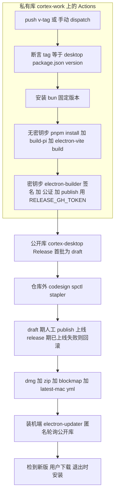

# feat: Desktop 发布自动化（私有源码 → 公开库 release + 自动升级）

## Summary

把半成品的 Desktop 发布链补成闭环：私有库 `rambocode/cortex-work` 打 `v<version>` tag 触发 GitHub Actions，在 macOS runner 上构建、Developer ID 签名、Apple 公证，再用 electron-builder `--publish always` 跨库把 arm64 产物发到新建的公开库 `rambocode/cortex-desktop`，装机端经 electron-updater 匿名读取该公开库 feed 自动升级。

---

## Problem Frame

现有发布链多处断裂（详见 origin）：workflow 从不安装 `bun`，而 `build:pi`（产物 `resources/pi` 被 gitignore）必须在 CI 现场用 bun 编译，故构建会失败；workflow 只 `upload-artifact`、`permissions: contents: read`，从不创建 Release；`scripts/dist-dmg.sh` 走 `dist:dmg`（仅 dmg + `--publish never`），产不出自动更新所需的 zip + `latest-mac.yml` 也不发布；`electron-builder.yml` 的 `publish` 指向私有源码库。根因：源码私有，而 electron-updater 需要一个公开可读的更新源——私有库 release 要 token 才能读，装机端无法匿名拉取，当前只能手动替换安装。

---

## Requirements

承接自 origin（R-ID 保持一致，见 `docs/brainstorms/2026-06-16-desktop-release-automation-requirements.md`）。

**公开库与更新源**

- R1. 新建专用公开库 `rambocode/cortex-desktop`，仅承载编译产物（dmg / zip / blockmap）与 `latest-mac.yml`，不含源码。
- R2. `electron-builder.yml` 的 `publish.owner/repo` 指向该公开库，使内嵌 `app-update.yml` 指向公开库 feed。
- R3. 装机端 electron-updater 匿名读取公开库 release（无 token），沿用现有检查 / 下载 / 安装 UX 与节奏。

**CI 构建与签名**

- R4. push `v*` tag 与 `workflow_dispatch` 触发 workflow，在 macOS runner 上先装 `bun`，再 `pnpm install` → `build:pi` → `electron-vite build` → `electron-builder`。
- R5. Developer ID 签名 + Apple 公证，env 驱动：有证书（CI）才签 / 公证，本地无证书自动跳过且不报错。
- R6. 保留签名校验 `codesign --verify --deep --strict` / `spctl --assess` / `xcrun stapler validate`（app 与 dmg），任一失败即 fail。

**跨库发布**

- R7. 发布不走 `scripts/dist-dmg.sh`（本地 dmg-only、`--publish never`），改为 workflow 内用完整 mac target（zip + dmg）调 electron-builder 完成构建 + 签名 + 发布。
- R8. 用 Fine-grained PAT（仅公开库 Contents: Read+Write）作 `GH_TOKEN` 跨库发布，存到私有库的受保护 Environment（见 KTD9/U1,非裸 repo secret）；workflow 默认 `GITHUB_TOKEN` 维持 `contents: read`，不用于跨库写。
- R9. 发布走 `electron-builder --publish always`，把 arm64 dmg / zip / blockmap / `latest-mac.yml` 发到公开库正式 release（非 draft）。

**发版流程**

- R10. 发版动作：先 bump `apps/desktop/package.json` version → commit → 打同名 `v<version>` tag → push；tag 与 version 必须一致。
- R11. release secrets（`RELEASE_GH_TOKEN`、`APPLE_ID` / `APPLE_APP_SPECIFIC_PASSWORD` / `APPLE_TEAM_ID`、`CSC_LINK` / `CSC_KEY_PASSWORD`）缺失即 fail-fast。

**app 侧（最小改动）**

- R12. `apps/desktop/src/main/ipc/update.ts` 的 feed 注释更新指向公开库；更新逻辑不改（源由 `app-update.yml` 驱动）。

---

## Key Technical Decisions

- KTD1. **公开库做唯一更新源、跨库直发正式版。** `publish` 指 `rambocode/cortex-desktop`，`publish.releaseType: release` 直接出正式 release（electron-builder GitHub publisher 默认建 draft，必须显式设 `release` 才能全自动上线）。装机端匿名读公开库 feed。首批 1–2 个版本临时走 `draft` + 真机验证 + 人工 publish 作软门控,稳定后再切 `release` 全自动(见 Operational Notes)。（origin KD1/KD2/KD6）
- KTD2. **签名「提交即签、本地脚本显式关」,而非手改 YAML。** `electron-builder.yml` 恢复为签名开启态（`identity` 真实 Developer ID + `notarize: true`，即 HEAD 状态）；CI 用 secrets 注入 `CSC_LINK` / `APPLE_*` 自动签 + 公证。本地 `dist:*` 脚本追加 `-c.mac.identity=null -c.mac.notarize=false` 覆盖关闭——从此本地无证书也能打包、且 `identity: null` 永不入库（消除当前未提交改动那种来回手改）。
- KTD3. **CI 必须先装 bun。** `build:pi`（`scripts/build-pi-binary.mjs`）用 `bun build --compile` 产 pi 二进制，产物 `apps/desktop/resources/pi` 被 gitignore，CI 全新 checkout 没有它，故 workflow 须 `setup-bun` 后再构建，否则 `build:pi` 找不到 bun 直接失败。这是当前 CI 的真实断点。
- KTD4. **完整 mac target + `--publish always`,经新增 `release:mac` 脚本。** mac 自动更新依赖 **zip**（dmg 仅人工下载），故必须出 zip + dmg；electron-builder 生成 `latest-mac.yml` / blockmap 并一并发布。新增 `prepackage:mac`（无密钥构建）+ `release:mac`（`--publish always` 签名发布）两脚本供 CI（拆步见 KTD8），`dist-dmg.sh` 留作本地辅助、不进 CI。（R7/R9，研究确认 zip 为 mac updater 硬需求）
- KTD5. **tag 与 version 一致性靠 CI 断言。** 以 `apps/desktop/package.json` version 为产物版本来源，workflow 比对去掉 `v` 前缀的 tag，不符即 fail——把 AE3 的失败模式变成构建守卫，而非仅靠流程约定。（resolve origin deferred 问题）
- KTD6. **签名产物在仓库外校验。** 先 `ditto` 拷到仓库外（如 `/tmp`）再跑 codesign/spctl/stapler，规避「在 `<repo>/apps/desktop/dist` 内校验时进程摸到仓库 `node_modules` 兜底 → 假通过」这条 `docs/lessons.md` 记录的踩坑。校验在 electron-builder publish **之后**执行（electron-builder 在 `release:mac` 一步内完成签名+公证+publish）:draft 期校验通过再人工 publish（校验先于上线）,全自动 `release` 期校验是 publish 后的门（失败按 Operational Notes 回滚）。（R6）
- KTD7. **跨库授权用 fine-grained PAT,默认 token 维持最小。** `RELEASE_GH_TOKEN` 仅对公开库有 `Contents: Read+Write`（足够建 release + 传 asset）；workflow `permissions` 维持 `contents: read`，跨库写完全靠 PAT，不提权默认 `GITHUB_TOKEN`。（origin KD4）
- KTD8. **密钥按步注入、构建与发布拆步。** secrets 不放 job 级 env（否则 `pnpm install`、`bun build` 等执行第三方代码的步骤都能读到 PAT/证书）。把流水线拆成**无密钥步**（pnpm install + `prepackage:mac` 跑 build:pi/electron-vite,第三方/bun 编译在此）与**签名发布步**（`release:mac` 跑 electron-builder 打包+签名+公证+publish）;`CSC_*` / `APPLE_*` 与 PAT 仅按 step 级注入到 electron-builder 那一步,electron-builder 自身不跑依赖 install 脚本,故 PAT/证书基本不接触第三方拉取与编译。注:electron-builder 默认 `npmRebuild: true`,会在该密钥步对 node-pty 跑 node-gyp 原生编译——故在 `electron-builder.yml` 设 `npmRebuild: false`（install 步已按 `onlyBuiltDependencies` 重建好 node-pty）,把原生编译移出密钥步,令此不变式名副其实（否则 electron-builder 仅 strip 子进程的 `GH_TOKEN`/`CSC_*`/`*PASSWORD`,而 `APPLE_ID`/`APPLE_TEAM_ID` 仍透传给该编译）。（security F1/F3,feasibility 核实）
- KTD9. **发布凭据放受保护 Environment + 收口触发授权 + 单一信任根兜底。** 5 个签名 secret + PAT 存到受保护 Environment（如 `production-release`）,job 声明 `environment:`,配「仅 `v*` tag 可进入」policy,叠加 `v*` tag protection——把触发面从「谁有 push 权限」收窄。runner 必须 GitHub-hosted（一次性 VM）,禁用 self-hosted,否则证书/keychain 跨 job 残留。**单人仓库下** required reviewers 会退化为自审（审批者=触发者=owner `rambocode`）,本期不强制,留作新增第二维护者/机器人账号时的前向预留;当前单一信任根靠**强制 `rambocode` 硬件 2FA** 兜底（该账号一处失守=可向所有装机用户推签名二进制）,并把 GitHub App（短时 token、可审计）设为近期 follow-up。（security F2/F7,scope/adversarial）

---

## High-Level Technical Design

凭据拓扑：私有库 Action 持有 `RELEASE_GH_TOKEN`（PAT，仅对公开库可写）+ `CSC_LINK` / `APPLE_*`（签名/公证）。产物单向流入公开库；公开库不持有任何写权限；装机端只读公开库、无需任何 token。

---

## Implementation Units

### U1. （前置 / 手动 + gh）建公开库、PAT 与 secrets

- **Goal:** 搭好跨库发布的目标库与凭据，让后续单元可真正发布。
- **Requirements:** R1, R8, R11
- **Dependencies:** 无
- **Files:** 无（GitHub 网页 / `gh` CLI / 仓库 Settings）
- **Approach:** 用 `gh` 或 GitHub 网页新建**公开库** `rambocode/cortex-desktop`（可空库,确认为 public 且匿名可读）。创建 **fine-grained PAT**,**仅**授该一个库 `Contents: Read and Write`（+ 默认 `Metadata: Read`,其余一律 No access——这是建 release + 传 asset 的最小集）,记录到期日与吊销路径。把 `RELEASE_GH_TOKEN` 与 5 个签名 secret（`APPLE_ID` / `APPLE_APP_SPECIFIC_PASSWORD` / `APPLE_TEAM_ID` / `CSC_LINK` / `CSC_KEY_PASSWORD`）存到私有库的**受保护 Environment**（如 `production-release`,配「仅 `v*` tag 可进入」policy;required reviewers 留作多维护者时启用,见 KTD9），而非裸 repo secret。强制该账号硬件 2FA。
- **Test expectation:** none —— 纯 ops/配置，发布能力在 U4 首次跑通时验证。
- **Verification:** 公开库存在且为 public、匿名可浏览 releases；受保护 Environment 含 `RELEASE_GH_TOKEN` 与 5 个签名项,tag policy 已配（reviewers 暂缓,KTD9）;PAT 仅 `Contents: R/W`。

### U2. electron-builder.yml：repoint publish + 恢复签名默认

- **Goal:** 让打包内嵌的 `app-update.yml` 指向公开库，并把签名/公证恢复为「提交即开」的 CI 默认态。
- **Requirements:** R2, R5, R9
- **Dependencies:** 无（与 U1 并行；逻辑上配合）
- **Files:** `apps/desktop/electron-builder.yml`
- **Approach:** `publish.owner` 改 `rambocode`、`publish.repo` 改 `cortex-desktop`，新增 `publish.releaseType: release`。把 mac 段从当前未提交的「关签名」态（`identity: null` / `notarize: false`）改回签名态：`identity: "Jiangwei Lan (HQ537XMLJY)"`、`notarize: true`，保留 `hardenedRuntime: true` / `gatekeeperAssess: false`。保留 zip + dmg 两个 arm64 target 与既有的 asar 体积排除规则（与本方案无冲突）。另设 `npmRebuild: false`（node-pty 由 install 步重建,避免密钥步内原生编译,KTD8）。关闭生产 sourcemap（在 electron-vite 配置禁用,或在 `files` 加 `!**/*.map`）,防私有源码结构随 `out/**` 泄入公开包（security F6）。
- **Patterns to follow:** HEAD 已提交版本即签名态（`git show HEAD:apps/desktop/electron-builder.yml`）；只在其基础上改 `publish` 三项。
- **Test scenarios:** Covers AE1 —— 配置层改动，签名行为在 U4（CI 有证书→签）与本地（U3 覆盖→不签）分别验证。
- **Verification:** YAML 合法；`publish` 指公开库且 `releaseType: release`；mac 段为签名态。

### U3. desktop package.json：新增 release:mac + 本地脚本关签名

- **Goal:** 给 CI 一个「完整 target + 发布」入口；让本地打包在无证书下自动跳过签名，无需手改 YAML。
- **Requirements:** R4, R7, R9
- **Dependencies:** U2
- **Files:** `apps/desktop/package.json`
- **Approach:** 拆成两个脚本以隔离密钥（KTD8）:`prepackage:mac` = `build:pi` → `electron-vite build`（第三方/bun 编译,CI 在**无密钥步**跑）;`release:mac` = `electron-builder --mac --publish always`（打包+签名+公证+跨库发布,CI 在**密钥步**跑;electron-builder 从 `out/` 打包、自身不跑第三方 install 脚本,出 zip + dmg 全量）。给 `dist:dir` / `dist:zip` / `dist:dmg`（及 `dist`）追加 `-c.mac.identity=null -c.mac.notarize=false`，使本地默认出未签名包（KTD2）。
- **Patterns to follow:** 现有 `dist:*` 脚本串联形态（`build:pi && electron-vite build && electron-builder ...`）。
- **Test expectation:** none —— 脚本接线，行为由 U4 与本地手测覆盖。
- **Verification:** 本地 `pnpm --filter @cortex-work/desktop dist:dmg` 在无证书机器上出未签名 dmg 且不报签名错；`prepackage:mac`（无 publish/无密钥）与 `release:mac`（带 `--publish always`）分别存在。

### U4. 重写 .github/workflows/desktop-release.yml

- **Goal:** 把 workflow 改成可用的跨库发布流水线：装 bun、断言版本、签名公证、跨库发布、仓库外校验。
- **Requirements:** R4, R5, R6, R8, R9, R10, R11
- **Dependencies:** U1, U2, U3
- **Files:** `.github/workflows/desktop-release.yml`
- **Approach:** 保留触发器（`v*` + `workflow_dispatch`）与 `permissions: contents: read`；job 声明受保护 `environment`（KTD9）,runner 固定 GitHub-hosted `macos-15`（禁 self-hosted）。**secrets 不放 job 级 env,改按步注入**（KTD8）。步骤顺序：checkout → **先 corepack 启用 pnpm 10.28.2,再** setup-node 20（`cache: pnpm` 需 pnpm 先在 PATH,修正现 workflow 的顺序隐患）→ setup-bun（**固定 `bun-version`**,pi 二进制对 bun 版本敏感,KTD3）→ **secrets fail-fast**（含 `RELEASE_GH_TOKEN` 与 5 个签名项,仅检查非空、不外泄,R11）→ **tag/version 断言**（`apps/desktop/package.json` version 对比去 `v` 前缀的 `github.ref_name`,不符 `exit 1`；dispatch 无 tag 时跳过,KTD5）→ **无密钥步**：`pnpm install --frozen-lockfile` + `prepackage:mac`（build:pi + electron-vite build,第三方/bun 编译在此,**不注入任何 secret**）→ **签名发布步**：`release:mac`（electron-builder 打包+签名+公证+`--publish always`）,**仅此步**用 step 级 env 注入 `CSC_LINK` / `CSC_KEY_PASSWORD` / `APPLE_*` 与 `GH_TOKEN: ${{ secrets.RELEASE_GH_TOKEN }}`（electron-builder 自身不跑第三方 install 脚本,PAT/证书不接触依赖拉取与 bun 编译,R8/R9/F1/F3）→ **仓库外校验**：`ditto` 把 `.app`/`.dmg` 拷到 `/tmp` 再跑 codesign/spctl/stapler（KTD6/R6）。**任何拉取/执行第三方代码的步骤必须排在 secrets 校验 + tag 断言之后**。移除 `scripts/dist-dmg.sh` 两步。确认生产构建关闭 sourcemap（或从 `files` 排除 `*.map`）、随包 `package.json` 无敏感字段,防私有源码/凭据泄入公开产物（F6）。
- **Patterns to follow:** 现 workflow 的 secrets 校验步骤与签名校验命令（codesign/spctl/stapler）可复用，只是改为对仓库外副本执行。
- **Test scenarios:**
  - Covers AE2. `package.json` version=`0.2.0` 且 tag `v0.2.0` → 公开库出 `v0.2.0` 正式 release，含 dmg/zip/`latest-mac.yml`，清单版本=`0.2.0`。
  - Covers AE3. tag `v0.2.0` 但 version=`0.1.0` → 断言步骤 fail，不发布。
  - 缺任一 release secret → fail-fast，不进入构建。
- **Execution note:** workflow 无法有意义单测,且 draft 对**匿名** electron-updater 不可见——故匿名真机升级闭环**测不了 draft**。首发前验证分两处:① 先用一个**抛弃式测试公开库** + 同型 fine-grained PAT 跑一次完整 `release`,证实 electron-builder 26 跨 owner publish + PAT 权限通,并在干净机器走完匿名低→高升级闭环（与生产同构、不污染正式库名）;② 正式库首批走 `draft`（经 `release:mac -- -c.publish.releaseType=draft` 命令行覆盖,不改 committed YAML,KTD2）验证产物完整性+签名公证后人工 publish,publish 后立即真机确认匿名 6s 首查可达,失败则按 Operational Notes 回滚。稳定后切 `release` 全自动。**不要**用 `--publish always` + 正式 release 直接 dry run（会把测试产物变成首发包,F4）。
- **Verification:** 发布后公开库 release 资产齐全（dmg/zip/blockmap/`latest-mac.yml` 版本一致）;仓库外签名/公证校验全绿;私有库源码与 secrets 未进入公开产物（含无 `*.map`）;并在干净机器上完成低→高真机升级闭环（检到→下载→退出安装,无 electron-updater `error` 态,见 Operational Notes go/no-go）。

### U5. update.ts feed 注释对齐公开库

- **Goal:** 让 app 侧文档与新更新源一致;确认无需改逻辑。
- **Requirements:** R3, R12
- **Dependencies:** U2
- **Files:** `apps/desktop/src/main/ipc/update.ts`
- **Approach:** 把 `UPDATE_FEED_CONFIGURED` 附近注释中的 `rambocode/cortex-work` 改为 `rambocode/cortex-desktop`。逻辑保持不动（`autoDownload=false`、6s 首查 + 2h 复查、IPC handler 不变;源由打包生成的 `app-update.yml` 驱动）。
- **Test expectation:** none —— 注释改动;自动更新行为见 AE4，需用真实安装包在发布后手动验证（属用户手动验证范畴）。
- **Verification:** 注释指向公开库;`pnpm --filter @cortex-work/desktop typecheck` 通过。

---

## Acceptance Examples

承接自 origin，绑定到上面的单元与测试场景。

- AE1. **Covers R5（U2/U3）。** Given CI 配好 `CSC_LINK` / `APPLE_*`，When 构建，Then 产物签名并公证;Given 本地无 `CSC_LINK`，When `pnpm dist`，Then 跳过签名、出未签名包且不报错。
- AE2. **Covers R9, R10（U4）。** Given version=`0.2.0` 且 push tag `v0.2.0`，When workflow 跑完，Then 公开库出 `v0.2.0` 正式 release，含 dmg/zip/`latest-mac.yml` 且清单版本=`0.2.0`。
- AE3. **Covers R10（U4）。** Given tag `v0.2.0` 但 version=`0.1.0`，When 构建，Then tag/version 断言 fail、不发布。
- AE4. **Covers R3（U5）。** Given 装的是 `0.1.0` 且公开库已有 `0.2.0`，When app 启动约 6s 后检查，Then 报告有更新可下载;Given 公开库无更新，Then 静默无提示。

---

## Scope Boundaries

- 仅 arm64 macOS（pi 的 bun target 硬编码 `bun-darwin-arm64`）；不做 Intel x64 / universal、Windows、Linux。
- 公开库 release 不做下载门控/鉴权——二进制公开可下载（分发源的固有代价）。
- 不做 beta / 灰度 channel（electron-updater prerelease 分流）。
- app 侧自动更新 UX 不改——状态机、IPC、检查节奏沿用现有实现。
- 首次安装来源可信**不在本方案保证内**（已接受的残余风险）:Gatekeeper 仅保证「经某有效 Developer ID 签名+公证」,不保证签名主体是官方 Team ID `HQ537XMLJY`;公开库 + 个人账号拓扑存在冒名 fork / 形似账号风险。缓解（非本期）:官网公示唯一权威下载入口 + 官方 Team ID 供自验,运营关注冒名 fork。（adversarial F5）

### Deferred to Follow-Up Work

- Intel x64 / universal 支持（需 pi 二进制出 x64 版 + 构建矩阵翻倍）。
- 删除或重构 `scripts/dist-dmg.sh`（本期保留作本地辅助）。
- beta / prerelease channel 与发布说明（release notes）自动生成。
- 把本次跨库发布 / PAT 最小权限 / 公证 entitlements 经验沉淀到 `docs/lessons.md` 或 `/ce-compound`。

---

## Risks & Dependencies

- **PAT 过期/泄漏。** fine-grained PAT 最长 1 年，到期发布会失败 → 记录到期日、临期轮换;仅授单库最小权限以收敛泄漏面。
- **CI 装 bun 的稳定性。** `build:pi` 强依赖 bun;`setup-bun` 失败即构建失败。pi 旁置资产（theme/assets/export-html/wasm）须随 `extraResources` 带出，缺失会在运行时炸。
- **公证耗时与额度。** notarytool 公证为分钟级轮询，`timeout-minutes: 60` 需留足;macos-15 runner 额度按 Actions 计费。
- **跨库 publish 配置。** PAT 权限或 `publish` owner/repo 配错 → 发布静默失败或 401/404;首发必须人工核对公开库产物齐全。
- **monorepo / hoist。** `.npmrc` `shamefully-hoist=true`，electron-builder 的 `files` 排除清单依赖扁平 `node_modules` 布局（既有，低风险）。
- **Feed 仓库地址是不可变契约。** `app-update.yml` 在打包期固化 owner/repo 进每个安装包,事后改不了。首发配错（指私有库/拼错/库非 public）→ 那批包永久收不到更新、无法补救;日后改公开库名/迁移会断掉所有旧安装包的更新。→ 首发前把「publish 三件套 + 库 public + 匿名可读」列为 go/no-go 必过项;库名一旦发出首个正式版即视为永久。（deployment）
- **源码/凭据泄入公开产物。** electron-vite 生产构建若产 `.map` 进 `out/**`,会把私有源码结构泄给公开用户;随包 `package.json` 若含私有 registry token/内部 URL 同理。→ 关 sourcemap 或从 `files` 排除 `*.map`,核对随包 `package.json`。（security F6）
- **触发授权面 + 单一信任根。** 任何能 push `v*` tag 或改 workflow 的协作者都能触发一次「secret 注入 CI」。→ 受保护 Environment + tag policy + tag protection（KTD9）;runner 必须 GitHub-hosted,禁 self-hosted。单人拓扑下 PAT 持有者=owner=（潜在）reviewer 均为 `rambocode`,该账号一处失守即可向全体装机用户推签名二进制 → **强制 `rambocode` 硬件 2FA**,GitHub App 设为近期 follow-up。（security F2/F7,adversarial F3）
- **install-time 脚本边界。** 根 `package.json` 的 `onlyBuiltDependencies`（`esbuild`/`electron`/`node-pty`）是 pnpm 安装期唯一会跑脚本的白名单——已强约束第三方 install 脚本执行面;扩这个白名单需安全评审。（security F3）
- **依赖单元:** U1 的库 + PAT + 受保护 Environment 是 U4 能跑通的前置。

---

## Operational Notes

**回滚 / 止损**（electron-updater 按 `latest-mac.yml` 的 version 单调比较,且 feed 库已固化进旧安装包）:

- **删公开库坏 release**（确认 `latest` 与 `latest-mac.yml` 不再指向坏版本）→ 止住「还没点下载」的用户（`autoDownload=false` 是天然缓冲窗口）。
- **roll-forward 发更高 patch**（如 `0.2.1`,内容可回退但版本号必升）→ **唯一**能覆盖「已下载/已 `autoInstallOnAppQuit` 装上坏版本」的存量用户;**不能降版本回滚**（semver 单调）。
- **撤私有库 tag** 对装机端无效,只防 CI 重触发再生。
- 一句话:删 release 止新增,roll-forward 救存量,撤 tag 只防再生。

**首发 go/no-go**（任一不过即 No-Go）:

- **feed owner/repo 永久定稿**（不可逆,见 Risks / Open Questions）:确认 owner 用个人 `rambocode` 还是迁组织、库名 `cortex-desktop` 终定——首个正式版发出后即固化进所有安装包、无法更改。
- **抛弃式测试库预演**:先在临时测试公开库用同型 fine-grained PAT 跑通 electron-builder 跨 owner publish,并完成一次匿名真机低→高升级闭环（draft 对匿名不可见,匿名闭环只能在真发布的库上测,故用抛弃库与生产同构验证、不污染正式库名）。
- publish 三件套逐字核对（`owner` / `repo` / `releaseType`）,库 public 且匿名可读。
- 产物齐全:arm64 dmg + **zip**（mac 自动更新硬依赖）+ blockmap + `latest-mac.yml`（version/sha512/files 一致）。
- 仓库外签名/公证校验全绿;公开库无源码 / `*.map` / 凭据泄漏。
- **pi 子进程真机可跑**:签名+hardened runtime 包里 pi（extraResources 的 bun 二进制）能正常 spawn（公证通过 ≠ 应用能跑;hardened runtime + library validation 可能需对 pi 额外 entitlement/签名,见 Open Questions）。
- **真机匿名闭环**:干净机器装低版本正式包 → 库发更高正式版 → 6s 首查报有更新 → 手动下载无 `error` → 退出自动装 → 版本升级（AE4 正反向）。正式库首发即真发,此步在 publish 后立即做,失败即 roll-forward。

**监控（无遥测）:** 盯 update 状态机 `error` 态（sha512/签名/公证/404 都落此）作为「有无校验错」的信号;首发 24–72h 人工复查几台机器 + GitHub release 下载计数;用户反馈是存量唯一信号。

---

## Open Questions

余下待定项（feed owner/库名已升为 go/no-go 阻塞项,见 Operational Notes;其余为实现期可定的小项）：

- **公证 entitlements + pi 子进程在 hardened runtime 下能否跑。** 现 `hardenedRuntime: true`、`gatekeeperAssess: false`;Electron 应用通常需默认 hardened entitlements（如 allow-jit）。**尤其** pi 是 extraResources 的独立 bun 二进制,主 app spawn 不同签名身份的子可执行文件,可能需 `com.apple.security.cs.disable-library-validation` 或对 pi 单独签名;真机闭环须验 pi 子进程能跑,而非只看公证通过。首次失败时在 U4/U2 加 `mac.entitlements` 或调整 pi 签名。
- **PAT 账号归属。** 默认用个人账号 `rambocode`;若后续要去个人化可换专用机器人账号（不影响计划结构）。
- **首发软门控（已倾向采用）。** 前 1–2 个正式版走 `draft` + 真机验证 + 人工 publish,稳定后切 `release` 全自动（KTD1 / Operational Notes）。
- **feed owner/库名定稿（已升为 go/no-go 阻塞,见 Operational Notes）。** 决策点:owner 用个人 `rambocode` 还是**迁组织**（组织对长期可控性更优,迁移近零成本、宜首发前做）;`cortex-desktop` 终名确认。若要可迁移 feed,需自建稳定 generic feed URL（Deferred）——放进 Deferred 等于接受永久锁定,首发前应有意识权衡。
- **PAT vs GitHub App。** 个人 PAT 为本期方案;GitHub App（限定单库、短时 token、可审计）为推荐演进方向。

---

## Sources / Research

- `.github/workflows/desktop-release.yml` —— 现有 workflow（未装 bun、只 upload-artifact、经 `dist-dmg.sh` 走 dmg-only `--publish never`、`contents: read`）。
- `apps/desktop/electron-builder.yml` —— publish 指私有库;HEAD 为签名态，工作区未提交改动关掉了签名。
- `scripts/dist-dmg.sh` —— 本地签名+公证 dmg 辅助（`dist:dmg` = dmg-only + `--publish never`，不适合 CI 发布）。
- `apps/desktop/scripts/build-pi-binary.mjs` —— `bun build --compile --target bun-darwin-arm64`（arm64 根因;产物 `resources/pi` 被 gitignore，CI 须装 bun 现场生成）。
- `apps/desktop/src/main/ipc/update.ts` / `update-state.ts` —— electron-updater 接线;更新源 100% 由打包生成的 `app-update.yml`（即 publish 字段）驱动，无任何手动引用。
- `apps/desktop/package.json` —— `dist:*` 脚本链;`electron-builder ^26.0.12` / `electron-updater ^6.6.2`。
- `docs/lessons.md` —— 「打包产物校验须复制到仓库外，否则摸到仓库 node_modules 造成假通过」。
- 外部框架文档检索本轮不可用（研究 agent 返回 403）;electron-builder 26 跨库 publish、`releaseType: release` 默认 draft、mac 自动更新依赖 zip、`notarize: true` 走 notarytool 等结论基于框架知识 + 仓库事实，首发 dry run 时实测确认。
