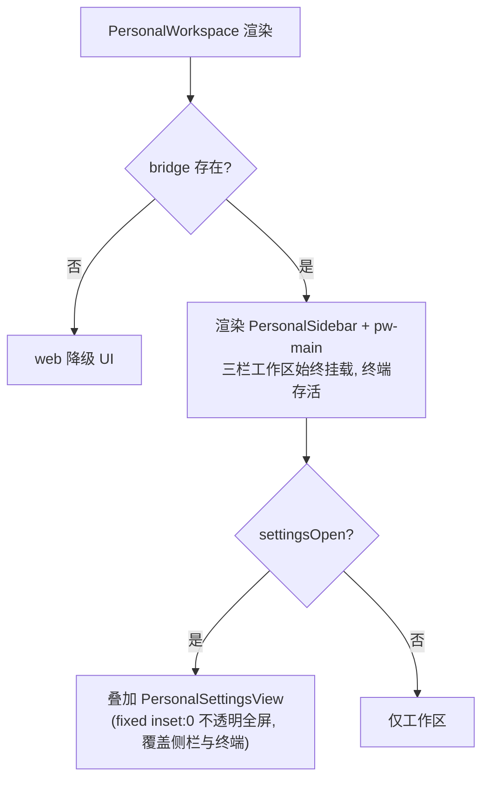

# feat: 个人工作区设置改为全尺寸两栏页面

## Summary

把个人工作区的设置从居中模态弹层（`SettingsDialog`，60vw×60vh 浮窗）改造为**全尺寸整页**：左侧菜单栏（顶部含「返回」按钮）+ 右侧内容区，打开时以**不透明全屏覆盖层**接管整个窗口（隐藏个人侧栏；底层工作区与运行中的终端保持挂载、不被卸载，PTY 会话不受影响）。沿用团队设置页已确立的「整页两栏 + 顶部返回」结构骨架，但以个人工作区的主题 token 实现外壳；8 个现有设置分区的功能逻辑原样复用、不改行为。设置的开闭通过个人 store 新增的瞬态 `settingsOpen` 标志驱动，与 `homeOpen`/`automationOpen` 等互斥。

---

## Problem Frame

个人工作区的设置当前是一个居中模态弹层（`packages/views/cortex-desktop/personal/SettingsMenu.tsx` 的 `SettingsDialog`，根节点 `.pw-dlg-overlay` → `.pw-dlg`，固定 60vw×60vh）。它内部已经是「左 Tab 菜单 + 右内容」的两栏，但被限制在一个浮起的卡片里，空间逼仄、与「正常页面」的观感不符。

团队工作区一侧（`packages/views/cortex-desktop/Sections.tsx` 的 `SettingsPage`）**已经**是用户想要的形态：整页两栏、左栏顶部一个「返回应用」按钮、右栏内容区。本次工作把个人侧的设置对齐到同样的整页形态，让设置成为一个正常的全尺寸页面而非弹窗。

此前的范围确认（Phase 0.7）锁定两点：① 整页**接管整个窗口**、隐藏个人侧栏（避免出现两条左侧栏）；② 复用团队整页设置的样式骨架。研究阶段发现团队 `settings-*` 类硬编码浅色（`#fff`/`#eef0f4`），与个人工作区的主题化（深/浅色、品牌色调）冲突——故②细化为「复用结构骨架、用主题 token 实现」，详见 KTD3。

---

## Requirements

- **R1** 个人设置以全尺寸整页展示，左栏为菜单、右栏为内容，两栏布局。
- **R2** 左栏顶部有「返回」入口，点击后退出设置、回到设置打开前的工作区视图。
- **R3** 打开设置时接管整个窗口（隐藏个人工作区左侧栏 `PersonalSidebar`）；底层工作区不被卸载，运行中的终端会话保持存活。
- **R4** 8 个现有设置分区（个人资料 / 通用 / 供应商 / Agent / 宠物 / 时间线 / 推送 / 语音）的功能与行为保持不变。
- **R5** 设置的打开/关闭是瞬态 UI 状态，不持久化（重启不停留在设置页），且与其它主区视图（首页 / 自动化 / 时间线 / 闪记 / 会话）互斥。
- **R6** 设置页外壳尊重个人工作区的主题（深/浅色、token 配色），不得引入写死浅色。

---

## High-Level Technical Design

### 互斥视图标志模型

个人 store 已有一组**瞬态、互斥**的主区视图标志（`homeOpen` / `automationOpen` / `timelineProjectId` / `noteEditorId`），任一 open 入口在置位自身的同时清零其余。本方案新增同族成员 `settingsOpen`，遵循完全相同的约定：瞬态（不进 `toPersistedState`）、互斥（open 时清其余、其余 open 时清它）。

### 渲染决策（PersonalWorkspace）

设置页要「接管整窗 + 隐藏侧栏」，同时**不能卸载正在运行的终端**——`TerminalPanel` 卸载时其 cleanup 会 `ptyKill` 杀掉 PTY 会话（文件头注释明确「收起只隐藏不杀、卸载才真杀」）。故设置页采用**不透明全屏覆盖层**：`settingsOpen` 为真时，在 `PersonalWorkspace` 正常 return 内**追加渲染**一个 `<PersonalSettingsView/>`（`position:fixed; inset:0`、不透明底色、两栏铺满），覆盖在整个工作区之上。底层 `pw-main`（含 `PersonalSidebar`、`TerminalPanel`、中心视图）**保持挂载**、仅被视觉遮挡——侧栏因被覆盖而隐藏，终端 PTY 不受影响。这与原 `.pw-dlg-overlay` 同为 `position:fixed; inset:0` 的浮层，区别仅是从「居中卡片 + 半透明遮罩」改为「不透明全屏两栏」，并接管覆盖整窗。

> 指导性示意，非实现规范。`PersonalSettingsView` 是全屏覆盖层（根节点带 `role=\"dialog\" aria-modal=\"true\" aria-label=\"设置\"`，复用原模态的对话框语义），内部为「左 `nav`（顶部返回按钮 + 复用 TABS 菜单项）+ 右内容区（按 active tab 渲染 8 个现有 Section）」两栏结构。底层工作区保持挂载以保活终端。

---

## Key Technical Decisions

### KTD1 — 整页接管整窗用「不透明全屏覆盖层」，而非卸载式 early-return（保活终端）
设置页拥有自己的左菜单与返回按钮；若保留外层 `PersonalSidebar` 会出现两条左侧栏，故需接管整窗、隐藏侧栏。实现采用**全屏覆盖层**（`position:fixed; inset:0` 不透明两栏）叠加在工作区之上，而**不**用「顶层 early-return 卸载工作区」——因为 early-return 会卸载 `TerminalPanel`，其卸载 cleanup 调 `bridge.ptyKill` 杀掉所有运行中的终端会话（`TerminalPanel.tsx` 头注释：「收起面板只隐藏不杀进程；关闭标签 / 离开个人工作区时真正 kill」）。覆盖层让底层 `pw-main` 保持挂载，侧栏被覆盖而隐藏、终端 PTY 存活。视觉上仍是「全尺寸整页」，与团队 `SettingsPage` 的两栏 + 返回形态一致（`Sections.tsx:693-719`）。
**备选**：① 顶层 early-return 卸载工作区——能接管整窗但会杀掉运行中的终端，被否（用户确认保活终端）；② 在 `.pw-center-col` 三元链里渲染（只占中栏、侧栏仍在，像 `AutomationView`）——达不到「接管整窗」，被否。

### KTD2 — 用瞬态 `settingsOpen` 标志驱动，镜像 `noteEditorId` 模式
新增 `settingsOpen: boolean` + `openSettings()` / `closeSettings()`，并在所有「主区视图重置点」补 `settingsOpen: false`。不加入 `toPersistedState` 的持久化白名单（保持瞬态）。`closeSettings` 仅置 `settingsOpen:false`，回退到设置打开前的底层视图（底层标志未被 `openSettings` 清掉的话自然恢复；见 KTD2a）。
**为何**：与现有 `homeOpen`/`automationOpen`/`noteEditorId` 同族，复用成熟约定与测试范式（`personal.test.ts:707-757`）；瞬态标志不入持久化是本仓既定约定（避免重启停留、避免落盘节流时序问题）。

### KTD2a — `openSettings` 不清底层视图标志，实现「返回原视图」
`openSettings()` 置 `settingsOpen:true`，但**不**清 `homeOpen`/`timelineProjectId` 等底层标志（设置是覆盖在当前视图之上的整页，渲染优先级最高）。这样 `closeSettings()` 只需把 `settingsOpen` 置回 false，底层视图标志原样保留，用户即回到打开设置前的页面，满足 R2。互斥的另一半由「其它 open 入口清 `settingsOpen`」保证（KTD2 的重置点改造）。

### KTD3 — 复用团队整页**结构骨架**，但以主题 token 实现外壳（不照搬团队 `settings-*` 类）
团队 `settings-page`/`settings-sidebar` 硬编码浅色（`cortex-desktop.css:2061` `background:#fff`、`2065` `#eef0f4`），个人工作区是主题化的（设置内就有主题切换器）。直接复用会导致深色模式下设置页恒为浅色。故新增一组 token 化的 `pw-settings-*` 外壳类（页面容器 + 返回按钮），内部两栏直接复用个人侧**已 token 化**的 `.pw-dlg-nav`/`.pw-dlg-nav-item`/`.pw-dlg-body`（4938-4974）与全部全局内容类（`.pw-scard`/`.pw-srow`/…，5453+，已确认非 `.pw-dlg-body` 作用域），满足 R6。
**注**：此条细化了 Phase 0.7 确认的「复用团队 settings-* 类」call-out——结构骨架沿用，配色改用 token。

### KTD4 — 最小改动：原地把 `SettingsDialog` 改造为 `PersonalSettingsView`，保留 `pw-dlg-*` 弹窗类
8 个 Section 组件（`SettingsMenu.tsx:87-1585`，约 1500 行）原地不动、原样复用，仅把外壳 `SettingsDialog`（1587-1639）改写为整页 `PersonalSettingsView`、把 `SettingsMenu` 入口（1641-1652）改为调用 store。`.pw-dlg-overlay`/`.pw-dlg` 模态类**保留**——`AutomationDialog` 仍依赖它们（`AutomationDialog.tsx:1` 注明「复用 SettingsDialog 外壳风格」），CSS 改动纯增量。

---

## Implementation Units

### U1. 个人 store 新增 `settingsOpen` 视图标志

**Goal**：在 `packages/core/store/personal.ts` 增加瞬态、互斥、不持久化的 `settingsOpen` 标志及其 open/close 动作，并织入所有主区视图重置点。

**Requirements**：R5（瞬态 + 互斥），支撑 R2/R3 的状态基础。

**Dependencies**：无。

**Files**：
- `packages/core/store/personal.ts`（修改）
- `packages/core/store/personal.test.ts`（新增用例）

**Approach**：
- 状态声明区（约 `personal.ts:79-84`，紧邻 `automationOpen`）加 `settingsOpen: boolean`；store 初始对象（约 243-250）加 `settingsOpen: false`。
- 接口与实现新增 `openSettings: () => void`（置 `settingsOpen:true`，**不**清底层标志，见 KTD2a）与 `closeSettings: () => void`（置 `settingsOpen:false`）。位置紧邻 `openAutomation`/`closeTimeline`（约 556-562）。
- 在以下「重置点」的 `set({...})` 中补 `settingsOpen: false`（否则在设置页点新建/选会话/切首页等不会退出设置）：`createSession`(391-402)、`setActiveSession`(459-473)、`activateProject`(475-484)、`openTimeline`(547-548)、`openHome`(553)、`openAutomation`(556-557)、`openNoteEditor`(560-561)。
- **不**修改 `toPersistedState`（583-602）——`settingsOpen` 不在白名单即为瞬态。

**Patterns to follow**：`noteEditorId` 的全套实现（声明 84 / open-close 560-562 / 各重置点）即为镜像范本。建议参照经验沉淀，open 入口集中通过一致的「置一清零其余」写法，避免遗漏互斥。

**Test scenarios**（`personal.test.ts`，新开 `describe("设置页视图态(settingsOpen)")`，镜像 707-757）：
- `openSettings()` 后 `settingsOpen===true`（happy path）。
- 预置 `homeOpen:true`/`automationOpen:true`/`timelineProjectId:"p1"`/`noteEditorId:"n1"` 后 `openSettings()`：`settingsOpen===true` 且**底层标志保持不变**（验证 KTD2a 不清底层）。
- `closeSettings()` 后 `settingsOpen===false`。
- 让位互斥：预置 `settingsOpen:true` 后分别调 `createSession`/`setActiveSession`/`activateProject`/`openHome`/`openAutomation`/`openTimeline`/`openNoteEditor`，每个分支断言 `settingsOpen===false`。
- 持久化排除：`expect("settingsOpen" in toPersistedState(usePersonalStore.getState())).toBe(false)`（照抄 752-756）。

**Verification**：`pnpm --filter @cortex-work/core test -- run packages/core/store/personal.test.ts` 全绿；`pnpm --filter @cortex-work/core typecheck` 通过（接口与实现签名一致）。

---

### U2. 整页设置外壳样式（token 化，增量）

**Goal**：在 `cortex-desktop.css` 新增 token 化的 `pw-settings-*` 全屏覆盖层外壳类，承载「左菜单（顶部返回）+ 右内容」两栏并铺满视口，复用既有 token 化两栏部件。

**Requirements**：R1、R2、R3、R6。

**Dependencies**：无（可与 U1 并行）；U3 消费这些类。

**Files**：
- `packages/views/cortex-desktop/cortex-desktop.css`（新增，紧邻 `.pw-dlg-*` 区块 4913-4992 之后或自然分组处）

**Approach**：
- 新增 `.pw-settings-page`：**全屏覆盖层**——`position: fixed; inset: 0; z-index: 200; display: flex; flex-direction: row; background: var(--bg-app);`（不透明、铺满视口、两栏；`z-index:200` 与原 `.pw-dlg-overlay` 4913 一致，确保盖住工作区与侧栏）。因是 `fixed` 浮层、不再是 `.chat`/`.body` 的 flex 子项，无需 `chat/section/mc-page` 类，也无 `.chat` 的 `flex-direction:column` 覆盖问题。
- 新增 `.pw-settings-back`：左栏顶部返回按钮（行内 flex、图标+文案、hover 态），配色 token（参照团队 `.settings-back` 2073-2086 的尺寸手感，但取 token）。
- **右内容限宽**：新增 `.pw-settings-page .pw-dlg-body` 限宽规则（或在 `.pw-dlg-body` 内层包一个 `max-width` 容器，镜像团队 `.settings-panel` 2119 的 `max-width:860px` 手感），令右栏内容在上限内左对齐，**避免整窗下 `.pw-srow-l { flex:0 0 38% }`（5457）把标签列拉伸、表单变形**。
- 左栏菜单与右内容**直接复用**已 token 化的 `.pw-dlg-nav`/`.pw-dlg-nav-h`/`.pw-dlg-nav-item`(+`.is-active`)/`.pw-dlg-body`（4938-4974）；左栏需铺满整窗高度，仅补必要的高度/滚动微调，不重写。
- 全局内容类（`.pw-scard`/`.pw-srow`/`.pw-sblock`/`.pw-set-input`/`.pw-pet-grid`/`.pw-prov-split`/`.pw-ml-*` 等，5453+）**零改动**——已确认非 `.pw-dlg-body` 作用域，可直接在覆盖层下生效。
- **不删除** `.pw-dlg-overlay`/`.pw-dlg`（AutomationDialog 仍用）。
- 确认 toast/系统通知层级**高于** `z-index:200`（`ToastStack` 挂在更上层的 `CortexDesktopView`），否则回合完成 toast 会被设置页覆盖层遮住。

**Patterns to follow**：原 `.pw-dlg-overlay`/`.pw-dlg`（4913-4937）的 `position:fixed; inset:0; z-index:200` 浮层定位；团队 `.settings-panel`（2119）的内容限宽手感；个人侧已 token 化的 `.pw-dlg-nav`/`.pw-dlg-body` 配色取值。

**Execution note**：先按经验 #1 双向对账——每个新写的 `pw-settings-*` className 与 CSS 定义一一对应，且反向 grep 确认无拼错后缀（CSS 全 token 匹配，`pw-settings-x ≠ pw-settings-x-y`）。

**Test scenarios**：`Test expectation: none -- 纯样式新增，无行为逻辑；视觉效果（深/浅色、全屏铺满、内容不变形、返回按钮命中区、toast 不被遮）由用户手动验证（见验证分工约定）。`

**Verification**：`pnpm lint` 通过；用户在深/浅两主题、窗口最大化下手动确认覆盖层全屏铺满、两栏、内容不横向拉伸、配色随主题、返回按钮可点、回合完成 toast 仍显示在设置页之上。

---

### U3. 把设置弹窗改造为整页并接通入口

**Goal**：将 `SettingsDialog` 原地改写为全屏覆盖层 `PersonalSettingsView`，把侧栏「设置」入口改为调用 `openSettings()`，并在 `PersonalWorkspace` 正常 return 内**叠加渲染**（非 early-return，保活终端）设置页。

**Requirements**：R1、R2、R3、R4。

**Dependencies**：U1（store 动作）、U2（外壳样式类）。

**Files**：
- `packages/views/cortex-desktop/personal/SettingsMenu.tsx`（改写 `SettingsDialog`→`PersonalSettingsView`、改写 `SettingsMenu` 入口、刷新文件头注释；8 个 Section 不动）
- `packages/views/cortex-desktop/personal/PersonalWorkspace.tsx`（在主 return 末尾追加覆盖层渲染）
- `packages/views/cortex-desktop/personal/SettingsMenu.test.tsx`（新建：入口/返回/焦点/ESC 守卫的最小渲染测试）

**Approach**：
- **PersonalSettingsView**（替代 `SettingsDialog` 1587-1639）：根节点 `
`（复用原模态 1600 的 `role="dialog" aria-label="设置"` 语义——整页接管后底层仍挂载，`aria-modal` 让读屏忽略被覆盖的背景）；左栏 `<nav className="pw-dlg-nav" aria-label="设置菜单">` 顶部加 `<button className="pw-settings-back" onClick={closeSettings}><Icon.Back/> 返回应用</button>`（文案对齐团队 `Sections.tsx:700` 的「返回应用」，整窗接管下语义更明确），其下复用 TABS（`SettingsMenu.tsx:65-76`）渲染 `.pw-dlg-nav-item`、给当前项加 `aria-current={tab===t.id ? "page" : undefined}`；右栏 `
` 按 active tab 渲染 8 个现有 Section（原 1618-1634 的 switch 原样搬入）。active tab 维持本地 `useState<SettingsTab>("profile")`。
- **焦点管理**：挂载时把焦点移入覆盖层（返回按钮 `ref` + `useEffect` 调 `.focus()`），否则键盘焦点会停在被覆盖但仍在 DOM/Tab 序里的底层控件上。
- **ESC 守卫**：保留 window 级 keydown 监听并把 `onClose` 改为 `closeSettings()`，但**加守卫**——当 `document.activeElement` 处于快捷键录制态（`HotkeyCapture` 录制中）或表单输入（`input`/`textarea`/`select`）时**不**触发 `closeSettings`。否则在「通用」分区用 `HotkeyCapture` 录制闪记快捷键时按 ESC（其取消手势）会因合成事件 `stopPropagation` 拦不住 window 原生监听而连带关掉整个设置页。去掉 `.pw-dlg-x` 关闭按钮（返回由顶部按钮承担）。
- **SettingsMenu 入口**（1641-1652）：删本地 `useState open` 与末尾 `{open ? <SettingsDialog/> : null}`；保留 `
<button className="sb-row is-mute ...">`，`onClick` 改为 `openSettings()`。**不**给入口加 `is-active=settingsOpen`——设置页为覆盖层时该入口虽仍挂载但被遮挡不可见，高亮无意义（去掉以免死逻辑与误导性测试）。
- **PersonalWorkspace**（`PersonalWorkspace.tsx`）：顶部取 `const settingsOpen = usePersonalStore((s)=>s.settingsOpen)`；在主 `return` 的 fragment **末尾**（`
` 闭合 `pw-main` 之后、`</>` 之前）追加 `{settingsOpen ? <PersonalSettingsView /> : null}`。覆盖层 `fixed inset:0` 盖住全部，**不做 early-return**——底层 `pw-main`（含 `TerminalPanel`）保持挂载，终端 PTY 存活。`!bridge` 降级分支不渲染设置（设置仅桌面端可达）。
- **刷新头注释**：`SettingsMenu.tsx:1-4` 现述「左侧 Tab 菜单（宠物 / 外观）」（仅 2 项、且描述弹窗）已与 8 分区 + 整页形态脱节，顺手更新。
- 验证无 Section 依赖 `.pw-dlg-body .twk-sect`（4992，疑似遗留）；如确无引用，迁移不受影响。

**Patterns to follow**：原 `SettingsDialog`（1587-1639）的 tab switch + ESC 监听结构；团队 `SettingsPage`（`Sections.tsx:693-719`）的返回按钮 + 两栏形态。

**Execution note**：本单元为纯 renderer 改动（store 标志 + 视图层 + CSS），不碰 preload / `main/ipc`，HMR 即可生效、无需重启 Electron。

**Test scenarios**（`SettingsMenu.test.tsx`，vitest + Testing Library，仅依赖 store、不需 bridge）：
- 渲染 `<SettingsMenu/>`，点击「设置」按钮后 `usePersonalStore.getState().settingsOpen===true`（入口接通，happy path）。
- 渲染 `PersonalSettingsView`，点击「返回应用」后 `settingsOpen===false`（R2 返回逻辑）。
- 焦点管理：挂载 `PersonalSettingsView` 后 `document.activeElement` 位于覆盖层内（返回按钮）。
- ESC 守卫（happy）：焦点在普通区域按 `Escape` → `settingsOpen===false`。
- ESC 守卫（边界）：把焦点置于一个 `input`（或模拟录制态元素）后按 `Escape` → `settingsOpen` 仍为 `true`（不误关）。
- `Covers R4.` 默认 active tab 为「个人资料」，点击「通用」菜单项后右栏切到「通用」、该菜单项带 `is-active` 且 `aria-current="page"`（tab 切换不回归；若 Section 需 bridge，注入最小 stub 或仅断言菜单态迁移）。
- 边界：`PersonalSettingsView` 卸载后 window keydown 监听已解绑（不残留）。

**Verification**：`pnpm --filter @cortex-work/desktop typecheck`（node+web 两套）与 `pnpm test` 全绿；用户手动验证——点「设置」进入全屏整页、侧栏隐藏、返回回到原视图、8 个分区功能如常、深/浅色正确、**终端跑命令时进出设置命令仍在运行**、录制快捷键时按 ESC 只取消录制不关设置。

---

## Scope Boundaries

**In scope**：个人工作区设置弹窗→整页的外壳改造、`settingsOpen` 视图标志、入口接通、token 化外壳样式、相关 store/入口单测。

**Out of scope（非目标）**：
- 团队工作区设置（`Sections.tsx` 的 `SettingsPage`）——已是整页，不在本次改动内。
- 8 个设置分区的功能/字段/布局本身——原样复用，不增删改。
- 移除 `pw-dlg-*` 模态样式或 `SettingsDialog` 以外的弹窗（`AutomationDialog` 仍依赖）。

### Deferred to Follow-Up Work
- 全局 `⌘,` 快捷键唤起个人设置（团队侧栏有 `⌘,` 提示，个人侧目前无；本次不接线）。
- 把「互斥 open 标志 + 共享切换器 + 不入持久化 + 覆盖层接管」沉淀为 `docs/solutions/` 或 `lessons.md` 一条约定（这是第三个全屏视图，模式已成型，宜在落地后用 `/ce-compound` 固化）。

---

## Risks & Mitigations

- **终端被误杀**：early-return 卸载工作区会 `ptyKill` 掉运行中的终端（评审 P1）。**缓解**：KTD1 改用覆盖层、`pw-main` 不卸载，PTY 存活；U3 手验「终端跑命令时进出设置命令仍在运行」。
- **互斥遗漏**：某个重置点漏加 `settingsOpen:false` → 从设置页导航后设置页「卡住」叠加。**缓解**：U1 测试逐个分支断言让位；改动集中在已知 7 个重置点。
- **ESC 误关**：全局 ESC→closeSettings 与「通用」分区 `HotkeyCapture` 录制态的 ESC 取消手势冲突（合成事件 `stopPropagation` 拦不住 window 监听）。**缓解**：U3 ESC 守卫——录制态/输入态不触发 closeSettings；手验录制时按 ESC 只取消录制。
- **z-index 层级**：覆盖层 `z-index:200` 需低于 toast/系统通知层，否则回合完成 toast 被遮。**缓解**：U2 确认 `ToastStack`（挂在更上层 `CortexDesktopView`）层级在其之上 + 手验 toast 仍显示。
- **样式作用域误判**：误以为内容类受 `.pw-dlg-body` 限定而过度改写。**缓解**：已核实内容类全局（5453+），仅 `.twk-sect` 受限且疑似遗留；U3 grep 确认无 Section 用 `twk-sect`。
- **配色回归**：若误用团队 `settings-*` 浅色类 → 深色模式破相。**缓解**：KTD3 明确 token 化外壳；U2 经验 #1 双向对账 + 用户深/浅色手验。
- **内容横向变形**：复用为 60vw 模态设计的内容类、`.pw-srow-l { flex:0 0 38% }` 在整窗下拉伸。**缓解**：U2 给右栏补 `max-width` 容器（镜像团队 860px）。
- **误删共享弹窗类**：删 `.pw-dlg-overlay`/`.pw-dlg` 会连带破坏 `AutomationDialog`。**缓解**：KTD4 明确保留；CSS 纯增量。

---

## Sources & Research

- 团队整页设置范本：`packages/views/cortex-desktop/Sections.tsx:693-719`（`SettingsPage`）、`32-34`（`MulticaPageShell`）；返回动作 `698`。
- 当前个人设置弹窗：`packages/views/cortex-desktop/personal/SettingsMenu.tsx:1587-1639`（`SettingsDialog`）、`1641-1652`（入口）、`65-76`（TABS）、`87-1585`（8 个 Section）。
- 主区渲染与互斥标志：`packages/views/cortex-desktop/personal/PersonalWorkspace.tsx:70-111`；`packages/core/store/personal.ts:79-84/243-250/391-562/583-602`。
- 样式事实：`packages/views/cortex-desktop/cortex-desktop.css` — 团队 `settings-*` 硬编码浅色 `2060-2135`（`#fff`/`#eef0f4`）；个人 token 化两栏 `4913-4992`（`.pw-dlg-overlay` 4913 即 `fixed/inset:0/z-index:200`）；团队 `.settings-panel` 限宽 `2119`；全局内容类 `5453+`（`.pw-srow-l flex:0 0 38%` 5457）。`AutomationDialog` 复用 `pw-dlg-*`：`AutomationDialog.tsx:1`。
- 终端保活依据：`packages/views/cortex-desktop/personal/TerminalPanel.tsx`（头注释「收起只隐藏不杀、卸载才真杀」；卸载 cleanup 调 `bridge.ptyKill`）。ESC 冲突依据：`packages/ui/controls/HotkeyCapture.tsx`（录制态 ESC 取消手势 + 合成事件 `stopPropagation` 拦不住 window 监听）。toast 层级：`ToastStack` 挂 `CortexDesktopView`（早期 return 之上层）。
- 测试范式：`packages/core/store/personal.test.ts:707-757`（`noteEditorId` 互斥/不持久化镜像）、`128-157`（`openHome`/`activateProject`）。
- 既有经验（`tasks/lessons.md`）：className↔CSS 双向对账（2026-06-14）；瞬态 vs 持久化切片 + 500ms 节流（2026-06-11）；布局/命中区先量再改（2026-06-12）。本次为纯 renderer 改动，无需重启 Electron。
- 文档评审（`ce-doc-review`，coherence/feasibility/design-lens/adversarial 四 persona）已并入：覆盖层保活终端（adversarial P1，用户拍板）、右栏限宽（design P2）、焦点管理 + `role=dialog`/`aria-label`/`aria-current`（design）、ESC 录制态守卫（adversarial P2）、去除 `is-active` 死逻辑（feasibility+adversarial）。
