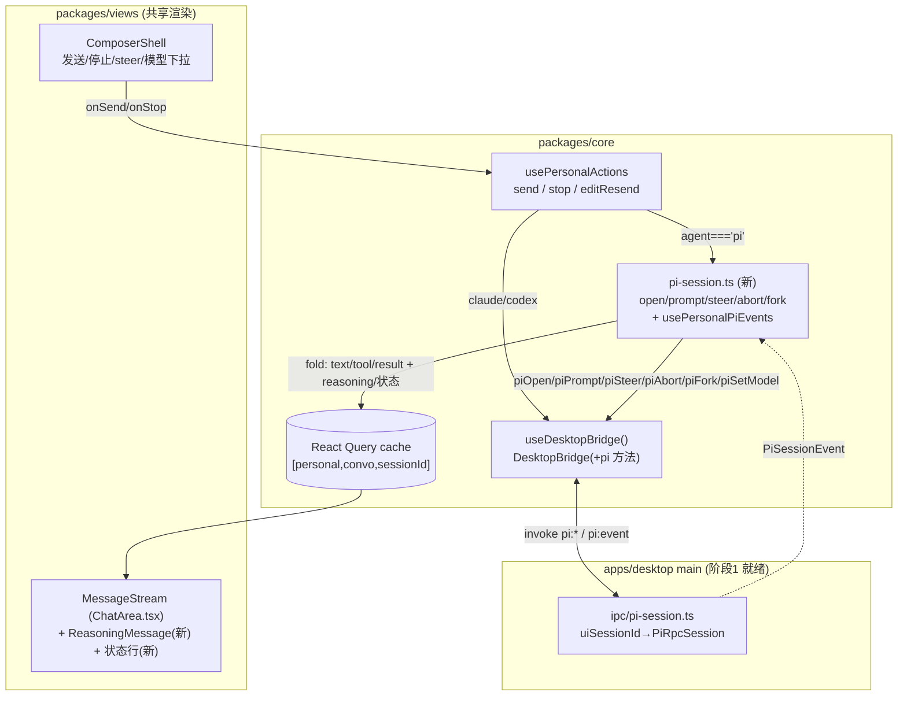

# feat: pi RPC 长驻会话——阶段 2（渲染层交互）

- 日期：2026-06-16
- 类型：feat
- 范围：`packages/core`（契约镜像 + pi 会话消费）、`packages/views`（交互 UI + 事件渲染）；`apps/desktop` 主进程/preload 阶段 1 已就绪，本阶段基本不动
- origin：`docs/plans/2026-06-16-003-feat-pi-rpc-session-plan.md`（§3.5 事件映射、§3.6 IPC 契约、§6 阶段划分）
- 阶段 1 落地：commit `c598064`（`PiRpcSession` + `ipc/pi-session.ts` + `pi:*` IPC + preload `piOpen/…/onPiEvent` + `PiSessionEvent` 类型）
- 状态：待执行
- 深度：Deep（跨 core/views、运行时控制、新增渲染分支）

---

## 1. 摘要

阶段 1 已把 pi 从单发 `--mode json -p` 升级为 `--mode rpc` 长驻会话，主进程侧 `PiRpcSession` + `pi:*` IPC + preload `piOpen/piPrompt/piSteer/piAbort/piFork/piSetModel/piCompact/onPiEvent` 全部就绪并挂在 `window.desktopAPI.personal`。但**契约层（`DesktopBridge`）、`core/desktop/types.ts`、core/views 三处都还没有 pi RPC 任何内容**——pi 会话现在是「主进程已实现、渲染层未消费」的半成品。

阶段 2 把这条 RPC 通道接进渲染层：让个人工作区聊天主区在 `agent === "pi"` 时改走 RPC（`piOpen` + `piPrompt`）而非单发 `startCli`，并把更细的 `PiSessionEvent`（text / reasoning / tool 起止 / result / 压缩 / 重试 / 队列）折叠进现有消息流渲染。同时解锁运行时控制：停止走 `piAbort`、编辑重发走 `piFork`、运行中可 `steer` 插话、`setModel` 实时切换。

claude/codex 完全不变，仍走 `messages.ts` 的单发 `startCli` 管线——本阶段以 characterization 测试守住该路径不回归。

---

## 2. 问题框架

**现状**：个人工作区聊天 UI 完全住在 `packages/views/cortex-desktop/`（跨 Web/Desktop 共享）。三个 agent 统一走单发 CLI：`usePersonalActions().send` → `bridge.startCli` → 主进程 spawn → `cli:event`/`cli:exit` → `packages/core/personal/messages.ts` 把归一化 `CliStreamEvent`（仅 `init|text|tool|result` 四种）折叠进 React Query cache（key `["personal","convo",sessionId]`）→ `MessageStream` 渲染。停止走 `bridge.killCli(runId)`，编辑重发走 `trimAgentSession`（截断会话文件）。

**缺口**：
1. **契约未承认 pi**：`DesktopBridge`（`packages/core/desktop/bridge.ts`）无 pi 方法；`PiSessionEvent`/`PiOpenRequest`/`PiOpenResult` 只在 `apps/desktop/src/main/ipc/types.ts`，未镜像到 `packages/core/desktop/types.ts`。`App.tsx` 把 `window.desktopAPI.personal`（已含 pi 方法）整体 cast 成 `DesktopBridge`，多出的 pi 方法被结构子类型静默丢弃，core/views 看不到。
2. **无 pi 事件消费**：core 没有订阅 `onPiEvent` 的等价 hook（单发是 `usePersonalCliEvents`，messages.ts:677）。
3. **渲染分支缺失**：`ChatArea.tsx` 只有 `text`/`agentLog`/`typing` 等，无 reasoning（思考流）、无 compaction/retry/queue 状态展示。
4. **send 路径无 pi RPC 分叉**：`send`/`stop`/`editResend` 全部硬走 `startCli`/`killCli`/`trimAgentSession`，pi 的运行时控制（steer/abort/fork）无入口。

**目标**：补齐上述四点，让 pi 在与单发完全一致的聊天 UI 里运行，并额外获得运行时控制能力。pi 会话长驻（一个 UI 会话 = 一个 pi 子进程），lazy open，`uiSessionId` 直接复用个人会话 `SessionMeta.id`。

**非目标（本阶段不做）**：崩溃自动重启与 `switchSession` 上下文恢复、空闲回收、多会话进程上限（→ 阶段 4）；extension 工具确认 UI、自定义工具样例（→ 阶段 3）；单发 pi 代码删除（保留作兜底，验证稳定后再清）。

---

## 3. 需求追溯

| R-ID | 需求 | 来源 |
|---|---|---|
| R1 | pi 的一轮对话走 RPC：`piOpen`（lazy）+ `piPrompt`，流式事件渲染进与单发一致的消息气泡 | origin §6 阶段 2、§3.1 |
| R2 | 停止走 `piAbort`（打断当前轮，不杀长驻进程）；单发 claude/codex 仍走 `killCli` | origin §0、§3.2 |
| R3 | 编辑重发走 `piFork(entryId)` 分支，替代 `trimAgentSession` 截断 | origin §8、§3.6 |
| R4 | 运行中可 `steer` 插话注入，UI 展示待注入队列计数 | origin §0(1)、§3.5 queue_update |
| R5 | 渲染 `reasoning`（思考增量，仅 reasoning 模型）为独立可折叠块 | origin §3.5 reasoning |
| R6 | 渲染 `tool-start`/`tool-end`（toolCallId 配对）为 agentLog 卡片；`turn-end` 收尾 | origin §3.5 |
| R7 | 渲染 `compaction`/`retry`/`queue`/`thinking-level` 状态；`error`/`crashed` 显式提示 | origin §3.5、§7 |
| R8 | 模型可运行时切换：`setModel` 实时生效（会话已开启时） | origin §0(3)、§3.2 |
| R9 | `DesktopBridge` + `core/desktop/types.ts` 镜像 pi 能力，Web 端（bridge=null / 方法 undefined）优雅降级 | origin §3.6、架构硬边界 |
| R10 | claude/codex 单发路径零回归 | origin §0、§1 |

---

## 4. 关键技术决策（KTD）

### KTD-1：pi RPC 走 `DesktopBridge` + core 编排，而非 desktop-only 旁路

**决策**：把阶段 1 已挂在 preload `personal` 上的 pi 方法补进 `DesktopBridge` 接口（可选 `?:`），core 经 `useDesktopBridge()` 调用，新建 core 模块消费 `onPiEvent`。

**理由**：既有流式 agent 能力（`onCliEvent`/`startCli`）的成立先例正是「进 bridge + core 编排」（`usePersonalCliEvents` 在 `messages.ts`）。pi 会话是主聊天区（`PersonalChatArea`，复用 `packages/views`）的核心功能，与 spotlight/notesOverlay 那种「desktop 本地浮窗、显式不进 bridge」性质不同。走 bridge 才能让 Web/Desktop 共享同一套 `packages/views` 渲染。

**代价**：契约需双写镜像（core 与 main 各一份，靠人工 + `satisfies` 对齐）。可接受——与现有所有能力域一致。

### KTD-2：复用 messages.ts 的消息 cache 折叠机制，pi 专属事件单独处理

**决策**：pi 事件中与单发**语义重叠**的部分（`text`→文本块、`tool-start`/`tool-end`→agentLog 卡片、`result`→收尾）翻译进 `messages.ts` 现有的 run / 折叠管线（`RunState` + `foldCliEvent` + `handleCliEvent` + `finalizeRun`）；pi**专属**事件（`reasoning`/`compaction`/`retry`/`queue`/`thinking-level`/`crashed`）在新模块 `pi-session.ts` 直接处理。

**理由**：`foldCliEvent` 的尾部游标折叠（`FoldCursor`）与 agentLog 卡片逐项翻 check 逻辑是经过实战的复杂代码，重写易引入气泡错位 bug。最大化复用 = 最小化 pi 渲染的新增折叠逻辑（只剩 reasoning 一种新折叠）。

**实现自由度（执行时定夺，不在计划锁死）**：复用方式可以是「抽出共享折叠 helper 模块供两者引用」或「pi 事件翻译成 `CliStreamEvent` 形状喂给导出的 `handleCliEvent`」。两条路都必须用 characterization 测试守住单发路径。倾向后者（翻译 + 导出少量函数），改动面更小、对单发零侵入；若翻译处变形过多再退化为抽取。

**关键发散点（长驻 vs 单发）**：单发每轮 spawn→stream→exit，看门狗静默超时**杀进程**（`killCli`）；pi 进程长驻，一轮 run 的结束由 `result` 事件（`agent_end`）表达，**绝不能杀进程**。故 pi 的 `RunState` 标记 `transport:"pi"`：看门狗只刷新 typing 等待时长、不在静默时 `killCli`；超时兜底走 `piAbort`（打断轮，进程存活）。

### KTD-3：`uiSessionId` 复用个人会话 `SessionMeta.id`，pi 会话 lazy open + 长驻

**决策**：一个个人会话 ↔ 一个 pi 子进程，`uiSessionId === session.id`。首次对该会话 `send`（agent=pi）时 lazy `piOpen`（期间 typing 显「启动中」，冷启 ~790ms 经阶段 1 `get_state` 探测就绪）；之后多轮复用同一长驻会话。会话切换时**保持存活**（切回即时响应）；会话删除 / `PersonalWorkspace` 卸载 / app 退出时 `piClose`。

**理由**：lazy 避免为「只是扫一眼」的会话也 spawn 进程；长驻保留运行时上下文（steer/abort/fork 的前提）。空闲回收（N 分钟无活动 stop + 惰性重启）是阶段 4，本阶段保持简单。

**本阶段已知限制**：pi 进程内存态只在存活期间有效。重开既有 pi 会话（app 重启后 / 卸载后）→ `piOpen` 全新进程，pi 侧无历史上下文（但磁盘聊天历史经 saved chat 仍正常渲染）。`switchSession(sessionFile)` 文件态恢复 → 阶段 4。计划在 Scope Boundaries 显式记此缺口。

### KTD-4：`reasoning` 作为新增 `Message` kind，状态事件走轻量系统行 / 头部指示

**决策**：`packages/core/types/index.ts` 的 `Message` 联合新增 `kind:"reasoning"`（可折叠思考块，按 delta 累积，类似 text 折叠）。`compaction`/`retry` 渲染为瞬态系统文本行（自动收尾），`queue`（待注入计数）+ `thinking-level` 渲染为会话头部 / composer 指示，不新增持久消息 kind。

**理由**：reasoning 是会进历史、值得回看的内容 → 持久 kind。compaction/retry/queue 是瞬态运行状态 → 不污染消息历史。`error`/`crashed` 复用现有 `⚠️` 文本气泡约定（`result.ok===false` 同款）。

---

## 5. 高层数据流（HTD）

阶段 2 在「pi 分叉」处接管：`send` 判 `agent==="pi"` 后走右侧 RPC 通道，事件经新 `usePersonalPiEvents` 折叠进**同一** React Query 消息 cache，复用 `MessageStream` 渲染。

**一轮 pi run 的事件序列（阶段 1 实测）**：`message_start → message_update(text_delta…) → tool_execution_start → tool_execution_end → turn_end → message_end → agent_end{willRetry:false}`，经 `mapPiEvent` 归一为 `text* → tool-start → tool-end → turn-end → result`。失败体现在 `message_end{stopReason:error|aborted}` → `error` 事件。

---

## 6. 实现单元

### U1. Core 契约：镜像 pi 类型 + `DesktopBridge` 声明 pi 方法

**Goal**：让 core/views 能类型安全地调用阶段 1 已存在于 preload 的 pi 方法。

**Requirements**：R9。

**Dependencies**：无（起点）。

**Files**：
- `packages/core/desktop/types.ts`（新增 `PiOpenRequest`/`PiOpenResult`/`PiSessionEvent` 镜像，逐字对齐 `apps/desktop/src/main/ipc/types.ts:283-321`）
- `packages/core/desktop/bridge.ts`（`DesktopBridge` 接口新增可选 pi 方法组 + `onPiEvent`）
- `packages/core/desktop/types.test.ts`（若已有镜像 parity 测试则扩展，否则新增一条形状断言）

**Approach**：
- 镜像 `PiSessionEvent` 联合（13 个变体）、`PiOpenRequest`（注意 `provider` 内嵌形与 `CliStartRequest.provider` 同形）、`PiOpenResult`。core 侧 `provider` 用 core 已有的 provider 形状（与 `CliStartRequest` 复用，避免重复定义）。
- `DesktopBridge` 按现有 `onCliEvent` 范式新增：`piOpen?(req): Promise<PiOpenResult>`、`piPrompt?/piSteer?/piFollowUp?(uiSessionId, message): Promise<unknown>`、`piAbort?/piGetForkMessages?/piGetState?/piGetStats?/piClose?(uiSessionId)`、`piFork?(uiSessionId, entryId)`、`piSetModel?(uiSessionId, provider, modelId)`、`piSetThinking?(uiSessionId, level)`、`piCompact?(uiSessionId, customInstructions?)`、`onPiEvent?(cb: (uiSessionId: string, event: PiSessionEvent) => void): () => void`。全部 `?:`（Web 降级）。
- 验证 preload 的 `personal` 对象（`apps/desktop/src/preload/index.ts`）已满足新接口：它已含全部 pi 方法，`satisfies DesktopBridge` 若存在则应继续通过；不需要改 preload / `App.tsx`（cast 透传现成）。
- 若 `core/desktop/types.ts` 顶部约定的 `satisfies` 对齐机制涉及 main 侧引用，确认 `apps/desktop/src/main/ipc/types.ts` 无需反向改动（pi 类型已在 main 定义，core 这侧是补镜像）。

**Patterns to follow**：`onCliEvent`/`onCliExit`（bridge.ts:158-159）的订阅签名 + 返回 `() => void`；`CliStartRequest.provider` 的内嵌 provider 形状；现有可选能力 `?:` 降级约定。

**Test scenarios**：
- 形状 parity：core `PiSessionEvent` 与 main 侧字段逐一对齐（若仓库有 `satisfies`/parity 测试范式则照搬；否则一条断言「core 侧能赋给 main 侧类型」的编译期测试）。
- `Test expectation: 主要由 typecheck 覆盖`——契约改动无运行时行为；parity 断言防漂移。

**Verification**：`pnpm --filter @cortex-work/core typecheck` 通过；`packages/views` 能 import 到 `bridge.piOpen` 等且类型正确。

---

### U2. Core：pi 会话生命周期 + 事件消费（`pi-session.ts`）

**Goal**：新建 core 模块，管理 pi 长驻会话开/关，订阅 `onPiEvent` 把 `PiSessionEvent` 折叠进消息 cache。

**Requirements**：R1、R5、R6、R7。

**Dependencies**：U1。

**Files**：
- `packages/core/personal/pi-session.ts`（新增）
- `packages/core/personal/pi-session.test.ts`（新增）
- `packages/core/personal/messages.ts`（导出 U2 复用所需的少量折叠/收尾函数——见 KTD-2 实现自由度；导出面尽量小）

**Approach**：
- **会话注册表**：模块级 `Map<sessionId, { sessionId; piSessionId?: string; opening?: Promise<void>; ready: boolean }>`。`openPiSession(bridge, session, projectPath)`：已 ready 直接返回；正在 opening 复用同一 Promise（去重，防并发 send 重复 spawn）；否则 `bridge.piOpen({ uiSessionId: session.id, cwd, model, useOwnSkills, provider })` → 记 `piSessionId`（写回 `SessionMeta.agentSessionIds.pi` 供诊断）。
- **事件订阅**：`usePersonalPiEvents()`（在 `PersonalWorkspace` 挂载一次，对称 `usePersonalCliEvents`）：`bridge.onPiEvent((uiSessionId, ev) => handlePiEvent(qc, uiSessionId, ev))`，返回退订。
- **事件折叠**（`handlePiEvent`）：按 KTD-2 翻译——
  - `text` → 复用 messages 文本折叠（尾部并入当前 text 块）。
  - `reasoning` → 折叠进 `kind:"reasoning"` 块（新折叠，类比 text；同一轮内累积）。
  - `tool-start`/`tool-end` → 复用 agentLog 卡片折叠（按 `toolCallId` 配对：start 新增 running 项，end 翻 check / error）。
  - `turn-end` → 收尾当前 agentLog。
  - `error` → `⚠️` 文本气泡（复用单发错误约定）。
  - `result{willRetry}` → `willRetry:false` 收尾该 run（清 typing、`setRunning(undefined)`、落盘、TTS/时间线收尾复用 `finalizeRun`）；`willRetry:true` 保持 typing，显「重试中」。
  - `compaction`/`retry` → 瞬态系统行（自动收尾）。
  - `queue` → 更新该会话待注入计数（写 store 瞬态字段，供 composer 读）。
  - `thinking-level`/`session-info` → 更新会话头部指示 / `SessionMeta`。
  - `crashed` → `⚠️` 提示「pi 会话已退出」+ 标记需重开（清 ready），清 running。
- **运行状态**：pi 一轮 = `piPrompt` 到 `result(!willRetry)`/`error`/`crashed`/`abort`。`runningBySession` 复用（pi 的 runId 可用合成 turn id 或直接用 sessionId 语义）。
- **命令封装**：导出 `promptPi/steerPi/abortPi/forkPi/setModelPi/closePiSession`，内部 `bridge.piPrompt(...)` 等；失败（reject）→ `⚠️` 提示。
- **看门狗发散**：pi run 的 `RunState.transport="pi"`：看门狗只更新 typing 等待时长，静默**不** `killCli`；启动阶段超时（piOpen 迟迟不 ready）才提示并 `piClose`。

**Patterns to follow**：`usePersonalCliEvents`/`handleCliEvent`/`handleCliExit`/`finalizeRun`/`foldCliEvent`（messages.ts）；`RunState`/`emptyFoldCursor`/`appendMsg`/`updateTypingMsg`/`dropMsg`/`clearTransient`（messages.ts 内部）。

**Test scenarios**（Vitest + 注入 fake bridge，模拟 `onPiEvent` 回调）：
- **Happy**：open→ready 去重（并发两次 open 只 spawn 一次）；`text` 增量折叠进单一文本块；`tool-start`+`tool-end`(同 toolCallId) 折叠为一张 agentLog 卡片并翻 check；`result{willRetry:false}` 清 typing + `setRunning(undefined)` + 落盘。
- **reasoning**：连续 `reasoning` delta 累积进一个 `kind:"reasoning"` 块，不与正文 text 混。Covers R5。
- **错误/重试**：`error` 事件 → `⚠️` 气泡 + 清 running；`result{willRetry:true}` → 保持 typing/显重试，不收尾；`retry` 事件 → 系统行展示 attempt/max。
- **crashed**：`crashed` → `⚠️` + ready 清除 + running 清除（下次 send 触发重开）。
- **路由**：`onPiEvent` 按 `uiSessionId` 分派——A 会话事件不写进 B 会话 cache（多会话隔离）。
- **看门狗发散**：pi run 静默超过单发 STALL 阈值**不**触发 `killCli`（断言 fake bridge 的 killCli 未被调用）。
- **compaction/queue**：`compaction start/end` → 瞬态行出现/消失；`queue{steering:n}` → store 待注入计数 = n。

**Verification**：`pnpm --filter @cortex-work/core test -- run packages/core/personal/pi-session.test.ts` 全绿；多会话事件不串场。

---

### U3. `send`/`stop`/`editResend` 对 pi 分叉到 RPC

**Goal**：聊天主流程在 `agent==="pi"` 时改走 RPC 通道，单发 claude/codex 零回归。

**Requirements**：R1、R2、R3、R8、R10。

**Dependencies**：U1、U2。

**Files**：
- `packages/core/personal/messages.ts`（`send`/`stop`/`editResend` 分叉）
- `packages/core/personal/messages.test.ts`（pi 分叉测试 + 单发 characterization）

**Approach**：
- **send**（messages.ts:774）：`agent==="pi"` 时——保留 appendMsg 用户消息 + typing 占位 + RunState（`transport:"pi"`）+ `setRunning` 不变；把 `bridge.startCli({...})` 替换为 `await openPiSession(...)`（lazy，typing 显「启动中」）+ `promptPi(bridge, session.id, text)`。provider/model 解析（现 messages.ts:861-872 的 isPi 分支）复用，作为 `piOpen` 的入参（首次开会话时定）。claude/codex 分支 `startCli` 原样不动。
- **stop**（messages.ts:950）：`agent==="pi"`（按 sessionId 查会话 agent）→ `abortPi(bridge, sessionId)`（`piAbort`）；否则 `killCli(runId)` 不变。4 秒兜底复位 UI 复用。
- **editResend**（messages.ts:910）：`agent==="pi"` → 截断 cache（复用 `truncateForEdit`）后，用 `bridge.piGetForkMessages` 取可分支条目、定位编辑轮的 entryId，`forkPi(bridge, sessionId, entryId)` 分支，再 `promptPi(newText)`；替代 `trimAgentSession`。claude/codex 仍走 clear/trim。
- **模型实时切换**：`PersonalChatArea` 的 `onChangePiModel`（现 PersonalChatArea.tsx:398 仅 `updateSession`）——若该会话 pi 进程已 open，额外调 `setModelPi(bridge, sessionId, providerId, modelId)` 实时生效；未 open 仅 `updateSession`（下次 open 带新模型）。

**Execution note**：**characterization-first**——动 `send`/`stop`/`editResend` 前，先为 claude/codex 单发路径补/确认 characterization 测试（断言 `startCli`/`killCli`/`trimAgentSession` 入参与调用次数不变），再加 pi 分叉。守住 R10。

**Patterns to follow**：现有 isPi provider 拍平（messages.ts:861-900）；`clearAgentSessionPatch`/`sessionResumeId`/`truncateForEdit`（messages.ts）。

**Test scenarios**：
- **pi send**：`agent="pi"` → 调 `piOpen`(一次) + `piPrompt`，**不**调 `startCli`；typing 经历「启动中」。Covers R1。
- **pi send 复用会话**：同会话第二次 send 不再 `piOpen`（已 ready），直接 `piPrompt`。
- **pi stop**：running 中 stop → `piAbort`，**不** `killCli`。Covers R2。
- **pi editResend**：→ `piGetForkMessages` + `piFork(entryId)` + `piPrompt`，**不** `trimAgentSession`；cache 截断到编辑点。Covers R3。
- **模型切换**：会话已 open 时 `onChangePiModel` → `piSetModel`；未 open 时只 `updateSession`、不调 `piSetModel`。Covers R8。
- **单发 characterization（R10）**：`agent="claude"`/`"codex"` 的 send/stop/editResend 调用序列与入参与改前逐一一致——`startCli`/`killCli`/`trimAgentSession` 仍被调用，pi 方法**从不**被调用。
- **错误路径**：`piOpen` reject（启动失败）→ `⚠️` 提示 + 清 running，不留悬挂 typing。

**Verification**：`pnpm --filter @cortex-work/core test -- run packages/core/personal/messages.test.ts` 全绿；单发 characterization 断言无回归。

---

### U4. `PersonalWorkspace` 挂载 pi 事件订阅 + 会话生命周期接线

**Goal**：在视图根挂一次 pi 事件订阅，并在会话删除 / 卸载 / 退出时 `piClose`，避免孤儿子进程。

**Requirements**：R1、KTD-3。

**Dependencies**：U2。

**Files**：
- `packages/views/cortex-desktop/personal/PersonalWorkspace.tsx`（挂 `usePersonalPiEvents()`；会话删除时 `closePiSession`）
- `packages/core/store/personal.ts`（会话删除动作处接 `closePiSession` 钩子——若删除逻辑在 store，则经回调/事件由视图侧触发，遵守 core 不直接持 bridge 的边界：实际 `piClose` 调用在视图或 `usePersonalActions`，store 只发信号）

**Approach**：
- `PersonalWorkspace`（已一次性挂载 `usePersonalCliEvents`/`usePersonalPersistence`）并列挂 `usePersonalPiEvents()`。
- 会话删除：在删除会话的动作里调 `closePiSession(bridge, sessionId)`（经 `usePersonalActions` 或视图层），`piClose` 终止该会话子进程。
- 会话切换**不**关闭（KTD-3 保活）。`PersonalWorkspace` 卸载 / app 退出：app 退出已由阶段 1 `killAllPiSessions`（main `before-quit`）兜底；渲染层卸载时尽力 `piClose` 当前活跃会话（非必需，main 侧兜底足够，但显式更干净）。

**Patterns to follow**：`usePersonalCliEvents` 在 `PersonalWorkspace` 的挂载方式；现有会话删除动作路径。

**Test scenarios**：
- `usePersonalPiEvents` 在 `PersonalWorkspace` 渲染时订阅一次、卸载时退订一次（断言 `onPiEvent` 返回的退订被调用）。
- 删除一个有 pi 进程的会话 → `piClose(sessionId)` 被调用。
- 切换会话（A→B→A）**不**触发 `piClose`（保活）。

**Verification**：`pnpm --filter @cortex-work/desktop test`（views 在 desktop 测试集）相关用例绿；手动切换会话不留孤儿进程（用户验证）。

---

### U5. 渲染：`reasoning` 块 + tool 配对 + 状态行

**Goal**：`MessageStream` 渲染 pi 新增的 reasoning 思考块与 compaction/retry/queue/thinking-level 状态。

**Requirements**：R5、R6、R7。

**Dependencies**：U2（产出这些消息/状态）。

**Files**：
- `packages/core/types/index.ts`（`Message` 联合新增 `kind:"reasoning"`；如需持久状态行可加，但优先用瞬态/头部指示，见 KTD-4）
- `packages/views/cortex-desktop/ChatArea.tsx`（新增 `ReasoningMessage` 子组件；`MessageStream` 分派新 kind）
- `packages/views/cortex-desktop/cortex-desktop.css`（reasoning 块 + 状态行样式）
- `packages/views/cortex-desktop/personal/PersonalChatArea.tsx`（头部 thinking-level / 队列计数指示）
- `packages/core/types/index.test.ts` 或就近测试 + `ChatArea` 渲染测试

**Approach**：
- `ReasoningMessage`：可折叠思考块（默认折叠/运行中展开，类比 `AgentLogMessage` 的折叠行为），渲染累积的 reasoning 文本（弱化样式，区别正文）。
- `tool-start`/`tool-end` 复用既有 `AgentLogMessage`（U2 已把它们折叠成 agentLog，渲染侧无需新增组件，仅确认 isError 翻红样式存在）。
- compaction/retry：瞬态系统行（小字灰色，「正在压缩上下文…」/「重试中 2/3」）。queue：composer 上方 / 头部「N 条待注入」徽标。thinking-level：会话头部只读指示。
- markdown：reasoning 用纯文本或轻 markdown（复用 `chatMarkdownComponents` 或 `renderRich`，按内容定）。

**Patterns to follow**：`AgentLogMessage`/`TextMessage`/`TypingMessage`（ChatArea.tsx）；`.agent-log`/`.al-h` 折叠 CSS 约定；`MessageAvatar`/`MessageHeader` 复用。

**Test scenarios**：
- `MessageStream` 遇 `kind:"reasoning"` → 渲染 `ReasoningMessage`，展示累积思考文本；可折叠交互。Covers R5。
- `tool-end{isError:true}` 折叠出的 agentLog 项渲染为错误态（红/叉）。Covers R6。
- 状态行：compaction start→出现「压缩中」、end→消失；retry→「重试 N/M」；queue n>0→「N 条待注入」徽标；thinking-level→头部显示等级。Covers R7。
- 空/边界：无 reasoning 事件的普通轮不渲染思考块（不留空块）。

**Verification**：`pnpm --filter @cortex-work/desktop test` 渲染用例绿；`pnpm typecheck` 通过；手动观感（用户验证）。

---

### U6. 运行时控制 UI：steer 插话 + abort 按钮 + 队列反馈

**Goal**：运行中的 pi 会话支持 `steer` 插话注入，停止按钮走 `piAbort`，并反馈待注入队列。

**Requirements**：R4、R2。

**Dependencies**：U2、U3、U5。

**Files**：
- `packages/views/cortex-desktop/personal/ComposerShell.tsx`（运行中 + pi：发送按钮变「插话/steer」，调 `steerPi`；展示队列计数）
- `packages/views/cortex-desktop/personal/PersonalChatArea.tsx`（把 steer 回调下传；停止按钮接 `stop`→`piAbort`）

**Approach**：
- 单发 agent 运行中发送按钮 = 停止（`onStop`）。pi 运行中：发送按钮拆为「停止（piAbort）」+ 输入框可再次发送 → `steerPi`（注入当前轮），输入即时清空，队列计数 +1（由 `queue` 事件回显，U2 已写 store）。
- 仅当 `agent==="pi"` 且会话 running 时启用 steer；claude/codex 运行中仍只能停止（行为不变）。
- 停止按钮：pi → `stop()`（U3 已分叉为 `piAbort`）。

**Patterns to follow**：`ComposerShell` 的 `running`/`onSend`/`onStop` 分支（ComposerShell.tsx:138）；`pw-model-pill` 等 composer 控件样式。

**Test scenarios**：
- pi running 中输入并发送 → `steerPi`（`piSteer`）被调，输入清空；claude running 中无 steer（发送按钮仅停止）。Covers R4。
- 队列：连发两次 steer → 队列计数随 `queue` 事件更新。
- 停止：pi running 中点停止 → `piAbort`（经 U3 stop）。Covers R2。
- 非运行态：composer 行为与现状一致（发送 = 新一轮 `send`）。

**Verification**：`pnpm --filter @cortex-work/desktop test` composer 用例绿；手动 steer/abort 体验（用户验证）。

---

## 7. 范围边界

### 本阶段做
- U1-U6：契约镜像、pi 会话消费、send/stop/editResend 分叉、视图挂载、reasoning/状态渲染、steer/abort/模型切换 UI。

### Deferred for later（origin 已划归后续阶段）
- **阶段 3（深度定制）**：extension 工具确认 UI 闭环（`extension_ui_request`→确认弹窗→`extension_ui_response`）、自定义工具样例、`registerCommand` 斜杠命令、`compact`/`setThinking` 主动控制入口（本阶段只渲染其事件，不提供触发按钮）。
- **阶段 4（健壮性）**：崩溃自动重启 + `switchSession(sessionFile)` 文件态上下文恢复、空闲回收（N 分钟无活动 stop + 惰性重启）、多会话进程上限、`followUp` 模式。
- **阶段 4（健壮性，对抗式评审追加——依赖 pi 运行时时序/协议行为，需真实环境复现后处理）**：
  - **事件代际校验**：`handlePiEvent` 折叠类事件（text/tool/result）完全信任 `piRunFor(sessionId)` 取到的当前 run，事件本身不携带轮次/进程身份。`crashed` 后立即重开 + 旧进程迟到 `result`、或并发 `editResend` 重入时，旧轮/旧进程的迟到事件可能落入新 run。建议事件入口做一次「本进程本轮」代际校验。本阶段已用同步发送锁 + crashed 清理 + 残余事件丢弃覆盖常见路径，深层乱序留阶段 4。
  - **`setPiModel` 轮中途漂移**：会话正跑一轮时切模型，`updateSession` 先行写入（UI/持久化立即变），`setModelPi` 失败被静默吞 → UI 模型与 pi 进程实际模型漂移、用户无反馈。需明确「轮中切模型」契约（拒绝/下轮生效/回滚）。
  - **`editResend` fork 失败可观测性**：`piFork` reject / `getForkMessages` 空时静默退化为「带旧记忆重发」，用户无感知记忆未截断。应提示。
  - **后缀匹配误命中**：`piEntryMatchesText` 的 `endsWith` 在某原文恰为另一 entry 文本后缀、且 steer 注入消息扰乱 `sameTextOrdinal` 计数时，可能 fork 到错误分支点。需更稳的 entryId 映射（理想由主进程回带消息↔entryId 映射）。

### Deferred to Follow-Up Work（本阶段实现顺带发现，非本阶段目标）
- 单发 pi 代码（`apps/desktop/src/main/agents/pi.ts` 的 `parseLine` 单发分支 + messages.ts isPi 单发拍平的死代码）删除——保留作兜底，RPC 路径稳定后单独 PR 清理。
- pi 会话 sessionFile 路径的渲染层追踪（为阶段 4 恢复铺路）——本阶段只存 `agentSessionIds.pi` 诊断用。

### 明确不做
- 改动 claude/codex 的单发 `startCli` 管线（仅以测试守护其不回归）。
- 改 preload / `App.tsx`（阶段 1 已暴露 pi 方法，U1 的契约镜像后透传自动生效）。

---

## 8. 风险与缓解

| 风险 | 缓解 |
|---|---|
| **复用 messages.ts 折叠机制时改坏单发路径**（R10 回归） | KTD-2：characterization-first（U3 Execution note）；导出面最小化；pi 翻译层独立于单发分支 |
| **`editResend` 的 entryId 映射难**（我方 Message uid ↔ pi entry id 对不齐） | U3：经 `piGetForkMessages` 拿 pi 真值条目按序/内容定位；阶段 2 优先保证「编辑最后一条用户轮」稳健，更早轮 best-effort；映射失败 → 退化为「截断 cache + 全新 prompt（不 fork）」并提示 |
| **lazy open 冷启 ~790ms 首轮延迟** | typing 显「启动中」（阶段 1 `get_state` 探测就绪，非固定 sleep）；open 去重防并发重复 spawn |
| **pi 看门狗误杀长驻进程** | KTD-2：pi run `transport:"pi"`，看门狗静默**不** killCli；只在 open 未就绪超时 `piClose`；运行轮靠 `result`/`piAbort` 收尾 |
| **多会话事件串场**（onPiEvent 单订阅分派） | 严格按 `uiSessionId` 路由（U2 测试覆盖 A/B 隔离）；阶段 1 已防「停止后残余 stdout 串场」 |
| **pi 版本协议漂移** | 沿用阶段 1 实测契约（0.79.2）；事件映射逐条测试（mapPiEvent 已在阶段 1 覆盖，U2 覆盖渲染侧映射） |
| **重开既有 pi 会话无上下文**（KTD-3 限制） | 本阶段显式记为限制（磁盘历史仍渲染）；`switchSession` 恢复 → 阶段 4 |

---

## 9. 验证计划

- **单测（core）**：U2 pi-session（事件折叠/路由/生命周期/看门狗发散/willRetry/crashed）、U3 send/stop/editResend pi 分叉 + 单发 characterization。`pnpm --filter @cortex-work/core test`。
- **单测（views/desktop）**：U4 订阅挂载/会话关闭、U5 reasoning/状态渲染、U6 steer/abort 控件。`pnpm --filter @cortex-work/desktop test`。
- **全量**：`pnpm typecheck` + `pnpm lint` + `pnpm test` 全绿（含阶段 1 既有 265 用例不回归）。
- **集成（真实 provider，用户/后续）**：pi 一轮 prompt→tool→result 渲染；steer 注入；abort 打断；editResend 经 fork 分支；切模型实时生效。
- **手动（用户验证，按 verification-split 约定）**：交互体验——启动中提示、思考流展开、插话队列、打断与分支的观感。

---

## 10. 执行姿态

- **characterization-first**：U3 动主流程前先锁单发行为（守 R10）。
- **TDD**：U2/U3 的折叠与分叉逻辑先写失败测试（注入 fake bridge）再实现。
- **每单元后**跑对应包 `test` + 全仓 `typecheck`/`lint`；单发 265 用例任一红即停下排查。
- **就近测试**：`*.test.ts(x)` 紧挨被测代码（Vitest + Testing Library + jsdom）。
