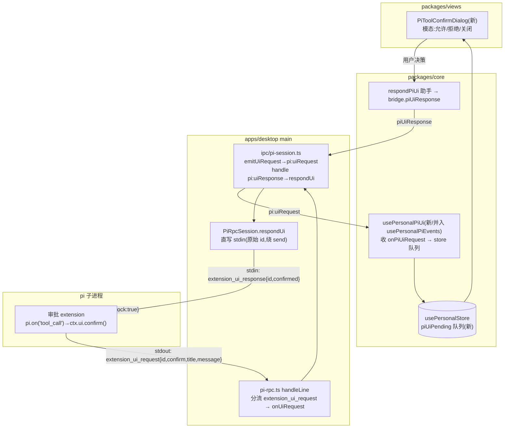

# feat: pi RPC 会话——阶段 3（深度定制：extension 工具确认 UI + 自定义工具）

- 日期：2026-06-17
- 类型：feat
- 范围：`apps/desktop`（主进程双向 UI channel + extension 生成）、`packages/core`（契约镜像 + 消费 hook）、`packages/views`（确认弹窗 UI）
- origin：`docs/plans/2026-06-16-003-feat-pi-rpc-session-plan.md` §4（深度定制接入点）；understand 工作流设计简报（2026-06-17）
- 前置：阶段 1（RPC 通道）+ 阶段 2（渲染层）已落地（commit `c598064`..`c4429ce`）
- 状态：待执行（U0 spike 已完成，结论见 §2）
- 深度：Deep（双向 channel 反向数据流、跨 5 层、新人机交互面）

---

## 1. 摘要

阶段 1/2 让 pi 跑起来并接进渲染层，但 pi 的**深度定制能力**（自定义工具、工具执行审批、自定义命令）全部经 pi 的 **extension 机制**，当前 Cortex 零支持：`buildRpcArgs` 恒带 `--no-extensions`（仅自定义 provider 时显式 `-e`），且 `extension_ui_request/response` 在全链路 grep 命中为 0。

阶段 3 解锁三件事：
1. **工具确认 UI 闭环（主线）**：pi extension 拦 `tool_call` → `ctx.ui.confirm()` → pi 经 stdout 发 `extension_ui_request{confirm}` → Cortex 渲染确认弹窗 → 用户决策经 stdin 回 `extension_ui_response{confirmed}` → pi 放行/阻断工具。这是一条**与现有 pi 通道方向相反**的双向 channel（主进程主动推 + 渲染层异步回）。
2. **自定义工具样例**：extension `pi.registerTool(def)` 经 `-e` 加载。
3. **自定义斜杠命令样例（可选）**：`pi.registerCommand`。

claude/codex 完全不涉及。pi 的现有 provider extension 注入**不动**——审批/工具 extension 是追加的独立 `-e` 文件。

---

## 2. U0 Spike 结论（已实测，2026-06-17）

经 `bun node_modules/@earendil-works/pi-coding-agent/dist/cli.js --mode rpc --no-extensions --no-skills -e <ext> -a`（bun 跑 pi 0.79.2，规避系统 node 的 undici 不兼容）+ 一个在 `session_start` 调 `ctx.ui.confirm()` 的非 LLM extension，实测确认：

| 未知 | 结论 |
|---|---|
| **`--no-extensions` + 追加 `-e` 下 hook 是否注册** | ✅ extension 加载、`session_start` hook 触发（`ctx.hasUI===true`）。hook 在 `--no-extensions` 下经显式 `-e` 仍注册。 |
| **`extension_ui_request{confirm}` 精确 envelope** | ✅ `{"type":"extension_ui_request","id":"<uuid>","method":"confirm","title":<string>,"message":<string>}`，与 `rpc-types.d.ts` 的 `RpcExtensionUIRequest` 逐字吻合（`title`+`message`，`id` 为 `crypto.randomUUID()`）。 |
| **回写闭环** | ✅ 向 stdin 写 `{"type":"extension_ui_response","id":<同>,"confirmed":true\|false}` 均被 pi 接受（干净 exit 0）。 |
| **`registerTool` parameters 形状** | ✅ 用**普通 JSON 对象** `{type:"object",properties:{...},required:[...]}` 作 parameters **直接注册成功**——**无需 `import {Type} from "typebox"`**，消除 userData extension 的依赖解析风险。 |

**仅剩需真实 provider key 验证（→ 用户手动验证，同款 hook+confirm 机制，高置信）**：真实 LLM 调危险工具时 `tool_call` hook 触发 + `return {block:true}` 真阻断工具执行。本计划据已验证契约实现，该端到端验证列入 §9。

`extension_ui_request` 全集（`rpc-types.d.ts`）：9 个 method，**需回写仅 4 个** `confirm/select/input/editor`；`notify/setStatus/setWidget/setTitle/set_editor_text` 为 fire-and-forget。`extension_ui_response` 三态：`{id,confirmed}` / `{id,value}` / `{id,cancelled:true}`。本阶段主做 **confirm**，类型层覆盖全集以便后续扩展。

---

## 3. 需求追溯

| R-ID | 需求 | 来源 |
|---|---|---|
| R1 | pi extension 经 `ctx.ui.confirm()` 发出的 `extension_ui_request` 被主进程路由（不被 `mapPiEvent` 吞），经独立 channel 推到渲染层 | 简报 §1.3、§2.1 |
| R2 | 用户决策经渲染层 → 主进程 → pi stdin 回 `extension_ui_response`，**绕过 send/pending**（用 pi 原始 `id`，不等 response） | spike §2、简报 §1.3 |
| R3 | 渲染层呈现确认弹窗（标题=工具/操作、正文=入参 detail），允许/拒绝/关闭三态映射 confirmed:true/false/cancelled | 简报 §3 |
| R4 | `extension_ui_request`/`response` 类型在 `core/desktop/types.ts` 与 `main/ipc/types.ts` **两侧镜像**；bridge 方法可选（web/旧壳降级） | 架构硬边界 |
| R5 | 审批 hook extension 可生成并经 `-e` 加载，与现有 provider extension **多 `-e` 共存**，provider 注入不变 | 简报 §4.4、spike |
| R6 | 自定义工具 extension 样例（`registerTool`，普通 JSON 对象 parameters）可生成加载 | spike §2、简报 §4.2 |
| R7 | 自定义斜杠命令 extension 样例（`registerCommand`）（可选） | 简报 §4.3 |
| R8 | pi 现有运行（无 extension / web 无 bridge）零回归；阶段 1/2 通道不受影响 | 阶段 1/2 |

---

## 4. 关键技术决策（KTD）

### KTD-1：独立双向 UI channel，不塞进 `PiSessionEvent` 单向流

**决策**：`extension_ui_request` 不进 `PiSessionEvent` 联合（那是 main→renderer 单向归一化事件流，`mapPiEvent` 无状态、丢 `id`）。新建独立 channel：主进程 `pi-rpc.ts` 在 `handleLine` 里 `mapPiEvent` **调用前**专门分流 `extension_ui_request` → 新 `onUiRequest` 回调 → `pi:uiRequest` IPC 推渲染层；渲染层经 `pi:uiResponse` IPC 回。

**理由**：UI 请求是「main 主动推 + renderer 异步回」的请求/响应语义，与单向事件流方向相反、且必须保留 `id` 关联。混进 `PiSessionEvent` 会丢 `id` 且语义错位。

### KTD-2：UI 回写绕过 `send()`/pending，直写 stdin

**决策**：`PiRpcSession` 新增 `respondUi(id, payload)`：直接 `transport.write(JSON.stringify({type:"extension_ui_response", id, ...payload})+"\n")`，**不分配 `req_N`、不登记 `pending`、不等 `{type:"response"}`**。

**理由**：现有 `send()`（`pi-rpc.ts:284`）为命令注入自增 `id` 并等 response；UI 回写要用 **pi 给的原始 `id`**、且 pi 不对回写发 response（fire-and-forget）。走 send 会 id 冲突 + 永久挂起 pending。spike 已验证直写 stdin 被 pi 接受。

### KTD-3：确认弹窗用模态（选型 B），状态走 Zustand，复用 AutomationDialog 外壳

**决策**：新建 `PiToolConfirmDialog.tsx`，pending 请求队列放 `usePersonalStore` 瞬态切片，复用 `AutomationDialog` 的 `.pw-dlg-overlay`+`.pw-dlg` 外壳（overlay + stopPropagation + ESC + 底部双按钮）。

**理由**：pi `confirm` 是**阻断语义**（extension 的 `await ctx.ui.confirm()` 在应答前挂起，工具暂停）。模态的「遮罩聚焦 + 不被 agent 消息流冲走」精确匹配；modal 状态走 Zustand 符合 `docs/floder.md` 约定。内联 `kind:"approve"` 卡片（选型 A）非阻塞、会被消息流顶走、且现有 `m.title` 被写死忽略，不如模态。

**取舍**：模态无时间线留痕。若产品要决策历史，可在 respond 后补发只读 `kind:"approve"` 消息（非本阶段必需）。

### KTD-4：extension 多 `-e` 共存，`registerTool` 用普通 JSON 对象 parameters（spike 已证）

**决策**：审批/工具/命令 extension 各自独立文件，`buildRpcArgs` 把单 `piExtensionPath` 的 `-e` 扩成「遍历所有 extension 路径各 push 一个 `-e`」，`-a` 仍只加一次，`--provider` 逻辑不动。`registerTool` 的 `parameters` 用普通 `{type:"object",...}`（**不引 typebox**）。生成方式复用 `pi-providers.ts` 的纯函数 `renderXxx()` + `writeXxx()` 模板法（落 `userData/pi-providers/`，`mode:0o600`）。

**理由**：spike 实测多 `-e` 与 `--no-extensions` 共存、hook 注册、普通对象 parameters 可用。复用现有模板法零新依赖、与 provider 注入隔离。

---

## 5. 高层数据流（HTD）

阶段 3 新增的是**反向**通道（虚线），与阶段 1/2 的正向命令/事件流并存：

实测请求序列（spike）：`extension_ui_request{id,method:confirm,title,message}` → host 回 `extension_ui_response{id,confirmed}` → pi 接受。

---

## 6. 实现单元

> U0（spike 验证）已完成，结论见 §2。依赖序：**U1→U2→U3→U4→U5→U6（确认闭环主链）**；**U7→（U8、U9 并行）**（extension 生成/加载，依赖 U2 的装配点）。

### U1. 主进程 `pi-rpc.ts`：UI 请求路由 + 回写

**Goal**：`handleLine` 分流 `extension_ui_request`；`PiRpcSession` 新增 `respondUi` 直写 stdin；`PiUiRequest` 类型。

**Requirements**：R1、R2。

**Dependencies**：无（建立在阶段 1 pi-rpc.ts 上）。

**Files**：`apps/desktop/src/main/agents/pi-rpc.ts`、`apps/desktop/src/main/agents/pi-rpc.test.ts`、`apps/desktop/src/main/ipc/types.ts`（`PiUiRequest` 定义）。

**Approach**：
- `PiRpcSession` 构造新增第三个回调参数 `onUiRequest?(req: PiUiRequest)`（与 `onEvent` 并列，`pi-rpc.ts:242`）。
- `handleLine`（`pi-rpc.ts:264`）：命中 pending response → resolve（不变）；否则 **先判** `obj.type === "extension_ui_request"` → 构造 `PiUiRequest`（透传 `id/method/title/message/options/...`）→ `onUiRequest?.(req)`；**再** `mapPiEvent`（避免被 default→null 吞）。只对 `method ∈ {confirm,select,input,editor}` 上抛（fire-and-forget 的 5 个暂忽略，类型层保留）。
- `respondUi(id, payload)`：`this.transport.write(JSON.stringify({type:"extension_ui_response", id, ...payload})+"\n")`。`stopped/exited` 时静默丢弃（与 feed 一致）。
- `PiUiRequest` 类型（`ipc/types.ts`）：`{ id:string; method:"confirm"|"select"|"input"|"editor"|"notify"|...; title?:string; message?:string; options?:string[]; placeholder?:string; ... }`（联合或宽接口，覆盖 9 method）。

**Patterns to follow**：`handleLine` 现有 pending/mapPiEvent 分支（`pi-rpc.ts:264-281`）；`send` 的 `transport.write`（`pi-rpc.ts:294`）；`feed` 的 stopped/exited 守卫（`pi-rpc.ts:253`）。

**Test scenarios**（注入 fake transport）：
- `extension_ui_request{confirm}` 行 → `onUiRequest` 收到含正确 `id/method/title/message`；**不**经 `onEvent`（不污染事件流）。
- `respondUi("abc", {confirmed:true})` → transport 写出 `{"type":"extension_ui_response","id":"abc","confirmed":true}\n`（精确 JSONL）。
- `respondUi` 在 stopped 后 → 不写（静默）。
- 命中 pending 的 `{type:"response",id}` 仍 resolve（回归不变）；普通事件仍走 `onEvent`。

**Verification**：`pnpm --filter @cortex-work/desktop test -- run agents/pi-rpc.test.ts` 绿；UI 请求与命令/事件三路互不串。

---

### U2. 主进程 `ipc/pi-session.ts`：pi:uiRequest 推 + pi:uiResponse 收

**Goal**：会话注册表把 `onUiRequest` 接出去（`pi:uiRequest`），新增 `pi:uiResponse` handler 调 `respondUi`。

**Requirements**：R1、R2。

**Dependencies**：U1。

**Files**：`apps/desktop/src/main/ipc/pi-session.ts`、`apps/desktop/src/main/ipc/pi-session.test.ts`。

**Approach**：
- `new PiRpcSession(transport, onEvent, onUiRequest)`（`pi-session.ts:59`）：新增 `onUiRequest = (req) => emitUiRequest(req.uiSessionId... )`。注意 `PiUiRequest` 本身无 uiSessionId，由闭包捕获当前 `req.uiSessionId`。
- `emitUiRequest(uiSessionId, request)`：`entry.sender.send("pi:uiRequest", { uiSessionId, request })`（仿 `emitEvent` `pi-session.ts:20`，但**不**摘注册表——UI 请求不终止会话）。
- `ipcMain.handle("pi:uiResponse", (_e, uiSessionId, id, payload) => { getSession(uiSessionId).respondUi(id, payload); })`。**不走 `command()` 包装**（那套等 response；respondUi 无返回）。会话不存在 → getSession 抛错（renderer invoke 收 rejection，无害）。

**Patterns to follow**：`emitEvent`（`pi-session.ts:20`）、`registerPiSessionHandlers` 的 handler 注册（`pi-session.ts:74`）、`getSession`（`pi-session.ts:29`）。

**Test scenarios**：
- open 会话 → 模拟 transport 吐 `extension_ui_request` → `event.sender.send` 收到 `pi:uiRequest{uiSessionId, request}`。
- `pi:uiResponse(uiSessionId, id, {confirmed:false})` → 对应 session 的 `respondUi` 被调、参数正确。
- 多会话：A 的 UI 请求只推给 A 的 sender。
- 会话已销毁后 `pi:uiResponse` → 抛「会话不存在」（不崩）。

**Verification**：`pnpm --filter @cortex-work/desktop test -- run ipc/pi-session.test.ts` 绿。

---

### U3. preload：`onPiUiRequest` + `piUiResponse`

**Goal**：`window.desktopAPI.personal` 暴露 UI 请求订阅 + 响应。

**Requirements**：R1、R2、R4。

**Dependencies**：U2。

**Files**：`apps/desktop/src/preload/index.ts`。

**Approach**：仿 `onPiEvent`（`index.ts:214`）新增 `onPiUiRequest(cb: (uiSessionId, request) => void): () => void` 订阅 `pi:uiRequest`；仿 `piPrompt`（`index.ts:194`）新增 `piUiResponse(uiSessionId, id, payload): Promise<void>` invoke `pi:uiResponse`。

**Patterns to follow**：`onPiEvent`/`piPrompt`（`index.ts:193-219`）。

**Test scenarios**：`Test expectation: 由 desktop typecheck 覆盖`（preload 形状对齐 DesktopBridge，与阶段 1/2 同款手工镜像，无独立运行时测试）。

**Verification**：`pnpm --filter @cortex-work/desktop typecheck` 绿。

---

### U4. core 契约镜像：`bridge.ts` + `types.ts`

**Goal**：`DesktopBridge` 新增可选 `onPiUiRequest`/`piUiResponse`；`PiUiRequest` 两侧镜像。

**Requirements**：R4。

**Dependencies**：U1（类型源）。

**Files**：`packages/core/desktop/bridge.ts`、`packages/core/desktop/types.ts`、`packages/core/index.ts`（导出 `PiUiRequest`）。

**Approach**：
- `desktop/types.ts` 镜像 `PiUiRequest`（对齐 `main/ipc/types.ts`）。
- `bridge.ts` pi 块（`bridge.ts:166`）新增可选 `onPiUiRequest?(cb: (uiSessionId: string, request: PiUiRequest) => void): () => void` 与 `piUiResponse?(uiSessionId, id, payload): Promise<void>`。
- core index 导出 `PiUiRequest` 类型。

**Patterns to follow**：阶段 1 的 `onPiEvent`/`PiSessionEvent` 镜像（`bridge.ts:185`、`types.ts:308`/`604`）。App.tsx 透传 + desktop web typecheck 即校验镜像对齐（同阶段 1 parity 机制）。

**Test scenarios**：`Test expectation: 由 typecheck 覆盖`（镜像 parity，无运行时行为）。

**Verification**：`pnpm --filter @cortex-work/core typecheck` + `pnpm --filter @cortex-work/desktop typecheck` 绿。

---

### U5. core 消费 hook + respond 助手

**Goal**：订阅 `onPiUiRequest` 写 store 队列；`respondPiUi` 助手；接通 `PersonalChatArea` 空 onApprove 缺口。

**Requirements**：R1、R2、R3。

**Dependencies**：U4。

**Files**：`packages/core/personal/messages.ts`（新增 `usePersonalPiUi` hook 或并入 `usePersonalPiEvents`；`respondPiUi`）、`packages/core/store/personal.ts`（`piUiPending` 切片 + setter）、`packages/core/index.ts`（导出）。

**Approach**：
- store 新增瞬态 `piUiPending: Array<{ uiSessionId: string; request: PiUiRequest }>`（FIFO 队列，不持久化）+ `pushPiUiRequest` / `resolvePiUiRequest(id)` 动作。RPC 串行 → 通常队列长度 ≤1，跨会话才可能 >1。
- `usePersonalPiUi()`（在 `PersonalWorkspace` 挂载，或并入 `usePersonalPiEvents` 的 effect）：`bridge.onPiUiRequest((uiSessionId, request) => store.pushPiUiRequest({uiSessionId, request}))`，返回退订。
- `respondPiUi(bridge, uiSessionId, id, payload)`：调 `bridge.piUiResponse?.(...)` + `store.resolvePiUiRequest(id)`（出队）。失败静默（会话已退则请求自然作废）。
- 会话退出/crashed/删除时清该会话的 pending（避免悬挂弹窗）：在 crashed 分支与 `reapSessionRun` 里清 `piUiPending` 中该 uiSessionId 项。

**Patterns to follow**：`usePersonalPiEvents`（`messages.ts:1099`）；store 瞬态切片如 `piRuntimeBySession`（阶段 2 新增）；`reapSessionRun`（阶段 2）。

**Test scenarios**（注入 fake bridge）：
- `onPiUiRequest` 回调 → store `piUiPending` 入队对应项。
- `respondPiUi(..., id, {confirmed:true})` → `bridge.piUiResponse` 被调（参数正确）+ 该 id 出队。
- 会话 crashed → 清掉该会话 pending（不留悬挂弹窗）。
- 多会话：A、B 各一请求 → 队列两项，按 uiSessionId 区分。

**Verification**：`pnpm --filter @cortex-work/core test` 绿；多会话隔离。

---

### U6. views 确认弹窗（模态）

**Goal**：渲染 `PiToolConfirmDialog`，呈现 confirm 请求，三态回传。

**Requirements**：R3。

**Dependencies**：U5。

**Files**：`packages/views/cortex-desktop/personal/PiToolConfirmDialog.tsx`（新增）、`PersonalWorkspace.tsx`（挂载 `usePersonalPiUi` + 渲染 Dialog）、`cortex-desktop.css`（复用 `.pw-dlg*`）、`PiToolConfirmDialog.test.tsx`。

**Approach**：
- 读 store `piUiPending`，取队首（`request.method==="confirm"`）渲染模态：标题 `request.title`、正文 `request.message`、底部「拒绝」（`{confirmed:false}`）/「允许」（`{confirmed:true}`）双按钮；overlay 点击 + ESC → `{cancelled:true}`。决策 → `respondPiUi(bridge, uiSessionId, id, payload)`。
- 无 pending → 不渲染。复用 `AutomationDialog` 的 overlay/stopPropagation/ESC useEffect/`.btn`/`.btn.primary`。
- 本阶段只渲染 `method:"confirm"`；其余 method（select/input）落 `default` 暂以「允许/拒绝」降级或忽略（类型层已覆盖，UI 留后续）。

**Patterns to follow**：`AutomationDialog.tsx:150-245`（模态外壳）；阶段 2 的 `usePersonalStore` 读法 + `useDesktopBridge`。

**Test scenarios**（jsdom + Testing Library）：
- store 有 confirm pending → 渲染弹窗，标题/正文正确；点「允许」→ `bridge.piUiResponse(uiSessionId, id, {confirmed:true})` 被调 + 出队。
- 点「拒绝」→ `{confirmed:false}`；ESC/overlay → `{cancelled:true}`。
- 无 pending → 不渲染。
- 多会话两请求 → 一次只显队首，应答后显下一个。

**Verification**：`pnpm --filter @cortex-work/desktop test`（views）绿；手动观感（用户验证）。

---

### U7. 审批 hook extension 生成 + 多 `-e` 加载装配

**Goal**：生成「拦 `tool_call` → `ctx.ui.confirm()`」extension；`buildRpcArgs` 支持多 `-e`；`pi:open` 按开关注入。

**Requirements**：R5、R8。

**Dependencies**：U1（闭环就绪后才有意义）；与 U8/U9 共享装配点。

**Files**：`apps/desktop/src/main/agents/pi-extensions.ts`（新增 `renderApprovalExtension`/`writeApprovalExtension` 等）、`apps/desktop/src/main/agents/pi-rpc.ts`（`buildRpcArgs` 多 `-e`）、`apps/desktop/src/main/ipc/pi-session.ts`（`pi:open` 按开关生成并收集路径）、`apps/desktop/src/main/ipc/types.ts`（`PiOpenRequest` 新增开关字段）、对应 test。

**Approach**：
- `renderApprovalExtension(opts?)`：`export default function (pi){ pi.on("tool_call", async (event, ctx) => { if(需审批 && ctx.hasUI){ const ok = await ctx.ui.confirm("允许执行 "+event.toolName+"?", JSON.stringify(event.input).slice(0,200)); if(!ok) return {block:true, reason:"user denied"}; } }); }`。需审批工具集（bash/write/edit 等）可配。
- `buildRpcArgs`（`pi-rpc.ts:144`）：把 `piExtensionPath` 单字段扩成「extension 路径数组」，遍历各 `args.push("-e", path)`，`-a` 仍一次，`--provider` 不动。
- `PiOpenRequest` 新增可选 `enableToolApproval?: boolean`（+ 可选 `approvalTools?: string[]`）。`pi:open`（`pi-session.ts:52`）：`if (req.provider) paths.push(writePiExtension(req.provider))`；`if (req.enableToolApproval) paths.push(writeApprovalExtension({tools: req.approvalTools}))`；把 paths 传 `buildRpcArgs`。
- **provider 注入路径不变**：provider extension 仍原样生成，审批 extension 追加。

**Patterns to follow**：`pi-providers.ts` 的 `render*`/`write*` 纯函数 + `userData/pi-providers/` 落盘（`mode:0o600`）；`buildRpcArgs` 现有 `-e`/`-a`/`--provider`（`pi-rpc.ts:150`）。

**Test scenarios**：
- `renderApprovalExtension` 输出含 `pi.on("tool_call"` + `ctx.ui.confirm` + `block:true`（字符串断言关键结构）。
- `buildRpcArgs` 给定多 extension 路径 → 输出多个 `-e <path>` + 单个 `-a`；无 extension → 不带 `-e`（回归）。
- `buildRpcArgs` 带 provider + 审批 → provider 的 `--provider safeId` 仍在、两个 `-e` 都在。
- `pi:open` 带 `enableToolApproval` → writeApprovalExtension 被调、路径进 args（mock writeApprovalExtension）。

**Execution note**：U0 spike 已证 `tool_call` hook 在 `--no-extensions`+`-e` 下注册、confirm envelope 与回写闭环；**真实 LLM 调工具触发 tool_call + block 阻断**留用户端到端验证（§9）。

**Verification**：`pnpm --filter @cortex-work/desktop test`（agents）绿；typecheck 绿。

---

### U8. 自定义工具 extension 样例（②）

**Goal**：生成 `registerTool` 样例 extension（普通 JSON 对象 parameters）。

**Requirements**：R6。

**Dependencies**：U7（共享装配点）。

**Files**：`apps/desktop/src/main/agents/pi-extensions.ts`（`renderCustomToolExtension`/`writeCustomToolExtension`）、`pi-session.ts`（开关注入）、`types.ts`（开关字段）、test。

**Approach**：
- `renderCustomToolExtension()`：`export default function (pi){ pi.registerTool({ name:"echo_upper", description:"把输入文本转大写返回", parameters:{type:"object", properties:{text:{type:"string"}}, required:["text"]}, async execute(toolCallId, params){ return {content:[{type:"text", text:String(params.text).toUpperCase()}], isError:false}; } }); }`。**用普通对象 parameters（spike 已证可用，不引 typebox）**；字段是 `execute`（非 `handler`），返回 `{content:[{type:"text",text}], isError}`。
- `PiOpenRequest` 新增可选 `enableSampleTools?: boolean`；`pi:open` 按开关 `writeCustomToolExtension()` 收集路径。

**Patterns to follow**：同 U7 模板法。

**Test scenarios**：
- `renderCustomToolExtension` 输出含 `pi.registerTool` + `name:"echo_upper"` + `execute` + `parameters:{type:"object"...}`（无 `import`、无 `typebox`）。
- `pi:open` 带 `enableSampleTools` → 路径进 args。

**Execution note**：spike 已证 `registerTool` 普通对象 parameters 注册成功；**真实 LLM 调用该工具产出结果**留用户验证。

**Verification**：`pnpm --filter @cortex-work/desktop test` 绿。

---

### U9. 自定义斜杠命令 extension 样例（③，可选）

**Goal**：生成 `registerCommand` 样例 extension。

**Requirements**：R7。

**Dependencies**：U7。

**Files**：`pi-extensions.ts`（`renderSlashCommandExtension`）、`pi-session.ts`、`types.ts`、test。

**Approach**：`export default function (pi){ pi.registerCommand("greet", { description:"打个招呼", handler: async (args, ctx) => { ctx.ui.notify("hello "+args, "info"); } }); }`。`PiOpenRequest` 可选 `enableSampleCommands?`。无回写需求，最简。

**Patterns to follow**：同 U7/U8。

**Test scenarios**：`renderSlashCommandExtension` 输出含 `pi.registerCommand("greet"` + `handler`。

**Verification**：typecheck + test 绿。

---

## 7. 范围边界

### 本阶段做
- U1-U6：confirm UI 闭环（双向 channel + 模态弹窗）。
- U7-U9：审批 hook + 自定义工具 + 斜杠命令样例 extension（多 `-e` 装配）。

### Deferred for later
- **其余 UI method 的渲染**：`select`（单选）/`input`（文本框）/`editor`/`notify`/`setWidget`/`setStatus` —— 类型层本阶段覆盖，UI 仅落 `confirm`。`notify` 可较易补（toast）；`setWidget`/`setStatus` 是 TUI 概念，桌面端映射待设计。
- **审批策略 UI**：「记住此选择 / 总是允许某工具 / 工具白名单设置页」——本阶段审批工具集是 extension 内硬编码/启动参数，无用户设置面。
- **决策时间线留痕**：模态无历史；可后续补只读 `kind:"approve"` 消息。
- **extension 用户自管理**：用户上传/编辑自己的 extension——本阶段只生成内置样例。

### 明确不做
- 改 claude/codex 通道。
- 改 pi 现有 provider extension 注入逻辑（仅把单 `-e` 扩成多 `-e`，provider 路径不变）。
- 阶段 4 健壮性项（崩溃恢复/空闲回收等，见 003 计划 §6 与阶段 2 计划评审追加项）。

---

## 8. 风险与缓解

| 风险 | 缓解 |
|---|---|
| **`tool_call` hook 真实触发 + block 阻断未经 LLM 实测** | U0 spike 已证 hook 在 `--no-extensions`+`-e` 下注册、confirm envelope、回写闭环、registerTool 可用;真实 LLM 端到端列入 §9 用户验证。同款机制,残余风险低。 |
| **多 `-e` 破坏 provider 注入** | provider extension 路径/`--provider` 逻辑完全不动,审批/工具 extension 是追加;U7 测试断言两个 `-e` 共存 + `--provider` 仍在。 |
| **回写 id 关联错误 / 绕 send 写脏** | KTD-2:用 pi 原始 `id`、直写 stdin、stopped 守卫;U1 测试断言精确 JSONL + id 透传。 |
| **悬挂弹窗**（会话退出但 pending 未清） | U5:crashed/删除会话时清该会话 `piUiPending`;模态无 pending 不渲染。 |
| **pi 版本协议漂移** | envelope 已 pin 0.79.2 实测;`extension_ui_request/response` 契约快照(U1 测试)防漂移。 |
| **userData extension 依赖解析**（typebox 等） | spike 已证普通 JSON 对象 parameters 可用,**不引 typebox**,extension 文件零 import,免疫解析问题（与 provider extension 同）。 |

---

## 9. 验证计划

- **单测**：U1 路由/回写、U2 channel、U5 消费/出队/多会话、U6 模态三态、U7-U9 extension 渲染 + 多 `-e` 装配。`pnpm --filter @cortex-work/desktop test` + `--filter @cortex-work/core test`。
- **全量**：`pnpm typecheck` + `pnpm lint` + `pnpm test` 全绿（阶段 1/2 既有用例不回归）。
- **非 LLM spike（已完成）**：confirm envelope + 回写闭环 + hook 注册 + registerTool（§2）。
- **真实 provider 端到端（用户手动验证，按 verification-split 约定）**：
  - 启用审批 → 让 pi 调危险工具（bash/write）→ 弹确认 → 允许则工具执行、拒绝则 `{block:true}` 阻断、关闭则取消。
  - 启用自定义工具 → 引导 pi 调 `echo_upper` → 返回大写结果。
  - 启用斜杠命令 → `/greet` → notify。
  - 确认与现有 provider 注入共存（自定义 provider + 审批同时开）。

---

## 10. 执行姿态

- **契约已 spike 锁定**：U1-U6 按 §2 验证的 envelope 平推。
- **TDD**：U1/U2/U5/U6 的路由/折叠/UI 逻辑先写失败测试（fake transport/bridge）。
- **每单元后**跑对应包 test + 全仓 typecheck/lint;阶段 1/2 用例任一红即停查。
- **extension 样例**：渲染纯函数先单测(字符串结构断言),加载装配后由用户真实验证运行时行为。
