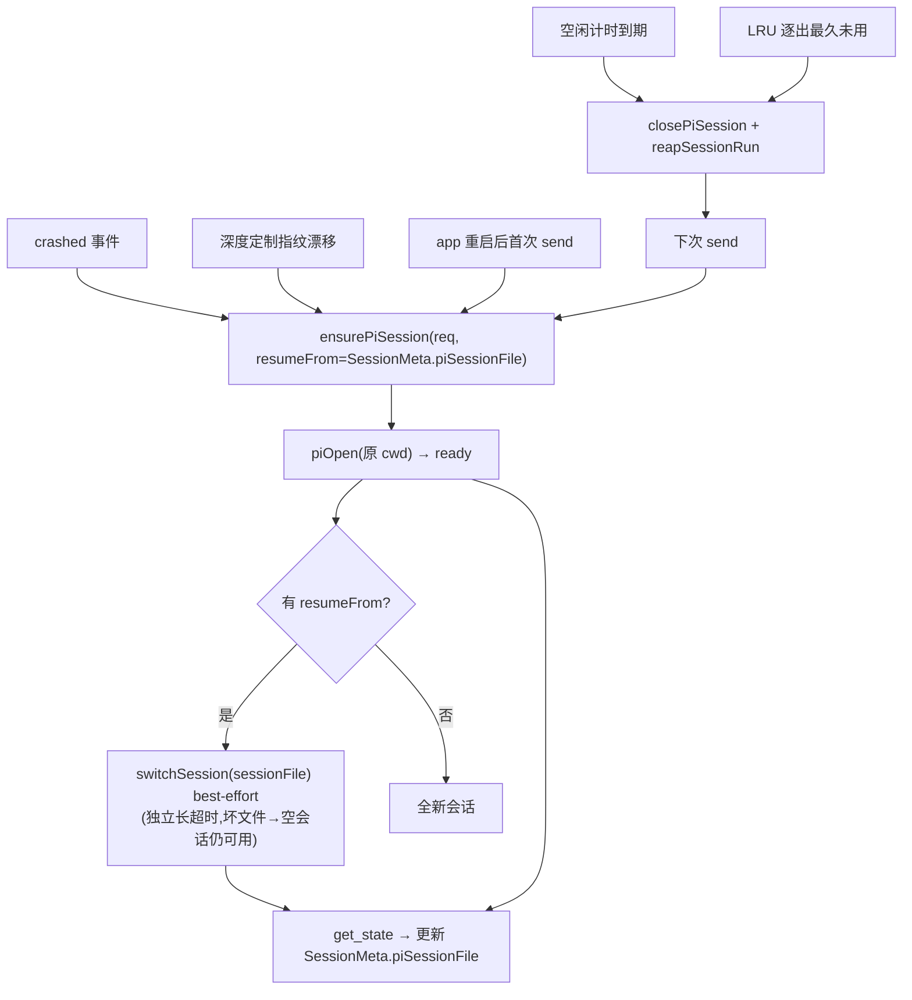

# feat: pi RPC 会话——阶段 4（健壮性：崩溃恢复 / 空闲回收 / 代际校验）

- 日期：2026-06-17
- 类型：feat
- 范围：`apps/desktop`（主进程 switchSession/runId 回带）、`packages/core`（恢复/回收/代际/评审修复）、`packages/views`（极少）
- origin：`docs/plans/2026-06-16-003-feat-pi-rpc-session-plan.md` §6/§7 + 阶段 2/3 评审追加项；understand 工作流设计简报（2026-06-17）
- 前置：阶段 1-3 已落地（`c598064`..`387efea`）
- 状态：待执行（U0 spike 已完成，见 §2）
- 深度：Deep（跨 4 层、恢复/资源/代际多维）

---

## 1. 摘要

pi RPC 会话长驻后，健壮性缺口：① 崩溃后下次发送是**全新会话**（丢 pi 内存上下文）；② 无空闲回收（会话进程永久长驻）；③ 无多会话进程上限；④ 事件无轮/进程身份（崩溃重开/并发 editResend 时迟到事件可能串入新轮）；⑤ 阶段 3 评审追加的 setModel 轮中漂移、fork 失败无声、后缀匹配误命中。

阶段 4 补齐：基于 pi 文档化的 `switch_session`（resume）机制做**统一恢复**——任何重开（崩溃/空闲/LRU/深度定制指纹/app 重启）后，若该会话有持久化的 `sessionFile`，就 `switchSession(sessionFile)` 从磁盘 JSONL 恢复上下文；加会话级空闲回收 + LRU 上限；加 runId 代际回带封堵事件串场；修三项评审追加。

---

## 2. U0 Spike 结论（已实测，2026-06-17，bun 跑 pi 0.79.2）

| 项 | 结论 |
|---|---|
| **get_state 回带 sessionFile** | ✅ `data.sessionFile` = `~/.pi/agent/sessions/--<cwd编码>--/<ts>_<uuid>.jsonl`（按 cwd 分目录，实时从活跃 session 读，非缓存）。冷启新进程的是**新空会话**路径——恢复必须用**崩溃前持久化的旧** sessionFile。 |
| **switch_session 机制** | ✅ `{type:"switch_session", sessionPath}` → pi `loadEntriesFromFile` + `buildSessionContext` 重建 messages[] + rebindSession,之后 get_state/prompt 作用于恢复会话。源码确认(`agent-session-runtime.js:125-143`)。 |
| **switch_session 失败形态** | ✅ **best-effort 永成功**:切到不存在/坏文件 → `{success:true,data:{cancelled:false}}`,pi 静默起空会话（坏文件 truncate）。即恢复「失败」是优雅的——至多丢 pi 上下文,会话仍可用,renderer 的 React Query 消息缓存不受影响。**无需复杂失败兜底,try/catch 即可**;可选 get_state 的 `messageCount` 探测确认是否真恢复。 |
| **唯一硬错** | cwd 不存在(项目目录被删)→ `MissingSessionCwdError`,走 `{success:false}` 被 `command()` 捕获。重开必须传**原 cwd**;捕获到则保持新会话(已可用)。 |

**架构关键事实（核验所得）**：pi 崩溃 = utilityProcess 退出,**renderer + `usePersonalStore` 全程存活**;且 `toPersistedState` 含 `sessions`（`personal.ts:626`）→ **SessionMeta 落盘**（claude 靠 `agentSessionIds` 跨 app 重启 resume 即证）。故 **sessionFile 存进 `SessionMeta`（持久化）一套覆盖崩溃/空闲/LRU/app 重启全部恢复轨**——无需双轨拆分。重启后 UI 历史经既有 `saveChat/loadChat` 自然恢复,pi 上下文经首次发送时 switchSession 恢复。

---

## 3. 需求追溯

| R-ID | 需求 | 来源 |
|---|---|---|
| R1 | 会话开启时取 pi `sessionFile` 持久到 `SessionMeta`,供任何重开恢复 | origin §7、spike §2 |
| R2 | `switchSession` 四层接线(handler/bridge/preload/core);任何重开后有 sessionFile 即 best-effort 恢复 | origin §3.3、spike |
| R3 | 崩溃后自动恢复:下次发送重开 + switchSession 续上下文（替代全新会话）;文案改恢复态 | origin §7 |
| R4 | 会话级空闲回收:N 分钟无活动 stop 进程,下次发送惰性重开 + 恢复 | origin §6 |
| R5 | 多会话进程上限 + LRU 逐出(逐出前 sessionFile 已持久,重开可恢复) | origin §6 |
| R6 | 事件 runId 代际回带:迟到/串台事件经 `runId` 守卫丢弃 | 阶段2 评审 |
| R7 | setModel 轮中失败回滚 + 提示(不静默吞 → UI/pi 漂移) | 阶段3 评审 |
| R8 | editResend fork 失败可观测(提示已带旧记忆重发) | 阶段3 评审 |
| R9 | 后缀匹配前缀收紧止血(剥已知系统提示前缀后等值) | 阶段3 评审 |
| R10 | claude/codex 与阶段 1-3 既有零回归 | 全程 |

---

## 4. 关键技术决策（KTD）

### KTD-1：sessionFile 存 `SessionMeta`，统一恢复（不分双轨）

**决策**：`SessionMeta` 加 `piSessionFile?: string`（持久化）。会话 ready 后用 `pi:getState` 取 `sessionFile` 写入。任何重开（crash/idle/LRU/指纹/app 重启）经 `ensurePiSession` 时，若 `req.resumeFrom`（来自 SessionMeta.piSessionFile）存在 → piOpen 后 `switchSession(resumeFrom)`。

**理由**：spike 证 SessionMeta 落盘 + switchSession best-effort，一套覆盖全部恢复轨，比简报的「内存轨A/磁盘轨B」双轨更简。指纹重开（阶段3）顺带也恢复（修一处既有失忆）。

### KTD-2：恢复用「重开即恢复」而非急切重启；switchSession best-effort

**决策**：崩溃/空闲/LRU 回收后**不急切重 spawn**，而是下次 `send` 经 `ensurePiSession` 惰性重开 + switchSession。switchSession 用 try/catch best-effort（坏文件 → 空会话仍可用），给独立长超时（参 `COMPACT_TIMEOUT_MS`，防大 JSONL 撞 30s）。

**理由**：惰性重开复用现有 send→ensurePiSession 路径，零额外生命周期管理；spike 证 switchSession 永成功，无需失败分支。crash 文案从「下次发送会重新启动」改「下次发送将恢复会话」。

### KTD-3：runId 代际回带封堵事件串场（根因，非渲染层 generation）

**决策**：`promptPi(message, runId)` → `pi:prompt` 透传 → 主进程 `PiRpcSession.prompt` 记 `currentRunId` → 该会话后续 `pi:event` envelope 带 `runId` → renderer `handlePiEvent` 折叠前守卫 `ev.runId && active.runId !== ev.runId → 丢弃`。

**理由**：runId 已是 Cortex 自造每轮唯一 id，pi 不参与。封堵 editResend 并发重入 + IPC 在途旧事件晚到新轮置位的真实裸露窗口（主进程 `feed` 的 stopped 守卫已堵跨进程串台，渲染层这两个窗口未堵）。状态类事件（queue/compaction/crashed）无 runId 仍按现状处理（不折叠进 run）。

### KTD-4：空闲/LRU 是「会话级」新维度，独立计时器，不混入轮级看门狗

**决策**：`PiSessionHandle` 加 `lastActiveAt` + 会话级 `idleTimer`；事件/prompt/steer/轮收尾刷新 `lastActiveAt`；有活跃 run 时暂停空闲计时。回收复用 `closePiSession` + `reapSessionRun`。LRU 在 `ensurePiSession` spawn 前检查 `piSessions.size >= MAX`，逐出 `lastActiveAt` 最小且无活跃 run 的会话。

**理由**：轮级看门狗（pi 不杀/cli 杀）是「轮在跑」维度，空闲是「会话长驻无轮」维度，正交，不可混。

---

## 5. 高层数据流（HTD）

统一恢复（任何重开触发源 → 同一 restore 路径）：

runId 代际（事件守卫）：`send(runId)` → `promptPi(runId)` → `pi:prompt` → 主进程绑 `currentRunId` → `pi:event{runId}` → `handlePiEvent`：`ev.runId !== active.runId` 则丢弃。

---

## 6. 实现单元（依赖序：U1→U2→U3；U5/U6 依赖 U2；U7/U8/U9/U10 独立）

### U1. sessionFile 贯通 + 持久 SessionMeta

**Goal**：ready 取 sessionFile，经 PiOpenResult → handle → SessionMeta.piSessionFile 持久。

**Requirements**：R1。**Dependencies**：无。

**Files**：`apps/desktop/src/main/agents/pi-rpc.ts`（ready 取 sessionFile）、`apps/desktop/src/main/ipc/pi-session.ts`（pi:open 回传）、`apps/desktop/src/main/ipc/types.ts`+`packages/core/desktop/types.ts`（PiOpenResult 加 sessionFile + SessionMeta 加 piSessionFile）、`packages/core/personal/pi-session.ts`（handle 存 + 写 SessionMeta）、对应 test。

**Approach**：`ready()` 轮询 get_state 时把 `data.sessionFile` 一并返回（现仅 sessionId）。`PiOpenResult` 加 `sessionFile?`。`PiSessionHandle` 存 `sessionFile`。`ensurePiSession` 成功后经回调/store 写 `SessionMeta.piSessionFile`（core 不直接持 store？pi-session.ts 是纯进程层——由 messages.ts sendPiTurn 在 ensurePiSession 后 updateSession，或 ensurePiSession 回带 sessionFile 给调用方写）。SessionMeta 加 `piSessionFile?: string`（core+main 镜像，持久化）。

**Test scenarios**：ready 返回含 sessionFile；ensurePiSession 落 handle.sessionFile；sendPiTurn 后 SessionMeta.piSessionFile 被写。

### U2. switchSession 四层接线 + 恢复入口

**Goal**：`pi:switchSession` 全链路 + `ensurePiSession` 支持 `resumeFrom`（重开后 switchSession）。

**Requirements**：R2。**Dependencies**：U1。

**Files**：`pi-rpc.ts`（switchSession 已有脚手架,给独立长超时）、`ipc/pi-session.ts`（pi:switchSession handler）、`preload/index.ts`（piSwitchSession）、`bridge.ts`（piSwitchSession?）、`pi-session.ts`（ensurePiSession 加 `resumeFrom?`：piOpen 后若有则 `bridge.piSwitchSession(sessionFile)` try/catch best-effort）、test。

**Approach**：`PiRpcSession.switchSession` 用 `SWITCH_TIMEOUT_MS`（5min,参 compact）。`pi:switchSession` 走 command 包装（捕获 MissingSessionCwdError 的 success:false）。`ensurePiSession(req)`：piOpen → ready → 若 `req.resumeFrom` → `bridge.piSwitchSession(uiSessionId, req.resumeFrom).catch(吞)`（best-effort）。

**Test scenarios**：resumeFrom 有 → piOpen 后调 piSwitchSession；switchSession reject（cwd 缺）→ 不抛、会话仍可用；无 resumeFrom → 不调。

### U3. 崩溃自动恢复（惰性重开 + 恢复）

**Goal**：crashed 后下次 send 重开 + switchSession 续上下文；文案改恢复态。

**Requirements**：R3。**Dependencies**：U2。

**Files**：`messages.ts`（crashed 分支文案；sendPiTurn 读 SessionMeta.piSessionFile 传 resumeFrom）、test。

**Approach**：crashed 分支 markPiSessionGone（不变）+ 文案「pi 会话已退出，下次发送将自动恢复上下文」。sendPiTurn 构造 ensurePiSession req 时 `resumeFrom: session.piSessionFile`（仅当会话此前开过、有 file）。首轮全新会话 piSessionFile 为空 → 不恢复。

**Test scenarios**：crashed 后 send → ensurePiSession 带 resumeFrom；崩溃前无 file 的全新会话不恢复；文案正确。

### U5. 会话级空闲回收

**Goal**：N 分钟无活动 → closePiSession；下次 send 惰性重开 + 恢复。

**Requirements**：R4。**Dependencies**：U2（回收后重开要能恢复）。

**Files**：`pi-session.ts`（handle.lastActiveAt + idleTimer + arm/disarm）、`messages.ts`（事件/prompt/steer/收尾刷 lastActiveAt）、test。

**Approach**：`IDLE_RECLAIM_MS`（如 10min）。`touchPiSession(sessionId)` 刷 lastActiveAt + 重置 idleTimer（有活跃 run 时不启动倒计时，run 收尾才 arm）。到期 → closePiSession + reapSessionRun。sessionFile 已在 SessionMeta（U1）→ 下次 send resumeFrom 恢复。

**Test scenarios**：空闲到期 closePiSession；活跃刷新重置计时；回收后 SessionMeta.piSessionFile 仍在（供恢复）。

### U6. 多会话 LRU 上限

**Goal**：piSessions 超上限时逐出最久未用（无活跃 run）会话。

**Requirements**：R5。**Dependencies**：U2、U5（复用 lastActiveAt）。

**Files**：`pi-session.ts`（ensurePiSession spawn 前 LRU 逐出）、`ipc/pi-session.ts`（主进程容量兜底闸）、test。

**Approach**：`MAX_PI_SESSIONS`（如 5）。ensurePiSession spawn 前若 size>=MAX，选 lastActiveAt 最小且非 running 的逐出（closePiSession + reapSessionRun）。主进程 pi:open 同样容量兜底（防绕过）。

**Test scenarios**：超上限逐出最久未用；不逐出有活跃 run 的；逐出会话 sessionFile 仍在 SessionMeta。

### U7. 事件 runId 代际回带

**Goal**：事件带 runId，handlePiEvent 守卫丢弃串台/迟到事件。

**Requirements**：R6。**Dependencies**：无（独立契约升级）。

**Files**：`pi-rpc.ts`（prompt 记 currentRunId + 事件映射出口附 runId）、`ipc/pi-session.ts`（pi:prompt 透传 runId + emitEvent envelope 带 runId）、`ipc/types.ts`+`core/desktop/types.ts`（pi:event payload/onPiEvent 签名加 runId）、`preload/index.ts`（透传）、`bridge.ts`（onPiEvent 回调签名）、`messages.ts`（promptPi 传 runId + handlePiEvent 守卫）、test。

**Approach**：envelope `{uiSessionId, runId, event}`（外层加 runId，比改 PiSessionEvent 每变体干净）。`PiRpcSession.prompt(message, runId)` 写 stdin 时绑 `this.currentRunId=runId`（在第一条 agent_start 前）；feed 出的事件 emit 时带 currentRunId。`handlePiEvent(qc, sessionId, ev, runId?)`：折叠类事件前 `if (runId && active.runId !== runId) return`。

**Test scenarios**：旧 runId 事件被丢弃；当前 runId 事件正常折叠；无 runId（状态事件）不受影响；promptPi 传的 runId 绑定到该会话事件。

### U8. setModel 轮中失败回滚

**Goal**：setPiModel 失败回滚 updateSession + 提示。

**Requirements**：R7。**Dependencies**：无。

**Files**：`messages.ts`（setPiModel）、test。

**Approach**：捕获 prev={providerId,model}；`setModelPi(...).catch(() => { updateSession(prev); appendMsg(⚠️ 切换模型失败，已回滚) })`，不再静默吞。

**Test scenarios**：setModelPi reject → updateSession 回滚 prev + ⚠️ 气泡；成功不回滚。

### U9. editResend fork 可观测性

**Goal**：fork 退化时提示。

**Requirements**：R8。**Dependencies**：无。

**Files**：`messages.ts`（editResend pi 分支）、test。

**Approach**：`const forked = await forkPiAtEditedMessage(...).catch(() => false); if (!forked) appendMsg(⚠️ 未能定位编辑点，已带原有记忆重发)`。

**Test scenarios**：fork 失败 → ⚠️ 提示 + 仍重发；fork 成功 → 无提示。

### U10. 后缀匹配前缀收紧止血

**Goal**：piEntryMatchesText 收紧。

**Requirements**：R9。**Dependencies**：无。

**Files**：`messages.ts`（piEntryMatchesText）、test。

**Approach**：endsWith 改「剥离 buildPiPromptMessage 已知系统提示前缀后 ===」。

**Test scenarios**：内联前缀的 entry 正确匹配；无关尾串不误命中。

---

## 7. 范围边界

### 本阶段做
- U1-U3（统一恢复 + 崩溃自动恢复）、U5-U6（空闲/LRU）、U7（代际）、U8-U10（评审小修）。

### Deferred for later
- **恢复后 UI 历史补推**（switchSession 不重放历史为事件）：轨A/重启 UI 历史经既有 saveChat/loadChat 已恢复，无需 get_messages 补拉；仅「app 重启后想从 pi 侧重建 UI」才需，留更后。
- **entryId 映射（editResend 结构性正解）**：与 U7 runId 回带同源（主进程沿 IPC 回带本地身份），合并为下一次契约升级；本阶段 U10 仅前缀止血。
- **followUp 模式**、**急切崩溃重启**（本阶段惰性重开已够）。

### 明确不做
- 改 claude/codex 通道（仅测试守零回归）。

---

## 8. 风险与缓解

| 风险 | 缓解 |
|---|---|
| switchSession 恢复半写/坏 JSONL | spike 证 best-effort 永成功(坏文件→空会话仍可用),try/catch + 可选 messageCount 探测;UI 历史(React Query)不受影响 |
| 大会话 switchSession 撞 30s 超时 | 独立 SWITCH_TIMEOUT_MS(5min,参 compact) |
| 恢复用错 cwd（MissingSessionCwdError） | 重开传原 cwd;捕获 success:false 则保持新会话(已可用) |
| runId 绑定时序（ack 与事件流分离） | currentRunId 在写 stdin prompt 时绑定,首条 agent_start 已带新 runId;单测覆盖 |
| 空闲/LRU 回收丢上下文 | sessionFile 已在 SessionMeta(U1),回收后重开 resumeFrom 恢复 |
| R10 回归 | claude/codex 路径不碰;每单元后跑 characterization + 全仓 |

---

## 9. 验证计划

- **单测**：U1 sessionFile 贯通、U2 switchSession 接线/best-effort、U3 崩溃恢复、U5 空闲计时、U6 LRU、U7 runId 守卫、U8-U10 评审修复。`pnpm --filter @cortex-work/{core,desktop} test`。
- **全量**：`pnpm typecheck` + `lint` + `test` 全绿（阶段 1-3 不回归）。
- **spike（已完成）**：get_state.sessionFile、switchSession best-effort、SessionMeta 落盘（§2）。
- **真实 provider 端到端（用户手动验证）**：跑几轮 → 杀 pi 进程（或等崩溃）→ 下次发送恢复上下文（pi 记得前文）；闲置 >10min 回来发送仍恢复；开多会话超上限逐出最久未用；editResend/切模型失败提示。

---

## 10. 执行姿态

- **契约已 spike 锁定**：U1-U3 按 §2 平推。
- **TDD**：每单元先写失败测试（fake bridge/transport）。
- **每单元后**跑对应包 test + 全仓 typecheck/lint；阶段 1-3 任一红即停。
- **对抗式评审**（workflow 多维度 + 逐条验证）后修复再终提交。
