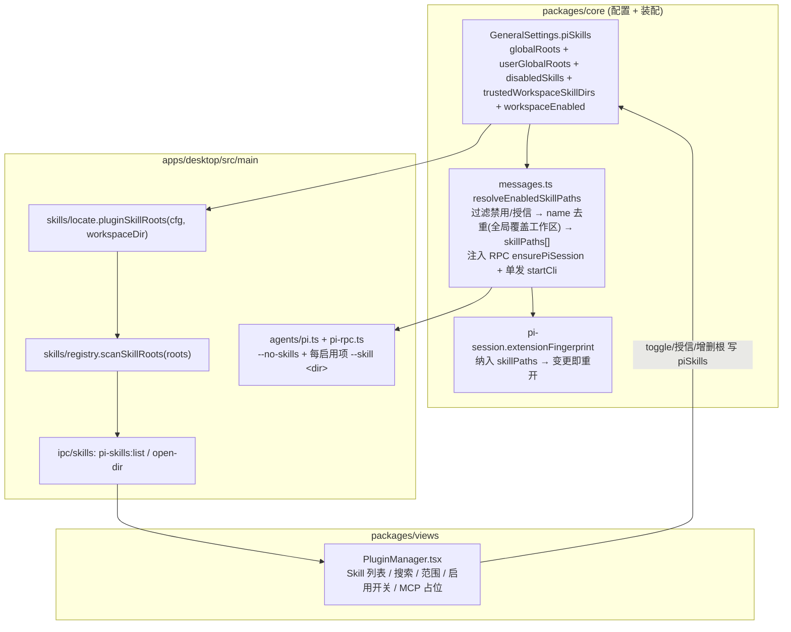

# feat: pi 插件管理——Skill 管理器（多目录 + 逐项启用 + 会话注入）

- 日期：2026-06-17
- 类型：feat
- 范围：`apps/desktop`（多目录 skill 扫描 + IPC + pi adapter 注入）、`packages/core`（类型镜像 + 配置 store + 会话装配）、`packages/views`（插件管理器 UI）
- origin：无 brainstorm 文档；用户请求 + 参考截图（Kun 风格 MCP/Skill 管理器）+ Phase 0 scope 对齐（2026-06-17）
- 前置：pi RPC 阶段 1–5 已落地（provider extension、深度定制、system prompt、思考强度）
- 深度：Standard（仅 Skill；跨 5 层但边界清晰；新增设置面但复用既有 skill 扫描基建）

---

## 1. 摘要

为 pi agent 增加**插件管理**入口。本轮**只做 Skill 管理**，MCP 全延后（见 §6 决策与 §9 延后清单）。

参考截图实现一个 Skill 管理器：搜索框、范围下拉（全部 / 全局 / 工作区）、「打开目录 / 刷新」、推荐 + 个人分组、**每张卡片逐项启用/禁用**、底部统计「已扫描 N 个，M 个启用」。

技术骨架已部分存在但**未接入 pi 会话**：`apps/desktop/src/main/skills/registry.ts` 已能浅扫 `<root>/<skill>/SKILL.md` 并解析 frontmatter（`name` / `description` / `argument-hint`），但仅服务 ce-plan 注入、且只认两个写死根（`userData/skills` + 内置）。pi adapter（`pi.ts` / `pi-rpc.ts`）当前对 skills 只有 `--no-skills`，从不传 `--skill`。

本轮做四件事：

1. **多目录扫描**：把 registry 重构为扫描**任意可配置根**，每个 skill 携带「来源根 / 范围（全局/工作区）/ 绝对目录」。全局默认根 = `~/.agent/skills` + `~/.cortex-desktop/skills`；工作区根 = `<项目>/.cortex-desktop/skills`；全局根用户可增改。
2. **逐 skill 启用/禁用 + 工作区信任**：UI 维护禁用集（`scope:name` 复合键）；**全局 skill 默认启用**，**工作区 skill 默认禁用、需显式授信**（安全边界，见 KTD-2/R12）。
3. **会话注入**：pi 启动恒带 `--no-skills`，对每个已启用（工作区还需授信）的 skill 单独传 `--skill <该skill目录>`——UI 即唯一真相源（不依赖 pi 自身 `~/.pi/agent/skills` 自动发现）。注入前按 name 去重、全局覆盖工作区（KTD-6）。注入覆盖 **RPC 与单发两路**；skill 集合变化经 `extensionFingerprint` 触发会话重开。
4. **插件管理器 UI**：新设置入口，Skill 标签页完整；MCP 标签页留占位（敬请期待空态），供后续接入。

claude / codex 不涉及。pi 现有 provider / 审批 / 样例 extension 注入不动——`--skill` 与 `-e` 各自独立。

---

## 2. 关键事实（已核实）

| 事实 | 证据 |
|---|---|
| **pi 原生零 MCP**（设计决定，非遗漏） | pi README `dist` 内 README:493「No MCP. Build CLI tools with READMEs (Skills), or build an extension that adds MCP support.」全 `dist/` 无 mcp 代码。截图的「运行时状态/N 个服务/N 个工具」在 pi 里不存在。 |
| **`--skill <path>` 可重复，接文件或目录** | `node_modules/@earendil-works/pi-coding-agent/dist/cli/args.js:127`「Load a skill file or directory (can be used multiple times)」。目录含 SKILL.md → 加载该单个 skill。 |
| **`--no-skills` 禁用默认发现** | `cli/args.js:139`（别名 `-ns`）「Disable skills discovery and loading」。与显式 `--skill` 是否共存需 §U0 spike 确认。 |
| **pi 默认 skill 根 ≠ 用户要的路径** | pi 默认 `~/.pi/agent/skills` + `<cwd>/.pi/skills`（`dist/core/skills.js:330`）。用户要 `~/.agent/skills` + `~/.cortex-desktop/skills`——必须经显式 `--skill` 驱动，不靠 pi 默认。 |
| **registry 已能扫 SKILL.md + frontmatter** | `apps/desktop/src/main/skills/registry.ts`（`scanRoot` / `listSkills`）、`frontmatter.ts`（取 name/description/argument-hint）。 |
| **PiOpenRequest 装配点** | `packages/core/personal/messages.ts:1028`（`ensurePiSession` 调用，含 `useOwnSkills` / `piCustomization` 注入）。 |
| **会话重开指纹** | `packages/core/personal/pi-session.ts:86`（`extensionFingerprint`，provider/customization/systemPrompt 变化即重开）。 |
| **打开目录能力已有** | `apps/desktop/src/main/ipc/fs.ts:552`（`shell:openPath`）。 |

---

## U0. 共存确认：`--no-skills` 与显式 `--skill`（源码已证，5 分钟核对）

**Goal**：确认 pi 在 `--no-skills` 同时显式 `--skill <dir>` 时仍加载该 skill。

**已从源码证实（评审核实，2026-06-17）**：`node_modules/@earendil-works/pi-coding-agent/dist/core/resource-loader.js:277-279`——`noSkills` 为真时 `skillPaths = mergePaths(cliEnabledSkills, additionalSkillPaths)`，即 `--no-skills` 仅丢弃「自动发现」项，**显式 `--skill`（走 `cliEnabledSkills`/`additionalSkillPaths`）恒被保留**，与 `--no-extensions` + `-e` 同构。故 KTD-1 成立，无架构风险。

**Approach**：仅做一次环境核对（规避 pi 版本差异）：仿既有 spike（见 [[pi-rpc-spike-via-bun]]），bun 跑 `cli.js --mode rpc --no-skills --skill <临时skill目录> -a`，发 `get_commands`，断言返回含 `skill:<name>`（`source==="skill"`）。

**回退（极低概率，仅版本差异致失败时）**：改用 `DefaultResourceLoader` 的 `additionalSkillPaths` 程序化注入（SDK 层，`resource-loader.d.ts:67`）。**不采用** `PI_CODING_AGENT_DIR` + staging 软链方案——它未验证是否屏蔽 pi 默认根、且引入软链生命周期/清理的大量计划外复杂度（评审 adversarial/feasibility 指出），与 Skill-only 目标不相称。

**Test expectation: none** —— 一次性核对，结论已写回本节。

---

## 3. 需求追溯

| R-ID | 需求 | 来源 |
|---|---|---|
| R1 | 设置区新增「插件」入口，含 MCP / Skill 两标签；Skill 标签完整，MCP 留占位 | 用户请求、截图 |
| R2 | Skill 列表跨多目录扫描，每项标注范围（全局/工作区） | 用户请求、截图「全局」徽标 |
| R3 | 全局默认根含 `~/.agent/skills` 与 `~/.cortex-desktop/skills`；全局根可增改 | 用户请求 |
| R4 | 支持工作区 skill 目录（`<项目>/.cortex-desktop/skills`） | 用户请求 |
| R5 | 逐 skill 启用/禁用；默认全启用；底部统计已扫描/已启用数 | 截图卡片「禁用」按钮、「113 个，113 个启用」 |
| R6 | 搜索框过滤 skill；范围下拉过滤（全部/全局/工作区） | 截图 |
| R7 | 「打开目录」打开当前范围目录；「刷新」重扫 | 截图 |
| R8 | 已启用 skill 经 `--skill` 注入 pi 会话（单发 + RPC 两路）；UI 为唯一真相源（恒 `--no-skills`） | scope 对齐、§2 |
| R9 | skill 启用集变化触发 pi 会话重开（指纹） | pi-session 既有模式 |
| R10 | 配置持久化（全局根列表 + 禁用集 + 工作区开关）；web / 旧壳零回归 | 架构硬边界 |
| R11 | MCP 全延后，UI 占位不误导（明确「敬请期待」） | scope 对齐 |
| R12 | **工作区 skill 信任边界**：工作区根 skill 默认**不自动注入**（opt-in），避免恶意仓库经 `<项目>/.cortex-desktop/skills` + `-a` 任意代码执行 | 评审 security P0 |
| R13 | **路径安全**：open-dir / mkdir / `--skill` 注入的路径经 expand + resolve 后校验在白名单根内；用户新增全局根需一次确认 | 评审 security P1 |

---

## 4. 关键技术决策（KTD）

### KTD-1：恒 `--no-skills` + 逐 skill `--skill <目录>`，UI 唯一真相源
**决策**：pi 启动**永远**带 `--no-skills`（关 pi 自动发现），对每个已启用 skill 追加一个 `--skill <该 skill 绝对目录>`。不依赖 pi 的 `~/.pi/agent/skills` / `<cwd>/.pi/skills` 默认扫描。
**理由**：用户明确要 UI 为唯一真相源、默认根是 `~/.agent/skills`（≠ pi 默认）。逐 skill 传目录天然实现截图的「逐项启用/禁用」——禁用的不传即可，无需 staging/软链。
**取舍**：skill 多时命令行参数变长（每个 `--skill <path>` 两个 token）。可接受（skill 数量级百，参数长度远低于系统上限）；spike 失败则切 `PI_CODING_AGENT_DIR` + staging（§U0 回退）。

### KTD-2：启用态按 skill 绝对目录键；全局默认启用、工作区默认禁用（信任边界）
**决策**：配置存 `disabledSkills: string[]`（`scope:name` 复合键）+ `trustedWorkspaceSkillDirs: string[]`（工作区显式授信集）。**全局根** skill 默认启用（用户自有目录，可信）；**工作区根** skill 默认**禁用**，仅当用户在 UI 显式「信任并启用」后才进入注入集（R12）。
**理由**：截图「全部启用」反映的是全局 skill；工作区 skill 来自任意被打开的仓库，默认自动注入 + `-a` 信任 = 恶意仓库任意代码执行（评审 security P0）。
**取舍**：用 `scope:name` 复合键（而非绝对目录键）使 skill 目录重命名/移动后禁用态仍生效，避免 fail-open（被禁用的 skill 因路径变化重新启用，评审 adversarial P2）；symlink/重复目录用 canonicalize 归一，与 pi 的 realpath 去重（`skills.js:303-308`）对齐。

### KTD-6：注入前按 name 去重，全局覆盖工作区；冲突在 UI 标注
**决策**：生成 `skillPaths` 前按 frontmatter `name` 去重——**全局范围优先，覆盖工作区同名**（与初版 §9「工作区覆盖全局」相反）。被覆盖的卡在 UI 标「已被同名覆盖」。
**理由**：pi 的 `loadSkills` 对同 name skill 产 `collision` diagnostic 并按 `--skill` 顺序静默保留先到者、丢后到者（`skills.js:309-322`），结果不可控。必须我方注入前去重定序。让**高可信来源（全局/用户自有）覆盖低可信来源（任意工作区）**，否则恶意工作区可用同名 SKILL.md 劫持用户惯用的全局 skill（评审 security P2）。

### KTD-3：registry 重构为「扫描可配置根 + 携带范围」，listSkills 旧签名保留
**决策**：新增 `scanSkillRoots(roots: {path, scope}[])` 返回富 `PluginSkill[]`（含 `scope` / `rootPath` / `dir` / `enabled` 待 UI 叠加）；保留现有 `listSkills()` / `getSkill()` 旧签名（ce-plan 注入仍用），内部改为调用新扫描器喂双默认根，**行为不变**。
**理由**：ce-plan 注入（`skills:list/get`）与插件管理器是两种消费，不应耦合。重构只扩能力不破旧契约。

### KTD-4：配置挂在 `GeneralSettings.piSkills`，复用既有透传持久化
**决策**：`GeneralSettings` 新增可选 `piSkills?: PiSkillSettings`（全局根列表 + 禁用集 + 工作区开关）。落盘复用 `resolveGeneralSettings` 的整体透传（`packages/core/store/personal.ts:245`，注释已声明「新增顶层设置字段无需再改本函数」）。
**理由**：与 `piCustomization` / `piSystemPrompt` 同源同模式，最小改动。默认值（两个全局根、空禁用集、工作区开）在 `DEFAULT_GENERAL_SETTINGS` 与读取兜底里给。

### KTD-5：插件管理器为独立全屏视图，复用 SettingsMenu 外壳模式；MCP 仅最简占位
**决策**：新建 `PluginManager.tsx`，作为 SettingsMenu 的新标签「插件」接入（见 U8）。顶部 MCP/Skill 分段切换**仅渲染两个标签按钮**，MCP 标签下是一处「敬请期待」空态——**不**为 MCP 建任何通用切换框架/数据抽象。
**理由**：本轮唯一 MCP 需求是 R11「占位不误导」，满足它只需空态。为延后且属另一计划的 MCP 提前立抽象是为不存在的消费者建结构（评审 scope-guardian）；真正的切换结构待 MCP 计划按真实需求引入。

---

## 5. 高层技术设计（HTD）

数据流：配置 → 扫描 → UI（启用态叠加）→ 会话注入。



关键点：扫描（main，列出全部 + 范围）与启用态（store，禁用集）解耦——UI 把禁用集叠加到扫描结果上渲染开关；会话注入时 `messages.ts` 再次按禁用集过滤出 `skillPaths`。

---

## 6. 范围边界

**本轮做**：Skill 多目录扫描 / 逐项启用 / 会话注入 / 插件管理器 Skill 标签 / 配置持久化。

### 延后到后续工作（Deferred to Follow-Up Work）
- **MCP 管理（整体）**：pi 零原生支持，需自写 pi extension 当 MCP 客户端（stdio/http transport）+ `registerTool` 桥接 + 运行时状态回报 + 配置增删改 + 推荐目录。独立大工程，单列后续计划。本轮仅留 MCP 标签占位。
- **Skill 在线安装/下载**（截图「创建」「推荐」安装）：`skills/download.ts` 已有桩（多源 clawhub/skills.sh/github、配额、路径安全）。本轮只做本地已存在 skill 的管理，不接下载。
- **Skill 创建/编辑器**（截图「创建」按钮）：本轮不做新建 skill 的表单。
- **`disable-model-invocation` 细粒度**：本轮启用/禁用为「传不传 `--skill`」二态，不暴露 frontmatter 的 disable-model-invocation 单独控制。

### 非目标
- claude / codex 的 skill 管理（pi 专属）。
- 沿用 pi 自身的 `~/.pi/agent/skills` / `<cwd>/.pi/skills` 默认发现（我们恒带 `--no-skills` 关之）。**迁移影响**：原依赖 pi 默认根放置 skill 的用户，新模型下需把目录加入插件管理器的全局根（或移动到 `~/.agent/skills`）；本轮不做自动迁移提示。

---

## 7. Output Structure（新增 + 改动文件）

```
apps/desktop/src/main/skills/
  locate.ts          (改：新增 pluginSkillRoots)
  registry.ts        (改：新增 scanSkillRoots + PluginSkill)
apps/desktop/src/main/ipc/
  skills.ts          (改：新增 pi-skills:list / pi-skills:open-dir)
packages/views/cortex-desktop/personal/
  PluginManager.tsx        (新)
  PluginManager.test.tsx   (新)
  SkillCard.tsx            (新，可内联进 PluginManager)
```

---

## 8. 实现单元

### U1. Skill 插件配置类型与默认值
**Goal**：定义 `PiSkillSettings` 与富 skill 类型，两侧镜像，给默认值。
**Requirements**：R3, R4, R5, R10。
**Dependencies**：无。
**Files**：
- `packages/core/desktop/types.ts`（`PiSkillSettings` + `PluginSkill` + `GeneralSettings.piSkills?` + `DEFAULT_GENERAL_SETTINGS` 默认根）
- `apps/desktop/src/main/ipc/types.ts`（同形镜像 `PluginSkill` / `PiSkillRoot`）
- `packages/core/desktop/types.test.ts`（若有）或就近
**Approach**：
- `PiSkillSettings { globalRoots: string[]; userGlobalRoots?: string[]; disabledSkills: string[]; trustedWorkspaceSkillDirs: string[]; workspaceEnabled: boolean }`。默认 `globalRoots = ["~/.agent/skills", "~/.cortex-desktop/skills"]`（内置默认双根，存原样含 `~`，main 侧 expand），`userGlobalRoots = []`（用户自增根，与默认根区分以支持 R13 信任确认与 R3 删除——内置根不可删），`disabledSkills = []`，`trustedWorkspaceSkillDirs = []`，`workspaceEnabled = true`。
- `disabledSkills` 的键用 **`scope + ":" + name` 复合键**（非纯绝对目录），使 skill 目录重命名/移动后禁用态仍生效（KTD-2 取舍缓解）。
- `PluginSkill { name; description; argumentHint?; dir; rootPath; scope: "global" | "workspace"; enabled: boolean; trusted: boolean; shadowedBy?: string }`（`trusted` 仅 workspace 有意义；`shadowedBy` = 被同名覆盖时的覆盖来源，供 UI 标注，KTD-6）。
- `SkillScope = "global" | "workspace"`。
**Patterns to follow**：`PiCustomizationSettings`（`packages/core/desktop/types.ts:393`）与 `SkillMeta`（同文件 :960）的镜像风格。
**Test scenarios**：
- 类型层无运行逻辑 → `Test expectation: none -- 纯类型 + 常量默认值，由消费单元的测试间接覆盖`。

### U2. 多目录 skill 扫描器（registry 重构）
**Goal**：registry 支持扫描任意配置根并携带范围，旧 `listSkills/getSkill` 行为不变。
**Requirements**：R2, R3, R4, KTD-3。
**Dependencies**：U1。
**Files**：
- `apps/desktop/src/main/skills/registry.ts`（新增 `scanSkillRoots`）
- `apps/desktop/src/main/skills/locate.ts`（新增 `pluginSkillRoots(cfg, workspaceDir?)`，含 `~` expand）
- `apps/desktop/src/main/skills/registry.test.ts`（新建或扩）
- `apps/desktop/src/main/skills/locate.test.ts`（新建）
**Approach**：
- `pluginSkillRoots`：把 `cfg.globalRoots` 逐个 expand（`~` → homedir）标 scope=global；若 `workspaceEnabled && workspaceDir` 追加 `<workspaceDir>/.cortex-desktop/skills` 标 scope=workspace。返回 `{path, scope}[]`。
- `scanSkillRoots(roots)`：对每根复用既有 `scanRoot` 逻辑（容错跳过不存在的根），产出 `PluginSkill[]`（`enabled` 先恒 true，启用态由调用方叠加）。同名跨根**不去重**（范围不同，各自一张卡）；同范围同名按目录键去重。
- 旧 `listSkills()` 改为 `scanSkillRoots(双默认根)` + 按 name 去重映射回 `SkillMeta`，**行为不变**。
**Patterns to follow**：现有 `scanRoot`（`registry.ts:13`）容错跳过；`frontmatter.parseFrontmatter` 复用。
**Test scenarios**：
- 单根含 2 个合法 skill → 返回 2 项，scope/dir/rootPath 正确。
- 根不存在 → 跳过不抛，返回该根 0 项。
- 目录无 SKILL.md → 跳过该目录。
- 全局根 + 工作区根各有同名 skill → 返回 2 项（scope 各异，不去重）。
- frontmatter 缺 name → 兜底用目录名（保持旧行为）。
- `~` 路径 expand 为 homedir 绝对路径。
- 回归：旧 `listSkills()` 对双默认根输出与重构前一致（按 name 去重）。

### U3. IPC + bridge：扫描查询 + 打开目录
**Goal**：渲染端经 bridge 拉取富 skill 列表（按当前工作区）并打开范围目录。
**Requirements**：R2, R6, R7。
**Dependencies**：U2。
**Files**：
- `apps/desktop/src/main/ipc/skills.ts`（新增 `pi-skills:list` handler，入参 workspaceDir? + 当前 piSkills 配置；`pi-skills:open-dir` 复用 `shell.openPath`）
- `apps/desktop/src/preload/index.ts`（暴露 `piSkillsList` / `openSkillDir` 到 `window.desktopAPI.personal`）
- `packages/core/desktop/bridge.ts`（`piSkillsList?(args): Promise<PluginSkill[]>`、`openPath?` 若未有则复用既有）
- `apps/desktop/src/main/ipc/skills.test.ts`（扩）
**Approach**：
- `pi-skills:list`：入参 `{ globalRoots, workspaceEnabled, workspaceDir? }`（由渲染端从 store 传，main 不读 store）→ `pluginSkillRoots` → `scanSkillRoots` → 返回 `PluginSkill[]`（`enabled` 留默认 true，启用态由渲染端叠加禁用集）。
- **路径安全（R13，关键）**：`pi-skills:open-dir` **不能**裸复用 `shell:openPath`——后者的 `assertAllowed`（`fs.ts:34-43`）白名单只含 promptRoot/项目目录，全局根 `~/.agent/skills` 不在内会被拒；而绕过校验直开渲染端传入的任意路径 = 路径遍历 + 任意目录创建（评审 security P1）。新 handler 自带校验：对入参路径 `~` expand + `path.resolve` 后，断言其落在「当前配置的 globalRoots ∪ workspaceDir」白名单内（用 `isInside` 比对），越界拒绝；`mkdirSync(recursive)` 仅允许在白名单根内。
- bridge 方法可选（web/旧壳为 null → 管理器降级空态/禁用按钮）。
**Patterns to follow**：`apps/desktop/src/main/ipc/skills.ts` 既有 handler；`fs.ts` 的 `assertAllowed`/`isInside` 路径校验风格；preload `contextBridge` 形状对齐 `DesktopBridge`（CLAUDE.md 硬边界）。
**Test scenarios**：
- `pi-skills:list` 给定根列表 → 返回扫描结果（mock fs）。
- 传 workspaceDir 且 workspaceEnabled → 含 workspace scope 项。
- workspaceEnabled=false → 不含 workspace 项。
- `pi-skills:open-dir` 白名单内目录不存在 → 先建后开，无异常。
- `pi-skills:open-dir` 白名单外路径（如 `/etc` 或 `../../foo`）→ 拒绝、不创建、不打开（路径遍历防护）。
- bridge 方法在 web（null bridge）→ 不崩（由 U7 UI 测试覆盖降级）。

### U4. pi adapter：`--skill` 注入（单发 + RPC）
**Goal**：`PiOpenRequest` / `CliStartRequest` 携带 `skillPaths`，两路 buildArgs 恒 `--no-skills` + 每项 `--skill`。
**Requirements**：R8。
**Dependencies**：U0（spike 结论）、U1。
**Files**：
- `packages/core/desktop/types.ts` + `apps/desktop/src/main/ipc/types.ts`（`PiOpenRequest.skillPaths?: string[]` + `CliStartRequest.skillPaths?: string[]` 两侧镜像）
- `apps/desktop/src/main/agents/pi.ts`（`buildArgs`：恒 `--no-skills`，对 `skillPaths` 逐个 `--skill <p>`）
- `apps/desktop/src/main/agents/pi-rpc.ts`（`buildRpcArgs`：同上）
- `apps/desktop/src/main/agents/pi.test.ts` + `pi-rpc.test.ts`（扩）
**Approach**：
- adapter 是**纯渲染**：恒带 `--no-skills`（不再依赖 pi 自动发现），对传入的 `skillPaths` 逐个追加 `--skill <dir>`，顺序稳定（便于指纹与单测）。adapter **不**自行判断 `useOwnSkills`——下发与否由装配层（U5）决定，adapter 只渲染收到的 paths。
- **`useOwnSkills` 注意（评审 P0）**：旧语义「`useOwnSkills===true` 才省略 `--no-skills`」作废。注入是否发生由 U5 按「配置中有启用项」决定，**不**门控在每会话 `useOwnSkills`（其默认 false，会导致配好的 skill 全不注入）。`useOwnSkills` 的去留见 U5/§9。
- `-a`（信任）与 provider extension 的 `-a` 复用一次（已有逻辑只加一次 `-a`）。
**Execution note**：先写失败单测断言 args 含 `--no-skills` 且对 N 个 skillPaths 产出 N 段 `--skill`，再改实现（args 是纯函数，TDD 直接）。
**Patterns to follow**：`buildRpcArgs` 既有 `exts` 多 `-e` 拼接（`pi-rpc.ts:150`）；`safeId`/`-a` 复用。
**Test scenarios**：
- `skillPaths=[a,b]` → args 含 `--no-skills` 且依序含 `--skill a`、`--skill b`。
- `skillPaths` 空/缺 → 仅 `--no-skills`，无 `--skill`。
- 与 provider extension 共存：`-e` 与 `--skill` 同时存在，`-a` 只出现一次。
- 回归：无 skillPaths 的现有行为不变（仍 `--no-skills`）。

### U5. 会话装配：解析启用 skill 目录（去重 + 信任）+ 指纹（RPC 与单发两路）
**Goal**：按 piSkills 配置解析出已启用、去重、授信后的 skill 目录，注入 **RPC（ensurePiSession）与单发（startCli）两条路径**（R8）；skill 集合纳入重开指纹。
**Requirements**：R8, R9, R12, KTD-6。
**Dependencies**：U2, U3, U4。
**Files**：
- `packages/core/personal/messages.ts`（**两处**：`ensurePiSession` 调用 ~`:1028`、单发 `startCli` 调用 ~`:1438`，各注入 `skillPaths`；抽一个共享 `resolveEnabledSkillPaths()` helper）
- `packages/core/personal/pi-session.ts`（`extensionFingerprint` 纳入 `skillPaths`）
- `packages/core/personal/messages.test.ts`（扩，含单发路径断言）
- `packages/core/personal/pi-session.test.ts`（扩）
**Approach**：
- `resolveEnabledSkillPaths()`：读 `generalSettings.piSkills` + 当前项目路径 → `bridge.piSkillsList({globalRoots, userGlobalRoots, workspaceEnabled, workspaceDir})` 得全量 → 过滤 `disabledSkills`（`scope:name` 复合键）→ **工作区项再过滤**：仅保留 `dir ∈ trustedWorkspaceSkillDirs` 的（R12，未授信工作区 skill 不注入）→ **按 frontmatter name 去重，全局覆盖工作区**（KTD-6）→ 取各项 `dir`，**排序**后作 `skillPaths`。
- **注入条件（评审 P0）**：`skillPaths` 非空即下发，**不**门控在 `session.useOwnSkills`（默认 false 会让全部启用项静默失效）。`useOwnSkills` 的归宿：要么废弃 ComposerShell 的「Skills 开/关」pill，要么把它重定义为「本会话临时全关 skill」的覆盖（下发前若该会话 useOwnSkills===false 则清空 skillPaths）；本计划取**后者**（保留 pill 作会话级一键关，默认不关），并同步更新 `ComposerShell.tsx:450/453` 的 title/label 文案（旧文案「已加载 agent 自身 skills」与新模型不符）。
- 缓存：`resolveEnabledSkillPaths` 每次开会话查一次（频率低，可接受）；指纹只用「排序后启用 skill 目录集合」而非扫描全量内容，避免文件内容抖动误触重开。
- `extensionFingerprint`：把排序后的 `skillPaths` 加入指纹对象（与 provider/customization 并列）→ 启用集变化即重开会话。
**Patterns to follow**：`messages.ts:1022` 读 `piCustomization` 注入；`extensionFingerprint`（`pi-session.ts:86`）字段定序。
**Test scenarios**：
- 配置启用 2 个全局 skill → RPC 与单发两路都收到 `skillPaths=[2 个 dir]`。
- 禁用集含其中 1 个 → 只下发 1 个。
- 工作区 skill 未授信（不在 trustedWorkspaceSkillDirs）→ 不下发（R12）；授信后 → 下发。
- 全局+工作区同名 skill 均启用且工作区已授信 → 仅注入全局版（KTD-6 全局覆盖工作区）。
- `useOwnSkills===false`（pill 关）→ 清空 skillPaths（会话级一键关）；缺省/true → 正常下发（不因默认 false 而失效）。
- 指纹：skillPaths 内容变化 → 指纹变化触发重开；内容相同顺序不同 → 排序后指纹不变（不误重开）。
- workspaceEnabled=false → 不含 workspace skill。

### U6. 配置 store：piSkills 读写 + 默认兜底
**Goal**：piSkills 配置可读写持久化，旧档无该字段时兜默认。
**Requirements**：R5, R10。
**Dependencies**：U1。
**Files**：
- `packages/core/store/personal.ts`（`resolveGeneralSettings` 兜 `piSkills` 默认；细粒度 setter：`togglePiSkill(scope, name, enabled)`、`trustWorkspaceSkill(dir, trusted)`、`addGlobalSkillRoot(path)` / `removeGlobalSkillRoot(path)`）
- `packages/core/store/personal.test.ts`（扩）
**Approach**：
- 透传持久化已就绪（`resolveGeneralSettings` 整体透传，注释声明新增字段无需改）；只需在读取兜底里：`piSkills: { ...DEFAULT_PI_SKILLS, ...g?.piSkills }`（含旧档无该字段、或缺子字段的兜底）。
- 启用/禁用 = 增删 `disabledSkills`（`scope:name` 复合键）；工作区授信 = 增删 `trustedWorkspaceSkillDirs`；增删全局根写 `userGlobalRoots`（内置 `globalRoots` 不可删）。封装 helper 避免 UI 手拼数组。
**Patterns to follow**：`setGeneralSettings`（`personal.ts:394`）；`resolveGeneralSettings`（:245）。
**Test scenarios**：
- 旧档无 piSkills → hydrate 后得默认（双全局根、空 disabledSkills、空 trusted、workspaceEnabled=true）；旧档缺某子字段 → 该子字段兜默认。
- togglePiSkill("global","x",false) → disabledSkills 含 `global:x`；再 true → 移除。
- trustWorkspaceSkill(dir,true) → trustedWorkspaceSkillDirs 含 dir。
- addGlobalSkillRoot → userGlobalRoots 追加；removeGlobalSkillRoot 内置根 → 拒绝/无效。
- `toPersistedState` 往返不丢 piSkills 各子字段。

### U7. 插件管理器 UI（Skill 标签 + MCP 占位）
**Goal**：实现截图风格的插件管理器：MCP/Skill 分段切换、Skill 搜索/范围过滤/分组/逐项开关/工作区授信/全局根增删/统计/四态；MCP 最简占位。
**Requirements**：R1, R2, R3, R5, R6, R7, R11, R12。
**Dependencies**：U3, U6。
**Files**：
- `packages/views/cortex-desktop/personal/PluginManager.tsx`（新）
- `packages/views/cortex-desktop/personal/PluginManager.test.tsx`（新）
- `packages/views/cortex-desktop/personal/assets`（如需样式，复用既有 css 约定）
**Approach**：
- 顶部 MCP / Skill 分段切换（两个标签按钮）；MCP 渲染单一「敬请期待」空态（R11，不建通用切换框架，KTD-5）。
- **分组模型（拍板，评审 coherence/design）**：列表按 **scope** 分两组——「全局」与「工作区」（与范围徽标、范围下拉同维度，皆可由 `PluginSkill.scope` 派生）。**不**引入「推荐/个人 = 内置根/用户根」这一第三维度（无字段支撑且与 scope 徽标语义重叠）。组顺序：全局在上；组内按 name 排序。
- **四态（评审 design P1）**：(1) 加载中 = 骨架占位；(2) 扫描成功 0 项 = 空态，文案「未发现 skill，把 SKILL.md 目录放入 ~/.agent/skills，或点『打开目录』」并高亮打开目录/刷新；(3) IPC 错误 = 错误态 + 「重试」；(4) 有数据 = 列表。
- Skill 标签控件：
  - 搜索框（按 name/description 过滤）+ 范围下拉（全部/全局/工作区）。
  - 工具条：「打开目录」、「刷新」（重调 `piSkillsList`）、统计「已扫描 N 个，M 个启用」。
  - **打开目录行为（评审 design P2）**：范围=单一根 → 直接 `openSkillDir(该根)`；范围=「全部」或全局多根 → hover 展开根列表菜单选择（遵循 [[hover-over-click-menus]]），所选根经 U3 白名单校验。
  - **全局根增删（R3，评审 scope/design conf 100）**：工具条加「管理目录」入口——「添加目录」（系统目录选择器 → `addGlobalSkillRoot`，新增根弹一次信任确认 R13）；每个 `userGlobalRoots` 项可删（内置默认双根不可删）。
  - 卡片：name、description（截断）、scope 徽标、启用/禁用按钮（写 `togglePiSkill(scope,name,…)`）。**工作区卡**额外有「信任并启用」动作（写 `trustWorkspaceSkill`），未授信时开关置灰并标「未信任」（R12）。被同名覆盖的卡（`shadowedBy`）标「已被全局同名覆盖」徽标、开关视觉次要（KTD-6）。
  - 数据：mount 时 `piSkillsList`，叠加 `disabledSkills`/`trustedWorkspaceSkillDirs` 算 `enabled`/`trusted` 渲染。
  - toggle 为乐观更新（即时翻转+更新统计），并附一行「更改将在下一轮对话重新加载」呼应 U5 会话重开。
  - 可访问性：分段切换 role=tablist/tab + 方向键；每个开关用语义 switch + aria-label（skill 名+状态）。
- bridge null（web/旧壳）→ 空态 + 禁用工具按钮（降级，不崩）。
**Patterns to follow**：`SettingsMenu.tsx` 的 Section/SettingCard/BareSelect/Toggle 控件；`AutomationView.tsx` 列表布局；store 选择器用法。
**Test scenarios**：
- 渲染 skill 列表（mock bridge 返回 3 全局项）→ 显示 3 张卡 + 统计「3 个，3 个启用」，分「全局」组。
- 点某卡「禁用」→ 调 togglePiSkill，统计变「3 个，2 个启用」（乐观更新）。
- 搜索「review」→ 仅匹配项可见。
- 范围下拉选「工作区」→ 仅 workspace scope 卡可见。
- 工作区卡未授信 → 开关置灰、标「未信任」；点「信任并启用」→ 调 trustWorkspaceSkill。
- 同名全局+工作区卡 → 工作区卡标「已被全局同名覆盖」。
- 加载中 → 骨架；返回 0 项 → 空态引导文案；IPC reject → 错误态 + 重试按钮。
- 「添加目录」→ 调 addGlobalSkillRoot + 信任确认；内置根无删除按钮、用户根有。
- 打开目录：单根范围直开；多根/全部 → 展开根菜单。
- 切到 MCP 标签 → 显示「敬请期待」占位，无报错。
- bridge=null → 渲染降级空态，工具按钮禁用，不抛。

### U8. 设置入口接入
**Goal**：把插件管理器接入设置导航（新「插件」标签）。
**Requirements**：R1。
**Dependencies**：U7。
**Files**：
- `packages/views/cortex-desktop/personal/SettingsMenu.tsx`（`SettingsTab` 加 `"plugins"`、`TABS` 加项、section 渲染分支引 `PluginManager`）
- `packages/views/cortex-desktop/personal/SettingsMenu.test.tsx`（扩）
**Approach**：
- `SettingsTab` 联合加 `"plugins"`；`TABS` 加 `{ id:"plugins", label:"插件", icon:<Icon.Puzzle/> 或合适图标 }`（核对 `Icon` 是否有 Puzzle，无则用 Blocks/Grid 替代）。
- section switch 渲染 `<PluginManager/>`。
**Patterns to follow**：`SettingsMenu.tsx:71` 的 `SettingsTab` / `TABS` / section 渲染分支（如 `PiSection`）。
**Test scenarios**：
- 切到「插件」标签 → 渲染 PluginManager。
- ESC/返回行为与其他标签一致（复用既有外壳，无需新测，回归确认）。

---

## 9. 风险与依赖

| 风险 | 影响 | 缓解 |
|---|---|---|
| `--no-skills` 屏蔽显式 `--skill` | KTD-1 不成立 | **已由源码排除**（resource-loader.js:277-279，§U0）；U0 仅环境核对，失败走 `additionalSkillPaths` SDK 注入（非 staging 软链）。 |
| skill 数量大致命令行过长 | 启动失败 | 数量级百、参数长度远低于系统 ARG_MAX。 |
| 同名 skill 跨范围注入冲突 | pi `loadSkills` collision 静默丢后到者（`skills.js:309-322`），保留谁取决参数顺序 | 注入前按 name 去重、**全局覆盖工作区**（KTD-6，落 U5）；UI 标「已被全局同名覆盖」（U7）。 |
| 恶意工作区 skill 自动注入 + `-a` 执行 | 任意代码执行（评审 security P0） | 工作区 skill 默认禁用、需显式授信（R12/KTD-2，落 U5/U7）。 |
| open-dir/mkdir 任意路径 | 路径遍历（评审 security P1） | 白名单根校验 + 仅白名单内 mkdir（R13，落 U3）。 |
| 扫描每轮开会话执行 | 轻微延迟 | 频率低可接受；指纹只用启用目录集合（非内容），避免抖动重开。 |
| `~` 未 expand 导致目录找不到 | skill 不加载 | locate 统一 expand；测试覆盖。 |

**延后清单**见 §6（MCP 整体、在线下载、skill 创建、disable-model-invocation 细粒度）。

---

## 10. 验证

- `pnpm --filter @cortex-work/core test` + `pnpm --filter @cortex-work/desktop test` 全绿。
- `pnpm typecheck`、`pnpm lint` 通过。
- 手动（用户验证 [[verification-split]]）：设置→插件→Skill：扫描出 `~/.agent/skills` 与 `~/.cortex-desktop/skills` 下 skill，逐项启用/禁用、搜索、范围切换、打开目录、刷新；启用某全局 skill 后新发一轮 pi，确认会话重开且该 skill 生效（如 `/skill:<name>` 可用或行为体现）。工作区 skill 默认「未信任」不注入，授信后生效。MCP 标签显示占位。
- 回归（含语义变更说明）：`useOwnSkills` pill 关 → 本会话清空 skillPaths、pi 仅 `--no-skills`，与改动前一致；pill 开/缺省 → 由原先「省略 `--no-skills` 靠 pi 自动发现」改为「`--no-skills` + 显式 `--skill`（UI 真相源）」——**这是有意行为变更**，非回归。原放置于 pi 默认根 `~/.pi/agent/skills` 的 skill 在新模型下不再被自动发现（见 §6 非目标 / [[pi-rpc-session-phases]]）。
