# feat: pi 自定义工具 askquestion——会话内多组提问卡片（输入框上方）

- 日期：2026-06-17
- 类型：feat
- 范围：`apps/desktop`（extension 生成 + 主进程信封路由）、`packages/core`（契约镜像 + 消费 hook + 清理矩阵）、`packages/views`（输入框上方富卡片 UI）
- origin：无上游 brainstorm（solo 规划）；understand 研究简报（2026-06-17，含对抗式校验）
- 前置：阶段 3 的 pi extension 双向 UI 通道（confirm 全链路 + `select/input/editor` 自动 cancelled 兜底 + `piUiPending` 队列 + 多 `-e` 装配）**已在 master 就位**（`feat/pi-rpc-session` 是 master 严格子集，`git rev-list --left-right --count master...feat/pi-rpc-session = 15 0`），**本计划无前置分支依赖**，从 master 直接开 `feat/pi-askquestion`
- 状态：待执行
- 深度：Deep（B' 协议机制非显然、跨 main/core/views 五层、新人机交互面、终止路径清理矩阵）

---

## 1. 摘要

给 pi agent 增加一个**常驻**自定义工具 `askquestion`：pi 在一轮回答中途可调用它,向用户抛出**一组或多组问题**(每组 ≤3 个选项、其中一个标"推荐"、每组还可填自定义自由文本),以**卡片渲染在会话输入框正上方**;用户**整卡一次提交**(每组必答),答案聚合成 JSON 作为 tool result 回传给 pi,该轮随即继续。对标 Claude Code 的 AskUserQuestion,落在桌面端 pi 会话里。

实现复用阶段 3 已落地的 pi extension + 交互式提问通道,**不新开 IPC 通道、不改 pi 二进制、不动消息折叠管线**。只针对 pi(claude/codex 单发适配器不涉及)。

---

## 2. 问题框架

**现状(master 已就位)**：阶段 3 打通了 pi extension 的双向 UI 通道——extension 内 `await ctx.ui.confirm(...)` → pi 经 stdout 发 `extension_ui_request` → `pi-rpc.ts` `handleLine` 在 `mapPiEvent` 前分流到 `onUiRequest` → `pi-session.ts` `emitUiRequest` → IPC `pi:uiRequest` → preload `onPiUiRequest` → core `usePersonalPiUi`(`packages/core/personal/messages.ts:1240-1255`)→ zustand `piUiPending` 队列(`packages/core/store/personal.ts:70`)→ views `PiToolConfirmDialog.tsx`(全局模态)→ `respondPiUi` → `bridge.piUiResponse` → `PiRpcSession.respondUi`(`pi-rpc.ts:309`,直写 stdin、用 pi 原始 id、绕 send/pending)→ pi 端 Promise resolve。回写三态 `{confirmed}|{value}|{cancelled}`(`apps/desktop/src/main/ipc/types.ts:381-384`)。

**缺口**：
1. **`select`/`input`/`editor` 三个 method 至今无 UI**：`usePersonalPiUi` 对它们**立即回 `{cancelled:true}`**(`messages.ts:1248-1252`,见 `:1251`)以免 pi 永久挂死。askquestion 要补的正是这块渲染。
2. **无富信封工具**：现有 `renderCustomToolExtension` 只有 `echo_upper` 样例;无"抛多组问题 + 推荐 + 自定义"的工具。
3. **清理矩阵需补全(已核实代码)**：askquestion `execute()` 在 `await` 期间该会话 `running` 恒为真(`handlePiEvent` 仅在 `result`/`crashed`/4s 兜底清 running),故**待答期间唯一可达的用户中断路径是 stop**(`messages.ts:1558-1594`)——而 stop 当前**不**调 `clearPiUiForSession`、也不回 `{cancelled}`,会留残卡且 pi 端 `execute` 永久 await。`crashed`(`messages.ts:839`)与 reap(`messages.ts:939`)**已**调 `clearPiUiForSession`,仅缺「回 `{cancelled}`」(进程已死时 `respondUi` 守卫兜底丢弃,无害)。`editResend` 因 `messages.ts:1502` 的 `running` 早退守卫 + 编辑按钮 `editable=!running` 隐藏,**待答期间不可达**,其清理仅作防御(覆盖卡已 resolve、新一轮未起的窗口)。

**目标**：补齐上述三点,让 pi 拥有一个开箱常驻、体验对标 AskUserQuestion 的提问能力,并把终止路径的清理矩阵补全。

---

## 3. 关键约束：B' = 富 UI、轻协议（对抗式校验结论）

研究阶段的对抗式校验**推翻了一个核心前提**,这是本计划的载荷性约束,先于一切单元拍定:

> **pi 0.79.2 的 `RpcExtensionUIRequest` 是封闭的 9-method 联合**(`rpc-types.d.ts:347-404`),`ExtensionUIContext`(`types.d.ts:67-191`)也是固定接口、无 `askquestion` 原语。**给 cortex 侧 `PiUiRequest` 镜像加 method 不会让 pi 二进制真的发出来**。

因此"扩协议让 pi 发自定义 askquestion 请求"(原义方案 B)在协议层**不可实现**;而 pi 原生 `ctx.ui.select`(只有 `title` + `options[]`)承载不了 spec 三要素(多组 / 推荐 / 自定义),纯方案 A 要拆成 N×select + N×input 多次往返、无推荐标记、无法整卡一次提交。

**裁决:采用 B'——产品形态走方案 B(富卡片),协议机制走方案 A(只复用现有 `ctx.ui` 原语 + `{value}`/`{cancelled}` 回写,不臆造新 pi method)。** 富信封在 extension 的 `execute()` 内**自行组装**,经**一次** `ctx.ui` 调用借道抛给 host,答案聚合成 JSON 经 `{value}` 回写;cortex 侧在主进程把该信封**归一为内部判别式 `method:"askquestion"`** 的 `PiUiRequest`(此 method 是 cortex 内部标签,非 pi 协议字段),供 renderer 渲染富卡片。改动收敛在「extension 源码 + 主进程归一 + renderer 渲染 + 镜像类型」,零侵入 pi 二进制与折叠管线。

> 借道用哪条 `ctx.ui` 原语、信封塞 `title` 还是其他字段、pi 对超长/含 JSON 文本的容忍度——由 **U0 spike** 锁定(见 §6 U0)。

---

## 4. 需求追溯

### 工具与协议
| R-ID | 需求 | 来源 |
|---|---|---|
| R1 | `askquestion` 作为**常驻**自定义工具注册进 pi(无用户开关),`parameters` schema 约束「多组、每组 ≤3 选项、可标推荐项、可允许自定义」 | spec、Phase 2 拍板（常驻） |
| R2 | 富信封在 `execute()` 内组装,经**一次** `ctx.ui` 调用借道,答案经 `{value}` 回写、取消经 `{cancelled}`;**不新增 pi 协议 method、不扩 `PiUiResponsePayload`**;host 归一前校验 sentinel 真伪 + 信封结构/尺寸上限 | §3、对抗校验、security |
| R3 | `execute()` 必须处理取消(`ctx.ui.*` 返回 `undefined`)→ return **合法 `AgentToolResult`**(如「用户取消了提问」),不得让 pi 拿到 `undefined` 致该轮崩 | edgeCases、spec「回传后继续」硬约束 |

### 渲染与交互
| R-ID | 需求 | 来源 |
|---|---|---|
| R4 | 富卡片渲染在**会话输入框正上方**:多组并列,每组 ≤3 选项(推荐项视觉高亮)+ 每组一个自定义输入框;选项与自定义**每组互斥**(自定义 = 「其他」) | spec、Phase 2 |
| R5 | **每组必答、整卡一次提交**:全部组作答后提交按钮才可用;答案聚合成单个 JSON 经 `{value}` 回写 | Phase 2 拍板（全部必答） |
| R6 | **会话隔离**:卡片为内联(非全局模态),仅当 `request.uiSessionId === 当前活跃会话` 才渲染;后台会话的卡绝不冒到当前会话 composer 上方 | edgeCases、KTD-3 |

### 健壮性与边界
| R-ID | 需求 | 来源 |
|---|---|---|
| R7 | 终止路径清理矩阵补全:**stop**(`:1558-1594`,待答期间唯一可达中断路径)新增 `clearPiUiForSession` + 经 `respondUi` 回 `{cancelled}` 解锁 `execute`;`crashed`/reap 已清队列、仅补回 `{cancelled}` 语义(进程已死则守卫兜底);`editResend`/`switchSession` 作防御性清理;待答期间普通 send 已被 `messages.ts:1375` 的 running 守卫挡住,无需新增门控 | edgeCases、feasibility、risks |
| R8 | 交互卡片为**临时态**:只读 `piUiPending`、不进 `Message[]`、不落盘;但工具调用本身按常规 emit `tool_execution_start/end` 折叠进 `agentLog`(与任意 pi 工具一致),计划文案据此限定 | 对抗校验（nuanced） |
| R9 | `PiUiRequest`/信封类型在 `main/ipc/types.ts` 与 `core/desktop/types.ts` **双镜像逐字符一致**;core 侧不依赖 `react-dom`/`localStorage`/`process.env` | 架构硬边界、CLAUDE.md |
| R10 | 零回归:现有 `confirm` 模态、裸 `select/input/editor` 的 cancelled 兜底、claude/codex 单发路径行为不变 | risks |

---

## 5. 关键技术决策（KTD）

### KTD-1：B'——extension 内组装信封,借一次 `ctx.ui` 调用,`{value}` 回写

**决策**：见 §3。`askquestion.execute()` 把结构化问题(groups/options/recommended/allowCustom)`JSON.stringify` 成信封,经**一次** `ctx.ui` 调用抛 host;`await` 得到 `value`(答案 JSON 串)或 `undefined`(取消);解析后 `return {content:[{type:"text",text:<人类可读答案>}],isError:false}`。

**理由**：pi 协议封闭(§3),富信封只能在 extension 侧组装、借现有通道往返。`respondUi`(`pi-rpc.ts:311`)对整个 payload `JSON.stringify` 再 `+"\n"`,含换行的自定义文本被 JSON 转义、不破坏 LF 分帧(已验证安全),故答案 JSON 经 `{value}` 回写无分帧风险。

**取舍**：纯方案 A(多次 native select)体验差、无推荐/无整卡提交,弃;纯方案 B(扩协议)协议不可实现,弃。

### KTD-2：cortex 内部判别式 `method:"askquestion"`,在主进程归一——不碰现有 cancel 分支

**决策**：pi 实际 emit 的是某个真实 method(如 `input`/`select`)+ 信封 sentinel。**主进程** `pi-rpc.ts` `handleLine` 的 extension 分流处识别 sentinel → 解析信封 → 发出一个 `method:"askquestion"`(携带已解析 `groups`)的 `PiUiRequest`。renderer 的 `usePersonalPiUi` 仅**新增**一个 `method==="askquestion"` → 入队分支;**现有 `select/input/editor` → cancelled 兜底分支完全不动**。

**理由**：把信封解析放主进程,renderer 拿到的是干净结构化数据(符合双镜像约定);用 cortex 内部判别式避免改动既有 cancel 兜底,`personalActions.test.tsx:275-289`(裸 select/input cancelled 断言)无需改写,把对 R10 的冲击降到最低。

**取舍**：另一路是让 renderer 直接解析裸 `select`/`input` 的 title——会迫使改写既有 cancel 断言、且把 JSON 解析散进 renderer,弃。

**Sentinel 加固(防伪造 + 防版本漂移)**：sentinel 不能是固定常量——`title` 是 LLM 调 `ctx.ui.input/select` 时可控的自由文本,固定 sentinel 会被 LLM(或被注入的上下文)伪造混入裸 `input`/`select`,诱导 host 渲染攻击者塑形的假问题卡。故 sentinel 为**每会话一次性高熵 token**(`pi:open` 时生成、随 extension 源码注入、host 侧比对),host 归一前还须校验信封**结构 + 尺寸/组数/选项数上限**(与 outbound schema 对称),任一不符即按裸 method 透传并**记可观测诊断**——而非静默 cancelled(静默会让借道随 pi 版本升级改动 `title` 处理时无声失效)。pi 版本钉死,升级 checklist 标注重跑 U0 spike。

### KTD-3：内联富卡片(非模态),挂 `MessageStream` 与 `PersonalComposer` 之间,按活跃会话隔离

**决策**：新建 `AskQuestionCard.tsx`,在 `PersonalChatArea.tsx` 的 `<MessageStream/>`(`:289-386`)与 `<PersonalComposer/>`(`:388`)之间插入(落在 `ComposerShell` 的 `.composer-wrap` 正上方,`ComposerShell.tsx:359`);读 `piUiPending` 队首且 `method==="askquestion"` && `uiSessionId===activeSessionId` 才渲染。

**理由**：spec 明确「输入框上方」;pi 原生 widget placement 枚举正是 `aboveEditor/belowEditor`(`types.d.ts:42`),印证此 idiom。confirm 用全局模态(阻断、聚焦)是因为审批是顶层语义;askquestion 是会话内提问,内联 + 按会话隔离才对——否则后台会话 B 的卡会冒到当前会话 A 的 composer 上方,导致误答他会话。

**取舍**：放 `ComposerShell` 内顶部(`pw-edit-bar :417` 同层)会与附件/slash 提示争位、随 composer 边框内收,不如外置缝干净。

### KTD-4：常驻注入,无开关

**决策**：`pi:open` 装配处**无条件** `extra.push(writeAskQuestionExtension())`,对照 provider extension 的常驻注入,而非 `enableSampleTools` 那种 sample 开关。

**理由**：Phase 2 拍板。askquestion 是 pi 的真实产品能力(随时可中途提问),不是 demo;常驻最贴用途,且不新增设置 UI 单元。

### KTD-5：每组必答、整卡一次提交、答案聚合 JSON;选项与自定义每组互斥

**决策**：卡片所有问题组并列展示;每组须选一个预设选项**或**填自定义输入(二者互斥,自定义即「其他」);全部组作答后提交按钮才启用;提交时聚合成 `{ answers: [{ groupId, value, isCustom }] }` 形状(字段定义见 U1 `AskQuestionAnswers`)经 `{value}` 回写。

**理由**：Phase 2 拍板「全部必答、整卡一次提交」,对标 AskUserQuestion 的每问必答 + 始终可「其他」。互斥规则给回写唯一性,避免「既选了选项又填了自定义」的歧义。

### KTD-6：无 timeout,靠 100% 清理矩阵兜底

**决策**：askquestion 不设超时(人类决策无时限);代价是 §6 U6 必须保证待答中断的**可达**路径(stop——已核实为待答期唯一可达)清卡 + 回 `{cancelled}` 解锁 pi;`crashed`/reap 已清队列(仅靠 `respondUi` 守卫兜底丢弃回写即等价解锁);`editResend`/`switchSession` 作防御性兜底。

**理由**：协议虽有 `timeout?` 字段但现 `PiToolConfirmDialog` 也不消费;人类回答不该被计时杀。换来的约束是清理必须无遗漏——这正是 R7 的来由。

---

## 6. 高层数据流（HTD）

askquestion 在阶段 3 双向通道之上,新增「extension 内组装信封 + 主进程归一 + 内联富卡片」三处(下图加粗节点),`ctx.ui` 借道与 `{value}`/`{cancelled}` 回写复用既有:

```mermaid
flowchart TD
  subgraph P["pi 子进程"]
    Tool["askquestion.execute(新)\n组装信封 JSON\nawait ctx.ui.&#42;(信封)\n解析 value→AgentToolResult\nundefined→取消 result"]
  end
  subgraph M["apps/desktop main"]
    Route["pi-rpc.ts handleLine(改)\n识别 sentinel→解析→\n发 PiUiRequest{method:askquestion,groups}"]
    Sess["pi-session.ts\nemitUiRequest(透传,不改)"]
    Resp["respondUi(不改)\n直写 stdin {value}|{cancelled}"]
  end
  subgraph C["packages/core"]
    Hook["usePersonalPiUi(改)\n新增 askquestion→pushPiUiRequest"]
    Store[("piUiPending 队列(复用)")]
    Norm["答案聚合纯函数(新)\n多组答案→JSON"]
    Clean["清理矩阵(改)\nstop 清卡+回 cancelled\ncrashed/reap 已清队列"]
  end
  subgraph V["packages/views"]
    Card["AskQuestionCard(新)\n输入框上方;多组+推荐+自定义\n整卡一次提交;按 activeSessionId 隔离"]
  end

  Tool -->|"stdout: extension_ui_request{method,title:信封}"| Route
  Route --> Sess
  Sess -->|"pi:uiRequest"| Hook
  Hook --> Store --> Card
  Card --> Norm
  Norm -->|"respondPiUi {value: 答案JSON}"| Sess
  Sess --> Resp
  Resp -->|"stdin: extension_ui_response{value}"| Tool
  Clean -.->|"待答卡终止→{cancelled}"| Sess
```

---

## 7. 实现单元

> 依赖序：**U0(spike)→ U1(契约)→ U2、U3(并行,共享 sentinel 契约)→ U4(消费)→ U5、U6(并行)**。U0 锁定借道机制后,其余按 §3/§5 平推。

### U0. Spike：验证 askquestion 借道机制（非 LLM）

**Goal**：锁定 B' 的借道细节,作为 U1-U6 的契约基线。

**Requirements**：R2。

**Dependencies**：无。

**Files**：临时 spike 脚本(不入库)+ 本单元结论回填本计划 §3/U1。

**Approach**：
- 照 auto-memory `pi-rpc-spike-via-bun`,用 `bun node_modules/@earendil-works/pi-coding-agent/dist/cli.js --mode rpc --no-extensions --no-skills -e <ext> -a`(bun 规避系统 node undici 不兼容)。
- 写一个在 `session_start` 即 `await ctx.ui.<候选原语>(<sentinel+长 JSON 信封>)` 的非 LLM extension,实测:
  1. **借道原语选型**:`input`(`{title, placeholder?}`,信封塞 title)vs `select`(`{title, options[]}`,`options` **必填非空**,纯当载体须塞占位项、会触发 TUI 渲染副作用)vs `editor`(多行 `title + prefill`,无 timeout 字段,语义上最贴「承载多行 JSON 信封」,**优先评估**)。实测各原语对**超长 / 含 JSON 字符串**是否原样透传不截断/不转义破坏。
  2. **请求 envelope**:确认 pi emit 的 `extension_ui_request` 里信封字段原样可取(对照 `rpc-types.d.ts`)。
  3. **value 回写往返**:向 stdin 写 `{type:"extension_ui_response",id,value:<答案 JSON 串>}` → extension 的 `await` 是否 resolve 成该串、能否 `JSON.parse` 还原。
  4. **取消往返**:写 `{id,cancelled:true}` → `ctx.ui.*` 是否 resolve 成 `undefined`。

**Test scenarios**：`Test expectation: none -- spike 验证,结论以 §3/U1 契约固化;不入库不留测试`。

**Verification**：明确写出「借道原语 = ?、信封载荷字段 = ?、value/cancelled 往返成立、sentinel 不可被裸 method 伪造」四条结论,回填 §3/KTD-2/U1。
**失败决策树**(spike 是 U1-U6 唯一前置,必须有退路):若没有任一原语能原样承载信封 →(a)信封分块塞 `input.placeholder`+`title`;(b)优先退到 `editor.prefill`(多行、无 options 副作用);(c)最后退到**纯多组多轮 native select** 的降级产品形态(无推荐高亮、无整卡一次提交,体验降级但可用)。择路并记录代价,不在 spike 失败时现场无预案。

---

### U1. 契约：askquestion 信封 + 答案类型 + `PiUiRequest` 内部判别式（双镜像）

**Goal**：定义富信封、答案 JSON、cortex 内部 `method:"askquestion"` 的 `PiUiRequest` 形状,两侧镜像。

**Requirements**：R2、R9。

**Dependencies**：U0(借道结论)。

**Files**：`apps/desktop/src/main/ipc/types.ts`、`packages/core/desktop/types.ts`、`packages/core/index.ts`(导出新类型)、`packages/core/desktop/types.test.ts`(若有 parity 范式则扩)。

**Approach**：
- 信封类型 `AskQuestionEnvelope`：`{ groups: Array<{ id: string; header?: string; question: string; options: Array<{ label: string; description?: string }>; recommended?: number; allowCustom?: boolean }> }`(每组 `options.length ≤ 3` 由 schema/校验约束,`recommended` 为 options 下标)。
- 答案类型 `AskQuestionAnswers`：`{ answers: Array<{ groupId: string; value: string; isCustom: boolean }> }`。
- `PiUiRequest` 联合**新增内部变体** `{ id; uiSessionId; method:"askquestion"; envelope: AskQuestionEnvelope }`(此 method 是 cortex 内部判别式,**非** pi 协议字段,由 U3 归一时赋值);回写仍复用现有 `{value}|{cancelled}`,**不扩 `PiUiResponsePayload`**。
- 两侧逐字符镜像(对照 `core/desktop/types.ts:712-727`、`ipc/types.ts:381-384`)。

**Patterns to follow**：阶段 3 `PiUiRequest`/`PiUiResponsePayload` 双镜像;`satisfies`/parity 对齐机制。

**Test scenarios**：`Test expectation: 主要由 typecheck 覆盖`——类型无运行时行为;若仓库有 parity 断言范式则加一条「core 侧 `AskQuestionEnvelope` 可赋给 main 侧」编译期断言防漂移。

**Verification**：`pnpm --filter @cortex-work/core typecheck` + `pnpm --filter @cortex-work/desktop typecheck` 绿。

---

### U2. 主进程：`renderAskQuestionExtension` + 常驻装配

**Goal**：生成 askquestion 工具 extension(组装信封 / 借道 / 解析 value / 取消兜底),`pi:open` 常驻注入。

**Requirements**：R1、R2、R3。

**Dependencies**：U1。

**Files**：`apps/desktop/src/main/agents/pi-extensions.ts`(`renderAskQuestionExtension`/`writeAskQuestionExtension`)、`apps/desktop/src/main/ipc/pi-session.ts`(`pi:open` 装配)、`apps/desktop/src/main/agents/pi-extensions.test.ts`、`apps/desktop/src/main/ipc/pi-session.test.ts`。

**Approach**：
- `renderAskQuestionExtension()`：纯函数生成零 import JS——`pi.registerTool({ name:"askquestion", description:<引导 LLM 何时用>, parameters:<多组问题 JSON schema,约束每组 options ≤3、recommended 为下标、allowCustom 布尔>, async execute(toolCallId, params, signal, onUpdate, ctx){ /* 1. 校验+组装 AskQuestionEnvelope; 2. const value = await ctx.ui.<U0 选定原语>(JSON.stringify(信封, sentinel)); 3. if (value === undefined) return {content:[{type:"text",text:"用户取消了提问"}],isError:false}; 4. const answers = JSON.parse(value); return {content:[{type:"text",text:<人类可读答案汇总>}],isError:false}; } })`。`parameters` 用普通 JSON 对象(不引 typebox)。
- **答案汇总格式(回给 LLM)**:execute 的 tool result 文本逐组列「问:<question> 答:<选中 label 或自定义文本>」,让 LLM 把答案对回原问题(`groupId` 是内部标识、LLM 看不懂),不要只回裸 value。
- **description 约束触发**:工具 description 明确「仅在真有歧义、需用户裁决时调用」,降低常驻工具被 LLM 在不必要时主动调用打断用户的概率(见 KTD-4 取舍)。
- 校验:空 `groups`、某组 0 选项且不允许自定义、`recommended` 越界 → execute 内直接 return `isError` result 或降级(见 R3/边界),不让 pi 崩。
- `pi:open` 装配:无条件 `extra.push(writeAskQuestionExtension())`(KTD-4),`buildRpcArgs` 多 `-e`(阶段 3 已支持)。

**Patterns to follow**：`renderCustomToolExtension`/`writeExtension`/`echo_upper` execute 返回形(`pi-extensions.ts:18-89`,`:44-47`);`pi:open` 三步装配(对照 `enableToolApproval`/`writeApprovalExtension`)。

**Test scenarios**：
- `renderAskQuestionExtension()` 输出 `toContain('pi.registerTool')`、`name:"askquestion"`、`execute`、`parameters:{type:"object"`、sentinel 常量;`not.toContain('import')`/`('typebox')`。
- 含取消分支断言:输出含 `=== undefined` → 合法 result 的结构(字符串断言)。Covers R3。
- `writeAskQuestionExtension` 落 `pi-extensions` 路径 + `{mode:0o600}`。
- `pi:open`(无任何开关)→ `writeAskQuestionExtension` 被调、路径进 `extraExtensionPaths`(mock writeXxx,断言含路径,对照 `pi-session.test.ts:325-357`)。Covers R1/KTD-4。
- 回归:带 provider 时 `--provider` 仍在、askquestion 的 `-e` 与 provider `-e` 共存。
- 答案汇总:execute 输出含「逐组 问/答」结构(字符串断言汇总携带 question 原文,非仅 value)。

**Execution note**：U0 spike 已锁借道契约;extension 渲染纯函数先写失败测试(字符串结构断言)再实现。真实 LLM 调 askquestion 的端到端留 §9 用户验证。

**Verification**：`pnpm --filter @cortex-work/desktop test`(agents + ipc)绿。

---

### U3. 主进程：`handleLine` 识别信封 → 发 `method:"askquestion"` 的 `PiUiRequest`

**Goal**：把 pi emit 的「带 sentinel 的 `select`/`input` 请求」归一成内部 askquestion 请求。

**Requirements**：R2、R9、R10。

**Dependencies**：U1(类型)、与 U2 共享 sentinel 契约。

**Files**：`apps/desktop/src/main/agents/pi-rpc.ts`(`handleLine` extension 分流处)、`apps/desktop/src/main/agents/pi-rpc.test.ts`。

**Approach**：
- 在 `handleLine` 现有 `extension_ui_request` 分流分支内:若 `method ∈ {input,select}` 且载荷命中**本会话一次性高熵 sentinel**(KTD-2,非固定常量)→ `JSON.parse` 信封 → **校验结构 + 尺寸/组数/选项数上限**(与 outbound schema 对称,防超大/畸形入站)→ 构造 `PiUiRequest{method:"askquestion", id, envelope}` → `onUiRequest`;否则原样走既有逻辑(confirm 入队、裸 select/input 仍由 renderer cancelled)。
- sentinel 不匹配 / `JSON.parse` 失败 / 越界 → 退化为原 method 透传(不崩),记**可观测诊断**(非纯静默,便于 pi 版本漂移时定位),由 renderer cancelled 兜底。
- `respondUi`(`:309/311`)**不改**——`{value}`/`{cancelled}` 已覆盖。

**Patterns to follow**：`handleLine` 现有 pending/分流/`mapPiEvent` 顺序(确保归一在 `mapPiEvent` 前,不污染事件流)。

**Test scenarios**(注入 fake transport):
- emit 带**本会话 sentinel** 的 `input` 请求 → `onUiRequest` 收到 `method:"askquestion"` + 正确解析的 `envelope`;**不**经 `onEvent`。Covers R2。
- emit **裸** `select`/`input`(无 sentinel)→ 仍以原 method 上抛(既有 cancelled 兜底不受影响)。Covers R10。
- emit `confirm` → 行为不变。Covers R10。
- **伪造 sentinel**(裸 input 的 title 含非本会话 token)/ **超大信封**(组数/选项越界)→ 不改判为 askquestion,退化透传 + 可观测诊断。Covers 安全边界(R2)。
- 畸形信封 JSON → 不崩,退化透传 + 诊断。
- `respondUi("id",{value:"<json>"})` → transport 写出精确 JSONL(回归)。

**Verification**：`pnpm --filter @cortex-work/desktop test -- run agents/pi-rpc.test.ts` 绿。

---

### U4. core：`usePersonalPiUi` 入队 + 答案聚合纯函数

**Goal**：消费 askquestion 请求入队;提供「多组答案 → JSON」聚合纯函数。

**Requirements**：R5、R8、R9。

**Dependencies**：U1、U3。

**Files**：`packages/core/personal/messages.ts`(`usePersonalPiUi` 新增分支 + 聚合纯函数 + 导出)、`packages/core/index.ts`、`packages/core/personal/messages.test.ts`。

**Approach**：
- `usePersonalPiUi`(`:1240-1255`):**新增** `request.method==="askquestion"` → `pushPiUiRequest({uiSessionId, request})`;**现有** `confirm` 入队、`select/input/editor` → `{cancelled:true}` 兜底**保持不动**(KTD-2)。
- 聚合纯函数 `serializeAskQuestionAnswers(envelope, perGroupSelections)`:把卡片每组的「选项下标 或 自定义文本」按 KTD-5 互斥规则归一成 `AskQuestionAnswers` JSON 串。无 React/DOM/env 依赖(R9)。
- `respondPiUi`(`:1259-1267`)直接复用(出队 + `bridge.piUiResponse`)。

**Patterns to follow**：`usePersonalPiUi` 现有分支结构;阶段 3 store 队列测试范式(`messages.test.ts` describe 'pi extension UI 待确认队列（阶段3 U5）' `:683-726`)。

**Test scenarios**：
- `onPiUiRequest` 回调收到 `method:"askquestion"` → `piUiPending` 入队该项;`confirm` 仍入队;裸 `select/input` 仍立即 `respondPiUi cancelled`(既有断言不回归)。Covers R5/R10。
- `serializeAskQuestionAnswers`:全选项作答 → 正确 JSON;含自定义组 → `isCustom:true` 且选项被覆盖;互斥(同组既选又填)→ 以约定唯一值序列化。喂结构断言结构,不 mock RQ/Zustand。
- core 边界:纯函数与入队分支不触 `react-dom`/`localStorage`/`process.env`。Covers R9。

**Verification**：`pnpm --filter @cortex-work/core test -- run packages/core/personal/messages.test.ts` 绿。

---

### U5. views：`AskQuestionCard` 富卡片 + 挂载

**Goal**：输入框上方渲染多组提问,整卡一次提交,`{value}` 回写。

**Requirements**：R4、R5、R6。

**Dependencies**：U4。

**Files**：`packages/views/cortex-desktop/personal/AskQuestionCard.tsx`(新)、`packages/views/cortex-desktop/personal/PersonalChatArea.tsx`(挂载)、`packages/views/cortex-desktop/cortex-desktop.css`、`packages/views/cortex-desktop/personal/AskQuestionCard.test.tsx`。

**Approach**：
- 读 `usePersonalStore(s => s.piUiPending)` 队首,仅当 `method==="askquestion"` && `uiSessionId===当前活跃会话 id` 才渲染(R6)。
- 渲染:每组一块——组标题/问题 + ≤3 选项(推荐项高亮,如 badge/边框)+ 一个自定义输入框;选项与自定义**互斥**(选了选项则自定义置灰,反之亦然)。
- 提交:所有组作答后启用提交按钮;点提交 → `serializeAskQuestionAnswers` 聚合 → `respondPiUi(bridge, uiSessionId, id, { value })`。取消按钮 / ESC → `{cancelled:true}`。
- 插 `PersonalChatArea.tsx` 的 `<MessageStream/>`(`:289-386`)与 `<PersonalComposer/>`(`:388`)之间(KTD-3)。
- **交互态(在 U5 落地,勿留实现期猜)**:
  - **高度/滚动**:卡片设 `max-height`(参照 `.pw-confirm-body` 的 40vh)+ 内部 `overflow-y:auto`;提交/取消按钮钉在滚动容器外常驻可见,避免多组撑高顶出 composer 或够不到提交。
  - **未答反馈**:提交禁用时显「还有 N 组未作答」并定位/标记首个未答组(漏答组可能在视口外)。
  - **互斥状态机**:定义选项↔自定义切换触发点(聚焦 vs 输入)、切换时旧值是否清空、置灰输入是否仍显文本——保证任一时刻每组只有唯一作答来源。
  - **键盘可达性**:卡片出现焦点移入(或 aria-live 播报「新问题」);每组选项用 radiogroup/radio 语义 + 方向键导航;推荐项除高亮外加**文字 badge**(不仅靠颜色);明确 Tab 落点与 ESC=cancel。非模态,故不照搬 `PiToolConfirmDialog` 的 aria-modal。
  - **提交中**:点提交后立即禁用提交/取消(防重复回写同一 id),回写派发成功再出队隐藏;bridge 为 null(web)时降级不渲染。
  - **多卡排队**:同会话连抛多张时按 `piUiPending` 队列依次渲染(队首答完出队显下一张),不并发叠卡。
- 无 pending askquestion → 不渲染。

**Patterns to follow**：`PiToolConfirmDialog.tsx` 消费骨架(读队首 / `respondPiUi` / ESC=cancelled),换成内联 + 富渲染;`PiToolConfirmDialog.test.tsx` 测试骨架。

**Test scenarios**(jsdom + Testing Library,`render(<CoreProvider wsId identity desktopBridge={makeBridge()}>)` + `usePersonalStore.setState` 注队列):
- 单组 + 推荐项:渲染 ≤3 选项、推荐项有高亮标记;选推荐项提交 → `piUiResponse(uiSessionId,id,{value})` 含正确答案 + 出队。Covers R4/R5。
- 单组走自定义:填自定义 → 选项置灰互斥;提交回写 `isCustom:true`。Covers R4/KTD-5。
- 多组:全组并列,**未全部作答时提交按钮禁用**;补齐后可提交、聚合多组 JSON。Covers R5。
- 取消 / ESC → `{cancelled:true}` + 出队。
- 会话隔离:`uiSessionId` ≠ 活跃会话 → 不渲染(后台会话卡不冒头)。Covers R6。
- 多卡排队:同会话两张待答卡 → 一次只显队首,出队后显下一张。
- 键盘:卡片出现焦点移入;Tab 在选项/自定义/提交间流转;推荐项有文字 badge(非仅颜色)。
- 提交中:点提交后按钮禁用、不可重复回写同一 id。
- 无 pending → 不渲染。

**Verification**：`pnpm --filter @cortex-work/desktop test`(views)绿;手动观感(用户验证)。

---

### U6. 终止路径清理矩阵补全

**Goal**：待答中断的可达路径(stop)清卡 + 回 `{cancelled}` 解锁 pi;crashed/reap 补 cancelled 语义评估;editResend/switchSession 防御性清理。

**Requirements**：R7、KTD-6。

**Dependencies**：U4(`clearPiUiForSession` + `respondPiUi`)。可与 U5 并行。

**Files**：`packages/core/personal/messages.ts`(`stop` `:1558-1594` 主改;`editResend` pi 分支 `:1510-1526` 防御性;crashed `:839`/reap `:939` 仅评估补 cancelled)、`packages/core/personal/messages.test.ts`。

**Approach**：
- **stop / 4s 兜底**(`:1558-1594`,**待答期唯一可达中断路径**,已核实):停止前对该会话每张待答卡 `respondPiUi(..., {cancelled:true})`(解锁 `execute`)再 `clearPiUiForSession`。
- **crashed**(`:839`)/ **reap**(`:939`):已调 `clearPiUiForSession`;进程已死,`respondUi` 的 stopped/exited 守卫(`pi-rpc.ts:310`)兜底丢弃回写,等价已解锁,无需额外回 cancelled。
- **editResend**(`:1510-1526`)/ **switchSession**:因 `:1502` running 早退 + 编辑按钮 `editable=!running` 隐藏,**待答期不可达**;仅作**防御性**清理(覆盖卡已 resolve、新一轮未起的窗口),fork 前清残留卡——不要据此在主中断路径上写死代码。
- **send 门控冗余**:已核实 send(`:1375`)有 `running`(+`piSendStarting`)守卫,askquestion `await` 期 running 恒真,普通 send 天然被挡,**无需新增门控**;`steer`/`followUp` 等不走该守卫的注入路径是否需挡,列 Open Questions 实测后定。

**Execution note**：characterization-first——动 `stop`/`editResend` 前先确认/补 claude/codex 与 pi 既有行为断言,再加清理分支,守 R10。

**Test scenarios**(注入 fake bridge):
- stop 时有待答 askquestion → `respondPiUi({cancelled})` 被调 + `clearPiUiForSession` 被调;无待答 → 行为不变。Covers R7。
- crashed/reap 时有待答卡 → 队列被清(回归既有 `clearPiUiForSession` 不破)、无悬挂卡。
- 多会话:停 A 只清 A 的待答卡,B 的不动。
- send 门控冗余:待答期 send 被既有 running 守卫挡住(断言**不**新增门、不重复发送)。
- 回归:claude/codex 的 stop/editResend 调用序列不变;无 askquestion 时清理矩阵不误触。Covers R10。

**Verification**：`pnpm --filter @cortex-work/core test` 绿;多会话清理隔离;手动:停止/编辑重发不留悬挂卡、pi 不永久 await(用户验证)。

---

## 8. 范围边界

### 本计划做
- U0-U6：askquestion 工具(常驻)、B' 借道机制、主进程归一、core 消费 + 聚合、输入框上方富卡片、终止清理矩阵。

### Deferred for later
- **裸 `select`/`input`/`editor` 的通用渲染**：本计划只渲染 askquestion 信封;裸 select/input 仍走 cancelled 兜底(单选下拉 / 文本框 UI 后续按需补)。
- **askquestion timeout**：本计划不设超时(KTD-6);若日后要限时,需补倒计时 UI + 超时回 cancelled。
- **`piUiPending` 队列项加 `runId` 维度**：当前靠 `respondUi` stopped/exited 守卫 + 会话级清理兜底代际失效;若发现旧卡回写串入新进程再加 runId 判别。
- **答题历史可见性**：交互卡不持久(R8);提交后用户在 `agentLog` 折叠条只看到一条 askquestion 工具调用(name/args),**看不到自己选了什么**(`tool_execution_end` 仅携带 name/isError)。本期接受此限制;若产品要「问答专属只读块」或把答案折进卡片文案,后续补(见开放问题)。

### 明确不做
- 改 claude/codex 单发通道(仅以测试守其不回归)。
- 改 pi `confirm` 模态 / pi 现有 provider extension 注入(仅追加 askquestion 的 `-e`)。
- 扩 pi 协议 method 或 `PiUiResponsePayload`(§3:协议封闭,B' 复用 `{value}`/`{cancelled}`)。

### 开放问题(实现期 / 产品决策)
- **答案回看可见性**:提交后是否让用户在历史里看到自己的答案(把答案 detail 折进 `agentLog`,或加只读问答块)?本期默认不做,接受「历史只见工具调用、不见答案」。
- **可选问题**:当前模型「每组必答」(Phase 2 拍板),pi 无法声明某组可选;若日后需要,在信封加每组 `required?`(默认 true)+ UI「跳过」。
- **`steer`/`followUp` 待答门控**:普通 send 已被 running 守卫挡住(U6),steer/followUp 不走该守卫,待答期是否该挡需实测后定。
- **两套交互范式**:confirm 模态(审批顶层阻断)与 askquestion 内联(会话内提问)是有意分工;实现时确认用户能自然区分,不再增第三种范式。

---

## 9. 风险与缓解

| 风险 | 缓解 |
|---|---|
| **方案 B 原义(扩协议让 pi 发新 method)协议层不可实现**(`RpcExtensionUIRequest` 封闭联合) | §3 改为 B':extension 内组装信封、借现有 `ctx.ui` + `{value}` 回写;U0 spike 先行锁定借道原语,盲扩镜像类型会得到 pi 永不 emit 的死 method。 |
| **`execute` 不处理取消 → pi 拿 `undefined` 该轮崩** | R3:execute 对 `undefined` 必 return 合法 `AgentToolResult`;U2 测试断言取消分支结构。 |
| **stop 不清挂起卡 → pi 永久 await + 残卡**(待答期 editResend 因 `:1502` running 守卫不可达,stop 为唯一可达中断路径) | U6:stop 补 `clearPiUiForSession` + 回 `{cancelled}`;crashed/reap 已清队列;editResend 防御性;characterization-first 守既有行为。 |
| **会话隔离漏做 → 后台会话卡冒到当前会话、误答他会话** | KTD-3/R6:内联卡按 `uiSessionId===activeSessionId` 过滤;U5 测试覆盖隔离。 |
| **"答案不持久化"措辞与实际矛盾**(工具调用必折叠进 agentLog) | R8/对抗校验:文案限定为「交互卡片临时态不持久,工具调用按常规折叠」,不承诺「历史无痕」。 |
| **双镜像类型漏同步**(编译期不报、运行期错位) | R9:`ipc/types.ts` ↔ `core/desktop/types.ts` 逐字符一致;parity 断言防漂移。 |
| **借道原语对超长/含 JSON 文本的容忍未知** | U0 spike 实测选型(input / select / **editor.prefill**),并预置失败决策树(分块 / editor.prefill / 退回多轮 native select),不在 spike 失败时无预案。 |
| **sentinel 可被 LLM 伪造混入裸 input/select**(title 是 LLM 可控文本) | KTD-2:sentinel 为每会话一次性高熵 token + host 比对 + 信封结构/尺寸校验;U3 测试覆盖伪造/超大→退化透传。 |
| **pi 版本升级改动 UI 请求字段/title 处理 → sentinel 失配静默降级** | 钉死 pi 版本、升级 checklist 标注重跑 U0 spike;U3 失配走**可观测诊断**而非静默 cancelled,使漂移可定位。 |
| **常驻注入对每个 pi 会话恒加工具 → 占 token / 可能被 LLM 不必要时调用** | KTD-4:常驻为产品决策(Phase 2);U2 的 tool description 强约束触发条件(仅真有歧义时调);单工具 schema 体量可接受。 |
| **preload/主进程改动 HMR 不热更**(auto-memory) | 改 pi-extensions/pi-session/types/preload 后,新卡不弹首先重启 `pnpm dev:desktop` 再疑 bug。 |

---

## 10. 验证计划

- **U0 非 LLM spike(bun 跑 pi cli.js)**：借道原语 + 信封载荷 + `value`/`cancelled` 往返 + sentinel 防伪四条结论 + 失败决策树,固化 §3/KTD-2/U1。
- **单测**：U2 extension 渲染 + 装配回归;U3 信封归一 + 裸 method 不回归;U4 入队分支 + 聚合纯函数;U5 富卡片多组/推荐/自定义/整卡提交/会话隔离;U6 清理矩阵 + 多会话隔离。`pnpm --filter @cortex-work/desktop test` + `--filter @cortex-work/core test`。
- **全量**：`pnpm typecheck` + `pnpm lint` + `pnpm test` 全绿(阶段 1-3 既有用例不回归)。
- **真实 provider 端到端(用户手动验证,按 verification-split 约定)**：
  - 引导 pi 调 `askquestion`(单组 / 多组)→ 输入框上方弹富卡片 → 推荐项高亮 → 选项 / 自定义作答 → 整卡提交 → pi 拿到答案续轮。
  - 待答时点停止 / 编辑重发 → 卡片消失、pi 不永久 await。
  - 多会话:会话 B 的待答卡不冒到会话 A;切回 B 仍可作答。
  - 取消提问 → pi 收到「用户取消」result、该轮正常收尾。

---

## 11. 执行姿态

- **spike-first**：U0 先锁 B' 借道契约,再平推 U1-U6。
- **characterization-first**：U6 动 `stop`/`editResend` 前先锁既有行为(守 R10)。
- **TDD**：U2-U6 的渲染纯函数 / 归一 / 入队 / 卡片 / 清理先写失败测试(注入 fake transport/bridge)再实现。
- **每单元后**跑对应包 `test` + 全仓 `typecheck`/`lint`;阶段 1-3 既有用例任一红即停查。
- **运行时交互**:extension 渲染与归一/折叠先单测(字符串/结构断言),真实 LLM 端到端由用户验证(§10)。
