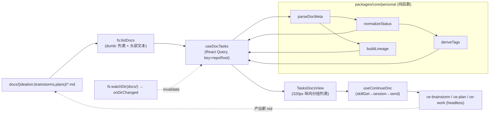

# feat: 右栏 Tasks 面板聚合 docs 文档 — DocMeta 解析 / 状态归一 / 标签分类 / 血缘 / 继续动作

## Summary

把 ce-ideate / ce-brainstorm / ce-plan 生成、落在 `docs/{ideation,brainstorms,plans}/*.md` 的文档，聚合进既有右侧面板 `PersonalRightPanel` 的 "Tasks" 视图（`rightView:"todos"`）。新增一个 core 纯函数解析层：把两套元数据编码（YAML `---` 块 / `# 标题`下的 inline `- 字段：值` 块）+ 文件名兜底归一为 `DocMeta`，再归一状态、派生多维标签、按 `origin` 串血缘；新增一个 dumb 的 `fs:listDocs` IPC 只负责列目录 + 回传文件头部文本；UI 端以 320px 纵向状态分组列表渲染，卡片可触发下一步 skill（复用闪记深化的 headless 调用范式）。

落实 origin ideation 文档的全部 6 条 idea（#1 解析器 / #2 状态词表 / #3 标签 / #4 血缘 / #5 纵向分组列表 / #6 继续动作）。

**已确认范围决策（origin 之外、本计划新增）：**
- 右栏「Tasks」视图**替换**既有 `TodosView`（其扫描 `tasks/` 目录 + 客户端 todos 的渲染被取代；底层 Zustand `todos` 数据结构保留不动，只是该视图不再渲染它）。
- **不纳入** checkbox→`TodoMeta` 注入与 watcher 同步那一支（origin idea 提及但留作后续）。
- 「继续」动作**只读不回写**源文档 frontmatter 状态——状态纯由源数据派生。

---

## Problem Frame

三类 skill 产物各居一目录、各有元数据约定，但桌面端**无统一浏览/继续入口**，用户要在文件树里逐个翻。具体障碍（均经 origin 实测，见 `docs/ideation/2026-06-17-tasks-panel-doc-status-tags.md`）：

1. **元数据双编码**：一类是 `---` YAML frontmatter（`status: completed/active/ready`），一类是 `# 标题`下的 inline 列表（`- 状态：待执行（U0 spike 已完成）`），中英文冒号都有。现有解析器（`packages/views/cortex-desktop/personal/markdownFrontmatter.ts` 的 `splitFrontmatter`、`apps/desktop/src/main/skills/frontmatter.ts` 的 `parseFrontmatter`）**只解析 YAML 块**，不处理 inline 块、不做文件名兜底。
2. **状态是多语种自由文本**，非枚举：`completed / active / ready / 待执行 / 待评审 / ∅`，还带括号补注，无法直接驱动看板/筛选。
3. **缺 status 字段的文件**（如 `flash-notes-plan`）无从判断进度。
4. **`origin` 把 ideation→brainstorm→plan 串成血缘**，但无 UI 聚合呈现。
5. **没有列 `docs/{ideation,brainstorms,plans}` 的桥能力**：`bridge.listTaskFiles` 路径写死 `tasks/`（`apps/desktop/src/main/ipc/fs.ts:529-531`），`scanDirTree` 递归全树偏重。
6. 「继续这些文档」的能力散落在闪记卡片逻辑里，未抽象为面板级、面向任意 doc 的动作。

---

## Requirements

| R-ID | 需求 | 来源 idea |
|---|---|---|
| R1 | 纯函数把双编码 + 文件名兜底归一为 `DocMeta`，解析失败不吞正文、不抛 | #1 |
| R2 | 自由文本状态归一为 `TaskStatus` 五态枚举，词表可扩、保留原文、kind 兜底 | #2 |
| R3 | 从 `DocMeta` 派生阶段/类型/主题域/深度四维标签 | #3 |
| R4 | 解析 `origin` 构血缘，按 basename 容错匹配，孤儿平铺 | #4 |
| R5 | 新增 `fs:listDocs` 列三目录顶层 `.md` + 头部文本 + mtime，bridge/preload/类型四处同步 | #1/#5 |
| R6 | React Query hook 聚合上述，key 按**仓库根**命名空间（**不含 wsId**），watch `docs/` 变更触发 invalidation | #5 |
| R7 | 320px 纵向状态分组可折叠列表 + 标签筛选 chip + 点击复用既有 Markdown 详情；替换 `TodosView` | #5 |
| R8 | 血缘流水线卡聚合呈现 | #4 |
| R9 | 卡片按 kind 路由下一步 skill（ideation→brainstorm→plan→work），复用 headless 范式，只读不回写 | #6 |

---

## Key Technical Decisions

**KTD1 — 解析全部落在 core 纯函数，IPC 保持 dumb。**
`parseDocMeta` / `normalizeStatus` / `deriveTags` / `buildLineage` 均为 `packages/core/personal/` 下的纯函数，输入是已读到的文本/记录，无 IO、就近写 `*.test.ts`，符合 core 不依赖 `process.env`/`localStorage` 的硬边界。`fs:listDocs` 只列目录 + 回传**头部文本**，不做任何语义解析。理由：状态/标签/血缘逻辑最易回归，必须可表驱动单测；最同构的既有参照是 `packages/core/personal/taskArchive.ts`（「列目录结果 → 分组」纯函数）。

**KTD2 — `listDocs` 只回传文件头部，不回传全文。**
frontmatter（YAML 块或 inline 块）都在文件头部，解析只需前 ~80 行。新 IPC 对每个文件读头部切片（如前 4KB）即可，避免对 ~20 个文档各发一次全量 `readFile`。详情态展示时才用既有 `bridge.readFile` 读全文。

**KTD3 — query key 按仓库根命名空间，绝不含 wsId。**
桌面端无 wsId 概念（`packages/core/personal/notes.ts` 头注：`useWorkspaceId` 返回占位值、闪记用 `projectId` 命名空间）。`docs/` 是**仓库级**资源（origin 否决项 R4 已明确），key 以仓库根路径（或 `"no-project"` 占位）命名。**这修正了 origin ideation 文档里「query key 含 wsId」的表述**——CLAUDE.md「key 必须含 wsId」是面向多 workspace 的 Web 业务态，桌面 docs 面板不适用。

**KTD4 — 「Tasks」视图替换 `TodosView`（已确认）。**
`rightView:"todos"` 渲染分支（`packages/views/cortex-desktop/personal/PersonalRightPanel.tsx:96-104`）改渲染新组件 `TasksDocsView`；标题表保留 `todos:"Tasks"`。既有 `TodosView` 扫描 `tasks/` 目录 + 客户端 todos 的渲染被取代。Zustand `todos`/`projects` 数据结构与相关 store action **保持不动**（仅本视图不再消费），把爆炸半径压到只换渲染。

**KTD5 — 继续动作复用闪记 headless 范式，严守顺序、只读不回写。**
`useContinueDoc` 仿 `useDeepenNotes`(`notes.ts:382`)/`useGeneratePlan`(`notes.ts:482`)：`bridge.skillGet(name)` → `createSession` 拿 id → **用 id 拼 outPath/systemPrompt** → `usePersonalActions().send(...)` 注入首条（KTD：不绕过 send 直接 setState）→ 成功仅 `invalidateQueries`。顺序硬约束：outPath 依赖会话 id，必须先建会话。**不写回源 doc 的 status**。注：`notes.ts` 现仅有 `deepenDocPath`/`planDocPath`，无 brainstorm 路径助手，需新增 `brainstormDocPath`。

**KTD6 — 状态归一：剥括号补注 → 小写 → 词表匹配 → kind 兜底 → 留原文。**
`normalizeStatus(raw, kind)`：先 `raw.replace(/（.*?）|\(.*?\)/g,"").trim().toLowerCase()`，查同义词表（中英混合）；命中失败按 kind 落默认（plan→`todo`，brainstorm/ideation→`idea`）并保留 `statusRaw` 供 UI tooltip。

**KTD7 — 血缘按 basename 容错匹配。**
`origin` 文本不规范（路径 + § 章节 + 自由说明 + `null`/`无 brainstorm` 混写）。从中正则抽 `docs/...md` 片段后，按 **basename** 在已扫描集合内匹配父节点，容忍相对/绝对差异；抽不到的不当「文件缺失」处理（`docs/lessons.md:84-94` ENOENT 教训）。

---

## High-Level Technical Design

数据流（单向）：



状态归一映射（KTD6 词表）：

| 规范态 `TaskStatus` | 命中词（去补注 + 小写后） |
|---|---|
| `done` | completed, done, 已完成, 已落地 |
| `active` | active, in-progress, 进行中, 实现中 |
| `review` | 待评审, review, in-review |
| `todo` | ready, 待执行, planned, todo；**plan 类且无 status** |
| `idea` | ideation/brainstorm 类默认（未进入 plan） |

`DocMeta` 形状（core 内部类型，**不过 IPC、无需镜像**）：

```
DocKind   = "ideation" | "brainstorm" | "plan"
TaskStatus= "idea" | "todo" | "review" | "active" | "done"
DocMeta {
  path: string         // repo-relative
  name: string
  kind: DocKind        // 由所在目录决定（最权威）
  title: string        // frontmatter title → # 标题 → slug 兜底
  type?: string        // feat/fix/chore/docs/style
  status: TaskStatus
  statusRaw?: string   // 归一失败时保留原文
  date?: string
  seq?: number         // 文件名序号
  depth?: string       // Deep/Standard（仅 plan inline）
  topic?: string
  origin: string[]     // 抽出的 docs/...md 片段（basename 容错）
  mtimeMs: number
}
```

`DocFileRaw`（**过 IPC，需 main↔core 类型镜像**）：`{ path: string; name: string; kind: DocKind; mtimeMs: number; head: string }`。

---

## Output Structure

```
packages/core/personal/
  docMeta.ts            (新) parseDocMeta + DocMeta/DocKind/TaskStatus 类型
  docMeta.test.ts       (新)
  docStatus.ts          (新) normalizeStatus + 词表
  docStatus.test.ts     (新)
  docTags.ts            (新) deriveTags
  docTags.test.ts       (新)
  docLineage.ts         (新) buildLineage
  docLineage.test.ts    (新)
  docTasks.ts           (新) useDocTasks 查询 hook + useContinueDoc + brainstormDocPath
packages/views/cortex-desktop/personal/
  TasksDocsView.tsx     (新) 320px 纵向分组列表 + 标签 chip + 血缘卡 + 继续按钮 + 详情
  TasksDocsView.test.tsx(新)
apps/desktop/src/main/ipc/
  fs.ts                 (改) 新增 fs:listDocs handler
apps/desktop/src/main/ipc/types.ts   (改) DocFileRaw + listDocs 契约
apps/desktop/src/preload/index.ts    (改) 暴露 fs:listDocs
packages/core/desktop/bridge.ts      (改) listDocs? 可选方法
packages/core/desktop/types.ts       (改) DocFileRaw 镜像
packages/core/index.ts / package.json(改) exports 暴露新模块
packages/views/cortex-desktop/personal/PersonalRightPanel.tsx (改) todos 分支改渲染 TasksDocsView
```

---

## Implementation Units

> 分四阶段：数据层（U1-U4，纯函数先行可独立测）→ 桥/IPC（U5）→ 查询与动作（U6-U7）→ UI（U8-U9）。

### U1. `parseDocMeta` 双编码 + 文件名兜底解析器

**Goal:** 把单个文档的头部文本 + 路径归一为 `DocMeta`（不含 status 归一/标签/血缘的下游加工，仅原始字段抽取 + kind/title/origin/type/date/seq/depth）。

**Requirements:** R1

**Dependencies:** 无

**Files:**
- `packages/core/personal/docMeta.ts`（新）
- `packages/core/personal/docMeta.test.ts`（新）

**Approach:** 三级抽取，优先级递降：(a) 文本以 `---` 独占行开头 → 解析 YAML 平铺块（复用 `packages/views/cortex-desktop/personal/markdownFrontmatter.ts` `splitFrontmatter` 的「仅 `---` 独占行才认定 / 失败原样返回正文不吞」语义，但解析器需落 core，不能 import views；按需把该语义在 core 内重写或抽共享）；(b) 否则扫描 `# 标题`后、首个空行前的 `- 字段：值` / `- 字段: 值`（兼容中英文冒号 `：:`）；(c) 仍缺的字段从文件名正则兜底 `/^(\d{4}-\d{2}-\d{2})-(\d{3})-(feat|fix|chore|docs|style)-(.+)-(plan|deepen|brainstorm)\.md$/`。`kind` 由调用方传入（来自目录，最权威），title 取 frontmatter `title` → 首个 `# ` 行 → slug。`origin` 原样收集字符串（抽路径留给 U4）。解析任何异常都返回一个 status 待 U2 处理的 `DocMeta`，绝不抛。

**Patterns to follow:** `packages/core/personal/taskArchive.ts`（列目录结果→纯函数加工）；`markdownFrontmatter.ts` 的容错语义。

**Test scenarios:**
- YAML 编码：`2026-06-14-001-...-plan.md` 头部 → 正确抽 `title/type:feat/status:completed/date`。
- inline 编码：`2026-06-17-002-...-robustness-plan.md` 头部 → 抽 `类型:feat/origin/状态/深度`，中文冒号生效。
- 混合冒号：inline 用英文 `:` 也能命中。
- 无 frontmatter 无 inline：纯靠文件名兜底，正确还原 `date/seq/type/kind`。
- `title` 三级兜底：无 frontmatter title 时取 `# ` 行；无 `# ` 行时取 slug。
- 损坏输入（只有半个 `---`、空文件、二进制噪声）：不抛，返回带 kind 的最小 `DocMeta`，正文不丢。
- `origin` 多形态（`docs/...md`、`null` 字面量、`无 brainstorm`、路径+§章节）：原样收集为字符串数组。

**Verification:** `docMeta.test.ts` 全绿；用本仓真实 `docs/` 文件（含本计划与 origin ideation 文档）作夹具均解析成功。

---

### U2. `normalizeStatus` 状态归一词表

**Goal:** 把自由文本 status + kind 归一为 `TaskStatus` 五态，保留原文。

**Requirements:** R2

**Dependencies:** U1（消费 `DocMeta.statusRaw`/`kind`）

**Files:**
- `packages/core/personal/docStatus.ts`（新）
- `packages/core/personal/docStatus.test.ts`（新）

**Approach:** 见 KTD6。导出 `TaskStatus` 枚举、同义词表常量（便于扩展与测试）、`normalizeStatus(raw, kind)`。剥括号补注（中英括号）→ trim → toLowerCase → 查表 → 失败按 kind 兜底并回填 `statusRaw`。

**Patterns to follow:** core 纯函数 + 常量表外置。

**Test scenarios:**
- 各规范态命中：`completed→done`、`active→active`、`待评审→review`、`待执行→todo`、`ready→todo`。
- 带补注：`待执行（U0 spike 已完成）→todo` 且 `statusRaw` 保留原文。
- plan 无 status 字段 → `todo`；ideation/brainstorm 无 status → `idea`。
- 未知值（如 `blocked`）→ 按 kind 兜底 + `statusRaw="blocked"`。
- 大小写/空白鲁棒：`  Completed  → done`。

**Verification:** `docStatus.test.ts` 全绿，覆盖全部实测值域 `{completed,active,ready,待执行,待评审,∅}`。

---

### U3. `deriveTags` 多维标签派生

**Goal:** 从 `DocMeta` 派生四维标签：阶段（kind）/ 类型（type）/ 主题域（topic|slug 聚类）/ 深度（depth）。

**Requirements:** R3

**Dependencies:** U1

**Files:**
- `packages/core/personal/docTags.ts`（新）
- `packages/core/personal/docTags.test.ts`（新）

**Approach:** `deriveTags(doc): Tag[]`，每个 `Tag = { dim: "stage"|"type"|"topic"|"depth", value, label }`。阶段：`ideation→💡构思 / brainstorm→📋需求 / plan→📐计划`。类型：直出 `feat/fix/...`。主题域：优先 `topic` 字段，否则按 slug 公共前缀启发式归并（`pi-rpc-*`/`personal-*`/`flash-note*` 等明显簇）。深度：仅 plan 有 inline `depth` 时出。缺字段的维度不产标签。

**Patterns to follow:** 纯函数；标签维度枚举外置便于 UI 复用。

**Test scenarios:**
- 阶段标签由 kind 正确映射三类。
- 类型标签从 `feat/fix` 正确派生；无 type 时不产该维标签。
- 主题域：有 `topic` 用 topic；无 topic 时 `pi-rpc-renderer`/`pi-rpc-robustness` 聚为同一 `pi` 簇。
- 深度：plan 有 `Deep` 出标签；ideation/brainstorm 不出深度标签。
- 全字段缺失的最小 DocMeta：仅出阶段标签（kind 恒有）。

**Verification:** `docTags.test.ts` 全绿。

---

### U4. `buildLineage` origin 血缘构建

**Goal:** 把 `DocMeta[]` 构成血缘森林：解析 origin → basename 容错连边 → 输出「流水线组 + 孤儿」结构。

**Requirements:** R4

**Dependencies:** U1

**Files:**
- `packages/core/personal/docLineage.ts`（新）
- `packages/core/personal/docLineage.test.ts`（新）

**Approach:** `buildLineage(docs): { pipelines: DocMeta[][]; orphans: DocMeta[] }`。对每个 doc 的 `origin[]` 正则抽 `docs/[^\s)]+\.md` 片段，取 basename，在集合内按 basename 匹配父节点（容相对/绝对差异，KTD7）；并查链，把同一条链折叠为有序数组（ideation→brainstorm→plan 方向）；无任何入边出边的为孤儿。多 origin（如同时引文件 + understand 简报）取能匹配到的文件边，匹配不到的忽略不报错。

**Patterns to follow:** 纯函数图构建；`docs/lessons.md:84-94` ENOENT 容错心智。

**Test scenarios:**
- 单链：`shanji-notes-requirements.md ← flash-notes-plan.md`（plan.origin 指向 brainstorm）正确成对。
- 多子同父：`pi-rpc-session-plan` 被 renderer/extension/robustness 三个 plan 的 origin 指向 → 一棵树。
- ideation→plan 跨类型：`sess-...-deepen.md ← sess-...-plan.md`。
- origin 抽不到文件路径（`无 brainstorm`/understand 简报）→ 该 doc 入孤儿，不抛。
- basename 容错：origin 写绝对/相对/带 §章节，均按 basename 命中。
- 无任何 origin 的集合 → 全部孤儿。

**Verification:** `docLineage.test.ts` 全绿，用本仓真实 origin 链作夹具。

---

### U5. `fs:listDocs` IPC + 桥/类型四处同步

**Goal:** 新增列 `docs/{ideation,brainstorms,plans}` 顶层 `.md`（含 kind、mtime、头部文本）的桥能力。

**Requirements:** R5

**Dependencies:** 无（与 U1-U4 并行）

**Files:**
- `apps/desktop/src/main/ipc/fs.ts`（改，新增 handler）
- `apps/desktop/src/main/ipc/types.ts`（改，`DocFileRaw` + `listDocs` 契约）
- `apps/desktop/src/preload/index.ts`（改，暴露 `fs:listDocs`）
- `packages/core/desktop/bridge.ts`（改，`listDocs?(projectRoot): Promise<DocFileRaw[]>` 可选方法）
- `packages/core/desktop/types.ts`（改，`DocFileRaw` 镜像 + 注释「与 main/ipc/types.ts 逐字镜像」）

**Approach:** 仿 `fs.ts:507` `listTaskFiles` 但遍历三个固定子目录 `docs/ideation|brainstorms|plans`；每文件 `stat` 取 mtime，读头部切片（如前 4KB / 80 行）作 `head`，`kind` 由所在子目录决定。目录不存在则跳过（不报错）。handler 加在 `fs.ts` 内即随 `registerFsHandlers` 生效，无需改 `register.ts`。preload 仿 `index.ts:99` `fs:listTaskFiles` 暴露。bridge 方法标可选（Web 端为 null），core/views 永不直接碰 `window.desktopAPI`。

**Patterns to follow:** `fs.ts` `listTaskFiles`（:507）、`TaskFilesResult`/`TaskFileInfo` 形状（`types.ts:886-897`）、preload `index.ts:99`、bridge `watchDir?` 可选方法风格。

**Test scenarios:** `Test expectation: none — 主进程 IPC 桥接层，按团队约定（实现+自动化测试归 Claude、跨进程 IO 由用户手动验证）不写单测；正确性由 U6 hook 集成与用户手动验证覆盖。`（头部切片大小、子目录缺失跳过的边界在 U6 集成中以 mock bridge 间接覆盖）

**Verification:** 桌面端运行时 `bridge.listDocs(repoRoot)` 返回三类文件、kind 正确、head 含 frontmatter；目录缺失不崩。

---

### U6. `useDocTasks` 聚合查询 hook + watch invalidation

**Goal:** React Query hook：`listDocs` → 逐文件 `parseDocMeta`→`normalizeStatus`→`deriveTags`，整体 `buildLineage`，订阅 `docs/` 变更 invalidation。

**Requirements:** R6

**Dependencies:** U1, U2, U3, U4, U5

**Files:**
- `packages/core/personal/docTasks.ts`（新，含 query key 工厂 + `useDocTasks`）
- `packages/core/personal/docTasks.test.ts`（新，测 key 工厂 + 纯组装函数；hook 本身不强测）

**Approach:** query key 以**仓库根路径**命名（KTD3，**不含 wsId**；无项目用 `"no-project"` 占位）。`queryFn`：`bridge.listDocs(root)` → 对每项 `parseDocMeta(item.head, item.path, item.kind)` → `normalizeStatus` 回填 → `deriveTags` 附加 → 数组整体 `buildLineage`，返回 `{ docs: DocMetaView[]; pipelines; orphans }`。`bridge==null`（Web）时 `enabled:false`。订阅既有 `bridge.onDirChanged`（watchId=`docs:<root>`）+ `bridge.watchDir(id, "<root>/docs")`，事件回调**只 `invalidateQueries`**（不 setQueryData、不写 Zustand）。`staleTime:Infinity` + `refetchOnWindowFocus:true` 兜底丢事件。

**Patterns to follow:** `notes.ts` `useAllNotes`(:306)/`useNotesChangeSubscription`(:360-369)；`TodosView` 的 `watchDir`/`onDirChanged` 用法(:704-716)；`live/queries.ts` 的 key 工厂 + options 风格（但 key 用 root 非 wsId）。

**Test scenarios:**
- key 工厂：同一 root 稳定、不同 root 隔离、`"no-project"` 占位生效。
- 组装纯函数（抽出 `assembleDocTasks(rawList)` 便于测）：给定 mock `DocFileRaw[]` → 正确产出含状态/标签/血缘的聚合结果。
- `bridge==null` → hook `enabled:false`，不发请求。
- 事件回调触发 invalidation（mock `qc.invalidateQueries` 被调用），不直接写缓存。

**Verification:** `docTasks.test.ts` 全绿；桌面端运行时新增/改动 `docs/*.md` 后列表自动刷新。

---

### U7. `useContinueDoc` 继续动作（headless skill 路由）

**Goal:** 按文档 kind 路由下一步 skill 的 mutation hook，只读不回写。

**Requirements:** R9

**Dependencies:** U5（`brainstormDocPath` 与产出探测）；复用 `notes.ts` 既有范式

**Files:**
- `packages/core/personal/docTasks.ts`（改/扩，加 `useContinueDoc` + `brainstormDocPath` + 纯函数 `nextSkillForKind`）
- `packages/core/personal/docTasks.test.ts`（改，测 `nextSkillForKind` + 路径助手）

**Approach:** `nextSkillForKind(kind)` 纯映射：`ideation→ce-brainstorm`、`brainstorm→ce-plan`、`plan→ce-work`。`useContinueDoc(doc)`：`bridge.skillGet(skill)` → `createSession` 拿 id → 用 id 拼 `outPath`（新增 `brainstormDocPath(cwd,id)→docs/brainstorms/<id>-...md`，复用 `deepenDocPath`/`planDocPath` 风格）→ 拼 headless system prompt（注入 skill 元数据 + skillMdPath + 降格约束 + 给死 outPath + 把源 doc 路径作为输入让 agent `Read`）→ `usePersonalActions().send(...)` 注入首条 → 成功仅 `invalidateQueries(docTasksKeys)`。严守「先建会话→拼 outPath/prompt→send」顺序。**不修改源 doc frontmatter**。

**Execution note:** 先为 `nextSkillForKind` 与 `brainstormDocPath` 写失败测试，再接副作用编排。

**Patterns to follow:** `notes.ts` `useDeepenNotes`(:382)/`useGeneratePlan`(:482)/`buildPlanSystemPrompt`(:165)/`deepenDocPath`/`planDocPath`(:121/127)。严守 KTD4 send 范式与顺序约束。

**Test scenarios:**
- `nextSkillForKind`：三类 kind → 正确 skill 名；plan→`ce-work`。
- `brainstormDocPath(cwd,id)` 路径形如 `docs/brainstorms/<id>-...md`，与既有助手风格一致。
- skill 缺失（`skillGet` 返回空）→ 早退不建会话（仿 `useDeepenNotes` L430）。
- 顺序约束：会话 id 先于 outPath/prompt 构造（以调用序断言）。
- 不回写：mutation 路径中无对源 doc 的 `writeFile`/frontmatter 改写调用。

**Verification:** `docTasks.test.ts` 全绿；桌面端从 brainstorm 卡点「生成 Plan」能起 headless 会话并最终在 `docs/plans/` 落文件。

---

### U8. `TasksDocsView` — 纵向状态分组列表 + 标签筛选 + 详情

**Goal:** 320px 右栏新视图：按规范状态分组的可折叠纵向列表 + 顶部标签筛选 chip + 卡片点击进详情；替换 `TodosView`。

**Requirements:** R7

**Dependencies:** U6（数据源）

**Files:**
- `packages/views/cortex-desktop/personal/TasksDocsView.tsx`（新）
- `packages/views/cortex-desktop/personal/TasksDocsView.test.tsx`（新）
- `packages/views/cortex-desktop/personal/PersonalRightPanel.tsx`（改，`todos` 分支渲染 `TasksDocsView`）
- `packages/views/cortex-desktop/cortex-desktop.css`（改，分组/卡片/chip 样式，沿用现有右栏样式令牌）

**Approach:** 消费 `useDocTasks`。布局：状态为可折叠分组头（`▾ 待执行 (4)` …，`done` 组默认折叠）；组内纵向卡（阶段标签 + 类型标签 + 标题 + 相对日期）。顶部一行标签 chip（阶段/类型/主题域多选，320px 内换行或横滚）。点击卡 → 切右栏详情态（拖宽生效）复用既有 `MarkdownDetail`（`TodosView.tsx:38-174` 读法 `bridge.readFile`）。固定 320px 由 CSS 控制（沿用现注释语义，不在组件写死）。`PersonalRightPanel.tsx:96-104` 的 `view==="todos"` 分支由 `TodosView` 改为 `TasksDocsView`，标题表 `todos:"Tasks"` 不变。

**Patterns to follow:** `TodosView.tsx`（列表/详情/`MarkdownDetail` 模板）；`PersonalRightPanel.tsx` 渲染分支与宽度机制；现有 CSS 右栏令牌。

**Test scenarios:**
- 给 mock 聚合数据 → 渲染出正确的状态分组与组内计数。
- `done` 组默认折叠、点击展开/收起。
- 标签 chip 多选筛选：选「📐计划 + feat」只剩匹配卡。
- 空态（无任何 docs）→ 友好空提示，不崩。
- 点击卡触发详情态（断言 `setRightView`/详情打开回调或 `requestTaskDetail` 等价路径被调）。
- `bridge==null`（Web）→ 渲染降级占位，不调用桥。
- Covers R7 / #5：320px 下不出现横向看板布局（纵向分组）。

**Verification:** `TasksDocsView.test.tsx` 全绿；视觉（分组/折叠/chip/详情切换/320px 适配）由用户手动验证。

---

### U9. 血缘流水线卡 + 卡片继续按钮

**Goal:** 在 `TasksDocsView` 内呈现 origin 血缘（流水线折叠卡）并为卡片按 kind 出「继续」按钮。

**Requirements:** R8, R9

**Dependencies:** U4（血缘数据）, U7（继续动作）, U8（承载视图）

**Files:**
- `packages/views/cortex-desktop/personal/TasksDocsView.tsx`（改/扩）
- `packages/views/cortex-desktop/personal/TasksDocsView.test.tsx`（改/扩）

**Approach:** 提供「血缘视图」开关：开启时把 `pipelines`（U6 输出）折叠为可展开流水线卡（节点状态用规范态着色，方向 ideation→brainstorm→plan），孤儿平铺；关闭时回到 U8 的纯状态分组。每卡按 `nextSkillForKind(kind)` 出按钮：ideation→「生成 Brainstorm」、brainstorm→「生成 Plan」、plan→「开始实现」，点击调 `useContinueDoc`；任意卡有「打开文档」。进行中/已完成态可禁用对应继续按钮（纯展示态判断）。

**Patterns to follow:** U8 卡片结构；`notes.ts` 触发 hook 的 UI 调用方式（闪记卡的深化/生成按钮）。

**Test scenarios:**
- 血缘开关：开启渲染流水线卡（同一链节点聚合），关闭回分组列表。
- 流水线节点按规范态着色（断言状态 class/标记）。
- 继续按钮按 kind 出正确文案与目标 skill（点击触发 `useContinueDoc` mock 被调，参数含本 doc）。
- 孤儿文档在血缘视图平铺、不入任何流水线卡。
- 状态门控：已完成 plan 的「开始实现」按钮禁用（或隐藏）。
- Covers R8 / #4 + R9 / #6。

**Verification:** `TasksDocsView.test.tsx` 全绿；血缘聚合与继续动作端到端（点 brainstorm 卡 → 起会话 → 落 plan 文件）由用户手动验证。

---

## Scope Boundaries

**In scope:** origin 6 条 idea（解析器 / 状态词表 / 标签 / 血缘 / 纵向分组列表 / 继续动作）；替换 `TodosView`；新增 `fs:listDocs`。

### Deferred to Follow-Up Work
- **checkbox→`TodoMeta` 注入 + watcher 同步 done**（origin ideation idea #2/#3 的细粒度 todo 分支）：本计划只做文档级 `DocMeta`，不碰 plan.md 内 checkbox 级 todo。
- **继续动作回写源文档 status**：当前只读派生；未来可在产出探测成功后回写源 doc frontmatter（需先定多编码安全回写策略）。
- **git diff 推断 todo 落地 / 待确认态**（origin idea #7）。
- **跨项目聚合**（origin 否决项 R4）：docs 是仓库级，跨项目是独立议题。
- **`docs/lessons.md` 沉淀**：落地后补「桌面端 docs 面板不用 wsId」「DocMeta 双编码解析约定」两条。

---

## System-Wide Impact

- **既有「Tasks」视图行为变更**：`TodosView` 扫描 `tasks/` 目录 + 客户端 todos 的渲染被取代（KTD4）。受影响者：依赖右栏看 `tasks/*.md` 的用户。Zustand `todos` 数据与 store action 不动，可随时回切或后续并存。
- **类型镜像**：`DocFileRaw` 须 `apps/desktop/src/main/ipc/types.ts` 与 `packages/core/desktop/types.ts` 逐字镜像（U5）。
- **exports/barrel**：新 core 模块须同步 `packages/core/package.json` exports 与 `packages/core/index.ts` barrel（U6/U7）。
- **Web 端降级**：`bridge==null` 时面板与继续动作须兜底（U6/U8）。

---

## Risks & Dependencies

| 风险 | 影响 | 缓解 |
|---|---|---|
| 替换 `TodosView` 移除既有 `tasks/` 列表能力 | 用户既有用法回归 | 已确认替换；Zustand 数据保留，必要时低成本回切/并存 |
| inline 块解析歧义（嵌套/多行值/异常补注） | 解析错字段 | U1 仅扫「标题后首空行前」窄区；表驱动测试覆盖损坏输入；失败不吞正文 |
| 主题域 slug 聚类启发式误并/漏并 | 标签分类不准 | 优先用显式 `topic` 字段；slug 簇仅兜底；维度可关 |
| origin 文本不规范导致血缘错连 | 流水线卡错误聚合 | basename 容错匹配 + 抽不到即孤儿（KTD7、ENOENT 教训） |
| 继续动作复用闪记 send 范式的顺序约束被违反 | 首条丢失/会话错乱 | 严守「建会话→outPath→prompt→send」（U7 测试断言调用序） |
| `listDocs` 头部切片过小漏掉靠后的 inline 块 | 字段缺失 | 切片取足够大（≥80 行/4KB）；inline 块紧跟标题，风险低 |

---

## Sources & Research

- Origin ideation：`docs/ideation/2026-06-17-tasks-panel-doc-status-tags.md`（6 idea + 4 否决 + 实测元数据）。
- 既有解析器参照：`packages/views/cortex-desktop/personal/markdownFrontmatter.ts`、`apps/desktop/src/main/skills/frontmatter.ts`。
- 列目录/详情/watch 模板：`packages/views/cortex-desktop/personal/TodosView.tsx`、`apps/desktop/src/main/ipc/fs.ts:507`、`apps/desktop/src/main/ipc/watch.ts`。
- skill 路由范式：`packages/core/personal/notes.ts`（`useDeepenNotes`/`useGeneratePlan`/`buildPlanSystemPrompt`/`deepenStateTransition`/`applyDeepenFinalize`）。
- 右栏/store：`packages/views/cortex-desktop/personal/PersonalRightPanel.tsx`、`packages/core/store/personal.ts`。
- wsId 反面教材（桌面端不用 wsId）：`packages/core/personal/notes.ts` 头注。
- ENOENT 容错教训：`docs/lessons.md:84-94`。
- 测试参照：`packages/core/personal/notes.test.ts`、`packages/core/personal/taskArchive.test.ts`。
