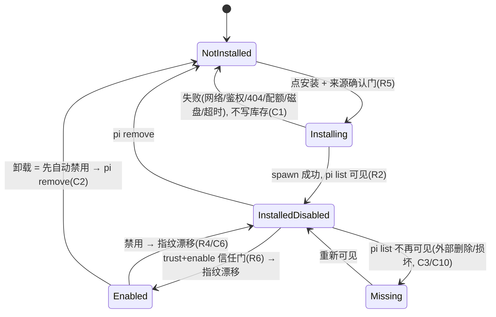
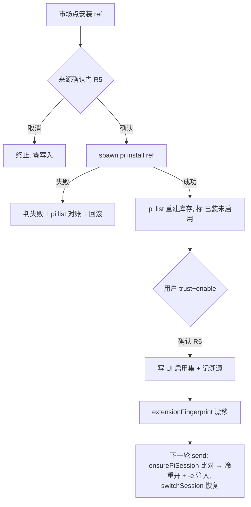

# feat: 用 pi 原生 `pi install` 实现扩展市场安装机制

## Summary

在 `apps/desktop` 新增一条扩展安装机制：把 pi 二进制的 `install`/`list`/`remove` 当惰性下载运行时，市场负责策展、信任与 UI。范围限**扩展**（npm/git 包），技能保留既有 download 路径。装上≠启用——`pi install` 只下载入库，用户显式 trust+enable 后才经 `-e` 注入、靠 `extensionFingerprint` 漂移在下一轮会话生效；UI 是启用集唯一真相源，pi 自己的 `settings.json` 仅作库存来源。一条自建 importer 回退（R8）保留为应急契约，由前置验证结论触发才实现。

## Problem Frame

用户想「通过应用市场安装工具」。pi 的「工具」即扩展（`registerTool`/`registerCommand`，经 `package.json` 的 `pi.extensions` 声明），而扩展在本仓库当前**完全没有分发通道**——是 `apps/desktop/src/main/agents/pi-extensions.ts` 里写死模板、本地代码生成、写到固定文件名的 0600 JS（`writeExtension`，`pi-extensions.ts:161`）。技能有 `<name>/SKILL.md` 目录分发雏形（`apps/desktop/src/main/skills/download.ts` 存根 + Go importer 蓝本），扩展一条都没有。

pi 官方提供 `pi install npm:/git:` 与 `settings.json` 的 `packages[]`，且本地 spike（pi 0.79.2）已确认：`pi install` 不跑生命周期脚本、本地源不解析依赖、落盘 `~/.pi/agent/settings.json`（`-l` 则 `.pi/settings.json`）、`pi list`/`pi config` 原生分离装与启用（见 origin: `docs/brainstorms/2026-06-17-pi-install-extension-runtime-requirements.md` Sources）。借力它即可省掉自建下载/依赖/校验栈，但必须不破坏本仓库「UI 为启用集唯一真相源 + 默认拒绝信任」的底色——`apps/desktop/src/main/agents/pi.ts:57` 起的 `--no-extensions --no-skills` 基线正是该底色。

---

## Requirements

承接 origin 的 R1–R8（见 origin 文档），本计划落点：

- R1. 安装经 `spawn(pi, ["install", <ref>])` 完成，宿主进程不 import pi 模块（沿用 `resolvePiBinary` + `spawn` 进程隔离）。→ U4
- R2. 安装产物入「已装库存」，与「已启用集」是两个独立状态；安装不使任何扩展进入启用集。→ U2, U5
- R3. 用户显式 trust+enable 后扩展才经 `-e` 注入；启用集真相源是宿主 UI/配置，非 pi 的 `settings.json`。→ U2, U5, U6
- R4. 启用/禁用须使 `extensionFingerprint` 漂移，触发会话 close-and-reopen 生效。→ U3, U5
- R5. `spawn pi install` 之前展示来源/版本确认门；拒绝则不安装。→ U6
- R6. 主信任门在启用/加载时刻（启用即 `-e` 注入即首次执行代码）；不依赖 `--ignore-scripts`（0.79.2 无此 flag、且安装不跑脚本）。→ U5, U6
- R7. 已装扩展记 version/source/installedAt/origin 溯源，`pi list` 为数据起点。→ U2, U4
- R8. 若前置验证不利（远程安装行为或共存不可接受），回退自建 importer（复用 `server/internal/handler/skill.go` 蓝本）。→ U1 触发，见 Scope Boundaries

---

## Key Technical Decisions

- **借力 pi install，不自建下载运行时。** spike 已确认 0.79.2 提供 `install/remove/update/list/config`，安装在 pi 自己进程内完成（`resolvePiBinary`，`apps/desktop/src/main/agents/pi-locate.ts:11`），与现有 `--mode json/rpc` 的 spawn 模型同构。仅当 U1 前置验证不利才触发 R8。
- **库存层不另存第二真相源，每次以 `pi list` 重建。** 对齐技能侧「每次重扫文件系统、无缓存」的做法（`apps/desktop/src/main/skills/registry.ts:scanRoot`）。UI 只额外持久化「启用集 + 信任 + 溯源」，按扩展唯一键（`源类型+包名`，非仅包名）关联；`pi list` 里消失的项在 UI 标「已失踪」而非静默移除启用记录。(C3)
- **扩展注入用独立的 `extensionPaths` 字段，并显式纳入 `extensionFingerprint`。** 不复用 `skillPaths`。`extensionFingerprint`（`packages/core/personal/pi-session.ts:86`）当前 hash `skillPaths`(已排序)/provider/审批开关等；新增 `extensionPaths`(排序后)进同一摘要，否则禁用静默不生效（该函数注释警告的「裸奔」）。(C6, R4)
- **启用集解析的 `-e` 路径是注入的唯一来源；绝不信任 pi 的 settings 自动发现。** 与 `apps/desktop/src/main/agents/pi.ts:57` 的 `--no-extensions` 基线一致——已装但未启用的扩展即便在 pi settings 里，也不得被加载。(C4, R3/R6)
- **v1 仅用户级安装，数据模型 scope-aware 以便无损扩到项目级。** `pi install -l`（项目级 `.pi/settings.json`）引入工作区信任攻击面（对照 `packages/core/desktop/types.ts:395` 技能侧的命名威胁）。v1 只做用户级（默认可信），但启用/信任集用复合键 `${scope}:${ref}` 记录、装配按当前 `projectPath` 过滤，使后续加项目级（默认不授信）不破坏数据结构。(C7)
- **安装是可失败异步事务，失败不写 UI 库存、并对账 settings。** spawn 非零退出或 stderr 即判失败；失败后调一次 `pi list` 校对，若 pi 半写入则 `pi remove` 回滚或标「待清理」。同一扩展安装在途去重、不同扩展安装串行化（回避并发写 `settings.json` 竞争）。(C1, C5)
- **卸载正在启用的扩展先自动禁用再 `pi remove`。** 移出启用集 → 指纹漂移 → 下一轮以不含该 `-e` 的新指纹冷重开；活跃会话当前轮不受影响。(C2)
- **启用/禁用只改持久启用集、不主动重开（惰性 debounce）。** `ensurePiSession`（`packages/core/personal/pi-session.ts:145`）在下次 send 时比对指纹一次性重开；连续启停只在下一轮 send 重开一次，免抖动。(C9)

---

## High-Level Technical Design

扩展生命周期状态机（库存层 + 启用层正交）：

安装 → 生效的数据流（注意「装上」与「生效」之间隔着一次会话冷重开）：

---

## Implementation Units

### U1. 前置验证（gating，可触发 R8）

- **Goal**：用真实网络/key 实测两条 origin Deferred-to-Planning 假设，决定继续 pi-install 路径还是触发 R8。
- **Requirements**：R8 的判据；origin 的两条 Deferred-to-Planning。
- **Dependencies**：无。**必须先于 U2–U7**。
- **Files**：无源码改动（验证活动，结论写回 origin/本计划的 Open Questions）。
- **Approach**：在隔离 HOME（`export HOME=$(mktemp -d)`，对齐已记录的 spike 方法）跑：①`pi install npm:<真实已发布扩展>` 与 `git:<repo>`，观察是否拉运行时依赖、依赖阶段是否跑 postinstall、远程包缓存落盘何处；②用真实 key 起一个 `--no-extensions` 会话，逐字确认已装包不被自动加载。注意远程安装会执行第三方代码，挑可信源。
- **Execution note**：这是 gating 验证单元，不写产品代码。任一硬性不满足（远程安装在依赖阶段跑不可信脚本、或 `--no-extensions` 未真正抑制自动发现）即停止 U2–U7、改走 R8 回退路径。
- **Test expectation: none** — 验证活动，结论为继续/回退的决策门。
- **Verification**：两条假设各得明确「成立/不成立」结论并记入 Open Questions；据此给出「继续 / R8」决定。

### U2. 扩展安装数据模型与启用集（types + store + 契约字段）

- **Goal**：定义已装扩展的库存项与持久化的启用/信任/溯源结构，并在请求契约里加 `extensionPaths`。
- **Requirements**：R2, R3, R7。
- **Dependencies**：U1（结论为「继续」）。
- **Files**：`packages/core/desktop/types.ts`（新增 `InstalledExtension` 库存类型 + `PiExtensionSettings` 启用/信任/溯源，镜像 `PiSkillSettings` 风格，`types.ts:397`/`412` 旁；`PiOpenRequest`/`CliStartRequest` 加内部填充字段 `extensionPaths?: string[]`）、`apps/desktop/src/main/ipc/types.ts`（同字段镜像，`types.ts:331` 的 `extraExtensionPaths` 旁）、`packages/core/store/personal.ts`（新增 setters：`toggleExtension(scope, ref, enabled)`/`trustExtension(scope, ref)`，复合键 `${scope}:${ref}`，沿用 `togglePiSkill` 的 `disabled`-集模式 `store/personal.ts:409`；`DEFAULT_PI_EXTENSIONS`）、`packages/core/desktop/types.ts` 的 `GeneralSettings` 加 `piExtensions?`。
- **Approach**：库存项不持久化（每次由 `pi list` 重建，U4 提供）；持久的只有 enabled/trusted/溯源，按 `${scope}:${ref}` 键。唯一键 `ref = 源类型+包名`（npm:foo 与 git:foo 视为两项）。
- **Patterns to follow**：`PiSkillSettings` + `DEFAULT_PI_SKILLS`（`packages/core/desktop/types.ts:397`/`412`）；store setter 整体写回 `generalSettings.piExtensions` 的模式（`store/personal.ts:409-454`）。
- **Test scenarios**：
  - Covers R3. `toggleExtension("global","npm:foo",true)` 后启用集含该键；再 `false` 后移除。
  - 复合键隔离：`npm:foo` 与 `git:foo` 互不影响。
  - `DEFAULT_PI_EXTENSIONS` 缺省合并：load 时 `{...DEFAULT, ...persisted}` 不丢字段。
  - 溯源字段（version/source/installedAt/origin）随启用记录持久化与读回。
- **Verification**：类型通过 `pnpm --filter @cortex-work/core typecheck`；store 单测覆盖上述场景。

### U3. extensionFingerprint 纳入 extensionPaths + 装配层解析

- **Goal**：让启用集的变化驱动会话重开；禁用真正生效（防裸奔）。
- **Requirements**：R3, R4, R6。
- **Dependencies**：U2。
- **Files**：`packages/core/personal/pi-session.ts`（`extensionFingerprint`，`pi-session.ts:86`：把已解析的 `extensionPaths`(排序)纳入摘要 JSON）、`packages/core/personal/messages.ts`（`resolveEnabledSkillPaths` 旁新增 `resolveEnabledExtensionPaths`，按启用集 + 信任 + 当前 `projectPath` 过滤产出 `-e` 路径，`messages.ts:960`）。
- **Approach**：注入的 `-e` 路径**只**来自启用集解析；pi settings 的自动发现不参与（与 `--no-extensions` 基线一致）。`extensionPaths` 排序后入指纹，保证顺序无关、内容变即漂移。
- **Patterns to follow**：`skillPaths` 在指纹里的排序处理（`pi-session.ts:86-112` 注释「已在装配层排序，此处再排序一次」）；`resolveEnabledSkillPaths` 的 workspace 过滤。
- **Test scenarios**：
  - Covers R4. 启用集增删一个扩展 → `extensionFingerprint` 输出变化。
  - 顺序无关：同一组 `extensionPaths` 不同顺序 → 指纹相同。
  - Covers R6（防裸奔）：禁用一个先前启用的扩展 → 指纹漂移（断言其 `-e` 不再出现在解析结果）。
  - 运行时态不入指纹：仅改 model/thinkingLevel 不致漂移（沿用现注释约定 `pi-session.ts:83-85`）。
  - 解析只取启用集：库存里未启用项不出现在 `resolveEnabledExtensionPaths` 结果。
- **Verification**：core 单测；`pnpm --filter @cortex-work/core test`。

### U4. pi 安装/列举/卸载 IPC + 四层契约联动

- **Goal**：主进程提供 install/list/remove 三动作，含失败回滚与在途去重；并跨四层暴露给渲染层。
- **Requirements**：R1, R7。
- **Dependencies**：U2。
- **Files**：新增 `apps/desktop/src/main/ipc/pi-extensions-market.ts`（handlers `pi-ext:install`/`pi-ext:list`/`pi-ext:remove`，`spawn(resolvePiBinary(), ["install"|"list"|"remove", ...])`，解析 stdout/退出码）、`apps/desktop/src/main/ipc/register.ts`（import + 在 `registerIpcHandlers` 注册，`register.ts:22-41`）、`apps/desktop/src/main/ipc/types.ts`（请求/响应类型）、`packages/core/desktop/types.ts`（镜像）、`packages/core/desktop/bridge.ts`（`DesktopBridge` 新增可选 `piExtInstall?`/`piExtList?`/`piExtRemove?`，`bridge.ts:253` 旁）、`apps/desktop/src/preload/index.ts`（暴露到 `window.desktopAPI.personal`）。
- **Approach**：`pi-ext:list` 解析 `pi list` 输出为 `InstalledExtension[]`（库存重建的唯一来源，C3）。`pi-ext:install` 串行化队列 + 同 ref 在途去重（对照 `pi-session.ts` 的 `opening` Promise 去重，C5）；失败（非零退出/stderr）不写库存、调一次 `pi list` 对账、半写入则 `pi remove` 回滚（C1）。env 复用 `spawnEnvFor`/`buildEnv`（`apps/desktop/src/main/ipc/cli.ts:109`），注意 HOME 继承 `process.env.HOME`——校验它与 pi 读 `~/.pi/agent/settings.json` 的路径一致（C7 串场防护）。v1 不传 `-l`（用户级）。
- **Patterns to follow**：`registerSkillsHandlers` 注册模式；`download.ts` 存根头注释的接入路径；`spawnPiRpc` 的 spawn + env 注入（`pi-rpc.ts:245`）；白名单/路径安全三件套（`skills.ts:39-43`）。
- **Test scenarios**：
  - Covers R1. install 成功 → 解析出库存项 + 写 pi settings；`pi-ext:list` 重建可见。
  - Covers R7. 库存项带 version/source/installedAt/origin。
  - 安装失败矩阵（C1）：网络断 / 401 / 404 不存在 ref / 配额限流 / 磁盘满 / spawn 超时被杀 —— 各断言不写 UI 库存、`pi list` 对账无半写入、可重试。
  - 在途去重（C5）：同 ref 重复点装只跑一次。
  - 串行化（C5）：并发装不同 ref 不并发写 `settings.json`。
  - remove：`pi-ext:remove` 后 `pi list` 不再含该项。
- **Verification**：主进程单测（注入 fake spawn，对照 `pi-rpc.ts` 的 `RpcTransport` 可注入测试模式）；`pnpm --filter @cortex-work/desktop typecheck`（node + web 两套）。

### U5. 安装/启用/禁用/卸载流程编排（core）

- **Goal**：把 IPC 动作与启用集/信任/指纹串成完整状态机，含库存对账、信任门、级联卸载、惰性重开。
- **Requirements**：R2, R3, R4, R6。
- **Dependencies**：U2, U3, U4。
- **Files**：`packages/core/personal/`（新增扩展市场的 hooks/编排，按仓库约定：服务端态走 React Query、客户端态走 Zustand store；库存查询用 `bridge.piExtList`，key 含 wsId）、`packages/core/store/personal.ts`（启用/禁用/信任 action 复用 U2 setters）。
- **Approach**：安装成功 → 触发库存查询失效重建（C3，以 `pi list` 为准）。启用 = 过信任门(R6) → 写启用集 + 记溯源 → 不主动重开（惰性，C9）。禁用 = 移出启用集（指纹下一轮漂移）。卸载 = 若在启用集先自动禁用，再 `pi-ext:remove`（C2）。`pi list` 失踪项标「已失踪」不删启用记录（C3）。
- **Patterns to follow**：仓库状态约定（`CLAUDE.md`：服务端态 React Query、query key 含 `wsId`；WebSocket 仅触发失效）；`resolveEnabledSkillPaths` 的启用集→注入路径流。
- **Test scenarios**：
  - Covers R2. 安装成功后库存标「已装未启用」，启用集不含它。
  - Covers R3/R6. 未过信任门的扩展绝不进启用集、绝不出现在 `-e` 解析。
  - 卸载在用扩展（C2）：活跃会话当前轮工具仍可用；自动禁用 → 下一轮重开后该扩展消失且会话不崩。
  - 双源对账（C3）：外部改 `settings.json` 后重建库存，失踪项标态而非误删启用记录。
  - 连续启用 3 个（C9）：下一轮 send 只重开一次、注入全部 3 个。
- **Verification**：core 单测覆盖状态迁移；`pnpm --filter @cortex-work/core test`。

### U6. 管理 UI：已装列表 + 按 ref 安装 + 来源/信任门 + 启停/卸载

- **Goal**：给用户一个管理已装扩展、按 ref 安装、并经两道门确认的界面。**不含**远程浏览/发现目录（见 Scope Boundaries）。
- **Requirements**：R5, R6, R3。
- **Dependencies**：U4, U5。
- **Files**：`packages/views/cortex-desktop/personal/PluginManager.tsx`（新增「扩展」管理面板/区，与现有 `Tab="mcp"|"skill"` 并列或在 Skill 旁；复用四态加载 + 搜索 + 派生 enabled/trusted 计算 `PluginManager.tsx:130`）、按需拆 `ExtensionPanel.tsx`。
- **Approach**：已装扩展列表来自 `bridge.piExtList`（库存）叠加启用/信任态（对照 `SkillPanel` 的 `decorated` 派生 `PluginManager.tsx:130-143`）。「按 ref 安装」输入框 → 提交先弹**来源确认门**（来源 ref/包名/版本，R5）→ 调 install。每个已装项有 enable（弹**信任门** R6）/disable/uninstall 控件。安装中态：按钮置「安装中」+ 去重（C5）。`pi list` 失踪项标「已失踪」。MCP 占位 tab 保持不动。
- **Patterns to follow**：`SkillPanel` 的 `LoadState` 四态 + `noBridge` 空态（`PluginManager.tsx:16-18,197`）；`bridge.createSkill`/`openSkillDir` 的可选桥调用模式。
- **Test scenarios**：
  - Covers R5. 点安装先弹来源确认门展示 ref/版本；取消 → 不调 install、零写入（AE2）。
  - Covers R6. 启用前弹信任门；未确认不进启用集。
  - 安装中态（C5）：安装进行时按钮禁用/置「安装中」，重复点不重复触发。
  - 已失踪项（C3）：`pi list` 不含的启用记录显示「已失踪」而非消失。
  - bridge 缺失（web 壳）：面板降级为 `noBridge` 空态，不报错。
- **Verification**：Testing Library + jsdom 组件测试；用户手动验证 UI 交互（信任门/安装中/失踪态）。

### U7. 坏 `-e` 隔离与加载失败容错

- **Goal**：单个已装扩展的 `-e` 路径失效（外部删除/损坏）不应拖垮整个 pi 会话。
- **Requirements**：R3（健壮性）；C10。
- **Dependencies**：U3, U5。
- **Files**：`apps/desktop/src/main/agents/pi.ts`（`-e` 注入，`pi.ts:66`）、`apps/desktop/src/main/agents/pi-rpc.ts`（`buildRpcArgs` 的 `-e` 拼接，`pi-rpc.ts:208`）、`apps/desktop/src/main/ipc/pi-session.ts`（open 流程 ready 失败路径，`pi-session.ts:74`）。
- **Approach**：注入前校验每个 `-e` 路径存在性，失效的剔除并在 UI 标该扩展失效，其余照常注入。**依赖 U1 旁路确认**：先验证 pi 对坏 `-e` 是 fail-soft 还是 fail-hard（当前直接 push `-e <path> -a`，一个坏路径可能让会话起不来）；若 pi fail-hard，则宿主侧预校验是必需的。
- **Patterns to follow**：`pi-session.ts` 恢复路径对坏 sessionFile 的 best-effort 容错。
- **Test scenarios**：
  - Covers C10. 启用集含一个引用已删目录的扩展 → 注入前剔除该 `-e`、其余注入、会话正常起、该扩展标失效。
  - 全部 `-e` 有效时行为不变（回归）。
  - 边界：启用集为空 → 不传 `-e`，会话照常（沿用 `--no-extensions` 基线）。
- **Verification**：主进程单测（注入 fake spawn + 不存在路径）；手动验证会话不崩。

---

## Scope Boundaries

**本计划范围内**：扩展（npm/git 包）经 pi install 的安装/列举/卸载、启用集与信任/溯源、指纹激活、两道门 UI 与已装管理、健壮性（失败回滚、级联卸载、坏 `-e` 隔离）。

**Deferred for later（承自 origin）**：
- 技能（`SKILL.md` 目录）分发——保留既有 `download.ts`/clawhub 路径，不动。
- MCP 单元类型安装（PluginManager 的 MCP 占位 tab 保持「敬请期待」）。

**Outside this product's identity（承自 origin）**：
- 自建中央注册服务器。

**Deferred to Follow-Up Work（本计划局部排期）**：
- **远程浏览/发现目录 UI**（远程 catalog、搜索、分类、安装按钮、已装态徽标）——origin 划归 ideation #3/#6，本计划只做「按 ref 安装 + 已装管理」。
- **项目级 `-l` 安装 + 按项目授信**——v1 仅用户级；数据模型已 scope-aware（`${scope}:${ref}`），后续加项目级（默认不授信）不破坏结构 (C7)。
- **R8 自建 importer 回退**——保留为应急契约，仅当 U1 前置验证不利才实现：复用 `server/internal/handler/skill.go` 的多源/配额（1MiB/8MiB/128 文件）/`validateFilePath`/origin 模型，经 `pi-extensions:download` 类 IPC 落地，激活语义（U3/U5）不变。
- **同名扩展冲突的工具名告警 与 `pi update` 更新流**——记溯源已支持识别，冲突解析与更新后重开留后续 (C8)。

---

## Risks & Dependencies

- **R8 触发风险（U1 结论）**：若远程 `pi install` 在依赖阶段执行不可信脚本，或 `--no-extensions` 未真正抑制 settings 自动发现，则 pi-install 路径不成立，须切 R8 自建 importer——U2–U7 的「装上≠启用 + 指纹激活 + 两道门」对用户呈现可保持不变，仅安装后端替换。U1 必须先行。
- **双真相源漂移（C3）**：pi 的 `settings.json` 可被用户或其他 pi 客户端直接改。缓解：库存每次以 `pi list` 重建、UI 只持久启用/信任/溯源、失踪项标态不误删。
- **HOME/路径一致性（C7）**：`spawnEnvFor` 继承 `process.env.HOME`（`cli.ts` 未显式覆盖）。须确认宿主 spawn pi 时的 HOME 与 pi 读 `~/.pi/agent/settings.json` 一致，否则安装与运行看到不同 settings。
- **坏 `-e` fail-hard 风险（C10/U7）**：当前 `-e <path> -a` 直接拼接，一个坏路径可能拖垮会话；U1 旁路需确认 pi 容错语义。
- **pi 版本契约**：行为依附 pin 的 0.79.2（`apps/desktop/resources/pi/.pi-version`）；升级 pi 须复验子命令集、不跑脚本、settings 路径。

---

## Acceptance Examples（承自 origin，映射到单元）

- AE1（装≠启用，承 R2/R3）→ U5 状态迁移测试 + U6 列表态。
- AE2（来源门取消则零写入，承 R5）→ U6 来源确认门测试。
- AE3（进行中会话启用 → 下一轮重开生效，承 R4）→ U3 指纹漂移 + U5 惰性重开测试。
- AE4（验证不利则切 R8，呈现不变）→ U1 决策门 + Scope Boundaries 的 R8 契约。

---

## Open Questions（Deferred to Implementation，U1 回答）

- 远程 `npm:/git: pi install` 是否拉运行时依赖、依赖阶段是否执行不可信生命周期脚本、远程包缓存落盘何处？（本地源已确认不解析依赖/不跑脚本；远程未知）
- 真实 key 起会话时，`--no-extensions` 是否逐字确认抑制 pi settings 的自动发现（已装未启用包确不被加载）？
- pi 对失效 `-e` 路径是 fail-soft 还是 fail-hard？（决定 U7 宿主预校验是否必需）

任一前两项硬性不利 → 触发 R8。

---

## Sources & Research

- origin 需求文档：`docs/brainstorms/2026-06-17-pi-install-extension-runtime-requirements.md`（R1–R8 / AE1–AE4 / spike 实测事实）。
- 上游 ideation：`docs/ideation/2026-06-17-pi-app-marketplace-ideation.html`（idea #2）。
- 关键现状（repo 勘察，带 file:line）：IPC 四层契约 `apps/desktop/src/main/ipc/types.ts`（`CliStartRequest:193` / `PiOpenRequest:306` / `extraExtensionPaths:331`）、`register.ts:22-41`、`packages/core/desktop/bridge.ts:253`（skills 桥方法）；pi adapter `apps/desktop/src/main/agents/pi.ts:52`（buildArgs）/`pi-rpc.ts:200`（buildRpcArgs）/`pi-locate.ts:11`/`pi-extensions.ts:161`（writeExtension 0600）；指纹与重开 `packages/core/personal/pi-session.ts:86`（extensionFingerprint）/`:145`（ensurePiSession）；装配 `packages/core/personal/messages.ts:960`（resolveEnabledSkillPaths）；状态 `packages/core/store/personal.ts:409`（setters）/`packages/core/desktop/types.ts:397`（PiSkillSettings）/`:412`（DEFAULT_PI_SKILLS）；UI `packages/views/cortex-desktop/personal/PluginManager.tsx`（tabs/SkillPanel/decorated:130）；回退蓝本 `server/internal/handler/skill.go`（importer 入口:1582 / 配额:457 / validateFilePath:178 / origin 模型:743）；env `apps/desktop/src/main/ipc/cli.ts:109`（spawnEnvFor，HOME 继承）。
- 流程/边界分析：C1–C10（安装失败回滚、卸载在用扩展、双源对账、信任门、禁用防裸奔、scope 串场、同名/更新、惰性重开、坏 `-e` 隔离）已分别落到对应单元的 Approach 与 Test scenarios。
