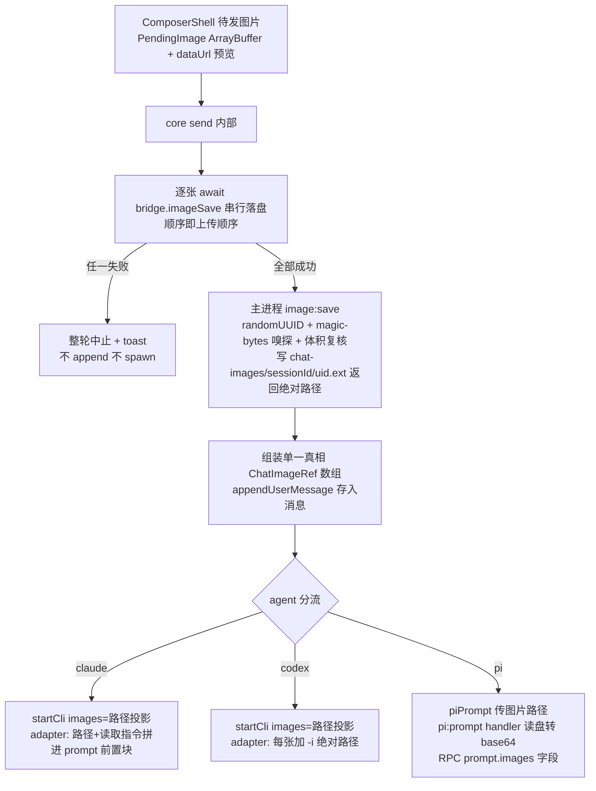
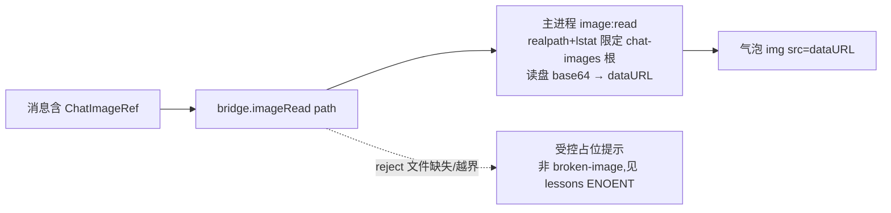

# feat: desktop 聊天框图片上传(三 agent 原生通道)

## Summary

让 desktop 个人工作区聊天框支持图片上传:用户通过**粘贴 / 拖拽 / 选择文件**把图片加入消息,图片随消息送达当前 agent,并在用户消息气泡里显示缩略图。覆盖「会话页」与「新会话落地页」两个输入入口,以及 `claude` / `codex` / `pi` 三个 agent。

统一骨架是「图片先落盘拿到绝对路径」,但**每个 agent 走各自的原生图片通道**(下方 Problem Frame 解释为什么不能一刀切):claude 把绝对路径写进 prompt 文本、codex 用原生 `-i/--image` flag 传路径、pi 读盘转 base64 进 RPC `prompt` 的 `images` 字段。二进制经 IPC 用 `ArrayBuffer` 直传(照抄已验证的 ASR 录音通路);落盘文件名由主进程生成、做 magic-bytes 嗅探与体积复核;缩略图回读用新增的图片专用 IPC(自带 realpath 边界白名单,规避 `fs:readFile` 的「文本 + 项目白名单」双重限制)。

---

## Problem Frame

- **现状**:聊天 prompt 全链路是纯字符串。claude/codex 经命令行 argv 传 prompt 且 spawn 时 `stdio[0]="ignore"`(stdin 关闭);pi 走 RPC 的 `{type:"prompt", message:string}`。三者都没有图片/二进制通道。输入框 `ComposerShell` 是纯 `<textarea>`,拖拽只认应用内部 MIME(`PROMPT_DRAG_MIME`/`TODO_DRAG_MIME`),无粘贴/选文件/图片能力。`vision` 字段仅是供应商/模型能力元数据,未接入发送链路。
- **既有可复用资产**:ASR 录音已有「renderer 二进制 → `blob.arrayBuffer()` → `bridge.asrTranscribe({ audio: ArrayBuffer })` → preload → 主进程 handler」的成熟通路。会话落盘 `chat:save` 已有原子写 + `mkdir recursive` + `SAFE_ID` 校验 + 按 sessionId 串行化(`writeQueues`)范式(`apps/desktop/src/main/ipc/chat.ts`)。主进程 IPC handler 有**直测先例**(`apps/desktop/src/main/ipc/skills.test.ts` 用 `vi.mock("electron")` 捕获 handler + `mkdtempSync` 临时目录跑真实 fs,含路径白名单断言)。
- **为什么不能用单一「路径写进 prompt」一刀切**(外部研究的决定性结论,见 Sources):
  - **claude** ✅:Read 工具原生支持图片视觉,官方推荐「Analyze this image: /abs/path.png」,绝对路径、跳权限后无 cwd 限制 —— 路径进 prompt 可行。
  - **codex** ❌:agent 有硬性 consent/privacy 边界,**拒绝**把 prompt 里的任意本地路径转成视觉输入,必须用原生 `-i/--image` flag(flag 收的仍是文件路径)。`--dangerously-bypass-approvals-and-sandbox` 绕的是命令沙箱,**绕不过**视觉 consent 门控。
  - **pi** ⚠️:文件系统读取不受沙箱限制(能读 cwd 外绝对路径),但「工具读到的图」在部分后端进不了模型;RPC `prompt` 命令有协议内置的 `images` 字段(base64),是无门控、最可靠的通道。
- **缺口**:需要补三段链路——(1) composer 采集图片;(2) 二进制落盘 + 缩略图回读的 IPC 通道;(3) 发送时按 agent 分流到各自原生图片通道,并在气泡渲染缩略图。

---

## Scope Boundaries

**In scope**
- 个人工作区聊天框「会话页(`PersonalComposer`)」与「新会话落地页(`NewSessionLanding`)」两个入口的图片上传。
- 三种输入交互:Cmd/Ctrl+V 粘贴截图、从系统拖入图片文件、点按钮选择文件。
- 三个 agent 都能「看见」图片:claude(路径进 prompt)、codex(`-i` flag)、pi(RPC `images` base64)。
- 图片落盘到 `~/.cortex-desktop/chat-images/<sessionId>/`,随会话持久化;会话删除时清理。
- 用户消息气泡内显示已发图片缩略图;会话历史重载后缩略图可重渲染。
- 编辑/重发携带原消息**已落盘**的图片(复用引用,不重新落盘)。
- 格式/大小/数量校验(纯函数,带单测);主进程侧二次复核(权威闸门)。

**Out of scope(非目标)**
- 团队工作区聊天(独立 mock 链路)—— 不触碰。
- pi「插话(steer)/ follow-up」携带图片 —— 待发图片只随新一轮 `prompt` 发送(见 KTD9 的状态模型)。
- 编辑态对图片的增删(本期编辑只保留原图,不支持加图/删图)。
- 图片以外的任意文件类型上传(PDF/视频/音频等)。
- 图片标注、裁剪、编辑、压缩转码;BMP/TIFF/SVG 本期直接拒绝(不做转 PNG)。
- **Windows 路径安全**(保留名/盘符/UNC/MAX_PATH/ADS):本期仅保证 macOS;若分发 Windows 需专项加固(主进程 `randomUUID` 文件名已规避大部分,但未系统验证)。
- agent **回复**消息里输出图片的渲染(本期只处理用户**上传**方向)。
- 给 `vision=false` 的模型强塞图片(pi 静默忽略;claude/codex 退化为各自 CLI 行为,见 Risks)。

### Deferred to Follow-Up Work
- 缩略图点击全屏放大 / lightbox 预览 —— 本期仅渲染缩略图。**注意**:lightbox 把 dataURL 从 `` 移到容器渲染上下文,实现时须复审 SVG/MIME 注入(见 Risks R8)。
- 非 vision 模型在 UI 上禁用/提示图片上传(用 `model.vision` 能力位)。
- 编辑态增删图片;pi steer/followUp 带图(取决于 pi RPC 协议是否在这些命令支持 `images`,见 Open Questions)。
- BMP/TIFF/SVG 自动转 PNG 后再上传。

---

## Key Technical Decisions

KTD1 — 统一「落盘拿绝对路径」骨架,但每个 agent 走原生图片通道,不强行 path-in-prompt 一刀切。
研究证明 path-in-prompt 只对 claude 成立(codex 硬拦截、pi 工具读图后端不可靠)。统一骨架 = 所有图片先落盘得绝对路径;claude 用路径进 prompt、codex 用 `-i` 传路径、pi 读盘转 base64 进 `images`。claude 无需改 stream-json/stdin(最低改动面)。**关键不对称**:claude/codex 的图片字节**永不经主进程读盘**(路径直接进 argv,由 CLI 子进程自读),**唯独 pi 在主进程 `pi:prompt` handler 内 `fsp.readFile` 转 base64**。故两类失败的归属与提示不同:claude/codex 落盘未完成 → CLI 自身 ENOENT;pi → 主进程读失败 → 该轮 reject 走 `failPiTurn`。

KTD2 — 图片存 `~/.cortex-desktop/chat-images/<sessionId>/`(目录以 `mode 0o700` 创建),不进项目目录、不进 `assertAllowed` 项目白名单。
不污染用户 repo / git;随会话持久化让缩略图可重渲染;以**不可变的 app session uuid** 为目录键,会话重命名零影响、无历史数据需迁移。per-session 子目录便于随 `chat:delete` 整目录清理。pi 不受沙箱限制可直接读此绝对路径;claude/codex 跳权限/绕沙箱后同样可读。**信任边界**:`image:read` 的 realpath 围栏只有在「根不被其它本地主体写入」时才成立——故根以 0700 创建,并显式把「同用户本地进程」视为可信(与 `~/.cortex-desktop` 其余内容一致),残余风险收敛到该边界,不留隐含假设。

KTD3 — 缩略图回读用新增图片专用 IPC `image:read`(返回 dataURL),边界判定基于 **realpath/lstat** 限定在 chat-images 根,不复用 `fs:readFile`。
`fs:readFile` 只回 utf8 文本(图片乱码)且受项目白名单约束,会拒读 userData 下的图片。`image:read` 完全绕过 `assertAllowed`,其唯一防线就是这个根白名单——故**必须用 realpath 解析符号链接后再做边界匹配、并 lstat 拒绝符号链接**,否则 `chat-images/<sid>/x.png -> /etc/passwd` 会把任意文件 base64 泄露给 renderer。读侧 MIME 由扩展名命中固定 allowlist `{png,jpg,jpeg,gif,webp}` 才返回对应 image MIME,否则抛错——**绝不返回 `image/svg+xml` 或任何非位图 MIME**。该规避不读 persisted 白名单(静态根),天然不受 `assertAllowed` 落盘节流竞态影响(lessons 2026-06-11)。

KTD4 — 二进制经 IPC 用 `ArrayBuffer` 字段直传,renderer 不预转 base64;dataURL 只活在内存与回读返回,绝不持久化。
Electron 结构化克隆原生支持 `ArrayBuffer`,ASR 已验证。`ChatImageRef`(进消息/落盘 JSON)只含 `path/name/mimeType/宽高`;**`dataUrl`/base64 绝不写进消息**(否则像 reasoning 当初那样撑爆 chat JSON,已被 `sanitizeForSave` 丢弃的前车之鉴)。

KTD5 — composer 新增独立 `images` 通道,不并入文本型 `PersonalAttachment`。
现有 attachments(prompt/todo)最终被 `buildAttachmentSystemPrompt` 拼成文本 system prompt;图片不能走文本,且需二进制落盘 + 各 agent 原生注入,语义与传输都不同。

KTD6 — claude 的图片引用 = 绝对路径 + 显式读取指令 + 引用块置于用户文本之前。
研究证实 claude Read 需绝对路径、官方示例用「Analyze this image: /path」、图片置于文本前视觉效果更好;显式指令降低模型「以为 Read 只是展示给用户」的误读。该前置块进 `-p` body,与走 `--append-system-prompt` 的 skill/todo 注入正交。

KTD7 — 落盘前在主进程做 magic-bytes 嗅探,扩展名由**嗅探结果**决定,与声明 MIME 不一致即拒绝。
renderer 的 `isAcceptedImage` 只看浏览器给的 `file.type`,可被绕过。主进程嗅探真实字节(PNG `89 50 4E 47`、JPEG `FF D8 FF`、GIF `47 49 46 38`、WebP `RIFF....WEBP`),据此定扩展名。这同时关掉「伪装成 png 的 svg/任意字节」与「扩展名⁄真实 MIME 错配致 claude API 400 甚至污染会话历史」两条路(claude 靠扩展名判 MIME)。

KTD8 — codex 每轮 spawn 全新 `codex exec`,`-i` 天然附到「当轮消息」。
codex `--image` 语义是「attach to the first message」。因本仓每轮对话都新起一个 `codex exec [resume]` 进程,当轮 prompt 即该次调用的首条消息,故 `-i` 附图到当轮成立。`-i` 在 `exec` 与 `exec resume` 两分支都须插在 `...common` 内、**所有位置参数(resumeSessionId / prompt)之前**;resume 续话场景需实现期复测(见 Open Questions)。

KTD9 — 待发图片是发送草稿,**只通过 `send()`(新一轮 prompt)发出并清空**;steer / 编辑重发旧消息 / `/clear` / slash 命令均不消费、不清空待发图。
这条单一规则收口所有交互态:pi 运行中按「插话」不带待发图(图保留等下一轮 send);claude/codex 运行中允许继续采集(UI 提示「将随下条消息发送」),`send()` 被 `running` 短路时不丢图;`/clear` 只隐藏视图、不删磁盘图也不清待发图。避免「图片永久卡在待发条」或「被 slash 静默吞掉」的悬挂态。编辑重发是独立路径:复用被编辑消息**自身**的已落盘 `ChatImageRef`(不重新落盘、不删旧文件),本期不支持编辑态增删图。

KTD10 — 主进程是体积与文件名的权威闸门,且**绝不解码图片**。
落盘文件名 = 主进程 `crypto.randomUUID()` + 嗅探扩展名;renderer 传入的 `fileName`/`id` **不参与路径构造**(只存进 `ChatImageRef.name` 供显示),从源头消除路径穿越与 Windows 保留名/ADS。`image:save` 在 `Buffer.from` 前复核 `req.data.byteLength <= MAX_IMAGE_BYTES`(renderer 校验仅 UX,不可信)。主进程只搬字节、不解码(防 decompression bomb 致 OOM);宽高由 renderer 解码后随 `ChatImageRef` 带上。

---

## High-Level Technical Design

### 发送数据流(落盘是阻塞前置步 + 三 agent 分流)

图片落盘是发送的**前置阻塞步骤**:逐张 `await imageSave` 全部成功拿到路径后,才组装单一真相 `ChatImageRef[]` → `appendUserMessage` → 分流注入。任一张落盘失败 → 整轮中止(不 append 用户消息、不 spawn/prompt),已落盘的前几张作为孤儿随会话删除清理。

### 缩略图渲染(统一走 image:read 单路)

发送态的内存 dataUrl 随 `send()` 后 composer 清空而销毁,故气泡渲染**统一**经 `image:read(path)` 回读(本地盘读取,延迟可忽略),不维护跨组件 dataUrl 缓存——消除缓存生命周期与悬空 dataUrl 一整类问题。

### 存储与契约镜像

- 落盘根:`apps/desktop/src/main/paths.ts` 新增 `chatImagesDir(sessionId)` = `join(cortexHome(), "chat-images", sessionId)`,**内部对 `sessionId` 跑 `SAFE_ID` 校验**(像 `chatPath` 一样),使 save/read/delete 全部自动受保护。
- 类型契约镜像:`packages/core/types/index.ts`(消息模型 `ChatImageRef`)、`packages/core/desktop/types.ts` ↔ `apps/desktop/src/main/ipc/types.ts`(IPC DTO)。`PendingImage` 是 composer 内存态,**只在 `core/desktop/types.ts`,不镜像到 main**;`CliStartRequest.images` 仅 claude/codex 消费(pi 走 `piPrompt` 独立参数)。

---

## Requirements

**采集(composer)**
- R1. 在聊天输入框 Cmd/Ctrl+V 粘贴剪贴板中的图片 → 加入待发图片列表;粘贴纯文本走原行为。
- R2. 从系统把图片文件拖入输入框 → 加入待发列表;原有应用内部 MIME 拖拽行为不回归(应用内 MIME 优先)。
- R3. 点击上传按钮经系统文件选择框选图(支持多选)→ 加入待发列表。
- R4. 待发图片以缩略图条展示,每张可单独移除;`send()` 成功后清空,顺序即加入顺序。
- R5. 仅接受 PNG/JPEG/GIF/WebP,超出单张大小上限或非图片输入被拒并 toast 提示。

**传输与存储**
- R6. 发送时每张图片在 `send()` 内落盘到 `chat-images/<sessionId>/`,文件名由主进程 `randomUUID` + 嗅探扩展名生成,返回绝对路径;落盘只在 `send()` 内,composer 仅持 `ArrayBuffer`。
- R7. 已发图片的引用(path/name/mimeType/宽高)随会话消息持久化;`dataUrl` 不持久化;`chat:load` 能取回引用。
- R8. 删除会话时该会话图片目录被清理;`/clear` 不删图片;编辑重发截断产生的孤儿图随会话删除统一清理。

**agent 注入**
- R9. claude:已发图片的绝对路径 + 显式读取指令置于 prompt 用户文本之前。
- R10. codex:每张已发图片作为 `-i/--image <绝对路径>` 加入 `codex exec` 参数(位于所有位置参数之前)。
- R11. pi:主进程把图片读为 base64,放入 RPC `prompt` 命令的 `images` 字段。
- R12. 在 vision 能力的模型下,三个 agent 都能在回复中正确感知所发图片内容。

**渲染与非回归**
- R13. 用户消息气泡内渲染所发图片缩略图,顺序与发送一致。
- R14. 会话历史重载后经 `image:read` 重新渲染;读失败/文件缺失显示受控占位而非崩溃。
- R15. 团队工作区聊天与渲染无任何变化。
- R16. 不带图片的纯文本发送链路(含 `send`/`editResend`/`appendUserMessage` 签名变更后)行为不变,三 agent 均零回归。

---

## Acceptance Examples

- AE1. claude 会话,粘贴一张 PNG 截图 + 文本「这个报错怎么修」并发送。
  - **Given** 当前 agent=claude、模型支持 vision。
  - **When** 发送。
  - **Then** 图片落盘得绝对路径;claude prompt 以「请先读取以下图片…/abs/uid.png」前置块开头,后接用户文本;claude 回复能描述图片内容;气泡显示该缩略图。
- AE2. codex 会话,选择两张图发送。
  - **Then** `codex exec` 参数含两个 `-i <绝对路径>`(在位置参数前);prompt 文本里**不**注入路径;codex 回复感知两张图。
- AE3. pi 会话,拖入一张 WebP。
  - **Then** `pi:prompt` 收到图片路径,handler 读盘转 base64,RPC `prompt` 含 `images:[{type:"image",data,mimeType:"image/webp"}]`;pi(vision 模型)回复感知图片。
- AE4. 粘贴一段纯文本(非图片)→ 走原有文本粘贴,不进入图片列表,不触发落盘。
- AE5. 拖入 `.svg` 或 20MB 的 `.png`(或把 svg 字节改名 `.png`)→ renderer 拒绝;即便绕过 renderer,主进程 magic-bytes 嗅探/体积复核也拒绝落盘,不写文件。
- AE6. 发图后重启应用并重新打开该会话 → 气泡缩略图经 `image:read` 重渲染;手动删掉某图片文件后重开 → 显示受控占位、聊天视图不崩。
- AE7. 新会话落地页粘贴图片 + 文本发送 → `createSession` 后图片落盘到该新 sessionId 目录,新会话气泡显示缩略图(验证「先建会话再落盘」时序)。
- AE8. 对一条带图历史消息做编辑重发(改文字)→ 截断后重发的新消息复用原图引用(不重新落盘),agent 仍感知该图。
- AE9. claude/codex 运行中粘贴图片 → 图片进待发条并提示「将随下条消息发送」;当前回合不发出,下一次 `send()` 才带出。
- AE10. 三张图,第二张落盘失败 → toast,不出现用户气泡、不发请求(整轮中止)。
- AE11. 待发条有图时输入 `/clear` → 视图清空,磁盘已发图片与待发图均不被删除。

---

## Implementation Units

> 依赖优化:U5/U6 仅依赖 U1(adapter/RPC 读 `images` 是纯函数,单测喂 mock 即可),可与 U4 并行,不必等 U4 真正填值。

### U1. 数据模型与 IPC 契约

**Goal**:定义图片相关的消息模型、composer 待发类型、IPC DTO,并在契约镜像处同步。

**Requirements**:R6、R7、R9-R11 的类型基础;为 U2-U7 提供契约。

**Dependencies**:无。

**Files**
- `packages/core/types/index.ts`(`Message` 的 `text` 变体加 `images?: ChatImageRef[]`;新增 `ChatImageRef`)
- `packages/core/desktop/types.ts`(`CliStartRequest` 加 `images?: CliImageRef[]`;新增 `ImageSaveRequest`/`ImageSaveResult`/`ImageReadResult`/`PendingImage`/`CliImageRef`)
- `apps/desktop/src/main/ipc/types.ts`(镜像 IPC DTO;**不含 `PendingImage`**)

**Approach**
- `ChatImageRef = { path: string; name: string; mimeType: string; width?: number; height?: number }`(持久化进消息;`path` 绝对路径;`name` 仅显示)。
- `CliImageRef = { path: string; mimeType: string }`。`CliStartRequest.images` 加注释「仅 claude/codex 消费;pi 图片走 piPrompt 独立参数」(与现有 `provider`/`piExtensionPath` 的「pi 专用/主进程内部填充」注释风格一致)。
- `PendingImage = { id: string; name: string; mimeType: string; dataUrl: string; data: ArrayBuffer; width?: number; height?: number }`(composer 内存态;`id`/`name` 客户端用,**不得用于路径**)。
- `ImageSaveRequest = { sessionId: string; fileName: string; mimeType: string; data: ArrayBuffer }`;`ImageSaveResult = { path: string }`;`ImageReadResult = { dataUrl: string }`。

**Patterns to follow**:`AsrTranscribeRequest`(`audio: ArrayBuffer` 直传)、现有 `CliStartRequest`/`MessageAttachmentRef` 镜像写法。

**Test expectation**: none —— 纯类型/契约,行为由 U2-U7 覆盖。**收尾必做**:core/desktop/types.ts ↔ main/ipc/types.ts 字段逐一核对一致,且确认 `PendingImage` 未被误镜像到 main;`ChatImageRef` 只含 path/name/mimeType/宽高、不含 dataUrl。

---

### U2. 图片落盘/回读通道:主进程 IPC + preload + bridge

**Goal**:打通「renderer 二进制 → 落盘 → 回读 dataURL」通道,主进程做权威校验,会话删除时清理。

**Requirements**:R6、R8、R14;KTD3/KTD7/KTD10。

**Dependencies**:U1。

**Files**
- `apps/desktop/src/main/paths.ts`(新增 `chatImagesDir(sessionId)`,内部 `SAFE_ID` 校验)
- `apps/desktop/src/main/ipc/sessionWriteQueue.ts`(新建:把 `chat.ts` 现有私有 `writeQueues` 抽成导出的 `enqueue(sessionId, fn)`,save/delete/image 三方共用)
- `apps/desktop/src/main/ipc/image.ts`(新建:`image:save`/`image:read` handler + 纯函数)
- `apps/desktop/src/main/ipc/image.test.ts`(新建)
- `apps/desktop/src/main/ipc/register.ts`(`import { registerImageHandlers }` + 在 `registerIpcHandlers` 体内加一行)
- `apps/desktop/src/main/ipc/chat.ts`(`writeQueues` 改用共享模块;`chat:delete` 链内追加删图片目录)
- `apps/desktop/src/preload/index.ts`(`personal.imageSave`/`personal.imageRead`)
- `packages/core/desktop/bridge.ts`(`imageSave?`/`imageRead?` 接口)

**Approach**
- 纯函数(便于单测,**不依赖 electron `app`**):`sniffImageExt(buf): "png"|"jpg"|"gif"|"webp"|null`(magic bytes)、`extToMime(ext)`、`isInsideRoot(root, absPath)`(realpath 解析后严格分隔符边界匹配;`isInsideRoot` 接收 root 作参数,handler 注入)。**核心 fs 逻辑抽成接收 root 入参的纯函数** `saveImageInto(root, sessionId, req)` / `readImageFrom(root, absPath)`(照抄 `session-trim.ts` 的 `trimSessionFile(path, …)` 范式),handler 注入 `chatImagesDir`;否则 `chatImagesDir`→`cortexHome()`→硬编码 `homedir()` 不可注入,`image.test.ts` 无法用临时目录(feasibility 发现:`skills.ts` 可测正因它接收 root 入参)。
- **共享写队列**:`chat.ts` 现有 `writeQueues` 是模块私有 Map,`image.ts` 取不到。抽到 `sessionWriteQueue.ts` 导出 `enqueue(sessionId, fn)`,`chat:save`/`chat:delete`/`image:save` 全部经它按 sessionId 串行,真正实现 save-vs-delete 互斥(否则计划原先「共用 writeQueues」的说法在跨文件下不成立,删除会话时在途落盘会留孤儿)。
- `image:save`:经 `enqueue(sessionId, …)`;校验 `sessionId` 命中 `SAFE_ID`;`req.data.byteLength <= MAX_IMAGE_BYTES` 否则抛;`sniffImageExt(Buffer.from(req.data))`,为 null 或与 `req.mimeType` 不符则抛(KTD7);文件名 = `randomUUID()` + ext;`await ensureMigrated()` + `mkdir(chatImagesDir(sessionId), { recursive: true, mode: 0o700 })`(0700 让 realpath 围栏立得住,KTD2);原子写(tmp+rename);返回绝对路径。
- `image:read`:`fsp.realpath(path)` + `lstat` 拒绝符号链接;`isInsideRoot(realRoot, realPath)` 否则抛「路径不在允许范围内」;扩展名命中 `{png,jpg,jpeg,gif,webp}` 才定 MIME,否则抛;**读取用校验后的 `realPath`(或 `open` 带 `O_NOFOLLOW` 后 fstat),不读原始 `path`** —— 消除 check→use 之间被换成 symlink 的 TOCTOU(security 发现);→ base64 → `data:<mime>;base64,...`。ENOENT(文件被外部删)→ **reject 带可识别 message**(供 U7 受控占位,而非返回空串)。**不复用 `fs:readFile`**。
- `chat:delete`:经同一 `enqueue`、在删 `<id>.json` 且 `ensureMigrated` 之后 `fsp.rm(chatImagesDir(id), { recursive: true, force: true })`。

**Patterns to follow**:`chat.ts`(原子写/`mkdir`/`SAFE_ID`/`ensureMigrated`)、`session-trim.ts`(接收 root/path 入参的可测纯函数)、`llm.ts` 的 `asr:transcribe`(`Buffer.from(ArrayBuffer)`,但**别照抄它无体积上限**)、`fs.ts` 的 `isInside`(边界匹配,但**升级为 realpath**)、`skills.test.ts`(handler 直测 harness)。

**Execution note**:preload/主进程改动 HMR 不热更,验证前彻底重启 Electron(记忆 electron-preload-main-needs-restart)。

**Test scenarios**(`image.test.ts`,套用 `skills.test.ts` 的 `vi.mock("electron")` + `mkdtempSync` harness;纯函数喂临时 root)
- `sniffImageExt`:真实 PNG/JPEG/GIF/WebP 头 → 对应 ext;SVG/文本/截断字节 → null。
- `isInsideRoot`:根内 → true;`/etc/passwd`、项目目录、`chat-images-x` 同名前缀 → false;**根内符号链接指向根外 → false**(realpath/lstat 防逃逸)。
- `saveImageInto(tmpRoot, …)`:正常 → 文件存在、扩展名由嗅探定、文件名为 uuid;声明 `image/png` 但字节是 svg → 抛、不写;超 `MAX_IMAGE_BYTES` → 抛;`sessionId` 非法 → 抛。
- `readImageFrom(tmpRoot, …)`:刚写入路径 → 正确 `data:` 前缀;根外路径 → 抛;符号链接 → 抛;**check 后把目标换成 symlink → 仍不越界读**(TOCTOU 断言);ENOENT → reject 带可识别 message。
- `chat:delete`:删除后该 session 图片目录不存在;`enqueue` 下 save-during-delete 不留孤儿。

---

### U3. Composer 采集:粘贴/拖拽/选择 + 待发缩略图

**Goal**:在 `ComposerShell` 增加图片采集(三种输入)与待发缩略图条,扩展 `onSend` 携带图片,落实 KTD9 的待发图状态规则。

**Requirements**:R1-R5、R16、KTD9。

**Dependencies**:U1。

**Files**
- `packages/views/cortex-desktop/personal/ComposerShell.tsx`(`images` 状态、`onPaste`、扩展 `onDrop`/`onDragOver`、文件选择按钮+隐藏 input、缩略图条、运行中提示)
- `packages/views/cortex-desktop/personal/imageIntake.ts`(新建:纯函数)
- `packages/views/cortex-desktop/personal/imageIntake.test.ts`(新建)
- `packages/views/cortex-desktop/personal/PersonalComposer.tsx`(`onSend` 透传 images)
- `packages/views/cortex-desktop/personal/NewSessionLanding.tsx`(`onSubmit` 透传 images)
- `packages/views/cortex-desktop/personal/PersonalChatArea.tsx`(onSend 回调接 images;「重发」按钮 onSend 顺带修正)
- `packages/views/cortex-desktop/cortex-desktop.css`(缩略图条 + 移除按钮样式)

**Approach**
- 纯函数 `imageIntake.ts`:`isAcceptedImage(mimeType)`、`validateImageSize(bytes, max)`(**先按 `file.size` 预检,再读 arrayBuffer**,避免先读大图再拒)、`fileToPendingImage(file): Promise<PendingImage>`(`arrayBuffer()` + dataUrl + 宽高)。失败返回原因码 → 组件 toast。
- `onSend` 第三参 `images?: PendingImage[]` **可选**;ComposerShell 内部 `runCommand`/slash 等不带图调用不受影响(KTD9:它们不消费待发图)。
- **纯图可发**:发送守卫与按钮 `disabled` 从 `!text.trim()` 改为 `!text.trim() && !images.length`(否则粘贴/拖入图片但没打字时发送按钮恒灰、无法发图;R1/R3/R4 把加图定义为独立于文本的动作)。
- **只在「真正消费」时清空待发图**:现状 `send()` 无条件 `setAttachments([])`,但 `/clear`、pi 不可用兜底等分支会短路、不消费图。改法:`onSend` 回调返回「是否已消费(真正发出)」的判别,composer 仅在已消费时 `setImages([])`;`/clear`、`steer()`、`runCommand()`、pi 不可用 → 不清(KTD9、解 AE11 与 pi 兜底丢图,见 U4)。
- **上传中态**:落盘是阻塞前置步(U4),`await imageSave` 期间禁用发送按钮并显示 busy 态(复用 ASR `is-busy` pill / 发送按钮 spinner),成功或失败 toast 后恢复。
- `onPaste`:遍历 `clipboardData.items` 取 image 的 `getAsFile()`;有图则 `preventDefault` 并加入;纯文本走原行为(R1/AE4)。**粘贴无可见落点**,故缩略图条须在粘贴后**立即**出现(先放占位贴片,再异步补 `dataUrl`/宽高)作为唯一确认反馈,避免用户重复粘贴。
- `onDrop`:**先**保留 `PROMPT_DRAG_MIME`/`TODO_DRAG_MIME` 分支并命中即 return(应用内 MIME 优先,R2);**否则**处理 `dataTransfer.files` 中的图片。`onDragOver` 增 `types.includes("Files")` 也给拖拽高亮(否则拖图无反馈)。
- 文件选择:按钮触发隐藏 `<input type="file" accept="image/*" multiple>`,走同一 `fileToPendingImage`。
- 去重:同一次文件选择/拖拽内按 `name+size` 去重;粘贴图不去重(剪贴板图常同名)。
- 校验顺序:**先按 `file.size` 预检再读 `arrayBuffer()`**(避免先把超大图读进内存再拒)。
- 缩略图条与控件 a11y:上传按钮与每个移除按钮都是真实 `<button>`,带 `aria-label`(「上传图片」/`移除 ${name}`)、源序可 Tab、可见焦点环;移除某张后把焦点移到下一张移除按钮或上传按钮(不留悬空焦点);命中区覆盖可视区(lessons 2026-06-12)。
- 缩略图条:渲染 `images`,每张带移除按钮;运行中(claude/codex `send` 被禁、或 pi 可插话)允许采集,在缩略图条上方显示「将随下条消息发送」提示。
- 上限常量(单张 ~5MB、张数上限)集中定义,与主进程 `MAX_IMAGE_BYTES` 同源。

**Patterns to follow**:`ComposerShell` 录音段 `blob.arrayBuffer()`、既有 `attachments`/`dragOver`、`onDrop` 现有去重(`attachments.some(a => a.path === path)`);`ComposerShell.test.tsx` 的 `renderShell` helper;`cortex-desktop.css` 既有 token。

**Test scenarios**(`imageIntake.test.ts` + 追加到 `ComposerShell.test.tsx`)
- `isAcceptedImage`/`validateImageSize`:正反例 + 超限原因码。
- 粘贴含 image → 加入、`preventDefault`;粘贴纯文本 → 不加入、不拦截(AE4)。
- drop 图片 → 加入;drop `PROMPT_DRAG_MIME`(即便 `dataTransfer.files` 非空)→ 只走 skill 分支(R2 优先级断言)。
- 文件选择多张 → 全加入;同次拖入两张同 name+size → 去重为一;移除某张 → 消失、焦点不悬空。
- 纯图无文本 → 发送按钮可用、可发出(image-only send 守卫)。
- `send` 真正发出 → `images` 清空;运行中采集 → 进待发条且不发出(AE9);`/clear`、pi 不可用兜底 → 待发 images **保留不清**(KTD9、AE11)。
- 超限/不支持 → toast、不加入(AE5)。

---

### U4. 发送链路:core send 落盘并按 agent 分流

**Goal**:`send` 接受 images,逐张落盘得绝对路径,组装单一真相引用并按 agent 分流;编辑重发复用原图。

**Requirements**:R6、R7、R12、R16、R8(孤儿);KTD1/KTD9。

**Dependencies**:U1、U2、U3。

**Files**
- `packages/core/personal/messages.ts`(`send`/`editResend`/`appendUserMessage`/`sendPiTurn` 签名与实现)
- `packages/core/personal/pi-session.ts`(`promptPi` 透传图片路径)
- `packages/views/cortex-desktop/personal/personalActions.test.tsx`(追加:send/editResend 经 `usePersonalActions` 钩子驱动的落盘+分流断言,扩 `makeBridge` 加 `imageSave`/`imageRead`)
- `packages/core/personal/messages.test.ts`(追加:仅纯函数/refs-投影形断言)

**Approach**
- **新增 image 入参一律追加到末尾**避开既有 `extraSystemPrompt` 位置实参冲突:`send(session, projectPath, text, attachments, extraSystemPrompt?, images?: PendingImage[], presavedImages?: ChatImageRef[])`;`appendUserMessage(qc, sessionId, text, attachments, refs?)`;`sendPiTurn(..., ids, imagePaths?)`。composer 正常发送传 `images`;editResend 传 `presavedImages`(见下)。
- `send`:`images`(新采集)**逐张串行 `await bridge.imageSave(...)`**(串行保序,禁用 `Promise.all`)得 path → `ChatImageRef`;与 `presavedImages`(已存盘、跳过 imageSave)**按序拼成**单一真相 `ChatImageRef[]`,再 `.map` 出 `CliImageRef[]`/imagePaths 两个投影。任一张 `imageSave` 失败 → 整轮中止(不 `appendUserMessage`、不 spawn/prompt),toast。落盘在 `appendUserMessage` **之前**。
- **`send` 返回「是否已消费」**(真正发出 = true),供 composer 决定是否清空待发图(U3:`/clear`、pi 不可用等未消费分支返回 false → 不清)。
- 图片**不进** `buildAttachmentSystemPrompt`。分流:claude/codex → `startCli({ ..., images: cliRefs })`;pi → `sendPiTurn(..., imagePaths)` → `promptPi(bridge, session.id, message, runId, imagePaths)`。
- `editResend`:末尾加 `presavedImages?: ChatImageRef[]`;从**被编辑消息(截断前)自身的 `images` refs** 取已存盘引用,经 `send` 的 `presavedImages` 通道下传(**不重新落盘、不删旧文件**,feasibility 发现:pre-saved refs 不能走 `images→imageSave` 管线);顺带修正 `PersonalChatArea` 「重发」按钮写死的 `attachments=[]`(连 skill 都丢)。
- **pi 不可用兜底分支**:不落盘、不传 refs、**返回未消费**(让 composer 保留待发图供重试),toast「pi 不可用」(adversarial 发现:原先会静默丢图)。
- 无 images 时所有路径与现状逐字节一致(R16);`oneshotCli`(autoTitle)不涉图、零改动。

**Patterns to follow**:`send`/`appendUserMessage`/`sendPiTurn`/`editResend` 现有签名;`personalActions.test.tsx` 的 `renderHook` + `makeBridge` 范式(send/startCli/piPrompt 真正被钩子驱动处);`messages.test.ts` 的纯函数 mock 范式。

**Execution note**:先写「send 带 images 的落盘+分流+部分失败中止+未消费不清图」测试再接线,确保无图分支零回归。

**Test scenarios**(`personalActions.test.tsx` 钩子驱动 + `messages.test.ts` 纯函数)
- 2 张图 claude send:每张调 `imageSave`;`startCli.images` 含 2 个 `{path,mimeType}` 且**顺序==上传顺序**;消息 refs 写入;send 返回已消费。
- codex/pi:refs 经 `startCli.images` / `promptPi` imagePaths 下传,顺序一致。
- 第二张 `imageSave` 失败 → 不 `appendUserMessage`、不 `startCli`/`promptPi`、返回未消费(AE10)。
- editResend 带图历史消息:经 `presavedImages` 复用原 refs、**不调 `imageSave`**、不删文件(AE8)。
- pi 不可用兜底:不调 `imageSave`、返回未消费(composer 据此保留待发图)。
- 无 images:`imageSave` 不被调用,`startCli`/`promptPi` 入参与现状一致(R16)。

---

### U5. claude + codex adapter 图片注入

**Goal**:claude 把图片绝对路径 + 读取指令前置进 prompt;codex 把每张图加成 `-i` 参数。

**Requirements**:R9、R10、R16;KTD6/KTD8。

**Dependencies**:U1(单测喂 mock `CliStartRequest`,可与 U4 并行)。

**Files**
- `apps/desktop/src/main/agents/claude.ts`(`buildArgs` 处理 `req.images`)
- `apps/desktop/src/main/agents/codex.ts`(`buildArgs` 处理 `req.images`)
- `apps/desktop/src/main/agents/claude.test.ts` / `codex.test.ts`(**追加**,勿覆盖现有 buildArgs 用例)

**Approach**
- adapter 对 `req.images` 只做**形态转换,不做存在性校验**(落盘已由 U2 保证),避免两 adapter 各长一套防御。
- claude:若 `req.images?.length`,前置块(置于用户文本前,KTD6)`请先读取并查看以下用户上传的图片,再回应:\n<abs1>\n<abs2>\n\n` + 原 `req.prompt` 作 `-p` 值;其余 flag 不动;与 `--append-system-prompt` 正交。
- codex:若 `req.images?.length`,为每张在 `...common` 内 push `["-i", img.path]`,**位于所有位置参数(`exec`/`resume`/`resumeSessionId`/prompt)之前**;`exec` 与 `exec resume` 两分支都要插;`-i` 与 `promptWithSkills` 正交,prompt body 一字不改(不注入路径,避开 consent 拦截)。
- 两者无 images 时参数与现状逐字符一致(R16)。

**Patterns to follow**:`claude.ts` 条件 `args.push`、`codex.ts` `promptWithSkills` + 位置参数顺序;`claude.test.ts`/`codex.test.ts` 的 `baseReq` fixture 与断言风格。

**Test scenarios**(追加)
- claude:带 images → `-p` 值以读取指令 + 各绝对路径开头随后用户文本;无 images → `-p` 值=原 prompt(逐字符相等)。
- codex `exec`:带 2 张 → 含两组 `-i <path>` 且都在位置参数前、`args.at(-1)` 仍是 prompt、prompt 不含路径;无 images → args 现状一致。
- codex `exec resume`:带图 → `-i` 在 `resumeSessionId`/prompt 之前(顺序断言);多张保持上传顺序。

---

### U6. pi 注入:RPC prompt.images 字段

**Goal**:pi 路径把图片读为 base64,放入 RPC `prompt` 命令的 `images` 字段。

**Requirements**:R11、R12、R16。

**Dependencies**:U1(单测喂 mock,可与 U4 并行)。

**Files**
- `apps/desktop/src/main/ipc/pi-session.ts`(`pi:prompt` handler 接图片路径,读盘转 base64)
- `apps/desktop/src/main/ipc/pi-session.test.ts`(追加 handler 层用例)
- `apps/desktop/src/main/agents/pi-rpc.ts`(`PiRpcSession.prompt(message, runId?, images?)` payload 加 `images`)
- `apps/desktop/src/main/agents/pi-rpc.test.ts`(追加 payload 用例)
- `apps/desktop/src/preload/index.ts`(`piPrompt` 增图片路径参数)
- `packages/core/desktop/bridge.ts`(`piPrompt` 签名末尾加 `imagePaths?: string[]`)

**Approach**
- `bridge.piPrompt(uiSessionId, message, runId?, imagePaths?)` → preload `invoke("pi:prompt", uiSessionId, message, runId, imagePaths)`。
- **base64 转换在 `pi:prompt` handler**(不在 `PiRpcSession`,后者保持 node 纯净、可单测不碰 fs):逐个 `fsp.readFile` + 扩展名得 mimeType,组 `images: [{ type:"image", data, mimeType }]`,调 `s.prompt(message, runId, images)`。**单张读失败 → 整轮 reject(由 `command()` 转 rejection、`sendPiTurn` catch 走 `failPiTurn`),不静默跳过**(否则用户以为发了图)。
- `PiRpcSession.prompt`:`this.send({ type:"prompt", message, ...(images?.length ? { images } : {}) })`,保留 `this.currentRunId = runId` 副作用。
- steer/followUp 本期**不带图**(KTD9/Scope);其 RPC 是否支持 `images` 见 Open Questions。
- 无图片时 payload 与现状一致(R16)。

**Patterns to follow**:`pi-rpc.ts` `send`/`prompt` 结构、`pi-session.ts` `command(uiSessionId, s => ...)` 包装、`pi-rpc.test.ts:264` 的 `f.lastCmd()` payload 断言、`pi-session.test.ts:179` 的 handler 转发断言、`image.ts`(U2)base64 读取。

**Test scenarios**(追加)
- `prompt(msg, runId, images)`(`pi-rpc.test.ts`)→ stdin JSON 含 `type:"prompt"`/`message`/`images`(每项 `type:"image"`/`data`/`mimeType`);`prompt(msg)` 无图 → payload 无 `images` 键(R16)。
- `pi:prompt` handler(`pi-session.test.ts`)→ 给临时图片路径 → 读盘 base64 与字节一致、mimeType 由扩展名推断、转发 `s.prompt(message, runId, images)`;单张路径不存在 → reject。

---

### U7. 消息气泡缩略图渲染(统一 image:read 单路)

**Goal**:用户消息气泡渲染所发图片缩略图,统一经 `image:read` 回读;读失败/缺失显受控占位。

**Requirements**:R13、R14、R15;KTD4。

**Dependencies**:U1、U2。

**Files**
- `packages/views/cortex-desktop/ChatArea.tsx`(`TextMessage` 渲染 `m.images`)
- `packages/views/cortex-desktop/personal/ChatImages.tsx`(新建:回读 + 渲染 + 占位)
- `packages/views/cortex-desktop/personal/ChatImages.test.tsx`(新建)
- `packages/views/cortex-desktop/cortex-desktop.css`(缩略图样式)

**Approach**
- `ChatImages({ images, bridge })`:挂载时对每张 `bridge.imageRead(path)` → `dataUrl` → ``(**统一回读,不维护跨组件 dataUrl 缓存**,KTD4);`imageRead` reject(文件缺失/越界)→ **受控占位**:固定尺寸贴片(同缩略图尺寸)显示「图片不可用」+ 持久化的 `name` + `alt`,不渲染 broken-image(不把存在文件误判缺失,仅 reject 才占位,lessons ENOENT);避免空串 `src`。本期缩略图**不可点**,故不给 hover lift/pointer 光标(避免死交互,放大见 Deferred)。bridge 作显式 prop 便于测试 mock(`TextMessage` 已 `useDesktopBridge()` 可注入)。
- 仅个人区且 `m.images?.length` 时渲染;团队侧不传/无 images → 零变化(R15)。
- 缩略图固定尺寸、`object-fit: cover`、`alt=name`、顺序即 refs 顺序;`` 仅用于 `src`(不进 `innerHTML`/`href`);本期不做点击放大(Deferred)。

**Patterns to follow**:`ChatArea.tsx` 的 `m.attachments` 渲染块(`.attach-row` + `.map`,同构模板)、`TextMessage` 取 bridge 方式;`chatMarkdown.test.tsx`/`PersonalChatArea.test.tsx` 的 jsdom 组件测试;`cortex-desktop.css` 既有 `.md-body` token。

**Test scenarios**(`ChatImages.test.tsx`)
- 消息含 3 张 ref → 渲染 3 个缩略图、调 `imageRead` 三次、顺序==refs。
- `imageRead` reject → 渲染受控占位,不抛、不崩(AE6/R14)。
- 团队侧消息(无 images)→ 不渲染缩略图(R15)。

**收尾必做(CSS)**:`.image-*`/缩略图 className 与 cortex-desktop.css 双向 grep 对账无悬挂类(lessons 2026-06-14);移除按钮/缩略图命中区覆盖可视区域(lessons 2026-06-12)。

---

## System-Wide Impact

- **IPC 契约新增**:`image:save`/`image:read`,`piPrompt` 参数扩展,`CliStartRequest.images`。三处类型镜像(core/types、core/desktop/types ↔ main/ipc/types)须同步,否则 desktop 两套 tsconfig typecheck 红。`PendingImage` 不镜像到 main。
- **核心函数签名变更**:`send`/`editResend`/`appendUserMessage`/`sendPiTurn`/`piPrompt` 均**末尾追加可选参数**,避免冲击既有(可能存在的)`extraSystemPrompt` 位置实参调用方;`GitBar`/`runCommand`/`oneshotCli` 等不带图调用靠可选参数零回归。
- **持久化格式演进**:消息 `text` 变体新增 `images?`(`ChatImageRef`,无 dataUrl),经 `sanitizeForSave` 保留;旧消息无此字段 → 不渲染缩略图,向后兼容。
- **新存储位置 + 孤儿来源**:`~/.cortex-desktop/chat-images/<sessionId>/`;孤儿来自「编辑重发截断旧消息」与「多图部分落盘失败」,统一靠 `chat:delete` 整目录清理;`/clear` 不删图。
- **安全边界**:`image:read` 绕过项目白名单,realpath/lstat 根白名单是任意文件读取的唯一闸门;`image:save` 的 magic-bytes + 体积 + uuid 文件名是写侧权威闸门。
- **多进程**:preload/主进程改动需重启 Electron(HMR 只热更 renderer)。

---

## Risks & Dependencies

- R1 — `image:read` 任意文件读取 / symlink 逃逸 / TOCTOU(HIGH):read 绕过 `assertAllowed`,唯一防线是根白名单。若按字符串前缀照抄 `fs.ts:isInside`,`chat-images/<sid>/x.png -> /etc/passwd` 可逃逸泄露;且 check 与 read 之间被换成 symlink 存在 TOCTOU。缓解:`isInsideRoot` 用 realpath + `lstat` 拒符号链接、根自身取 realpath;**读取用校验后的 `realPath`(或 `O_NOFOLLOW` open+fstat)而非原始 path**;根以 `0700` 创建并显式将「同用户本地进程」纳入信任域(KTD2/KTD3、U2);单测含 symlink 逃逸 + TOCTOU 用例。
- R2 — 字节/MIME 错配毁会话(medium):claude 靠扩展名判 MIME,错配触发 API 400 甚至污染会话历史;pi 的 base64 payload 类型不符行为未定义。缓解:KTD7 主进程 magic-bytes 嗅探为统一写侧闸门,扩展名由嗅探定。
- R3 — 主进程 OOM / decompression bomb / IPC 巨包(medium):renderer 校验仅 UX。缓解:KTD10 主进程 `MAX_IMAGE_BYTES` 复核 + 绝不解码;`image:read` base64 膨胀 ~33%,大量历史图回读见 Open Questions(是否限并发)。
- R4 — codex `-i` resume 语义(medium,需验证):`--image` 文档语义「附首条消息」。本仓每轮新 spawn 故当轮成立(KTD8),但 `exec resume` 续话轮是否生效 + `-i` 位置须实测(Open Questions)。
- R5 — claude Bedrock Read 图片不可靠(external,low):本仓走第一方/自配 provider,非 Bedrock;记录为已知外部限制。
- R6 — assertAllowed 白名单时序(已规避,low):`image:*` 用静态根、不读 persisted 白名单,规避落盘节流竞态(lessons 2026-06-11)。
- R7 — 非 vision 模型退化(low):pi 静默忽略 `images`;claude 非 vision 模型可能把路径当文本读;codex `-i` 给非 vision 模型可能 400。本期不前置拦截(Deferred 用 `model.vision` 提示)。
- R8 — dataURL 渲染上下文 / 未来 lightbox(low):dataURL 仅进 ``/`background-image`,绝不进 `innerHTML`/`href`;read 侧已硬拒非位图 MIME。Deferred 的 lightbox 实现时复审 SVG/MIME 注入与 CSP `img-src data:`。
- R9 — className↔CSS 静默失效 / 命中区(low):U3/U7 新增 CSS 必做双向 grep 对账(lessons 2026-06-14),命中区覆盖可视区(lessons 2026-06-12)。

---

## Open Questions

- pi `steer`/`followUp` 的 RPC 命令是否支持 `images` 字段?本期默认仅 `prompt` 带图(KTD9);若上游支持且有需求,后续扩展。
- codex `exec resume` 续话轮 `-i` 附图是否生效、`-i` 精确插入位 —— 实现期用真实 codex 复测;不生效则文档标注「codex 图片仅新会话首轮可靠」或回退。
- 历史会话含 N 张图时 `image:read` 是否限并发/限单次回读总量,防一次性 base64 巨包?
- magic-bytes 嗅探对罕见编码/动画 WebP 变体的误拒成本是否可接受?给出精确字节签名与覆盖测试。
- 单张大小上限与张数上限取值(~5MB / N 张)—— 取 claude/codex 共同安全区,实现期定常量(renderer 与主进程同源)。
- pi 的 RPC `prompt.images` 是否真的进入所配置后端的模型?`prompt` 响应是毫秒级「受理 ack」、不代表模型已看图,Problem Frame 标 pi 为 ⚠️。实现期对真实 vision 后端做一次 spike 验证图片确实进上下文(可参考 bun 跑 pi 的既有手法),并定「图被静默忽略」时的 UX(`message_end` error 不一定触发)。

---

## Verification

- `pnpm --filter @cortex-work/core test`(U4、U1 相关单测全绿)。
- `pnpm --filter @cortex-work/views test`(U3、U7 单测全绿;jsdom)。
- `pnpm --filter @cortex-work/desktop test`(U2 handler 直测、U5/U6 adapter/RPC 单测全绿;含 symlink 逃逸、magic-bytes、体积、顺序断言)。
- `pnpm typecheck` 全仓通过(含 desktop node + web 两套;三处类型镜像一致、可选参数末尾追加无回归)。
- `pnpm lint` 通过。
- U3/U7 的 `.image-*` className 与 cortex-desktop.css 双向 grep 对账无悬挂类(lessons 2026-06-14)。
- 重启 Electron 后手动验证(用户):
  - claude/codex/pi 三个会话各自:粘贴截图、拖入图片、按钮选图三种方式 → 发送 → agent 回复能描述图片内容;气泡显示缩略图。
  - 新会话落地页发图 → 新建会话且气泡显示图(AE7);编辑重发带图消息 → 图仍在(AE8);运行中粘贴图 → 提示「随下条发送」(AE9)。
  - 纯文本发送三 agent 均无变化;团队工作区聊天无变化。
  - 重启应用重开会话 → 缩略图重渲染;手动删图片文件后重开 → 受控占位、不崩。
  - 拖入 `.svg`/超大图/svg 改名 png → 被拒(renderer 与主进程双层)。

> 验证分工:Claude 负责实现 + 自动化测试;UI/agent 实际看图效果由用户手动验证(记忆 verification-split)。绝不虚报未实际运行的结果(记忆 no-fabricated-verification)。

---

## Sources & Research

**外部研究(决定 per-agent 通道)**
- Claude Code Read 支持图片、需绝对路径、官方「Analyze this image: /path」引用法:[Common workflows](https://code.claude.com/docs/en/common-workflows)、[Read 工具描述](https://github.com/Piebald-AI/claude-code-system-prompts/blob/main/system-prompts/tool-description-readfile.md);Bedrock/MIME 不可靠坑:[claude-code#35866](https://github.com/anthropics/claude-code/issues/35866)。
- codex `-i/--image`(附首条消息)+ 视觉 consent 边界(拒绝自构路径):[Codex CLI reference](https://developers.openai.com/codex/cli/reference)、[features](https://developers.openai.com/codex/cli/features)、[codex#12439](https://github.com/openai/codex/issues/12439)、[discussion#2085](https://github.com/openai/codex/discussions/2085)。
- pi RPC `prompt` 的 `images` 字段(base64)+ 文件系统无沙箱 + 工具读图后端风险:[pi rpc.md](https://github.com/earendil-works/pi/blob/main/packages/coding-agent/docs/rpc.md)、[pi ai README](https://github.com/earendil-works/pi/blob/main/packages/ai/README.md)、[pi#3022](https://github.com/earendil-works/pi/issues/3022)。

**代码位置(实现起点)**
- composer:`packages/views/cortex-desktop/personal/ComposerShell.tsx`(`onSend`、`onDrop`/`onDragOver`、`send`/`steer`/`runCommand`、录音 `arrayBuffer`)、`PersonalComposer.tsx`、`NewSessionLanding.tsx`(`onSubmit` create-then-send)、`PersonalChatArea.tsx`(onSend 分支、「重发」按钮写死 `[]`)。`ComposerShell.test.tsx` 的 `renderShell` 范式。
- 发送链路:`packages/core/personal/messages.ts`(`send`/`editResend`/`appendUserMessage`/`sendPiTurn`/`clearView`/`sanitizeForSave`)、`pi-session.ts`(`promptPi`)。
- 二进制传输范式:`apps/desktop/src/main/ipc/llm.ts`(`asr:transcribe` 消费 `ArrayBuffer`,但无体积上限别照抄)、`AsrTranscribeRequest`(types.ts)。
- 落盘/迁移:`apps/desktop/src/main/ipc/chat.ts`(原子写/`SAFE_ID`/`writeQueues`/`chat:delete`)、`apps/desktop/src/main/paths.ts`(`cortexHome`/`chatsDir`/`ensureMigrated`)。
- handler 直测范式:`apps/desktop/src/main/ipc/skills.test.ts`(`vi.mock("electron")` + `mkdtempSync` + 白名单断言)、`pi-session.test.ts`(`pi:prompt` 转发断言)、`agents/claude.test.ts`/`codex.test.ts`(`buildArgs` 断言)、`agents/pi-rpc.test.ts`(payload 断言)。
- agent 注入点:`apps/desktop/src/main/agents/claude.ts`(`-p`)、`codex.ts`(位置参数 + resume 分支)、`pi-rpc.ts`(`prompt` payload)、`pi-session.ts`(`pi:prompt` handler)。
- 白名单/边界参照:`apps/desktop/src/main/ipc/fs.ts`(`assertAllowed`/`isInside`,本计划升级为 realpath)。
- 契约镜像:`packages/core/desktop/types.ts` ↔ `apps/desktop/src/main/ipc/types.ts`、`packages/core/types/index.ts`(`Message`/`MessageAttachmentRef`)、`packages/core/desktop/bridge.ts`。
- 渲染同构模板:`packages/views/cortex-desktop/ChatArea.tsx`(`TextMessage` 取 bridge、`m.attachments` 渲染块)。
- 历史教训:`tasks/lessons.md`(className↔CSS、命中区、assertAllowed 时序、ENOENT 路径构造)。
