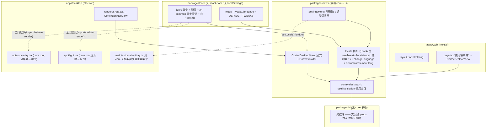
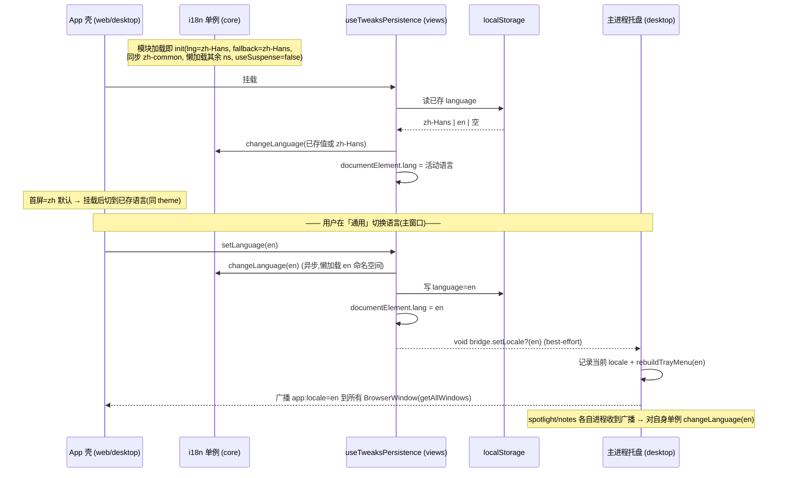
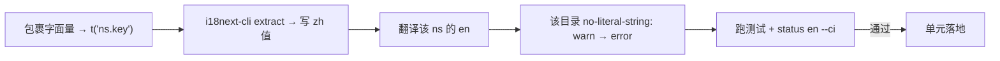

# feat: 多语言支持(中文 + 英文)——i18n 基建与全量字符串提取

## Summary

为 Cortex Desktop 引入 react-i18next 国际化能力,让 Web(Next.js)与 Electron 两端 UI 可在 **中文(zh-Hans,默认)** 与 **英文(en)** 间运行时切换。本计划落地 i18n 单例、语言偏好持久化、设置内的语言切换器、提取/lint/CI 工具链,并将现有 ~252 个源文件中的硬编码中文**全量**提取为语义化 key 的翻译目录。

## Problem Frame

当前仓库**零 i18n 基建**:所有 UI 文案以硬编码中文散落在 `packages/views`、`apps/desktop`、`packages/core` 中(252 个含 CJK 字面量的 `.ts/.tsx`)。设置计划(`docs/plans/2026-06-14-006-feat-settings-general-and-provider-alignment-plan.md`)已明确把 i18n 记为延期项,理由是「字符串提取工作量远超其余各项之和」。本计划是该延期项的兑现:先建可复用基建,再按特性命名空间逐块提取,使应用具备双语能力且后续可扩展更多语言。

中文是事实上的**源语言**,这带来一个反向特性:复数规则的负担落在 **目标语 en**(CLDR 下英文有 `_one`/`_other`,中文只有 `_other`),需在英文翻译时主动处理。

---

## Requirements

### 框架与基建

- R1. 应用支持在 **中文(zh-Hans,默认)** 与 **英文(en)** 间运行时切换,无需重载窗口。
- R2. **桌面端是三个独立渲染进程**(`main.tsx` 主树、`spotlight.tsx`、`notes-overlay.tsx`,各自独立 BrowserWindow / V8 realm,Web 为单进程),每个进程各持有 `packages/core` 模块级 i18next 单例。单例只保证各窗口**首屏**默认 zh;**跨进程语言一致由主进程广播驱动**(见 R13),import-before-render 仅解决首屏裸 key,不能跨进程同步。
- R3. 缺失的英文翻译在生产环境回退到中文源串,**绝不**渲染裸 key。
- R4. 翻译 key 类型安全:`i18next.d.ts` 增强提供自动补全与编译期非法 key 报错。

### 偏好与持久化

- R5. 所选语言跨会话持久化,下次启动生效;Web 与 Desktop **复用同一套 localStorage 通路**(仿 `theme`),不新增 IPC / electron-store 管线。
- R6. `document.documentElement.lang` 随活动语言更新(Web 与 Desktop 一致)。

### UI 表面

- R7. 「通用」(General)设置区提供语言切换器(中文 / English)。
- R8. 所有用户可见的中文文案被外部化到翻译目录,覆盖 `packages/views`、`packages/ui`(经 props)、各 `apps`、`packages/core` 非组件常量,以及 Electron 托盘菜单(全量提取)。

### 开发工作流与质量

- R9. 翻译 key 为语义化(`feature.component.element`),按特性命名空间组织,外加一个受治理的 `common` 命名空间。
- R10. 新增硬编码用户可见串被 lint 拦截(`eslint-plugin-i18next` 的 `no-literal-string`),随各特性迁移完成**按目录从 warn 棘轮升级到 error**,全量完成后全局 error。
- R11. CI 在「提取漂移」(代码含目录里没有的 key)与「英文覆盖不完整」时失败。
- R12. 现有断言中文串的组件测试继续通过(zh 保持默认与源;测试 setup 同步加载 zh 资源,规避懒加载异步)。
- R13. 桌面端切换语言时,**所有已打开窗口**(主窗口、spotlight、notes overlay)的语言保持一致:主进程把 locale 广播到所有窗口(各渲染进程对自身单例 `changeLanguage`);新开的次级窗口由主进程注入初始 locale。

---

## Key Technical Decisions

- KTD1. **react-i18next + 全局默认单例**,在 `packages/core/i18n` 模块级 `init`。理由:Web 页面整体 `"use client"`(无 RSC 翻译),Electron 是纯客户端 SPA;全局默认实例让每个渲染进程内**绕过 `CoreProvider` 的 React 根**都能通过 `useTranslation` 解析,无需各自挂 provider。**关键修正(经评审)**:桌面端 `main`/`spotlight`/`notes` 是 `electron.vite.config.ts` 里三个独立 renderer 入口 → **三个 BrowserWindow / 三个进程 / 三份独立单例**(独立 V8 realm)。所以「一个单例服务所有根」只对**同进程内**成立;跨进程语言一致**必须靠主进程 IPC 广播**(KTD7a / U12),不能靠 import 共享。**Provider 放置**:每个进程的主视图树在 `CortexDesktopView` 显式挂 `<I18nextProvider i18n={instance}>`;同进程内的 bare root(主进程窗口里如有)依赖全局默认实例;次级窗口(spotlight/notes)各自是独立进程,其单例由该窗口的 init 模块 import-before-render(首屏)+ 主进程注入/广播 locale(同步)。**不放进 `CoreProvider`**——后者只承载环境事实(wsId/identity/apiConfig/desktopBridge),locale 是 UI 偏好,应仿 `theme` 留在 `views` 层。

- KTD1a. **全局单例的安全不变量(bounded trade-off)**:仅在「服务端恒渲染默认 zh 且任何代码都不在服务端/模块级调用 `changeLanguage`」时安全。一旦引入服务端 locale 协商(`Accept-Language`/cookie/`[lang]` 路由段在 RSC 或 `generateMetadata` 中翻译),并发请求会在共享实例的可变 `language` 上竞态——该 bug 仅在生产并发下出现、本地单请求不可复现。引入服务端协商即是迁移到每请求 `createInstance()` 的触发条件。见 Risks(R-i18n-1)与 Scope Boundaries。

- KTD2. **中文(zh-Hans)即源 = 默认 = `fallbackLng`**;英文是翻译层。中文串作为 key 的默认值由提取工具写入 zh 目录;英文缺 key 时回退中文。这同时让现有断言中文的测试保持绿色(R12)。

- KTD3. **语言是客户端 UI 偏好,像 `theme` 一样经 `useTweaksPersistence` 走 localStorage 持久化**——放在 `views` 层,**不**放 `core`(`core` 不得碰 `localStorage`),**不**走 `DesktopBridge`/electron-store。在 `Tweaks`(`packages/core/types/index.ts`)加 `language` 字段。理由:localStorage 在 Web 与 Electron 渲染进程都可用,零新增 IPC,完全复用既有 `theme` 通路。

- KTD4. **语义化 key + 特性命名空间 + 受治理 common**;非默认命名空间经 `i18next-resources-to-backend` 动态 `import()` 懒加载,**默认 zh 的 `common` 命名空间同步打包**进 `resources` 以保证 SSR/首屏一致。`react.useSuspense: false`。

- KTD5. **提取用 `i18next-cli`**(`i18next-parser` 已于 2025-09 弃用),**防回归用 `eslint-plugin-i18next` 的 `no-literal-string`**,配合 CI 闸门(`extract --ci` 查漂移、`status en --ci` 查覆盖、`types` 生成类型)。

- KTD6. **语言在挂载后生效**:首屏恒为 zh 默认,随后 `useEffect` 从持久值 `i18n.changeLanguage`,与现有 `theme` 的「首屏默认 + 挂载后应用」行为一致。注意 `changeLanguage` 返回 Promise 且懒加载命名空间是异步的:切到 en 时会出现「zh 默认 → 挂载后切 → 懒加载 ns resolve 后再定」的**两段过渡**(`useSuspense:false` 下先渲染 zh 回退,可接受,同 theme 量级)。持久化订阅按 theme 范式 fire-and-forget(不 await);测试切语言须 `await changeLanguage` 或 `waitFor`(U5 的同步全量资源使其同 tick resolve)。

- KTD7. **主进程(托盘)字符串单独本地化**:主进程无法用 react-i18next。字符串来自 `packages/core/i18n` 里一个**零 react / react-i18next 依赖的纯数据模块**(core 是 Node-safe;若该模块 import 了 react,主进程会传递性拉入 React——必须避免)。**注意 `externalizeDepsPlugin`**:`electron.vite.config.ts` 的 `main`/`preload` 用 `externalizeDepsPlugin()`,会把 `@cortex-work/core`(workspace 包,出 `.ts` 源)externalize,Node 无法直接执行——主进程引入该数据层须在 `main` 配置里 `exclude` 它使其被打包(见 U12)。渲染端经**新增可选 `DesktopBridge.setLocale?(locale)` 方法**把当前语言推给主进程(仿现有 `setDesktopBehavior?` 即时通路,best-effort:旧壳/Web 无此方法时静默降级)。**所有权**:渲染端(主窗口)i18next 为权威源,主进程持最终一致镜像,用于原生 chrome 与次级窗口同步。

- KTD7a. **跨窗口 locale 扇出(经评审新增)**:主进程收到 `setLocale` 后,(1)用 `BrowserWindow.getAllWindows()` 广播 `app:locale` 到所有窗口(复用 `apps/desktop/src/main/automation/events.ts` 既有广播范式),各渲染进程对**自身**单例 `changeLanguage`;(2)**重建**托盘菜单(`tray.ts` 当前是闭包捕获的静态 `Menu`,须改为模块级保留回调 + 导出 `rebuildTrayMenu(locale)`,仅换 label 字串不生效);(3)记录当前 locale,新开次级窗口时注入初始值。是否对**已打开**的次级窗口做实时同步 vs 仅「下次打开生效」见 Open Questions。

- KTD8. **`packages/ui` 保持无翻译**(不得依赖 `core`):文案经 props 传入。`core` 的非组件常量与默认串按「持久化危险」分类处理(见 KTD8a),非危险者在**渲染处**翻译,`core` 内部产生的运行时串(经注入的 `onToast` 回调或 chat 文本/`Notification` body)用**调用时** `i18n.t()`(`pushToast` 不可从 core 调用,core 走 view 注入的 `onToast`)。

- KTD8a. **持久化危险:某些字面量被写入磁盘/作为种子值,绝不可天真地改成渲染时 `t()`**。这类必须在**渲染时按稳定标识派生**或在**创建时解析为具体串**,保持持久层不含 key:`PROVIDER_PRESETS[].name`(被 `providerFromPreset` 复制进持久化的 `ProviderProfile.name`)、`"未命名 Todo"`(写入 `TodoMeta.title`)、`"AI 日报"`/`"全局日报"`(写入 `TimelineEvent.title`)。详见对应单元。`PI_THINKING_LABELS` 经核对**安全**(消费方只把 label 用于展示,value 恒为稳定枚举)。

- KTD9. **TS key 安全经 `i18next.d.ts` 模块增强 + `enableSelector: true`**(选择器式类型检查在 ~250 文件资源树上远比字面量联合类型可扩展),由 `i18next-cli types` 生成,避免手维护。

- KTD10. **`packages/core/i18n` 分两层**:(1)**无框架资源/数据层**(纯对象,可被主进程与未来每请求 `createInstance` 复用);(2)薄的 react-i18next 绑定层(单例 init + `useTranslation` 再导出)。`react-i18next` 在 `core` 声明为 **`peerDependency`**(对齐既有 `react` 的处理),而非 hard `dependencies`,避免工作区内重复实例。

---

## High-Level Technical Design

### 分层放置(谁能依赖谁)

i18n 各件必须落在不违反硬边界的包里(`core` ≠ react-dom / localStorage;`ui` ≠ core;`views` ≠ next/*)。



### 启动取语 + 切换语言时序



### 提取/棘轮工作流(每个特性单元复用)



---

## Output Structure

新增 i18n 相关产物的预期布局(实现可微调):

```text
packages/core/
  i18n/
    index.ts            # 单例创建 + init(全局默认实例) + 导出 t/i18n/changeLanguage
    config.ts           # lng/fallbackLng/ns/backend/react 选项
    resources/
      zh-Hans/
        common.json      # 同步打包(首屏)
        settings.json    # 懒加载
        chat.json
        notes.json
        files.json
        timeline.json
        pet.json
        ...
      en/
        common.json
        settings.json
        ...
  types/i18n.d.ts        # CustomTypeOptions 增强(enableSelector)
i18next.config.ts        # i18next-cli 配置(仓库根)
```

> 命名空间清单是设计意图,非约束;实现时按 `useTranslation('<feature>')` 的实际边界微调。各单元的 **Files** 字段为权威。

---

## Implementation Units

> 阶段 1 建基建(除切换器外无可见变化);阶段 2 按命名空间逐块提取,每块独立可落地;阶段 3 收口闸门。U6–U12 为行为保持型重构——执行采用「**现有测试即特征化安全网**」:zh 保持默认与源,既有断言中文的测试必须持续绿色。

### Phase 1 — Foundation

### U1. i18n 单例、配置与命名空间脚手架

- **Goal**:在 `packages/core/i18n` 建立模块级 i18next 单例与资源加载策略,作为全仓唯一 i18n 入口。
- **Requirements**:R1, R2, R3, R4, R9(基础)。
- **Dependencies**:无。
- **Files**:
  - 新增 `packages/core/i18n/resources/`(**无框架数据层**:`zh-Hans/common.json`、`en/common.json` 等纯 JSON;主进程与未来每请求实例都可复用,**不得** import react)
  - 新增 `packages/core/i18n/index.ts`、`packages/core/i18n/config.ts`(**react 绑定层**:单例 init + `useTranslation` 再导出 + 调用时 `t`/`changeLanguage`)
  - 新增 `packages/core/i18n/native.ts`(主进程可消费的纯 locale 映射,供 U12 托盘用;零 react 依赖)
  - 新增 `packages/core/types/i18n.d.ts`(`CustomTypeOptions` 增强,`enableSelector: true`)
  - 改 `packages/core/package.json`(`peerDependencies` 加 `react-i18next@^17.0.8`、`dependencies` 加 `i18next@^26.3.1`、`i18next-resources-to-backend@^1.2.1`;`exports` 加 `./i18n` 与 `./i18n/native`)。**不**加 `i18next-browser-languagedetector`——其唯一用途(navigator 探测)已延期(见 Scope Boundaries),随该后续工作再引入,避免引入无消费方的依赖。
  - 改 `packages/core/index.ts`(barrel 导出 i18n 入口)
  - 新增 `packages/core/i18n/index.test.ts`
- **Approach**:**分两层**(KTD10):无框架资源/数据层(纯对象)+ 薄 react 绑定层。用 **全局默认实例**(非 `createInstance`),`.use(initReactI18next).use(resourcesToBackend(动态 import))`,`init({ lng: 'zh-Hans', fallbackLng: 'zh-Hans', defaultNS: 'common', ns: ['common'], react: { useSuspense: false }, interpolation: { escapeValue: false } })`。`common`(zh)**静态 import 同步打入** `resources`;其余命名空间由 `resourcesToBackend` 经字符串字面量 `import(\`./resources/${lng}/${ns}.json\`)` 懒加载(打包器要求字面量)。导出 `i18n`、`t`(调用时绑定当前语言的非 React `t`,供 core 非组件函数调用)、`changeLanguage`。`react-i18next` 声明为 `peerDependency`(对齐 `react`),避免重复实例;react-i18next 17 要求 i18next ≥ 26.2.0,版本须同步。
- **Patterns to follow**:`packages/core/provider.tsx` 的「单一初始化入口」风格;`packages/core/package.json` 既有 `react` peer-dep 处理与 `exports` + `index.ts` barrel 子路径导出约定。
- **Technical design(directional)**:`t()` 必须是函数包装 `(...args) => i18n.t(...args)`,而非 `const t = i18n.t`——后者在 `changeLanguage` 后不更新。**排序约束**:U8/U10 的 core 非组件函数依赖此 `@cortex-work/core/i18n` 的调用时 `t`,故本单元必须先于这些提取单元落地(纯 react 侧 provider 不足以给 core 函数提供可调用 `i18n`)。
- **Test scenarios**:
  - Happy:`t('common.<已知key>')` 在默认语言返回 zh 串。
  - 回退:对一个 en 缺失、zh 存在的 key,`changeLanguage('en')` 后 `t()` 返回 zh 源串(R3),不返回裸 key。
  - 单例:从两处 import `i18n` 得到同一实例(引用相等)。
  - 懒加载:`changeLanguage('en')` resolve 后,某懒加载命名空间的 key 可解析(异步 await)。
- **Verification**:`pnpm --filter @cortex-work/core test` 通过;`pnpm --filter @cortex-work/core typecheck` 通过;`@cortex-work/core/i18n` 可从 views 子路径导入。

### U2. 语言偏好:Tweaks 集成 + 持久化 + DOM lang

- **Goal**:把 `language` 作为客户端 UI 偏好接入 `Tweaks`,经既有 localStorage 通路持久化并应用到 i18n 与 `documentElement.lang`。
- **Requirements**:R5, R6;支撑 R1。
- **Dependencies**:U1。
- **Files**:
  - 改 `packages/core/types/index.ts`(`Tweaks` 加 `language: Locale`;新增 `Locale = 'zh-Hans' | 'en'` 类型)
  - 改 `packages/core/store/ui.ts`(`DEFAULT_TWEAKS.language = 'zh-Hans'`)
  - 改 `packages/views/cortex-desktop/useTweaksPersistence.ts`(hydrate 时读 `language` 并 `changeLanguage`;`applyTweaksToDom` 设 `document.documentElement.lang`;订阅变化时 `changeLanguage` + 写 localStorage,沿用既有 `typeof window` / try-catch 守卫)
  - 改 `apps/web/app/layout.tsx`(`<html lang="zh">` → 文档默认 `lang="zh-Hans"`,运行时由 `applyTweaksToDom` 客户端更新)
  - 改 `packages/views/cortex-desktop/useTweaksPersistence.test.ts`(若存在)或新增覆盖
- **Approach**:严格镜像现有 `theme` 流。`language` 缺字段时回退 `DEFAULT_TWEAKS`(既有 `{ ...DEFAULT_TWEAKS, ...saved }` 合并已覆盖)。只读/应用语言放 `useEffect`/订阅回调,渲染期不读——规避 Next hydration 警告(与现有模式一致,KTD6)。`changeLanguage` 是异步且懒加载 ns,订阅回调按 theme 范式 fire-and-forget(不 await),接受切换时的两段过渡(KTD6)。
- **Patterns to follow**:`packages/views/cortex-desktop/useTweaksPersistence.ts` 现有 `theme`/`fontScale` 的 hydrate→apply→subscribe→persist 全链。
- **Execution note**:先写一个「切 `tweaks.language` → `i18n.language` 改变且 localStorage 写入」的失败测试,再接线。
- **Test scenarios**:
  - Happy:store `language` 设为 `'en'` → `i18n.language === 'en'` 且 `documentElement.lang === 'en'`。
  - 持久化:设 `'en'` → localStorage 写入;新挂载读回 `'en'` 并 `changeLanguage('en')`。
  - 缺字段:localStorage 无 `language` → 回退 `'zh-Hans'`,不抛错。
  - 守卫:`localStorage.setItem` 抛错(隐私模式模拟)时被 try-catch 吞掉,不崩溃。
  - Covers R6:切换语言后 `documentElement.lang` 同步更新。
- **Verification**:`pnpm --filter @cortex-work/views test` 通过;手测 Web 与 Desktop 切语言后刷新仍保持。

### U3. 语言切换器 UI(设置「通用」区)

- **Goal**:在「通用」设置区加 中文 / English 切换控件,接到 U2 的偏好通路。
- **Requirements**:R7;支撑 R1。
- **Dependencies**:U2。
- **Files**:
  - 改 `packages/views/cortex-desktop/personal/SettingsMenu.tsx`(在「通用」段加 `SegmentedRadio` 语言项)
  - 新增/改 `packages/views/cortex-desktop/personal/SettingsMenu.test.tsx` 相关用例
- **Approach**:复用既有 `SegmentedRadio`(`@cortex-work/ui/controls/*`),选项 `中文`/`English`,值绑 `tweaks.language`,onChange 走与 `theme` 同样的 store/persistence 动作。**硬性要求**:此控件自身文案**直接用 `settings.*` key**(不走临时硬编码标签)——语言切换器若自身留硬编码中文,既会被 `no-literal-string` 命中,又会出现「切换语言的控件自己不翻译」的讽刺缺口。en 值在本单元一并补(无需等 U7)。
- **Patterns to follow**:同文件内 `theme`/`density` 的 `SegmentedRadio` 用法。
- **Test scenarios**:
  - Happy:渲染设置→点击 `English` → store `language` 变为 `'en'` 且 `i18n.language === 'en'`。
  - 回显:`language='en'` 时控件高亮 English。
  - 切换器自身文案:`language='en'` 时控件标签渲染 en 值(本单元自带 settings key,不依赖 U7)。
- **Verification**:`pnpm --filter @cortex-work/views test` 通过;手测切换即时生效。

### U4. 提取、lint 与 CI 工具链

- **Goal**:落地 `i18next-cli` 提取/类型生成、`eslint-plugin-i18next` 防回归、以及 CI 漂移/覆盖闸门(初期非阻断)。
- **Requirements**:R10, R11;支撑 R4, R9。
- **Dependencies**:U1。
- **Files**:
  - 新增 `i18next.config.ts`(仓库根,`defineConfig`:`locales: ['zh-Hans','en']`,`input: ['packages/views/**/*.{ts,tsx}','apps/**/*.{ts,tsx}','packages/core/**/*.{ts,tsx}']`,`output: 'packages/core/i18n/resources/{{language}}/{{namespace}}.json'`,`defaultNS: 'common'`,`primaryLanguage: 'zh-Hans'`)
  - 改根 `package.json`(devDep `i18next-cli@^1.64.1`、`eslint-plugin-i18next`;scripts:`i18n:extract`、`i18n:status`、`i18n:types`)
  - 改 `packages/eslint-config/base.js`(或 `react.js`)接入 `i18next` flat 配置,`no-literal-string` **默认 warn**;`ignoreCallee` 含 `t`/`i18n.t`;`parserOptions.project` 指向 tsconfig
  - 改 `turbo.json`(如需把 `i18n:status` 纳入 pipeline)与 CI 工作流(非阻断步骤)
- **Approach**:`no-literal-string` 仅校验 JSX 文本以降误报;迁移期全局 warn,U6–U12 各单元按目录用 ESLint `overrides`/flat per-path 升 error(棘轮)。CI 跑 `i18next-cli extract --ci`(漂移)与 `status en --ci`(覆盖),阶段 1–2 设为非阻断(warning),阶段 3(U13)转阻断。**注意**:`fallbackLng=zh` 让缺失 en key 渲染中文而非裸 key(R3 所需),会使「漏译」在人工 QA 里**隐形**——`status en --ci` 是唯一探测器,故从 U6 起就把它作为**每单元上报的非阻断 warning** 跑,让覆盖漂移逐单元可见,而非到 U13 才整批发现。
- **Patterns to follow**:`packages/eslint-config/*.js` 既有 flat config 结构;根 `package.json` 既有 turbo 脚本命名。
- **Test scenarios**:`Test expectation: none —— 工具/配置单元`。验证靠下方命令实跑。
- **Verification**:`pnpm i18n:extract` 在干净工作区生成 zh 资源;`pnpm i18n:types` 产出类型且 `pnpm typecheck` 通过;在某组件故意留一个裸中文 JSX 文本 → `pnpm lint` 报 warn。

### U5. i18n 测试基建

- **Goal**:让经 `CoreProvider` 渲染的组件测试同步看到真实 zh 串(规避懒加载异步导致测试看到 key)。
- **Requirements**:R12。
- **Dependencies**:U1。
- **Files**:
  - 改 `packages/views/test/setup.ts`(测试环境同步 `init` 全量 zh `resources`,或对测试实例关闭懒加载)
  - 改 `packages/core` 测试侧(如需 node 环境的同步资源)
  - 可选新增 `packages/views/test/renderWithProviders.tsx`(共享渲染助手,封装 `CoreProvider` + 既有 store 播种)
- **Approach**:测试用一份**全量同步 `resources`**(直接 import 所有 zh JSON)init i18n,`useSuspense: false`,使 `t()` 首渲染即返回 zh 值,并使 `changeLanguage` 同 tick resolve(无 backend import 异步)——这样既有断言中文的同步测试无需改写;切语言的测试仍须 `await changeLanguage` 或 `waitFor`。共享渲染助手非强制(当前各测试自带内联 `renderXxx`),建议补以降低后续提取单元改测试成本。
- **Patterns to follow**:`packages/views/cortex-desktop/personal/TodosView.test.tsx` 的内联 `renderXxx()` + `usePersonalStore.setState` 播种。
- **Test scenarios**:
  - 一个用懒加载命名空间 key 的样例组件,在测试中**首次同步渲染**即显示 zh 值(非 key)。
  - 既有某断言中文串的测试在接入 setup 后仍绿。
- **Verification**:`pnpm --filter @cortex-work/views test` 与 `pnpm --filter @cortex-work/core test` 全绿。

### Phase 2 — 按命名空间提取(每单元:包裹→提取 zh→翻译 en→该目录 lint 升 error→测试)

### U6. common 命名空间 + 共享框架文案

- **Goal**:提取应用外框/共享 chrome 文案到 `common` 与对应命名空间。
- **Requirements**:R8(覆盖共享 chrome);R9, R3。
- **Dependencies**:U1–U5。
- **Files**(提取目标,均改为 `useTranslation` + 语义 key,并产出 zh/en JSON):
  - `packages/views/cortex-desktop/TitleBar.tsx`、`Sidebar.tsx`、`Sections.tsx`、`RightPanel.tsx`、`OrgSwitcher.tsx`、`UpdateButton.tsx`、`TweaksPanel.tsx`、`CortexDesktopView.tsx`
  - `packages/ui/controls/*`(**经 props 传文案,不引入 t**)及其在 views 的调用点
  - 资源:`packages/core/i18n/resources/{zh-Hans,en}/common.json`
- **Approach**:通用按钮/动作(保存/取消/关闭等)入受治理 `common`;框架专属串入各自命名空间。`ui` 控件标签由 views 经 props 注入,保持 `ui` 无翻译(KTD8)。完成后该目录 `no-literal-string` 升 error。
- **Patterns to follow**:`useTranslation('<feature>')` + `keyPrefix`;`common` 经 `{ ns: 'common' }` 访问而非前缀语法。
- **Execution note**:行为保持型;现有测试即安全网,先确保绿再升 lint。
- **Test scenarios**:
  - 现有针对这些组件的断言中文的测试保持绿(zh 默认)。
  - 新增:切 en 后 TitleBar/Sidebar 的 2–3 个代表 key 渲染 en 值。
  - 无裸串:该目录 `pnpm lint` 在 error 档无 `no-literal-string` 报错。
- **Verification**:`pnpm --filter @cortex-work/views test`、`pnpm lint`(该目录 error)通过;手测 en 下框架文案为英文。

### U7. settings 命名空间(最大单元)

- **Goal**:提取设置全屏页 8 个分区(个人资料/通用/供应商/Agent/宠物/时间线/推送/语音)及供应商预设、思考档位标签。
- **Requirements**:R8;R9, R3;收编 U3 的切换器文案。
- **Dependencies**:U6。
- **Files**:
  - `packages/views/cortex-desktop/personal/SettingsMenu.tsx`(278 行 CJK,最大文案文件;含语言切换器收编、`nickname` 占位 `"我"`@111、`DEFAULT_PUSH_TEMPLATE` 写文件@1441)
  - `packages/core/desktop/types.ts`(`PI_THINKING_LABELS`@479、`PROVIDER_PRESETS[].name`@240/252/262/279)
  - `packages/core/desktop/providers.ts`(`providerFromPreset`@88-96:把 preset.name 复制进持久化 profile——持久化危险点)
  - `packages/views/cortex-desktop/personal/ComposerShell.tsx`(@641 消费 `PI_THINKING_LABELS`)
  - 资源:`{zh-Hans,en}/settings.json`(必要时拆 `providers`/`agent`/`push`/`voice` 子命名空间)
- **Approach**:
  - `PI_THINKING_LABELS`(经核对**安全**):两处消费(`ComposerShell.tsx:641`、`SettingsMenu.tsx:1325`)都只把 label 用于展示,`value` 恒为稳定 `ThinkingLevel` 枚举——可放心把 record 值改 key 或换 `labelKeyForThinkingLevel(lv)` helper,组件渲染时 `t()`。
  - `PROVIDER_PRESETS[].name`(**持久化危险,KTD8a**):`name` 是双重身份——下拉 label(渲染)+ 被 `providerFromPreset` 复制进持久化的 `ProviderProfile.name`(种子)。改 key 后**绝不能让 key 串流进 `providerFromPreset`**:把字段改 `nameKey`,下拉用 `t(nameKey)` 渲染;`providerFromPreset` 在**创建时**解析 `i18n.t(nameKey)` 为具体串写入 `ProviderProfile.name`(该字段本就是用户可改的已冻结展示值)。
  - 专有产品名(通义千问/智谱 GLM/硅基流动)en 策略见 Open Questions;en JSON 仍建 key 备覆盖。
  - `DEFAULT_PUSH_TEMPLATE` 在 `SettingsMenu.tsx:1441` 被写入文件——其 key 化由 U10 拥有(`timeline.*` 命名空间),但本单元的写文件消费点须在 U10 完成时同步处理(见 U10 排序注)。
- **Patterns to follow**:U6;同文件内既有 `SegmentedRadio`/`Toggle` 控件。
- **Execution note**:行为保持;先绿后升 lint。该文件最大,建议内部按分区小步提交。
- **Test scenarios**:
  - 现有设置相关测试保持绿。
  - 切 en:每个分区标题至少 1 个 key 渲染 en 值。
  - 供应商预设:下拉 label 经组件渲染时随语言变化(zh→en)。
  - **持久化保护**:从预设新建供应商,持久化的 `ProviderProfile.name` 是**具体本地化串**(如「通义千问」/「Qwen」),**不是裸 key**(`providerFromPreset` 创建时解析)。
  - Covers R7:语言切换器标签自身在 en 下为英文。
- **Verification**:`pnpm --filter @cortex-work/views test`、该目录 lint(error)通过。

### U8. chat 命名空间

- **Goal**:提取聊天区与输入区文案。
- **Requirements**:R8;R9, R3。
- **Dependencies**:U6。
- **Files**:
  - `packages/views/cortex-desktop/ChatArea.tsx`、`packages/views/cortex-desktop/personal/ComposerShell.tsx`
  - `packages/core/personal/messages.ts` 中用户可见串(区分注释 vs 文案;`core` 内部 toast/状态串用**调用时** `i18n.t()`)
  - 资源:`{zh-Hans,en}/chat.json`
- **Approach**:`core/personal/messages.ts` 大量 CJK 为注释,只提取真正用户可见串。`core` 产生的运行时文案(toast/状态)用 `import { t } from '@cortex-work/core/i18n'` 的调用时 `t()`。
- **Execution note**:行为保持;先绿后升 lint。
- **Test scenarios**:
  - 现有 chat/composer 测试保持绿。
  - 切 en:输入区占位/发送相关 2–3 key 渲染 en。
  - core toast:某条 core 触发的 toast 在 en 下为英文(调用时取语言)。
- **Verification**:`pnpm --filter @cortex-work/views test` 与 `@cortex-work/core test`、该目录 lint(error)通过。

### U9. notes 命名空间(含次级窗口 i18n 接线)

- **Goal**:提取闪记视图与 notes-overlay 文案,并为**两个独立进程的次级窗口**(notes-overlay、spotlight)接好 i18n:首屏 import-before-render + 接受主进程注入的初始 locale + 订阅 `app:locale` 广播。
- **Requirements**:R8;R9, R3;R13(次级窗口同步)。
- **Dependencies**:U6;次级窗口的实时同步依赖 U12 的广播(初始 locale 注入与 import-before-render 不依赖 U12,可先行)。
- **Files**:
  - `packages/views/cortex-desktop/personal/NotesView.tsx`(110 行 CJK)
  - `packages/core/personal/notes.ts`(175 行,区分注释/文案;`prepareDeepenNotes`@87、`useDeepenNotes`@419 经注入 `onToast` 产生用户串——调用时 `i18n.t()`)
  - `apps/desktop/src/renderer/src/notes-overlay.tsx`、`apps/desktop/src/renderer/src/spotlight.tsx`(两个独立进程根,各需:**首次渲染前 import core i18n 初始化**;读主进程注入的初始 locale;订阅 `window.desktopAPI` 暴露的 `app:locale` 事件 → 对**本进程**单例 `changeLanguage`)
  - 资源:`{zh-Hans,en}/notes.json`
- **Approach**:每个次级窗口是**独立进程独立单例**(KTD1),import 顺序——init 模块须在 `createRoot().render()` 前 import(否则首屏裸 key)。初始 locale 由主进程在开窗时注入(或 preload 暴露读取),实时切换由 U12 的 `app:locale` 广播驱动。
- **Execution note**:行为保持;额外加次级窗口翻译解析 + 广播响应的回归测试。
- **Test scenarios**:
  - 现有 notes 测试保持绿。
  - 次级窗口首屏:渲染 notes-overlay 与 spotlight(独立进程,无 CoreProvider),key 解析为注入/默认语言值。
  - 广播响应:模拟收到 `app:locale=en` → 该窗口单例 `changeLanguage('en')`,文案变英文(R13)。
  - 切 en:NotesView 2–3 key 渲染 en;core `onToast` 串(如深化截断提示)在 en 下为英文。
- **Verification**:`pnpm --filter @cortex-work/views test`、该目录 lint(error)通过;手测主窗口切语言后,**重新打开**(及在 U12 落地后**已打开**)的 notes overlay / spotlight 文案随之变英文。

### U10. files + timeline 命名空间

- **Goal**:提取文件视图与时间线视图(及 core 时间线串)文案。
- **Requirements**:R8;R9, R3。
- **Dependencies**:U6。
- **Files**:
  - `packages/views/cortex-desktop/personal/FilesView.tsx`(80 行 CJK)
  - `packages/core/personal/filePaths.ts`
  - `packages/views/cortex-desktop/personal/TimelineView.tsx`(@113 渲染 `event.title`)、`HomeView.tsx`
  - `packages/core/personal/timeline.ts`(`"AI 日报"`@611、`"全局日报"`@476 写入持久化 title;`DEFAULT_PUSH_TEMPLATE`@551;推送状态串@665/683)
  - 资源:`{zh-Hans,en}/files.json`、`{zh-Hans,en}/timeline.json`
- **Approach**:
  - **持久化危险(KTD8a)**:`"AI 日报"`/`"全局日报"` 被写入持久化的 `TimelineEvent.title`。**不**在写入时 `t()`(会冻结语言)——改为在 `TimelineView.tsx:113` **按 `event.kind`(已有 `summary.day`/全局 summary)渲染时派生标题**,持久 `title` 不动。
  - 推送运行时串(`DEFAULT_PUSH_TEMPLATE` 的运行时 fallback、@665/683 推送结果)在 core 非组件函数中产生 → **调用时 `i18n.t()`**;写入 Skill 文件的那次(`SettingsMenu.tsx:1441`)是一次性内容快照,可接受冻结。
  - **命名空间所有权**:`timeline.*` 由本单元独占,避免 U7 另起重叠 key。
- **Execution note**:行为保持;先绿后升 lint。
- **排序注**:`DEFAULT_PUSH_TEMPLATE` 定义在本单元但其写文件消费点在 U7 的 `SettingsMenu.tsx:1441`——U7 先行,故本单元落地时须回头处理该消费点(清单项),勿遗漏。
- **Test scenarios**:
  - 现有 files/timeline 测试保持绿。
  - 切 en:FilesView 2–3 key 渲染 en。
  - **持久化保护**:已存的 `summary.day` 事件切到 en 后,列表标题渲染为英文(按 kind 派生),且磁盘上的 `TimelineEvent.title` 未被改写为 key。
  - 推送结果串在 en 下为英文(调用时取语言)。
- **Verification**:相关 filter 测试、目录 lint(error)通过。

### U11. pet 命名空间 + core 非组件兜底串

- **Goal**:提取宠物特性文案,并收尾 `core` 内剩余非组件默认/兜底串。
- **Requirements**:R8(覆盖 core 常量);R9, R3。
- **Dependencies**:U6。
- **Files**:
  - `packages/views/cortex-desktop/pet/*`(6 文件)
  - `packages/core/store/personal.ts`(`"未命名 Todo"`@533)、`packages/views/cortex-desktop/personal/TodosView.tsx`(@556 调用 `addTodo`,@渲染 title)
  - 资源:`{zh-Hans,en}/pet.json`、`common.json`(兜底串)
- **Approach**:
  - **持久化危险(KTD8a)**:`"未命名 Todo"` 在 `addTodo` 写入持久化的 `TodoMeta.title`。**不**在写入时 `t()`——改为持久空/哨兵标题,在 **render** 时 `title || t('todo.untitled')`,避免冻结语言。
  - `identity.name: "我"`(`App.tsx:31`/`page.tsx:15`):经核对**当前无展示消费方**(显示名走 `profile.nickname`);属 shell 层,**先验证是否 dead code 再决定是否处理**,勿盲目花功夫。真正的默认昵称渲染回退是 `SettingsMenu.tsx:111` 的 `placeholder="我"`(归 U7 settings)。
- **Execution note**:行为保持;注意 `"未命名 Todo"` 等被测试断言处需同步(zh 默认下不变)。
- **Test scenarios**:
  - 现有 pet 与 personal store 测试保持绿(zh 默认下默认串不变)。
  - 切 en:新建无标题 Todo **渲染**显示「Untitled Todo」,且持久 `TodoMeta.title` 不含 key(空/哨兵)。
  - 切 en:pet 文案 2–3 key 渲染 en。
- **Verification**:`@cortex-work/core test`、`@cortex-work/views test`、目录 lint(error)通过。

### U12. Electron 主进程 locale 扇出(广播 + 托盘 + `setLocale` 桥方法)

- **Goal**:让主进程成为桌面端 locale 的扇出中枢:接收渲染端 `setLocale` → 广播到所有窗口、重建托盘、记录当前 locale 供新窗口注入。
- **Requirements**:R8(覆盖原生 chrome),R13(跨窗口同步)。
- **Dependencies**:U2(语言来源)、U1(`i18n/native` 数据层)。
- **Files**:
  - 改 `packages/core/desktop/bridge.ts`(加可选 `setLocale?(locale: Locale): Promise<void>`)与 `packages/core/desktop/types.ts`(IPC 契约)
  - 改 `apps/desktop/src/preload/index.ts`(`contextBridge` 暴露 `setLocale` 与订阅 `app:locale` 事件的接口)
  - 改 `apps/desktop/src/main/ipc/register.ts` + 新增 locale IPC handler(收 `setLocale` → 记录 + 广播 + rebuild tray)
  - 改 `apps/desktop/electron.vite.config.ts`(`main` 的 `externalizeDepsPlugin({ exclude: ['@cortex-work/core'] })`,使 `@cortex-work/core/i18n/native` 被打包进 main chunk;否则 externalize 后 Node 无法执行 `.ts` 源——见 R-i18n-2)
  - 改 `apps/desktop/src/main/automation/tray.ts`(模块级保留 `opts`/回调;导出 `rebuildTrayMenu(locale)` 用 `buildFromTemplate` 重建并替换右键闭包读取的 `Menu` 变量;label 从 `@cortex-work/core/i18n/native` 取——**仅换 label 字串不生效**,须真重建)
  - 改 `apps/desktop/src/main/ipc/fs.ts`(@496 `"未命名 Todo"` 写入 md 文件 body——一次性内容快照,创建时本地化即可)
  - 改 `packages/views/cortex-desktop/useTweaksPersistence.ts`(切语言时 `void desktopBridge?.setLocale?.(language)`,best-effort)
  - 新增主进程 locale handler / 托盘重建的小测试
- **Approach**:
  - **广播**:收到 `setLocale` → `for (w of BrowserWindow.getAllWindows()) w.webContents.send('app:locale', locale)`(复用 `automation/events.ts` 既有范式),各渲染进程据此 `changeLanguage`(响应侧在 U9)。
  - **托盘重建**:`tray.ts` 现为闭包捕获的静态 `Menu`,`createTray` 在 `tray` 已存在时早返回;须把 `onShow/onQuit/onToggleSpotlight` 提到模块级保留,导出 `rebuildTrayMenu(locale)` 重新 `buildFromTemplate` 并更新右键处理读取的 `Menu` 引用——只改 label 字串无法刷新已绑定的右键菜单。
  - **打包边界**:`native` 数据层须保持零 react 依赖,且经 `externalize exclude` 打包进 main(R-i18n-2)。
  - `setLocale` 仿 `setDesktopBehavior?` 即时通路,**best-effort**(旧壳/Web 为 null 静默降级)。`index.ts:209` 热键失败提示本就推到渲染端做 toast,由渲染端 i18n 处理(归 U6),不进托盘数据层。
- **Patterns to follow**:`apps/desktop/src/main/automation/events.ts`(getAllWindows 广播);`SettingsMenu.tsx:418` 的 `bridge?.setDesktopBehavior?.(next)` 调用风格;`apps/desktop/src/main/ipc/store.ts` handler 注册风格。
- **Test scenarios**:
  - Happy 广播:`setLocale('en')` → 所有窗口收到 `app:locale=en`(mock getAllWindows + webContents.send)。
  - 托盘重建:`rebuildTrayMenu('en')` 后**右键路径**(非仅 buildFromTemplate 入参)surface en label。
  - 冷启动:渲染端未 push 前托盘渲染默认 zh(已知可接受闪烁,见 R-i18n-3)。
  - 映射回退:未知 locale 回退 zh 映射,不崩溃。
  - Web 安全:`desktopBridge` 为 null 时切语言不抛错。
  - 边界守护:`@cortex-work/core/i18n/native` 不 import react / react-i18next。
- **Verification**:`pnpm --filter @cortex-work/desktop typecheck`(node + web 两套)通过;**`pnpm build:desktop` 或 `dist:desktop:dir` 实跑成功**(typecheck 不暴露 externalize 打包问题);手测主窗口切语言后,托盘菜单(右键)与已打开的次级窗口均变英文。

### Phase 3 — 收口

### U13. 全局 lint 棘轮 + 阻断式 CI 闸门 + 英文覆盖收尾

- **Goal**:把 `no-literal-string` 全局升 error,CI 闸门转阻断,补齐英文覆盖与复数,加一道「无裸 key 可见」冒烟。
- **Requirements**:R10, R11(阻断),R3;收尾 R8。
- **Dependencies**:U6–U12。
- **Files**:
  - 改 `packages/eslint-config/base.js`/`react.js`(移除 per-dir warn override,全局 error)
  - 改 CI 工作流(`i18next-cli extract --ci`、`status en --ci`、`types --ci` 转阻断)
  - 补齐各 `en/*.json`(尤其英文复数 `_one`/`_other`);如需,新增 `cimode`/伪本地化冒烟测试
- **Approach**:英文复数主动处理(zh 仅 `_other`,en 需 `_one`/`_other`,`count` 必传)。`cimode` 或伪本地化跑一遍页面,定位任何漏提取的中文/裸 key。`saveMissing` 仅开发期开启。
- **Test scenarios**:
  - CI:故意删一个 en key → `status en --ci` 失败(闸门生效)。
  - CI:故意留一个裸 JSX 中文 → `lint` error(全局生效)。
  - 复数:en 下 count=1 与 count=2 渲染正确单复数。
  - cimode:切 `cimode` 后无残留中文文案节点(漏提取检测)。
- **Verification**:全仓 `pnpm lint`、`pnpm typecheck`、`pnpm test` 通过;CI 阻断闸门在故意破坏下失败、修复后通过。

---

## System-Wide Impact

- **跨包边界**:i18n 实例落 `core`(不破 react-dom/localStorage 边界;`react-i18next` 作 peerDependency,KTD10),持久化落 `views`,`ui` 保持无翻译。任何把 `localStorage` 或翻译逻辑塞进 `core`/`ui` 的实现都违反 `docs/floder.md` 硬规则。
- **三个独立渲染进程**:桌面端 `main`/`spotlight`/`notes` 是三个 BrowserWindow / 三个进程 / 三份独立单例(`electron.vite.config.ts` 三入口)。**单例不能跨进程共享**——跨窗口语言一致靠主进程 `app:locale` 广播(KTD7a/U12/R13)。`<I18nextProvider>` 放各进程的 `CortexDesktopView` 而非 `CoreProvider`。
- **全局单例不变量(load-bearing,Web 侧)**:安全前提是「服务端恒渲染 zh + 不在服务端/模块级 `changeLanguage`」。引入服务端 locale 协商即触发迁移到每请求 `createInstance()`(R-i18n-1)。
- **打包边界**:主进程引入 `i18n/native` 需在 `externalizeDepsPlugin` 里 `exclude` `@cortex-work/core`(R-i18n-2);该数据层须零 react 依赖。
- **locale 所有权**:渲染端(主窗口)i18next 为权威源;主进程持最终一致镜像,负责扇出到次级窗口与原生 chrome,勿让主进程变权威。
- **测试基线**:zh 保持默认与源 → 既有 252 文件相关测试在正确的同步资源 setup 下应保持绿;U5 是这条保证的关键。
- **构建/CI**:新增 `i18next-cli` 与 lint 闸门进入 pipeline;阶段 1–2 非阻断,阶段 3 阻断,避免迁移中途卡住主干。
- **首屏行为**:语言挂载后生效带来与 `theme` 同款瞬时闪烁(非默认语言),为既有可接受行为,不引入新模式。
- **包体积**:非默认命名空间懒加载(代码分块),仅 zh-common 同步打入;en 资源按需加载。

---

## Risks & Dependencies

- **风险:测试看到 key 而非 zh 值**(懒加载异步)。缓解:U5 测试环境同步加载全量 zh 资源,`useSuspense: false`。
- **风险:Next hydration 不匹配**。缓解:Web 页面整体 `"use client"`,无 RSC 翻译;默认 zh 首屏一致,语言挂载后切换(KTD1/KTD6)。低残留风险。
- **风险:`core` 模块级常量在加载时定语言**(`PROVIDER_PRESETS`/`PI_THINKING_LABELS`/默认串)。缓解:这些在**渲染处**或**调用时** `t()`,不在模块级求值(KTD8)。
- **风险:全量提取工作量巨大(~250 文件)**,单 PR 不可评审。缓解:按命名空间分单元、每单元独立 PR、per-dir lint 棘轮(R10)。
- **风险:英文翻译质量**(工程师撰写 vs 专业翻译)。见 Open Questions。
- **R-i18n-1(全局单例不变量)**:全局默认实例仅在服务端恒渲染 zh、且无服务端/模块级 `changeLanguage` 时安全。引入服务端 locale 协商(`Accept-Language`/cookie/`[lang]` 路由在 RSC 或 `generateMetadata`)会让并发请求在共享 `language` 上竞态——仅生产并发可复现。缓解:作为有界 trade-off 显式记录;硬规则「i18n 模块不在服务端/模块级 `changeLanguage`」;需要服务端协商时迁移到每请求 `createInstance()`。
- **R-i18n-1b(跨进程单例不同步,P0 级,经评审捕获)**:桌面端三个独立渲染进程各持独立单例,主窗口 `changeLanguage('en')` **不会**自动到达 spotlight/notes 进程——这些窗口会一直停在 zh。缓解:主进程 `app:locale` 广播(getAllWindows,复用 `automation/events.ts`)+ 各窗口订阅 + 新窗口注入初始 locale(R13/KTD7a/U9/U12)。**若不做扇出,R2/R13 在运行期为假**。
- **R-i18n-2(主进程串来源 + 打包)**:托盘/原生 chrome 串须来自 core 的**无框架数据模块**(`i18n/native`,零 react 依赖);且 `main` 的 `externalizeDepsPlugin` 会把 `@cortex-work/core`(出 `.ts` 源)externalize 致 Node 无法执行——须 `exclude` 使其打包。缓解:KTD7/KTD10 分层 + `electron.vite.config.ts` exclude + U12 实跑 `build:desktop`(typecheck 不暴露此问题)+ 边界守护测试。
- **R-i18n-3(托盘冷启动闪烁/重建机制)**:托盘在主进程冷启动构建,早于渲染端 push locale → 每次冷启动托盘短暂显示 zh;且 `tray.ts` 是**闭包捕获的静态 `Menu`**,只换 label 字串不刷新右键菜单。缓解:接受冷启动闪烁(类比 theme 首屏)、模块级保留回调 + `rebuildTrayMenu(locale)` 真重建、`setLocale` best-effort。
- **R-i18n-4(持久化冻结)**:`PROVIDER_PRESETS[].name`/`"未命名 Todo"`/`"AI 日报"`/`"全局日报"` 会被写入磁盘——天真地写入时 `t()` 会把语言冻进存量数据。缓解:创建时解析为具体串 或 渲染时按稳定标识派生(KTD8a + 各单元);持久层不含 key。
- **依赖:版本耦合** `react-i18next@17` 要求 `i18next ≥ 26.2.0`;`i18next-cli` 取代已弃用的 `i18next-parser`。须按 KTD 锁版本。
- **依赖:`docs/floder.md`** 的包边界规则为本计划放置决策的硬约束。

---

## Scope Boundaries

### 本计划范围内

- 中文(zh-Hans,默认)+ 英文(en)双语;运行时切换;全量字符串提取(含托盘)。
- 语义化 key、特性命名空间、提取/lint/CI 工具链、类型安全。

### Deferred to Follow-Up Work

- **日期/数字/货币的区域格式化**:本计划仅做轻量处理(翻译 key 用 zh-Hans/en;如某处展示日期数字,建议用 `i18n.language` 映射到 `zh-CN`/`en-US` 的 `Intl` 包装)。系统性 region 格式化(尤其用量日历等)若量大,拆后续。
- **首启 navigator 语言自动探测**(无持久值时):默认恒为 zh;探测留作可选后续。
- **服务端 locale 协商 / RSC 翻译 + SEO**:本计划用全局默认单例,服务端恒渲染 zh、locale 挂载后生效。若未来需按 `Accept-Language`/cookie/`[lang]` 路由在服务端渲染对应语言(SEO `<title>`/`<html lang>`),须迁移到每请求 `createInstance()` + `getFixedT()`(R-i18n-1 的触发条件),属后续工作。
- **TMS/翻译厂商集成**(Locize 等在上下文编辑、翻译记忆)。

### 超出本产品身份(不做)

- zh/en 之外的语言、RTL 布局。
- Go 后端(`../server`,独立仓库)产生的服务端文案。

---

## Open Questions

- **英文文案来源**:每个特性单元的 en 由工程师撰写(计划默认假设),还是另接专业翻译/审校?这影响 U13 的覆盖闸门标准与时间线。
- **区域格式化深度**:v1 是否需要 `zh-CN`/`en-US` 的 `Intl` 日期/数字格式化,还是仅文本双语、格式化全延期?
- **专有产品名 en 策略**:「通义千问/智谱 GLM/硅基流动」等保留原名、音译,还是官方英文名?(影响 U7 的 en JSON 值,不影响 key 结构。)
- **次级窗口实时同步深度**:spotlight/notes overlay 是短命弹窗。「已打开时」实时随主窗口切语言(需 `app:locale` 广播 + 各窗口订阅,U12/U9 已含),还是仅「下次打开生效」(只注入初始 locale,省去广播订阅)即可?计划默认做完整广播(更稳、复用既有范式),但若团队认为这两个窗口几乎不会在切语言时开着,可降级为仅注入初始值。
- **次级窗口初始 locale 来源**:经主进程开窗时注入(确定,推荐),还是依赖 file:// / localhost 同源 localStorage 共享(不确定,Electron file:// 同源行为需验证)?计划默认走主进程注入以规避同源不确定性。

---

## Sources & Research

- 放置约束与边界:`docs/floder.md`;`packages/core/provider.tsx`(单一初始化入口);`CLAUDE.md`(包分层硬边界)。
- 持久化先例(本计划的核心模板):`packages/views/cortex-desktop/useTweaksPersistence.ts`(`theme` 经 localStorage,合法绕开 `core` 边界);`packages/core/store/ui.ts`(`DEFAULT_TWEAKS`);`packages/core/types/index.ts:201`(`Tweaks`)。
- 独立根需全局单例:`apps/desktop/src/renderer/src/notes-overlay.tsx`(绕过 CoreProvider)。
- 切换器落点 + 最大文案文件:`packages/views/cortex-desktop/personal/SettingsMenu.tsx`;延期记录:`docs/plans/2026-06-14-006-feat-settings-general-and-provider-alignment-plan.md`(i18n 缺口、KTD7、Risks)。
- 主进程串 + 桥先例:`apps/desktop/src/main/automation/tray.ts`;`packages/core/desktop/bridge.ts`(`setNotesHotkey?` 即时通路)。
- 测试先例:`packages/views/cortex-desktop/personal/TodosView.test.tsx`(内联 render + store 播种);`packages/views/test/setup.ts`、`packages/views/vitest.config.ts`。
- react-i18next + Next App Router(客户端单例 vs 每请求服务端实例):https://locize.com/blog/next-app-dir-i18n/ ;SSR/hydration:https://react.i18next.com/latest/ssr ;App Router 示例 hydration 讨论:https://github.com/i18next/next-app-dir-i18next-example/issues/40
- i18next API(`createInstance`/`changeLanguage`/`lng`/`fallbackLng`/`ns`):https://www.i18next.com/overview/api ;命名空间:https://www.i18next.com/principles/namespaces ;复数:https://www.i18next.com/translation-function/plurals ;TS 类型(`CustomTypeOptions`/`enableSelector`):https://www.i18next.com/overview/typescript
- 懒加载后端:https://github.com/i18next/i18next-resources-to-backend ;语言探测(caches/自定义 detector):https://github.com/i18next/i18next-browser-languageDetector
- 提取工具链(`i18next-parser` 已弃用 → `i18next-cli`):https://github.com/i18next/i18next-cli ;https://github.com/i18next/i18next-parser ;防回归 lint:https://github.com/edvardchen/eslint-plugin-i18next ;key 命名:https://www.locize.com/blog/guide-to-i18n-key-naming/
- 版本(2026-06 核对 npm):`i18next@^26.3.1`、`react-i18next@^17.0.8`(peer i18next ≥ 26.2.0)、`i18next-resources-to-backend@^1.2.1`、`i18next-browser-languagedetector@^8.2.1`、`i18next-cli@^1.64.1`。
