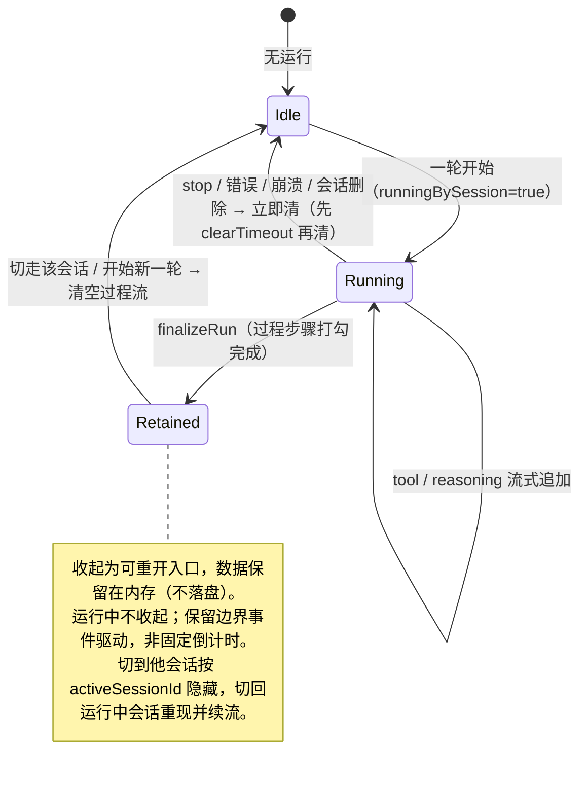

# feat: 个人工作区会话——执行过程移至右侧临时区且不落盘

## Summary

把个人工作区会话里 agent 的中间执行过程（工具调用折叠成的 `agentLog`「N 步」卡片、`reasoning` 思考流）从中间对话流移到右侧一块**临时、随运行出现的执行过程区**；中间对话只保留用户提问与最终结果。过程信息**不落盘**——会话存档只存提问与结果，但过程在本会话内存内保留可回看至切走或下一轮。范围限个人工作区，团队侧渲染零回归。

---

## Problem Frame

当前 agent 的中间执行过程内联渲染在中间对话流（`AgentLogMessage` / `ReasoningMessage`），并且 `agentLog` 会被写入磁盘 chat JSON（`sanitizeForSave` 只丢弃 `typing` 与 `reasoning`，保留 `agentLog`）。这带来两个**相互独立**的问题，本计划分别处理：

- **呈现：对话被过程淹没**。用户回看一段会话时，真正关心的「我问了什么、得到什么结果」被一长串工具步骤卡片打断、稀释。→ 解法是把过程移出中栏对话列。
- **持久化：过程被落盘**。中间步骤是一次性的执行轨迹、不是长期记录，却被写进 chat JSON，长会话下持续撑大文件（与当年 `reasoning` 被 `sanitizeForSave` 丢弃所规避的「撑爆 chat JSON」同类）。→ 解法是过程永不落盘。

两个解法叠加会顺带删掉一个**现有能力**：当前 `agentLog` 落盘且在历史会话里可展开回看。本计划**有意保留「会话内回看」**：过程移到右侧区后默认收起为可重新展开的入口、数据随会话保留在内存（不落盘）；只放弃**跨重启的持久回看**。这样降噪与不落盘两个目标都达成，而「可回看」不被牺牲。

---

## Requirements

### 会话呈现（中栏）

- R1. 中间对话流只渲染用户提问（`text` who=me）与最终结果（`text` who=agent），不再内联工具步骤卡片或思考流。
- R2. 一轮运行期间，中栏保留一个轻量「运行中／思考中」提示，直到该轮结束才消失（纯工具长执行期间中栏不静默）。当右侧过程浮层因窗口尺寸被收起或不可见时，该提示至少反映当前步数或最近一步文本，使进度可见性不依赖浮层是否渲染。
- R3. 纯工具轮（成功但本轮无任何 agent 文本）在中栏补一条终态占位，避免「问了没回」的观感。
- R4. 错误／超时／spawn 失败／鉴权类提示仍作为结果文本进中栏并落盘，失败会话重开后仍能看到失败原因。

### 右侧执行过程区

- R5. agent 中间执行过程（`agentLog` 步骤 + `reasoning` 思考）移到右侧一块临时执行过程区，随运行流式更新。
- R6. 过程区独立于现有右栏 文件／Tasks／闪记／Skills——不作为新的常驻 `rightView` 标签、不参与其视图切换、不抢占其宽度与内容。
- R7. 过程区按 `activeSessionId` 隔离：只显示当前会话的过程；后台运行会话的过程不在当前会话屏上显示；切回仍在运行的会话能重现其过程并续流——重现以 process query 未被回收为界（后台长轮的 `gcTime` 处理见 U2），超界时切回显示明确占位而非误判为 bug。
- R8. 一轮结束后过程区不立即销毁，而是收起为一个紧凑、可重新展开的入口，数据随会话保留在内存（不落盘）；运行中不收起。保留边界为事件驱动（切走该会话或开始新一轮即清），而非固定倒计时。
- R9. 过程区的出入场与收起动画在 `prefers-reduced-motion: reduce` 下静默；收起后的展开入口键盘可聚焦可激活（`role`/`aria-expanded`），流式步骤对辅助技术可感知（`aria-live`，或由 R2 中栏提示承担进度告知），浮层出现不抢焦点。

### 持久化（不落盘）

- R10. agent 中间执行过程不写入磁盘：会话存档（chat JSON）只保存提问与结果。过程流仅存于 React Query 内存缓存，不出现在任何 `bridge.save*` 入参、不进 store 的 `toPersistedState`、不被任何 React Query 落盘插件捕获（本仓无 `persistQueryClient`）。
- R11. 现有已落盘旧会话里的中间过程（`agentLog`）在加载时被清除，重开历史会话只见问答，无需独立迁移脚本。该清洗在 `throughUid` 命中的隐藏历史路径上无损；但 `createHiddenHistory` 仅在末条消息有 `uid` 时写 `throughUid`（`messages.ts:274`，`Message.uid` 可选），`count` 兜底路径真实可达——剥离 `agentLog` 使数组变短时，按旧 `count` 切分的隐藏/可见边界会偏移，须在清洗时同步修正（按剥离前后长度差回算 `count`，或在 `splitPersonalMessages` 内对剥离后数组重新定位边界）。

### 范围与回归

- R12. 改动限个人工作区；团队侧共享的 `ChatArea` / `MessageStream` 渲染零回归（`agentLog` / `reasoning` 仍在团队侧内联），且不改动 `ChatArea.tsx` 的导出面。
- R13. 时间线摘要（run 事件 `summary` / `files`）不受影响，仍来自 `run.buffer` / `run.changedFiles`。

---

## Key Technical Decisions

- KTD1. 独立瞬态过程流（路线 B1）。过程（`tool→agentLog`、`reasoning`）折叠进一条独立的 per-session React Query key（`["personal","process",sessionId]`），与持久消息流 `personalChatKeys.detail` 分离，**永不 `saveChat`**。理由：直接满足「不落盘」零依赖 sanitize 兜底，中栏天然只剩问答，符合「消息流走 React Query」的硬边界，把「持久会话」与「瞬态过程」语义彻底分开。**代价显式可见**：B1 引入第二条流，需与 `run.cursor`、运行态、清理出口、保留/清空时机保持同步（见 Alternatives 的同步面对比）——这是用同步成本换语义分离的有意取舍，不是「问题固有复杂度」。备选路线 A、C 见 Alternatives。
- KTD2. `sanitizeForSave` 丢 `agentLog`，且这是**有意的破坏性旧档迁移**。`sanitizeForSave` 同时作用于加载（`messages.ts:1371`、`:1424`）与保存（`messages.ts:303`）两条路径。新增 `m.kind !== "agentLog"` 过滤后，任何旧档被加载进缓存、随后发生任意一次 `flushChat`，都会把该 chat JSON **原地重写**为不含 `agentLog` 的版本（无 `.bak`、不可逆）。这正是「过程永不落盘、旧过程也彻底消失」所要的语义，故接受；但须作为显式契约写明，不留作隐式副作用。
- KTD3. 浮起 overlay 挂载，不进 `rightView`。过程区是相对中栏列的**绝对定位浮层（overlay，非并排的常驻第三列面板——文件名中的 `side-panel` 仅指「在右侧」，不指 docked 面板）**，**不扩 `RightView` 联合、不进 `PersonalRightPanel` 三元链、不参与 `.pw-upper`/`.pw-center-col` 的 flex**。理由：用户明确要求过程区不和 文件／Tasks 混进同一套视图切换；浮层叠加而非替换，不打断用户正在看的文件预览／Tasks。挂载与定位前置条件见 High-Level Technical Design 与 U4（须给定位锚点加 `position: relative`，浮层须 `position: absolute` 以脱离中栏列的 `flex:1` 规则）。
- KTD4. 结束后收起为可重开入口，保留边界事件驱动。`finalizeRun` 成功收尾后，过程区收起为紧凑可展开入口，过程数据保留在 React Query 内存，直到**切走该会话或开始新一轮**才清空（而非固定计时销毁）——消除「5s 倒计时是唯一回看窗口」的随机信息丢失。若仍需一个自动收起的视觉延迟，其计时是 view 层的收起动画（参照 `ToastStack`/`Jellyfish`），不是 core 的数据销毁 timer。任何 core 侧延迟清理 timer 的句柄存独立 `Map<sessionId, timer>`（仿 `saveTimers`，`messages.ts:280`），**绝不挂 `RunState`**（`finalizeRun` 已 `runs.delete`，挂 run 上则清理出口无从 `clearTimeout`）。修正：不参照 Pet 节拍器（其衰减计时在 view 组件、store 只存态，与本处 core 持态语义不符）。
- KTD5. 中栏运行态语义。运行中用一个**渲染在 `MessageStream` 容器之外、独立于 `convo` 是否为 null** 的轻量「运行中」提示（读 `runningBySession[activeSessionId]`）替代易被首个事件 `dropMsg` 删除的 `typing` 占位——保证「首轮纯工具、消息流尚空（`convo===null`）」时提示仍可见。该提示不进 `convo`/消息流（否则又被落盘/被 drop）。纯工具轮补一条终态占位文本；错误文案仍走 `text` 进中栏并落盘（C2 守护，迁移时不触碰这些 `appendMsg(kind:"text")` 分支）。
- KTD6. 折叠职责：纯函数只管同流折叠，跨流收尾全在调用方。不变量：`foldCliEvent` 纯函数**只负责把同类事件折进自己那条流**；删去其 text 分支里对 `agentLog` 的跨类收尾（`messages.ts:408` 那段在 B1 下会作用于不含该 `logUid` 的消息数组，成为静默 no-op）。`text` 到达且上一块是 tool 时，由 `handleCliEvent`/`handlePiEvent` 对 **process key** 调一次 `finalizeAgentLog(processPrev, run.cursor.logUid)` 并清 `logUid`；`result`/`turn-end` 分支（`messages.ts:522-531`、pi `:942`/`:977`）的 `finalizeAgentLog` 目标一律改到 process key。**同型的跨流收尾点还有两处必须一并改 target，否则同样静默 no-op**：pi `tool-end` 的 `finalizeLastToolItem`（`messages.ts:810`，把最后一个 running 工具项翻 `check`/⚠️）、`reasoning` 收尾 `finalizeRunReasoning`（`messages.ts:800`，6 处调用 `:924/932/950/966/974`）——两者的 `setMessages` 目标都改到 process key。建议把 `logUid` 从共享 `FoldCursor` 迁出为 `run` 上的独立 process 游标，避免单游标隐式承载两条流的状态。
- KTD7. 过程区独立节流。过程流是新订阅者，套用与消息流同款的渲染节流（`CHAT_RENDER_THROTTLE_MS ≈ 80ms`，`messages.ts:1386`），避免高频 `tool`/`reasoning` 每 token 触发右区全量重渲；并守住 `React.memo`「未变项保留原引用」契约（`ChatArea.tsx:114`）。
- KTD8. 会话隔离与按语义分类的清理出口。过程流按 `sessionId` 命名空间，瞬态、不进 `toPersistedState`。清理出口按语义分两类，不可混为「七处都塞同一段」：
  - **立即清空**（错误/异常终态）：`reapSessionRun`（会话删除）、`failPiTurn`、watchdog 超时、stop 4s 兜底、pi `crashed`、`finalizeRun` 的 run-not-found 兜底分支——这些经共享 helper `clearTransient`（全部 6 处调用，`messages.ts:602/891/1006/1081/1683/1858`，分别对应 finalizeRun 的 run-not-found 兜底、pi `crashed`、`reapSessionRun`、`failPiTurn`、watchdog、stop 4s 兜底）统一调 `clearProcess`，每个出口在清 process key 前必须先 `clearTimeout` 该 session 的延迟清理 timer。
  - **保留+收起**（正常成功）：`finalizeRun` 成功路径——收尾打勾后保留、不立即清。
  - **单独处理**：`editResend` 不走 `clearTransient`，须显式调用一次 `clearProcess(sessionId)`（截断重发前）；它被 `runningBySession` 守卫（`messages.ts:1760`），不存在「运行中过程残留」，故只是清掉上一轮残留入口。
- KTD9. 过程行用新建精简组件，不复用团队侧私有渲染件。`AgentLogMessage` / `ReasoningMessage` 是 `ChatArea.tsx` 内的模块私有 `const`（未 export）。新建一个精简的 `ProcessStep` 渲染件在 `packages/views/cortex-desktop/personal/` 内，**不**把团队侧组件提为导出——避免触碰 `ChatArea.tsx` 导出面、与 R12「不改 ChatArea」一致；其展开/收起状态由过程流自身的 `active`/`completed`（U1/U2 在 process key 上翻转）驱动。

---

## High-Level Technical Design

### 数据流：一份事件，分流到「持久问答」与「瞬态过程」两条流、两个渲染面

```mermaid
flowchart TB
  EV["CLI / pi 事件<br/>init · text · tool · reasoning · result"] --> H["handleCliEvent / handlePiEvent<br/>(messages.ts)"]
  H -->|"text 增量"| ML["持久消息流<br/>personalChatKeys.detail(sessionId)"]
  H -->|"tool→agentLog · reasoning"| PS["瞬态过程流<br/>personal/process(sessionId)"]
  H -.->|"text 到达且上块是 tool：<br/>收尾 process 流打开的 agentLog"| PS
  ML --> SAVE["sanitizeForSave → saveChat<br/>磁盘 chat JSON（仅 text：提问+结果）"]
  ML --> CENTER["中栏 MessageStream<br/>仅渲染 text（问答）"]
  PS --> PANEL["右侧 PersonalProcessPanel<br/>按 activeSessionId 渲染过程"]
  PS -. 永不落盘（无 bridge.save* 通道） .-> NONE["（不写磁盘）"]
```

关键不变量：`text`（含 who=me 提问、who=agent 结果、⚠️ 错误文案）始终只进消息流并落盘；`tool`/`reasoning` 只进过程流；跨流收尾（虚线）由调用方对 process key 执行，纯函数 `foldCliEvent` 只做同流折叠（KTD6）。`run.buffer` 与 `run.changedFiles`（时间线摘要来源）与本改造解耦，R13 因此成立。

### 过程区生命周期：运行时出现、结束收起可重开、切走/下一轮才清



### 挂载与定位（不进 rightView，浮层脱流）

```
.pw-upper (行 flex, cortex-desktop.css:4159)
  .pw-center-col (flex:1; 需补 position:relative 作定位锚点)
    ├─ PersonalChatArea
    └─ PersonalProcessPanel (position:absolute, 贴会话区右上角)   ← 新增：脱离中栏列 flex，不抢宽
  {!automationOpen && rightOpen ? <PersonalRightPanel/> : null}    ← 现有右栏，原样不动
```

定位前置：`.pw-center-col` 当前无 `position: relative`（`cortex-desktop.css:4162`），且有 `.pw-center-col > :not(.pw-col-head){flex:1}`（`:4163`）会把非脱流的直接子元素拉伸成等高——故过程区**必须** `position: absolute` 才不被压垮，且其定位锚点（`.pw-center-col` 或专用 wrapper）须显式 `position: relative`。`ToastStack` 先例（`.toast-stack` absolute，`cortex-desktop.css:2969`）挂在 `CortexDesktopView` 根层，定位祖先与此挂点不同，不能直接照搬其 `bottom/left` 写法。门控：仅当中栏正显示会话区（非 automation/home/timeline/noteEditor/settings）且当前会话有过程时渲染；与 `rightOpen`/`rightView` 解耦。窄窗退化见 U4。

---

## Implementation Units

### U1. 过程流独立通道 + 不落盘 + 旧档迁移

- Goal: 新增 per-session 瞬态过程流，把 `tool→agentLog`、`reasoning` 的折叠目标改到过程流；`text` 仍进消息流；跨流收尾在调用方；过程流永不落盘；`sanitizeForSave` 丢弃 `agentLog` 兜底旧档。落地 R1、R5、R10、R11、R13、KTD1、KTD2、KTD6、KTD7。
- Requirements: R1, R5, R10, R11, R13
- Dependencies: 无
- Files:
  - `packages/core/personal/messages.ts`（新增 process query key + 免落盘 setter `setProcessMessages(qc, sessionId, updater)`（写 `["personal","process",sessionId]`、**绝不调 `scheduleChatSave`**，区别于硬绑 `personalChatKeys.detail`+`scheduleChatSave` 的现有 `setMessages`，`:316`）+ process 专用 `foldIntoCache` 变体（复用 `foldCliEvent`/`foldReasoning` 纯函数、经 `setProcessMessages` 落地）+ `usePersonalProcess(sessionId)` 节流 hook；`foldIntoCache` 的 tool 折叠与 `foldReasoning` 目标改为 process 流；**删去 `foldCliEvent` text 分支对 agentLog 的跨类收尾（`:408`）**；`handleCliEvent`/`handlePiEvent` 在 `text` 到达且上块是 tool 时对 process key 调 `finalizeAgentLog(processPrev, run.cursor.logUid)` 并清 `logUid`；`result`/`turn-end` 分支（`:522-531`、`:942`、`:977`）、pi `tool-end` 的 `finalizeLastToolItem`（`:810`）、`reasoning` 收尾 `finalizeRunReasoning`（`:800`，6 处调用）的 `setMessages` 目标一律改 process key；`logUid` 迁出为 `run` 上的独立 process 游标；`sanitizeForSave` 增 `m.kind !== "agentLog"` 过滤）
  - `packages/core/personal/messages.test.ts`
- Approach: 不变量「纯函数只管同流折叠、跨流收尾全在调用方」（KTD6）。`text` 仍走 `personalChatKeys.detail`，不动 `run.buffer` 累加（R13）。process query 用 `staleTime: Infinity` + 与消息流同款 `useThrottledValue` 节流。`sanitizeForSave` 的 `agentLog` 过滤是有意的破坏性旧档迁移（KTD2），仅安全于 `throughUid` 命中的隐藏历史路径（R11）。
- Execution note: characterization-first，但**不复用为「交错折叠测试无需改」**——既有 `describe("流式交错折叠 foldCliEvent")` 用例（`messages.test.ts:312-393`）断言的是「text/tool 在同一数组交错收尾」，B1 下两条独立数组不再发生该交错；这些用例须重新校准期望，跨流收尾为净新增逻辑须补特征测试。所有 `__handle*EventForTest` 后读 `agentLog`/`reasoning` 的集成断言（约 52 处引用）须改为读 process key（引入 `processCacheOf(qc, sessionId)` 测试辅助）。
- Patterns to follow: `foldCliEvent` / `foldReasoning` / `foldIntoCache`（`messages.ts:392,455,776`）；节流参照 `CHAT_RENDER_THROTTLE_MS` + `useThrottledValue`（`messages.ts:1386`）；瞬态 query key 命名空间仿 `personalChatKeys`（`messages.ts:51`）；`sanitizeForSave` 既有 `reasoning` 过滤（`messages.ts:287`）。
- Test scenarios:
  - 一轮 `text` 事件后，消息流含对应 `text` 消息，过程流为空。
  - 一轮 `tool` 事件后，过程流（`processCacheOf`）含 `agentLog`（步骤 `running`），消息流不新增 `agentLog`。
  - `tool, tool, text` 序列：`text` 到达时**对 process key** 收尾 `agentLog`（两步全部 `check`/完成），消息流只含一条 `text`（验证跨流收尾，非 `:408` 同数组 no-op）。
  - pi `reasoning` 增量折叠进过程流的 `reasoning` 块，消息流无 `reasoning`。
  - 用假 `bridge.saveChat` spy：一轮 `text`+`tool`+`reasoning` 后，`saveChat` 收到的数组只含 `text`；process key 的 `setQueryData` 从不触发任何 `bridge.save*`。
  - 改写现有 `sanitizeForSave` 断言（`messages.test.ts:412-416`）：期望从「保留 `agentLog`」改为「丢弃 `agentLog`」（`toEqual(["text","text"])`）。
  - Covers R11. 加载含历史 `agentLog` 的旧档 → 触发一次 `flushChat` → 断言 `saveChat` 收到的数组已不含 `agentLog`（验证旧档被原地清洗，固化破坏性契约）。
  - Covers R11. 旧档含 `text-agentLog-text` 交错 + 一条带 `throughUid` 的 `hiddenHistory` → 清洗后 `splitPersonalMessages` 的可见/隐藏切分对用户语义不变（`throughUid` 命中路径无损）。
  - Covers R11. 旧档 `hiddenHistory` 无 `throughUid`（仅 `count`）→ 清洗剥离 `agentLog` 后，按修正逻辑重定位的隐藏/可见边界仍与清洗前对用户语义一致（`count` 兜底路径无损）。
  - pi `tool-start, tool-end` 序列后，process 流该工具步骤翻 `check`（错误时 ⚠️ 前缀），验证 `finalizeLastToolItem` 作用于 process key 而非持久流。
  - pi `reasoning` 增量后 `finalizeRunReasoning` 在 process 流上把 `reasoning` 块正确翻完成态。
- Verification: 个人会话流式时中栏只出现 `text`，工具步骤出现在过程流且能正确收尾打勾；磁盘 chat JSON 不含 `agentLog`/`reasoning`；旧会话重开只见问答。

### U2. 过程流生命周期与按语义分类的清理出口

- Goal: `finalizeRun` 成功后保留并收起过程区、事件驱动清空；各异常终态出口立即清空并取消游离 timer。落地 R7、R8、KTD4、KTD8。
- Requirements: R7, R8
- Dependencies: U1
- Files:
  - `packages/core/personal/messages.ts`（`finalizeRun` 成功路径收尾过程流为完成态并保留；新增 `clearProcess(sessionId)` + 独立 `processCleanupTimers: Map<sessionId, timer>`；立即清空出口经 `clearTransient`（`messages.ts:602/891/1006/1081/1683/1858` 全部 6 处）调用 `clearProcess`，每处先 `clearTimeout`；`editResend` 截断前显式调用 `clearProcess`；`reapSessionRun` 删会话时取消游离 fade timer；后台运行会话给 process query 设显式 `gcTime`（≥ pi 看门狗时长）或保活隐藏 observer，使 R7 切回重现不被 10min 全局 `gcTime` 回收；`__resetPersonalMessageRunsForTest` 清空过程流与全部 timer）
  - `packages/core/personal/messages.test.ts`
- Approach: 严格区分「保留+收起」（仅 `finalizeRun` 成功路径）与「立即清空」（异常终态）；二者对 process 的处理不同，不可只在 `clearTransient` 里塞一段。延迟清理/收起 timer 句柄存独立 `Map`（仿 `saveTimers`，`messages.ts:280`），不挂 `RunState`；任一立即清空出口先 `clearTimeout(processCleanupTimers.get(sessionId))` 再清 process key，杜绝「会话已删、游离 timer 触发把数据写回已删会话 process key」的复活。`editResend` 是受 `running` 守卫的伪运行态出口，只清上一轮残留入口。
- Execution note: characterization-first——先固化各出口现有「清消息列表瞬态」行为，再扩展清过程流。
- Patterns to follow: `clearTransient`（`messages.ts:330`）、`reapSessionRun`（`messages.ts:995`）、watchdog（`messages.ts:1674`）、stop 兜底（`messages.ts:1848`）、`editResend`（`messages.ts:1756`）；timer Map 仿 `saveTimers`（`messages.ts:280`）。
- Test scenarios:
  - `finalizeRun` 成功后过程流步骤全部 `check`/completed 且**保留可读**（不立即清空）。
  - 切到他会话再切回／开始新一轮：前者保留并隐藏、切回重现；后者清空旧过程。
  - 运行中 stop：过程流当前 `agentLog` 收尾后被清；无错误文本误入消息流。
  - 会话删除（`reapSessionRun`）在 `finalizeRun` 已挂保留 timer 后发生 → 推进 fake timer → 断言过程流不被 timer 重新写入（无复活）。
  - pi `crashed` / `failPiTurn` / watchdog 超时：过程流被清，游离 timer 被取消。
  - `editResend` 截断：目标会话上一轮残留过程入口被清。
  - 后台长轮超默认 gc 窗口后切回：过程流仍可重现（显式 `gcTime`/保活 observer 生效），或退化为明确占位（验证 R7 边界）。
  - `__resetPersonalMessageRunsForTest` 清空全部过程流与 timer。
- Verification: 任一终态后右侧不残留已结束/已删会话过程；正常完成轮过程收起可重开；pi 看门狗超时不泄漏；无 timer 复活已删会话数据。

### U3. 中栏运行态语义：运行中提示 + 无文字回复占位

- Goal: 运行中中栏保留独立于 `convo` 的轻量「运行中」提示；纯工具轮（CLI 与 pi 两条分支各自判定）补终态占位；确认错误文案仍进中栏。落地 R2、R3、R4、KTD5（C1、C2）。
- Requirements: R2, R3, R4
- Dependencies: U1
- Files:
  - `packages/core/personal/messages.ts`（`handleCliEvent` result 分支：`ev.ok && !run.sawText && !ev.text` 时 `appendMsg` 占位 `text`；`handlePiEvent` result 分支：`run.resultOk !== false && !run.sawText` 时占位，且须在该 case 内、`finalizeRun` 之前执行——pi 的 `result` 事件是 `{willRetry}`，无 `ok`/`text` 字段）
  - `packages/views/cortex-desktop/personal/PersonalChatArea.tsx`（新增渲染在 `MessageStream` 容器之外、独立于 `convo===null` 的「运行中／思考中」提示行，读 `runningBySession[session.id]`；浮层不可见时回填步数/最近一步——该步数/最近一步取自 process key 的派生计数，是 B1 分离的一处有意例外，不进 store、不进消息流）
  - `packages/views/cortex-desktop/cortex-desktop.css`（`.pw-running-hint` 样式 + `prefers-reduced-motion` 静默）
  - `packages/core/personal/messages.test.ts`、`packages/views/cortex-desktop/personal/PersonalChatArea.test.tsx`
- Approach: 占位逻辑按通道分写（CLI 读 `ev.ok`/`ev.text`，pi 读 `run.resultOk`/`run.sawText`），与现有 `!sawText && ev.text` 兜底并存；运行中提示纯渲染、读 store 运行态，渲染层级在 `MessageStream` 之外以覆盖「首轮纯工具、`convo===null`」；保留 C2 全部 `appendMsg(kind:"text", ⚠️ …)` 错误分支不动。
- Patterns to follow: CLI result 兜底（`messages.ts:558`）、pi result case（`messages.ts:962-984`，末尾 `finalizeRun`）；运行态读取 `running`（`PersonalChatArea.tsx:181`）、`convo` 计算（`:170-176`）；瞬态提示参照 `TypingMessage` 但简化、不入消息流。
- Test scenarios:
  - CLI 纯工具轮（`ev.ok`、`!sawText`、`!ev.text`）后中栏新增占位 `text(agent)`。
  - pi 纯工具轮（result 仅 `willRetry:false`、`!sawText`）后中栏新增占位 `text(agent)`。
  - 有文本的正常轮不追加占位（不重复）。
  - Covers R4. `result.ok=false` / spawn 失败 / 超时仍 `appendMsg(kind:"text")` 进消息流并落盘。
  - Covers R2. `messages` 为空但 `running=true`（首轮纯工具、`convo===null`）时中栏存在 `.pw-running-hint`；`finalizeRun` 后该提示消失。
  - Covers R2. 浮层不可见（窄窗退化）且运行中时，中栏提示显示当前步数/最近一步文本（取自 process 流派生计数）。
- Verification: 提问后运行中始终有「运行中」提示（即便消息流尚空）；纯工具轮（含 pi）也有可见结果；失败会话重开仍见 ⚠️ 文案。

### U4. 右侧执行过程区组件 PersonalProcessPanel

- Goal: 新增浮起、可收起可重开的临时执行过程区，读过程流按 `activeSessionId` 渲染、随运行流式更新、结束收起，并在窄窗下退化不遮挡正文。落地 R5、R6、R7、R8、R9、KTD3、KTD9。
- Requirements: R5, R6, R7, R8, R9
- Dependencies: U1（数据）, U2（保留/收起时机）
- Files:
  - `packages/views/cortex-desktop/personal/PersonalProcessPanel.tsx`（新建）
  - `packages/views/cortex-desktop/personal/PersonalProcessPanel.test.tsx`（新建）
  - `packages/views/cortex-desktop/personal/PersonalWorkspace.tsx`（在 `.pw-center-col` 内、`PersonalChatArea` 之后挂载，独立门控）
  - `packages/views/cortex-desktop/cortex-desktop.css`（`.pw-center-col` 或专用 wrapper 补 `position: relative`；`.pw-process` 浮层 `position: absolute` + 淡入／收起 `@keyframes` + 窄窗 `@media` 退化 + `prefers-reduced-motion: reduce` 静默）
- Approach: 组件 `usePersonalProcess(activeSessionId)` 取过程流，空集 `return null`；用新建精简 `ProcessStep` 渲染件（KTD9，不复用 `ChatArea` 私有件），展开/收起由过程流 `active`/`completed` 驱动；`position: absolute` 脱离中栏列 `flex:1` 规则、锚到 `.pw-center-col` 的 `relative`；结束后收起为可重开入口（数据由 U2 保留至切走/下一轮）。门控与 `rightOpen`/`rightView` 解耦，依据「中栏显示会话区 + 当前会话有过程」。窄窗退化以**中栏实际可用宽度**（受右栏 `is-fileopen`/`is-detail` 展宽影响后的 `.pw-center-col` 计算宽度，经 container query 或 `ResizeObserver`/`:has` 联动右栏态判定，而非整窗宽度）为准：窄于阈值（如 < 480px）时改底部贴附或收起为单行摘要、不覆盖正文与输入框。可达性：收起后的展开入口键盘可聚焦、`role="button"`+`aria-expanded` 反映展开态；流式步骤容器加 `aria-live="polite"`（或显式标注视觉-only、由 R2 中栏提示承担辅助技术进度告知）；浮层出现不抢当前焦点。
- Patterns to follow: 瞬态纯渲染 + 空集 null + 自动收起：`ToastStack.tsx` + `store/ui.ts:79`；会话隔离过滤：`AskQuestionCard.tsx:22`；动画与 `prefers-reduced-motion` 硬约定：`Jellyfish.tsx:123`；浮层定位思路（注意定位祖先不同）：`.toast-stack`（`cortex-desktop.css:2969`）。**不**参照 `notes-overlay`（独立 BrowserWindow，量级错配）。
- Test scenarios:
  - 当前会话有过程流时渲染过程区并展示步骤；过程流为空时 `return null`。
  - 流式追加 `tool` 步骤时过程区增量更新；`finalizeRun` 后收起为可重开入口、再点开仍显示该轮过程（数据保留）。
  - Covers R7. 会话隔离：过程挂在会话 A，`activeSessionId` 为 B 时过程区不显示 A 的过程；切回 A 重现。
  - Covers R6. 不渲染进 `PersonalRightPanel`，`rightView` 不被改动；过程区 `absolute` 不改变 `.pw-upper` 行 flex 与 `PersonalRightPanel` 宽度/位置，现有右栏 文件／Tasks 同时可见。
  - Covers R9. `prefers-reduced-motion: reduce` 下不应用进出场/收起动画。
  - 门控：automation/home/timeline/noteEditor/settings 打开（中栏非会话区）时过程区不渲染。
  - 窄窗（中栏 < 阈值）时过程区退化为底部贴附/单行摘要，不覆盖正文与输入框。
  - 右栏处于 `is-fileopen`/`is-detail` 展宽态、中栏被挤窄到阈值以下时，过程浮层退化（底部贴附/单行摘要），不覆盖中栏正文与输入框。
  - 收起后的展开入口键盘可聚焦并可激活（`role="button"`+`aria-expanded`）；浮层出现不夺取当前焦点。
- Verification: 运行时右上角浮出过程区、流式更新，结束收起可重开；切换会话过程区随当前会话；现有右栏与中栏布局、窄窗正文均不被遮挡。

### U5. 集成与回归测试（团队侧零回归 + 跨场景 + 不落盘强保证）

- Goal: 守住团队侧零回归并覆盖多会话／切换／截断等跨单元场景，把「永不落盘」从「靠 sanitize 兜底」升级为「结构上无落盘通道」的强保证。落地 R12，并端到端复核 R7、R10。
- Requirements: R12
- Dependencies: U1, U2, U3, U4
- Files:
  - `packages/core/personal/messages.test.ts`、`packages/views/cortex-desktop/personal/PersonalChatArea.test.tsx`、`packages/views/cortex-desktop/personal/PersonalProcessPanel.test.tsx`、`packages/views/cortex-desktop/ChatArea.test.tsx`（团队侧回归）
- Approach: 以现有 `__handleCliEventForTest` / `__handlePiEventForTest` + 真实 `QueryClient` 驱动端到端场景；团队侧直接渲染 `MessageStream`（不传过程相关 prop）断言 `agentLog`/`reasoning` 仍内联，且 `ChatArea.tsx` 导出面未变（KTD9 用新组件、未导出团队侧件）。
- Test scenarios:
  - Covers R12. 团队侧 `MessageStream` 传入含 `agentLog`/`reasoning` 的 `convo`、不传任何过程相关 flag 时仍内联渲染 `.agent-log` / `.reasoning-block`（与现状一致）。
  - 多会话并发：A、B 同时运行，过程流各自累积，过程区只渲染 `activeSessionId` 的那份。
  - 切换重现：A 运行中切到 B 再切回 A，A 过程区重现并续流。
  - `editResend` 截断含旧 `agentLog` 的会话后：落盘内容不含 `agentLog`，且截断后中栏不渲染 `.agent-log`（旧档残留不因截断闪回中栏——必要时 `editResend` 写 `truncated` 前先过一遍 `sanitizeForSave`）。
  - HMR 重建 run（`sessionIdHint` 路径）后过程流仍能继续接收过程事件。
  - Covers R10. 端到端不落盘强保证：一段含工具+思考+结果的会话，`bridge.saveChat` 调用只由 `text`/`result` 触发、收到内容只含 `text`；process key 的 `setQueryData` 从不引发任何 `bridge.save*`。
- Verification: `pnpm --filter @cortex-work/core test` 与 `pnpm --filter @cortex-work/views test` 全绿；团队侧渲染与 `ChatArea.tsx` 导出面无变化。

---

## Scope Boundaries

- 范围限**个人工作区**（`packages/views/cortex-desktop/personal/` + `packages/core/personal/`）。团队侧 `ChatArea` / `RightPanel` 不改、导出面不动（KTD9）。
- `piRuntime` chips（压缩／重试／待注入队列／思考档）保留在中栏头部（现状），**不**迁入过程区——它们是会话级运行时元状态，不是逐步执行过程。
- `diff` / `approve` 卡片不在本计划范围（个人区流式管线当前不产出这两类）。

### Deferred to Follow-Up Work

- **跨重启的持久过程回看**：本计划只保留「会话内存内回看」（R8）；跨应用重启的历史轮过程回看不做（与「不落盘」直接冲突）。若后续确有需求，需重新评估持久化策略，单列。
- chat JSON 与过程流的长会话条数硬上限／裁剪（现仅靠 React Query gc 与渲染窗口）——本计划不引入，沿用现状。

---

## System-Wide Impact

- **持久化契约变更（破坏性、不可逆）**：chat JSON 不再包含 `agentLog`（此前包含）。`sanitizeForSave` 加载+保存两路共用，旧档被加载后任意一次 `flushChat` 即原地重写为不含 `agentLog` 的版本（无 `.bak`）。这是有意契约（KTD2），无下游消费 `agentLog`（时间线摘要走 `run.buffer`，不读 `agentLog`；backfill 的 `deriveBackfillEvents` 只读 `text`）。
- **并发与生命周期**：触及多会话并发运行、`activeSessionId` 切换、HMR 重建 run，以及按语义分类的清理出口与游离 timer 取消（KTD8）——B1 第二条流是本计划新增的状态同步面（取舍见 KTD1/Alternatives），任一不同步会造成过程残留或泄漏。
- **共享渲染管线**：`ChatArea` / `MessageStream` 为团队／个人、Web／Desktop 共用；B1 只改个人区折叠目标、用新建 `ProcessStep` 渲染过程，不改 `MessageStream` 渲染能力、不改 `ChatArea.tsx` 导出面，团队侧结构上零回归（以回归测试守住）。
- **不落盘泄漏审计（闭环）**：过程流 (1) 不在任何 `bridge.save*` 入参，(2) 不进 store `toPersistedState`（仿 `runningBySession`/`piRuntimeBySession`），(3) 本仓无 `persistQueryClient` 等 React Query 落盘插件——三条逐一排除，R10 由「结构上无落盘通道」保证。
- **性能契约**：过程区是新订阅者，须套用消息流同款节流并守住 `React.memo` 引用稳定假设。

---

## Alternatives Considered

- **路线 A：过程仍折进消息流 + 中栏 filter + `sanitizeForSave` 丢 `agentLog` + 右区反向 filter。** 改动面最小（`foldCliEvent` 完全不动），且复用现有单流清理出口（过程随消息一起被 `clearTransient`/`reapSessionRun` 处理）。代价：过程仍写消息流并每 token 排落盘 timer（白做功）；右区只显示「当轮过程」需 run-scoping；中栏 filter 干扰渲染窗口计数。**同步面对比**：A 复用现有单流出口、无第二游标；B1 需同步第二条流（`run.cursor` 跨流持 `textUid`/`logUid`）、按语义分类的清理出口、保留/清空时机。选 B1 是**有意用更多同步点换取「过程彻底离开消息流 DOM 与落盘契约」的语义分离**，而非因为 A 更复杂。
- **路线 C：过程留在中栏、默认折叠成单行摘要（如「▸ 12 步工具调用」），点开才展开。** 天然随消息流持久/清理（无第二条流、无出口同步）、随历史会话自然回看（无信息丢失）、无浮层尺寸/遮挡问题。**否决理由**：用户在原始请求中明确要求过程显示在**右侧**、不留在对话列里（来自用户直述、非推断）——C 与该明确诉求冲突。记录在此以使取舍可见：B1/A 相对 C 的复杂度溢价，是为换取「过程移出中栏、落到右侧」这一用户明确的呈现目标。
- **复用团队侧 `AgentLogMessage`/`ReasoningMessage` 渲染过程行。** 否决（KTD9）：二者是 `ChatArea.tsx` 私有 `const`，复用须提为导出、触碰本应零回归的团队侧文件。改为新建精简 `ProcessStep`。
- **浮层并排第三列挂载（参与 flex）。** 否决：会和现有右栏抢 flex 宽度、详情宽态下挤窄中栏。改用 `absolute` 脱流浮层（KTD3）。
- **piRuntime chips 迁入过程区。** 否决：语义上属会话级运行时元状态，保留中栏头部。

---

## Risks & Dependencies

- 折叠分流改动触及 streaming-interleaving 修复过的归约层。缓解：characterization-first；明确「`foldCliEvent` 单测可保留为纯函数级，但集成断言需整体改读 process key，跨流收尾为净新增逻辑须补测」（不可当作「测试免改」）。
- 清理出口语义异质（共享 helper `clearTransient` vs `finalizeRun` 成功路径 vs `editResend`）。缓解：按「立即清空 / 保留+收起 / 单独处理」三类实现 + 逐出口测试（U2）。
- 延迟清理/收起 timer 与会话删除竞态（timer 复活已删会话 process key）。缓解：timer 句柄存独立 `Map`、立即清空出口先 `clearTimeout`（KTD8）+ 复活测试（U2）。
- 浮层定位前置（`.pw-center-col` 无 `relative`、有 `flex:1` 规则）与窄窗遮挡。缓解：补 `position: relative` + 浮层 `absolute` 脱流 + 窄窗 `@media` 退化（U4）。
- pi 占位判定字段（pi `result` 无 `ok`/`text`）。缓解：U3 按通道分写判定 + pi 专用占位测试。

---

## Open Questions

实现期可调，非阻塞：

- 过程区「收起」的触发时机（运行结束后立即收起为入口、还是停留短延迟再收起）与收起动画时长——R8 已定「数据保留至切走/下一轮」，此处仅是视觉收起节奏。
- 收起入口的标识内容（步数 / 最近一步摘要 / 纯图标）——建议与 R2 中栏提示对齐为「N 步 + 最近一步」，使收起后仍可辨识该轮过程。
- 过程步骤渲染件 `ProcessStep` 的视觉密度（是否完全独立样式还是借用部分 `agent-log` 视觉）。

---

## Sources & Research

- 落盘单一闸口、加载+保存共用与旧档迁移先例：`packages/core/personal/messages.ts:287`（`sanitizeForSave`）、`:303`（保存路径）、`:1371`/`:1424`（加载路径）；测试 `packages/core/personal/messages.test.ts:412-416`（现断言保留 agentLog，须改写）。
- 折叠归约层与跨流收尾点：`packages/core/personal/messages.ts:392`（`foldCliEvent`）、`:408`（须摘除的同数组收尾）、`:455`（`foldIntoCache`）、`:776`（`foldReasoning`）、`:522-531`（CLI result 收尾）、`:962-984`（pi result）、`:810`（`finalizeLastToolItem`，pi tool-end）、`:800`（`finalizeRunReasoning`，6 处调用 `:924/932/950/966/974`）、`:316`（现有 `setMessages` 硬绑 detail+`scheduleChatSave`，过程流须另建免落盘 setter）、`:591`（`finalizeRun`）。
- 清理出口与 timer 范式：`clearTransient` 调用点 `:602/891/1006/1081/1683/1858`、`reapSessionRun:995`、`editResend:1756`（running 守卫 `:1760`）、`saveTimers:280`（独立 timer Map 范式）；会话删除入口 `PersonalSidebar.tsx:70`。
- 时间线与 `agentLog` 解耦：`finalizeRun` 摘要走 `run.buffer` / `run.changedFiles`，`deriveBackfillEvents` 只读 `text`。
- 渲染与 memo 契约、私有渲染件：`packages/views/cortex-desktop/ChatArea.tsx:114`（memo 注释）、`:191`（`ReasoningMessage`，私有）、`:230`（`AgentLogMessage`，私有）、`:580`（团队侧 collapsible 内联）。
- 瞬态 UI 范式：`packages/views/cortex-desktop/ToastStack.tsx` + `packages/core/store/ui.ts:79`（自动移除）、`packages/views/cortex-desktop/personal/AskQuestionCard.tsx:22`（会话隔离）、`packages/views/cortex-desktop/personal/Jellyfish.tsx:123`（`prefers-reduced-motion` 硬约定）。
- 右栏/中栏布局与挂载：`packages/views/cortex-desktop/personal/PersonalWorkspace.tsx:101-117`（`.pw-upper`/`.pw-center-col`）、门控 `:116`；`cortex-desktop.css:4159`（`.pw-upper`）/`:4162-4163`（`.pw-center-col` 无 relative + `flex:1` 规则）/`:2969`（`.toast-stack`）；`PersonalRightPanel.tsx:98`（`rightView` 三元链）、`packages/core/store/personal.ts:42`（`RightView`）/`:63-70`（瞬态字段）/`:702`（`toPersistedState`）。
- 隐藏历史切分：`splitPersonalMessages`（`throughUid` 命中 vs `count` 兜底）、`createHiddenHistory`（总写 `throughUid`）。
- 相关历史决策：`docs/plans/2026-06-14-002-fix-streaming-message-interleaving-plan.md`（折叠归约层前身）、`docs/flash-notes-impl-contract.md:474-532`（读取期合成、绝不双写落盘 KTD6）、`:320-327`（`rightView` 三元链治理）。
