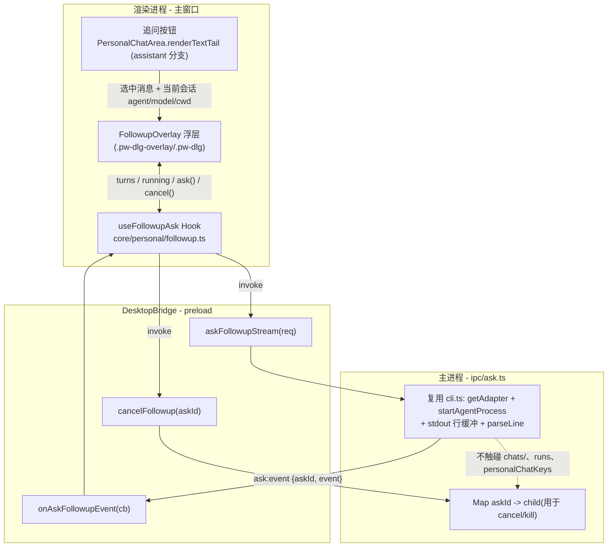
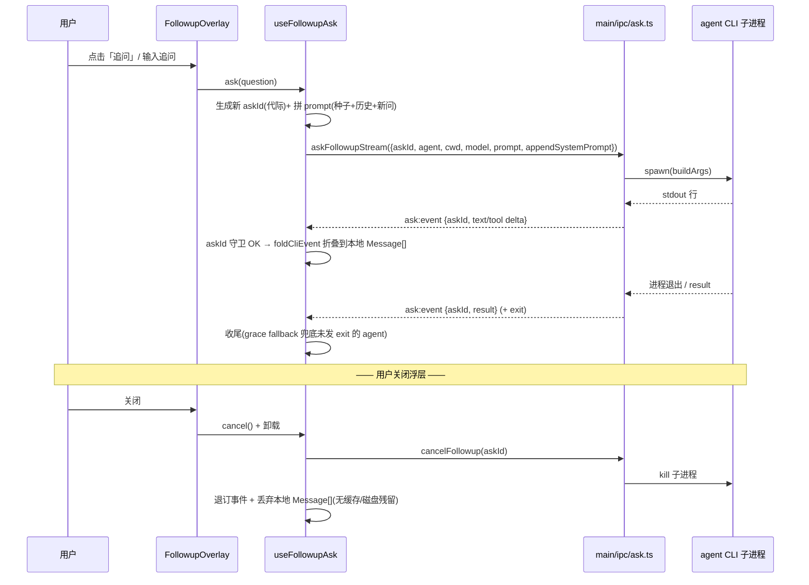

# feat: 历史消息追问浮层(即问即答、关闭即弃)

## Summary

在个人工作区桌面端会话里,给每条 assistant 文本消息加一个「追问」入口。点击后弹出一个**应用内浮层小窗**,以该条消息正文为上下文种子,经**新增的临时流式应答通道**作答。浮层内可连续多轮追问形成临时对话,但**窗口关闭即从 app 侧全部丢弃**——不写入主会话、不落盘 `chats/`、不进 React Query 缓存或 run 注册表。目标是「再次提问而不污染主会话、即问即答」。仅桌面端(Electron),Web 端无桥接能力时隐藏入口。

> 「关闭即弃」的边界:本功能保证 **app 自身不留痕**(不写主会话、不进 `chats/`/缓存/注册表)。底层 agent CLI(claude/codex)仍会在其自身目录(`~/.claude`、`~/.codex`)写 transcript——这属系统层,不在 app 控制范围(见 Scope Boundaries)。对外表述应说「不污染主会话、app 不落盘」,不宜承诺「系统层零留痕」。

---

## Problem Frame

用户在浏览一段会话时,常想就**其中某条消息**追问几句(澄清、展开、换个角度),但又不希望这些临时问答把主会话搅乱——既不想在主时间线里塞进与主线无关的往返,也不想留痕。现有路径都不合适:`send`/`startCli` 会落盘 `chats/<id>.json` 并进 run 注册表(正是要避免的"污染");`oneshotCli` 虽不落盘但会缓冲整段、一次性返回,没有逐字流式体验。因此需要一条「流式 + 不落盘 + 关闭即弃」的新通道,以及一个轻量浮层 UI。

---

## Requirements

### 入口与上下文
- R1. 个人工作区会话中,每条 assistant 文本消息的底部操作行提供「追问」入口;Web 端(无 `desktopBridge` 或无新方法)时隐藏。
- R2. 点击「追问」弹出应用内浮层,以该条消息正文作为上下文种子注入应答。
- R6. 应答复用当前活动会话的 agent / model / 工作目录(`cwd`),**不新建会话**。

### 应答与交互
- R3. 应答**流式到达即渲染**(claude/pi 为逐字增量;codex 的文本为整段一次性到达——粒度随 agent 而异,UI 须就此区分体感,见 KTD6);text 与 tool 事件按到达顺序交错折叠(复用既有折叠语义)。
- R4. 浮层内可连续多轮追问,形成一段临时对话(后续轮带上本浮层内的历史)。
- R8. 应答结束能可靠收尾(含部分 agent 不发 exit、以及失败/非零退出的情况),不留永久「运行中」状态;失败时浮层呈现明确错误态而非空白(见 U3/U4)。

### 隔离与清理(核心约束)
- R5. 关闭浮层即丢弃全部内容:**不**写入主会话、**不**落盘 `chats/`、**不**进 React Query 缓存(`personalChatKeys`)、**不**进 run 注册表(`runs`)。
- R7. 在途子进程与事件订阅在所有终止路径都不泄漏,清理覆盖三条路径:① 浮层关闭/取消 = `cancel()` + kill + 清本地态;② app `window-all-closed` 与真正退出 = `killAllAsk()`(并入既有 killAll 注册表);③ app 隐藏到托盘(close-to-tray:窗口只 hide、renderer 不卸载)时浮层主动 `cancel()`。
- R9. 追问应答在**无项目工作目录**(`cwd` 退化到 `homedir()`)时不得让 agent 的 tool 在用户主目录跳审批执行有副作用操作:此场景须收紧/禁用 tool 能力(claude 收紧权限、codex 用沙箱而非 bypass),或禁用该会话的追问入口。

---

## Key Technical Decisions

- KTD1. **应用内浮层,而非独立 BrowserWindow。** 浮层渲染在主 renderer 内,天然拥有 `CoreProvider`/`QueryClientProvider`/注入的 `desktopBridge`,也直接拿得到被追问的那条消息对象,无需跨窗口 IPC 传递上下文。这同时规避了独立浮层窗口的已知陷阱(裸 React root 无 QueryClient,见 `docs/plans/2026-06-15-001-feat-flash-notes-plan.md` KTD10)。独立悬浮窗(可拖出 app、置顶于其他应用之上)列入 Alternatives,本期不做。

- KTD2. **新增专用 `ask:*` 流式通道,不复用 `oneshotCli` / `send` / `startCli`。** `oneshotCli` 缓冲后一次性返回,无逐字 UI;`send`/`startCli` 会 `appendUserMessage` → React Query 缓存 → `flushChat`/`saveChat` 落盘并注册 `runs`——正是要避免的污染。新通道在主进程**复用 `cli.ts` 的 spawn 基建**(`getAdapter` / `startAgentProcess` / `spawnEnvFor` / stdout 行缓冲 + `adapter.parseLine`),但用一次性 `askId`,既不写 `chats/`、也不入个人 run 注册表。

- KTD3. **临时态用组件/Hook 本地 state + 复用纯函数 `foldCliEvent`,不进 React Query。** 浮层的多轮 `Message[]` 持于本地 `useState`/`useRef`;text/tool 事件用 `foldCliEvent`(`packages/core/personal/messages.ts:392`,纯函数,只吃 `Message[]`+event+cursor,不碰 `qc`)折叠。结束/收尾不调 `setMessages(qc,...)`。这样「关闭即弃」=组件卸载,无任何缓存或磁盘残留。

- KTD4. **多轮用每轮无状态重发,不维持 agent 会话。** 每一轮都是一次全新单发 spawn:prompt 由「种子消息块 + 本浮层已发生的问答 + 本轮新问题」拼成,种子放 `appendSystemPrompt`。好处是绝对不落盘、无会话文件生命周期管理;代价有二:① 每轮重发累积上下文的 token 成本;② **语义保真风险**——每个 spawn 是无记忆的 print 模式进程(`claude -p`/`codex exec`/`pi -p`),不会把内嵌的 `assistant:` 段理解为「自己上一轮的输出」,而是当作用户给的文本,故「你上一句为何这么说 / 继续 / 再展开第 2 点」这类指代上轮自身输出的追问易答非所问。缓解:`buildFollowupPrompt` 用明确角色标注包裹历史(如「以下 `<assistant>` 段是你在本次追问会话中先前的回答,请据此继续」),并加一条指代上轮输出的测试用例(U3)。维持临时 agent 会话(关闭删文件)列入 Alternatives。

- KTD5. **`askId` 每轮唯一,作代际守卫;关闭/取消是显式清理路径。** 事件 envelope 外层带 `askId`,浮层折叠前守卫 `active.askId !== ev.askId → 丢弃`(封堵并发重入 + IPC 在途旧事件晚到)。浮层关闭/取消 ≠ 仅销毁组件:必须 `cancelFollowup(askId)` → 主进程 kill 子进程 + 退订事件。**注意 app 是 close-to-tray**:点 X 默认只 hide、renderer 不卸载,故"关闭=cancel"不能只挂在组件卸载上,还须在 app 进入后台(window hide)时主动 cancel,并把 `killAllAsk()` 接进 `index.ts` 的 `window-all-closed` 与真正退出钩子(与既有 `killAllCli`/`killAllPiSessions` 并列,经 `register.ts` 导出),否则后台仍有跳审批的 agent 子进程在跑(参考 `docs/plans/2026-06-17-004-feat-pi-askquestion-tool-plan.md` 清理矩阵)。

- KTD6. **pi/codex 经单发 adapter 路径,不为浮层启长驻 RPC;但须装配 provider 并接受 codex 的整段粒度。** `getAdapter('pi'|'codex')` 的 `buildArgs`/`parseLine` 在单发路径可用(同 `cli:oneshot`)。两点不可省:① **provider 装配**——pi 用自定义供应商时,正确应答依赖 provider 解析(`sendPiTurn` 从 `session.providerId` → `providerSettings.providers` 解析 → `writePiExtension` 生成扩展 → `spawnEnvFor` 注入 key);故 `AskFollowupRequest` 须带可选 `provider`,U1 在 pi 分支复用 `cli:start` 的 `if(agent==="pi"&&provider) piExtensionPath=writePiExtension(provider)`(否则 R6「复用当前会话 model」对 pi 自定义供应商不成立)。② **codex 粒度**——codex 的 `parseLine` 把文本作为 `item.completed` 整段发一个 `text` 事件(非增量),故 codex 会话的追问体感接近 oneshot;R3 的「流式」对 codex 表现为「生成中 → 整段出现」,UI 须为 codex 显示「生成中」占位而非逐字光标。

- KTD7. **种子上下文 = 选中消息正文,用正文级截断上限。** 截断不复用 `clipSummary` 的 200 字摘要级上限(会砍残正文);采用独立的、更宽的正文级上限。拼装风格参照 `buildAttachmentSystemPrompt`(`messages.ts:74`):用一个标注块包住正文并提示 agent「这是用户想追问的一段历史回复」。

- KTD8. **无 cwd 会话的 tool 安全。** claude 单发带 `--dangerously-skip-permissions`、codex 带 `--dangerously-bypass-approvals-and-sandbox`;当 `cwd` 退化到 `homedir()`(无项目会话)时,这些跳审批的 tool 会在用户主目录真实执行,有误伤风险。本期取保守解:无 cwd 时禁用追问入口(U5 门控),或在 ask 路径对追问场景收紧 tool 能力(claude `--disallowedTools`/收紧权限,codex 用沙箱)。满足 R9。

---

## High-Level Technical Design

### 分层与数据流

### 单轮应答 + 关闭即弃时序

---

## Implementation Units

### U1. 主进程:新增临时流式应答通道 `ipc/ask.ts`

**Goal:** 提供「流式 + 不落盘 + 可取消」的单发应答 IPC,复用 `cli.ts` spawn 基建。
**Requirements:** R3, R5, R6, R7, R8, R9
**Dependencies:** 无
**Files:**
- `apps/desktop/src/main/ipc/ask.ts` (新建)
- `apps/desktop/src/main/ipc/types.ts` (新增 `AskFollowupRequest`;事件复用 `CliStreamEvent`)
- `apps/desktop/src/main/ipc/register.ts` (导入并调用 `registerAskHandlers()`;导出 `killAllAsk` 供退出钩子调用,仿现有 `killAllCli` 导出链)
- `apps/desktop/src/main/ipc/cli.ts` (仅按需抽出 stdout 行缓冲循环为可复用 helper;`getAdapter`/`startAgentProcess`/`spawnEnvFor` 已是 `export function`,直接 import 即可,**不改其签名**)
- `apps/desktop/src/main/index.ts` (在 `window-all-closed` 与真正退出钩子里调 `killAllAsk()`,与既有 `killAllCli`/`killAllPiSessions`/`killAllPty` 并列)
- `apps/desktop/src/main/ipc/ask.test.ts` (新建)

**Approach:**
- `ipcMain.handle("ask:start", (e, req: AskFollowupRequest))`:`getAdapter(req.agent).buildArgs({...req, runId: req.askId, sessionId: req.askId})` → `startAgentProcess`;stdout 逐行 `parseLine` → `e.sender.send("ask:event", { askId, event })`;进程退出/`result` 双保险收尾(决定见 KTD/Open Questions:复用 `{type:"result"}` + 子进程 `close`,渲染端据此关 `running`)。
- **pi 自定义供应商**:在 buildArgs 前复用 `cli:start` 的 `if (req.agent==="pi" && req.provider) req.piExtensionPath = writePiExtension(req.provider)`,并用 `spawnEnvFor({agent, provider})` 注入 key——否则 pi 自定义供应商的追问无扩展/无 key,违背 R6。
- **tool 安全(R9)**:`cwd` 退化到 `homedir()` 时(无项目会话),对 claude/codex 收紧 tool 能力(不带 bypass/skip 标志或显式 `--disallowedTools`/沙箱);见 KTD8。
- 维护模块级 `Map<askId, child>`;`ipcMain.handle("ask:cancel", kill + 删表)`;子进程自然退出时也删表;`killAllAsk()` 遍历表全 kill。
- **绝不**调用 `saveChat`/写 `chats/`,**不**接触个人 `runs`。
- `AskFollowupRequest` 字段:`askId, agent, cwd, prompt, model?, appendSystemPrompt?, effort?, provider?`(`CliStartRequest` 的不落盘子集,无 `sessionId`/`resumeSessionId`;`provider` 同 `CliStartRequest.provider` 形状)。

**Patterns to follow:** `apps/desktop/src/main/ipc/cli.ts` 的 `cli:start`(224-297,含 `writePiExtension`/`spawnEnvFor` 装配 229-231)与 `cli:oneshot`(303+);`killAllCli` 的导出 + 退出钩子接线链(`index.ts` `window-all-closed`/`onRealQuit`);`spotlight`/automation 的 `Map<id, proc>` 取消范式。
**Test scenarios:**
- text delta 多行流入 → 逐条 `ask:event` 按序发往 sender。
- `ask:cancel` → 对应子进程被 kill 且从表移除;重复 cancel 幂等无抛。
- `killAllAsk()` → 多个在途 ask 子进程全部被 kill 且清表(Covers R7 的退出/托盘路径)。
- 进程非零退出 → 发出携带 `error` 的终止事件,不抛未捕获异常(Covers R8 失败态)。
- pi + 自定义 provider → buildArgs 含 `-e <piExtensionPath>` 且环境注入 key;无 provider 的 pi 不加该参数。
- 无 `cwd`(homedir 退化)→ claude/codex 以收紧后的 tool 能力启动(无 bypass/skip 标志);Covers R9。
- 终止后迟到的 stdout 行不再向 sender 发事件(进程已 kill)。
**Verification:** 单测覆盖上述;手动:从浮层发起一次追问,主进程日志可见 spawn 与逐行解析;关闭浮层 / 收进托盘后该子进程消失(`ps`)。

### U2. Bridge 接线:preload 暴露 + core 类型镜像 + 接口声明

**Goal:** 把 `ask:*` 通道经四层标准接线暴露为可选 `DesktopBridge` 能力。
**Requirements:** R1(Web 降级依据), R3, R7
**Dependencies:** U1
**Files:**
- `apps/desktop/src/preload/index.ts` (`personal` 对象新增 `askFollowupStream` / `onAskFollowupEvent` / `cancelFollowup`)
- `packages/core/desktop/types.ts` (镜像 `AskFollowupRequest`,含可选 `provider`;复用 `CliStreamEvent`)
- `packages/core/desktop/bridge.ts` (`DesktopBridge` 新增三方法,**均标 `?:` 可选**)

**Approach:**
- 仿 `startCli` / `onCliEvent` / `killCli` 的 preload 写法:`askFollowupStream` 走 `ipcRenderer.invoke("ask:start", req)`;`onAskFollowupEvent(cb)` 包 `ipcRenderer.on("ask:event", ...)` 并返回退订函数;`cancelFollowup` 走 `invoke("ask:cancel", askId)`。
- `core/desktop/types.ts` 与 `main/ipc/types.ts` 的 `AskFollowupRequest` **逐字段对账一致**。
- bridge 方法可选,使 Web 端(`bridge` 为 `null`)与旧壳自动降级。

**Patterns to follow:** `docs/plans/2026-06-18-001-feat-desktop-chat-image-upload-plan.md`(四层接线 + 三处镜像)、`bridge.ts` 现有 `startCli`/`onCliEvent` 段。
**Test scenarios:** `Test expectation: none -- 纯接线/类型镜像,无独立行为;由 U1/U3 的集成路径覆盖。` 收尾必做:`core/desktop/types.ts` 与 `main/ipc/types.ts` 字段对账。
**Verification:** `pnpm --filter @cortex-work/desktop typecheck` 通过;改完 preload/主进程**彻底重启 Electron**(preload/main 不热更)后,`window.desktopAPI.personal.askFollowupStream` 存在。

### U3. core:临时追问 Hook `personal/followup.ts`

**Goal:** 提供浮层用的临时多轮问答状态机:拼 prompt、折叠流式、代际守卫、收尾兜底、清理。
**Requirements:** R3, R4, R6, R7, R8
**Dependencies:** U2
**Files:**
- `packages/core/personal/followup.ts` (新建:`useFollowupAsk(seed, sessionCtx)` Hook + 纯函数 `buildFollowupSystemPrompt` / `buildFollowupPrompt`)
- `packages/core/personal/followup.test.ts` (新建)
- `packages/core/index.ts` 或相应 `exports` (若需对外导出给 views)

**Approach:**
- Hook 返回 `{ turns: Turn[], running: boolean, ask(question), cancel(), reset() }`,其中每个 `Turn` 带 `status: "streaming" | "done" | "error" | "cancelled"`(供 U4 渲染错误/取消态,满足 R8)。
- `turns` 持于本地 `useState`/`useRef`,**不**用 Zustand、**不**用 React Query。
- `ask()`:生成新 `askId`(放 `useRef` 作 active 代际)→ 把用户问题 append 到本地 `turns` → `buildFollowupPrompt(seed, turns, question)` + `buildFollowupSystemPrompt(seed)` → `bridge.askFollowupStream({...sessionCtx, provider})`。`sessionCtx` 含 `agent/model/cwd/provider`,由 U5 解析后传入。
- `buildFollowupPrompt` 用明确角色标注包裹历史(KTD4:标注 `<assistant>` 段为「你在本次追问会话中先前的回答」),避免无状态重发的指代漂移。
- 订阅 `bridge.onAskFollowupEvent`:守卫 `ev.askId === activeRef.current`;`text/tool` 经 `foldCliEvent`(复用 `messages.ts:392` 纯函数,传本地 `cursor` ref)折叠进当前 `Turn`;`result.ok=false`/error → 当前 `Turn.status="error"` 并关 `running`;`result`/exit 正常 → `status="done"`。
- 收尾兜底:仿 `scheduleResultExitFallback`(`messages.ts:582`),对不发 exit 的 agent 设宽限定时器关 `running`。
- `cancel()`/卸载:`bridge.cancelFollowup(askId)` + 退订 + 当前 `Turn.status="cancelled"` + 清 `running`。
- `buildFollowupSystemPrompt` 用正文级上限截断种子正文(非 `clipSummary` 200 字)。

**Patterns to follow:** `messages.ts` 的 `usePersonalCliEvents`(事件订阅 + 折叠)、`foldCliEvent`/`emptyFoldCursor`/`finalizeAgentLog`、`buildAttachmentSystemPrompt`、`scheduleResultExitFallback`;provider 解析参照 `sendPiTurn`(`messages.ts:1121-1125`,`session.providerId ?? defaultProviderId` → `providerSettings.providers`)。
**Test scenarios:**
- `buildFollowupSystemPrompt`:超长种子正文按正文级上限截断;短正文原样;含特殊字符不破坏块结构。
- `buildFollowupPrompt`:多轮历史按顺序串入并带角色标注,新问题在末尾;含一条「指代上轮自身输出」的追问用例(Covers KTD4 语义保真)。
- 折叠:text→tool→text 事件序列产出「文本块 / agentLog 块 / 新文本块」三段(不退化成两块);Covers R3。
- 代际守卫:旧 `askId` 的迟到 text 事件被丢弃,不污染当前 turn;Covers R7。
- 收尾兜底:只收到 text、迟迟无 result/exit → 宽限后 `running` 转 false,无永久运行中;Covers R8。
- 失败态:收到 `error`/非零退出终止事件 → 当前 `Turn.status="error"`、`running` 关、可再次发问;Covers R8。
- `cancel()`:调用 `bridge.cancelFollowup`、当前 `Turn.status="cancelled"`,后续事件不再改 `turns`。
**Verification:** `pnpm --filter @cortex-work/core test` 全绿;Hook 在浮层中能驱动一次完整多轮问答,含失败/取消态。

### U4. views:追问浮层组件 `FollowupOverlay.tsx`

**Goal:** 应用内浮层 UI:展示种子消息、多轮问答流、输入框,关闭即弃。
**Requirements:** R2, R3, R4, R5
**Dependencies:** U3
**Files:**
- `packages/views/cortex-desktop/personal/FollowupOverlay.tsx` (新建)
- `packages/views/cortex-desktop/cortex-desktop.css` (复用 `.pw-dlg-overlay`/`.pw-dlg`;按需加追问浮层专属类)

**Approach:**
- **三段式固定布局**:顶部种子消息正文(只读、可折叠)固定;中部 `turns` 区**独立滚动**,流式时自动吸底(用户上滚时暂停吸底);底部输入框固定。避免长答案撑高浮层或看不到生成结尾。
- 用 `.pw-dlg-overlay` + `.pw-dlg`(`role="dialog"`、`aria-modal`、`stopPropagation`),模板参照 `PiToolConfirmDialog.tsx`。
- 中部渲染 `turns`(复用现有单条消息渲染:`TextMessage`/`MessageStream`,以本地 `turns` 喂入)。**注意**:若 `MessageStream` 内部耦合主会话 React Query/run 注册表读取,则改用其纯展示子组件或本地轻量渲染,守住「不进缓存/注册表」(见 Risks)。
- **状态可见**:`streaming` 显示流式光标(codex 显示「生成中」占位,见 KTD6)+「停止」按钮;`error` 轮渲染错误文案 +「重试本轮」入口;`cancelled` 轮标注已取消;空态(未发问)中部给一句引导(如「就这条回复继续追问,关闭即丢弃」)。
- **键位**:多行 `textarea`,Enter 发送 / Shift+Enter 换行,与主会话 ChatArea 输入框约定一致;`running` 时禁用输入。
- **焦点**:打开时初始焦点落输入框;Tab/Shift+Tab 焦点陷在浮层内;关闭后焦点归还触发「追问」按钮(若 `PiToolConfirmDialog` 已有焦点处理则复用)。
- 接 `useFollowupAsk`;关闭(背景/ESC/关闭键)统一走 `cancel()` 后卸载,保证 R5/R7。

**Patterns to follow:** `packages/views/cortex-desktop/personal/PiToolConfirmDialog.tsx`、`AutomationDialog.tsx`(`.pw-dlg` shell + 焦点/ESC);`ChatArea.tsx` 的 `MessageStream`/`TextMessage` 渲染与输入框键位。
**Test scenarios:**
- 打开 → 顶部显示种子正文、中部空态引导、焦点在输入框;Covers R2。
- 发送一问 → 流式区渲染应答(claude/pi 逐字、codex「生成中」→整段);Covers R3。
- 连续两问 → 浮层内出现两轮问答,中部自动吸底;Covers R4。
- `error` 轮 → 显示错误文案 +「重试」,输入恢复可用;Covers R8。
- 键位:Enter 发送、Shift+Enter 换行;`running` 时输入禁用、「停止」可中断。
- 焦点:Tab 不逸出浮层;关闭后焦点回到触发按钮。
- 背景点击 / ESC / 关闭键 → 触发 `cancel()` 且组件卸载;Covers R5。
**Verification:** Testing Library 渲染交互断言;手动:浮层弹出、流式、错误态、关闭无残留。

### U5. views:会话内「追问」按钮 + 浮层挂载 + Web 降级

**Goal:** 在 assistant 消息操作行接入入口,管理浮层开合与种子/会话上下文传递。
**Requirements:** R1, R2, R6, R9
**Dependencies:** U4
**Files:**
- `packages/views/cortex-desktop/personal/PersonalChatArea.tsx` (`renderTextTail` assistant 分支加按钮;持有浮层开合 state;解析并注入会话上下文)

**Approach:**
- 在 `renderTextTail` 的 assistant 分支(当前 258-280 的 `.m-act-row`)增一个「追问」按钮:用语义清晰的图标(对话气泡/问号类),带 `aria-label`/`title`「追问」,排在既有 复制/朗读 按钮**之后**形成固定次序。
- 点击:`setFollowup({ seedText: msgText, seedUid: m.uid })` 打开 `FollowupOverlay`。
- **会话上下文解析**:`agent`/`model`/`providerId` 取自当前 `SessionMeta`(`usePersonalStore`),`cwd` 不在 `SessionMeta` 上——按现有合成口径 `cwd = realProject?.path ?? session.noProjectDir`(参照 `PersonalChatArea.tsx:131-146` 的 `syntheticNoProject`),主进程再兜底 `homedir()`。`provider` 由 `providerId` → `providerSettings.providers` 解析(pi 自定义供应商需要)。
- **R9 门控**:无 cwd(`realProject?.path` 与 `session.noProjectDir` 都缺)时,要么禁用「追问」按钮,要么仅在浮层内对该次追问标记「收紧 tool」传给 U1(见 KTD8)。
- **Web 降级**:按钮仅在 `bridge?.askFollowupStream` 存在时渲染(同 `App.tsx` 既有可选能力门控范式);Covers R1。
- 浮层挂载在 `PersonalChatArea` 内,单实例;同时只开一个追问浮层(切换种子打开新浮层前,旧浮层先 `cancel()`)。

**Patterns to follow:** `renderTextTail` 现有复制/朗读按钮(`m-act-btn`);`App.tsx:15-18` 可选能力门控降级;`PersonalChatArea.tsx:131-146` 的 cwd 合成;`sendPiTurn` 的 provider 解析。
**Test scenarios:**
- assistant 文本消息底部出现带 `aria-label`「追问」的按钮,排在 复制/朗读 之后;`me` 消息不出现(本期仅 assistant);Covers R1。
- 无 `bridge.askFollowupStream`(Web/旧壳)→ 按钮不渲染;Covers R1。
- 点击 → 浮层以该条正文为种子打开,且 `agent/model/cwd/provider` 正确解析传入,无新建会话;Covers R2, R6。
- 无 cwd 会话 → 入口禁用或追问走收紧 tool 路径;Covers R9。
**Verification:** `pnpm --filter @cortex-work/views test` 通过;手动:点按钮弹浮层、追问、关闭。

---

## Scope Boundaries

### 不做(本期非目标)
- 独立悬浮窗(可拖出 app、置顶于其他应用之上)——本期是应用内浮层。
- 在 `me`(用户)消息上提供追问入口——本期仅 assistant 文本消息。
- 把追问结论「回填」进主会话或导出为闪记——本期严格丢弃。
- pi 的长驻 RPC 富事件(reasoning/工具起止细分)——本期 pi 走单发。
- Web 端实现——无桥接能力时隐藏入口。

### 不在本功能控制范围
- 底层 agent CLI(如 `claude`)在其自身目录(`~/.claude` 等)写的会话/transcript:本功能保证 **app 自身不落盘**(不写 `chats/`、不进缓存/注册表),但无法、也不负责清理 agent CLI 进程自留的记录。

### 可作后续跟进(Deferred to Follow-Up Work)
- 种子上下文可选「带上前一条用户消息 / 整段会话」以增强追问质量(见 Open Questions)。
- 在 `me` 消息上也支持追问。
- 全局热键唤起追问浮层(若做需固化 `globalShortcut` 接入经验,见 `docs/plans/2026-06-15-001-feat-flash-notes-plan.md` 尾注)。

---

## Open Questions

- 种子上下文范围:默认仅注入**被选中的那条消息正文**。是否需要默认带上其紧邻的上一条用户消息(常能显著提升追问可用性)?默认取「仅选中消息」,在 U3 的 `buildFollowupSystemPrompt` 留扩展位,待实现时按手感定。
- 误关保护:有未关闭的多轮内容时,背景点击/ESC 是否需二次确认?本期默认「关闭即弃、不确认」(与功能定位一致);若实测误关痛感明显,再加保护。

**已定**(原 Open Question,经评审定稿):终止信号约定 = **复用 `{type:"result"}` + 子进程 `close` 双保险**,配 grace fallback;U1 发、U3 收据此对齐(不新增 `ask:exit`)。

---

## Risks & Dependencies

- 迟到事件串场:多轮快速发问或 IPC 在途旧事件晚到 → 用 `askId` 代际守卫(KTD5)两端封堵。
- **孤儿子进程(close-to-tray)**:app 点 X 默认只 hide、renderer 不卸载,「关闭=cancel」失效且 `window-all-closed` 不 fire → 三路清理(浮层 cancel + app 后台主动 cancel + `killAllAsk()` 接退出钩子,KTD5/R7/U1)。
- agent 不发 exit:本轮卡「运行中」→ `scheduleResultExitFallback` 式宽限收尾(U3,R8)。
- **codex 非逐字**:codex 文本整段到达,追问体感接近 oneshot → R3/KTD6 已限定表述,UI 为 codex 显示「生成中」占位。
- **无状态重发语义漂移**:指代上轮自身输出的追问易答非所问 → `buildFollowupPrompt` 角色标注 + 测试用例(KTD4/U3)。
- **无 cwd 的 tool 安全**:跳审批 tool 在 homedir 执行有误伤风险 → 收紧/禁用(KTD8/R9/U1/U5)。
- **`MessageStream` 耦合**:本地 `turns` 直喂若拉入主会话 React Query/run 依赖,违背「不进缓存/注册表」→ 改用纯展示子组件(U4)。
- 多轮 token 成本:无状态重发累积上下文随轮数增长 → 接受(即问即答通常短);必要时后续可加轮数/长度上限。
- 工程约束:preload/主进程改动**不热更**,验证前须彻底重启 Electron(已在 U2 Verification 标注);开发期 renderer HMR/刷新会丢失 `useRef` 里的 `askId`,在途子进程事件无人接收——开发期现象,生产无此路径。
- 复用细节:`cli.ts` 的 stdout 行缓冲(含 1MB 溢出保护、无换行末行冲刷)目前内联在 `cli:start`;U1 抽成 helper 而非复制,避免两处维护漂移。

---

## Sources & Research

- 按钮挂载点:`packages/views/cortex-desktop/personal/PersonalChatArea.tsx` `renderTextTail` assistant 分支(258-280 `.m-act-row`)。
- 消息类型:`packages/core/types/index.ts` `Message` 联合(text 变体含 `who`/`text`/`uid`/`time`)。
- 流式 spawn 基建:`apps/desktop/src/main/ipc/cli.ts` `cli:start`(224-297)、`cli:oneshot`(303+);事件契约 `apps/desktop/src/main/ipc/types.ts` `CliStreamEvent`(246-250)、`CliStartRequest`(193-219)。
- 折叠纯函数:`packages/core/personal/messages.ts` `foldCliEvent`(392)、`FoldCursor`(350)、`emptyFoldCursor`(363)、`finalizeAgentLog`(368);收尾兜底 `scheduleResultExitFallback`(582);system prompt 拼装 `buildAttachmentSystemPrompt`(74)。
- 桥接四层接线 + 三处镜像:`docs/plans/2026-06-18-001-feat-desktop-chat-image-upload-plan.md`;`packages/core/desktop/bridge.ts`(`startCli`/`onCliEvent`/`killCli` 段)、`apps/desktop/src/preload/index.ts`。
- 浮层 shell:`packages/views/cortex-desktop/personal/PiToolConfirmDialog.tsx`、`AutomationDialog.tsx`(`.pw-dlg-overlay`/`.pw-dlg`)。
- 清理矩阵 / 代际守卫经验:`docs/plans/2026-06-17-004-feat-pi-askquestion-tool-plan.md`、`docs/plans/2026-06-17-002-feat-pi-rpc-robustness-plan.md`;流式聚合教训:`docs/plans/2026-06-14-002-fix-streaming-message-interleaving-plan.md`。
- 包边界:`docs/floder.md`(core 不依赖 `react-dom`/`process.env`;ui 不引 core;views 不引 `next/*`/`react-router-dom`)。
