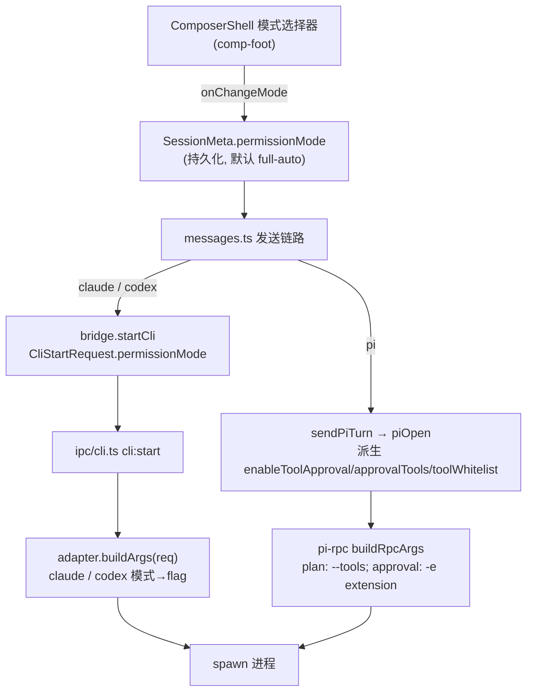

# feat: Agent 运行模式（plan / accept-edits / full-auto）

## Summary

给个人工作区会话引入「运行模式」选择器，让用户在发送前选择 agent 的权限松紧档位。三档语义统一、跨 claude / codex / pi 三个 agent：

- **plan**：只读分析 + 出计划，不改文件、不跑写/执行类工具。
- **accept-edits**：自动接受文件编辑，写工作区放行；危险/执行类工具（bash 等）受限或仍需审批。
- **full-auto**：跳过全部权限，所有工具直接执行（= 当前行为）。

模式随会话持久化（存 `SessionMeta`），各 agent 的 `buildArgs` 把模式翻译成自己 CLI 的原生标志；UI 落在 Composer 工具栏，与模型、思考强度并列。**默认 `full-auto`**，不破坏现有体验，用户主动切档才收紧。

核心约束：claude / codex 跑在 `-p` / `exec` 非交互流式（print）模式，**没有人工审批回路**，所以三档映射到各 CLI 的原生 sandbox / permission 标志，而非弹审批框。pi 是唯一例外——它走 RPC 长驻通道，已有 `tool_call` extension 审批 hook，accept-edits 可弹审批；但 pi 没有原生权限/沙箱标志，plan 只读靠工具白名单 `--tools` 兑现。

---

## Problem Frame

当前所有 agent 一律以「最宽松」方式启动：claude `--dangerously-skip-permissions`、codex `--dangerously-bypass-approvals-and-sandbox`、pi 不注入审批 extension。用户无法让 agent「只读看一眼出个计划」或「自动改文件但别乱跑命令」。本计划引入用户可选的三档权限模式，把「现状全自动」收敛为其中最松的一档，并补齐 plan / accept-edits 两档收紧能力。

**为什么不是弹审批框**：claude / codex 的每轮对话是一次性 `-p` / `exec` spawn，进程无 stdin 交互回路，无法在工具调用中途把审批请求回送给用户。因此 plan / accept-edits 必须靠 CLI 启动时的 sandbox / permission 标志「事前约束」工具能力，而不是「事中审批」。pi 走 RPC 长驻、有 `extension_ui_request` 双向通道，是唯一能做事中审批的 agent。

---

## Requirements

- **R1**：用户能在 Composer 为当前会话选择三档运行模式之一（plan / accept-edits / full-auto）。
- **R2**：所选模式持久化到会话（`SessionMeta`），重开会话保留；新会话默认 `full-auto`。
- **R3**：claude / codex / pi 三个 adapter 各自把模式翻译成本 CLI 能兑现的原生标志，行为符合下文映射表。
- **R4**：模式在非交互 print 模式下不得导致进程挂起（plan 不 hang、accept-edits 受限工具被拒而非等待）。
- **R5**：pi 模式切换需重开 RPC 会话（因 `--tools` 与审批 extension 均为冷启注入），切换体验与现有 pi 会话重开机制对齐。
- **R6**：full-auto 行为与当前完全一致（回归保护）。
- **R7**：模式在 UI 上语义清晰，每档有简短说明，避免用户误判「accept-edits 能跑任意命令」。

---

## Key Technical Decisions

### KTD1：三档 = 统一枚举，各 agent 尽力翻译，不可兑现处显式降级

定义统一类型 `PermissionMode = "plan" | "accept-edits" | "full-auto"`。沿用 `effort` 字段「各 adapter 尽力翻译成对应 CLI 参数，不支持的忽略」的既有惯例（见 `packages/core/desktop/types.ts:660-662`）。映射见 High-Level Technical Design。

### KTD2：claude accept-edits 不补 `--allowedTools`（v1 取原生语义）

研究证实：claude `--permission-mode acceptEdits` 在 `-p` 下自动批准文件编辑 + 少数文件系统命令（`mkdir/touch/rm/mv/cp/sed`，限工作目录内），但**其它 Bash 命令（`npm test`、`git commit`、网络请求）会让 run abort**。v1 采用原生 acceptEdits 语义——edits 自动、执行类工具受限即中止，UI 文案如实说明。是否追加 curated `--allowedTools` 白名单放行常用命令，列入 Open Questions / Deferred。

### KTD3：codex accept-edits 用 `-c approval_policy=never`，不用 `--full-auto`

研究证实：`codex exec` **不接受** `--ask-for-approval`（顶层 TUI 才有）；`--full-auto` 虽被 exec 接受但 = `workspace-write + on-failure`，而 `on-failure` 在无人审批的 print 模式会卡住。故 accept-edits 显式用 `exec -s workspace-write -c approval_policy=never`，plan 用 `exec -s read-only -c approval_policy=never`。codex workspace-write 默认不联网，符合「自动写工作区」预期。

### KTD4：pi 三档分走两套机制；plan 靠 `--tools`，accept-edits/full-auto 靠审批 extension 开关

pi 无原生权限/沙箱标志（README 明示 "No permission popups / No plan mode"），但提供两类原材料：

- **plan** = 工具白名单 `--tools read,grep,find,ls`（pi 官方钦定的 read-only 配方，物理上无写/执行工具）。当前 `buildRpcArgs` 与 json 单发 `buildArgs` **都未传任何工具门控 flag**，需新增。
- **accept-edits** = `enableToolApproval=true` + `approvalTools` 不含 edit/write（如 `["bash"]`）——复用现有 `renderApprovalExtension` 的 `tool_call` hook，仅在 RPC 模式（`ctx.hasUI=true`）弹审批。
- **full-auto** = `enableToolApproval=false`，不注入审批 extension（= 现状）。

注意：pi 的三档**全部是冷启绑定**（`--tools` 与审批 extension 均经会话启动参数注入），故模式切换 ⇒ 重开 pi RPC 会话（R5）。json 单发模式（`--mode json -p`，无 UI）只有 plan 的 `--tools` 白名单有意义，accept-edits 的审批 hook 在无 UI 时直接放行 → 单发场景 accept-edits 退化为 full-auto，UI 层不暴露 pi 单发的 accept-edits（或如实降级）。

### KTD5：claude / codex 模式逐轮生效，无需重开；pi 需重开

claude / codex 每轮 fresh spawn，模式标志在下一轮 `buildArgs` 自然生效，切档零成本。pi RPC 长驻，切档触发会话重开（复用 sendPiTurn 现有 `extensionFingerprint` / switchSession 恢复机制）。

### KTD6：pi 无 OS 沙箱 → accept-edits 写入范围不受限（已知局限）

pi 无 `--sandbox`，accept-edits 的「自动写」无法限制在 cwd 内（bash/write 能写任意路径）。v1 接受此局限并在文档/UI 注明；路径围栏（`tool_call` hook 内 mutate/校验 `event.input` 路径）或容器化列入 Deferred。

---

## High-Level Technical Design

### 模式 → CLI 标志映射表（全部非交互）

| 档位 | claude（`-p`） | codex（`exec`） | pi（RPC / json） |
|---|---|---|---|
| **plan** | `--permission-mode plan` | `-s read-only -c approval_policy=never` | `--tools read,grep,find,ls`（新增；冷启，切档重开） |
| **accept-edits** | `--permission-mode acceptEdits`（执行类工具受限即中止，见 KTD2） | `-s workspace-write -c approval_policy=never`（默认不联网） | `enableToolApproval=true` + `approvalTools` 不含 edit/write（仅 RPC 有 UI 时弹审批；json 单发退化为 full-auto） |
| **full-auto** | `--permission-mode bypassPermissions`（= 现用 `--dangerously-skip-permissions`） | `--dangerously-bypass-approvals-and-sandbox`（现用） | `enableToolApproval=false`（不注入审批 extension，现状） |

> 注：claude `bypassPermissions` 与 `--dangerously-skip-permissions` 官方等价。为最小化回归，full-auto 档 claude 可继续保留现用 `--dangerously-skip-permissions`，仅 plan / accept-edits 走 `--permission-mode`。

### 端到端数据流

---

## Implementation Units

### U1. 定义 PermissionMode 类型、SessionMeta 字段与默认值

**Goal**：建立统一模式枚举、会话级持久化载体、默认值常量。

**Requirements**：R1, R2, R6

**Dependencies**：无

**Files**：
- `packages/core/desktop/types.ts`（新增 `PermissionMode` 类型，与 `ReasoningEffort`（约 960 行）并列；`SessionMeta`（41-71 行）新增 `permissionMode?: PermissionMode` 字段，含中文注释说明缺省 = full-auto）
- `packages/core/desktop/types.ts` 或就近常量文件（新增 `DEFAULT_PERMISSION_MODE = "full-auto"`，参照 `DEFAULT_PI_APPROVAL_TOOLS`（466-478 行附近）的定义风格）

**Approach**：`permissionMode` 可选，缺省统一在读取处回退到 `DEFAULT_PERMISSION_MODE`，与 `thinkingLevel` / `useOwnSkills` 的「可选 + 缺省回退」惯例一致。不引入新 store，复用 `usePersonalStore` 的 `updateSession`。

**Patterns to follow**：`SessionMeta.thinkingLevel`（56 行）、`SessionMeta.useOwnSkills`（64 行）的字段定义与注释风格。

**Test scenarios**：
- 类型层无运行时行为；新增 `permissionMode` 字段不破坏现有 `SessionMeta` 序列化/反序列化（旧会话无该字段 → 读取回退 full-auto）。
- `Test expectation: 轻量` —— 在 U6 的派生函数测试中一并覆盖「缺省回退 full-auto」，本单元自身无独立行为测试。

---

### U2. 扩展 DTO：CliStartRequest 与 pi 启动请求携带模式

**Goal**：让模式从 renderer 流到主进程的发起 DTO。

**Requirements**：R3

**Dependencies**：U1

**Files**：
- `packages/core/desktop/types.ts`（`CliStartRequest`（645-673 行）新增 `permissionMode?: PermissionMode`；`PiOpenRequest`（733-765 行）新增 `toolWhitelist?: string[]`，用于 plan 档的 `--tools`，与已有 `enableToolApproval` / `approvalTools` 协同）
- `apps/desktop/src/main/ipc/types.ts`（镜像同步 `CliStartRequest`（193-219 行）与 pi 启动请求的新增字段——两处必须逐字一致）

**Approach**：`CliStartRequest.permissionMode` 给 claude / codex adapter 消费；pi 不走 `CliStartRequest`（走 `PiOpenRequest`），故 pi 的模式以「派生后的 `toolWhitelist` + `enableToolApproval` + `approvalTools`」形态传入，而非直接传 `permissionMode`（保持主进程 pi 路径无需理解模式枚举，只认已派生的能力开关）。

**Patterns to follow**：`CliStartRequest.effort`（662 行）端到端接线方式；`PiOpenRequest.approvalTools`（753-754 行）语义（undefined=默认 / []=穿透 / 数组=子集）。

**Test scenarios**：
- `Test expectation: none -- 纯类型/DTO 字段扩展，无独立行为；契约正确性由 U3-U6 的 buildArgs/派生测试覆盖。`

---

### U3. claude adapter：模式 → permission-mode 标志

**Goal**：claude `buildArgs` 按模式拼接对应标志。

**Requirements**：R3, R4, R6

**Dependencies**：U2

**Files**：
- `apps/desktop/src/main/agents/claude.ts`（`buildArgs`，32-59 行）
- `apps/desktop/src/main/agents/claude.test.ts`（新建或就近测试文件）

**Approach**：在固定 args 中，把现用无条件的 `--dangerously-skip-permissions`（43 行）改为按 `req.permissionMode` 分支：
- `plan` → `--permission-mode plan`
- `accept-edits` → `--permission-mode acceptEdits`
- `full-auto`（或缺省）→ 保留 `--dangerously-skip-permissions`（KTD5 注：等价 bypassPermissions，保留现用标志最小化回归）

其余标志（`--output-format` / `--strict-mcp-config` / `--effort` / `--resume` 等）不变。更新文件头注释列出新支持的 flag。

**Patterns to follow**：现有 `req.effort` / `req.useOwnSkills` 的条件 push 写法（50-57 行）。

**Test scenarios**：
- Covers R3. `buildArgs({permissionMode:"plan",...})` → args 含 `--permission-mode plan`，不含 `--dangerously-skip-permissions`。
- `buildArgs({permissionMode:"accept-edits",...})` → 含 `--permission-mode acceptEdits`。
- Covers R6. `buildArgs({permissionMode:"full-auto",...})` 与 `buildArgs({})`（缺省）→ 均含 `--dangerously-skip-permissions`，输出与改动前一致（回归快照）。
- 模式标志与 `--model` / `--effort` / `--resume` 组合时顺序与互不干扰。

---

### U4. codex adapter：模式 → sandbox / approval_policy 标志

**Goal**：codex `buildArgs` 按模式拼接 sandbox + approval_policy。

**Requirements**：R3, R4, R6

**Dependencies**：U2

**Files**：
- `apps/desktop/src/main/agents/codex.ts`（`buildArgs`，26-50 行）
- `apps/desktop/src/main/agents/codex.test.ts`（新建或就近）

**Approach**：把 `common` 中无条件的 `--dangerously-bypass-approvals-and-sandbox`（32 行）改为按模式分支：
- `plan` → `-s read-only -c approval_policy=never`
- `accept-edits` → `-s workspace-write -c approval_policy=never`
- `full-auto`（或缺省）→ 保留 `--dangerously-bypass-approvals-and-sandbox`

`-s` / `-c` 标志放进 `common`（落在所有位置参数前，`exec` 与 `exec resume` 两分支通用，与现有 `--image` 处理一致）。**不使用 `--full-auto`**（KTD3：on-failure 在 print 模式会卡）。

**Patterns to follow**：现有 `-c model_reasoning_effort=...`（40 行）与 `--image`（44 行）放进 `common` 的写法；`exec` / `exec resume` 分支（46-48 行）。

**Test scenarios**：
- Covers R3. `permissionMode:"plan"` → common 含 `-s read-only` 与 `-c approval_policy=never`，不含 bypass 标志。
- `permissionMode:"accept-edits"` → 含 `-s workspace-write -c approval_policy=never`。
- Covers R6. `full-auto` 与缺省 → 含 `--dangerously-bypass-approvals-and-sandbox`，回归一致。
- Covers R4. 断言任何档位都不出现 `--ask-for-approval` 与 `--full-auto`（两者在 exec 下分别报错 / 卡住）。
- `exec resume` 分支下模式标志同样位于 `threadId` / prompt 之前。

---

### U5. pi adapter：plan 工具白名单（RPC + json 单发）

**Goal**：pi 的 plan 档落地 `--tools read,grep,find,ls`，两条 pi 路径都覆盖。

**Requirements**：R3, R5

**Dependencies**：U2

**Files**：
- `apps/desktop/src/main/agents/pi-rpc.ts`（`buildRpcArgs`，约 200-222 行——读取 `PiOpenRequest.toolWhitelist`，存在则 `--tools <逗号拼接>`）
- `apps/desktop/src/main/agents/pi.ts`（json 单发 `buildArgs`，51-78 行——若 `CliStartRequest` 也带 plan 语义则同样注入 `--tools`，用于 ask 追问 / oneshot 路径）
- `apps/desktop/src/main/agents/pi-rpc.test.ts` / `pi.test.ts`（就近）

**Approach**：`--tools` 是全局 CLI flag，与 `--mode rpc|json` 正交，可与现有 `--no-skills` / `--skill` / `-e` 共存。accept-edits / full-auto 的审批 extension 注入逻辑**不在本单元**（已由现有 `enableToolApproval` 路径处理，见 U6 派生）。注意 plan 白名单与「已启用 skill 的 `--skill` 注入」并存时，模型仍只能调用白名单内工具。

**Patterns to follow**：`buildRpcArgs` 现有逐项 push（`--skill` / `-e` / `--provider`）；`pi.ts` 的 `--no-skills` + `--skill` 共存注释（59-63 行）。

**Test scenarios**：
- Covers R3. `buildRpcArgs({toolWhitelist:["read","grep","find","ls"]})` → 含 `--tools read,grep,find,ls`。
- `toolWhitelist` 为 undefined（accept-edits / full-auto）→ 不含 `--tools`（穿透，全工具可用）。
- `--tools` 与 `--skill <path>` 同时存在时两者都在 args 中（不互斥）。
- json 单发 `pi.ts buildArgs` 在 plan 语义下同样注入 `--tools`，prompt 仍为最后位置参数。

---

### U6. 发送链路：模式派生与端到端接线

**Goal**：把会话的 `permissionMode` 在发送时转成各路径所需参数；统一派生逻辑。

**Requirements**：R2, R3, R5, R6

**Dependencies**：U3, U4, U5

**Files**：
- `packages/core/personal/messages.ts`（claude/codex 主发送 `bridge.startCli`（2024-2036 行）追加 `permissionMode: sendSession.permissionMode ?? DEFAULT_PERMISSION_MODE`）
- `packages/core/personal/messages.ts`（pi 路径 `sendPiTurn` / `piOpen` 组装处（约 1356-1447 行）：由 `permissionMode` 派生 `toolWhitelist` / `enableToolApproval` / `approvalTools`——plan → `toolWhitelist=["read","grep","find","ls"]` 且 `enableToolApproval=false`；accept-edits → `enableToolApproval=true, approvalTools=["bash"]`（不含 edit/write）；full-auto → `enableToolApproval=false`）
- `packages/core/personal/permissionMode.ts`（新建：纯函数 `deriveClaudeMode` / `deriveCodexMode` 不需要——adapter 内分支即可；但 pi 的 `derivePiCapabilities(mode): {toolWhitelist?, enableToolApproval, approvalTools?}` 抽成可单测纯函数）
- `apps/desktop/src/main/ipc/ask.ts`（`tightenTools` 逻辑（29-67 行）与新模式对齐——见 Approach）
- `packages/core/personal/permissionMode.test.ts`（新建）

**Approach**：
- claude / codex：模式直接随 `CliStartRequest.permissionMode` 下传，adapter 内翻译（U3/U4），core 侧仅取值 + 缺省回退。
- pi：core 侧 `derivePiCapabilities` 把模式转成能力开关塞进 `PiOpenRequest`；**pi 切档需触发会话重开**——复用 sendPiTurn 现有的 extension 指纹 / `ensurePiSession` 重开判定，把 `permissionMode`（或其派生指纹）纳入「是否需要重开」的比较，模式变化即重开（R5）。
- `ask.ts` 对齐：现有 `tightenTools` 是「无项目会话去掉跳审批标志」的二元逻辑。本计划不改其触发条件，但追问通道也应尊重会话 `permissionMode`——最小改动是追问沿用主会话模式（把 `permissionMode` 加入 `AskFollowupRequest` 并在 `ask.ts` buildArgs 入参透传），`tightenTools` 与模式取「更严」者。若范围过大，可在 Open Questions 标注「追问通道模式对齐」为后续。

**Patterns to follow**：`effort` 字段在 `messages.ts` 的取值传递；`PiOpenRequest` 审批参数现有组装（messages.ts:1422-1427）。

**Test scenarios**：
- Covers R3. `derivePiCapabilities("plan")` → `{toolWhitelist:["read","grep","find","ls"], enableToolApproval:false}`。
- `derivePiCapabilities("accept-edits")` → `{enableToolApproval:true, approvalTools:["bash"]}`（断言不含 edit/write）。
- `derivePiCapabilities("full-auto")` → `{enableToolApproval:false}`，`toolWhitelist` 为 undefined。
- Covers R6. 主发送对缺省 `permissionMode` 会话 → `startCli` 收到 `full-auto`。
- Covers R5. pi 会话 `permissionMode` 由 full-auto 切到 plan → 触发会话重开（断言重开判定函数返回 true / 派生指纹变化）。
- 边界：旧会话无 `permissionMode` 字段 → 派生与下传均按 full-auto。

---

### U7. Composer 模式选择器 UI 与默认值接线

**Goal**：在 Composer 工具栏加模式选择器，回写会话；新会话默认 full-auto。

**Requirements**：R1, R2, R7

**Dependencies**：U1

**Files**：
- `packages/views/cortex-desktop/personal/ComposerShell.tsx`（props（76-135 行）新增 `permissionMode` + `onChangeMode`；`comp-foot`（556-671 行）新增模式下拉，与思考强度下拉（635-649 行）并列）
- `packages/views/cortex-desktop/personal/ComposerShell.tsx` 的宿主调用方（`PersonalChatArea.tsx` 等——透传 `session.permissionMode` 与 `updateSession({permissionMode})` 回调）
- `packages/views/cortex-desktop/personal/NewSessionLanding.tsx`（41-47 行——新会话 `draft` 默认模式 = `DEFAULT_PERMISSION_MODE`，与 `resolveDefaultAgent` 同处落点）
- `packages/views/cortex-desktop/personal/agentMeta.ts`（可选：新增模式 label/说明常量，供下拉与 tooltip；参照 `AGENT_LABEL`（8 行））

**Approach**：模式选择器对所有 agent 显示三档；每档带简短 tooltip 说明实际行为（plan=只读出计划；accept-edits=自动改文件、命令受限；full-auto=全自动，R7）。pi 在 accept-edits 档因冷启重开会有「切档重开会话」提示（复用现有重开 UI 反馈）。模式值写入 `SessionMeta.permissionMode` 经 `updateSession` 持久化。选择器在 plan / full-auto 间切换 claude/codex 无副作用（下一轮生效）。

**Patterns to follow**：思考强度下拉（`ComposerShell.tsx:635-649`，仅 pi 显示）的 prop + 回调 + 下拉渲染结构；`NewSessionLanding` 的 `draft` 默认值组装（41-47 行）。

**Test scenarios**：
- Covers R1. 渲染 ComposerShell → 模式选择器出现，三档可选。
- Covers R2. 选择 plan → 触发 `onChangeMode("plan")`；宿主 `updateSession` 被调用写入 `permissionMode`。
- 新会话 landing → `draft.permissionMode === "full-auto"`（默认值）。
- Covers R7. 每档 tooltip / 说明文案存在且与实际行为一致（plan 不改文件 / accept-edits 命令受限 / full-auto 全自动）。
- 已有会话带 `permissionMode:"accept-edits"` → 选择器回显该档（受控显示）。

---

## Scope Boundaries

### 在本计划内
- 三档模式的类型、持久化、三个 adapter 翻译、发送链路派生、Composer UI。
- pi plan 档的 `--tools` 白名单接线（RPC + json 单发）。
- full-auto 回归保护。

### Deferred to Follow-Up Work
- **claude accept-edits 的 `--allowedTools` 白名单**：放行常用 Bash（`npm test` / `git` 等）使 accept-edits 更可用（KTD2）。v1 取原生 acceptEdits 语义。
- **pi accept-edits 的路径围栏**：`tool_call` hook 内校验/改写 `event.input` 路径，把写入限制在 cwd（KTD6）。
- **追问通道（ask:*）的完整模式对齐**：若 U6 中范围过大，追问沿用主会话模式的完整实现可拆为后续（见 Open Questions）。
- **codex accept-edits 联网开关**：`-c sandbox_workspace_write.network_access=true` 暴露为用户可选项。

### 非目标
- 不引入交互式「事中审批弹框」给 claude / codex（print 模式无回路，架构不支持）。
- 不做 OS 级沙箱 / 容器隔离。
- 不改动 agent 切换、模型选择、skills 等既有 Composer 能力。

---

## Open Questions

- **OQ1（U6）**：追问通道（`ask.ts`）是否在本计划内完整对齐会话模式，还是 v1 仅保证主会话、追问沿用现有 `tightenTools` 二元逻辑？倾向 v1 最小透传 `permissionMode` 到 ask buildArgs 入参，复杂的「更严者优先」合并逻辑可延后。
- **OQ2（U7）**：pi 在 accept-edits / plan 切档触发会话重开时，UI 是否需要显式确认（「切换模式将重启 pi 会话，是否继续？」），还是静默重开复用现有恢复机制？倾向静默 + 轻提示。
- **OQ3（U3）**：claude full-auto 是保留 `--dangerously-skip-permissions`（最小回归）还是统一改用 `--permission-mode bypassPermissions`（语义一致）？倾向保留现用标志。

---

## Risks & Dependencies

- **R-A**：claude accept-edits 下执行类工具会 abort（非静默跳过），用户若期望「全自动改+跑」会困惑 → 由 R7 的 UI 文案明确「accept-edits 不跑任意命令」缓解。
- **R-B**：pi 切档重开会话若与现有 RPC 恢复机制（switchSession / extensionFingerprint）交互不当，可能丢上下文 → U6 测试覆盖重开判定，并复用而非重写恢复逻辑。
- **R-C**：codex 不同版本对 `-c approval_policy` / `-s` 取值可能漂移（研究基于 0.141.0-alpha.6）→ adapter 测试锁定标志字符串，CLI 升级时由测试兜底。
- **依赖**：实测版本 claude v2.1.183、codex 0.141.0-alpha.6、pi 0.79.2；映射表与这些版本绑定。

---

## Sources & Research

- claude `--permission-mode` 取值（`acceptEdits|auto|bypassPermissions|default|dontAsk|plan`）、`-p` 下 plan 不 hang、acceptEdits 的 Bash abort 行为、bypassPermissions ≡ `--dangerously-skip-permissions`：本机 `claude --help` 实测 + 官方 permission-modes / headless 文档。
- codex `exec` 不接受 `--ask-for-approval`、`--full-auto`=workspace-write+on-failure（print 会卡）、`-s`/`-c approval_policy` 取值、workspace-write 默认不联网：本机 `codex exec --help` 实测 + `~/.codex` 会话注入的权限指令块。
- pi 无原生权限/沙箱标志、`--tools` read-only 配方、`tool_call` hook + `{block:true}` 审批、cortex 现有 `renderApprovalExtension` 与 `enableToolApproval`/`approvalTools` 语义：`node_modules/@earendil-works/pi-coding-agent` README/args.d.ts + 仓库 `pi-rpc.ts` / `pi-extensions.ts` / `types.ts`。
- 现有接线点：`packages/core/desktop/types.ts`（SessionMeta / CliStartRequest / PiOpenRequest）、`apps/desktop/src/main/agents/{claude,codex,pi,pi-rpc}.ts`、`apps/desktop/src/main/ipc/{cli,ask}.ts`、`packages/core/personal/messages.ts`、`packages/views/cortex-desktop/personal/{ComposerShell,NewSessionLanding,agentMeta}.tsx`。
