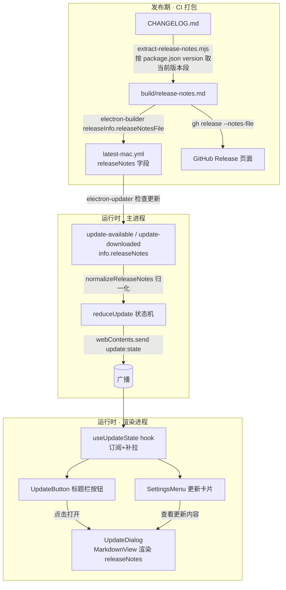

# feat: 桌面端更新改为用户主导（手动下载 + 展示更新内容）

> **类型**: feat · **深度**: Standard · **创建**: 2026-06-20
> **相关背景**: `docs/brainstorms/2026-06-16-desktop-release-automation-requirements.md`、`docs/plans/2026-06-16-002-feat-desktop-release-automation-plan.md`（发布自动化；其中「release notes 自动生成」被列为 deferred follow-up，本计划补上最小必要的一环）。该文档是相关背景而非本功能 UX 的 origin。

---

## Summary

把桌面端 electron-updater 的更新行为从「全自动」改为「用户主导」：发现新版本时仅在标题栏显示提示按钮，点击弹出弹窗展示新版本号 + 更新内容（release notes），用户在弹窗内点「下载更新」才开始下载。关闭 `autoDownload`，保留退出时自动安装（`autoInstallOnAppQuit=true`）。

更新内容的数据通道为：发布时把 markdown changelog 写进 electron-updater 的更新清单 `latest-mac.yml`，运行时 `info.releaseNotes` 透传到渲染层，复用现有 `MarkdownView` 渲染。

---

## Problem Frame

当前 `apps/desktop/src/main/ipc/update.ts` 设 `autoDownload=true`，检测到新版本即静默下载，UI 仅在标题栏显示版本号、不展示任何更新内容。这与既定发布策略相悖——release-automation 计划明确把 `autoDownload=false` 视为「召回坏版本的缓冲窗口」，但代码实际是 `true`。同时用户无从得知「这次更新改了什么」，无法在下载前知情决策。

本计划把代码拉回手动下载的预期，并补齐「展示更新内容」这一缺失的 UX 与其上游数据通道。

---

## Key Technical Decisions

1. **`autoDownload=false`，保留 `autoInstallOnAppQuit=true`**（用户确认）。仅「下载」改为手动触发；下载完成后既可点「重启更新」，也会在下次正常退出时静默安装，兼顾控制权与便利。
   - **语义边界（明确）**：「用户主导」仅指**下载**手动；**安装**仍是退出时静默自动。即用户一旦在弹窗点过「下载更新」，即便不点「重启更新」、只是正常关掉应用，下次启动也已是新版本。因此 release-automation 计划所说的「召回坏版本缓冲窗口」仅覆盖到**下载之前**——下载后退出即装，缓冲失效。此为用户已确认的取舍，在此点破以免实现者/用户误读。

2. **更新内容数据来源 = 发布时写入更新清单**（用户确认）。在 `electron-builder.yml` 配 `releaseInfo.releaseNotesFile`，打包时把 markdown 写进 `latest-mac.yml` 的 `releaseNotes`。运行时 electron-updater 的 `update-available` / `update-downloaded` 事件 `info.releaseNotes` 即为 markdown 原文，复用 `MarkdownView`（`packages/views/cortex-desktop/personal/MarkdownView.tsx`）渲染——外链走 `bridge.openExternal`、代码高亮、复制按钮全部现成。
   - 反例（不采用）：依赖 electron-updater 默认行为时，`GitHubProvider` 会从 `releases.atom` 取 GitHub 渲染后的 **HTML**（见 `computeReleaseNotes`/`getNoteValue`），无法直接喂 `MarkdownView` 且需 XSS 净化。把 notes 写进清单可绕开此路径。

3. **release notes 单一来源 `apps/desktop/CHANGELOG.md` + 提取脚本**。CHANGELOG 放在 `apps/desktop/`（而非仓库根）——因为版本号以 `apps/desktop/package.json` 的 `version` 为键、且本仓库仅 desktop 走 electron-updater 发布，放 app 内避免与 monorepo 多包语义混淆。发布前用脚本按该 `version` 提取当前版本段，生成 `apps/desktop/build/release-notes.md`，供 electron-builder（写入清单）与 CI `gh release`（GitHub Release 页面）共用，保证应用内与 release 页一致。**标题格式契约**：版本段标题必须匹配 `^## \[?<version>\]?`（`<version>` 为 package.json 裸版本号，允许 `## [0.1.9]`、`## 0.1.9`、`## [0.1.9] - 2026-06-20` 三种写法，但不带 `v` 前缀）——脚本正则与此契约绑定，CHANGELOG 顶部以注释写明。「从 git commit 自动生成 changelog」沿用 release-automation 计划，仍为 deferred。

4. **抽 `useUpdateState` 共享 hook**。当前 `UpdateButton` 与 `SettingsMenu` 各有一份重复的「订阅推送 + 挂载补拉」逻辑；新增弹窗又需同一份 state。抽成 `packages/core/desktop/useUpdateState.ts` 单一来源，三处复用，避免状态漂移（此为 Phase 0.7 call-out 的落地选择）。

5. **弹窗复用 `.pw-dlg` 模态外壳，不新建 Modal 抽象**。`packages/ui/` 无通用 Modal，模态是「CSS class 约定 + 局部组件」，照搬 `personal/AutomationDialog.tsx` 的 `.pw-dlg-overlay`/`.pw-dlg`/`.pw-dlg-x` 结构。

---

## High-Level Technical Design

更新内容的数据流（跨发布期 / 主进程 / 渲染进程三段）：



更新状态机 phase 流转（交互层面）：`available`（标题栏按钮出现）→ 用户点开弹窗 → 弹窗内点「下载更新」→ `downloading`（进度）→ `downloaded`（「重启更新」）。注意：`autoDownload=false` 后，`available` **不再自动**进入 `downloading`。

---

## Implementation Units

### U1. 主进程：关闭自动下载 + 采集 release notes

- **Goal**: `update.ts` 停止自动下载，并把 electron-updater 的 `info.releaseNotes` 采集进状态链路。
- **Dependencies**: U2（引入其导出的 `normalizeReleaseNotes`，故 U2 需先落地或与本单元同一提交）
- **Files**:
  - `apps/desktop/src/main/ipc/update.ts`（修改）
- **Approach**:
  - `autoUpdater.autoDownload = false`；`autoInstallOnAppQuit = true` 保持不变。更新两处注释说明手动下载意图。
  - `update-available`（约 49 行）与 `update-downloaded`（约 52 行）的 `dispatch` 调用追加 `releaseNotes: normalizeReleaseNotes(info.releaseNotes)`（`normalizeReleaseNotes` 由 U2 在 `update-state.ts` 导出并在此引入）。
- **Patterns to follow**: 现有 `dispatch(event)` + `reduceUpdate` 单向数据流。
- **Test scenarios**: `Test expectation: none -- 纯副作用接线（autoUpdater 事件绑定），逻辑由 U2 的归一化与归约单测覆盖；行为变化在端到端验证中确认`。
- **Verification**: 打包态检测到新版本后状态停在 `available`、不自动进入 `downloading`。

### U2. 状态机携带 release notes + 归一化

- **Goal**: 把 `releaseNotes` 纳入 `UpdaterEvent` 与 `UpdateState`，并提供 electron-updater `releaseNotes` 字段（`string | ReleaseNoteInfo[] | null`）到 `string | undefined` 的归一化纯函数。
- **Requirements**: 支撑 KTD 2、KTD 4。
- **Dependencies**: 无（U1 引用本单元导出的 `normalizeReleaseNotes`）
- **Files**:
  - `apps/desktop/src/main/ipc/update-state.ts`（修改）
  - `apps/desktop/src/main/ipc/update-state.test.ts`（修改）
- **Approach**:
  - `UpdaterEvent` 的 `available` / `downloaded` 分支新增 `releaseNotes?: string`。
  - `reduceUpdate`：`available` / `downloaded` 写入 `releaseNotes`；`progress`、`error` 分支保留 `state.releaseNotes`（与现有保留 `version` 同理），保证下载/失败时弹窗仍能展示更新内容。
  - 新增并导出 `normalizeReleaseNotes(notes)`：`null/undefined → undefined`；`string → trim 后非空则保留`；`ReleaseNoteInfo[] → notes.map(n => n.note).join("\n\n")`（**仅作类型完备兜底**：本项目 `fullChangelog=false`、notes 由本方以字符串写入清单，数组分支无现实消费者，故只做最小拼接、不加「以版本号为小标题」的格式化，也不为它单列测试用例——注释写明此分支不可达）。
- **Patterns to follow**: `update-state.ts` 现有纯函数 + 表驱动断言风格。
- **Test scenarios**:
  - `available` 携带 `releaseNotes` → state 含该字段。
  - `downloaded` 携带 `releaseNotes` → state 含该字段。
  - `progress` 事件 → 保留前一 `available` 的 `releaseNotes`（不丢失）。
  - `error`（有 version）→ 保留 `version` 与 `releaseNotes`。
  - `normalizeReleaseNotes`：`null` → `undefined`；空串/纯空白 → `undefined`；普通字符串 → 原样 trim。（数组分支为不可达兜底，不单列测试。）
- **Verification**: `pnpm --filter @cortex-work/desktop test` 全绿。

### U3. 镜像类型新增 releaseNotes 字段

- **Goal**: 两处镜像 `UpdateState` 同步加 `releaseNotes?: string`，保持跨进程/跨包契约一致。
- **Dependencies**: U2
- **Files**:
  - `apps/desktop/src/main/ipc/types.ts`（修改，`UpdateState`）
  - `packages/core/desktop/types.ts`（修改，`UpdateState`，含 zh-Hans 注释）
- **Approach**: 两处各加 `releaseNotes?: string` 字段并注释「available 及之后：本次更新的 markdown 说明，来自打包写入清单的 release notes」。preload（`apps/desktop/src/preload/index.ts`）走同一 `update:state` 广播自动透传，无需改；`DesktopBridge`（`bridge.ts`）方法签名不变。
- **Test scenarios**: `Test expectation: none -- 纯类型字段，由 typecheck 保证两处镜像一致`。
- **Verification**: `pnpm typecheck` 通过。

### U4. 发布侧：release notes 写入更新清单

- **Goal**: 建立 release notes 数据通道——`apps/desktop/CHANGELOG.md` 单一来源 → 提取脚本 → `build/release-notes.md` → 写进 `latest-mac.yml` 与 GitHub Release。
- **Requirements**: KTD 2、KTD 3。
- **Dependencies**: 无（与运行时单元并行，但端到端展示依赖本单元产出真实 notes）
- **Files**:
  - `apps/desktop/CHANGELOG.md`（新建，Keep a Changelog 中文风格，含当前 `0.1.8` 段 + 标题格式契约注释）
  - `apps/desktop/scripts/extract-release-notes.mjs`（新建）
  - `apps/desktop/scripts/extract-release-notes.test.mjs`（新建）
  - `apps/desktop/electron-builder.yml`（修改，加 `releaseInfo.releaseNotesFile`）
  - `apps/desktop/package.json`（修改，新增 `prebuild:notes` 脚本并接入所有打包入口）
  - `apps/desktop/.gitignore`（修改/新建，忽略生成物 `build/release-notes.md`）
  - `.github/workflows/desktop-release.yml`（修改，`gh release` 用 `--notes-file`）
- **Approach**:
  - 提取脚本：读 `apps/desktop/package.json` 的 `version`，按 KTD 3 的标题格式契约（`^## \[?<version>\]?`，无 `v` 前缀）从 `apps/desktop/CHANGELOG.md` 提取该版本段正文，写入 `apps/desktop/build/release-notes.md`（目录不存在则创建）。ESM（`.mjs`，项目 `"type": "module"`），风格参考 `apps/desktop/scripts/build-pi-binary.mjs`。
  - **缺段语义分级**（修正原「无条件占位退出 0」）：找不到版本段时——默认写入安全占位「本次更新暂无详细说明。」并退出码 0（本地/非正式构建不阻断）；但当处于**正式发布**（CI `publish-release` 模式，经环境变量/参数判定）时**改为非零退出使 CI 失败**，强制发布者补 CHANGELOG。避免「忘写版本段 → 静默退化为永久占位 → 所有测试仍全绿」这一正是本计划要消除的失配复现。
  - **打包入口统一**（修正 `dist:*` 绕过 `prepackage:mac` 的 P1 缺口）：新增 `prebuild:notes` 脚本（= 跑提取脚本），并在**所有**进 electron-builder 的入口前置它——`prepackage:mac`、`dist`、`dist:zip`、`dist:dmg`。不可只挂 `prepackage:mac`，因为现有 `dist:*` 直接内联 `build:pi && electron-vite build && electron-builder`、不调用 `prepackage:mac`，否则本地手动 dmg 分发会带陈旧/占位 notes。（`dist:dir` 产出无 `latest-mac.yml` 的未打包 app，是否需要 notes 见 Open Questions。）
  - `electron-builder.yml`：新增 `releaseInfo:\n  releaseNotesFile: release-notes.md`（**相对 buildResources=`build/` 解析，即 `build/release-notes.md`**，用惯用相对值而非 `build/build/...` 的 projectDir 二级回退），并加注释说明该文件由 `extract-release-notes.mjs` 在打包前生成、最终进入 `latest-mac.yml`。
  - CI `desktop-release.yml`：CI 的 `Prepackage` 步已调 `prepackage:mac`，故脚本随 `prebuild:notes` 自动在 electron-builder（生成 `latest-mac.yml`）之前运行——**不新增 CI 步**。把约第 245-248 行 `gh release create ... --notes "Cortex Desktop ${BUILD_TAG#v}"` 改为 `--notes-file apps/desktop/build/release-notes.md`（标题保留裸版本号）；该步依赖前述 Prepackage 已把文件写到磁盘。
- **Patterns to follow**: `apps/desktop/scripts/build-pi-binary.mjs` 的 Node ESM 脚本风格；CI 现有 step 结构。
- **Test scenarios**:
  - 提取脚本：给定含多版本的 CHANGELOG + 指定 version → 仅输出该版本段正文（不含相邻版本）。
  - 标题三种写法均命中：`## [0.1.9]`、`## 0.1.9`、`## [0.1.9] - 2026-06-20`。
  - 版本段为 changelog 首个/末个条目的边界提取正确。
  - 缺段 + 非正式模式 → 写占位、退出码 0；缺段 + `publish-release` 模式 → 非零退出。
- **Verification**: 本地 `node apps/desktop/scripts/extract-release-notes.mjs` 生成 `build/release-notes.md` 内容正确；`pnpm --filter @cortex-work/desktop test` 含脚本测试通过。端到端（真实发布）见 Verification 章节。

### U5. 共享 `useUpdateState` hook

- **Goal**: 抽出「订阅 `onUpdateState` 推送 + `updateGetState` 补拉」的单一来源 hook，供按钮、设置卡片、弹窗复用。
- **Requirements**: KTD 4。
- **Dependencies**: U3
- **Files**:
  - `packages/core/desktop/useUpdateState.ts`（新建）
  - `packages/core/desktop/useUpdateState.test.tsx`（新建）
  - `packages/core/package.json`（修改 `exports`，若需对外子路径）/ `packages/core` 桶导出（同步导出 hook）
- **Approach**: 复刻 `UpdateButton.tsx:78-98` 的订阅+补拉范式（先订阅，补拉只兜底挂载前错过的状态，`pushed` 标志防止晚到补拉覆盖推送）。返回 `UpdateState`。bridge 缺失（web/旧壳）时返回 `{ phase: "idle" }`。属客户端订阅态，不进 React Query / Zustand（这是对 main 单例状态的本地镜像，非服务端数据）。
- **Patterns to follow**: `UpdateButton.tsx` 现有 effect；`packages/core/desktop/` 既有 hook 组织（如 `usePersonalPersistence`）。
- **Test scenarios**:
  - 挂载补拉到 `available` → 返回该状态。
  - 推送 `available → downloading → downloaded` → 依次返回最新状态。
  - 补拉晚于推送返回时不覆盖推送结果（`pushed` 优先）。
  - 无 bridge → 返回 `idle` 且不报错。
  - 卸载时取消订阅（`off()` 调用）。
- **Verification**: `pnpm --filter @cortex-work/core test` 全绿。

### U6. 更新内容弹窗 `UpdateDialog`

- **Goal**: 新增弹窗，展示新版本号 + markdown 更新内容，并按 phase 提供下载/进度/重启操作。
- **Requirements**: 核心 UX；KTD 2、KTD 5。
- **Dependencies**: U3
- **Files**:
  - `packages/views/cortex-desktop/UpdateDialog.tsx`（新建）
  - `packages/views/cortex-desktop/UpdateDialog.test.tsx`（新建）
  - `packages/views/cortex-desktop/cortex-desktop.css`（修改，少量：下载进度条等，模态外壳复用既有 class）
  - `packages/core/i18n/resources/zh-Hans/common.json`、`packages/core/i18n/resources/en/common.json`（修改，新增 `updateDialog` 段）
  - `packages/core/i18n/@types/resources.d.ts`（修改）
- **Approach**:
  - props：`{ state: UpdateState; onDownload(): void; onInstall(): void; onClose(): void }`（state 由调用方下传，弹窗自身不订阅）。
  - 结构照搬 `personal/AutomationDialog.tsx`：`.pw-dlg-overlay` > `.pw-dlg`（`.pw-dlg-x` 关闭）。标题 `发现新版本 v{version}`。
  - **三段式布局 + 长内容滚动**（修正长 notes 顶飞按钮）：标题头 + 中部 markdown 正文 + 底部操作三段；仅**中部正文**为带 `max-height`（约束在视口内）的独立滚动区，标题与底部按钮始终固定可见。正文：`<div className="pw-todo-md"><MarkdownView content={state.releaseNotes ?? t('updateDialog.noNotes')} /></div>`（`MarkdownView` 从 `./personal/MarkdownView` 导入）。若 notes 意外为 HTML，react-markdown 默认按文本降级展示，可接受。
  - **footer 纯由实时 `state.phase` 渲染**（无「打开时快照」）：故无论从哪个 phase 打开弹窗都显示当前阶段操作，且下载中途完成时弹窗实时切到「重启更新」。各 phase：
    - `available` → 「下载更新」(`onDownload`) +「稍后」
    - `downloading` → 进度条 + 「下载中 {percent}%」(禁用) +「关闭」（后台继续下载，state 在 main）
    - `downloaded` → 「重启更新」(`onInstall`) +「稍后」
    - `error`(有 version) → 在正文下方/按钮旁渲染 `state.error` 文案 + 「重试下载」(`onDownload`，文案区别于首次「下载更新」) +「稍后」
  - **统一关闭语义**：`.pw-dlg-x`、Esc、遮罩点击在**所有 phase** 均映射 `onClose`；下载进行中关闭不取消下载（state 由 main 持有，后台继续）。每个 phase 都有一个关闭/「稍后」入口，标签一致。
  - i18n 用现有 `ZH_FALLBACK` 模式（参考 `UpdateButton.tsx:19-36`）。
- **Patterns to follow**: `personal/AutomationDialog.tsx`（模态外壳 + 遮罩/关闭语义）、`personal/TodosView.tsx` 等对 `MarkdownView` 的 `.pw-todo-md` 包裹用法。
- **Test scenarios**:
  - `available` 带 `releaseNotes` → 渲染版本号标题 + markdown 内容 + 「下载更新」按钮；点击触发 `onDownload`。
  - `releaseNotes` 为空 → 渲染「暂无更新说明」占位。
  - `downloading` → 显示进度百分比、下载按钮禁用、无重启按钮、有「关闭」。
  - `downloaded` → 显示「重启更新」；点击触发 `onInstall`。
  - `error`(有 version) → 渲染 `state.error` 文案 + 「重试下载」；点击触发 `onDownload`。
  - 直接以 `downloading` / `downloaded` 为初始 phase 挂载 → footer 正确（验证无快照、纯 phase 驱动）。
  - 各 phase 点关闭 / 「稍后」/ Esc / 遮罩 → 触发 `onClose`。
- **Verification**: `pnpm --filter @cortex-work/views test` 全绿。

### U7. UpdateButton 改为打开弹窗

- **Goal**: 标题栏按钮点击从「直接下载」改为「打开更新内容弹窗」，并接入共享 hook。
- **Requirements**: 仅标题栏按钮入口（用户确认）。
- **Dependencies**: U5, U6
- **Files**:
  - `packages/views/cortex-desktop/UpdateButton.tsx`（修改）
  - `packages/views/cortex-desktop/UpdateButton.test.tsx`（修改）
  - `packages/core/i18n/resources/{zh-Hans,en}/common.json`（修改 `updateButton.updateAvailableTitle` 文案为「点击查看更新内容」）
- **Approach**:
  - 改用 `useUpdateState()` 取 state（替换本地 effect）。
  - 新增 `const [open, setOpen] = useState(false)`；按钮 `onClick` 统一 `setOpen(true)`；渲染 `<UpdateDialog state={state} onDownload={...} onInstall={...} onClose={() => setOpen(false)} />`。
  - `updateButtonUi`：`available` 的 `title` 文案改为「点击查看更新内容」；`downloading` 按钮改为可点击（点开看进度）；label 逻辑保留。`action` 字段语义简化为「是否可打开弹窗」。
  - **保留按钮内联进度**：`downloading` 时按钮 label 仍显示「更新 {percent}%」（沿用现有行为），避免把进度全藏进弹窗后标题栏失去一目了然的进度指示。
- **Patterns to follow**: 现有 `updateButtonUi` 纯映射 + 单测。
- **Test scenarios**:
  - `available` → 显示「更新 {version}」按钮；点击打开弹窗（不再直接调 `updateDownload`）。
  - 弹窗内点「下载更新」→ 调 `updateDownload` 一次。
  - 推送 `downloaded` 后弹窗内「重启更新」→ 调 `updateInstall` 一次。
  - `idle`/`checking`/无 version 的 `error` → 不渲染按钮（沿用现有断言）。
  - 进度取整并夹在 0-100（沿用现有 `updateButtonUi` 单测）。
- **Verification**: `pnpm --filter @cortex-work/views test` 全绿（含改写后的断言）。

### U8. 设置卡片复用弹窗

- **Goal**: 设置页「更新」卡片接入共享 hook，并在有新版本时提供「查看更新内容」入口，复用同一弹窗。
- **Dependencies**: U5, U6
- **Files**:
  - `packages/views/cortex-desktop/personal/SettingsMenu.tsx`（修改更新卡片，约 601-634 行 + 订阅 effect 约 433-468 行）
  - `packages/core/i18n/resources/{zh-Hans,en}/settings.json`（修改，新增 `general.viewReleaseNotes`）
  - `packages/core/i18n/@types/resources.d.ts`（修改）
- **Approach**:
  - 用 `useUpdateState()` 替换 `SettingsMenu` 内重复的订阅+补拉 effect。
  - `available` / `error+version` 时，在现有「下载更新」按钮旁加「查看更新内容」按钮，打开 `UpdateDialog`（复用同一组件）。原有「检查更新 / 下载更新 / 重启更新」逻辑保留（设置页本就手动）。
- **Patterns to follow**: 现有 `SettingCard` / `SRow` 布局；`UpdateDialog` 与 `UpdateButton` 共享同一 state/回调。
- **Test scenarios**: `Test expectation: none -- 复用 U5/U6 已测逻辑，本单元为接线与按钮渲染；如时间允许补一条「available 时出现查看更新内容按钮并打开弹窗」交互测试`。
- **Verification**: 设置页手动验证：有新版本时出现「查看更新内容」，点击弹出与标题栏一致的弹窗。

---

## Scope Boundaries

**In scope**: 主进程关闭自动下载 + 采集 notes；状态机/类型携带 notes；发布侧 release notes 写入清单（CHANGELOG + 提取脚本 + electron-builder + CI 的最小必要改动）；更新内容弹窗；标题栏按钮改交互；设置卡片复用；共享 hook；i18n 与测试。

**Out of scope（真正非目标）**: 主动弹窗 / Toast 提示（用户选定仅标题栏按钮）；Web 端更新（无 desktopBridge，天然降级不渲染）。

### Deferred to Follow-Up Work

- 从 git commit / PR 自动生成 CHANGELOG（沿用 `docs/plans/2026-06-16-002` 的 deferred）。
- beta / prerelease 更新通道。
- Windows / Linux 的 release notes 文件（`release-notes-win.md` 等）——当前仅 macOS arm64 发布。

---

## Risks & Mitigations

- **旧版本 release 的清单无 `releaseNotes`**：归一化返回 `undefined`，弹窗显示「暂无更新说明」占位，不报错。
- **notes 落到 electron-updater 的 HTML 回退路径**（清单未写入时 `GitHubProvider` 取 atom HTML）：本计划通过 `releaseInfo.releaseNotesFile` 把 markdown 写进清单规避；归一化只处理 `string`/`ReleaseNoteInfo[]`，原始 HTML 串会被 `MarkdownView`（无 `rehype-raw`）按文本降级展示（不崩、不执行）。
- **release notes 经 `MarkdownView` 的 mermaid 渲染通道**：notes 里的 ```mermaid 代码块会经 `mermaid.render` → `dangerouslySetInnerHTML` 注入 SVG，是除原始 HTML 外的第二条注入通道。现有缓解：mermaid `securityLevel: "strict"`（内置 DOMPurify）+ notes 来自本方自有 GitHub Release（发布身份可信）。残余风险仅在「发布身份被攻陷 + mermaid 净化被绕过」双重前提下成立，低于强制处理阈值，此处显式记录以免被默认为惰性内容。
- **提取脚本找不到当前版本段**：非正式构建写占位、退出码 0 不阻断；**正式发布**（`publish-release`）改为非零退出使 CI 失败，避免静默丢 notes（见 U4）。
- **暗色主题下 markdown 可读性**：`MarkdownView` 的高亮主题/链接色原为 todos/timeline 语境设计，需在弹窗暗色背景下实测标题/链接/代码块对比度（见本地手动验证）。
- **macOS 自动更新要求 Developer ID 签名**：现有 `electron-builder.yml` 已配签名/公证，无新增要求。
- **`UpdateState` 两处镜像漂移**：U3 同步修改并由 `pnpm typecheck` 守护。
- **`releaseNotesFile` 依赖 electron-builder `getResource` 解析**：用惯用相对值 `release-notes.md`（相对 buildResources）避免二级回退；属实现细节而非公开契约，端到端验证时应实际抓 `latest-mac.yml` 确认 `releaseNotes` 字段非空。

---

## Verification

**单元测试**（就近放置，Vitest）:
- `pnpm --filter @cortex-work/desktop test` — `update-state.test.ts`（notes 透传/保留/归一化）、`extract-release-notes.test.mjs`（提取脚本）。
- `pnpm --filter @cortex-work/core test` — `useUpdateState.test.tsx`。
- `pnpm --filter @cortex-work/views test` — `UpdateDialog.test.tsx`、`UpdateButton.test.tsx`。

**全仓门禁**: `pnpm typecheck`、`pnpm lint`。

**本地手动验证**:
- dev 态用 fake bridge / 注入各 phase（含 `releaseNotes`、长 notes、空 notes、`error+message`）验证：标题栏按钮 → 弹窗 → markdown 渲染 → 下载/进度/重启/重试全链路；长 notes 时正文滚动、按钮不被顶飞。
- 暗色主题下检查弹窗内 markdown（标题/链接/代码块高亮）对比度可读。
- 确认 `autoDownload=false`：检测到 `available` 后状态不自动进入 `downloading`，仅弹窗内点「下载更新」才开始。
- 本地跑 `extract-release-notes.mjs` 检查 `apps/desktop/build/release-notes.md` 内容为当前版本段；缺段时本地为占位、模拟 `publish-release` 时非零退出。

**端到端（真实发布，deferred 到发版时）**:
- 打 `v<next>` tag 触发 CI → 检查公开库 release 的 `latest-mac.yml` 含 `releaseNotes`、Release 页 body 与之一致 → 真机旧版本触发更新 → 弹窗展示 markdown 更新内容 → 手动下载 → 重启安装成功。

---

## Open Questions

- **`dist:dir` 是否需要 release notes**：`dist:dir` 产出无 `latest-mac.yml` 的未打包 app，不参与自动更新。本计划默认**不**为其前置 `prebuild:notes`；若用于其它用途需要 notes 再补。
- **CHANGELOG 缺段在正式发布时 fail 的边界**：U4 选择 `publish-release` 模式非零退出。需确认 CI 的「正式发布」判定信号（tag push vs `workflow_dispatch` 的 mode 档位），实现时以 `desktop-release.yml` 既有 mode 变量为准。

## 提交约定

中文 Conventional Commits，按 U-ID 拆分原子提交，例如：
- `feat(update): 关闭自动下载并采集 release notes`
- `feat(update): 新增更新内容弹窗 UpdateDialog`
- `feat(release): release notes 写入更新清单（CHANGELOG + 提取脚本）`
