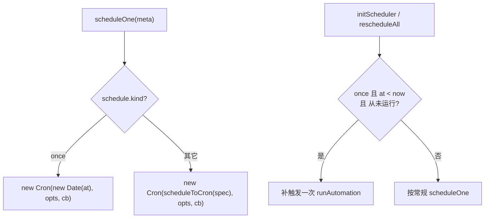

# feat: 自动化默认模板（新手一键创建）

## Summary

`自动化` 页对新手不友好——只有「空白表单 + 新建按钮」，用户面对标题 / 提示词 / agent / 频率一堆字段不知从何下手。本计划在自动化页新增一个**精选模板画廊**（截图的「从模板入手」）：新手点一张卡片，即可打开现有的新建弹窗、各字段已**预填**好（标题 / 提示词 / 频率 / 推理强度），改一改就能创建。每个模板的**默认提示词由本计划直接写好**。

附带一个必要的能力扩展：给排期引擎新增 **`once` 一次性**类型（具体日期时间触发一次），让「体检预约提醒」「会议前准备」这类一次性提醒模板能落地。

**范围内**：自动化页前端（模板画廊 + 弹窗预填 + 接线）、`once` 排期类型（core 类型 + 主进程调度/执行 + 编辑器 UI）、11 个模板的提示词内容。
**范围外**：不改自动化执行器的核心管线、不改结果投递方式（仍落运行记录 + 完成 toast）、不引入图像生成、无后端改动、无 i18n（沿用现有硬编码中文）。

---

## Problem Frame

- **现状**：`AutomationView` → `AutomationList` 仅渲染「空状态（`pw-panel-empty`：图标 + 『还没有自动化任务』+ 新建按钮）」或已有任务列表。新建走 `AutomationDialog`，全部字段空白。没有任何模板/示例引导。
- **痛点**：新手不知道自动化能干什么、提示词该怎么写、频率怎么配。空白表单的认知门槛高。
- **目标**：用一组开箱即用的精选模板，把「想个点子 + 写提示词 + 配频率」三步压缩成「点一张卡片 + 微调」。模板提示词预设到位，确保产出可用。
- **约束**：自动化为无头执行（`runner.ts`），产出落「运行记录」文本 + 完成 toast，**没有交互式追问、没有独立通知推送**。因此模板提示词必须自包含、要求 agent 直接输出结构清晰的中文 Markdown。

---

## Requirements

- **R1**：自动化页提供精选模板画廊；列表为空时作为新手引导整块展示，已有任务时收进顶部常驻入口（不挤占日常列表）。来源决策见 Key Technical Decisions KTD-3。
- **R2**：点击模板 → 打开现有新建弹窗（`AutomationDialog`），预填标题 / 提示词 / 频率 / 推理强度；agent 取当前首个可用项。用户可改后再创建。**不是**直接静默创建。
- **R3**：每个模板带名称、卡片描述、图标、默认提示词、默认频率。提示词由本计划写定，产出为可读中文 Markdown。
- **R4**：排期引擎新增 `once` 一次性类型（指定绝对日期时间触发一次），覆盖体检预约 / 会议前准备类模板。
- **R5**：`once` 任务触发后不再重排（`nextRunAt` 归空），并自动停用以示「已完成」；App 在 `once` 触发时刻处于关闭状态、下次启动后应补触发一次（不静默丢失提醒）。
- **R6**：模板集去掉「可爱萌宠手机壁纸」（依赖图像生成，文本 agent 不可行）。

---

## Key Technical Decisions

**KTD-1：模板数据放视图层新模块 `automationTemplates.ts`，不进 core。**
模板是自动化页专属的展示数据（名称 / 描述 / 图标 / 提示词文案 / 频率），只被自动化视图消费。放 `packages/views/cortex-desktop/personal/automationTemplates.ts`，复用 core 的 `AutomationInput` / `ScheduleSpec` 类型；core 保持纯净（不放 UI 文案与图标）。

**KTD-2：模板点击 → 复用 `AutomationDialog` 预填，而非新建独立创建流。**
弹窗已封装好 agent↔model 联动、pi 通道、提交校验。给它加一个「初始草稿」入口即可零成本复用全部既有逻辑（KTD-5）。模板只提供 `Partial<AutomationInput>`，**不含 agent**——agent 由弹窗按 `availAgents[0]` 兜底，避免模板写死一个用户未安装的 agent。

**KTD-3：画廊展示 = 空状态整块引导 + 有任务时顶部常驻「从模板」入口。**（用户决策）
列表为空：在 `pw-panel-empty` 区域改为渲染模板画廊（强引导）。已有任务：在面板头 `pw-panel-h` 增加「从模板」入口（按钮展开折叠区或浮层），不常占列表空间。

**KTD-4：`once` 用 croner 的 Date 一次性触发，不映射 cron 表达式。**
croner@10.0.1 的 `Cron` 构造器签名为 `pattern: string | Date`（`croner.d.ts:541`），传 `Date` 即一次性 job，`nextRun()` 在未来返回该时刻、过期返回 `undefined`（`:584`）。因此：
- `ScheduleSpec` 增 `{ kind: "once"; at: number }`（绝对 epoch ms）。
- `scheduleToCron` **不支持** once（once 无 cron 表示）；所有调用点（`scheduleOne` / `computeNextRun`）必须在调用前对 once 分支处理，`scheduleToCron` 保持「仅循环类型」并补 exhaustiveness 注释。
- `computeNextRun(once)` = `at > (after ?? now) ? at : null`（纯比较，不构造 croner）。

**KTD-5：`AutomationDialog` 新增 `initial?: Partial<AutomationInput>`，与 `meta`（编辑）正交。**
`initial` 仅用于「从模板新建」时 seed 初始 state（name/prompt/schedule/effort/projectId），不带 id → 仍走 `create`。`meta` 优先级高于 `initial`（编辑态不受影响）。`AutomationView` 的 `DialogState` 增 `{ mode: "template"; template: AutomationTemplate }` 分支。

**KTD-6：once 任务触发后 `finalize` 额外置 `enabled: false`。**（R5）
`finalize` 现有逻辑：`nextRunAt = enabled ? computeNextRun(...) : undefined`，once 过期后 `computeNextRun` 返回 null → `nextRunAt` 自然归空。再加一句：`schedule.kind === "once"` 时 patch `enabled: false`，让列表明确显示「已完成（已暂停）」而非「启用但无下次」。

---

## High-Level Technical Design

模板点击到创建的数据流：

```mermaid
flowchart LR
  A["模板卡片<br/>AutomationTemplates"] -->|onPick template| B["AutomationView<br/>DialogState=template"]
  B -->|initial=template.draft| C["AutomationDialog<br/>预填 name/prompt/schedule/effort"]
  C -->|agent=availAgents[0]| C
  C -->|创建 submit| D["useCreateAutomation<br/>→ bridge.automationCreate"]
  D --> E["main: 持久化 + scheduleOne"]
```

`once` 在调度层的分支（关键：scheduleToCron 不碰 once）：



---

## Implementation Units

### U1. ScheduleSpec 增加 `once` 类型与纯函数支持

- **Goal**：在类型与纯函数层支持一次性排期，为调度/编辑器/模板打底。
- **Requirements**：R4
- **Dependencies**：无
- **Files**：
  - `packages/core/desktop/types.ts`（`ScheduleSpec` 联合增 `{ kind: "once"; at: number }`，补注释说明 `at` 为绝对 epoch ms）
  - `apps/desktop/src/main/automation/schedule-cron.ts`（`validateScheduleSpec` / `computeNextRun` / `scheduleToCron` 三处分支）
  - `apps/desktop/src/main/ipc/types.ts`（若 `ScheduleSpec` 在此另有镜像/复用，确认同步——见 CLAUDE.md「类型契约集中在 main/ipc/types.ts」）
  - `apps/desktop/src/main/automation/schedule-cron.test.ts`（如不存在则新建）
- **Approach**：
  - `validateScheduleSpec`：`once` 校验 `at` 为有限整数（`Number.isFinite`）。**不**强制 future（避免时钟漂移/编辑历史任务被拒）；future 约束交给 UI（U3）。
  - `computeNextRun`：`once` 直接 `return spec.at > (after ?? new Date()).getTime() ? spec.at : null`，不构造 croner。
  - `scheduleToCron`：`once` 无 cron 表示——抛错或在类型上排除，并补注释「once 由调用方分支处理，不应走到此」。保持其余分支不变。
- **Patterns to follow**：现有 `schedule-cron.ts` 的 switch 风格与中文注释密度。
- **Test scenarios**：
  - `validateScheduleSpec({kind:"once", at: <未来>})` → ok；`at` 非数字/NaN → 报错。
  - `computeNextRun(once, 未来 at)` 返回 `at`；`at` 已过 → `null`；`after` 晚于 `at` → `null`。
  - 既有循环类型（daily/weekly/cron）的校验与 nextRun 用例保持全绿（回归）。
- **Verification**：`pnpm --filter @cortex-work/desktop test -- run .../schedule-cron.test.ts` 全绿；`pnpm --filter @cortex-work/core typecheck` 通过。

### U2. 调度器与执行器支持 `once`

- **Goal**：让 `once` 任务到点触发一次、错过能补、触发后自停。
- **Requirements**：R4, R5
- **Dependencies**：U1
- **Files**：
  - `apps/desktop/src/main/automation/scheduler.ts`（`scheduleOne` once 分支；`initScheduler` / `shouldCatchUp` 补漏逻辑）
  - `apps/desktop/src/main/automation/runner.ts`（`finalize` once 自停）
- **Approach**：
  - `scheduleOne`：`schedule.kind === "once"` → `new Cron(new Date(at), options, cb)`；否则维持 `new Cron(scheduleToCron(...), ...)`。注意 once 为绝对时刻，timezone 不影响。
  - 补漏：现有 `shouldCatchUp` 要求 `lastRunAt` 存在，故「从未运行过的 once 在关机期间错过」不会补触发（R5 缺口）。新增判断：`once` 且 `at < now` 且 `!lastRunAt` 且 `enabled` → 在 `initScheduler` / `rescheduleAll` 补触发一次。保持「只补一次」语义，避免唤醒堆叠。
  - `finalize`：`schedule.kind === "once"` 时一并 `patch({ enabled: false })`（KTD-6）；`nextRunAt` 仍按现逻辑归空。
- **Execution note**：先为补漏分支补一条针对 `shouldCatchUp`/初始化判定的单测（这是最易回归的时序点），再改实现。
- **Patterns to follow**：`scheduler.ts` 现有 `scheduleOne` 闭包快照与 `shouldCatchUp` 纯函数风格。
- **Test scenarios**：
  - 补漏判定：once + `at<now` + 无 `lastRunAt` + enabled → 应补触发；once + 已有 `lastRunAt` → 不补；循环类型沿用原 `shouldCatchUp` 行为。
  - `finalize` 对 once 任务置 `enabled:false` 且 `nextRunAt` 归空；对循环任务不动 `enabled`。
  - `Test expectation`：`scheduleOne` 真正建 croner job 属副作用，难纯单测——以补漏/finalize 纯判定为测试重点，建 job 的正确性靠类型 + 手动验证。
- **Verification**：手动验证——建一个 `at = now+2min` 的 once 任务，到点触发一次、之后变「已暂停」、`下次` 显示 `—`；建一个 `at` 已过的新 once（模拟错过），重启 App 后补触发一次。

### U3. ScheduleEditor 增加「一次性」档 + 摘要格式化

- **Goal**：用户能在弹窗里选「一次性」并指定日期+时间；列表/详情正确展示 once 摘要。
- **Requirements**：R4
- **Dependencies**：U1
- **Files**：
  - `packages/views/cortex-desktop/personal/ScheduleEditor.tsx`（KIND 增 `once`，渲染 `<input type="date">` + 时:分，组装 epoch）
  - `packages/views/cortex-desktop/personal/automationFormat.ts`（`scheduleSummary` 增 once 分支）
- **Approach**：
  - `KIND_LABEL` / `KIND_ORDER` 增 `once: "一次性"`。选中 once 时隐藏「频率」其余控件，展示日期选择 + 小时/分钟（复用现有 HOURS/MINUTES select）。
  - 由本地 date 字符串 + hour + minute 组装为本地时刻的 `Date` → `getTime()` 作为 `at`，`emit({ kind:"once", at })`。默认日期取明天、默认时间沿用 9:00。
  - UI 软约束：date 的 `min` 设为今天，避免选过去（与 U1「服务端不强制 future」配合：UI 兜前、引擎宽容）。
  - `scheduleSummary(once)` → `一次性 YYYY-MM-DD HH:mm`（复用 `pad`）。
- **Patterns to follow**：`ScheduleEditor` 现有「切 kind 保留局部缓存值」的 state 风格；`automationFormat.ts` 的 switch。
- **Test scenarios**：
  - 选「一次性」→ 渲染日期选择器，隐藏 weekday/cron 控件。
  - 改日期/时间 → `onChange` 收到 `{kind:"once", at}` 且 `at` 对应所选本地时刻。
  - `scheduleSummary({kind:"once", at})` 输出 `一次性 2026-04-08 07:00` 形态。
- **Verification**：`pnpm --filter @cortex-work/views test` 全绿；弹窗内手动切到「一次性」可正常选时并创建。

### U4. 模板数据模块（11 个模板 + 提示词）

- **Goal**：定义模板数据结构与全部 11 个精选模板（含写定的提示词）。
- **Requirements**：R3, R6（去掉壁纸模板）
- **Dependencies**：U1（once 模板用到新类型）
- **Files**：
  - `packages/views/cortex-desktop/personal/automationTemplates.ts`（新建）
- **Approach**：
  - 定义类型：
    ```ts
    // directional，非最终签名
    interface AutomationTemplate {
      id: string;            // 稳定 key
      name: string;          // 卡片标题 = 预填标题
      description: string;   // 卡片副标题（截断展示）
      icon: IconKey;         // 复用 @cortex-work/ui/icons 现有图标
      draft: {               // 预填进弹窗（不含 agent）
        prompt: string;
        schedule: ScheduleSpec;
        effort?: ReasoningEffort;
      };
      onceOffsetMs?: number; // once 模板：点选时 at = now + offset，并提示用户改成目标时间
    }
    ```
  - 图标复用现有集合（`Sparkle/Globe/Book?…` 见下表，无对应则取语义最近者，**不新增图标**以控范围）。可用图标：`Newspaper` 无 → AI 新闻用 `Globe`；英语单词用 `At`/`Hashtag`；睡前故事用 `Sparkle`；周报用 `Chart`；电影用 `Image`；历史上的今天用 `Clock`；每日为什么用 `Info`；父母联系用 `Users`；体检/会议/面试用 `Bell`/`Task`/`Code`。最终映射在实现时按观感微调。
  - `once` 模板（体检预约、会议前准备）：`schedule` 用占位 `{kind:"once", at:0}`，`onceOffsetMs` 给默认偏移（如 +1 天）；点选时由 U6 用 `Date.now()+offset` 覆盖 `at`，提示词内引导用户改成自己的目标日期。
- **提示词（写定，11 个）**：

  1. **每日 AI 新闻推送**（daily 09:00，icon Globe）
     > 你是我的 AI 行业资讯助理。请检索并汇总过去 24 小时内人工智能领域最重要的 5 条动态(模型发布、重要论文、行业事件、产品更新、政策监管)。每条给出:① 一句话标题;② 2-3 句要点;③ 为什么值得关注;④ 来源链接(如可获取)。按重要性排序,用简洁中文 Markdown 输出,总长 400 字内。若无法联网,请说明并改为基于已知信息给出近期值得关注的 AI 趋势。

  2. **每日 5 个英语单词**（daily 08:00）
     > 请为正在提升英语的学习者推荐 5 个高频实用英语单词(日常或职场场景,难度 CEFR B1-B2)。每个给出:① 单词+音标;② 中文释义与词性;③ 一个地道例句及中文翻译;④ 一个常见搭配或近义词辨析。避免过于基础或生僻的词。用清晰的中文 Markdown 列表输出。

  3. **每日儿童睡前故事**（daily 20:00）
     > 请为 3-8 岁孩子创作一个温暖治愈的原创睡前故事,约 400-600 字(3-5 分钟朗读量)。要求:① 主题积极(勇气/友善/好奇心/分享任选其一);② 语言简单生动有画面感,适合家长朗读;③ 结尾一句温柔的晚安寄语。先给标题再给正文。不要恐怖或紧张情节。

  4. **每周工作周报**（weekly 周五 18:00，effort medium）
     > 请汇总我本周的工作进展,生成简洁周报。基于当前项目仓库:① 用 git 查看最近 7 天提交与合并改动;② 归纳本周完成的主要工作(按主题分组);③ 列出进行中/未完成事项;④ 给出下周建议聚焦的 2-3 个重点。中文 Markdown,500 字内。提示:请在创建时为本任务选择关联「项目」,否则无法读取仓库信息。

  5. **经典电影推荐**（daily 21:00）
     > 请推荐一部高分经典电影(评分较高、上映满 5 年以上)。给出:① 片名(中/英)、年份、导演、主演;② 不剧透的一句话看点;③ 3-4 句剧情简介;④ 适合的观影心情或场景;⑤ 一句推荐语。尽量每天换不同类型(剧情/科幻/悬疑/动画/喜剧)。中文 Markdown 输出。

  6. **历史上的今天**（daily 07:00）
     > 请从科技、电影、音乐、科学、文化等领域挑选「历史上的今天」发生的一件有趣有启发的事件(优先相对小众但有意思的)。给出:① 日期与事件标题;② 3-4 句背景经过;③ 它的影响或一个值得回味的细节。语气轻松,中文 Markdown,200 字左右。以运行当天日期为准。

  7. **每日一个为什么**（daily 08:30）
     > 请抛出一个有趣、生活中常被忽略的「为什么」(科学/生活常识/心理/自然现象皆可),再通俗解答。结构:① 今日问题(一句话);② 30 秒能看懂的简短答案;③ 展开 3-4 句原理;④ 一个相关冷知识。避免过于学术,中文 Markdown,每天换不同领域。

  8. **父母联系提醒**（weekly 周日 10:00）
     > 现在是周末,温柔提醒我:别忘了给家人打电话或发条消息,陪他们聊几句。请生成:① 一句暖心提醒语;② 3 个可和父母聊的轻松话题或问候开场白(近况/健康/回忆/计划);③ 一句关于陪伴的小感悟。中文 Markdown,简短即可。

  9. **体检预约提醒**（once，默认 +1 天，icon Bell）
     > 提醒我:该确认并预约体检了。请生成简短行动清单:① 提醒语;② 体检前准备(空腹、证件、既往报告、预约时段等);③ 建议关注的常规检查项目(按年龄/性别通用建议);④ 一句健康鼓励。中文 Markdown 输出。

  10. **面试准备提醒**（cron `0 9-19/2 * * 1-5`，工作日每 2 小时）
      > 现在是复习时间,帮我做大模型/AI 工程师面试准备。随机选 1 个高频主题(Transformer 结构、注意力机制、微调与 RLHF、RAG、推理优化、评测指标、分布式训练等),给出:① 主题名;② 一道典型面试题;③ 要点清晰的参考答案(分点 3-6 条);④ 一个可能的追问及简答。中文 Markdown,400 字内,便于碎片时间复习。

  11. **会议前准备**（once，默认 +1 天，icon Task）
      > 我马上要开一个会,帮我快速进入状态。请生成会前准备清单:① 明确会议目标的引导问题(这次会要达成什么?);② 我需要提前整理的议题/材料清单;③ 3 个可主动提出或确认的关键点;④ 一句让自己专注高效的提醒。中文 Markdown,简洁可执行。

- **Patterns to follow**：现有 personal 模块的纯数据导出风格（如 `agentMeta.ts`）。
- **Test scenarios**：
  - `AUTOMATION_TEMPLATES` 全部 11 项 `id` 唯一、`prompt` 非空、`icon` 为合法图标键、`schedule` 通过 `validateScheduleSpec`。
  - once 模板（体检、会议）带 `onceOffsetMs`，且不含「壁纸」模板（R6 回归）。
- **Verification**：`pnpm --filter @cortex-work/views test` 全绿；`typecheck` 通过。

### U5. 模板画廊 UI 与入口

- **Goal**：在自动化页渲染模板画廊——空状态整块引导 + 有任务时顶部常驻入口。
- **Requirements**：R1, R2
- **Dependencies**：U4
- **Files**：
  - `packages/views/cortex-desktop/personal/AutomationTemplates.tsx`（新建：模板卡片网格）
  - `packages/views/cortex-desktop/personal/AutomationList.tsx`（空状态嵌入画廊；面板头加「从模板」入口）
  - `packages/views/cortex-desktop/cortex-desktop.css`（`pw-auto-tpl*` 卡片网格样式，参照截图：图标 + 标题 + 一行截断描述）
- **Approach**：
  - `AutomationTemplates` 接 `onPick(template)`，渲染卡片网格（标题 + 截断描述 + 图标），样式呼应截图三列卡片。
  - `AutomationList` 空状态：`pw-panel-empty` 改为「简短引导文案 + 模板画廊 + 仍保留『空白新建』入口」。
  - 有任务时：面板头 `pw-panel-h` 在「+」旁加「从模板」按钮，点开折叠区/浮层展示画廊，不常占列表。
  - 卡片点击向上冒泡到 `AutomationView`（新增 `onPickTemplate` 回调）。
  - 强调色沿用品牌 `#7c5cff`（见 hover 态）。
- **Patterns to follow**：`AutomationList` 现有 `pw-panel-h` / `pw-panel-empty` / `btn primary` 类；CSS 既有 `pw-auto-*` 命名。
- **Test scenarios**：
  - 列表为空 → 渲染模板画廊（含 11 张卡片）且保留空白新建入口。
  - 列表非空 → 画廊不整块占位,顶部「从模板」入口可展开。
  - 点击某卡片 → `onPick` 收到对应 template。
- **Verification**：`pnpm dev:desktop` 手动核对空/非空两态观感贴近截图；`pnpm --filter @cortex-work/views test` 全绿。

### U6. 弹窗模板预填与接线

- **Goal**：点模板 → 打开新建弹窗并预填,创建走正常 create 流。
- **Requirements**：R2
- **Dependencies**：U4，U3（once 模板需编辑器支持）
- **Files**：
  - `packages/views/cortex-desktop/personal/AutomationDialog.tsx`（新增 `initial?: Partial<AutomationInput>`，seed 初始 state）
  - `packages/views/cortex-desktop/personal/AutomationView.tsx`（`DialogState` 增 `template` 分支；接 `AutomationList.onPickTemplate`）
- **Approach**：
  - `AutomationDialog` 初始 state 优先级：`meta`（编辑）> `initial`（模板）> 空。`initial` 提供 name/prompt/schedule/effort/projectId；agent 仍按 `availAgents[0]` 兜底（KTD-2），不被模板写死。
  - once 模板：传入 `AutomationView` 时把 `at` 由 `Date.now() + onceOffsetMs` 计算后再注入 `initial.schedule`（模板里的 `at:0` 占位被覆盖）。
  - `DialogState` 增 `{ mode: "template"; template }`；渲染时把 template.draft（含计算好的 once at）作为 `initial` 传入弹窗，`meta` 不传 → 走 create。
  - 标题预填后用户可改;提交逻辑、校验（`canSubmit`）完全复用,无需改动。
- **Patterns to follow**：`AutomationView` 现有 `DialogState` 联合 + `AutomationDialog` 的 `useState(meta?.x ?? 默认)` 初始化风格。
- **Test scenarios**：
  - 点模板 → 弹窗以模板的 name/prompt/schedule/effort 预填;agent = 首个可用。
  - once 模板 → 弹窗频率为「一次性」,`at` ≈ now + 偏移,可改。
  - 预填后点「创建」→ 调 `useCreateAutomation` 且 input 含模板提示词;编辑既有任务（传 meta）不受 `initial` 影响（回归）。
  - 「每周工作周报」预填后 `projectId` 为空（提示用户自选项目）。
- **Verification**：手动——逐个模板点开创建,确认落库后能在列表看到、立即执行产出符合预期文本;`pnpm --filter @cortex-work/views test` 全绿。

---

## Scope Boundaries

**范围内**：模板画廊 UI 与入口、弹窗预填接线、11 个模板提示词、`once` 排期类型（类型/调度/执行/编辑器/摘要）。

**Non-goals**：
- 不改自动化执行器核心管线、进程注册表、超时策略。
- 不改结果投递（仍落运行记录 + 完成 toast），不做独立系统通知/收件箱推送。
- 不引入图像生成（壁纸模板已去除）。
- 不做 i18n（沿用现有硬编码中文）。
- 不新增图标资源（复用现有图标集，语义最近映射）。

### Deferred to Follow-Up Work
- **模板提示词推送为系统通知**：若后续接入 notify 能力，可让「推送」类模板把产出推系统通知（当前仅落运行记录）。
- **`once` 错过补触发的更强语义**：当前仅「下次启动补一次」；如需精确到日历提醒级别可单独立项。
- **模板用户自定义/收藏**：当前模板为内置静态集，用户自建模板不在本期。

---

## Risks & Dependencies

- **R-1：`scheduleToCron` 漏改 once 分支** → once 走到 cron 路径会抛错/静默失败。缓解：U1 在三处调用点全部分支并补 exhaustiveness 注释 + 单测覆盖。
- **R-2：once 时区/夏令时**。`at` 为绝对 epoch ms（UI 用本地时刻组装），croner 对 Date 不再做 cron 时区换算，语义正确;无需额外处理，但需在 U3 注释说明「once 存绝对时刻，与任务 timezone 无关」。
- **R-3：联网类模板（AI 新闻/电影/历史上的今天）依赖 agent 是否具备联网能力**。缓解：提示词均含「若无法联网则降级」兜底文案，保证产出不空。
- **R-4：周报模板需用户自选项目**，否则 agent 在中性目录无仓库可读。缓解：提示词内显式引导;`projectId` 预填留空提醒。
- **依赖**：croner@10.0.1（已在用，Date 一次性能力已核实）；无新增依赖。

---

## Sources & Research

- 代码勘察（本仓库）：`AutomationView/List/Dialog/Detail.tsx`、`ScheduleEditor.tsx`、`automationFormat.ts`、`packages/core/personal/automation.ts`、`packages/core/desktop/types.ts`、`apps/desktop/src/main/automation/{runner,scheduler,schedule-cron,store,events}.ts`。
- croner 类型核实：`node_modules/croner/dist/croner.d.ts:541`（`Cron(pattern: string | Date, …)`）、`:584`（Date 构造时 nextRun 行为）；版本 10.0.1。
- `docs/solutions/` 无自动化相关既有学习；自动化页无 i18n（硬编码中文），模板文案同样硬编码中文。
