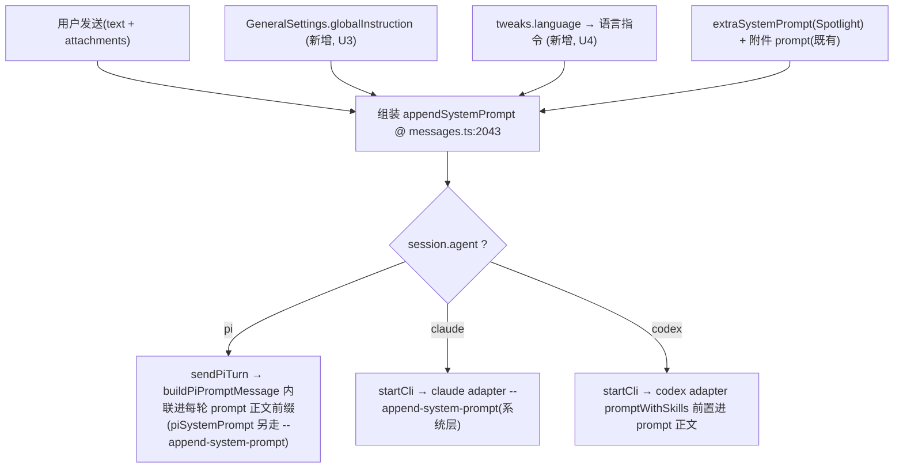

# feat: Desktop 全局指令/语言注入 + skills 增强 + 闪记/拖拽修复(批量)

## Summary

一批针对 Desktop 个人工作区的小颗粒改动,围绕「agent 系统提示词」与「skills 体验」两条主线,外加两处独立 bug 修复。共 6 个实现单元:

- **全局指令 + 当前语言注入(U3/U4)**:在唯一的系统提示词组装点统一注入,对 claude/codex/pi 三端一致生效。
- **skills 体验(U2/U5)**:修复「添加 skill 根目录后不生效」的 bug;并让 skill 面板展示文件夹内除 `SKILL.md` 外的配套文档。
- **独立修复(U1/U6)**:修复「闪记有时不显示」(订阅 hook 未挂载);让右栏文件预览可直接拖入聊天会话。

各单元彼此基本独立,唯 U4 复用 U3 的注入基础设施。建议先落两处 bug(U1/U2),再做特性。

---

## Problem Frame

用户在使用 Desktop 时反馈 6 个分散问题/诉求(原话):「全局指令、引入 skill 路径、当前语言注入系统提示词、闪记功能有时候会没显示、skills 目录不显示其它格式文档、文件预览可以直接拖入到会话」。

经代码侦察与澄清,逐项落地为明确范围:

1. **全局指令** — 目前仅 pi 有持久化的 `GeneralSettings.piSystemPrompt`;claude/codex 的全局指令只能走外部文件(`~/.claude/CLAUDE.md`、`~/.codex/AGENTS.md`),app 内无统一入口。需新增 app 管理的「全局指令」,统一注入三端。
2. **引入 skill 路径(bug)** — 「插件管理→添加 skill 根目录」功能已存在,但用户反馈「添加后不生效」。两条最可能成因(详见 U2)。
3. **当前语言注入** — app 已有 UI 语言状态(`tweaks.language`),但**完全没有**把它注入 agent 系统提示词的逻辑,agent 不会据当前语言回复。
4. **闪记有时不显示(bug)** — `useNotesChangeSubscription`(notes:changed → invalidation 的唯一通道)在全仓**零挂载点**,跨窗口/后台落盘的闪记不会触发主窗口刷新。
5. **skills 不显示其它格式文档** — `registry.ts readRoot` 硬编码只读各 skill 子目录下的 `SKILL.md`,文件夹内的配套文档(参考资料 `.md`/`.txt`/`.json`/`.yaml` 等)既不被扫描也不在面板展示。
6. **文件预览拖入会话** — 聊天输入区拖拽骨架(`onDrop`/`onDragOver`)与应用内自定义 MIME 拖拽范式(Prompt/Todo)均已具备,但右栏 `FilesView` 文件行/预览头**不可拖**,Composer 也无消费该来源的分支。

---

## Requirements

| R-ID | 需求 | 对应单元 |
|------|------|----------|
| R1 | 提供 app 管理的「全局指令」设置,统一注入 claude/codex/pi 系统提示词 | U3 |
| R2 | 把当前 UI 语言(`tweaks.language`)作为一句语言指令注入三端系统提示词 | U4 |
| R3 | 修复「添加 skill 根目录后不生效」:定位根因并使新增根的 skill 真正生效 | U2 |
| R4 | 修复「闪记有时不显示」:挂载变更订阅,保证跨窗口/后台新增的闪记及时刷新 | U1 |
| R5 | skill 面板展示并可打开 skill 文件夹内除 `SKILL.md` 外的配套文档 | U5 |
| R6 | 右栏文件预览可拖入聊天会话,作为附件/引用 | U6 |

> **成功标准**:6 项均有可观察的行为变化;两处 bug 有覆盖其失败场景的回归测试;新增设置项有 i18n 文案(zh/en);全局指令/语言注入对三端可验证一致。

---

## Key Technical Decisions

- **KTD1 — 单一注入点统一三端(U3/U4)**:`packages/core/personal/messages.ts:2041-2043` 组装的 `appendSystemPrompt` 是唯一同时流向三端的组装点;在此并入全局指令与语言指令即可覆盖三端,无需在三个 adapter 各改一遍。**但三端的承载通道不同,实现时务必区分**:
  - **claude**:经单发 `startCli` → adapter `--append-system-prompt`(系统层)。
  - **codex**:无 system-prompt flag,经 adapter 既有 `promptWithSkills()` 把 `appendSystemPrompt` 包进 `<user_request>` 前置进 prompt 正文(非系统层)。
  - **pi**:经 `:2047 sendPiTurn` → `buildPiPromptMessage`(`:1342`)把 `appendSystemPrompt` **内联进每轮 prompt 正文前缀**(`${appendSystemPrompt}\n\n${text}`),**不是** pi 会话级 `--append-system-prompt`——后者(`:1527`)只承载 `piSystemPrompt`。
  - **后果(pi)**:全局/语言指令会随每轮 prompt 重发并进入 pi 会话历史;fork/编辑重发依赖 `piEntryMatchesText`(`:1551`)的后缀匹配剥离前缀,U3/U4 改动后须验证 fork 定位不被破坏。
- **KTD2 — 全局指令字段与 pi 既有 `piSystemPrompt` 的关系**:新增通用字段 `GeneralSettings.globalInstruction`(对三端生效),与 pi 专属的 `piSystemPrompt` 并存且语义区分(全局指令=跨 agent 统一;piSystemPrompt=pi 特调)。**不**复用/重命名 `piSystemPrompt`,避免破坏既有 pi 用户配置。两者都进入 `appendSystemPrompt`,顺序:全局指令 → 语言指令 → 既有 extraSystemPrompt/附件。
- **KTD3 — 语言指令措辞用 native 映射**:语言指令文案(如「请用简体中文回复」)不走 i18next(渲染层),而用主/核心层可用的纯字符串映射(参考 `packages/core/i18n/native.ts` 的既有做法),保证 core 层无 react-dom/i18next 运行期依赖。指令内容是给 agent 看的,固定按目标 locale 生成,与 UI 显示语言一致。
- **KTD4 — skill 注入「不生效」的修复策略(U2)**:见 U2 的根因假设。倾向方案:(a) 修正根目录扫描语义,使「直接指向单个 skill 文件夹」也能被识别(自适应:root 自身含 `SKILL.md` 则视作单 skill);(b) 在 UI 明确区分「skill 根(含多个 skill 子目录)」与「单个 skill」,并对当前会话 agent 非 pi 时给出「skill 仅 pi 生效」的明确提示,消除「静默不生效」的困惑。最终方案以 U2 特征测试确认的根因为准。
- **KTD5 — skill 配套文档为只读展示,不改变注入语义(U5)**:`readRoot` 仍以 `SKILL.md` 作为「是否为一个 skill」的判定与注入依据;配套文档只是附加在该 skill 记录上的「可查看文件清单」,**不**影响 `resolveEnabledSkillPaths` 的注入集合。避免把无 `SKILL.md` 的杂项目录误判为 skill。
- **KTD6 — 文件拖入复用应用内 MIME 范式(U6)**:源是应用内 `FilesView`,走 renderer DOM `dataTransfer` + 自定义 MIME(仿 `PROMPT_DRAG_MIME`),payload 带 `{path,name}`,经既有 `bridge.readFile` 读内容 → 进 `attachments`。**不**引入 `webUtils.getPathForFile`、不新增 IPC/preload(那是「系统文件管理器拖入」的范畴,见 Scope Boundaries 延后)。

---

## High-Level Technical Design

系统提示词组装与三端分发(U3/U4 的核心数据流;`messages.ts` 单发入口):

> 该图为方案方向示意:注入点单一(B),三端分发为既有机制,U3/U4 只在 B 处增加两个输入源。

---

## Implementation Units

### U1. 修复闪记「有时不显示」:挂载变更订阅

**Goal**：让跨窗口(浮层捕捉)/主窗口失焦时后台落盘的闪记,能及时刷新主窗口的收件箱与时间线。

**Requirements**：R4

**Dependencies**：无

**Files**：
- `packages/views/cortex-desktop/personal/PersonalWorkspace.tsx`(在与 `usePersonalCliEvents()` 等并列处挂载 `useNotesChangeSubscription()`)
- `packages/core/personal/notes.ts`(`useNotesChangeSubscription` 约 `:374`;核对其 invalidation 是否覆盖 `notesKeys.byProject`)
- `packages/core/personal/timeline.ts`(`:377` `notesKeys.byProject` 读取点;验证一并失效)
- 测试:`packages/core/personal/notes.test.ts`

**Approach**：
- 根因(高置信):`useNotesChangeSubscription`(notes:changed → `invalidateQueries`)是事件刷新的唯一通道,但全仓**无任何调用点**(仅在 `packages/core/index.ts` 被 re-export)。在主窗口根组件 `PersonalWorkspace.tsx` 挂载即可恢复契约(见 `docs/flash-notes-impl-contract.md` 7.3)。
- 次要核对:所有 mutation 与订阅仅 `invalidate(notesKeys.all = ["personal","notes"])`,而时间线读 `notesKeys.byProject(projectId) = ["personal","notes",projectId]`。React Query 默认前缀匹配,`all` 应能级联失效 `byProject`;需用测试确认,否则时间线与收件箱会显示不一致。

**Patterns to follow**：`PersonalWorkspace.tsx` 中既有的 `usePersonalCliEvents()` / `usePersonalPiEvents()` 等订阅 hook 挂载方式。

**Execution note**：先写一个复现「notes:changed 触发后列表未刷新」的失败测试(特征测试),再补挂载。

**Test scenarios**：
- happy:订阅挂载后,模拟 `onNotesChanged` 回调触发 → `useAllNotes` 对应 query 被 invalidate(断言 invalidate 被调用且 query 重新 fetch)。
- 一致性:同一事件应同时失效 `notesKeys.all` 与 `notesKeys.byProject(pid)`(若不级联,需显式补一条 invalidate);断言时间线读取的 byProject query 也被刷新。
- 边界:未挂载基线测试(回归保护)——移除挂载则上述断言失败(锁定 bug 不复发)。
- 卸载:组件卸载时取消订阅,无悬挂监听(断言 off/cleanup 被调用)。

**Verification**：浮层新增一条闪记,主窗口收件箱与时间线**无需切窗口失焦**即时出现;`pnpm --filter @cortex-work/core test` 中新增用例通过。

---

### U2. 修复「添加 skill 根目录后不生效」

**Goal**：定位并修复用户在插件管理添加 skill 根目录后「skill 未生效」的问题,使新增根的 skill 真正可用,或在不可用时给出明确反馈。

**Requirements**：R3

**Dependencies**：无

**Files**：
- `apps/desktop/src/main/skills/registry.ts`(`readRoot` `:22-50`,只扫 `<root>/<子目录>/SKILL.md`)
- `apps/desktop/src/main/skills/locate.ts`(`pluginSkillRoots` `:42`、`expandTilde`)
- `packages/core/personal/messages.ts`(`:2125-2128` 仅 `agent==="pi"` 解析 `skillPaths`;`resolveEnabledSkillPaths` `:1350`)
- `packages/views/cortex-desktop/personal/PluginManager.tsx`(`SkillPanel` 添加根交互/提示)
- 测试:`apps/desktop/src/main/skills/registry.test.ts`(扫描语义)、`packages/core/personal/messages.test.ts`(注入条件)

**Approach** — 两条最可能根因(以特征测试确认后取舍):
- **假设 A(语义错配,高可能)**:`readRoot` 仅识别 `<root>/<child>/SKILL.md`。用户常把「某个 skill 文件夹本身」(顶层即 `SKILL.md`)当作根添加 → 扫不到任何 skill → 「不生效」。修复:`readRoot` 自适应——若 `<root>/SKILL.md` 存在,则把 root 自身当作单个 skill 收录;否则维持现有「多 skill 子目录」语义。
- **假设 B(注入仅 pi,已被代码证实为现状事实)**:`skillPaths` 仅在 `sendSession.agent === "pi"` 时注入(messages.ts:2126),claude/codex 完全忽略。用户若在 claude/codex 会话下添加 skill → 永远不生效。这不是待验证的假设而是确凿现状,无需再花特征测试「确认」。修复:明确标注「skill 仅对 pi 生效」,消除静默困惑(不强行给 claude/codex 造注入语义——那是更大的独立特性,见 Scope Boundaries)。**提示形态**:`PluginManager`/`SkillPanel` 当前**无会话/agent 上下文**,无法据「当前会话是否 pi」动态显隐。本批用**面板级常驻说明**(如「skill 当前仅对 pi agent 生效」)即可;若要做「仅非 pi 会话才提示」的动态形态,需把活动会话 agent 注入面板(更大改动,延后,见 Scope Boundaries)。新增提示文案须走 zh/en 资源(R-E)。
- **假设 C(持久化丢失,A/B 之外的第三失败模式)**:`addGlobalSkillRoot` 写入 `piSkills.userGlobalRoots`(store/personal.ts:478),但 store 初始化(store/personal.ts:~296)对 `globalRoots` 做硬重置 `globalRoots: DEFAULT_PI_SKILLS.globalRoots`。若 `userGlobalRoots` 持久化不全、或历史路径误写入 `globalRoots`,新增根会在重启后静默消失——同样表现为「添加后不生效」,且**单修假设 A 无法覆盖**。特征测试须含「添加根 → 重启/重载 → 根仍在且 skill 仍列出」一条,以区分这条根因。

**Patterns to follow**：`registry.ts` 既有容错跳过风格;`PluginManager.tsx SkillPanel` 既有 `bridge.validateDir` 校验与提示文案。

**Execution note**：先写失败的特征测试——「添加一个顶层含 `SKILL.md` 的目录为根 → `scanSkillRoots` 应能列出该 skill」当前会失败,据此驱动修复。

**Test scenarios**：
- 复现(假设 A):root 顶层即 `SKILL.md` → 修复前 `scanSkillRoots` 返回空、修复后返回 1 项(name 取 frontmatter 或目录名)。
- 兼容:root 含多个 `<child>/SKILL.md` 子目录 → 仍正确列出全部(回归保护)。
- 边界:root 既有顶层 `SKILL.md` 又有子目录 skill → 行为明确(优先按单 skill 还是合并,需在测试中钉死期望)。
- 注入(假设 B):pi 会话下,新增根的 skill 进入 `resolveEnabledSkillPaths` 结果;claude/codex 会话下 `skillPaths` 为 `undefined`(确认现状,并由 UI 提示覆盖)。
- 持久化(假设 C):`addGlobalSkillRoot` 后,模拟 store 重新初始化(走 init merge) → `userGlobalRoots` 仍含该根、`globalRoots` 不吞掉用户根;断言重载后 skill 仍被列出(锁定持久化不丢)。
- 不存在/无权限根:静默跳过、不抛(回归)。

**Verification**：按确认的根因,添加一个真实 skill 路径后,在 pi 会话发送时该 skill 的 `--skill <path>` 出现在命令行(或注入集合);非 pi 会话有明确「仅 pi 生效」提示。

---

### U3. 全局指令:app 统一管理并注入三端系统提示词

**Goal**：新增 app 管理的「全局指令」设置,统一注入 claude/codex/pi 的系统提示词。

**Requirements**：R1

**Dependencies**：无(为 U4 提供共享注入基础设施)

**Files**：
- `packages/core/desktop/types.ts`(`GeneralSettings` 新增 `globalInstruction?: string` `~:436` 附近)
- `packages/core/store/personal.ts`(setter,如 `setGlobalInstruction`,写回 `generalSettings`)
- `packages/core/personal/messages.ts`(`:2043` 注入点新增一个共享 helper,把全局指令并入 `appendSystemPrompt`;pi 路径 `sendPiTurn :1485/:1527` 复用同一来源,避免与 `piSystemPrompt` 重复/冲突)
- `packages/views/cortex-desktop/personal/SettingsMenu.tsx`(新增「全局指令」多行输入 UI)
- i18n:`zh`/`en` 文案资源(参考 `docs/i18n-migration-status.md` 的资源组织)
- 测试:`packages/core/personal/messages.test.ts`、`packages/core/store/personal.test.ts`(如存在)

**Approach**：
- 设 `globalInstruction` 为通用字段(KTD2),与 pi 专属 `piSystemPrompt` 并存。
- 在 `messages.ts:2043` 引入 helper `buildGlobalAppend(settings, locale)`,组装顺序:全局指令 → 语言指令(U4 接入)→ 既有 `extraSystemPrompt`/附件。helper 产出的字符串并入 `appendSystemPrompt`,从而 pi(2047)与 claude/codex(单发管线)同时获得。
- 三端承载通道见 KTD1(claude 系统层 / codex prompt 正文 / pi 每轮 prompt 前缀),均为既有机制,无需改 adapter。
- **UI 文案**:全局指令多行输入复用 piSystemPrompt 控件范式(含 4000 字计数);须补说明文案区分作用域(全局指令=三端统一 / piSystemPrompt=仅 pi),避免两个相邻字段混淆。文案走 zh/en 资源(R-E)。

**Patterns to follow**：`GeneralSettings.piSystemPrompt` 的类型/存储/读取范式;`SettingsMenu.tsx` 既有 pi system prompt 输入控件。

**Test scenarios**：
- happy:设置 globalInstruction 后,三端(pi/claude/codex)发送时 `appendSystemPrompt`(或 codex 的 prompt 前缀)均包含该指令文本。
- 空值:未设置时 `appendSystemPrompt` 不含全局指令段、且不产生空行污染(`filter(Boolean)` 行为保持)。
- 顺序:全局指令位于既有 extraSystemPrompt/附件之前,断言拼接顺序稳定。
- 与 pi 共存:pi 同时有 `globalInstruction` 与 `piSystemPrompt` 时两者都注入且不重复。
- 持久化:setter 写回后 `generalSettings.globalInstruction` 正确持久(若 store 有持久化测试)。

**Verification**：设置全局指令,分别用三端各发一条,经日志/参数确认指令进入系统提示词。

---

### U4. 当前语言注入系统提示词

**Goal**：把当前 UI 语言(`tweaks.language`)转成一句语言指令,统一注入三端系统提示词,使 agent 按当前语言回复。

**Requirements**：R2

**Dependencies**：U3(复用 `buildGlobalAppend` 注入基础设施)

**Files**：
- `packages/core/i18n/native.ts`(新增 locale → 语言指令文案的纯字符串映射,如 `zh-Hans → "请使用简体中文回复。"`)
- `packages/core/personal/messages.ts`(在 U3 的 helper 内读取 `useCortexUIStore.getState().tweaks.language` 并生成语言指令段)
- `packages/core/store/ui.ts`(`tweaks.language` 读取来源,已存在,通常无需改)
- 测试:`packages/core/personal/messages.test.ts`、`packages/core/i18n/native.test.ts`(如存在)

**Approach**：
- 语言状态在 `useCortexUIStore.tweaks.language`(注意**不在** personal store)。在 core 层直接 `getState()` 读取,生成对应 locale 的指令文案。
- 文案走 native 纯字符串映射(KTD3),不依赖 i18next 运行期;指令内容固定按目标 locale,与 UI 一致。
- 经 U3 helper 并入 `appendSystemPrompt`,三端一致生效。
- 语言指令在 `send` 派发时刻读取 `tweaks.language`(与调用方传入的 `extraSystemPrompt` 捕获时刻可能相差一次语言切换),这是有意为之以反映最新语言。`native.ts` 的语言指令映射须覆盖 `LOCALES` 全集,未知 locale 回退 `DEFAULT_LOCALE`。

**Patterns to follow**：`packages/core/i18n/native.ts` 既有的主进程/核心层纯字符串映射做法;`LOCALES`/`isLocale`(`i18n/locales.ts`)。

**Test scenarios**：
- happy(zh):`tweaks.language === "zh-Hans"` → 注入「请用简体中文回复」类指令;三端均含。
- happy(en):切到 `en` → 注入英文语言指令;断言文案随 locale 变化。
- 与全局指令组合:globalInstruction + 语言指令同时存在时,两段都在且顺序稳定。
- 默认/未知 locale:回退到 `DEFAULT_LOCALE`(`zh-Hans`)对应文案,不抛。
- Test expectation 覆盖三端:pi/claude/codex 各断言一次注入存在。

**Verification**：切换 app 语言后发送,agent 回复语言随之改变;参数中可见对应语言指令。

---

### U5. skill 面板展示文件夹内配套文档

**Goal**：让 skill 面板展示并可打开某个 skill 文件夹内除 `SKILL.md` 外的配套文档(`.md`/`.txt`/`.json`/`.yaml` 等)。

**Requirements**：R5

**Dependencies**：无

**Files**：
- `apps/desktop/src/main/skills/registry.ts`(`readRoot`:在收录 skill 时,额外枚举该 skill 目录内的其它文件,挂到记录上)
- `apps/desktop/src/main/ipc/types.ts`(`PluginSkill`/`SkillMeta` 扩展 `docs?: { name: string; path: string }[]`)
- `packages/core/desktop/types.ts`(同步扩展共用类型)
- `packages/views/cortex-desktop/personal/PluginManager.tsx`(`SkillPanel` 卡片渲染配套文档清单,点击经既有 `bridge.openPath`/预览打开)
- 测试:`apps/desktop/src/main/skills/registry.test.ts`、`PluginManager` 渲染测试

**Approach**：
- 维持 KTD5:`SKILL.md` 仍是「是否为一个 skill」的判定与注入依据;配套文档仅为展示用附加清单,不影响 `resolveEnabledSkillPaths`。
- `readRoot` 在为某 skill 目录读到 `SKILL.md` 后,再 `readdir` 该目录,收集除 `SKILL.md` 外的常规文件(可按白名单后缀或全部文件,需在测试钉死),填入 `docs[]`。浅层即可,深目录递归延后。
- 类型从 main `ipc/types.ts` → `core/desktop/types.ts` 同步(IPC 契约),`PluginManager` 渲染清单 + 打开动作。

**Patterns to follow**：`registry.ts` 现有 `readdir` 容错风格;`PluginManager.tsx` 既有 skill 卡片渲染与「打开目录」动作。

**Test scenarios**：
- happy:skill 目录含 `SKILL.md` + `reference.md` + `config.json` → `docs[]` 含后两者、不含 `SKILL.md`。
- 空配套:仅 `SKILL.md` → `docs[]` 为空数组,卡片不渲染文档区(不报错)。
- 后缀策略:含 `.txt`/`.yaml` 等按既定策略收录(测试钉死纳入/排除规则)。
- 注入不变:扩展 `docs[]` 不改变 `scanSkillRoots` 的注入集合/数量(回归)。
- UI:点击某配套文档触发既有打开/预览路径(断言回调入参为正确 path)。

**Verification**：在含配套文档的 skill 上,面板列出文档并可点击打开;`pnpm --filter @cortex-work/desktop typecheck` 通过。

---

### U6. 文件预览拖入会话

**Goal**：让右栏 `FilesView` 的文件行/预览可拖拽进聊天输入框,作为附件/引用。

**Requirements**：R6

**Dependencies**：无

**Files**：
- `packages/views/cortex-desktop/personal/FilesView.tsx`(`FileTreeNode` file 行 `~L53-65` 加 `draggable` + `onDragStart`;可选预览头 `~L384`)
- `packages/views/cortex-desktop/personal/ComposerShell.tsx`(`onDrop` `~L421-461` 新增消费 `FILE_DRAG_MIME` 分支;`onDragOver` `~L467` 高亮判定纳入新 MIME)
- `packages/views/cortex-desktop/personal/PromptPanel.tsx`(参考 `PROMPT_DRAG_MIME` 范式)
- `packages/core/personal/messages.ts`(`PersonalAttachment` `~L84`;决定复用 `kind:"prompt"` 还是新增 `kind:"file"`)
- `packages/core/types/index.ts`(若新增 kind,扩展 `MessageAttachmentRef` `~L83`)
- 测试:`ComposerShell` 与 `FilesView` 组件测试

**Approach**(KTD6):
- 源走应用内自定义 MIME(仿 `PROMPT_DRAG_MIME`),payload `{path,name}`;drop 端经既有 `bridge.readFile(path)` 读内容 → `setAttachments`。
- 决策:优先**复用 `kind:"prompt"`** 以实现零 core 改动;仅当需区分图标/系统提示文案时才新增 `kind:"file"`(连带 `MessageAttachmentRef` 扩展、落盘重渲染兼容)。建议先复用,UI 文案足够则不新增 kind。
- **注意 `deriveSkillName` 污染**:既有 prompt 分支(ComposerShell.tsx:~456)对内容跑 `deriveSkillName`,会把含 `name:` frontmatter 的普通文件(如 `config.json`/带 frontmatter 的 `.md`)显示名改成无关的 skill 名。复用 prompt 分支时文件附件须绕过 `deriveSkillName`(直接用文件名),或为 `kind:"file"` 单开分支。
- 预览文件已在项目白名单(`assertAllowed`)内,无需新 IPC/preload、无需 `webUtils`。

**Patterns to follow**：`PromptPanel.tsx`(L23-39)`draggable`+`onDragStart`+自定义 MIME;`ComposerShell.tsx` 既有 PROMPT/TODO drop 分支与 `.attach-pill` 渲染。

**Test scenarios**：
- happy:从 `FilesView` 拖一个文件到 Composer → 触发 `onDrop` 的 file 分支 → 调 `bridge.readFile(path)` → 出现一枚附件 pill。
- 高亮:拖拽悬停时 `onDragOver` 识别新 MIME 并加 `.pw-drop-target` 高亮。
- 兼容:既有 PROMPT/TODO 拖拽与图片 drop 分支不受影响(回归)。
- 去重:拖入已存在路径的文件 → 复用既有 prompt 分支的 path 去重(silent no-op),断言不新增 pill。
- 命名:拖入含 `name:` frontmatter 的普通文件 → 附件显示名仍为文件名,不被 `deriveSkillName` 改写。
- 边界:`bridge.readFile` 失败(文件不存在/超限)时不崩、给出可感知的失败处理(面向用户的可读文案,非 raw error)。
- 发送:含文件附件发送时,附件内容按既有 `buildAttachmentSystemPrompt`(`messages.ts` 既有 helper,复用)进入系统提示词。

**Verification**：从右栏文件预览拖入聊天框,生成附件并可正常发送;既有拖拽/粘贴通道无回归。

---

## Scope Boundaries

**本批包含**:上述 6 个单元(R1–R6)。

### Deferred to Follow-Up Work
- **claude/codex 原生 skill 注入**:让 app 管理的 skill 对 claude(`~/.claude/skills`)、codex 也生效,是独立的较大特性,本批仅在 U2 用 UI 提示消除「静默不生效」困惑,不实现跨 agent skill 注入。
- **系统文件管理器拖入会话**:从 macOS Finder 等系统文件管理器拖入任意本地文件并保留绝对路径,需引入 `webUtils.getPathForFile` + preload 暴露,属独立落点,本批仅做应用内 `FilesView → Composer` 拖拽。
- **skill 配套文档深目录递归 / 富预览**:U5 仅浅层枚举与基础打开,不做递归树与目录内富预览。
- **全局指令的 agent 级覆盖/分组**:本批为单一全局指令,不做按 agent/项目维度的多套指令管理。

---

## Risks & Dependencies

- **R-A(已澄清,非阻断)**:`notesKeys.all = ["personal","notes"]` 是 `byProject = ["personal","notes",projectId]` 的前缀,React Query `invalidateQueries` 默认前缀匹配**必然**级联失效 byProject,无需显式补 invalidate。U1 仍保留一条「两个 surface 同时刷新」的回归测试做保护,但不应为此新增冗余 invalidate。
- **R-B(U2 根因待确认)**:U2 提供两条假设,真实根因须由特征测试确认后再定修复方案,避免「假设错→改错地方」。已用 Execution note 锁定测试先行。
- **R-C(U3/U4 提示词膨胀)**:全局指令 + 语言指令叠加既有 extraSystemPrompt/附件,过长可能影响 token 预算/模型遵从;保持文案精简,语言指令一句话。
- **R-D(IPC 契约同步)**:U5 扩展 `PluginSkill`/`SkillMeta` 须在 `apps/desktop/src/main/ipc/types.ts` 与 `packages/core/desktop/types.ts` 两处同步,否则 typecheck 失败(desktop typecheck 跑 node+web 两套 tsconfig)。
- **R-E(i18n 文案)**:U3 的设置 UI 与 U2 的提示文案须补 zh/en 资源,避免硬编码中文(参考 `docs/i18n-migration-status.md`)。

---

## Open Questions

- **U5 后缀策略**:配套文档是「全部非 `SKILL.md` 文件」还是「白名单后缀(`.md`/`.txt`/`.json`/`.yaml`/`.yml`)」?默认建议白名单,实现时在测试钉死(可执行期再定)。
- **U6 附件 kind**:是否需为文件附件新增 `kind:"file"`(影响图标/落盘)?默认先复用 `kind:"prompt"`,UI 文案不足时再升级(执行期决定)。
- **U5 文档清单上限/类型区分**:skill 含大量配套文档时清单是否需折叠/计数以防卡片膨胀?不可打开的文件类型如何与可打开者视觉区分?默认浅层全列、超量折叠,执行期定。
- **U6 拖拽源可发现性**:文件行是否需 drag 把手/光标提示/拖拽 ghost,还是接受与 PromptPanel 一致的「无视觉提示」现状?默认对齐 PromptPanel 现状,可发现性增强延后。

---

## Sources & Research

代码侦察(2026-06-20)结论与精确落点:

- **系统提示词组装/注入点**:`packages/core/personal/messages.ts:2041-2047`(唯一三端共用点)、`:1485/:1527`(pi `sendPiTurn` 读 `piSystemPrompt`)、`:2123-2128`(skillPaths 仅 pi);adapter:`apps/desktop/src/main/agents/claude.ts:62`、`codex.ts promptWithSkills:17`、`pi.ts:78`。
- **设置/状态**:`packages/core/desktop/types.ts:436` `GeneralSettings.piSystemPrompt`;`packages/core/store/ui.ts` `tweaks.language`(非 personal store);`packages/core/i18n/{locales,native,index}.ts`。
- **skills**:`apps/desktop/src/main/skills/registry.ts readRoot:22-50`(硬编码 `SKILL.md`)、`locate.ts pluginSkillRoots:42`、`ipc/skills.ts:62 pi-skills:list`、`store/personal.ts:469 addGlobalSkillRoot`、`PluginManager.tsx SkillPanel`、`messages.ts:1350 resolveEnabledSkillPaths`。
- **闪记**:`packages/core/personal/notes.ts:374 useNotesChangeSubscription`(零挂载点)、`packages/core/index.ts:196`(仅 re-export)、`PersonalWorkspace.tsx:64`(应挂载处)、`timeline.ts:377 notesKeys.byProject`、`docs/flash-notes-impl-contract.md` 7.3。
- **文件拖拽**:`ComposerShell.tsx onDrop:421 / onDragOver:467 / onPaste:230`、`PromptPanel.tsx PROMPT_DRAG_MIME:23`、`FilesView.tsx FileTreeNode:53`、`messages.ts PersonalAttachment:84`、`core/types/index.ts MessageAttachmentRef:83`。未使用 `webUtils.getPathForFile`(全仓 grep 无)。
- **参考文档**:`docs/plans/2026-06-15-001-feat-flash-notes-plan.md`、`2026-06-17-003-feat-pi-skill-plugin-manager-plan.md`、`2026-06-18-002-feat-i18n-zh-en-foundation-and-extraction-plan.md`、`2026-06-14-003-feat-chat-file-link-preview-plan.md`、`2026-06-18-001-feat-desktop-chat-image-upload-plan.md`。
