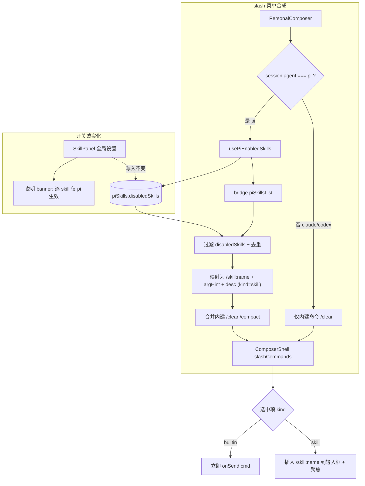

# feat: pi 风格 slash 动态 skills 菜单 + skills 开关作用域诚实化

## Summary

本计划解决两件相扣的事：(1) 修复「skills 开关好像没有作用」的观感问题——根因是逐 skill 的 `disabledSkills` 只对 pi agent 生效，claude 只有粗粒度全局开关、codex 完全无 skill 概念，而 UI 没有任何说明；(2) 参考 pi 的 slash 实现，把输入框 slash 菜单从硬编码命令表升级为 pi 风格的动态 skills 菜单——已启用的 pi skills 以 `/skill:<name>` + argument-hint + 描述形式出现在补全菜单里。两者天然相扣：slash 菜单正是「已启用 skills」对用户产生可见作用的地方，禁用的 skill 不出现在菜单里。

按用户确认的方向：开关问题走「明确限定 pi + UI 诚实传达」（不为 claude 补侵入式逐 skill 能力）；slash 做「pi 风格动态 skills 菜单核心」（暂不做 prompt-templates / `$1` 参数替换）；skills 仅在 pi 会话的菜单中显示。

---

## Problem Frame

两条独立线索指向同一组件群：

- **开关无效**：写入链路（点开关 → `togglePiSkill` → `disabledSkills` → 持久化）完全正常且有测试覆盖（`PluginManager.test.tsx`）。断点在读取/注入端——`disabledSkills` 仅经 `resolveEnabledSkillPaths` → `--skill` 注入到 pi（`pi-rpc.ts`、`pi.ts`）；claude 只读会话级 `useOwnSkills`（映射 `--disable-slash-commands`，claude.ts），codex 的 `buildArgs` 无任何 skill 逻辑。`messages.ts` 单发层显式只为 `agent === "pi"` 解析 `skillPaths`。由于默认 agent 派生顺序为 `claude > codex > pi`，多数用户当前会话是 claude/codex，在全局设置页 `SkillPanel` 切开关 → 命令行无变化 → 「看起来没作用」。

- **slash 框架已存在但静态**：`ComposerShell` 已具备完整 slash 菜单（前缀匹配、↑/↓ 键盘导航、Enter/Tab 执行、Esc 收起、`role=listbox` ARIA、`.pw-slash-*` CSS、测试）。但命令源是 `PersonalComposer` 里硬编码的 `{cmd,desc}[]`（仅 `/clear` 全 agent、`/compact` 仅 pi），不接 skills 列表、无 argument-hint。

pi 的模型（来自 `https://pi.dev/docs/latest`）：键入 `/` 打开补全、边输边过滤；skills 显示为 `/skill:name`；prompt-templates 显示为 `/模板名`；补全项展示 命令名 + argument-hint（`<必填>`/`[可选]`）+ 描述。本计划复刻其中的 skills 部分。

---

## Requirements

### 开关作用域诚实化

- R1. 在全局设置的 `SkillPanel` 中明确说明：逐 skill 开关仅对 pi 会话生效；codex 无 skill 概念；claude 使用会话级 skills 总开关（`--disable-slash-commands`），不支持逐 skill 控制。让用户理解「切了对当前会话不一定有效」属预期作用域、而非故障；说明同时点明 slash 菜单中的 skills 亦仅在 pi 会话出现（与面板共用同一条 pi-only 心智规则）。
- R2. 保持现有写入链路与 pi 注入行为不变：开关对 pi 会话仍按原样过滤已启用 skills，不回归。

### pi 风格动态 slash skills 菜单

- R3. pi 会话输入框键入 `/` 时，slash 菜单在内建命令之外列出当前已启用的 pi skills；被禁用的 skill 不出现。
- R4. 每个 skill slash 项展示 `/skill:<name>`、argument-hint（若 skill frontmatter 提供）、以及 skill 描述。
- R5. 选择 skill 项把 `/skill:<name> `（含尾随空格）插入输入框并保留焦点，供用户继续填写参数；选择内建命令（`/clear`、`/compact`）仍立即执行（行为不变）。
- R6. claude / codex 会话的 slash 菜单只含通用内建命令（如 `/clear`），不含 skills。
- R7. 桌面端以外（web 端 / 缺少 `piSkillsList` 的旧壳）优雅降级：slash 菜单回退为仅内建命令，无报错、无异步抖动。

---

## Key Technical Decisions

- KTD1. 开关问题走诚实化而非补能力。逐 skill 启停本质只对 pi 有意义（claude/codex 的 skill 模型不同）。在 `SkillPanel` 加说明而非为 claude 实现侵入式 `~/.claude/skills` 目录托管——后者风险高、改用户主目录、超出本轮范围（见 Scope Boundaries）。

- KTD2. skills 仅在 pi 会话注入 slash 菜单（R3/R6）。skills 是 pi 的 `--skill` 能力；在 claude/codex 会话展示 `/skill:*` 会重现「看着能选、其实没用」的同类困惑，与 KTD1 的诚实化方向冲突。

- KTD3. skill 命令命名为 `/skill:<name>`，对齐 pi 约定，并与内建 `/clear` `/compact` 天然区分。沿用现有前缀匹配（`cmd.startsWith(query)`），无需改匹配算法：键入 `/sk` 即过滤出全部 `/skill:*`。

- KTD4. slash 项区分两种执行语义：内建命令立即执行（现状 `onSend(cmd)`），skill 命令为「插入并保留编辑」（把 `/skill:<name> ` 写入输入框、聚焦、不发送），以支持 argument-hint 填参。由 slash item 上的 `kind`（`"builtin" | "skill"`）字段驱动分支，默认 `"builtin"` 保持向后兼容。菜单项需按 `kind` 给出不同动作提示（内建显示「运行」、skill 显示「插入」），避免用户误以为选 skill 会像 `/clear` 那样立即执行。

- KTD7. slash 菜单的触发条件从「文本以 `/` 开头」收紧为「以 `/` 开头**且尚未输入空格**」，即仅在用户仍在键入命令 token 时打开。否则现有触发逻辑（`text.trim()` 以 `/` 开头即匹配，`ComposerShell.tsx:382-385`）会在插入 `/skill:<name> ` 后立刻把菜单重开、覆盖输入框，且 `useEffect([slashQuery])`（`:387-390`）重置 `slashDismissed` 使其无法收起，Enter 又被 slashOpen 分支拦为「重新执行」而非发送——直接破坏 R5「插入后填参再发送」的核心流程。收紧后：插入 `/skill:<name> `（含空格）→ 菜单关闭 → 用户补参数 → Enter 正常提交。此约束对内建命令无副作用（内建为无参、选中即执行）。

- KTD5. 已启用 skills 的渲染端数据源 = 调用 `bridge.piSkillsList(piSkills 配置)` 并用 `disabledSkills` 过滤 + 按 name 去重，与 `resolveEnabledSkillPaths`（`messages.ts`）同源同规则（全局覆盖工作区、跳过未授信工作区 skill）。新增一个返回展示用元数据（name/description/argumentHint）的薄封装，避免与产出注入路径的 `resolveEnabledSkillPaths` 重复逻辑漂移。

- KTD6. 不改 IPC / agent 注入链路。skills 早已经 `--skill` 注入 pi；本计划只做发现性 UI + 诚实化。skill 的实际执行仍依赖 pi 侧已加载该 skill——本计划不新增「执行 skill」的 IPC（见 Open Questions 对 pi-rpc 是否解析前导 slash 文本的运行时核验）。

---

## High-Level Technical Design

slash 菜单的命令源从「硬编码静态表」变为「内建命令 + (仅 pi) 动态已启用 skills」的合成；开关作用域在 UI 层诚实化。两条数据流：

降级：`bridge` 为 null 或无 `piSkillsList`（web/旧壳）时 `usePiEnabledSkills` 返回 `[]`，菜单回退仅内建命令（R7）。

---

## Implementation Units

### U1. SkillPanel 作用域诚实化说明

- **Goal**: 在全局设置的 skill 面板加入清晰说明，传达逐 skill 开关只对 pi 会话生效，消除 bug 观感。满足 R1。
- **Requirements**: R1, R2
- **Dependencies**: 无
- **Files**:
  - `packages/views/cortex-desktop/personal/PluginManager.tsx`（`SkillPanel` 顶部加说明 banner）
  - `packages/core/i18n/resources/zh-Hans/settings.json`、`packages/core/i18n/resources/en/settings.json`（新增说明文案 key）
  - `packages/core/i18n/@types/resources.d.ts`（同步类型）
  - `packages/views/cortex-desktop/personal/PluginManager.test.tsx`（测试）
- **Approach**: 在 `SkillPanel` 现有 header/列表上方插入一条信息性说明（沿用面板既有的提示文案样式，不新造组件）。文案点明三点：① 这些开关作用于 pi 会话；② codex 无 skill；③ claude 用会话级 skills 总开关，不支持逐 skill；并附一句「slash 菜单中的 skills 同样仅 pi 会话出现」统一心智（R1）。不改 `togglePiSkill` / `disabledSkills` 写入路径（R2）。
  - 可选增强（本轮 banner 方案的上位，不强制）：面板可经 store 的 `activeSessionId` 读当前会话 agent，在非 pi 会话时对逐 skill 开关做视觉降级（置灰 + tooltip），把「诚实传达」从静态说明提升为上下文感知。若实现期 banner 被判定不足以兑现 R1 的作用域传达，再纳入；与 KTD2「菜单侧隐藏假可选项」的取舍对齐。
- **Patterns to follow**: 复用 `SkillPanel` 内既有的提示/空态文案渲染方式（如 `PluginManager.tsx:432` 一带的引导文案）；i18n 走 `useTranslation("settings")`，与面板现有 key 同 namespace。
- **Test scenarios**:
  - Covers R1. 渲染 `SkillPanel` → 断言说明文案（含「pi 会话」「codex」「claude」关键语义）出现在文档中。
  - Covers R2. 点击某 skill 的禁用开关 → 仍调用 `togglePiSkill(scope, name, false)` 并写入 `disabledSkills`（沿用 `PluginManager.test.tsx:47-51` 既有断言，确认未回归）。
- **Verification**: 设置页 skill 面板顶部出现作用域说明；现有禁用/启用写入测试仍绿。

### U2. ComposerShell slash 模型扩展（argument-hint + 插入模式）

- **Goal**: 扩展 slash 命令项数据结构以承载 argument-hint 与执行种类，并在下拉渲染 argHint、按 `kind` 分支执行。满足 R4、R5 的 composer 侧。
- **Requirements**: R4, R5
- **Dependencies**: 无
- **Files**:
  - `packages/views/cortex-desktop/personal/ComposerShell.tsx`（`slashCommands` prop 类型、`runCommand` 分支、下拉项渲染）
  - `packages/views/cortex-desktop/cortex-desktop.css`（argHint 展示样式，复用 `.pw-slash-*` 体系）
  - `packages/views/cortex-desktop/personal/ComposerShell.test.tsx`（测试）
- **Approach**:
  - 把 `slashCommands` 项类型从 `{ cmd; desc }` 扩为 `{ cmd; desc; argHint?: string; kind?: "builtin" | "skill" }`，`kind` 缺省视为 `"builtin"`（向后兼容现有 `/clear`、`/compact`）。
  - 下拉项（`ComposerShell.tsx:543` 一带）在 `<code>{cmd}</code>` 后、`{desc}` 前渲染 argHint（有则显示，无则不占位）。动作提示 `kbd`（现 `composer.slashRun`）按 `kind` 切换：`builtin` 显示「运行」、`skill` 显示「插入」（KTD4），新增对应 i18n key。
  - **触发收紧（KTD7）**：把 `slashQuery` 判定从「`text.trimStart().startsWith("/")`」改为「以 `/` 开头且 `text.trim()` 不含空格」，使插入 `/skill:<name> ` 后菜单关闭、Enter 正常提交。前缀匹配（`slashMatches`，`ComposerShell.tsx:384`）算法不变。
  - `runCommand`（`ComposerShell.tsx:392`）按 `kind` 分支：`builtin` → 维持 `onSend(cmd, [])` + 清空；`skill` → `setText(`${cmd} `)`、聚焦 `taRef`、不发送（插入并保留编辑；尾随空格配合 KTD7 即关闭菜单）。
  - **长列表态**：`.pw-slash-hint` 增加 `max-height` + 纵向滚动（skill 数可达 10-30），避免下拉溢出 composer。
- **Patterns to follow**: 现有 slash 下拉 JSX（`ComposerShell.tsx:527-550`）与 `.pw-slash-item` / `.pw-slash-kbd` 样式（`cortex-desktop.css:6013-6049`）。
- **Test scenarios**:
  - Covers R4. 传入带 `argHint` 的命令项 → 下拉该项渲染出 argHint 文本；不带 argHint 的项不渲染 hint 元素。
  - Covers R5. 选择 `kind:"skill"` 项（Enter/Tab/点击）→ 输入框文本变为 `"/skill:<name> "`、未触发 `onSend`、textarea 获得焦点。
  - KTD7. 插入 `"/skill:<name> "` 后 → slash 菜单关闭（不再 `role=listbox`）；此时按 Enter → 触发 `submit`/`onSend` 发送，而非重新执行命令。
  - kind 区分动作提示：`skill` 项高亮显示「插入」、`builtin` 项高亮显示「运行」。
  - 回归：选择 `kind:"builtin"`（或无 kind）的 `/clear` → 仍立即 `onSend("/clear")` 并清空（沿用 `ComposerShell.test.tsx:47-95` 既有用例）。
- **Verification**: 现有 slash 键盘导航测试全绿；新增 argHint 渲染、skill 插入后菜单关闭+Enter 发送、kind 动作提示测试通过。

### U3. 渲染端已启用 pi skills 数据源

- **Goal**: 提供一个返回「已启用 pi skills 展示元数据」的 hook，复用与注入链路同源的过滤/去重规则，供 composer 组装 slash 菜单。满足 R3、R7 的数据层。
- **Requirements**: R3, R7
- **Dependencies**: 无
- **Files**:
  - `packages/core/personal/piSkills.ts`（新增 `usePiEnabledSkills` hook 或 `listEnabledPiSkills` 辅助；与 `messages.ts` 的 `resolveEnabledSkillPaths` 同源逻辑）
  - `packages/core/index.ts`（导出新 hook；如走子路径需同步 `exports`）
  - `packages/core/personal/piSkills.test.ts`（测试）
- **Approach**:
  - **bridge 获取**：hook 经 `useDesktopBridge()`（`provider.tsx:70`，web 端返回 `null`）取桥，**不**从 store 取——bridge 不在 store 上。config 经 `usePersonalStore` 取 `generalSettings.piSkills`（`globalRoots`/`userGlobalRoots`/`workspaceEnabled`/`disabledSkills`/`trustedWorkspaceSkillDirs`）。
  - **projectPath 来源**：`piSkillsList` 需要 `workspaceDir` 才能扫描工作区 scope skill（`bridge.ts:292-297`）。hook 从 store 的 `activeSessionId` → 对应 session 的 `projectPath`（或 `projects.find(p => p.id === activeProjectId)?.path`）内部解析，**不**要求调用方传入——`ComposerShell` 并不持有 `project.path`。
  - **过滤须完整复刻 `resolveEnabledSkillPaths`（`messages.ts:1369-1380`），不止「按 name 去重」**：① 跳过 `disabledSkills`（复合键 `${scope}:${name}`）；② 丢弃未授信的工作区 skill（`scope==="workspace" && !trusted`）；③ 同名冲突按**全局覆盖工作区**precedence。否则未授信工作区 skill 会出现在菜单（且展示其 argHint）却永不被注入，菜单与实际注入不一致。
  - **`useOwnSkills` 门控**：`resolveEnabledSkillPaths` 在 `useOwnSkills === false` 时返回 `[]`（`messages.ts:1355`）。hook 同样接受当前会话的 `useOwnSkills`，为 `false` 时返回 `[]`，避免菜单广告了不会注入的 skill。
  - 返回 `{ name, description, argumentHint }[]`（取自 `PluginSkill`，`types.ts:1203-1213`）。
  - `bridge` 为 null 或无 `piSkillsList` → 返回 `[]`（R7 降级）。异步加载期间返回 `[]` 而非抖动。
  - **缓存**：用仓库既有 React Query 模式（`notes.ts:308-322`、`home.ts` 同款 `useQuery`）。query key **必须含 `wsId`**（CLAUDE.md 约定，防切 workspace 串场）+ `projectPath`，如 `["pi-skills", wsId, projectPath]`；`disabledSkills`/`useOwnSkills` 过滤在 fetch 后客户端应用，使 config 改动无需重新扫描。
- **Patterns to follow**: `PluginManager.tsx:129-160` 的 `piSkillsList` 拉取 + `disabledSkills` 叠加范例；`messages.ts:1350-1380` 的过滤/去重/`useOwnSkills` 规则（作为单一事实来源对照，勿复制粘贴使其漂移）；`notes.ts:308-322` 的 core/personal `useQuery` hook 范式与 `useDesktopBridge()` 用法。
- **Test scenarios**:
  - Covers R3. 给定扫描返回 3 个 skill、其中 1 个在 `disabledSkills` → hook 仅返回另外 2 个。
  - 未授信工作区 skill → 不出现在返回中（与注入一致）。
  - 去重：全局与工作区同名 skill → 返回全局项（覆盖工作区）。
  - `useOwnSkills === false` → 返回 `[]`（即便有已启用 skill）。
  - 元数据：返回项携带 `argumentHint`（当 skill frontmatter 有 `argument-hint`）。
  - Covers R7. `bridge` 无 `piSkillsList` → 返回 `[]`，不抛错。
- **Verification**: hook 单测覆盖过滤/未授信跳过/去重/`useOwnSkills` 门控/降级；与 `resolveEnabledSkillPaths` 在相同输入下产出一致的 skill 名集合。

### U4. PersonalComposer 合成 pi 风格动态 slash 菜单

- **Goal**: 把已启用 pi skills（仅 pi 会话）映射为 `/skill:<name>` slash 项并与内建命令合并交给 ComposerShell；确认插入后的 skill 文本经发送正常流向 pi。满足 R3、R6，串起 R4/R5。
- **Requirements**: R3, R4, R5, R6
- **Dependencies**: U2, U3
- **Files**:
  - `packages/views/cortex-desktop/personal/PersonalComposer.tsx`（用 U3 hook 组装 `slashCommands`）
  - `packages/views/cortex-desktop/personal/PersonalChatArea.tsx`（确认 `onSend` 对 `/skill:*` 文本走默认发送分支，无需新增拦截）
  - `packages/views/cortex-desktop/personal/PersonalComposer.test.tsx`（新增；当前不存在该测试文件）
- **Execution note**: 开工前先做 U4 前置 spike（见 Open Questions）——用一条真机 pi-rpc `prompt("/skill:<已启用名> 测试参数")` 观测 RPC 模式下参数是否透传给 skill，据结论定档插入文本形态，再写 `PersonalComposer.test.tsx`，避免按错误前提写完返工。
- **Approach**:
  - pi 会话：用 U3 hook（传入 `session.useOwnSkills`）取已启用 skills → 映射为 `{ cmd: `/skill:${name}`, desc: description, argHint: argumentHint, kind: "skill" }`，**排在内建命令之后**合并（`MERGE`），减少 skills 异步弹入时对既有高亮项（`slashSel`）的位移；内建仍 `[...SLASH_COMMANDS, ...PI_SLASH_COMMANDS]`（`PersonalComposer.tsx:62`）。
  - 非 pi 会话：仅 `SLASH_COMMANDS`（内建），不调用 hook / 不注入 skills（R6、KTD2）。
  - 内建命令项显式标 `kind:"builtin"`（或保持缺省，依赖 U2 默认值）。
  - skill 选中后输入框得到 `"/skill:<name> "`（KTD7 触发收紧使菜单随即关闭），用户补参数后正常发送；`PersonalChatArea.onSend`（拦截 `/clear`、pi 的 `/compact`，其余 `send`）对 `/skill:*` 走 `send` 默认分支——`pi-rpc.ts:544` 已对 `/` 前缀按扩展命令处理，故无需新增 IPC 拦截（参数透传以 spike 结论为准）。
- **Patterns to follow**: `PersonalComposer.tsx:62` 现有按 agent 选命令集的写法；`PersonalChatArea.tsx:426-450` 的 `onSend` 拦截结构。
- **Test scenarios**:
  - Covers R3 / R4. pi 会话渲染 composer，输入 `/` → 菜单含 `/skill:<name>` 项并显示描述/argHint（mock U3 hook 返回 1-2 个 skill）。
  - Covers R6. claude 会话输入 `/` → 菜单只含 `/clear`，不含任何 `/skill:*`。
  - Covers R5. pi 会话选择 `/skill:<name>` → 输入框为 `"/skill:<name> "`、未发送。
  - 降级：hook 返回 `[]`（web/旧壳）→ pi 会话菜单回退仅内建命令，无报错。
- **Verification**: pi 会话 slash 菜单出现已启用 skills、禁用项不出现、claude 会话无 skills；选 skill 插入待编辑、选内建仍立即执行。

---

## Scope Boundaries

### 本计划范围内

- `SkillPanel` 作用域说明（诚实化）。
- pi 会话 slash 菜单的动态 skills（`/skill:<name>` + argument-hint + 描述）。
- skill 项的「插入并编辑」交互；内建命令行为不变。
- web/旧壳降级。

### Deferred to Follow-Up Work

- **prompt-templates 支持**（`~/.pi/agent/prompts/*.md`、frontmatter、`/模板名`、`$1`/`$@` 参数替换）——用户明确选择「核心」范围，模板与参数替换留作后续。
- **更多内建命令**（`/model`、`/new`、`/resume` 等 pi 内建）——本轮只动态化 skills，不扩内建命令集。
- claude/codex 会话内的 skills 菜单（R6 明确排除）。

### Outside this product's identity（本轮不做）

- **为 claude 实现真正的逐 skill 禁用**（托管 `~/.claude/skills` 目录、启停时增删/软链）。侵入用户主目录、风险高，且与「诚实化」方向相悖（KTD1）。若未来确有需求，应单独立项评估。
- 改动 agent buildArgs / IPC 注入链路（KTD6）。

---

## Open Questions

- **RPC 模式下 `/skill:<name> <参数>` 的参数是否透传给 skill？（U4 前置 spike，开工前消除）** 前导 slash 文本是否被 pi 识别为扩展命令——**代码已给出答案：是**。`pi-rpc.ts:544` 显式 `const isSlash = message.trimStart().startsWith("/")`，并对 slash 前缀调度 `scheduleExtensionCommandFinalize`（`:555-559`）；`:351-356` 注释明确提到 `/skill: /template` 展开的收尾竞态。真正未被任何现有代码覆盖的是**带参语义**：现有扩展命令 `/clear`、`/compact` 皆无参，无证据表明 `/skill:foo 这是参数` 在 RPC 模式会把「这是参数」交给 skill（而非当普通用户消息）。这是 R5/KTD4「插入并保留编辑供填参」整个交互的价值支点。
  - **行动**：U4 开工前用一条真机 RPC `prompt("/skill:<已启用名> 测试参数")` 观测（`apps/desktop/src/main/agents/pi-rpc.ts`）。
  - 若参数被透传 → 现设计（KTD4 插入 `/skill:<name> ` 供填参）即兑现核心价值。
  - 若参数被吞/skill 未带参执行 → KTD4 降级为「仅插入 `/skill:<name>` 触发无参 skill」或改插自然语言引用；该分支须在 U4 写测试前定档。此结论只影响 U4 插入文本最终形态，不改 U1/U2/U3 边界。

---

## Sources & Research

- pi slash 模型与 prompt-templates 约定：`https://pi.dev/docs/latest/usage`、`https://pi.dev/docs/latest/prompt-templates`（skills → `/skill:name`；模板 → `/名`，补全展示 命令名 + argument-hint`<必填>`/`[可选]` + 描述）。
- 开关注入断点（根因）：`packages/core/personal/messages.ts:1350-1379`（`resolveEnabledSkillPaths`，唯一消费 `disabledSkills` 处）、`messages.ts:2125-2128`（单发层仅为 pi 解析 `skillPaths`）、`apps/desktop/src/main/agents/claude.ts:63-64`（仅 `useOwnSkills`）、`apps/desktop/src/main/agents/codex.ts:28-56`（无 skill 概念）。
- 写入链路（正常、勿动）：`packages/core/store/personal.ts:446-456`（`togglePiSkill`）、`packages/views/cortex-desktop/personal/PluginManager.tsx:487-525`（`SkillCard`）。
- slash 框架现状：`packages/views/cortex-desktop/personal/ComposerShell.tsx:381-419`（匹配/键盘/执行）、`:527-550`（下拉 UI）、`cortex-desktop.css:6013-6049`（`.pw-slash-*` 样式）、`PersonalComposer.tsx:9-14,62`（硬编码命令表）。
- skills 数据源：`packages/core/desktop/bridge.ts:292-297`（`piSkillsList`）、`packages/core/desktop/types.ts:1203-1213`（`PluginSkill`，含 `argumentHint`）、`PluginManager.tsx:129-160`（拉取 + 叠加范例）。
