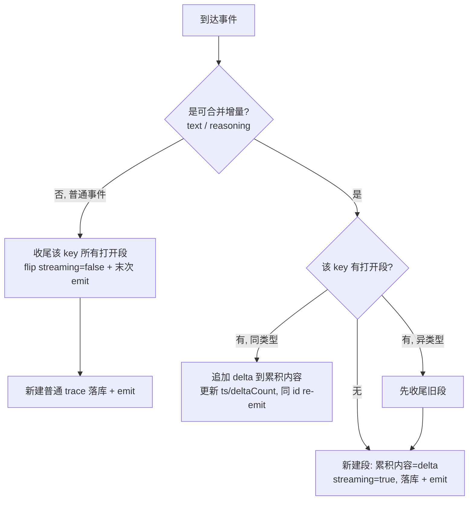

# feat: Agent 调试跟踪流式增量合并为完整段

## Summary

在 dev-only 的 `agent-trace` 子系统记录端把流式增量合并成完整段：连续的 text 增量累积成一条 text 跟踪、连续的 reasoning 增量累积成一条 reasoning 跟踪，遇到不同类型事件即收尾。合并在 `recordAgentTrace`(`apps/desktop/src/main/ipc/agent-trace.ts`)这一个点完成，cli 与 pi-session 两条发射路径接入；面板复用现有事件通道、改为按 `id` upsert，使合并段在流式期间实时生长为同一行。

---

## Problem Frame

主进程对每个解析出的流式事件都各记一条独立 trace：`cli.ts:351`(每条 `CliStreamEvent`)与 `pi-session.ts` 的 `emitEvent`(每条 `PiSessionEvent`，含 text 与 reasoning 增量)。pi 流式输出会吐出成百上千个增量，调试面板被一面「pi text」墙刷满，要逐条点开才能拼出完整输出，跟踪极其困难。

更要命的副作用：`recordAgentTrace` 的环形缓冲上限只有 500 条(`agent-trace.ts:25`)。一轮稍长的流式输出就把缓冲灌满，导致同会话内 start / tool / stderr / exit 等关键 trace 被挤出淘汰——恰恰是调试时最需要的上下文丢失了。

---

## Key Technical Decisions

- **合并引擎落在记录端单点。** 在 `recordAgentTrace` 所在模块维护「打开中的段」状态机，而非在面板端分组。环形缓冲里存的是「段」而非「增量」，同时根治视觉刷屏(R1、R5)与缓冲被挤爆(R8)。面板端分组只能治视觉、缓冲隐患仍在，故排除(见 origin Key Decisions)。
- **「更新同一条」复用现有 `agent-trace:event` 通道 + 面板 `id` upsert，不新增 IPC 通道。** 每个增量到达时以**相同 `id`** 重新 `emitTrace` 当前段，面板由纯 append 改为按 `id` upsert(R4)。比 origin 设想的「新增独立更新通道」改动更小。代价:流式期间每增量仍发一条 IPC 消息(仅更新同一行)，本次不引入节流——节流列入后续(见 Scope Boundaries)。
- **段类型由调用方分类，记录端管理段生命周期。** cli/pi-session 调用方知道事件语义(哪些是可合并的 text/reasoning 增量)，故由调用方把增量路由到合并 API、把其它事件走原 `recordAgentTrace`;记录端持有「打开中的段」map(按 run/session + 段类型归属)并负责追加、收尾、re-emit。记录端不反向解析 `data` 里的事件形状，避免与事件联合类型耦合。
- **任意非增量事件 = 该 run/session 所有打开段的收尾信号。** tool / result / turn-end / error / exit / crash 都经 `recordAgentTrace` 落库，记录端在落这类事件前先收尾同 key 的打开段(R2)。无需调用方显式 close。此外,到达的增量若与当前打开段类型不同(reasoning 直接转 text、中间无分隔事件),也先收尾旧段再开新段(R2)。
- **AgentTraceEvent 类型双处镜像需同步。** 该接口在 `agent-trace.ts:3-13` 与 `packages/core/desktop/types.ts:1004-1014` 各定义一份(手工镜像);新增的段字段(如 `segmentType` / `streaming` / `deltaCount`)两处同改，`AgentTraceInput`(agent-trace.ts:15-23)按需第三处同步,preload / bridge 仅 `import type` 自动跟随。

---

## High-Level Technical Design

记录端段状态机(每个 run/session 维护一组「打开中的段」，本质上同一时刻每 key 至多一个活跃段):

收尾的触发点(均已存在、都经 `recordAgentTrace`)：cli 的 tool/result/stderr/exit/error；pi 的 tool-start/tool-end/turn-end/result/error/crash。无需新增显式 close 调用。

---

## Requirements Traceability

源自 origin `docs/brainstorms/2026-06-20-agent-trace-stream-coalescing-requirements.md`：

- R1(同类增量累积成一条) → U1、U2、U3
- R2(类型变化/一轮结束收尾) → U1、U2、U3
- R3(按 run/session+类型归属) → U1
- R4(实时生长、更新同一条) → U1、U4
- R5(面板渲染段、展开看完整内容) → U4
- R6(text 与 reasoning 各自独立条目) → U3、U4
- R7(非流式事件维持一事件一条) → U1、U2、U3
- R8(缓冲占用与增量数无关、仅与段数相关) → U1
- AE1-AE4 → 见各 U 的 Test scenarios

---

## Implementation Units

### U1. 记录端段合并引擎

- **Goal**: 在 `agent-trace.ts` 引入「打开中的段」状态机与合并 API，使连续同类增量合并为一条实时生长的 trace，非增量事件收尾打开段。
- **Requirements**: R1, R2, R3, R4, R7, R8
- **Dependencies**: 无
- **Files**:
  - `apps/desktop/src/main/ipc/agent-trace.ts`(修改:新增段状态 + 合并函数 + 收尾逻辑 + 类型字段)
  - `packages/core/desktop/types.ts`(修改:镜像 `AgentTraceEvent` 新增字段)
  - `apps/desktop/src/main/ipc/agent-trace.test.ts`(新增测试)
- **Approach**:
  - 新增导出函数(命名待实现，如 `recordStreamDelta(input)`):入参含 `scope` / `segmentType: "text" | "reasoning"` / `delta` / `runId` / `sessionId` / `agent`。维护模块级 `openSegments` map，key 由 `runId ?? sessionId` + `segmentType`(并按 run/session 隔离)派生。
  - 段命中同类型:把 `delta` 追加到累积内容、刷新 `ts` 与 `deltaCount`，以**相同 `id`** 调 `emitTrace`(不 push 新条目)。段不存在:新建一条 `AgentTraceEvent`(`summary` 形如 `pi text`、`streaming: true`、`segmentType`)push 进缓冲并 emit。异类型命中:先收尾旧段再开新段。
  - 修改 `recordAgentTrace`:在落普通(非增量)事件前，先收尾该 run/session 下所有打开段(flip `streaming: false`、末次 emit、从 map 移除)，保证顺序(如 reasoning 段在 tool 事件到达时定格)。
  - 累积内容沿用 `MAX_STRING_LENGTH`(`sanitizeTraceData`)风格做上限截断，避免超长段无界增长。
  - `__resetAgentTraceForTest` 同时清空 `openSegments`。
  - `AgentTraceEvent` 新增可选字段:`segmentType?: "text" | "reasoning"`、`streaming?: boolean`、`deltaCount?: number`;在 `agent-trace.ts` 与 `core/desktop/types.ts` 两处镜像同步。
- **Patterns to follow**: 现有 `recordAgentTrace`/`emitTrace`/`traceId` 结构(agent-trace.ts:64-85);`sanitizeTraceData` 的截断与脱敏(agent-trace.ts:49-62)。
- **Test scenarios**(`agent-trace.test.ts`，沿用 hoisted electron mock + handlers Map):
  - Covers AE1. 连续 3 个同 run 的 text 增量经合并 API → 缓冲只新增 1 条;该条累积内容为三段拼接、`deltaCount=3`、`streaming=true`。
  - Covers AE1. 同上但混入 reasoning:48 个 reasoning 增量 + 31 个 text 增量(中间无分隔事件)→ 缓冲新增恰好 2 条(1 reasoning 段 + 1 text 段)，类型切换处旧段定格。
  - Covers AE2. 打开 text 段后,经 `recordAgentTrace` 落一条 tool 事件 → text 段 `streaming` 翻为 false 并末次 emit、随后 tool 作为独立条目落库;之后再来 text 增量 → 另起新段。
  - Covers AE3. 两个不同 runId 的增量交错到达 → 各自累积到归属 run 的段、内容不交叉。
  - Covers AE4. 灌入 2000 个增量(共 2 段)→ 缓冲为此轮仅新增 2 条;先前落的 start 事件仍在缓冲内(未被挤出)。验证 R8:缓冲占用与增量数无关。
  - R7. 非增量事件(start/exit)行为不变、仍逐条落库。
  - 同 `id` 多次 emit:断言生长期间 `emitTrace` 用同一 `id`,缓冲长度不随增量增长。

### U2. cli 流式路径接入合并

- **Goal**: 让 `cli.ts` 的流式解析把 text 增量路由到合并 API、其它事件维持原 `recordAgentTrace`。
- **Requirements**: R1, R2, R7
- **Dependencies**: U1
- **Files**:
  - `apps/desktop/src/main/ipc/cli.ts`(修改:`flushStdout` 回调约 348-362;`oneshot` 的 `handleLine` 约 484-501 视情同样接入)
  - `apps/desktop/src/main/ipc/cli.test.ts`(修改/新增)
- **Approach**:
  - 在 `pipeStdoutLines` 回调中,`ev.type === "text"` 时调合并 API(传 `segmentType: "text"` 与 `ev.delta`)而非 `recordAgentTrace`;其它 `ev.type`(init/tool/result)仍走 `recordAgentTrace`(其收尾逻辑由 U1 保证)。`sendEvent(ev)` 给渲染端的行为不变。
  - `CliStreamEvent` 无 reasoning 类型(types.ts:311-315)，故 cli 路径只合并 text(符合 origin 范围:不给非 RPC 路径补 reasoning)。
  - oneshot 路径(`handleLine`)按同样规则接入,保持一致;若 oneshot trace 价值低可仅保留 cli:start 流式路径接入并在计划执行时确认(见 Open Questions)。
  - **测试 mock 缺口**:`cli.test.ts` 用 `vi.mock("./agent-trace")` 把 `recordAgentTrace` 换成 `traceMock`;新合并 API(如 `recordStreamDelta`)必须同时加入该 mock 工厂(并列一个 `vi.fn()`),否则 cli.ts 里对它的 import 在测试中为 `undefined`、调用即报错。
- **Patterns to follow**: 现有 `recordAgentTrace({ scope: "cli", phase: "event", ... })` 调用形态(cli.ts:351-359)。
- **Test scenarios**(`cli.test.ts`，沿用 `traceMock` + `fakeChild` EventEmitter):
  - Covers AE1. stdout 推入多行 text 增量 → 合并 API 被调用累积、`traceMock`(普通 trace)不再每 text 增量一条。
  - Covers AE2. text 增量后推入一条 tool/result 行 → 该非增量事件经 `recordAgentTrace` 落库(触发 U1 收尾);随后 text 另起新段。
  - R7. start / stderr / exit trace 形态与数量不变(回归现有 `cli:start trace` 用例)。

### U3. pi-session RPC 路径接入合并

- **Goal**: 让 `pi-session.ts` 的 `emitEvent` 把 text 与 reasoning 增量分别路由到合并 API、其它事件维持原 `recordAgentTrace`。
- **Requirements**: R1, R2, R6, R7
- **Dependencies**: U1
- **Files**:
  - `apps/desktop/src/main/ipc/pi-session.ts`(修改:`emitEvent` 约 34-49)
  - `apps/desktop/src/main/ipc/pi-session.test.ts`(修改/新增)
- **Approach**:
  - 在 `emitEvent` 中,`ev.type === "text"` → 合并 API(`segmentType: "text"`);`ev.type === "reasoning"` → 合并 API(`segmentType: "reasoning"`);其它类型(tool-start/tool-end/turn-end/result/error 等，见 `AGENT_TURN_EVENT_TYPES` pi-rpc.ts:357-365)仍走 `recordAgentTrace`。`entry.sender.send("pi:event", ...)` 给渲染端的行为完全不变。
  - text 与 reasoning 是 `mapPiEvent` 产出的两类独立增量(pi-rpc.ts:56-57)，各自成段、互不合并(R6)。
  - **测试 mock 缺口**:`pi-session.test.ts` 的 `vi.mock("./agent-trace")` 工厂当前只导出 `recordAgentTrace: vi.fn()`(约 62 行);新合并 API 须并列加入,否则 `emitEvent` 调用它时为 `undefined` 报错。
- **Patterns to follow**: 现有 `recordAgentTrace({ scope: "pi", phase: "event", summary: \`pi ${ev.type}\`, ... })`(pi-session.ts emitEvent)。
- **Test scenarios**(`pi-session.test.ts`，沿用 `h.onEventRef.current` 手动驱动 onEvent + `recordAgentTrace` mock):
  - Covers AE1/R6. 经 `onEventRef` 注入多个 `{type:"reasoning",delta}` 后多个 `{type:"text",delta}` → reasoning 与 text 分别走合并 API、各成一段。
  - Covers AE2. reasoning 增量 → `{type:"tool-start"}` → text 增量:tool-start 经 `recordAgentTrace` 落库(收尾 reasoning 段)、text 另起新段。
  - R7. pi:open / pi:prompt trace 形态不变(回归现有「记录 pi open/prompt/event trace」用例的非 event 部分)。

### U4. 面板按 id upsert + 段实时生长展示

- **Goal**: `AgentTracePanel` 由纯 append 改为按 `id` upsert，使合并段实时生长为同一行;展开显示完整累积内容、区分段类型标签。
- **Requirements**: R4, R5, R6
- **Dependencies**: U1
- **Files**:
  - `packages/views/cortex-desktop/personal/AgentTracePanel.tsx`(修改:`onAgentTrace` 回调的 setEvents 逻辑约 33-35;行渲染约 114-123)
  - `packages/views/cortex-desktop/personal/AgentTracePanel.test.tsx`(新增 upsert 用例)
- **Approach**:
  - `onAgentTrace` 回调:收到事件时若 `prev` 中存在同 `id` 则原地替换该条(保留位置)、否则追加;仍保留 `.slice(-500)` 上限与 `paused` 短路。
  - 行渲染:`streaming` 段可在 `summary` 旁显示生长指示(如 `(生长中…)` / 完成后省略或打勾);展开区 `traceDataPreview` 已能显示 `data`，段的累积完整内容应可见(累积内容存于段的 `data` 或新字段，由 U1 决定承载位置——优先放进 `data` 以复用现有展开渲染)。
  - 段类型在行内可见:reasoning 段渲染区别于 text 段(可复用现有 `data-phase` / 增加 `segmentType` 标签),满足 R6 的「各自独立条目」视觉区分。
  - **自动滚动依赖**:现有自动滚动 effect 依赖 `[filtered.length, expandedId]`(AgentTracePanel.tsx 约 52-56)。upsert 后段生长期间 `filtered.length` 不变、滚动不再触发。若希望面板跟随生长,需把滚动 effect 改为也依赖最后一条的内容/`ts`/`deltaCount`。属 dev-only 显示体验,非正确性阻塞。
- **Patterns to follow**: 现有 `setEvents(prev => [...prev, event].slice(-500))`(AgentTracePanel.tsx:34)、`key={event.id}`(:102)、token 渲染(:114-123)。
- **Test scenarios**(`AgentTracePanel.test.tsx`，沿用 bridge 假实现 + `listeners[0]` 手动驱动):
  - Covers R4. 用同一 `id` 两次注入(累积内容递增)→ DOM 中只有一行、内容更新为第二次的累积值(不新增行)。
  - Covers R5. 点击生长中的段行 → 展开显示当前完整累积内容。
  - Covers R6. 注入 reasoning 段与 text 段(不同 id、不同 `segmentType`)→ 渲染为两个可区分的独立行。
  - 回归:不同 `id` 的普通事件仍各自追加成行(保留现有 append 语义用例)。

---

## Scope Boundaries

**本次实现**
- 记录端段合并 + 两条发射路径接入 + 面板 upsert/段展示。
- reasoning 仅 pi-session(RPC)路径(该路径本就产 reasoning)。

**Deferred for later**(origin)
- 给非 RPC 归一化路径(claude / codex / oneshot，对应 `CliStreamEvent`)补 reasoning 捕获。
- 跟踪的导出 / 复制整段完整内容功能。
- 增量级时序可视化(查看每个增量到达时刻)——非目标;合并后该信息不再单独保留。

**Deferred to Follow-Up Work**(本计划新增)
- 流式期间 IPC emit 节流(time-based / rAF 合批)——当前每增量发一条更新消息(仅更新同一行),如后续高频场景出现性能问题再做。

---

## Open Questions

**Deferred to Planning(执行时确认)**
- 累积内容的承载位置:放进现有 `data` 字段(复用面板展开渲染、最省)还是新增顶层字段。倾向放进 `data`;执行 U1 时定。
- oneshot 路径(`cli.ts` handleLine)是否一并接入合并:取决于 oneshot trace 的实际调试价值。倾向接入以保持一致;执行 U2 时确认。
- `streaming` 段在面板的生长指示具体呈现(文案/图标)——执行 U4 时按现有面板风格定。
- 段归属 key 用 `runId ?? sessionId`:需确认 pi 同一轮内所有增量的 `runId` 恒定(否则部分缺 `runId` 的增量会被拆成两段)。cli 路径恒带 `runId`;执行 U3 时核对 pi 路径。

---

## Sources & Research

- `apps/desktop/src/main/ipc/agent-trace.ts` — `recordAgentTrace`/`emitTrace`/`traceId`/`sanitizeTraceData` + 500 条环形缓冲(`MAX_EVENTS`);当前每次调用新建独立条目并广播。`AgentTraceEvent`/`AgentTraceInput` 定义(3-23)。
- `apps/desktop/src/main/ipc/cli.ts:348-362` — 流式 `CliStreamEvent` 每行一条 trace(刷屏源之一);oneshot `handleLine` 约 484-501 同构。
- `apps/desktop/src/main/ipc/pi-session.ts` `emitEvent`(约 34-49) — 每条 `PiSessionEvent`(含 text/reasoning 增量)一条 trace(截图所示路径)。
- `apps/desktop/src/main/agents/pi-rpc.ts:56-57` — `mapPiEvent` 中 `text_delta`→`text`、`thinking_delta`→`reasoning`;`AGENT_TURN_EVENT_TYPES`(357-365)列出一轮内交错的事件类型。
- `apps/desktop/src/main/ipc/types.ts:311-315`(`CliStreamEvent`，无 reasoning)、`:388-403`(`PiSessionEvent`，含 `reasoning` 增量)。
- `apps/desktop/src/preload/index.ts:279-290` — `agentTraceList`/`agentTraceClear`/`onAgentTrace`(经 `agent-trace:event` + subscribe/unsubscribe)。
- `packages/core/desktop/bridge.ts:243-247` — `DesktopBridge` 对四个 agentTrace 方法的契约;`packages/core/desktop/types.ts:1004-1014` — `AgentTraceEvent` 镜像定义(需同步新字段)。
- `packages/views/cortex-desktop/personal/AgentTracePanel.tsx:33-35,102,114-123` — 面板纯 append + `key={event.id}` + token 渲染(改 upsert 落点)。
- 测试现状:`agent-trace.test.ts`(electron mock + handlers Map)、`cli.test.ts`(`traceMock` + `fakeChild`)、`pi-session.test.ts`(`onEventRef` 驱动 + `recordAgentTrace` mock)、`AgentTracePanel.test.tsx`(bridge 假实现 + `listeners[0]` 驱动)——新测试沿用各自既有 mock 风格。
