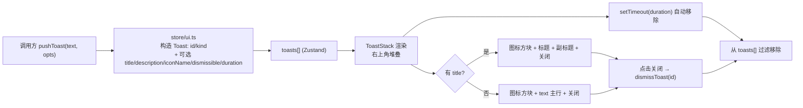

# feat: 全局通用提醒(富样式 toast 通知)

## Summary

把代码库已有的极简全局 toast 升级为图中效果的「通用提醒」组件:macOS 风格毛玻璃卡片,**屏幕右上角**进入并向下堆叠,含 **kind 着色的图标方块 + 加粗标题 + 副标题 + 关闭按钮**,可手动关闭并自动消失。改造保持 `pushToast(text)` 完全向后兼容——现有约 6 处调用点(org 切换、自动化执行结果、热键降级、检查更新等)无需改动即获得新视觉;新增 `title / description / icon / dismissible` 可选字段承载富内容。

图中「5h 配额已重置 / Codex 可以继续使用」**视为示例内容**:本计划交付通用可复用组件 + 一个预览入口,不接线真实的 agent 限流/配额重置事件检测(列为后续工作)。

形态为**应用内浮层**(渲染进程 React 组件,复用现有 `ToastStack` 体系),非 macOS 原生通知。

---

## Problem Frame

现有全局提醒能力(`packages/core/store/ui.ts` 的 `pushToast` + `packages/views/cortex-desktop/ToastStack.tsx`)只能显示单行纯文本深色药丸,底部居中,信息密度低、无法承载「标题 + 说明 + 图标 + 操作」这类结构化提醒,也与产品期望的 macOS 系统通知观感(右上角、浅色毛玻璃卡片)不一致。需要一个**统一、可复用、向后兼容**的提醒组件,既能满足图中富样式,又不打断现有调用点。

**非目标(本计划不做)**:
- macOS 原生系统通知(Electron `Notification` / 通知中心)。
- 真实 agent 配额/限流重置事件的检测与自动触发(图中文案仅为示例)。
- 提醒历史/通知中心面板、持久化、未读计数。
- Web 端(`apps/web`)专属适配——组件落在共享 `packages/views`,Web 端复用同一 store/组件即可,无额外平台工作。

---

## Requirements

- **R1** 提醒卡片视觉对齐图中效果:右上角定位、毛玻璃浅色卡片、左侧 kind 着色圆角图标方块、加粗标题、次级副标题、右上角关闭按钮。
- **R2** 向后兼容:所有现有 `pushToast(text, { kind })` 调用零改动,渲染为新卡片样式(无标题时文本作为主行)。
- **R3** 富内容 API:`pushToast` 支持可选 `title`、`description`、`icon`(`IconName`)、`dismissible`、按条 `duration`。
- **R4** 交互:支持手动点击关闭(`dismissToast`),同时保留自动消失;多条提醒右上角向下堆叠。
- **R5** 主题与可达性:浅/深色主题下均清晰;尊重 `prefers-reduced-motion`;关闭按钮可键盘聚焦/可点击(容器其余部分 `pointer-events: none` 不挡操作)。
- **R6** i18n:任何内置文案经 `packages/core/i18n` 注入,随 UI 语言切换。
- **R7** 提供预览入口验证图中示例(配额重置文案)。

成功标准:在桌面端触发 `pushToast` 富调用后,右上角出现与图一致的卡片;现有调用点视觉自动升级且无回归;`pnpm --filter @cortex-work/core test`、`pnpm --filter @cortex-work/views test`、`pnpm typecheck`、`pnpm lint` 全绿。

---

## Key Technical Decisions

- **KTD1 — 升级单一通道,而非新增并行通道**:扩展现有 `Toast` 模型与 `ToastStack`,而不是新建独立的 "notification" 类型。避免两套体系并存漂移,让所有调用点一次性受益。代价:需保证 text-only 旧调用的渲染兼容(R2 覆盖)。
- **KTD2 — 富字段全部可选,`text` 保留为兼容主体**:`Toast` 在现有 `{ id, text, kind }` 上**追加可选** `title? / description? / iconName? / dismissible? / duration?`。无 `title` 时 `text` 作为卡片主行;有 `title` 时 `text` 可省略(标题即主行)。这样旧签名 `pushToast("已切换")` 与新签名 `pushToast("", { title, description })` 并存。
- **KTD3 — kind→默认图标映射**:`info→Icon.Info`、`success→Icon.CheckCircle`、`error→Icon.XCircle`;调用方可用 `icon` 覆盖。复用 `@cortex-work/ui/icons` 的 `Icon.*`(已确认含 `Info / CheckCircle / XCircle / Bell / X`),不引入新图标资源。
- **KTD4 — 强调色用品牌色**:图标方块/info 着色采用品牌主色 `#7c5cff`(hover `#6a48f0`),success/error 沿用现有绿色/红色语义。集中在 CSS,不散落组件。
- **KTD5 — 定位用绝对定位 + 右上角偏移**:`.toast-stack` 由底部居中改为右上角,`top` 需让位于 `TitleBar`(避免遮挡窗口控制/标题栏),`right` 留边距;容器 `pointer-events: none`,仅卡片与关闭按钮 `pointer-events: auto`。
- **KTD6 — 关闭按钮常驻、自动消失保留**:卡片默认显示关闭按钮(`dismissible` 默认 `true`);`duration` 到点自动移除,手动关闭走现有 `dismissToast(id)`。`duration: 0` 表示不自动消失(用于需用户确认的提醒)。

---

## High-Level Technical Design

提醒的数据流与生命周期(单通道,富字段可选):

> 上图为方向性设计,描述模型与渲染分支,非逐行实现规范。卡片在无 `title` 时降级为「图标 + 单行文本」即覆盖全部现有调用点。

---

## Implementation Units

### U1. 扩展 Toast 数据模型与 store API

**Goal**:在不破坏现有签名的前提下,让 `Toast` 与 `pushToast` 承载富内容。

**Requirements**:R2, R3, R6, KTD2, KTD3, KTD6

**Dependencies**:无

**Files**:
- `packages/core/types/index.ts`(扩展 `Toast` 接口)
- `packages/core/store/ui.ts`(扩展 `pushToast` 选项与 `Toast` 构造、kind→默认图标映射)
- `packages/core/store/ui.test.ts`(新增)

**Approach**:
- `Toast` 在现有 `{ id, text, kind }` 上追加可选字段:`title?: string`、`description?: string`、`iconName?: IconName`、`dismissible?: boolean`、`duration?: number`。`IconName` 从 `@cortex-work/ui/icons` 导入类型(注意 `core` 不得依赖 `react-dom`——仅导入类型,不导入组件运行时,确认 `IconName` 是纯类型导出,见 floder 硬边界)。若类型导入引入跨包运行时风险,则在 `core` 内本地声明 `iconName?: string` 并在视图层做收窄。
- `pushToast(text, opts)` 的 `opts` 扩展为 `{ kind?, duration?, title?, description?, icon?: IconName, dismissible? }`;构造 `Toast` 时:`kind` 默认 `info`;`dismissible` 默认 `true`;`iconName` 取 `opts.icon ?? kindToIcon(kind)`;`duration` 默认沿用现有 `2400`,`duration === 0` 时跳过 `setTimeout`(常驻直到手动关闭)。
- 保留 `dismissToast(id)` 不变。

**Patterns to follow**:现有 `store/ui.ts` 的 `pushToast`/`toastSeq`/`setTimeout` 移除模式;`tweaks` 等可选选项对象写法。

**Test scenarios**(`packages/core/store/ui.test.ts`):
- happy:`pushToast("已切换")` → `toasts` 含一条 `{ text: "已切换", kind: "info", dismissible: true, iconName: <info默认> }`,验证向后兼容(Covers R2)。
- happy:`pushToast("", { title: "5h 配额已重置", description: "Codex 可以继续使用", kind: "success" })` → 该条带 `title/description`、`iconName` 为 success 默认。
- edge:`pushToast(t, { icon: "Bell" })` → `iconName === "Bell"`(显式覆盖默认映射)。
- edge:`pushToast(t, { duration: 0 })` → 不注册自动移除定时器,提醒保留(用 fake timers 推进时间后仍在 `toasts`)。
- happy:默认 `duration`(2400ms)到点后该条从 `toasts` 移除(fake timers)。
- happy:`dismissToast(id)` 移除指定条,其余保留。

---

### U2. 重构 ToastStack 渲染富卡片

**Goal**:`ToastStack` 渲染图中卡片结构,并对 text-only 旧数据优雅降级。

**Requirements**:R1, R2, R4, R5, KTD3, KTD5

**Dependencies**:U1

**Files**:
- `packages/views/cortex-desktop/ToastStack.tsx`(重构渲染)
- `packages/views/cortex-desktop/ToastStack.test.tsx`(新增)

**Approach**:
- 每条 `Toast` 渲染为卡片:`.toast` > `.toast-icon`(渲染 `Icon[t.iconName]`,kind 着色)+ `.toast-body`(`title` 存在时 `.toast-title` 加粗 + `.toast-desc`;否则 `.toast-text` 单行)+ `dismissible` 时 `.toast-close`(`Icon.X`,`onClick={() => dismissToast(t.id)}`,`aria-label` 来自 i18n)。
- `ToastStack` 需要 `dismissToast`:既可继续接收 `items` prop,同时从 `useCortexUIStore` 取 `dismissToast`(组件已在 `packages/views`,可直接用 store hook);保持 `items` 入参签名不变以最小化 `CortexDesktopView` 改动。
- 图标按名取用:`const I = Icon[t.iconName ?? "Info"]`,防御未知名回退 `Icon.Info`。
- 关闭按钮 `pointer-events: auto`(容器 `none`),`type="button"`,可键盘聚焦。

**Patterns to follow**:`OrgSwitcher.tsx` 的 `Icon.X`/`Icon.Check` 用法与按钮关闭交互;现有 `ToastStack` 的 `items.map`/`key=t.id` 结构。

**Test scenarios**(`packages/views/cortex-desktop/ToastStack.test.tsx`,Testing Library + jsdom):
- happy:传入富 `Toast`(title+description)→ 渲染标题文本、副标题文本、对应图标、关闭按钮(Covers R1)。
- happy:传入 text-only `Toast`(无 title)→ 渲染 `text` 主行,无标题/副标题节点(Covers R2)。
- edge:`items` 为空 → 渲染 `null`(沿用现有 `length === 0` 行为)。
- error/交互:点击关闭按钮 → 调用 `dismissToast` 且传入正确 `id`(可 mock store 或断言 store 状态)。
- edge:`iconName` 为未知字符串 → 回退渲染默认图标,不抛错。
- a11y:关闭按钮带 `aria-label`,可通过 role=button 查询到(Covers R5)。

---

### U3. 富样式 CSS、右上角定位与进出场动画

**Goal**:实现图中毛玻璃卡片观感、右上角堆叠定位与动画。

**Requirements**:R1, R4, R5, KTD4, KTD5

**Dependencies**:U2(类名约定一致)

**Files**:
- `packages/views/cortex-desktop/cortex-desktop.css`(改写 `.toast-stack` / `.toast` 区块,约 3236–3265 行)

**Approach**:
- `.toast-stack`:由 `bottom/left/translateX` 居中改为右上角——`top`(留出 TitleBar 高度,避免遮挡)、`right`(边距),`flex-direction: column`,`align-items: flex-end`,`gap` 略增;`pointer-events: none`。
- `.toast`:浅色毛玻璃卡片(浅底 + `backdrop-filter: blur`、圆角增大、柔和阴影、细描边),横向布局:图标方块 / 正文 / 关闭按钮;`pointer-events: auto`;限制最大宽度(如 ~320–360px)。
- `.toast-icon`:圆角方块,按 kind 着色(info 用品牌 `#7c5cff`,success 绿、error 红),图标白色。
- `.toast-title` 加粗、`.toast-desc` 次级色/略小;`.toast-text` 兼容单行。
- `.toast-close`:无边框图标按钮,hover 态,聚焦可见 outline。
- 动画:`toastIn` 由「下方淡入」改为「自右侧滑入 + 淡入」;补充 `prefers-reduced-motion: reduce` 关闭位移动画。
- 深色主题:在已有主题作用域下提供深色卡片底色变量(参照该 CSS 现有主题处理方式)。

**Patterns to follow**:现有 `.toast` 的 `backdrop-filter`/`box-shadow`/`@keyframes toastIn` 写法;该文件既有的主题色/品牌色变量约定。

**Test scenarios**:`Test expectation: none -- 纯样式改动`。验证靠 U5 的视觉自查(截图比对图中效果:右上角、卡片结构、品牌色图标、滑入动画)。

---

### U4. i18n 文案、代表性接入点升级与预览入口

**Goal**:为新结构补文案,升级一个真实调用点示范富用法,并提供验证图中示例的预览入口。

**Requirements**:R3, R6, R7

**Dependencies**:U1, U2, U3

**Files**:
- `packages/core/i18n/resources/zh-Hans/common.json`、`packages/core/i18n/resources/en/common.json`(新增关闭按钮 `aria-label`、预览示例文案键)
- `packages/core/i18n/@types/resources.d.ts`(若该工程用强类型资源声明,需同步;先确认其是否自动生成)
- `packages/core/personal/automation.ts`(将完成/失败 toast 升级为富格式:图标 + 标题 + 说明)
- `packages/views/cortex-desktop/personal/SettingsMenu.tsx`(新增「预览通知」按钮,触发图中配额示例)

**Approach**:
- i18n:在 `common.json` 增加 `toast.closeLabel`;预览示例文案 `toast.demo.quotaTitle`("5h 配额已重置")、`toast.demo.quotaDesc`("Codex 可以继续使用")。zh-Hans 与 en 同步。
- 代表性升级:`automation.ts` 中现有 `pushToast(\`「${label}」执行完成\`, { kind: "success" })` 改为 `pushToast("", { kind: "success", title: ..., description: ... })`,示范富用法且验证真实链路(保持原语义)。
- 预览入口:在 `SettingsMenu` 适当区(如 关于/通用 的开发者/调试项)加一个按钮,点击触发 `pushToast("", { title: t("toast.demo.quotaTitle"), description: t("toast.demo.quotaDesc"), kind: "success", icon: "Run" })`,用于人工对照图中效果。

**Patterns to follow**:`SettingsMenu.tsx` 现有 `pushToast` 调用与按钮写法;`OrgSwitcher.tsx`/`automation.ts` 的 `t(...)` 文案注入;现有 `common.json` 键层级。

**Test scenarios**:
- happy(`automation.ts` 既有测试若存在则补断言):完成事件触发的 toast 带 `title`/`kind: "success"`(Covers R3)。
- happy:i18n 键存在性——`toast.closeLabel`、`toast.demo.*` 在 zh-Hans 与 en 均有值(可在 i18n 现有校验测试或新增轻量断言)。
- 预览按钮:`Test expectation: none -- 调试/人工验证入口`,行为正确性由 U2 的 `ToastStack` 测试与 U5 视觉自查覆盖。

---

### U5. 视觉自查与回归核对

**Goal**:证明图中效果落地且现有调用点无回归。

**Requirements**:R1, R2, R5 的成功标准

**Dependencies**:U1–U4

**Files**:无源码改动(验证单元;如发现样式偏差回到 U3 修正)

**Approach**:
- `pnpm dev:desktop` 启动,点击 U4 预览按钮,核对:右上角定位、毛玻璃浅卡片、品牌色图标方块、加粗标题 + 副标题、关闭按钮、自右滑入动画——与图一致。
- 逐一触发现有调用点(org 切换、检查更新失败、热键提示等)确认 text-only 仍正确(单行 + 图标 + 关闭,无错位)。
- 浅/深色主题各看一遍;开启系统「减弱动态效果」确认动画降级。
- 关闭按钮鼠标点击 + 键盘聚焦各验一次。

**Test scenarios**:`Test expectation: none -- 人工视觉/回归验证`。最终跑 `pnpm --filter @cortex-work/core test`、`pnpm --filter @cortex-work/views test`、`pnpm typecheck`、`pnpm lint`。

---

## Scope Boundaries

**本计划包含**:富样式提醒组件(模型 + store + 渲染 + CSS)、向后兼容、右上角堆叠、手动关闭 + 自动消失、kind→图标、品牌色、i18n、预览入口、一个真实接入点升级示范。

### Deferred to Follow-Up Work
- 真实 agent 限流/配额重置事件检测(解析 claude/codex/pi CLI 输出或计时)并自动触发该提醒——图中文案的真实数据源。
- 提醒「操作按钮」(`action?`:如"查看""撤销"),本计划仅留模型扩展空间,不实现渲染。
- 通知中心/历史面板、未读计数、持久化。
- macOS 原生系统通知(应用失焦时弹出)。
- Web 端独立适配(若未来 Web 端定位/层级与桌面不同)。

---

## Risks & Dependencies

- **右上角遮挡 TitleBar/窗口控制**:`.toast-stack` 的 `top` 偏移必须让位标题栏,否则卡片压住窗口按钮。缓解:U3 取 TitleBar 高度做 `top`,U5 验证。
- **`core` 不得依赖 UI 运行时**:`IconName` 跨包类型导入需确认为纯类型(floder 硬边界:`core` 不引 `@cortex-work/core`→此处是 `core` 引 `ui` 的类型)。缓解:仅 `import type`;若有运行时风险则 `core` 内用 `string` 并在视图层收窄(U1 已注明回退)。
- **i18n 强类型资源声明**:`@types/resources.d.ts` 若为自动生成,手改会被覆盖。缓解:U4 先确认生成方式,按既有流程加键。
- **现有 6 处调用点回归**:text-only 降级渲染需逐点核对。缓解:U5 逐一触发验证。
- **`pointer-events` 误挡交互**:容器若 `auto` 会挡住下方按钮。缓解:容器 `none`、卡片/关闭 `auto`,U2/U5 验证。

---

## Sources & Research

- 现有提醒基础设施(本仓库):`packages/core/store/ui.ts`(`pushToast`/`dismissToast`/`toastSeq`)、`packages/core/types/index.ts`(`Toast`/`ToastKind`)、`packages/views/cortex-desktop/ToastStack.tsx`、`packages/views/cortex-desktop/cortex-desktop.css`(`.toast-stack` 约 3236–3265)。
- 调用点:`OrgSwitcher.tsx`、`personal/automation.ts`、`personal/SettingsMenu.tsx`、`apps/desktop/src/renderer/src/App.tsx`、`apps/desktop/src/preload/index.ts`(热键降级)。
- 图标体系:`packages/ui/icons/index.tsx`(`Icon.*`,含 `Info/CheckCircle/XCircle/Bell/X/Run`;`IconName = keyof typeof Icon`)。
- i18n:`packages/core/i18n/resources/{zh-Hans,en}/common.json`。
- 品牌色记忆:强调色 `#7c5cff`,hover `#6a48f0`。
- 外部调研:未进行——本仓库已有强本地模式(toast 体系)且设计由图给定,无需外部依据。
