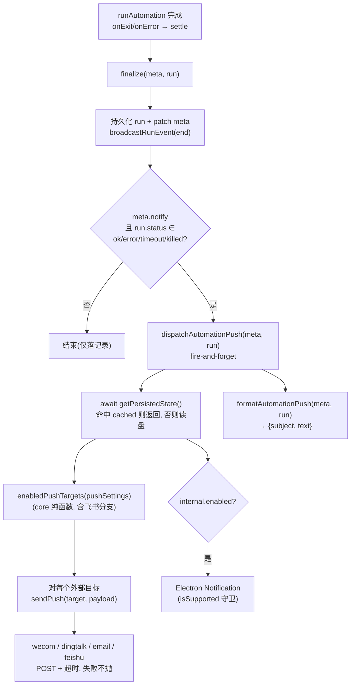
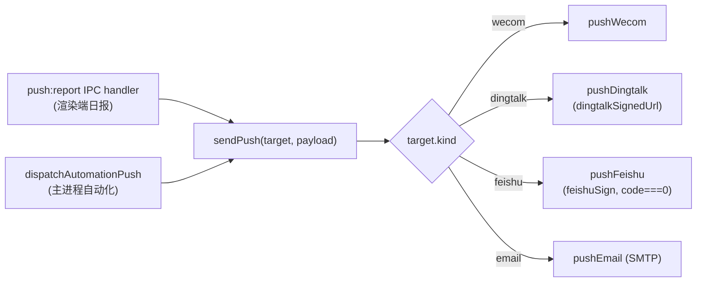

# feat: 自动化任务完成后推送(新增飞书 + 内部通知渠道)

## Summary

让「自动化任务」(`apps/desktop/src/main/automation/`)在**完成后**把执行结果推送到系统已集成的推送渠道,并把推送渠道从 3 类扩到 5 类:

1. 企业微信 webhook(已有)
2. 钉钉 webhook(已有,支持加签)
3. SMTP 邮件(已有)
4. **飞书自定义机器人 webhook**(新增,支持可选加签)
5. **内部通知**(新增 = 主进程 Electron 原生系统通知,无头/关窗也能收到)

复用现有全局 `pushSettings` 渠道配置与主进程 `push:report` 出站管线。因自动化是**无头执行**(关窗后仍在主进程 `runner.ts` 跑),所有渠道(外部 webhook + 原生通知)均在主进程 `runner.ts` 完成收尾处触发,而非现有渲染端日报路径。每个自动化通过弹窗新增的「完成后推送」开关单独 opt-in;开启后推送到所有全局启用的渠道,成功(`ok`)与失败(`error`/`timeout`/`killed`)均通知,被并发跳过的 `skipped` 不通知。

**关键非目标**:不改现有日报推送流程;不做通知历史/通知中心面板;飞书只发文本(不做富卡片深度定制);不动现有「应用内 toast」(它已是窗口打开时的实时反馈,与本次新增的原生通知互补)。

---

## Problem Frame

自动化任务当前的结果只落「运行记录」(`AutomationRun.output`),用户必须主动打开自动化视图查看。两份既有计划已显式为本功能预留接口:`2026-06-20-003-feat-automation-templates-plan.md` 的 Deferred 第一条「推送类模板把产出推系统通知(当前仅落运行记录)」,以及 `2026-06-21-001-feat-global-notification-toast-plan.md` 把「macOS 原生系统通知」「真实事件自动触发」列为 Deferred Follow-Up。本计划是这两处预留的收口实现。

现有推送基础设施(`apps/desktop/src/main/ipc/push.ts` + 全局 `pushSettings`)仅服务于渲染端的「时间线日报」一键推送,且只支持企业微信/钉钉/邮件。需要:(a) 把推送能力接到主进程的自动化完成收尾;(b) 新增飞书与内部原生通知两个渠道;(c) 让单个自动化可选择是否在完成后推送。

---

## Requirements

- **R1** 自动化弹窗(新建/编辑)新增「完成后推送」开关,持久化到 `AutomationMeta.notify`;默认关闭。
- **R2** 开启 `notify` 的自动化在终态(`ok` / `error` / `timeout` / `killed`)推送到所有**全局启用**的渠道;`skipped`(并发去重)不推送。
- **R3** 推送内容:标题 = 自动化名称 + 状态(成功/失败);正文 = 执行输出(成功)或错误信息(失败),截断到安全长度。默认不复用「推送格式 Skill」模板。
- **R4** 新增飞书渠道:自定义机器人 webhook,主进程出站 POST 文本消息,支持可选「加签」(HMAC-SHA256,**飞书算法,非钉钉**);host 白名单仅放行 `open.feishu.cn` / `open.larksuite.com`;成功判定 `code === 0`。
- **R5** 新增内部通知渠道:主进程 Electron 原生 `Notification`(`Notification.isSupported()` 守卫),点击聚焦主窗口;受 `pushSettings.internal.enabled` 门控,独立于 chat 的 `notifications.turnComplete`。
- **R6** 设置「通知」分区新增飞书渠道配置(开关 + webhookUrl + 可选 secret)与内部通知开关,沿用现有 `SwitchRow`/`SRow` 样式。
- **R7** 飞书渠道接入现有渲染端「日报一键推送」(`enabledPushTargets`),与企业微信/钉钉/邮件等同对待(零额外工作,纯函数加分支即得)。
- **R8** 所有新增内置文案经 `packages/core/i18n` 注入,随 UI 语言切换。
- **R9** 跨进程类型契约镜像同步:`core/desktop/types.ts` ↔ `apps/desktop/src/main/ipc/types.ts` ↔ `apps/desktop/src/main/ipc/push.ts` 本地 `PushTarget`。

成功标准:开启「完成后推送」的自动化执行完成后,已启用渠道(含飞书、原生通知)收到结果;关窗状态下原生通知与外部 webhook 仍送达;现有日报推送与 toast 无回归;`pnpm --filter @cortex-work/core test`、相关 desktop 单测、`pnpm typecheck`、`pnpm lint` 全绿。

---

## Key Technical Decisions

- **KTD1 — 推送在主进程 `runner.ts` 触发,不走渲染端日报路径**:自动化无头执行(`runAutomation` 在 main,关窗仍跑),`finalize()` 是唯一可靠的完成收尾点。渲染端 `usePushDailyReport` 依赖 React Query/Zustand,关窗即失效。因此自动化推送完全在主进程闭环:读 `pushSettings`(`getPersistedState` 的内存镜像)→ 建目标 → `sendPush` 出站 / `Notification` 原生通知。代价:主进程需复用 core 的纯函数(见 KTD3)与 push.ts 的出站函数(见 KTD2)。

- **KTD2 — 抽出可复用 `sendPush(target, payload)`,IPC handler 与 runner 共用**:当前 `push:report` 的渠道分发逻辑内联在 IPC handler。抽成导出函数 `sendPush`,handler 与自动化 runner 都调用它,避免两份出站实现漂移。飞书分支 `pushFeishu` 加在此处。

- **KTD3 — `enabledPushTargets` + 推送纯函数下沉到 React-free 模块**:现 `enabledPushTargets` 在 `packages/core/personal/timeline.ts`(该文件 import React,主进程不能引,否则把 React 打进 main 包)。新建 `packages/core/personal/push.ts`(无 react-dom/localStorage/process.env,守 core 硬边界),移入 `enabledPushTargets` 并加飞书分支,`timeline.ts` 改为 re-export 保持向后兼容。主进程经 `@cortex-work/core/personal/push` 子路径导入(与既有 `personal/devPreviewUrl` 同模式)。

- **KTD4 — 飞书加签是独立算法,新写 `feishuSign`,不复用 `dingtalkSignedUrl`**:研究确认两者结构相反 —— 飞书:HMAC 的 **key = `${timestamp}\n${secret}`、data = 空串**、timestamp 用**秒**、`{timestamp, sign}` 放**请求体**;钉钉:key=secret、data=`${ts}\n${secret}`、毫秒、放 **URL query**。复用钉钉助手必然签名校验失败。在 `push-sign.ts`(纯函数、Node `crypto`、可单测)新增 `feishuSign`。

- **KTD5 — 飞书成功判定 `code === 0`,推广 `postJson` 兼容**:企业微信/钉钉返回 `errcode`,飞书返回 `{ code, msg }`(HTTP 可能 200 但 code 非 0)。`postJson` 成功判定改为「`errcode`(若有)为 0 且 `code`(若有)为 0」,兼容三方。

- **KTD6 — 内部通知 = 主进程原生 `Notification`,与现有应用内 toast 互补不替代**:`automation.ts` 已订阅运行事件在完成时 `pushToast`(窗口打开时的实时反馈),保持不动。新增的「内部通知」渠道是 **Electron 原生系统通知**(主进程,关窗也送达),由 `pushSettings.internal.enabled` 门控。两者语义不同:toast=前台实时,原生通知=后台/关窗可达。遵循 toast 计划 KTD1「不新建并行 toast 类型」——这里新增的是原生通知通道,非第二套 toast。

- **KTD7 — `notify` 默认关闭,opt-in**:推送会外发到第三方/弹系统通知,默认静默更安全;用户在自动化弹窗显式开启。`skipped` 不推送(并发去重不是用户关心的终态)。

- **KTD8 — HMAC 用 Node 内置 `crypto`,不引第三方**:`push-sign.ts` 已用 `createHmac`。规避 `docs/lessons.md` 记录的「打包后第三方 ESM/CJS 解析崩」整类坑。

---

## High-Level Technical Design

### 完成后推送的数据流(主进程闭环)

### `sendPush` 渠道分发(IPC handler 与 runner 共用)

### 飞书加签 vs 钉钉(务必区分,见 KTD4)

| 维度 | 钉钉(现有) | 飞书(新增) |
|---|---|---|
| HMAC key | `secret` | `${timestamp}\n${secret}` |
| HMAC data | `${timestamp}\n${secret}` | `""`(空串) |
| timestamp 单位 | 毫秒 | 秒 |
| sign 放置 | URL query(`&timestamp=&sign=`) | 请求体字段 |
| 成功判定 | `errcode === 0` | `code === 0` |
| host 白名单 | `oapi.dingtalk.com` | `open.feishu.cn` / `open.larksuite.com` |

> 以上图表为权威设计,与正文一致;实现以正文与单测向量为准。

---

## Implementation Units

### U1. 类型契约:新增飞书 / 内部通知渠道 + `notify` 字段(三处镜像)

**Goal**: 扩展共享类型与镜像契约,为后续单元打底。

**Requirements**: R1, R4, R5, R9

**Dependencies**: 无

**Files**:
- `packages/core/desktop/types.ts` — 新增 `FeishuPushConfig { enabled; webhookUrl; secret? }`、`InternalNotifyConfig { enabled }`;`PushSettings` 增 `feishu?` 与 `internal?`;`PushTarget` 联合增 `{ kind: "feishu"; webhookUrl: string; secret?: string }`;`AutomationMeta` 与 `AutomationInput` 增 `notify?: boolean`。
- `apps/desktop/src/main/ipc/types.ts` — 镜像 `AutomationMeta` / `AutomationInput` 的 `notify?` 字段。
- `apps/desktop/src/main/ipc/push.ts` — 本地 `PushTarget` 类型同步增飞书分支(与 core 镜像)。

**Approach**: 纯类型新增,字段全部可选,保证旧档/旧调用兼容。`DEFAULT_PUSH_SETTINGS` 维持 `{}`。注意 `core/desktop/types.ts` 与 `main/ipc/types.ts` 两份 `AutomationMeta` 必须逐字对齐(见现有镜像注释)。

**Patterns to follow**: 现有 `WecomPushConfig`/`DingtalkPushConfig` 结构;现有 `PushTarget` 联合(`core/desktop/types.ts` ~L379)与 `push.ts` 本地 `PushTarget` 的双份镜像。

**Test expectation**: none —— 纯类型声明,由 `pnpm typecheck` 把关,行为在 U2–U7 覆盖。

---

### U2. 飞书加签纯函数 `feishuSign` + 单测

**Goal**: 提供与钉钉相反的飞书 HMAC 加签纯函数。

**Requirements**: R4

**Dependencies**: 无

**Files**:
- `apps/desktop/src/main/ipc/push-sign.ts` — 新增 `feishuSign(secret: string, timestampSec: number): string`,返回 base64 sign;以 `${timestampSec}\n${secret}` 为 key、空串为 data 做 HMAC-SHA256。
- `apps/desktop/src/main/ipc/push-sign.test.ts` — 新增测试。

**Approach**: `createHmac("sha256", \`${timestampSec}\n${secret}\`).update("").digest("base64")`。返回 sign 字符串;timestamp(秒)由调用方与 sign 一起放进请求体。

**Patterns to follow**: 同文件既有 `dingtalkSignedUrl`(注意:仅借其 `createHmac` 用法,key/data 顺序相反)。

**Test scenarios**:
- **已知答案向量(必须,非快照)**: 用独立参考(飞书官方文档示例或 Sources 引的少数派 `genSign` 输出)算出固定 `(secret, timestampSec)` 的期望 base64,以**字面量相等**断言。快照只能锁「自洽」不能证「正确」——自洽的错误算法(错换行、漏 `String()`、`base64` vs `base64url`)会让快照永久绿、却在 live 端报 19021。
- 差异断言: 同一 `(secret, ts)` 下 `feishuSign` 与「钉钉式 `createHmac(secret).update(\`${ts}\n${secret}\`)`」结果**不相等**(锁住 key/data 反转,防回归到钉钉算法)。
- 边界: `secret` 为空串时仍返回确定性 base64(不抛);timestamp 为秒级整数(非毫秒)。

---

### U3. 主进程推送管线:抽出 `sendPush` + 新增 `pushFeishu` + `postJson` 兼容 `code`

**Goal**: 让出站推送可被 IPC handler 与自动化 runner 共用,并接入飞书。

**Requirements**: R4, KTD2, KTD5

**Dependencies**: U1, U2

**Files**:
- `apps/desktop/src/main/ipc/push.ts` — 抽出 `export async function sendPush(target: PushTarget, payload: PushPayload): Promise<{ ok: boolean; error?: string }>`(原 handler 的 switch 移入);新增 `pushFeishu(webhookUrl, secret, payload)`;`postJson` 成功判定推广为兼容 `errcode` 与 `code`;`registerPushHandlers` 改为委托 `sendPush`。
- (可选)`apps/desktop/src/main/ipc/push.test.ts` — 若不存在则新建,测试纯逻辑部分。

**Approach**:
- `assertWebhookHost` 签名改为重载 `(url: string, allowed: string | string[])`,内部判 `Array.isArray(allowed) ? !allowed.includes(host) : host !== allowed`。wecom/dingtalk 仍传字符串(零改动),飞书传 `["open.feishu.cn", "open.larksuite.com"]`。**每个 webhook push 函数(wecom/dingtalk/feishu)在函数顶部无条件调用 `assertWebhookHost`**,host 白名单是 SSRF 的唯一信任边界,不得上提或跳过。
- `sendPush` 的 switch 必须有**显式 default 分支拒绝未知 `kind`**(返回 `{ ok:false, error }`),不得 fall-through 到 email —— `pushEmail` 接受 renderer 自填的任意 SMTP host(既有 SSRF/凭据面),共享入口后尤须防误路由。
- `pushFeishu`: 文本消息体 `{ msg_type: "text", content: { text } }`;有 secret 时计算 `timestampSec = Math.floor(Date.now()/1000)`、`sign = feishuSign(secret, timestampSec)`,合并 `{ timestamp: String(timestampSec), sign }` 进 body。
- `postJson`:**先解析响应体再判定**(不在 `!res.ok` 处提前返回裸 `HTTP ${status}`)——飞书的 19021/19022/19024 等错误可能以非 2xx 返回但带 `{ code, msg }`,提前返回会丢掉要透传给用户的 `msg`。判定成功 `(data?.errcode == null || data.errcode === 0) && (data?.code == null || data.code === 0)`;失败取 `errmsg ?? msg ?? \`HTTP ${res.status}\``;响应体缺失时回退 `HTTP ${status}`。
- **错误串与日志不得拼接 webhookUrl / 请求体 / 签名**:`postJson`/`pushFeishu` 的 error 文案只含响应 `msg`/`code` 或 HTTP 状态,绝不含 URL(钉钉签名在 URL query,泄漏即泄密)。
- 把消息内含 `subject`(标题)以便命中飞书「自定义关键词」安全模式(同钉钉注释思路)。

**Patterns to follow**: 同文件 `pushWecom`/`pushDingtalk`/`assertWebhookHost`/`postJson`/`FETCH_TIMEOUT_MS`(`AbortSignal.timeout`)。

**Test scenarios**:
- `postJson` 成功判定: `{ code: 0 }` 判成功;`{ errcode: 0 }` 判成功;`{ code: 19021, msg: "sign match fail" }` 判失败并带 `msg`;`{ errcode: 1, errmsg: "x" }` 判失败带 `errmsg`。
- 非 2xx 带体: HTTP 400 + `{ code: 19022, msg: "Ip Not Allowed" }` → 失败串含 `msg`(而非裸 `HTTP 400`),锁住「错误码透传」承诺。
- 既有渠道非回归: wecom/dingtalk 的 `{ errcode: 0 }` 仍判成功(`code` 字段缺失不影响)。
- `assertWebhookHost`(飞书): `https://open.feishu.cn/...` 与 `https://open.larksuite.com/...` 通过;`http://`(非 https)与其它 host 抛错;wecom/dingtalk 传字符串 host 行为不变。
- `sendPush` 分发: `kind: "feishu"` 路由到 `pushFeishu`;未知 `kind` 命中 default 分支返回失败、**不**误路由到 email(打桩断言)。
- 加签集成: 有 secret 时 body 含 `timestamp`/`sign` 字段;无 secret 时不含(纯函数级断言 body 构造,若把 body 构造抽为纯函数更易测)。
- 日志/错误不泄密: 失败 error 串不含 `webhookUrl`/`sign`/`secret` 子串。

---

### U4. `enabledPushTargets` 下沉到 React-free 模块 + 飞书分支

**Goal**: 让主进程与渲染端共用同一份「启用渠道 → 推送目标」纯函数,并支持飞书。

**Requirements**: R4, R7, KTD3

**Dependencies**: U1

**Files**:
- `packages/core/personal/push.ts` — 新建。**仅移入 `enabledPushTargets(push: PushSettings)`**(主进程唯一需要的纯函数),新增飞书分支(`feishu?.enabled && feishu.webhookUrl` → `{ kind: "feishu", webhookUrl, secret: secret || undefined }`,label `"飞书"`)。`buildPushReportData`/`renderPushReport`/`DEFAULT_PUSH_TEMPLATE` 当前无主进程消费者,**不随本计划搬迁**(避免无消费者的整理式改动;若日后自动化复用日报模板再一并移,见 Deferred)。
- `packages/core/personal/timeline.ts` — 改为从 `./push` re-export 被移走的符号,保持现有 import 路径不变。
- `packages/core/package.json` — `exports` 增 `"./personal/push": "./personal/push.ts"`。

**Approach**: 严守 core 硬边界(不引 react-dom/localStorage/process.env);`label` 文案此处仍用中文常量(与现有 `"企业微信"`/`"钉钉"`/`"邮件"` 一致,渲染端 i18n 文案由调用处的 `t(...)` 包裹,见现有 `usePushDailyReport`)。

**Patterns to follow**: 现有 `enabledPushTargets`(`timeline.ts` ~L634);既有 React-free 子模块 `personal/devPreviewUrl.ts` 的导出与 `exports` 注册方式。

**Test scenarios**:
- Covers R7. 飞书启用且有 webhookUrl → 返回含 `{ kind: "feishu" }` 目标;有 secret 透传、空 secret 归 `undefined`。
- 飞书 `enabled: false` 或 webhookUrl 空 → 不返回飞书目标。
- 既有渠道(wecom/dingtalk/email)行为不回归(沿用/迁移现有断言)。
- `timeline.ts` re-export: 经原路径 import `enabledPushTargets` 仍可用(防止移动后断链)。

---

### U5. 自动化完成后推送 hook(runner)+ 内部原生通知

**Goal**: 在主进程自动化完成收尾处,按 `notify` 分发到外部渠道与原生通知。

**Requirements**: R2, R3, R5(运行期消费 `internal.enabled` 门控), KTD1, KTD6 ——（设置 UI 的 R6 归 U7,此处不重复溯源）

**Dependencies**: U1, U3, U4

**Files**:
- `apps/desktop/src/main/automation/push-on-complete.ts` — 新建。`formatAutomationPush(meta, run): { subject; text }`(纯函数);`dispatchAutomationPush(meta, run): Promise<void>`(读 `getPersistedState().pushSettings` → `enabledPushTargets` → 逐个 `sendPush`;若 `internal.enabled` 则 `showAutomationNotification`)。
- `apps/desktop/src/main/automation/push-on-complete.test.ts` — 新建。
- `apps/desktop/src/main/automation/runner.ts` — `finalize()` 末尾(广播之后)加:`if (meta.notify && isTerminalPushStatus(run.status)) void dispatchAutomationPush(meta, run)`(fire-and-forget,推送失败仅 `console.error`,绝不影响 run 收尾)。
- (原生通知)在 `push-on-complete.ts` 或新 helper 内实现 `showAutomationNotification(subject, text)`:`if (!Notification.isSupported()) return`;`new Notification({ title, body }).show()`;click handler 经 `BrowserWindow.getAllWindows()` 取窗口(`index.ts` 的 `mainWindow` 是模块私有、未导出,无「既有引用」可 import;`app.ts` 已用 `getAllWindows()` 模式),且因 close-to-tray 窗口可能是 hidden,须 `win.show()` 后再 `win.focus()`(单 focus 不够)。

**Approach**:
- `formatAutomationPush`: 成功 → `subject = \`✅ ${meta.name}\``、`text = run.output`(截断,如 4000 字);失败 → `subject = \`⚠️ ${meta.name} 执行失败\``、`text = run.error ?? "未知错误"`。subject 含名称以命中飞书/企微关键词模式。**`text` 为原始输出,不前置 subject**:`pushWecom` 会 `payload.text.replace(payload.subject, "")` 剥首个 subject 子串——只要不前置,正常即 no-op;但 `run.output` 恰好含 `meta.name` 时企微会删掉该子串(边界,U3 加测试向量覆盖)。
- 终态集合: `ok | error | timeout | killed`;`skipped`/`running` 不推(KTD7)。
- 读设置: `await getPersistedState()`(**异步**:命中内存镜像 `cached` 则直接返回,未命中读盘;关窗/重启后的首次无头推送会走读盘,可接受)。`store:save` 同步刷新 `cached`。无需新增 IPC。
- `dispatchAutomationPush` 整体 try/catch;catch 与每渠道失败的 `console.error` **只记 `meta.name` / `run.status` / 脱敏后的 `result.error`**,绝不打印 target 对象、签名 URL 或原始抛出的 error(防 webhook token/签名入日志,见 U3)。

**Patterns to follow**: `runner.ts` 的 `finalize` 结构与 `broadcastRunEvent`;`resolveProvider` 经 `getPersistedState()` 读持久化态的方式。

**Test scenarios**:
- Covers R3. `formatAutomationPush`: `ok` 状态 subject 含名称与成功标记、text 为 output;`error` 状态 text 为 error;`timeout`/`killed` 归入失败文案;output 超长被截断。
- Covers R2. 终态过滤: `skipped`/`running` → `dispatchAutomationPush` 不发任何目标(以打桩 `sendPush`/`enabledPushTargets` 断言零调用)。
- 渠道分发: pushSettings 启用 feishu+internal 时,`sendPush` 被以 feishu 目标调用一次且 `showAutomationNotification` 被调用一次(打桩断言)。
- `internal.enabled: false` → 不调用原生通知;无任何渠道启用 → 不抛、无副作用。
- 集成(runner): `meta.notify = false` 时 `finalize` 不触发 `dispatchAutomationPush`;`notify = true` 且终态时触发一次(可注入/spy)。
- 健壮性: `dispatchAutomationPush` 内部抛错被吞(`console.error`),不影响 `finalize` 既有断言(沿用 `runner.test.ts` 风格)。
- 日志脱敏: 推送失败时 `console.error` 捕获的输出不含 webhookUrl/secret/签名子串(spy `console.error`,断言参数)。

**Execution note**: 先为 `formatAutomationPush` 与终态过滤写失败测试(纯函数,易 TDD),再接 `runner.ts` 的 fire-and-forget 调用。

---

### U6. 自动化弹窗:新增「完成后推送」开关

**Goal**: 让用户对单个自动化 opt-in 完成后推送。

**Requirements**: R1, R8

**Dependencies**: U1

**Files**:
- `packages/views/cortex-desktop/personal/AutomationDialog.tsx` — 新增 `notify` 状态(`useState(meta?.notify ?? initial?.notify ?? false)`),在表单合适位置加开关行(复用现有 `pw-set-field`/Switch 样式),提交时写入 `AutomationInput.notify`。
- i18n 资源(`packages/core/i18n` 对应 locale 文件)— 新增开关标签与说明文案。
- `apps/desktop/src/main/automation/ipc.ts` — **必须显式补 `notify`**。`automation:create` handler 是**逐字段构造** `AutomationMeta` 字面量(非展开 `...input`),不补则 `notify` 在**创建路径被静默丢弃**;`automation:update`(`{ ...existing, ...patch }`)用展开,本就透传。务必在 create 的 meta 字面量加 `notify: input.notify`。

**Approach**: 开关说明文案点出「推送到设置中已启用的通知渠道」,引导用户去设置配置渠道。默认关闭(KTD7)。文案建议补一句提示:开启「完成后推送」但未启用任何渠道(含内部通知)时不会有任何通知,避免 opt-in 静默无效(对应内部通知双重门控 `meta.notify` AND `internal.enabled`)。

**Patterns to follow**: `AutomationDialog.tsx` 现有 `effort`/`useOwnSkills` 等字段的 state→input 装配;现有开关/`label.pw-set-field` 写法。

**Test scenarios**:
- Covers R1. 弹窗渲染出「完成后推送」开关;默认关闭。
- 编辑既有 `meta.notify = true` 的自动化 → 开关回显为开。
- 切换开关并提交 → `onSubmit` 收到的 `AutomationInput.notify` 与 UI 一致。
- 透传(回归关键): 经 `automation:create` 创建后 `AutomationMeta.notify` 持久化为 input 值(锁住逐字段构造漏补 `notify` 的回归);`automation:update` patch `notify` 同样落盘。

---

### U7. 设置「通知」分区:飞书渠道配置 + 内部通知开关

**Goal**: 在全局推送设置中配置飞书与内部通知。

**Requirements**: R4, R5, R6, R8

**Dependencies**: U1

**Files**:
- `packages/views/cortex-desktop/personal/SettingsMenu.tsx` — 在推送渠道卡片(`channelCard`)内,仿企业微信/钉钉加飞书区块(`SwitchRow` 开关 + 展开后 `SRow` webhookUrl + 可选 secret),并加内部通知 `SwitchRow`。经 `setPushSettings({ feishu: {...} })` / `setPushSettings({ internal: {...} })` 写入。
- i18n 资源 — 新增 `feishu`/`feishuSecret`/`feishuSecretDesc`/`internal`/`internalDesc` 等文案。

**Approach**: 复用现有 `n.*`(通知分区)i18n 命名空间与 `SwitchRow`/`SRow`/`SettingCard`。飞书 secret 标注「可选,机器人安全设置为『加签』时必填」(同钉钉文案)。内部通知说明点出「主进程系统通知,关窗也能收到」。

> **文件体量注意**:`SettingsMenu.tsx` 当前 ~2003 行,已超仓库 1200 行上限(既有违规)。本单元仅做最小新增以不显著恶化;若实现中触及推送分区可顺势将其抽为独立子组件(如 `NotificationSettingsTab.tsx`)。该重构为**可选**,详见 Scope Boundaries 的 Deferred。

**Patterns to follow**: 同文件钉钉配置区块(`dingtalk` 开关 + webhookUrl + secret 的展开渲染);`pushSettings` 的 `setPushSettings` patch 用法。

**Test scenarios**:
- Covers R6. 飞书开关开启后渲染出 webhookUrl 与 secret 输入行;关闭则收起。
- 输入 webhookUrl/secret → `setPushSettings` 以 `feishu` patch 调用,值正确。
- 内部通知 `SwitchRow` 切换 → `setPushSettings` 以 `internal: { enabled }` 调用。
- i18n: 文案经 `t(...)` 渲染(切换语言不出现裸 key)。

---

## Scope Boundaries

### Deferred to Follow-Up Work

- **`SettingsMenu.tsx` 拆分**:把推送/通知分区抽为独立子组件以消除 2003 行超限(本计划仅最小新增,不强制重构)。
- **飞书富卡片 / `post` / `interactive` 消息**:本次只发 `text`;后续可按需支持 markdown 卡片(`lark_md`)。
- **推送格式 Skill 模板复用于自动化**:自动化推送默认用「名称 + 输出」简单格式;后续可让自动化也走日报那套占位符模板。
- **「仅失败时通知」子开关**:本计划默认成功+失败均通知;后续可加按自动化的「仅失败时通知」选项,缓解高频排期的通知疲劳。
- **推送失败重试 / 速率限制处理**:飞书限 100 条/分钟、5 条/秒;当前失败仅记日志,不重试。
- **通知历史 / 通知中心面板 / 未读计数**:沿用 `2026-06-21-001` 计划的非目标。

### Out of Scope(非目标)

- 改动现有时间线日报推送流程与现有应用内 toast 行为。
- 新增飞书/内部通知以外的推送渠道(如 Telegram/Bark/Slack)。
- Web 端(`apps/web`)原生系统通知适配。
- chat「回合完成通知」(`notifications.turnComplete`)逻辑变更。

---

## Risks & Dependencies

- **pushSettings 读取时新鲜度(低风险,已校正模型)**:`getPersistedState()` 是**异步**的——命中内存镜像 `cached` 直接返回,未命中(如关窗/重启后首次无头推送、渲染端本会话从未 `store:save`)则**读盘**回最新落盘值(安全,无需额外处理)。真正的窄竞态是:渲染端刚改完渠道设置、但其 `store:save`(有落盘节流)尚未发出,此窗口内主进程读到旧配置——含「刚禁用某渠道却仍推一次」的轻微数据外泄维度。自动化以排期触发为主,概率极低;若实测命中,参考 `2026-06-14-006` 的 `saveUrgency` immediate 档,把 `pushSettings` 变更纳入立即落盘,使渠道禁用即时生效。
- **通知疲劳(高频排期 × 默认成功+失败均通知)**:`notify` opt-in 限制了爆炸半径,但用户若在高频排期(如每 5 分钟)上开启,且每次成功都推 feishu + 原生通知 + 其它启用渠道,会训练用户静音渠道、反而埋没真正要紧的失败告警。默认「成功+失败均通知」是经与用户确认的取舍(自动化无头跑,成功也想确认产出);缓解:文案点明高频场景建议,后续可加「仅失败时通知」子开关(见 Deferred),并与延后的速率限制(飞书 100/分钟、5/秒)联动。
- **密钥/SSRF 暴露面**:飞书 webhookUrl/secret 由用户自填,主进程出站。已用 host 白名单(仅飞书域 + https)+ `AbortController` 超时 + 失败不抛缓解;密钥仅存本地持久化态、不出主进程日志。
- **飞书安全模式三选**:加签 / IP 白名单 / 自定义关键词三种模式独立可叠加。本计划支持「加签」与「关键词」(subject 含自动化名,文案提示);IP 白名单需用户自行放行,失败码 19022 透传给用户。
- **跨进程类型镜像**:`AutomationMeta`/`PushTarget` 在 core 与 main 两份,漏改一处即类型漂移或运行期字段错位;U1 集中处理并由 `pnpm typecheck` 兜底。
- **与并行计划基线变动**:`2026-06-21-001`(toast)与本计划同日,若并行落地,`automation.ts`/`ToastStack` 基线可能在变;本计划不改 toast,交集风险小。

---

## Sources & Research

- 飞书自定义机器人契约(host/body/响应/加签/错误码/限流):[飞书官方文档](https://open.feishu.cn/document/client-docs/bot-v3/add-custom-bot)、[Lark 国际版](https://open.larksuite.com/document/client-docs/bot-v3/add-custom-bot)、[少数派 Node `genSign` 示例](https://sspai.com/post/68578)。确认飞书加签 key=`timestamp\nsecret`、data=空、秒级、放 body、成功判 `code===0`,与钉钉相反(载入 KTD4/KTD5)。
- 既有计划交接:`docs/plans/2026-06-20-003-feat-automation-templates-plan.md`(automation runner 现状 + 「产出推系统通知」Deferred)、`docs/plans/2026-06-21-001-feat-global-notification-toast-plan.md`(toast 富样式 + 原生通知/自动触发 Deferred)、`docs/plans/2026-06-14-006-feat-settings-general-and-provider-alignment-plan.md`(主进程出站 HTTP 范式 + 设置落盘竞态)、`docs/plans/2026-06-15-001-feat-flash-notes-plan.md`(新 IPC 域/类型镜像范式)。
- 本仓库现状:`apps/desktop/src/main/ipc/push.ts`(wecom/dingtalk/email 出站)、`push-sign.ts`(`dingtalkSignedUrl` 纯函数)、`packages/core/personal/timeline.ts`(`enabledPushTargets`/`usePushDailyReport`)、`apps/desktop/src/main/automation/runner.ts`(`finalize`)、`packages/core/personal/automation.ts`(完成 toast)。
