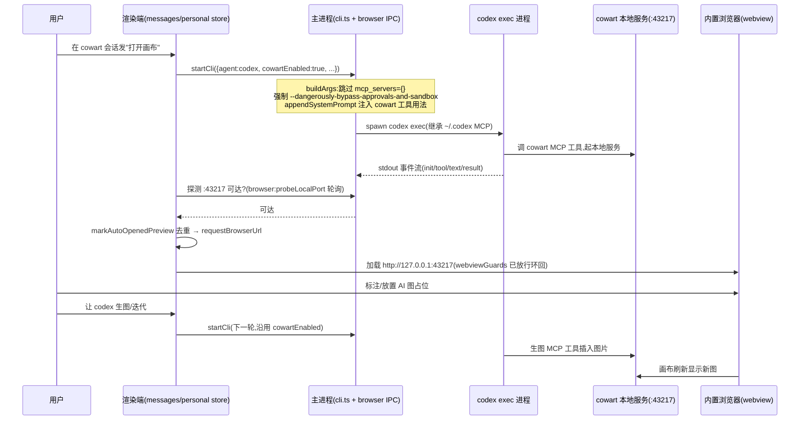

# feat: 集成 cowart 画布(仅 codex agent)

把 [cowart](https://github.com/zhongerxin/cowart)(面向 Codex 的本地 tldraw 无限画布插件)集成进 Cortex Desktop:用户在 codex 会话里驱动画布生图/按标注迭代,画布复用**内置浏览器**展示(`http://127.0.0.1:43217`),codex 起服务后自动打开 + 提供手动入口。仅 codex agent 可用。

> 来源:本计划由 `docs/brainstorms/2026-06-21-cowart-codex-canvas-requirements.md` 转化而来,并叠加了 Phase 1 的仓库 + 外部调研。

---

## 概要

集成的核心不是"嵌一个网页",而是**让 codex 在我们的 `codex exec` 管线里能真正调到 cowart 的 MCP 工具**。调研揭示了两个决定形态的事实:

1. `codex exec` 会加载用户 `~/.codex` 的 MCP server,但**工具调用在 exec 模式下会因 stdin EOF 被当成"用户拒绝"而取消(GitHub #24135)**,唯一可靠绕过是 `--dangerously-bypass-approvals-and-sandbox`——这正是本仓库 `full-auto` 档已用的 flag。
2. cowart 的 `cowart:*` 是 **skills**(内部包 MCP 工具),而**插件 skill 在 exec 模式有"不暴露"的已知 bug(#22078)**。

因此本计划:用**会话级开关**(而非全局)按需放开 MCP、**对 cowart 会话强制 full-auto**、默认走**裸 MCP 工具 + 注入用法提示**,并以一个**前置 spike**(U1)在目标 codex-cli 0.139.x 上实测后再定最终驱动方式。打开画布**复用现有 `requestBrowserUrl` 通路**,几乎零新增 IPC。

**执行姿态**:U1 是探索性 spike(先验证再定 U3 形态);U3 改 adapter 时 test-first(`codex.test.ts` 已有的 MCP 断言需改成双分支)。

---

## 问题框架

- **现状**:`apps/desktop/src/main/agents/codex.ts:42` 无条件 `-c mcp_servers={}` 清空所有 MCP("纯净启动"),且 `codex exec` 非交互——两者叠加使 cowart 这类 MCP/插件依赖的能力完全不可用。
- **目标**:在不破坏其它 codex 会话"纯净启动"行为的前提下,让**被显式标记的 cowart 会话**能调用 cowart 的 MCP 工具,并把画布呈现在内置浏览器。
- **边界**:不负责安装 cowart、不自建生图后端(详见 Scope Boundaries)。

---

## 需求追踪(origin)

| 需求 | 来源 | 落点 |
|---|---|---|
| R-1 codex 能加载用户插件/MCP 使 cowart 可用 | origin FR-1 | U2, U3 |
| R-2 cowart 服务起后自动在内置浏览器打开 | origin FR-2 | U5 |
| R-3 显式"打开画布"入口 | origin FR-3 | U5 |
| R-4 端口与 `COWART_PORT`(默认 43217)一致,支持非默认 | origin FR-4 | U5 |
| R-5 仅 codex 生效,claude/pi 不变 | origin FR-5 | U3, U4 |
| 头号风险 exec 模式 skills 可用性 | origin R-1 | U1(spike) |

---

## 关键技术决策(KTD)

### KTD-1:会话级 MCP 开口,不做全局去除
新增会话级布尔(`cowartEnabled`),仅当该会话开启时 `buildArgs` 才**跳过** `mcp_servers={}`,继承用户 `~/.codex` 的 MCP/插件;其它 codex 会话维持纯净启动不变。
- **理由**:brainstorm 初选"全局去除",但调研期复核后改为会话级——成本同样低,且**不改变其它所有 codex 对话的行为/启动开销**,隔离性更好(用户已确认改用会话级)。
- 承载位:`SessionMeta`(`apps/desktop/src/main/ipc/types.ts:63-82`,与 `packages/core/desktop/types.ts` 镜像)已是会话级配置容器,新增字段即可;`CliStartRequest`(`types.ts:285-313`)加一个透传字段。

### KTD-2:cowart 会话强制 full-auto(bypass-approvals)
当 `cowartEnabled` 为真时,`buildArgs` 忽略会话 `permissionMode`,强制走 `--dangerously-bypass-approvals-and-sandbox`。
- **理由**:GitHub #24135——exec 模式下 `approval_policy=never` 等键**都无法**抑制 stdin-EOF 导致的工具调用取消,只有 bypass flag 有效。read-only/workspace-write 档下 cowart 的 MCP 工具调用会被静默取消。
- 需在 U1 spike 对 0.139.x 复核(issue 基于 0.130.0)。

### KTD-3:默认驱动裸 MCP 工具 + 注入用法提示,skills 作为 spike 结论的备选
默认不依赖 `cowart:*` skill 被 codex 自动选中,而是在 cowart 会话的 `appendSystemPrompt` 注入 cowart MCP 工具名 + 调用约定,引导 codex 直接调底层工具。
- **理由**:插件 skill 在 exec 的暴露 bug(#22078)+ cowart 本为交互式设计。若 U1 实测 skills 在 0.139.x 可靠暴露,则保留 skill 路径、注入提示退化为兜底。
- **待定**:cowart 底层 MCP 工具的**真实工具名**需在 U1 读 cowart 插件 manifest/MCP server 定义确认(`cowart:*` 是 skill 名,非 MCP 工具名)。

### KTD-4:打开画布复用 `requestBrowserUrl`,自动打开用端口探测而非流解析
- 打开:调 `usePersonalStore.getState().requestBrowserUrl("http://127.0.0.1:<port>")`(`packages/core/store/personal.ts:766`),自动切右栏到内置浏览器。**无需新 IPC**。
- 自动打开时机:端口固定,**不从 codex 输出流解析 URL**(`devPreviewDetection.ts:6-7` 已注明 stdout 不进消息流、命中率低)。改为新增一条轻量主进程 IPC 探测 43217 可达性,cowart 会话内轮询到可达即触发,并用现有 `markAutoOpenedPreview` 去重(仿 `PersonalChatArea.tsx:158-175`)。

### KTD-5:仅 codex 可用
UI 层 cowart 开关仅在 `agent==="codex"` 时可见可用;`buildArgs` 的 cowart 分支天然只在 codex adapter 内。claude/pi 不受影响。

---

## 高层技术设计

cowart 会话的端到端时序(用户 → 渲染 → codex exec → cowart 服务 → 内置浏览器):

---

## 实现单元

### U1. Spike:实测 codex-cli 0.139.x 的 exec 模式 MCP/skills 行为

**Goal**:在目标 codex-cli 0.139.x 上,以最小手工实验确定三件事,以锁定 U3 的最终形态。
**Requirements**:origin R-1(头号风险)。
**Dependencies**:无。
**Files**:无生产代码;产出一份实测结论追加到本计划"Spike 结论"小节或 `docs/lessons.md`。
**Approach**(手工/脚本实验,不进生产代码):
- 先按 cowart README 在本机装好 cowart 插件并确认其 MCP server 定义,**记录底层真实 MCP 工具名**(供 KTD-3 注入提示用)。
- 实验 A:`codex exec --dangerously-bypass-approvals-and-sandbox`(去掉 `mcp_servers={}`)能否真正**调用**到一个 MCP 工具(验证 #24135 在 0.139.x 是否仍需 bypass、bypass 是否够)。
- 实验 B:同条件下 cowart 的 `cowart:*` skill 是否被暴露/可被模型选中(验证 #22078 是否仍复现)。
- 实验 C:`-s read-only`/`workspace-write` + `approval_policy=never` 下工具调用是否仍被取消(确认 KTD-2 的强制 full-auto 是否必要)。
**Execution note**:探索性 spike——先验证再定 U3;结论可能推翻 KTD-2/KTD-3 的默认选择。
**Test scenarios**:`Test expectation: none -- 探索性 spike,产出为实测结论文档而非代码`。
**Verification**:三个实验各有明确"可调用/不可调用、暴露/不暴露"的结论;cowart 底层 MCP 工具名已记录;U3 的驱动方式(裸 MCP vs skill)与档位约束据此定稿。

---

### U2. 会话级 `cowartEnabled` 字段:契约镜像 + 透传 + 持久化

**Goal**:在会话配置与 CLI 启动请求里引入 cowart 开关,贯通"渲染端设置 → 主进程消费"。
**Requirements**:R-1、R-5。
**Dependencies**:无(可与 U1 并行)。
**Files**:
- `apps/desktop/src/main/ipc/types.ts`(`SessionMeta` 加 `cowartEnabled?: boolean`;`CliStartRequest` 加 `cowartEnabled?: boolean`)
- `packages/core/desktop/types.ts`(逐字镜像,顶注要求两处同步)
- `packages/core/personal/messages.ts`(`startCli` 调用处约 `:2145` 从 `sendSession` 填入 `cowartEnabled`)
- `apps/desktop/src/main/agents/codex.test.ts`(新增字段后的 buildArgs 断言在 U3)
**Approach**:沿用 `SessionMeta` 现有"主进程仅 round-trip 持久化、不按字段消费"的范式(`types.ts:77` 注释即范例),无需主进程新逻辑;仅 `buildArgs` 在 U3 消费该字段。
**Patterns to follow**:`SessionMeta.useOwnSkills` / `permissionMode` 等既有会话级字段的镜像与透传写法。
**Test scenarios**:
- 类型镜像一致性由 `pnpm --filter @cortex-work/desktop typecheck` 保证(双 tsconfig)。
- `messages.ts` 发送路径:cowart 会话发起时 `startCli` 入参含 `cowartEnabled:true`;非 cowart 会话为 `false/undefined`(就近单测或在 U3 的 buildArgs 测试间接覆盖)。
**Verification**:typecheck 通过;`cowartEnabled` 能从会话设置一路透传到 `buildArgs` 入参。

---

### U3. codex adapter:条件化 MCP + 强制 full-auto + 注入工具提示

**Goal**:让 cowart 会话在 `buildArgs` 中跳过 MCP 清空、强制 bypass 档、注入 cowart 工具用法;其它会话行为不变。
**Requirements**:R-1、R-5;落地 U1 结论。
**Dependencies**:U1(定驱动方式)、U2(字段就位)。
**Files**:
- `apps/desktop/src/main/agents/codex.ts`(`buildArgs` 内据 `req.cowartEnabled` 分支)
- `apps/desktop/src/main/agents/codex.test.ts`(改写现有 `codex.test.ts:40-47` "纯净启动" 测试为双分支)
**Approach**:
- `cowartEnabled` 为真:**不** push `-c mcp_servers={}`;无论 `permissionMode` 一律 push `--dangerously-bypass-approvals-and-sandbox`(不再 push `-s`/`approval_policy`);把 cowart 工具用法拼进 `appendSystemPrompt`(经现有 `promptWithSkills` 包裹)。
- `cowartEnabled` 为假/缺省:维持现状(`mcp_servers={}` + 原 permissionMode 翻译)。
- 注入文案以 U1 记录的真实 MCP 工具名为准;若 U1 判定 skill 可靠,则注入退化为一句引导而非工具清单。
**Execution note**:test-first——先把 `codex.test.ts` 的 MCP 断言改成双分支(cowart 不带 / 非 cowart 带),再改 `buildArgs`。
**Patterns to follow**:`codex.ts` 现有 permissionMode→flag 的分支风格;`promptWithSkills`(`codex.ts:17-20`)。
**Test scenarios**:
- Covers R-1. cowart 模式:`buildArgs(req).args` **不含** `mcp_servers={}`,**含** `--dangerously-bypass-approvals-and-sandbox`,即使 `permissionMode:"plan"` 也不含 `-s read-only`。
- 非 cowart 模式:仍含 `-c mcp_servers={}`;`permissionMode:"plan"` 仍翻译为 `-s read-only -c approval_policy=never`(回归保护)。
- cowart 模式且有 `appendSystemPrompt`:prompt 中含 cowart 工具用法注入文案。
- `exec resume` 分支:cowart 模式同样跳过 MCP 清空、带 bypass flag(common 数组对两分支通用)。
- `parseLine` 不受影响(无需新增,确保未回归)。
**Verification**:`pnpm --filter @cortex-work/desktop test -- run apps/desktop/src/main/agents/codex.test.ts` 全绿;手动起一个 cowart 会话,codex 能调到 cowart MCP 工具(依赖 U1 环境)。

---

### U4. 前端:cowart 开关 UI(仅 codex)+ 接线

**Goal**:在会话 UI 暴露 cowart 开关,仅 codex 会话可见,切换写入会话级 `cowartEnabled`。
**Requirements**:R-5。
**Dependencies**:U2。
**Files**:
- `packages/views/cortex-desktop/personal/GitBar.tsx`(模式选择器附近加 cowart 开关,参照 `GitBar.tsx:27-30,179-189` 的 `onChangeMode` 写法)
- 对应会话 store 的设置 action(`packages/core/store/personal.ts`)
**Approach**:开关为会话级,仅 `agent==="codex"` 时渲染;切换调用会话设置 action 更新 `cowartEnabled`,下一轮 `startCli` 即生效(逐轮 fresh spawn)。
**Patterns to follow**:`GitBar` 现有 permissionMode 下拉的会话级写法。
**Test scenarios**:
- 仅 codex 显示:`agent==="claude"|"pi"` 时开关不渲染;`"codex"` 时渲染。
- 切换写入:开启后会话 `cowartEnabled===true`,关闭后为 `false`。
- 接线:开启状态下发起会话,`startCli` 入参 `cowartEnabled:true`(可与 U2 发送路径测试合并)。
**Verification**:UI 上仅 codex 会话出现开关;切换后下一轮请求带上正确字段。

---

### U5. 自动打开 + 手动入口:端口探测 + 复用 requestBrowserUrl

**Goal**:cowart 服务起后自动在内置浏览器打开画布,并提供手动"打开画布"入口;端口跟随 `COWART_PORT`(默认 43217)。
**Requirements**:R-2、R-3、R-4。
**Dependencies**:U4(cowart 会话已可标记)。
**Files**:
- `apps/desktop/src/main/ipc/browser.ts`(新增 `browser:probeLocalPort` handler,探测环回端口可达性)
- `apps/desktop/src/main/ipc/register.ts` / `apps/desktop/src/preload/index.ts` / `apps/desktop/src/main/ipc/types.ts` / `packages/core/desktop/types.ts` / `packages/core/desktop/bridge.ts`(新增 IPC 的契约同步,四/五处镜像)
- `packages/views/cortex-desktop/personal/PersonalChatArea.tsx`(cowart 会话内轮询探测 + auto-open,仿 `:158-175` openPreview + `markAutoOpenedPreview` 去重)
- 手动入口:`GitBar.tsx` 或 composer 区一个按钮,直接调 `requestBrowserUrl`
**Approach**:
- 自动:cowart 会话活跃期间轮询 `browser:probeLocalPort(port)`,首次可达且未自动打开过(去重 key 用 `会话:端口`)即 `requestBrowserUrl("http://127.0.0.1:<port>")`。
- 手动:按钮无条件 `requestBrowserUrl` 同一 URL(`nonce` 机制允许重复请求触发重载);若服务未起则展示空白/加载——可后续增强,本期不阻塞。
- 端口:读 `COWART_PORT`,缺省 43217;归一化复用 `normalizeDevPreviewUrlInput`(`devPreviewUrl.ts:74-101`,支持纯端口/0.0.0.0→127.0.0.1)。
- webview 放行:`http://127.0.0.1` 已被 `webviewGuards.ts:62-68` + `isAllowedDevPreviewHostname` 放行,**无需改闸门**。
**Patterns to follow**:`PersonalChatArea.tsx:158-175`(auto-open + 去重)、`personal.ts:766-777`(`requestBrowserUrl`/`markAutoOpenedPreview`)、`browser.ts` 现有 handler 形态。
**Test scenarios**:
- Covers R-4. `browser:probeLocalPort`:端口监听中返回可达,未监听返回不可达,超时按不可达处理。
- Covers R-2. auto-open:探测到可达后触发一次 `requestBrowserUrl`;重复探测**不**二次弹出(去重生效)。
- Covers R-3. 手动入口:点击即 `requestBrowserUrl` 目标 URL;连续点击靠 `nonce` 触发重载。
- 端口归一化:`COWART_PORT="50000"` → 打开 `http://127.0.0.1:50000`;缺省 → 43217。
- 平台回退:web 端无 webview 时走 iframe 路径不报错(`BrowserView.tsx:386-396`)。
**Verification**:cowart 会话中 codex 起服务后画布自动出现在内置浏览器;手动按钮任何时候可重新打开;改 `COWART_PORT` 后打开地址随之变化。

---

## 范围边界

### 暂缓(后续可做)— Deferred to Follow-Up Work
- 由 app 托管 cowart 服务生命周期(启动/停止/健康检查/退出清理)。
- 手动入口在"服务未起"时主动拉起服务并 loading 等待(本期手动入口仅打开 URL)。
- 独立画布面板视图(替代内置浏览器 tab)。
- 端口冲突自动协商、多项目多画布管理。

### 暂缓(origin Deferred for later)
- app 自动安装 cowart 插件 / 配置 marketplace。

### 不属于本产品身份(origin)
- 把画布做成脱离 Codex 的 app 原生绘图工具。

### 明确非目标
- 不为 claude/pi 提供画布能力。
- 不自建图片生成后端;生图依赖 cowart 自身配置的模型/API,由用户负责。
- 不代替用户安装 cowart(用户按 cowart README 自行 `codex plugin add cowart@personal`)。

---

## 风险与依赖

| 风险/依赖 | 说明 | 缓解 |
|---|---|---|
| #24135 在 0.139.x 是否仍需 bypass | exec 模式 MCP 工具调用被 stdin-EOF 取消,基于 0.130.0 | U1 实测复核;KTD-2 默认强制 bypass |
| #22078 插件 skill 不暴露 | exec 模式 cowart skill 可能静默不注册 | KTD-3 默认走裸 MCP 工具 + 注入提示 |
| cowart 真实 MCP 工具名未知 | `cowart:*` 是 skill 名非工具名 | U1 读 manifest 记录 |
| 强制 full-auto 的安全含义 | cowart 会话以 danger-full-access 运行 | UI 明示;仅显式开启的会话生效 |
| 打包后 cowart 进程定位资产 | lessons.md#68:Electron 打包后资产/路径定位易踩坑 | 在打包产物(非仅 dev)验证 codex 能继承 `~/.codex` 配置并起 cowart |
| 生图后端依赖 | cowart 生图需用户配置的模型/API | 非目标,文档说明 |

**依赖前提**:用户已按 cowart README 安装并配置生图后端;本机 codex-cli 支持 MCP/插件继承(adapter 注释基于 0.139.x)。

---

## 系统级影响
- 仅 codex adapter + 会话契约 + 内置浏览器接线受影响;claude/pi 路径零改动。
- 新增一条 `browser:probeLocalPort` IPC,需四/五处契约镜像(main types / core types / preload / bridge,见 CLAUDE.md 跨进程契约约定)。
- `SessionMeta` / `CliStartRequest` 各加一字段,两/三处镜像。

---

## 来源与调研
- origin:`docs/brainstorms/2026-06-21-cowart-codex-canvas-requirements.md`
- GitHub openai/codex #24135(exec 模式 MCP 工具调用被 stdin-EOF 取消,仅 bypass flag 有效;v0.130.0)
- GitHub openai/codex #22078(本地 marketplace 插件 skill 在 exec 不暴露;codex-cli 0.130.0)
- developers.openai.com/codex/skills(skills 经上下文注入、模型选中,exec 可用;slash 命令仅 TUI)
- github.com/zhongerxin/cowart(三个 `cowart:*` skill 包 MCP 工具,交互式设计)
- 仓库落点:`codex.ts:41-42`、`cli.ts`、`types.ts:63-82/285-313/683`、`personal.ts:766-777`、`PersonalChatArea.tsx:158-175`、`webviewGuards.ts:50-79`、`devPreviewUrl.ts:34-101`、`codex.test.ts:40-47`

---

## Spike 结论(U1 完成后回填)
> 待 U1 实测后补:(1) bypass 是否仍必需;(2) cowart skill 是否暴露;(3) cowart 底层 MCP 工具名;(4) U3 最终驱动方式与档位定稿。
