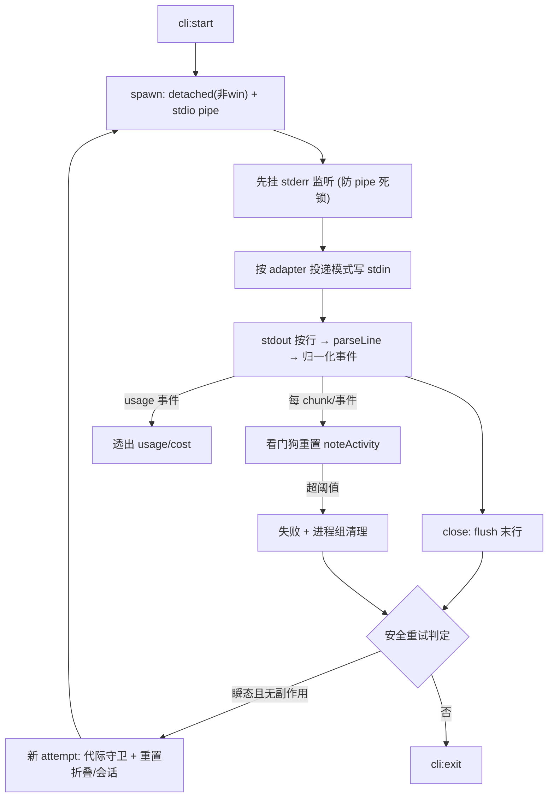
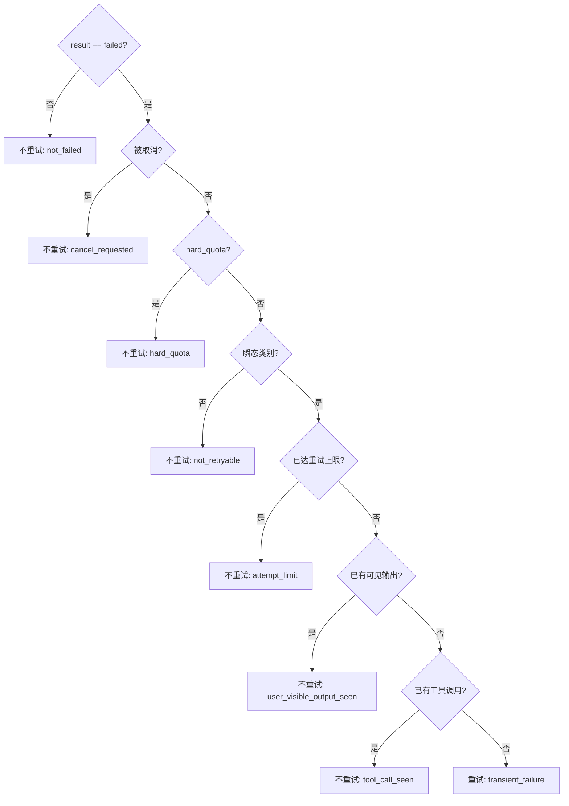

# feat: Agent CLI 调用层 M1 — 管线硬化 + 可观测性

> ID 约定:`R*` = 需求,`U*` = 实现单元,`KTD*` = 技术决策,`RISK-*` = 风险(origin 中以 R-1..R-4 标注,本计划改用 `RISK-*` 前缀避免与需求 `R1..R8` 混淆)。

## Summary

借鉴 open-design,把 `apps/desktop/src/main/ipc/cli.ts` 的 spawn 流式管线与三个 adapter 升级到「健壮、可观测」:prompt 走 stdin、归一化事件模型扩展为携带 usage/cost/thinking/turn/retry、引入活跃度看门狗与可配置超时、副作用感知安全重试、进程组级取消,以及 stderr/EPIPE/PATH 健壮化。纯主进程改动,事件模型只做向后兼容扩展,不破坏现有渲染端消费。

---

## Problem Frame

当前调用层是最小可用实现:prompt 只能走 argv(长 prompt 有 `E2BIG`/`ENAMETOOLONG` 风险)、usage/cost 被丢弃、主会话无超时无重试、取消只到整进程级(子孙进程残留)、codex tool 名硬编码。open-design 已用同一类管线驱动 24+ CLI 并把这些问题解过一遍且有 file 级证据。M1 是分期路线(见 origin)的第一步,foundation-first:无 UI、低风险、解锁后续 M2/M3。

注意:渲染端 `packages/core/personal/messages.ts` 已存在一套 per-run 看门狗(`RUN_START_TIMEOUT_MS` 90s / `RUN_STALL_TIMEOUT_MS` 300s,超时调 `killCli`)。M1 引入的主进程看门狗与重试必须与它协调,不能各自为政(见 U5、RISK-7)。

---

## Requirements

### Prompt 投递

- R1. prompt 通过 stdin 投递,命令行不再承载长 prompt。投递策略 per-adapter:claude 走 stream-json 一行 JSONL 并保持 stdin 打开到 turn 干净结束;codex 走 stdin 管道、写完即发 EOF、argv 不出现 `-`;pi 维持其现有路径。(origin FR-M1-1)

### 可观测性

- R2. `CliStreamEvent` 扩展为可携带 usage(input/output/cached/thinking tokens + cost)、thinking、归一化 tool 名与 tool 起止、turn 边界、retry。新增项为可选字段或新 event 变体,现有消费端不受影响。(origin FR-M1-2)
- R3. 采集 usage/cost:claude 读 `result` 帧的 usage 与 `total_cost_usd`,codex 读 `turn.completed.usage`,经事件透出,不再丢弃。流式 usage 补充而非取代既有磁盘来源。(origin FR-M1-3)

### 可靠性

- R4. 主会话引入基于活跃度(stdout/事件,非 CPU)的 per-turn 看门狗与可配置 inactivity 超时;超阈值按失败处理并清理进程。阈值可被 per-agent 与环境变量覆盖。须与渲染端既有看门狗统一,只保留一条权威超时路径。(origin FR-M1-4)
- R5. 副作用感知安全重试:仅对瞬态类别(rate_limit 非硬配额、上游不可用、首事件前的 timeout/空输出)重试;一旦已产生用户可见输出 / 工具调用 / 被取消,则不重试;默认上限可配。(origin FR-M1-5)
- R6. 取消升级为进程组级(非 Windows `detached` + `process.kill(-pgid)`,SIGTERM 与 SIGKILL 均针对 `-pgid`),SIGTERM→宽限→SIGKILL,先关 stdin;确保 CLI 派生子进程一并回收,且单进程常见场景的取消不退化。(origin FR-M1-6)
- R7. 进程健壮性:stderr 监听在消费 stdout 之前挂上、吞掉 stdin EPIPE、保持 `shell:false`、PATH 前置/追加策略与 open-design 对齐。(origin FR-M1-7)

### 兼容性

- R8. claude / codex / pi 在未触发新能力时,行为与改动前一致;`CliStreamEvent` 的两份镜像定义保持逐字同步;重试不得污染渲染端已累积的折叠状态或会话归属。

---

## Key Technical Decisions

- KTD1. **Per-adapter prompt 投递。** claude:`--input-format stream-json`,prompt 包成 `{type:"user",message:{role:"user",content:[{type:"text",text}]}}` 一行 JSONL 写入 stdin 且不关闭,turn 干净结束时再 `stdin.end()`。**关键依赖:** 当前 `claude.ts` 的 `parseLine` 不解析 `message_delta`/`message_stop`(`stop_reason` 所在帧),只认 system/stream_event/assistant/result,故「干净 turn 检测」需先由 U2 的 turn 变体 + parseLine 扩展提供 `stop_reason` 信号;否则 stdin 永不关闭、每轮被看门狗杀。单发(无多轮)场景可退化为在 `usage`/`result` 帧(EOF)处关 stdin。codex:prompt 经 stdin 管道写入后立即 `stdin.end()` 发 EOF,**argv 中不得出现 `-` 哨兵**(近版 codex 会 `exit 2`)。pi 维持现有 adapter/RPC 路径。投递模式由 adapter 声明字段驱动,单一 spawn 路径兼容两类 CLI。
- KTD2. **事件模型只做加法,双份同步,词汇对齐 pi。** 在 `apps/desktop/src/main/ipc/types.ts` 与镜像 `packages/core/desktop/types.ts` **同步**扩展 `CliStreamEvent`(新增可选字段 + 新变体)。新变体命名对齐既有 `PiSessionEvent`(`retry`/`turn-end`/`thinking-level`)。全仓消费端均为 if 链或无 `default` 的 switch,未知变体自然忽略;且 `foldCliEvent` 对非 text/tool 事件原样返回,故中途插入 usage/thinking/turn 不破坏文本/工具折叠 —— 向后兼容成立。
- KTD3. **流式 usage 补充磁盘来源,不另起权威。** 已存在基于磁盘(`~/.claude/projects/**/*.jsonl`)的 usage 管线(`usage.ts` + `usage:agent`/`usage:daily`)。M1 的流式 usage 作为补充信号经事件透出,不写第二份持久权威源。codex 无磁盘 token 历史,其流式 `turn.completed.usage` 是新增能力。
- KTD4. **统一一条 per-turn 看门狗,独立于 session-idle。** 渲染端既有 per-run 看门狗(`messages.ts` 的 `RUN_START_TIMEOUT_MS`/`RUN_STALL_TIMEOUT_MS`)与新主进程看门狗只能保留一条权威路径(见 U5):主进程看门狗成为权威(更贴近真实 stdout/事件活跃度),渲染端看门狗对 cli transport 关闭或对齐阈值,避免 90s 误杀抢在重试之前。常量借鉴 open-design:默认 10 分钟、24 小时上限钳制、kill 宽限 3 秒;可被 per-agent 与环境变量覆盖。与 session-idle 回收正交。
- KTD5. **安全重试 = 移植判定逻辑(cortex-local 类型)+ 会话与折叠状态隔离。** 不直接 import open-design 的 `@open-design/contracts`;在 cortex 本地定义失败类别/`retryable`。副作用集合**裁剪为 cortex 可派生的两项**:`userVisibleOutputSeen`(已有 `run.sawText`)、`toolCallSeen`(tool 事件);open-design 的 `artifact_write_seen`/`live_artifact_seen` 在 cortex 无对应概念,显式不移植。重试在主进程发起新 spawn;复用 pi-rpc 既有 runId 代际守卫丢弃旧 attempt 在途事件,并额外重置渲染端该 runId 的折叠游标与会话归属(见 U7),否则旧 attempt 的半截文本会与重试输出拼接、或重复创建/续接半截会话。默认最多 1 次同-run 重试。
- KTD6. **进程组取消,打包态实测为准,SIGTERM/SIGKILL 同针对组。** 非 Windows 用 `detached:true` 建进程组、`process.kill(-pgid)` 杀整组(失败回退 `child.kill`);`killWithTimeout` 的 SIGKILL 兜底也须由正 pid 改为 `-pgid`(否则只杀组长,残留子孙)。SIGTERM → 宽限(3s)→ SIGKILL,取消第一步先关 stdin。RISK-1 必须在 **复制到仓库外(/tmp)的打包 `.app`** 上验证,且须覆盖**单进程常见场景**取消不退化(仓库内 `dist` 会因 `node_modules` 兜底产生假通过,见 `docs/lessons.md`)。
- KTD7. **spawn 健壮化。** stderr 监听必须在任何会阻塞读 stdout 的逻辑之前挂上;`child.stdin.on("error")` 吞掉 EPIPE/EOF;保持 `shell:false`;复核 `buildEnv` 的 PATH 前置(node bin)/追加(用户工具链)。

---

## High-Level Technical Design

单次会话的 spawn → 流式 → 收尾/重试生命周期:

安全重试判定(任一命中即抑制,顺序与 U7 prose 一致):

---

## Implementation Units

### U1. RISK-1 / RISK-3 打包态实测 spike

- Goal: 在动手改 stdin 与进程组取消前,实测确认两条 gating 结论。
- Requirements: R1, R6
- Dependencies: 无
- Files: 无源码改动(实测结论回填本计划 / U4 / U6 的 Approach);验证脚本临时性,不入库。
- Approach: (a) RISK-1 —— 构造最小 Electron 主进程片段,`spawn(detached:true)` 一个会派生子进程(如 `bash -c 'sleep 100 & wait'`)的命令,`process.kill(-pid, "SIGTERM"/"SIGKILL")` 验证整组回收;另测**单进程无子进程**命令的取消不退化于现有 SIGTERM+3s。**关键:把打包 `.app` 复制到 `/tmp` 再跑**(仓库内 dist 有 `node_modules` 兜底,假通过)。(b) RISK-3 —— 手动用 `codex exec --json --skip-git-repo-check --dangerously-bypass-approvals-and-sandbox --cd <dir>` 把 prompt 经 stdin 管道喂入(argv 不带 `-`),确认正常读取且不 `exit 2`;并确认 `codex exec resume` 分支的 stdin 行为。
- Execution note: 验证单元,结论分别决定 U4(codex 是否真转 stdin)与 U6(进程组方案是否在打包态成立)。若 RISK-3 不成立,codex 回退保留 argv,仅 claude 转 stdin。
- Test scenarios: Test expectation: none -- 实测 spike,产出结论而非可回归代码。
- Verification: 三条结论(组回收、单进程不退化、codex stdin)各有「成立/不成立 + 证据」,且 U4/U6 Approach 据此定稿。

### U2. 扩展归一化事件模型(双份同步)

- Goal: 给 `CliStreamEvent` 加上 usage/thinking/turn/retry 的承载能力,为 U3/U5/U7 铺底。
- Requirements: R2, R8
- Dependencies: 无
- Files:
  - `apps/desktop/src/main/ipc/types.ts`(`CliStreamEvent` 定义)
  - `packages/core/desktop/types.ts`(镜像定义,必须逐字一致)
  - `apps/desktop/src/main/ipc/types.test.ts`(新增或就近补类型/构造测试)
- Approach: 新增可选字段(如 tool 事件的 `phase: "start"|"end"`、归一化后的 `name`)与新变体(`usage`、`thinking`、`turn`、`retry`),命名与 `PiSessionEvent` 既有词汇对齐。`thinking`/`turn` 在 M1 无生产者(U3 填 `usage`、U7 填 `retry`、U5 填失败/超时语义),**有意预留**:R2/FR-M1-2 把它们列为必备承载能力,且两份 types.ts 任何后续扩展都须同步修改,提前占位成本近零。本单元只改类型与构造,不改 adapter 产出。
- Patterns to follow: `PiSessionEvent`(`apps/desktop/src/main/ipc/types.ts` 与镜像)既有的 `retry`/`turn-end`/`thinking-level` 变体形状。
- Test scenarios:
  - 构造每个新变体的事件对象,类型检查通过(编译期)。
  - 既有 4 个变体(init/text/tool/result)的判别联合 narrow 不被新变体破坏。
  - 两份 types.ts 的 `CliStreamEvent` 结构一致(测试断言形状一致)。
- Verification: `pnpm --filter @cortex-work/desktop typecheck` 与 `pnpm --filter @cortex-work/core typecheck` 通过。

### U3. 采集 usage / cost

- Goal: 从 claude/codex 流式输出解析 usage 与 cost,经 U2 的 `usage` 事件透出。
- Requirements: R3
- Dependencies: U2
- Files:
  - `apps/desktop/src/main/agents/claude.ts`(`parseLine`:从 `result` 帧读 usage + `total_cost_usd`)
  - `apps/desktop/src/main/agents/codex.ts`(`parseLine`:从 `turn.completed` 读 `usage`)
  - `apps/desktop/src/main/agents/claude.test.ts`、`apps/desktop/src/main/agents/codex.test.ts`
- Approach: 在两个 adapter 的 `parseLine` 中,对应行额外产出 `usage` 事件(归一化 token 字段),不影响既有 `result`/`text` 产出。codex usage 在 `turn.completed.usage`(`codex.test.ts` 既有样例已含 `usage`)。注释明确:流式 usage 为补充信号,持久权威仍在 `usage.ts` 磁盘路径(KTD3)。
- Patterns to follow: 现有 `parseLine` 的逐行 `JSON.parse` + 类型守卫风格。
- Test scenarios:
  - claude:`result` 帧含 usage/`total_cost_usd` → 产出归一化 `usage` 事件(字段映射正确)。
  - codex:`turn.completed` 含 `usage` → 产出归一化 `usage` 事件。
  - usage 缺失/字段类型异常 → 不产出 usage 事件且不抛错(降级)。
  - 既有 `result`/`text`/`tool` 产出不被新增逻辑改变(回归)。
- Verification: 两个 adapter 单测通过;喂入真实样例行得到带 usage 的事件序列。

### U4. prompt 走 stdin(per-adapter 投递)

- Goal: 命令行不再承载长 prompt,按 adapter 投递模式写 stdin。
- Requirements: R1, R8
- Dependencies: U1(RISK-3 结论)、U2(claude 关闭时机所需的 turn/`stop_reason` 承载)
- Files:
  - `apps/desktop/src/main/ipc/cli.ts`(`startAgentProcess` 的 `stdio` 改 `["pipe","pipe","pipe"]`;按投递模式写 stdin)
  - `apps/desktop/src/main/agents/index.ts`(`AgentAdapter` 新增投递模式声明字段)
  - `apps/desktop/src/main/agents/claude.ts`(声明模式;`parseLine` 扩展识别 `message_delta`/`message_stop` 的 `stop_reason` 并产出 turn 事件)、`codex.ts`(声明模式;prompt 不再进 argv)
  - `apps/desktop/src/main/ipc/cli.test.ts`、各 adapter 测试
- Approach: `AgentAdapter` 增加投递声明(如 `promptDelivery: "stdin-stream-json" | "stdin-eof" | "argv"`,pi 维持现状)。cli.ts 据此:claude 写一行 user-message JSONL 并保持 stdin 打开,在 parseLine 报出干净 turn 结束(`stop_reason !== "tool_use"`)时 `stdin.end()`;单发场景退化为在 `usage`/`result`(EOF)处关闭。codex 写 prompt 后立即 `stdin.end()`。`child.stdin.on("error")` 吞 EPIPE(与 U8 一致)。若 U1 判定 codex 不能转 stdin,则 codex 保留 argv,本单元只迁 claude。
- Patterns to follow: open-design `server.ts` 的 stdin 写入段与 `applyClaudeStreamJsonRunBookkeeping` 的 turn_end 关闭判定;现有 `buildArgs` 结构。
- Test scenarios:
  - claude:超长 prompt(约 200KB)能正常发起会话,无截断/spawn 错误。
  - claude:turn 内含 `tool_use`(stop_reason=tool_use)时 stdin 不提前关闭;干净 `turn_end` 时关闭。
  - claude:parseLine 从 `message_delta`/`message_stop` 正确产出 turn 事件并携带 `stop_reason`。
  - codex:prompt 经 stdin 投递,argv 不含 `-`,不 `exit 2`(若 U1 判定可转)。
  - 子进程提前退出时写 stdin 触发 EPIPE 被吞,不崩主进程。
  - 普通短 prompt 行为与改动前一致(回归)。
- Verification: 长 prompt 会话成功;`pnpm --filter @cortex-work/desktop test` 通过。

### U5. 活跃度看门狗 + 可配置超时(统一一条路径)

- Goal: 给主会话加 per-turn inactivity 看门狗,超阈值清理进程,并与渲染端既有看门狗统一为一条权威路径。
- Requirements: R4
- Dependencies: U2(看门狗触发产出失败语义所需的事件承载)
- Files:
  - `apps/desktop/src/main/ipc/cli.ts`(`cli:start` 路径:每 stdout chunk/事件 `noteActivity`;超时 timer + 清理)
  - `packages/core/personal/messages.ts`(关闭或对齐既有 `RUN_START_TIMEOUT_MS`/`RUN_STALL_TIMEOUT_MS` 看门狗对 cli transport 的作用)
  - 常量/解析:就近新增(默认值 + env 覆盖 + per-agent 覆盖)
  - `apps/desktop/src/main/ipc/cli.test.ts`
- Approach: 在 `cli:start` 的 stdout `data` 与 `parseLine` 产出事件处重置 timer。默认 10 分钟,env(如 `CORTEX_CLI_INACTIVITY_TIMEOUT_MS`)覆盖,per-agent 可声明覆盖;24 小时上限钳制。**先决:** 渲染端 `messages.ts` 已有 per-run 看门狗(starting 90s / stalled 300s 调 `killCli`);本单元须把主进程看门狗定为权威,渲染端看门狗对 cli transport 关闭或把阈值对齐到主进程(避免 90s 误杀抢在 U7 重试之前)。超时按失败处理:走 U6 的进程组取消(U5 先行落地时退化为现有 `killWithTimeout`,由 U6 升级为进程组)。仅 per-turn,与 session-idle 解耦。`oneshot` 路径维持其既有 60s 超时不变。
- Patterns to follow: open-design `resolveChatRunInactivityTimeoutMs` 的覆盖优先级与钳制;pi-rpc 的「per-turn vs session-idle 两套计时器」分离(`docs/plans/2026-06-17-002-feat-pi-rpc-robustness-plan.md`)。
- Test scenarios:
  - 无活动超过阈值 → 进程被终止并发失败事件。
  - 阈值内持续有 stdout/事件 → timer 不断重置,不误杀。
  - env 覆盖生效;非法 env 值降级到默认;per-agent 覆盖生效。
  - 回归:一个静默 cli run 只有一条超时路径触发(渲染端与主进程不双杀/双报)。
  - oneshot 60s 超时不受影响(回归)。
- Verification: 用可控的「静默/持续输出」假命令验证误杀与不误杀两条路径;确认只触发一条超时;单测通过。

### U6. 进程组级取消

- Goal: 取消时回收 CLI 派生的整组子进程,不残留,且单进程常见场景不退化。
- Requirements: R6, R8
- Dependencies: U1(RISK-1 打包态结论)、U4(stdin 存在,取消先关 stdin)
- Files:
  - `apps/desktop/src/main/ipc/cli.ts`(`startAgentProcess` 的 `spawn` 加 `detached`;`wrapChild`/`killWithTimeout` 的 SIGTERM 与 SIGKILL 均改 `-pgid` + 回退;`cli:kill`/`killAllCli`;取消先关 stdin)
  - `apps/desktop/src/main/ipc/cli.test.ts`
- Approach: 非 Windows `spawn(..., { detached: true })`,记录 pgid = child.pid。`kill()`:先 `stdin.end()`(best-effort),再 `process.kill(-pgid, "SIGTERM")`(catch ESRCH 回退 `child.kill`),3s 后 `process.kill(-pgid, "SIGKILL")`(同样针对组,非正 pid)。保留 `killWithTimeout` 的「正常退出清 timer 防泄漏」语义。Windows 维持 `child.kill`。结论以 U1 打包态实测为准。
- Patterns to follow: open-design `runtimes/runs.ts` 的 `killChild`/`cancel`/`closeRunStdin` 升级链;现有 `killWithTimeout`/`wrapChild`。
- Test scenarios:
  - 取消一个会派生子进程的会话 → 父与子进程都被回收(无残留)。
  - 取消单进程(无子进程)会话 → 至少与现有 SIGTERM+3s 同样可靠终止(不退化)。
  - SIGTERM 后进程不退 → 宽限超时升级 SIGKILL(亦针对 `-pgid`)。
  - 取消先关 stdin,再发信号。
  - 进程未成为组长(回退路径)→ 退回 `child.kill` 不抛错。
  - 正常结束的会话 kill timer 被清理(无泄漏,回归)。
- Verification: 实测取消后 `ps` 无残留子进程(打包态按 U1 流程);单测通过。

### U7. 副作用感知安全重试

- Goal: 对瞬态失败自动重试一次,且绝不在已有副作用时重试,并隔离重试与旧 attempt 的会话/折叠状态。
- Requirements: R5, R8
- Dependencies: U2(失败分类/`retry` 事件承载)、U5(timeout 分类来源)
- Files:
  - `apps/desktop/src/main/ipc/cli.ts`(收尾处接入重试判定;按 runId 追踪副作用标志;代际守卫;重试前清会话归属)
  - 新增 `apps/desktop/src/main/ipc/run-retry-policy.ts`(纯逻辑)+ `run-retry-policy.test.ts`
  - 新增失败分类子步骤:就近新增 `classifyAgentFailure`(把 stderr/exit/事件归一为类别)+ 测试
  - `packages/core/personal/messages.ts`(重试时重置该 runId 的折叠游标 `run.cursor`/`run.processCursor`/`buffer`/`sawText`)
- Approach: 纯函数 `decideSafeRunRetry(failure, sideEffects, attemptCount)` 逐条判定:`not_failed` → `cancel_requested` → `hard_quota` → 非瞬态类别(`not_retryable`)→ `attempt_limit`(默认 1)→ `user_visible_output_seen` → `tool_call_seen`。**cortex-local 类型**,不 import `@open-design/contracts`;副作用集合裁剪为 `userVisibleOutputSeen`(`run.sawText`)与 `toolCallSeen`(tool 事件),不移植 `artifact_write_seen`/`live_artifact_seen`(cortex 无对应)。瞬态类别:rate_limit(非 hard_quota)、upstream_unavailable、timeout(仅首事件前)、empty_output(仅首事件前)。
  - **失败分类是硬前置,非细节:** `classifyAgentFailure` 把 cortex 现有信号(stderr 尾窗、exit code、`result.error`、`turn.failed`/`item.failed`)映射到上述类别并给出 `retryable`。在它落地前,重试一律保守判为 `not_retryable`(R5 在 M1 默认休眠);本子步骤须带覆盖 claude/codex 真实失败输出的测试。
  - **「首事件前」锚点(解决 origin 待定项):** 以**首个任意归一化事件**(init/tool/text)为界,而非首个 text —— 因为 codex 的 text 是 `item.completed` 整段、无流式首 token,用「首 text」对 codex 无意义且会让已跑过 Shell 的 codex 仍被判「首 token 前」。
  - **会话隔离:** 仅当尚未收到 `init`(未创建会话)时才重试,或在重试前清除已捕获的 agentSessionId,避免重复创建(claude 第二个 rollout)或续接半截会话(codex `no rollout found` )。
  - **折叠状态隔离:** 重试同 runId 时,渲染端 `run.cursor`/`run.processCursor`/`buffer`/`sawText` 必须重置(或经 `retry` 事件让 `handleCliEvent` 清),否则 attempt 1 的半截文本会与重试输出拼接。
- Patterns to follow: open-design `run-retry-policy.ts` 的判定顺序与常量;pi-rpc 的 runId 代际守卫(`docs/plans/2026-06-17-002` KTD-3);`messages.ts` 既有 `isMissingAgentSessionError`、`emptyFoldCursor`。
- Test scenarios:
  - 首事件前 rate_limit(非 hard_quota)→ 重试;upstream_unavailable → 重试;hard_quota → 不重试。
  - 已产生 text(可见输出)后失败 → 不重试;已有 tool 调用后失败 → 不重试;被取消 → 不重试。
  - 达到上限(已重试 1 次)→ 不重试。
  - 已收到 `init` 后失败重试 → 不重复创建会话、不续接半截会话。
  - attempt 1 流出半截 text → 瞬态失败 → 重试 → 最终消息只含重试输出,不与半截拼接。
  - 旧 attempt 在途事件被代际守卫丢弃,不串入新 attempt。
  - `classifyAgentFailure`:覆盖 claude/codex 真实失败样例到各类别;识别不出 → `not_retryable`。
- Verification: `run-retry-policy.test.ts` 覆盖全部判定分支;集成验证重试只在安全场景发生且不污染会话/折叠。

### U8. spawn 健壮化收尾

- Goal: 补齐 stderr 顺序、EPIPE 吞掉、shell/PATH 复核,消除已知崩溃/死锁面。
- Requirements: R7
- Dependencies: 无(与 U4/U6 相关但可独立落地)
- Files:
  - `apps/desktop/src/main/ipc/cli.ts`(stderr 监听挂载顺序;`child.stdin.on("error")` 吞 EPIPE;`shell:false` 显式;复核 `buildEnv` PATH)
  - `apps/desktop/src/main/ipc/cli.test.ts`
- Approach: 确保 stderr `data` 监听在进入会阻塞读 stdout 的逻辑之前挂上。`stdin.on("error")` 对 EPIPE/EOF 静默吞掉,其余照常上报。`spawn` 显式 `shell:false`。复核 `buildEnv` 前置(node bin)/追加(homebrew/.bun/.cargo 等),确认 GUI 启动下 shebang 解释器(如 pi 的 bun)可被 spawn 找到。
- Patterns to follow: open-design `server.ts` 的 stderr-before-stdout 注释段与 EPIPE 吞掉;现有 `buildEnv`/`spawnEnvFor`。
- Test scenarios:
  - 子进程狂刷 stderr 不导致管线死锁(stderr 持续 drain)。
  - 子进程提前关读端,写 stdin 的 EPIPE 被吞,不崩。
  - PATH 复核:缺失常见目录时被补齐(沿用现有 `buildEnv` 测试)。
- Verification: 死锁与 EPIPE 两条路径用假命令验证;单测通过。

---

## Scope Boundaries

### Deferred to Follow-Up Work

- usage/cost 的 UI 展示位与接入计费(M1 只采集并经事件透出)。
- M2 内容:MCP 注入解禁、声明式 adapter def 重构、`--continue` 与系统块哈希跳过、图片/appendSystemPrompt/错误来源归一化。
- M3 内容:用户 JSON 派生 agent、Plugin 框架(A 的扩展 + B)。
- 单 tool / 单轮级中断(M1 取消仍以进程组为粒度)。
- 并发上限 / 排队 / 优先级调度。
- pi adapter parseLine 的富事件改造(pi 已有 pi-rpc 富路径)。

---

## Risks & Dependencies

- RISK-1(进程组打包态):`detached` + `process.kill(-pgid)` 必须在复制到 `/tmp` 的打包 `.app` 上验证,且覆盖单进程不退化;仓库内 dist 会假通过(`docs/lessons.md`)。U1 gating U6。
- RISK-3(codex stdin):codex `exec` 对 stdin 哨兵敏感(`-` → exit 2)。U1 实测确认;若不成立 codex 回退 argv、仅 claude 转 stdin(R1 半交付,U4 Approach 已含回退)。
- RISK-7(双看门狗冲突):渲染端 `messages.ts` 已有 90s/300s per-run 看门狗调 `killCli`。若 U5 不收编,渲染端会在 90s 误杀、抢在重试之前并与主进程看门狗双报。U5 须定权威路径。
- RISK-8(重试污染状态):重试同 runId 若不重置渲染端折叠游标与会话归属,会拼接半截文本或重复/错续会话(U7 已纳入)。
- 双份类型同步:`CliStreamEvent` 两处镜像,任何扩展须同步,否则 core 端 narrow 不到(U2)。
- usage 双源漂移:流式 usage 定位为补充,持久权威留磁盘(KTD3),避免与按天用量日历(`docs/plans/2026-06-14-005-...`)冲突。
- claude 关 stdin 依赖 `stop_reason`:当前 parseLine 不解析该帧,U4 须先扩展(否则 stdin 不关、被看门狗杀)。
- MCP 解禁(M2,非本期)需与 cowart 画布需求(`docs/brainstorms/2026-06-21-cowart-codex-canvas-requirements.md`)统一策略 —— 仅提醒,M1 不动 MCP。

---

## Open Questions

- 失败分类的精确映射:把 stderr 文本 / exit code / `turn.failed`·`item.failed` 的 free-text error 分别归一为 rate_limit/upstream_unavailable/timeout/empty_output 的规则,需在 U7 的 `classifyAgentFailure` 子步骤对照 claude/codex 真实失败输出确定;首版保守(识别不出 → 不可重试)。codex 的 `upstream_unavailable` vs `hard_quota` 区分尤其需要真实样例。
- 渲染端看门狗的收编方式:对 cli transport 完全关闭,还是把阈值对齐到主进程权威值 —— U5 实现时定(二者都满足「只一条路径触发」,取决于是否仍需渲染端兜底)。

---

## Sources / Research

- 现状(cortex-work):`apps/desktop/src/main/ipc/cli.ts`(spawn/流式/kill 管线,stdin 当前 `ignore`、主会话无超时、`killWithTimeout` 仅 SIGTERM+3s 且 SIGKILL 用正 pid);`apps/desktop/src/main/agents/{index,claude,codex,pi}.ts`(`buildArgs`/`parseLine`,prompt 走 argv、usage 被丢弃、codex tool 名硬编码 `"Shell"`、claude parseLine 不解析 `message_delta`/`message_stop`)。
- 事件契约与消费端:`CliStreamEvent` 定义 `apps/desktop/src/main/ipc/types.ts` 与镜像 `packages/core/desktop/types.ts`;消费端 `packages/core/personal/messages.ts`(`handleCliEvent`、`foldCliEvent` 折叠依赖到达顺序、`run.cursor`/`run.processCursor` 按 runId、既有 90s/300s 看门狗调 `killCli`)、`packages/core/personal/followup.ts`;preload 透传 `apps/desktop/src/preload/index.ts`;契约 `packages/core/desktop/bridge.ts`。结论:加可选字段 + 新变体向后兼容(消费端 if 链/无 default switch;`foldCliEvent` 对非 text/tool 原样返回)。
- 既有 usage 管线:`usage.ts`(`parseClaudeFile`)+ `usage:agent`/`usage:daily`;codex 无磁盘 token 历史(`docs/plans/2026-06-14-005-feat-personal-landing-usage-calendar-plan.md`)。
- 参考实现(open-design,`apps/daemon`):prompt stdin 写入与 turn_end 关闭(`server.ts` 写入段 + `applyClaudeStreamJsonRunBookkeeping`,codex 写完即 `stdin.end()`);看门狗常量与覆盖(`resolveChatRunInactivityTimeoutMs`,默认 10min/24h 钳制/60s 安静期);安全重试(`run-retry-policy.ts` `decideSafeRunRetry`,默认 1 次、瞬态类别、副作用抑制,依赖 `@open-design/contracts` 的 `retryable` —— cortex 须本地化);进程组取消(`runtimes/runs.ts` `killChild`/`cancel`/`closeRunStdin`,SIGTERM 与 SIGKILL 均针对组);健壮性(`shell:false`、stderr-before-stdout、EPIPE 吞掉、`runtimes/launch.ts` PATH)。
- 既往学习:`docs/plans/2026-06-17-002-feat-pi-rpc-robustness-plan.md`(runId 代际守卫、per-turn vs session-idle 两套计时器);`docs/lessons.md`(打包态验证须复制到 /tmp,仓库内 dist 假通过)。
