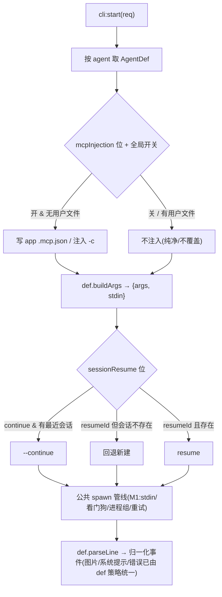
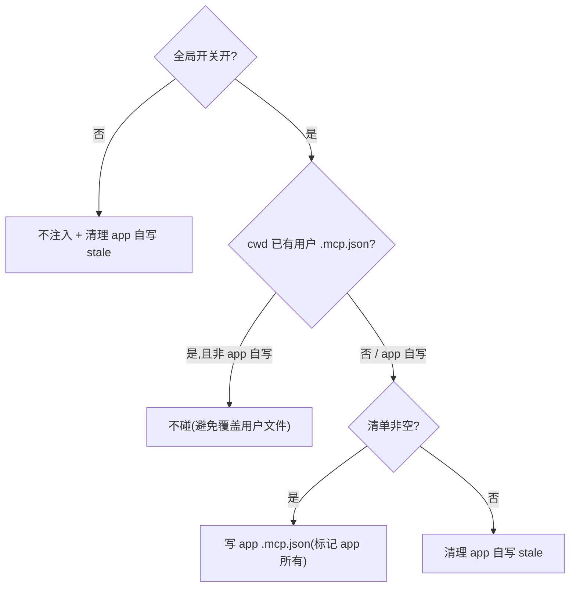

# feat: Agent CLI 调用层 M2 — 声明式 def + MCP 注入 + 会话续接 + 归一化

> 建立在 M1(分支 `feat/agent-cli-hardening`)之上:`AgentAdapter` 已有 stdin 投递 + `parseLineEvents` 数组返回;`CliStreamEvent` 含 usage/retry;`cli.ts` 已有 `launchAttempt` 顺序重试 + 看门狗 + 进程组取消。M2 在此基础上扩展能力,保持 IPC 对渲染端的契约语义不变。

## Summary

把 `AgentAdapter` 全量重写为声明式 `AgentDef`(能力位驱动公共管线),在其上解禁 MCP(声明式注入 + 全局总开关 + 严格 gate)、增强会话续接(`--continue` 语义 + resume 失败回退新建)、补齐跨 agent 归一化(图片 / appendSystemPrompt / 错误来源)。纯桌面端(主进程 + 一处设置 UI),IPC 事件契约只做向后兼容扩展。

---

## Problem Frame

M1 把调用层做到了「健壮、可观测」,但能力仍受限:MCP 被写死清空(claude `--strict-mcp-config --mcp-config '{}'`、codex `-c mcp_servers={}`),无法按会话使用 MCP;新增/改 agent 仍要改枚举 + 写两个函数 + 改多处 spawn 调用点;会话续接只有显式 `resumeSessionId`,无 `--continue`、resume 失败不回退;跨 agent 的图片 / appendSystemPrompt / 错误来源各写各的、归一化不彻底。

M2 解决这些能力缺口。open-design 用声明式 `RuntimeAgentDef` + `externalMcpInjection` + `agent-session-resume` 已把同类问题解过一遍,作为参考。**MCP 策略按 FR-M2-2 自身口径设计(声明式注入 + 总开关),不以 cowart 画布需求为驱动**;仅保证设计不堵死未来 codex 配置继承(cowart 旁注,见 RISK-5)。

---

## Requirements

### 声明式架构

- R1. 把 `AgentAdapter` 全量重写为声明式 `AgentDef`:用数据对象声明命令构造与解析 + 一组能力位(投递模式、MCP 注入策略、续接能力、图片/系统提示策略等),公共管线按能力位消费。新增/改 agent 只改其 def。IPC 请求/事件契约语义不变。(origin FR-M2-1)

### MCP

- R2. 解禁 MCP:取代写死的 `mcp_servers={}` / 空 `--mcp-config`,改为声明式注入 —— app 管理一份 MCP server 清单,按全局总开关注入到 claude(写项目 cwd 的 `.mcp.json`)与 codex(`-c`)。(origin FR-M2-2)
- R3. 严格 gate:**绝不覆盖用户已有的 MCP 配置文件**(用户自己仓库里的 `.mcp.json` 等);注入为 app 自写文件,禁用/清单为空时清理自写的 stale 文件;用户已有配置原样保留。(origin FR-M2-2)
- R4. 提供全局总开关与最小 MCP server 清单管理入口(设置区),关闭时行为回到「不注入」。(origin FR-M2-2)

### 会话续接

- R5. 会话续接增强:支持 `--continue` 语义续接最近会话;`resume` 目标会话在本机不存在时,自动回退为新建会话(而非带错 id 失败)。(origin FR-M2-3)

### 归一化

- R6. 跨 agent 归一化补齐:图片、appendSystemPrompt、错误来源由 `AgentDef` 的策略位统一表达,消费端不再为每个 agent 写分支。(origin FR-M2-4)

### 兼容性

- R7. 重写为行为保持:claude / codex / pi 在未启用 MCP / 未用新续接语义时,行为与 M1 结束态一致;`cli:start` / `cli:oneshot` / `ask` / automation 四条 spawn 路径全部经新 def 驱动且通过现有单测。

---

## Key Technical Decisions

- KTD1. **全量声明式 `AgentDef` 重写(用户选定)。** 用 `AgentDef` 取代 `AgentAdapter`,字段含:`id`、`bin`(可执行名/解析器)、`buildArgs(req) => {args, stdin?}`、`parseLine(line) => events`,以及能力位 `promptDelivery`("stdin-stream-json"|"stdin-eof"|"argv")、`mcpInjection`("claude-mcp-json"|"codex-c"|"none")、`sessionResume`("continue+resume"|"resume-only"|"none")、`imageDelivery`("native-flag"|"prompt-text"|"none")、`appendSystemPrompt`("native-flag"|"prompt-wrap"|"none")。公共管线(cli.ts)读能力位决定 spawn/注入/续接,adapter 文件只剩声明 + 两个纯函数。参考 open-design `runtimes/types.ts` 的 `RuntimeAgentDef`(`apps/daemon`)。
- KTD2. **MCP:声明式注入 + 全局总开关(用户选定)。** 新增主进程 MCP 配置存储(持久化一份 `{ enabled, servers[] }`)+ IPC(读/写/toggle)。注入按 def `mcpInjection` 分流:claude 写项目 cwd 的 `.mcp.json`(借 open-design `claude-mcp-json` 思路);codex 用 `-c` 传入用户清单(取代 `mcp_servers={}`)。**严格 gate:** 仅当 app 自写过该 `.mcp.json` 才接管/清理;探测到用户自有文件则不碰、不注入(避免覆盖)。总开关关闭 → 不注入 + 清理自写 stale。M1 移除写死清空后的「纯净启动」让步,由总开关(默认可设为关,保留纯净启动)兜底。
- KTD3. **MCP 默认关、纯净启动仍是默认。** 总开关默认关闭时,claude/codex 既不写死清空、也不注入 —— 等价于「不带 MCP 启动」,保留 M1 前的可预测性与启动开销。开启后才注入清单。这样解禁不改变默认体验,只为需要的用户打开能力。
- KTD4. **会话续接:`--continue` + resume 失败回退(用户选定,不含 hash 跳过)。** def `sessionResume` 位驱动:有最近会话且请求 continue → claude `--continue` / codex `exec`(其 resume 语义);带 `resumeSessionId` 但 `agentSessionExists`(复用 `session-trim.ts`)为 false → 回退新建(清除该 session 的 agentSessionId,走首轮分支)。**不移植 open-design 的 stable-prompt hash 跳过** —— cortex 每轮重新 spawn+resume,长驻进程优化收益与适配性存疑,留作后续(RISK-4)。
- KTD5. **归一化由 def 策略位承载。** 图片:claude `imageDelivery:"prompt-text"`(拼读取指令)、codex `"native-flag"`(`--image`)、pi 现状;appendSystemPrompt:claude `"native-flag"`、codex `"prompt-wrap"`(`<user_request>`);错误来源:统一在 `result`/`error` 事件层归一(stderr 尾窗 / exit / result.error 收敛为一致字段),消费端只读归一化结果。把 M1 散落在各 adapter 的分支收进 def 声明 + 公共管线。
- KTD6. **IPC 契约语义不变。** `CliStartRequest` / `CliStreamEvent` / `cli:event` 形状不破坏;新增按需为可选字段(如 MCP 配置走独立 IPC channel,不塞进 `CliStartRequest` 必填)。重写是主进程内部结构调整,渲染端无感(R7)。

---

## High-Level Technical Design

声明式 def 驱动的公共管线(M2 把 spawn/注入/续接的分支从 adapter 收敛到能力位):

MCP 注入的严格 gate 判定:

---

## Implementation Units

### U1. 声明式 `AgentDef` 重写 + 公共管线消费

- Goal: 用声明式 `AgentDef` 取代 `AgentAdapter`,三个 agent 迁为 def,公共管线(cli.ts/ask/oneshot/automation)按能力位驱动。行为保持,IPC 不变。
- Requirements: R1, R7
- Dependencies: 无(M2 起点)
- Files:
  - `apps/desktop/src/main/agents/index.ts`(定义 `AgentDef` + 注册表 + `parseLineEvents`)
  - `apps/desktop/src/main/agents/{claude,codex,pi}.ts`(迁为 def 声明 + 能力位)
  - `apps/desktop/src/main/ipc/cli.ts`、`ask.ts`、`automation/runner.ts`(改为读 def 能力位)
  - 各 `*.test.ts` 同步
- Approach: 先定 `AgentDef` 类型(含 KTD1 能力位),保留 `buildArgs`/`parseLine` 两纯函数为 def 字段。把 M1 散落的分支(stdin 投递模式、图片/appendSystemPrompt 处理)上提为能力位,公共管线据位分流。本单元**只做行为保持的结构迁移**,不加 MCP/续接新能力(U2/U4 再加)。能力位先放占位/沿用现状值,后续单元填充策略。
- Patterns to follow: open-design `runtimes/types.ts` 的 `RuntimeAgentDef` 字段划分;M1 现有 `AgentAdapter` + `parseLineEvents`。
- Test scenarios:
  - 三个 agent 的 buildArgs/parseLine 经 def 后输出与 M1 完全一致(逐 agent 回归)。
  - 四条 spawn 路径(cli:start/oneshot/ask/automation)经新 def 驱动跑通现有用例。
  - 新增/改一个示意 def 不需改公共管线代码(可加一个 fixture def 验证扩展点)。
  - 未知 agent 取 def 抛错语义不变。
- Verification: 全量 desktop 单测通过且无行为变更;`pnpm --filter @cortex-work/desktop typecheck` 通过。

### U2. MCP 声明式注入 + 全局总开关(后端)

- Goal: 解禁 MCP,按 def 策略 + 全局开关注入,严格 gate 不覆盖用户文件。
- Requirements: R2, R3, R4
- Dependencies: U1
- Files:
  - 新增 `apps/desktop/src/main/ipc/mcp-config.ts`(配置存储 `{enabled, servers[]}` + 读写 + 注入/清理纯逻辑)+ `mcp-config.test.ts`
  - `apps/desktop/src/main/ipc/cli.ts`(spawn 前按 def `mcpInjection` + 开关注入;移除 adapter 里写死清空)
  - `apps/desktop/src/main/agents/{claude,codex}.ts`(去掉 `--strict-mcp-config`/空 `--mcp-config` 与 `-c mcp_servers={}`,改由注入层决定)
  - `apps/desktop/src/main/ipc/types.ts` + `packages/core/desktop/types.ts`(MCP 配置类型,镜像同步)
  - IPC 注册 `apps/desktop/src/main/ipc/register.ts`
- Approach: claude 走「写项目 cwd `.mcp.json`」策略:写前探测——若存在且非 app 标记则**不碰**(R3);app 自写的带标记,可被接管/清理。codex 走 `-c` 注入用户 server 清单。总开关默认关(KTD3):关闭 → 不注入 + 清理 app 自写 stale。注入为纯逻辑(可单测),与 spawn 解耦。
- Patterns to follow: open-design `mcp-config.ts` 的 `externalMcpInjection` 三策略与 `.mcp.json` 严格 gate;现有 `session-trim.ts` 的「不 import electron、纯逻辑可测」风格。
- Test scenarios:
  - 开关开 + 清单非空 + cwd 无用户文件 → 写 app `.mcp.json`(含 app 标记),codex 注入 `-c`。
  - cwd 已有用户 `.mcp.json`(无 app 标记)→ 不覆盖、不注入(R3)。
  - 开关关 / 清单空 → 不注入,且清理 app 自写 stale;用户文件不动。
  - 移除写死清空后,默认(开关关)claude/codex 命令不含 `--strict-mcp-config`/`mcp_servers={}`,且不注入(等价纯净启动,KTD3)。
  - app 自写文件可被识别与清理(标记往返)。
- Verification: `mcp-config.test.ts` 覆盖 gate 全分支;集成确认开关开时同一会话可加载一个 MCP server。

### U3. MCP 设置入口(渲染端)

- Goal: 提供全局总开关 + 最小 MCP server 清单管理 UI。
- Requirements: R4
- Dependencies: U2
- Files:
  - `packages/views/cortex-desktop/`(设置区新增 MCP 分组:开关 + server 列表增删)
  - `packages/core/desktop/bridge.ts` + `apps/desktop/src/preload/index.ts`(暴露 MCP 配置读写)
  - 就近 `*.test.tsx`
- Approach: 最小可用:一个总开关 + 一组 `{name, command/url}` 列表(增/删/启停)。复用现有设置区组件与 `DesktopBridge` 注入模式(views 不直接碰 Node)。富管理(模板/分类/信任)延后(见 Scope Boundaries)。
- Patterns to follow: 既有设置分区(如通知/飞书渠道配置)的组件与 bridge 模式;品牌色 `#7c5cff`。
- Test scenarios:
  - 切换总开关 → 经 bridge 持久化,重开仍生效。
  - 增/删一个 server → 列表更新并持久化。
  - 关闭开关时列表禁用态(或明确「已停用」提示)。
  - Test expectation: 组件渲染 + 交互断言(Testing Library);bridge 调用以 mock 验证。
- Verification: 设置区可增删 server 并切换开关,与 U2 后端联通;views 单测通过。

### U4. 会话续接增强(`--continue` + resume 失败回退)

- Goal: 支持 `--continue` 续接最近会话;resume 目标不存在时回退新建。
- Requirements: R5
- Dependencies: U1
- Files:
  - `apps/desktop/src/main/agents/{claude,codex}.ts`(`sessionResume` 能力位 + continue 分支)
  - `apps/desktop/src/main/ipc/cli.ts`(spawn 前按 `agentSessionExists` 判定 resume vs 回退)
  - `apps/desktop/src/main/ipc/types.ts` + 镜像(`CliStartRequest` 增可选 `continueSession?: boolean`)
  - `apps/desktop/src/main/ipc/session-trim.ts`(复用 `agentSessionExists`;必要时补 continue 所需查询)
  - 相关 `*.test.ts`
- Approach: `CliStartRequest` 增可选 `continueSession`;def `sessionResume` 位声明各 agent 的 continue 形态(claude `--continue`;codex 依其 resume 语义)。带 `resumeSessionId` 时先 `agentSessionExists` 校验,false → 清除存储的 agentSessionId、走首轮新建分支(不带错 id spawn)。不做 hash 跳过(KTD4)。
- Patterns to follow: open-design `agent-session-resume.ts` 的 `resolveAgentResumeContext` / resume 失败识别;M1 既有 `resumeSessionId` 分支与 `isMissingAgentSessionError`、`session-trim.ts`。
- Test scenarios:
  - `continueSession:true` + 有最近会话 → claude `--continue`(codex 对应语义);buildArgs 正确。
  - 带 `resumeSessionId` 但 `agentSessionExists` false → 回退首轮新建(args 不含该 id)。
  - 带 `resumeSessionId` 且存在 → 正常 resume(回归)。
  - 无 resume / 无 continue → 首轮行为不变(回归)。
- Verification: 四种续接组合 buildArgs/spawn 正确;resume 失败不再带错 id 失败而是干净新建。

### U5. 跨 agent 归一化补齐(图片 / appendSystemPrompt / 错误来源)

- Goal: 把图片、appendSystemPrompt、错误来源收进 def 策略位,消费端不再按 agent 分支。
- Requirements: R6
- Dependencies: U1
- Files:
  - `apps/desktop/src/main/agents/{claude,codex,pi}.ts`(`imageDelivery`/`appendSystemPrompt` 策略位)
  - `apps/desktop/src/main/ipc/cli.ts`(错误来源归一:stderr 尾窗 / exit / result.error 收敛)
  - 相关 `*.test.ts`
- Approach: 图片:def `imageDelivery` 位(claude `prompt-text`、codex `native-flag`、pi 现状),公共逻辑按位组装。appendSystemPrompt 同理(claude `native-flag`、codex `prompt-wrap`)。错误来源:在终态收敛为一致字段(已有 M1 的 `result`/`error`),把三处来源(stderr 尾窗、exit、result.error)归一到一处,消费端只读归一结果。
- Patterns to follow: M1 现有 `buildClaudePrompt`/`promptWithSkills`/`mapClaudeUsage` 等 adapter 内策略;统一上提为 def 位。
- Test scenarios:
  - 图片:claude 进 stdin 文本、codex `--image`、pi 现状,均由 def 位驱动(回归 + 等价)。
  - appendSystemPrompt:claude flag、codex `<user_request>` 包裹,由位驱动。
  - 错误来源归一:非零退出 / result 失败 / stderr 三种来源产出一致的归一化错误字段。
  - 消费端不再含 per-agent 分支(结构断言/快照)。
- Verification: 归一化前后行为等价;新增 agent 的图片/系统提示/错误处理只需声明 def 位。

---

## Scope Boundaries

### Deferred to Follow-Up Work

- stable-prompt **hash 跳过重发**(open-design `computeIncludeStable`)—— 与 cortex 每轮 spawn+resume 架构适配性存疑,评估后再定(RISK-4)。
- MCP 富管理 UI(模板库、分类、信任分级、按会话覆盖)—— M2 只做总开关 + 最小清单。
- usage/cost 的 UI 展示与计费接入(M1 已采集,延续延后)。
- **M3 内容**:用户 JSON 不改代码派生 agent(open-design `local-profiles`)、Plugin 框架(A 扩展 + B)。

### 不属于本里程碑

- 把声明式 def 做成对用户开放的「第三方 agent 注册」机制(那是 M3 的 A 扩展)。
- 为 cowart 画布需求专门定制 MCP 行为 —— M2 的 MCP 按通用口径设计,cowart 作为独立功能另行规划。

---

## Risks & Dependencies

- RISK-1(重写回归面):全量 `AgentDef` 重写触及四条 spawn 路径与三个 adapter,回归面大。U1 严格「行为保持」,以现有全量单测为安全网,先不掺新能力。
- RISK-2(MCP 覆盖用户文件):写 `.mcp.json` 必须严格 gate —— 仅接管 app 自写文件,探测到用户自有文件一律不碰(R3)。这是数据安全红线,U2 首要测试项。
- RISK-3(codex MCP 注入形态):codex 用 `-c` 注入用户 server 清单的确切语法需对照 codex 版本实测(M1 spike 已确认 codex 配置经 `-c`,但 MCP server 清单的 `-c` 形态待核)。U2 实现首步实测。
- RISK-4(续接架构落差):open-design 的 hash 跳过依赖长驻进程,cortex 每轮重新 spawn+resume;M2 故只做 `--continue` + 回退,hash 跳过留后续,避免强行套用。
- RISK-5(cowart 旁注,非驱动):M2 的 MCP 设计应不堵死未来「codex 继承用户 ~/.codex」的可能(cowart 需求),但**不以 cowart 为设计驱动**;总开关 + 注入层的形态天然兼容后续继承策略。
- 依赖:M2 建立在 M1(`feat/agent-cli-hardening`)之上,须在 M1 合入后或基于其分支构建。
- 双份类型同步:MCP 配置类型与 `CliStreamEvent` 一样有 ipc/core 两份镜像,改动须同步(沿用 M1 的 ⚠️ 注释约定)。

---

## Open Questions

- MCP server 清单的数据形状:沿用 open-design `McpServerConfig`(transport: stdio/sse/http + command/args/env/url/headers)还是先取最小子集(stdio command + url)?U2/U3 实现时按「最小可用」定,字段可后续扩。
- codex 注入用户 MCP server 的 `-c` 精确键路径(`mcp_servers.<name>...`)需对照 codex 当前版本实测(RISK-3)。
- `--continue` 在 codex 的对应:codex 是否有等价「续接最近」语义,还是只能 `exec resume <id>`?U4 首步对照 codex --help 核实;无对应则 codex 的 continue 退化为「用最近 thread id resume」。

---

## Sources / Research

- 现状(M1 结束态,worktree `feat/agent-cli-hardening`):`apps/desktop/src/main/agents/{index,claude,codex,pi}.ts`(`AgentDef` 前身 `AgentAdapter`:buildArgs 返回 `{cmd,args,stdin?}`、parseLine 返回事件数组);MCP 写死清空仍在 claude/codex 的 buildArgs;`apps/desktop/src/main/ipc/cli.ts`(`launchAttempt` 管线);`apps/desktop/src/main/ipc/session-trim.ts`(`agentSessionExists`/`findClaude|CodexSessionFile`/`isMissingAgentSessionError` —— U4 续接回退的基础)。
- 事件/请求契约:`CliStreamEvent`/`CliStartRequest` 双份镜像(`apps/desktop/src/main/ipc/types.ts` + `packages/core/desktop/types.ts`);消费端 `packages/core/personal/messages.ts`(`handleCliEvent`)。
- 参考实现(open-design,`apps/daemon`):`runtimes/types.ts` `RuntimeAgentDef`(声明式能力位)、`runtimes/registry.ts`(注册)、`mcp-config.ts`(`externalMcpInjection` 三策略 + `.mcp.json` 严格 gate)、`agent-session-resume.ts`(`resolveAgentResumeContext` / resume 失败识别;**hash 跳过 `computeIncludeStable` 本次不移植**)。
- origin 需求:`docs/brainstorms/2026-06-21-optimize-agent-cli-invocation-requirements.md`(FR-M2-1..4、M2 路线段、RISK-4)。
