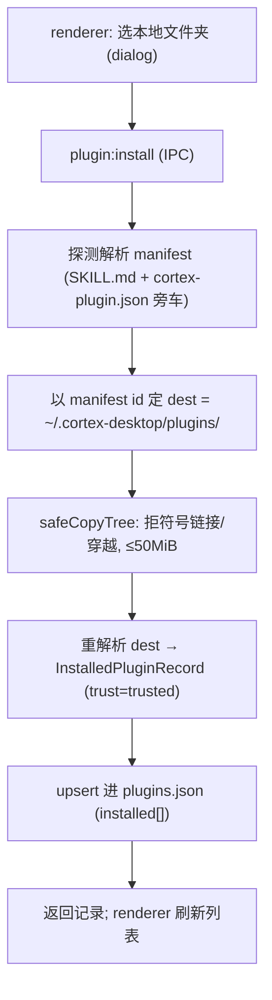
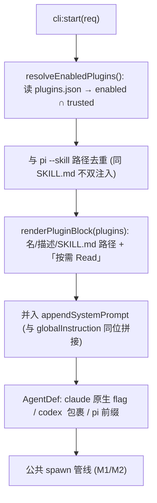

# feat: Agent CLI 调用层 M3-B — 第一方 Plugin 框架(清单 + 安装 + prompt 注入)

> ID 约定:`R*` = 需求,`U*` = 实现单元,`KTD*` = 技术决策,`RISK-*` = 风险。
> 建立在 M1(管线硬化)、M2(声明式 `AgentDef` + MCP 注入)、M3-A(用户 JSON 派生 agent,分支
> `feat/agent-cli-m3-local-profiles`)之上。本计划覆盖 origin 的 **FR-M3-2 / FR-M3-3** 与 **FR-M3-1
> 的渲染端跟进**;FR-M3-4(市场 UI / 信任提升 / 能力门控 / GenUI / 流水线)整体延后(见 Scope Boundaries)。

## Summary

借鉴 open-design 的第一方 Plugin 框架,给 cortex 加一套**跨 agent(claude / codex / pi)统一**的插件能力:
以 `SKILL.md`(+ 可选 `cortex-plugin.json` 旁车)为载体的统一 `PluginManifest`,支持本地文件夹安装、已安装记录持久化,
并把已启用 plugin 的指令经**既有 `appendSystemPrompt` 跨 agent 注入缝**拼进系统提示。复用 cortex 现有的
skill 扫描 / frontmatter 解析 / 路径白名单底座,**不重构 pi 既有 `--skill` / `-e` argv 注入**,不引入新 `packages/*`
共享包、不引入 SQLite/native 依赖 —— 沿用仓库既有「主进程模块 + 双份类型镜像 + views 设置区」模式(同 M2 MCP、M3-A)。

另含 FR-M3-1 收尾:渲染端 agent 选择器列出 M3-A 已派生的用户 agent(后端 `agents:profiles` 已就绪)。

---

## Problem Frame

origin 的 B(完整 Plugin 框架)目标是「用统一清单管理 skills/扩展,提供安装与 prompt 注入」。cortex 现状:
- 已有**三套互不统一**的「插件类」机制(已核实):内置 Skill 元数据(`SKILL.md` → 经 system prompt 路径注入,
  跨 agent)、pi 插件 Skill(`--skill`,仅 pi)、pi 扩展市场(`-e`,仅 pi,绑死 `pi install/list` CLI)。
- 注入层是 **pi 专属**:`claude` 只有 `--disable-slash-commands` 门控、`codex` 无 skill 处理;它们消费的是
  `appendSystemPrompt`(claude 原生 flag / codex `<user_request>` 包裹)。即**跨 agent 的统一注入缝已存在**,
  就是 `appendSystemPrompt` + core 装配层(`packages/core/personal/messages.ts` 的 `resolve*` 函数)。
- SKILL.md frontmatter 解析、多根扫描、路径白名单**已具备且 agent 无关**(`skills/frontmatter.ts`、
  `skills/registry.ts`、`skills/locate.ts`、`skills.ts` 的 `isInside`/`expandTilde`),可直接复用。

缺口 = 没有一个 **agent 中性的 Plugin 抽象**:统一清单 + 跨 agent 安装/持久化 + 统一 prompt 注入块。M3-B 补这层,
**复用底座、不另起并行体系**(origin 关键约束),也不照搬 open-design 的 daemon / SQLite / 市场网络栈。

---

## Requirements

### Plugin 清单与安装(FR-M3-2)

- R1. 统一 `PluginManifest`:以 `SKILL.md`(frontmatter `name`/`description` + 正文)为主载体,可选 `cortex-plugin.json`
  旁车承载富字段(`kind` / `supportedAgents` / `capabilities` / `context` 等);旁车优先,缺字段由 SKILL.md 补齐。(origin FR-M3-2)
- R2. 本地文件夹安装:用户选一个含 `SKILL.md` 的目录 → 探测解析清单 → 以 **manifest id**(非目录名)落盘到
  `~/.cortex-desktop/plugins/<id>/` → 写入已安装记录。安装须**安全**:拒绝符号链接 / 路径穿越,大小上限钳制。(origin FR-M3-2)
- R3. 已安装记录持久化:`~/.cortex-desktop/plugins.json` 持久 `{ installed[], enabled[] }`;装≠启用(opt-in)。
  记录形状含 id/version/source/fsPath/trust/installedAt。解析/读失败降级,不阻断启动。(origin FR-M3-2)

### Plugin prompt 注入(FR-M3-3)

- R4. prompt 注入块:把**已启用**plugin 归一为一段系统提示块(plugin 名 / 描述 / SKILL.md 绝对路径 + 「请按需 Read」
  指令),经 `appendSystemPrompt` 缝**跨 agent**注入(claude 原生 flag、codex `<user_request>` 包裹、pi 前缀)。
  与既有 globalInstruction / 内置 skill 注入**叠加不覆盖**;与 pi `--skill` 路径**去重**避免双重注入。(origin FR-M3-3)
- R5. 注入为 opt-in:仅 `enabled` 且过信任门(trust≠restricted)的 plugin 进注入块;无启用 plugin 时注入为空,
  行为与现状一致。(origin FR-M3-3)

### 信任(最小,FR-M3-4 的安全地板提前)

- R6. 最小信任默认:本地安装 → `trusted`;能力地板恒含 `prompt:inject`。完整信任分级 UI / 能力门控随 FR-M3-4 延后,
  但默认策略与「装≠启用 + 信任门」三态先就位(安全相关、成本低)。

### FR-M3-1 渲染端跟进

- R7. agent 选择器列出用户派生 agent:渲染端经 `agents:profiles` 拉取 M3-A 派生的 agent,在新建会话 / 切 agent 的
  选择器中可见可选;spawn 用其 id。(origin FR-M3-1 收尾)

### 兼容性

- R8. 向后兼容:未安装任何 plugin 时,claude / codex / pi 行为与 M3-A 结束态一致;`appendSystemPrompt` 既有消费者
  (globalInstruction、内置 skill、ask/automation)不受影响;不破坏 pi 既有 `--skill` / `-e` 注入。

---

## Key Technical Decisions

- KTD1. **不新建 `packages/*` 共享包,沿用「主进程模块 + 双份类型镜像 + views 设置区」模式。** open-design 因 daemon 服务
  web 而拆 `contracts` + `plugin-runtime` 两包;cortex 的 plugin 能力几乎全在主进程(安装 / 持久化 / spawn 前注入),
  渲染端只需类型 + IPC + 设置 UI。故落点:主进程 `apps/desktop/src/main/plugins/*`(同 `agents/`、`ipc/mcp-config.ts`、
  `agents/agent-profiles.ts`),类型进 `ipc/types.ts` + `packages/core/desktop/types.ts` 双镜像,UI 进
  `packages/views/cortex-desktop/`。这样**天然规避 origin RISK-5 的包硬边界问题**,且与 M2/M3-A 一致、回归面小。
- KTD2. **复用现有 skill 底座作为清单来源,不重写。** `skills/frontmatter.ts`(frontmatter 解析)、`skills/registry.ts`
  (多根扫描)、`skills/locate.ts`(`expandTilde`)、`skills.ts`(`isInside` 路径白名单)直接复用 / 轻量泛化。
  富字段经 `cortex-plugin.json` 旁车承载,**避免把手写三键 frontmatter 解析器升级为完整 YAML 依赖**(R1)。
- KTD3. **注入走既有 `appendSystemPrompt` 跨 agent 缝,不碰 pi argv 注入。** 装配层在 `messages.ts` 新增
  `resolveEnabledPlugins()` → 渲染出 plugin-block 文本 → 并入 `appendSystemPrompt`(与 globalInstruction 同位拼接)。
  claude / codex / pi 各自 adapter 已会把 `appendSystemPrompt` 翻成原生形态(M2 能力位),故注入对三 agent 统一生效。
  **pi 的 `--skill` / `-e` 注入完全不动**(origin 约束「不另起并行体系」+ 避免大改回归);去重见 RISK-2。
- KTD4. **注入「路径 + Read 指令」而非整段正文(对齐 cortex 既有 skill 注入)。** cortex 现有内置 skill 注入
  (`core/personal/notes.ts` 的深化 / plan 注入)就是「给元数据 + SKILL.md 绝对路径,让 agent 自己 Read」。
  plugin-block 沿用此模式:列 plugin 名 / 描述 / SKILL.md 路径 + 「按需 Read」,**避免把多个 plugin 正文塞爆系统提示**
  (prompt 膨胀),并复用「agent 自读」这一已验证路径(open-design 注入整段正文是 daemon 取舍,cortex 不照搬)。
- KTD5. **JSON 持久化,不引 SQLite。** `~/.cortex-desktop/plugins.json` 单文件存 `{installed[], enabled[]}` +
  插件目录 `~/.cortex-desktop/plugins/<id>/`。与仓库既有 JSON 持久化惯例(`automations.json`、`notes.json`、
  `agents.local.json`)一致,放弃 open-design 的 SQLite 读缓存(插件量级小,可接受)。
- KTD6. **安装只做本地文件夹,预留 fetcher 注入点。** installer 以「源 → 解析 → safeCopyTree 落盘 → upsert 记录」
  为骨架,M3-B 只接 `dialog.showOpenDialog` 选本地目录;github/https 市场来源随 FR-M3-4 接入(installer 留来源分发口)。
  safeCopyTree 移植 open-design 的安全姿态:拒符号链接 / `..` 穿越 / 超 50MiB。
- KTD7. **信任三态最小落地,UI 延后。** `installed`(库存)→ `enabled`(opt-in)→ 注入要求 `trusted`。本地装默认
  `trusted`,能力地板 `prompt:inject`。完整能力门控 / 信任提升 UI 随 FR-M3-4;本期只要默认策略 + 注入门(R6)。

---

## High-Level Technical Design

安装 → 落盘 → 持久化:



spawn 前的跨 agent 注入(只在主会话注入,ask/oneshot/automation 维持轻量):



信任 / 启用状态机:


---

## Output Structure

新增主进程模块(其余为既有文件改动):

```text
apps/desktop/src/main/plugins/
  manifest.ts          # PluginManifest 类型消费 + 解析(SKILL.md + cortex-plugin.json → 归一清单)
  manifest.test.ts
  installer.ts         # 本地文件夹安装 + safeCopyTree + 解析落盘
  installer.test.ts
  plugins-store.ts     # plugins.json 读写 + InstalledPluginRecord upsert/list/remove/setEnabled
  plugins-store.test.ts
  plugin-block.ts      # renderPluginBlock(enabled[]) → 注入文本(纯函数)
  plugin-block.test.ts
```

`~/.cortex-desktop/plugins.json` 与 `~/.cortex-desktop/plugins/<id>/` 为运行时数据(不入库)。

---

## Implementation Units

### U1. PluginManifest 类型 + 解析

- Goal: 定义 agent 中性的 `PluginManifest` / `InstalledPluginRecord` / `PluginSettings` / `TrustTier`,并实现
  「目录 → 归一清单」解析(SKILL.md frontmatter + 可选 `cortex-plugin.json` 旁车,旁车优先、SKILL.md 补齐)。
- Requirements: R1, R6
- Dependencies: 无
- Files:
  - `apps/desktop/src/main/plugins/manifest.ts`(类型消费 + `parsePluginFolder(dir)` 纯解析)
  - `apps/desktop/src/main/plugins/manifest.test.ts`
  - `apps/desktop/src/main/ipc/types.ts` + `packages/core/desktop/types.ts`(类型双镜像)
- Approach: 复用 `skills/frontmatter.ts` 取 SKILL.md 的 `name`/`description`;若存在 `cortex-plugin.json` 则 `JSON.parse`
  取富字段(`kind`/`supportedAgents`/`capabilities`/`version`),与 frontmatter 合并(旁车优先)。id 由 manifest `name`
  归一(`/^[a-z0-9][a-z0-9._-]*$/`,复用 `isValidSkillName` 思路)。无 SKILL.md / 解析失败 → 返回 null + warn(不抛)。
  `TrustTier = "bundled"|"trusted"|"restricted"`;能力地板 `prompt:inject`。
- Patterns to follow: `apps/desktop/src/main/skills/frontmatter.ts`、`agents/agent-profiles.ts`(纯解析 + 降级 + 不依赖 electron 风格)。
- Test scenarios:
  - 仅 SKILL.md(name/description)→ 归一清单(id 来自 name,trust 默认值)。
  - SKILL.md + cortex-plugin.json → 旁车富字段优先,frontmatter 补 description。
  - 非法 id / 缺 SKILL.md / 旁车非法 JSON → 返回 null + 不抛(降级)。
  - 双份类型镜像结构一致(形状断言)。
- Verification: `manifest.test.ts` 覆盖上述;`pnpm --filter @cortex-work/desktop typecheck` 与 core typecheck 通过。

### U2. 本地安装 + safeCopyTree

- Goal: 实现 `installLocalFolder(srcDir)`:探测解析 → 以 id 定 dest → 安全复制 → 重解析 → 产出 `InstalledPluginRecord`。
- Requirements: R2, R6
- Dependencies: U1
- Files:
  - `apps/desktop/src/main/plugins/installer.ts`(`installLocalFolder` + `safeCopyTree`)
  - `apps/desktop/src/main/plugins/installer.test.ts`
- Approach: stat 源目录(非目录拒绝)→ `parsePluginFolder` 取 id → `dest = ~/.cortex-desktop/plugins/<id>`(id 不安全则拒)→
  `safeCopyTree`(递归复制,**拒符号链接、拒含 `..`/绝对路径段、累计 ≤50MiB**,移植 open-design `installer.ts` 安全姿态)→
  重解析 dest → 记录 `{id,version,source:"local",fsPath,trust:"trusted",capabilitiesGranted:["prompt:inject"],installedAt}`。
  installer 以「源类型分发」为骨架但本期只接 local;github/https 留 fetcher 注入点(KTD6)。
- Patterns to follow: open-design `apps/daemon/src/plugins/installer.ts` 的 `installFromLocalFolder`/`safeCopyTree`;
  cortex `skills.ts` 的 `isInside`/`expandTilde` 路径安全。
- Test scenarios:
  - 合法本地目录 → 复制到 `plugins/<id>`,产出记录(id/fsPath/trust 正确)。
  - 源非目录 / 无 SKILL.md → 安装失败带可读 error,不落盘半成品。
  - 源含符号链接 / `..` 穿越段 → 拒绝(安全)。
  - 超 50MiB → 拒绝(大小钳制)。
  - 覆盖同 id 已装(overwrite)→ 行为明确(替换 + 更新 installedAt)。
- Verification: `installer.test.ts` 覆盖安全分支(用临时目录 + 构造 symlink/超限);手测选一个真实 SKILL.md 目录装成功。

### U3. plugins.json 持久化

- Goal: `plugins-store.ts` 读写 `~/.cortex-desktop/plugins.json`,提供 list / get / upsert / remove / setEnabled。
- Requirements: R3, R5
- Dependencies: U1
- Files:
  - `apps/desktop/src/main/plugins/plugins-store.ts`
  - `apps/desktop/src/main/plugins/plugins-store.test.ts`
- Approach: `PluginSettings = { installed: InstalledPluginRecord[], enabled: string[] }`(enabled 存 id)。读:文件缺失 /
  非法 JSON → `{installed:[],enabled:[]}`(降级,不阻断启动,同 `agent-profiles`)。写:原子写(临时文件 + rename,
  沿用仓库既有写法)。`setEnabled(id,bool)` 维护 enabled 集合;`remove(id)` 同步删记录 + 删插件目录 + 从 enabled 移除。
  uninstall 删目录复用 U2 的路径校验防误删。
- Patterns to follow: `apps/desktop/src/main/ipc/mcp-config.ts`(纯逻辑可测、不 import electron)、既有 store 原子写。
- Test scenarios:
  - 空 / 缺失文件 → 默认空配置。
  - upsert 新记录 → list 可见;重复 id upsert → 替换不重复。
  - setEnabled true/false → enabled 集合增删;remove → 记录 + enabled 同时清。
  - 非法 JSON → 降级空配置不抛。
- Verification: `plugins-store.test.ts` 覆盖;临时目录往返读写一致。

### U4. plugin-block 渲染(纯函数)

- Goal: `renderPluginBlock(plugins)` 把已启用 plugin 归一为一段系统提示文本(名 / 描述 / SKILL.md 路径 + Read 指令)。
- Requirements: R4, R5
- Dependencies: U1
- Files:
  - `apps/desktop/src/main/plugins/plugin-block.ts`
  - `apps/desktop/src/main/plugins/plugin-block.test.ts`
- Approach: 输入 `InstalledPluginRecord[]`(已 enabled∩trusted),输出 markdown:每 plugin 一行 `**<name>** — <description>`
  + `SKILL.md: <fsPath>/SKILL.md(按需 Read 获取完整指令)`。空数组 → 返回空串(R5)。对齐 cortex 既有 skill 注入文案
  风格(`core/personal/notes.ts`)。纯函数,不读盘(路径由记录提供)。
- Patterns to follow: `core/personal/notes.ts` 的 `buildDeepenSystemPrompt`/`buildPlanSystemPrompt` 注入文案;
  open-design `prompts/plugin-block.ts` 的分段结构(仅借结构,正文改为路径+Read)。
- Test scenarios:
  - 多 plugin → 每个一段,含 name/description/SKILL.md 路径。
  - 空数组 → 空串。
  - description 缺失 → 仅 name + 路径(降级)。
- Verification: `plugin-block.test.ts` 快照 / 字段断言。

### U5. 注入装配 + spawn 接线

- Goal: 在 core 装配层解析已启用 plugin 并把 plugin-block 并入 `appendSystemPrompt`,经 cli:start 跨 agent 注入;与 pi
  `--skill` 去重。
- Requirements: R4, R5, R8
- Dependencies: U3, U4
- Files:
  - `packages/core/personal/messages.ts`(新增 `resolveEnabledPlugins()` 经 bridge 拉取 → 渲染 block → 并入 appendSystemPrompt)
  - `packages/core/desktop/bridge.ts` + `apps/desktop/src/preload/index.ts`(bridge 暴露 plugin 列表读取)
  - `apps/desktop/src/main/ipc/cli.ts`(仅主会话注入;ask/oneshot/automation 维持轻量不注入,同 MCP 策略)
  - 相关 `*.test.ts`
- Approach: 装配点对齐既有 `resolveEnabledSkillPaths`/globalInstruction 拼接(`messages.ts:1362+`)。plugin-block 文本与
  globalInstruction / 既有 appendSystemPrompt **拼接不覆盖**(顺序固定、各占一段)。**去重**:若某 plugin 的 SKILL.md 已
  经 pi `--skill` 注入(同 dir),则不再进 plugin-block,避免 pi 双重注入(claude/codex 无 --skill,不受影响)。
  注入仅主会话(cli:start);ask/oneshot/automation 沿用 M2 轻量策略(不注入)。
- Patterns to follow: `messages.ts` 既有 `resolveEnabledSkillPaths`(`:1379`)/`resolveEnabledExtensionPaths`(`:1417`)/
  globalInstruction 跨 agent 注入(`:1362`);M2 的「仅主会话注入」分流(MCP)。
- Test scenarios:
  - 有 enabled∩trusted plugin → appendSystemPrompt 含 plugin-block;claude/codex/pi 各自原生形态承载(buildArgs 回归 + 等价)。
  - 无 enabled plugin → appendSystemPrompt 不含 block(行为同现状,R8)。
  - 同 SKILL.md 已走 pi --skill → 不重复进 plugin-block(去重)。
  - globalInstruction + plugin-block 并存 → 两段都在、互不覆盖。
  - ask/oneshot/automation → 不注入(回归)。
- Verification: 装配单测 + adapter buildArgs 断言;集成确认启用一个 plugin 后系统提示出现其指令块。

### U6. IPC + preload + bridge + 设置 UI

- Goal: 暴露 plugin 安装 / 列表 / 启停 / 卸载 IPC,渲染端提供最小管理设置区。
- Requirements: R2, R3, R5
- Dependencies: U2, U3
- Files:
  - `apps/desktop/src/main/ipc/cli.ts` 或新增 `ipc/plugins.ts` + `register.ts`(`plugin:install`/`list`/`get`/`uninstall`/`setEnabled`;install 经 `dialog.showOpenDialog`)
  - `apps/desktop/src/preload/index.ts` + `packages/core/desktop/bridge.ts`(暴露上述,类型用 `InstalledPluginRecord`)
  - `packages/views/cortex-desktop/personal/PluginSection.tsx` + `PluginSection.test.tsx`(挂入 `SettingsMenu`)
- Approach: IPC handler 调 U2/U3。设置区最小可用:列已安装(名/版本/启用开关/卸载)+「安装(选文件夹)」按钮。复用现有
  设置区组件与 `DesktopBridge` 注入模式(views 不碰 Node)。富管理(市场/信任提升/能力)延后(FR-M3-4)。品牌色 `#7c5cff`。
- Patterns to follow: `packages/views/cortex-desktop/personal/McpSection.tsx`(M2 U3)、`pi` 扩展市场设置组件;
  `ipc/register.ts` handler 注册。
- Test scenarios:
  - 安装(mock dialog 返回目录 + mock bridge)→ 列表新增。
  - 切换启用开关 → 经 bridge 持久化,重开生效。
  - 卸载 → 列表移除 + 记录删除。
  - Test expectation: 组件渲染 + 交互断言(Testing Library);bridge 以 mock 验证。
- Verification: 设置区可装 / 启停 / 卸载,与后端联通;views 单测通过。

### U7. 渲染端 agent 选择器列出派生 agent(FR-M3-1 收尾)

- Goal: 渲染端经 `agents:profiles` 拉取 M3-A 派生 agent,在 agent 选择器中可见可选,spawn 用其 id。
- Requirements: R7
- Dependencies: 无(后端 `agents:profiles` 已在 M3-A 就绪)
- Files:
  - `packages/core/store/personal.ts`(`agentsAvailable` / `lastAgent` 旁增派生 agent 列表来源;或新增 derivedAgents 状态)
  - `packages/core/desktop/bridge.ts` + `preload`(`listAgentProfiles` 已在 M3-A 暴露,确认接通)
  - agent 选择器组件(`packages/views/cortex-desktop/` 内 grep agent 选择器)+ `*.test.tsx`
- Approach: 启动 / 设置变更时调 `bridge.listAgentProfiles()` → 把派生 agent(id + label + base)并入选择器选项(内置三者
  之外追加)。选中派生 id → `CliStartRequest.agent` 用该 id(后端 `getAgentDef` 已解析,M3-A)。覆盖内置同名 id 的派生
  不新增选项(仍显示为该内置,行为已被后端接管)。
- Patterns to follow: `core/store/personal.ts` 的 `defaultAgent`/`initialAgent`/`agentsAvailable` 既有 agent 选择逻辑;
  现有 agent 选择器组件。
- Test scenarios:
  - `listAgentProfiles` 返回新 id → 选择器出现该选项(label 优先,缺省用 id)。
  - 选中派生 agent → 发起会话 req.agent = 派生 id。
  - 无派生 → 选择器仅内置三者(回归)。
  - 覆盖内置同名 id → 不重复出选项。
- Verification: 选择器列出并可选派生 agent;选中后 spawn 用其 id 跑通(后端 M3-A 已支持)。

---

## Scope Boundaries

### Deferred to Follow-Up Work(FR-M3-4 及其它)

- **市场来源安装**(github:/https: tarball)与**市场 UI / 搜索 / 发布**:installer 已留 fetcher 注入点,本期不接。
- **信任提升 UI / 能力门控执行**:本期只落最小默认信任(local→trusted)+ 注入门;完整能力 grant/revoke、能力校验、
  restricted→trusted 流程延后。
- **GenUI 表单 / 流水线 stages / atoms / connectors**:open-design 的 `genui`/`pipeline`/`atoms`/`connector-gate` 整块不移植。
- **快照 / GC / diff / lockfile / digest 校验**:open-design 的 snapshot 体系不移植(cortex 每轮 fresh spawn,无需冻结快照)。
- **统一 store 重构**:不把 pi `piSkills` / `piExtensions` 并入新 `pluginSettings`(避免大改;两者并存,新框架走新域)。
- **注入整段正文**:本期注入「路径 + Read 指令」(KTD4);若后续需要把正文直接喂入,另议。

### 不属于本里程碑

- 把 pi 的 `--skill` / `-e` argv 注入重构进新框架(origin 约束「不另起并行体系」≠「重写既有 pi 注入」;两者并存)。
- 把 cortex 改造成 daemon / 引入 SQLite。
- 与 open-design 完全等价的通用插件平台。

---

## Risks & Dependencies

- RISK-1(注入膨胀):多 plugin 启用时系统提示变长。缓解:KTD4 只注入路径 + Read 指令(不塞正文),且仅 enabled∩trusted。
- RISK-2(双重注入):pi 既走 `--skill` 又可能进 plugin-block → 同一 SKILL.md 双注入。缓解:U5 装配层按 dir 去重
  (claude/codex 无 --skill 不受影响)。这是 KTD3「不动 pi argv」带来的必须处理项。
- RISK-3(appendSystemPrompt 既有消费者冲突):globalInstruction / 内置 skill / ask 已用 appendSystemPrompt。缓解:
  plugin-block 与其**拼接不覆盖**(U5),固定顺序、各占一段;需核实拼接点不破坏 codex `<user_request>` 包裹语义。
- RISK-4(SKILL.md 富字段解析):手写三键 frontmatter 不解析 `supportedAgents`/`capabilities`。缓解:KTD2 富字段走
  `cortex-plugin.json` 旁车(JSON.parse),不升级 frontmatter 为 YAML 依赖。
- RISK-5(安装安全):安装任意本地目录有路径穿越 / 符号链接 / 超大风险。缓解:safeCopyTree 移植 open-design 安全姿态
  (U2),复用 cortex `isInside` 白名单。
- 依赖:建立在 M3-A(`feat/agent-cli-m3-local-profiles`,`agents:profiles` + 派生注册)之上;U7 直接消费其 IPC。
- 双份类型镜像:`PluginManifest` 系列与 `CliStreamEvent` / `McpSettings` 一样有 ipc/core 两份镜像,改动须同步。

---

## Open Questions

- `cortex-plugin.json` 的字段最小集:`{ kind?, supportedAgents?, capabilities?, version?, context? }` 取哪些进 v1?
  建议先 `version` + `supportedAgents`(用于按 agent 过滤注入)+ `capabilities`(地板 prompt:inject);其余随 FR-M3-4。
  U1 实现时按「最小可用」定,字段可后扩(passthrough 保留未知键)。
- `supportedAgents` 过滤:某 plugin 声明只支持 claude 时,codex/pi 会话是否跳过其注入?建议是(按当前会话 agent 过滤
  enabled 集),U5 实现时定。
- 注入是否需要 per-session 开关(某会话临时不加载 plugin)?本期先全局 enabled;per-session 覆盖随需求再加(参照 useOwnSkills)。

---

## Sources / Research

- 现状(cortex,已核实带 file:line):三套并行机制 —— 内置 skill 元数据 `apps/desktop/src/main/ipc/skills.ts`、
  `skills/{frontmatter,registry,locate}.ts`(扫描/解析/定位,agent 无关,可复用);pi 插件 skill `agents/pi.ts:71`、
  `agents/pi-rpc.ts:206`(`--skill`,仅 pi);pi 扩展市场 `ipc/pi-extensions-market.ts`(绑死 `pi install/list`,仅 pi)。
  跨 agent 注入缝 = `appendSystemPrompt`(claude 原生 flag `agents/claude.ts`、codex `<user_request>` `agents/codex.ts`、
  pi 前缀)+ 装配层 `packages/core/personal/messages.ts`(`resolveEnabledSkillPaths:1379`、globalInstruction:1362)。
  既有内置 skill 注入「路径 + 让 agent Read」模式:`packages/core/personal/notes.ts`。类型镜像约定:M2 MCP
  `ipc/mcp-config.ts` + `McpSection.tsx`、M3-A `agents/agent-profiles.ts`。
- 参考实现(open-design,`/Users/mike/source/ai/open-design`,设计借鉴非照搬):`packages/contracts/src/plugins/manifest.ts`
  (PluginManifest 规范,SKILL.md+open-design.json 旁车,passthrough 前向兼容)、`packages/plugin-runtime/`(parsers/
  adapters/merge/validate/resolve/digest,纯逻辑)、`apps/daemon/src/plugins/{installer,registry,trust,apply}.ts`
  (本地+archive 安装、safeCopyTree 安全姿态、信任三态 + 能力门、apply 产 snapshot)、`packages/contracts/src/prompts/
  plugin-block.ts`(注入块结构)。Electron 移植落点:全部 FS/持久化在主进程 `apps/desktop/src/main/plugins/`,
  渲染端经 IPC;不引 SQLite(改 JSON)、不引市场网络栈(留 fetcher 口)。
- origin 需求:`docs/brainstorms/2026-06-21-optimize-agent-cli-invocation-requirements.md`(FR-M3-2/3/4、B 框架段、RISK-5)。
- 既有里程碑:M1 `docs/plans/2026-06-21-004-feat-agent-cli-pipeline-hardening-plan.md`、M2
  `docs/plans/2026-06-21-005-feat-agent-cli-m2-capabilities-plan.md`、M3-A
  `docs/plans/2026-06-21-006-feat-agent-cli-m3-local-profiles-plan.md`(分支 `feat/agent-cli-m3-local-profiles`)。
