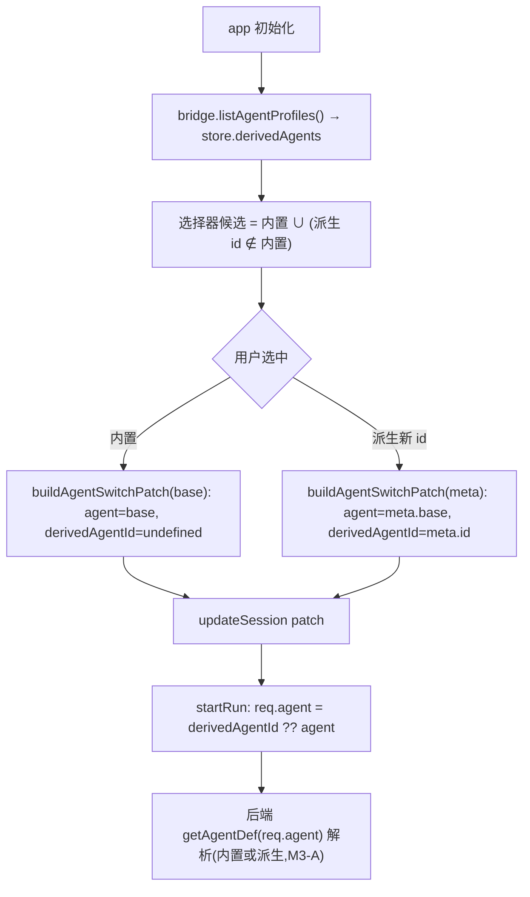

# feat: 渲染端 agent 选择器列出用户派生 agent(FR-M3-1 收尾)

> ID 约定:`R*` = 需求,`U*` = 实现单元,`KTD*` = 技术决策,`RISK-*` = 风险。
> 这是 M3-A(`feat/agent-cli-m3-local-profiles`,commit d7c5173)的渲染端收尾:后端已支持用户 JSON
> (`~/.cortex-desktop/agents.local.json`)派生 agent 且 `getAgentDef(id)` 能按派生 id 解析、spawn;
> IPC `agents:profiles`(经 `DesktopBridge.listAgentProfiles`)已透出派生元数据。**当前缺口仅在渲染端**:
> agent 选择器只列内置 claude/codex/pi,用户派生的**新 id** agent 无法被选中使用。原计划 M3-B/U7
> (`docs/plans/2026-06-21-007-feat-agent-cli-m3-plugin-framework-plan.md`)将其推迟,本计划专门处理。

## Summary

让用户在 `agents.local.json` 派生的**新 id** agent 出现在主聊天 agent 选择器与新建会话入口,选中后会话以
该派生 id 发起(后端 M3-A 已能解析),并显示其自定义名称/头像。核心取舍:**不放宽 `SessionMeta.agent`**
(那会波及全仓约 30 处 `Record<AgentKind>` 索引点、回归面大),改为新增 `SessionMeta.derivedAgentId?` 旁车字段
+ `session.agent` 仍存 base 内置值;仅 spawn 边界 `CliStartRequest.agent` 放宽为 string,显示与模型按
「派生优先、base 兜底」解析。纯渲染端 + 一个类型字段,后端零改动。

---

## Problem Frame

M3-A 交付了「用户 JSON 派生/覆盖 agent」的后端:`agents/agent-profiles.ts` 解析配置、`getAgentDef(id)` 解析派生
def、`spawnEnvForDef` 注入派生 env、`assertAgentAvailable` 对派生跳过 PATH 门控,IPC `agents:profiles` 透出元数据。
**覆盖内置同名 id 的场景已零 UI 端到端可用**(选 claude 即用被覆盖的 def)。但**派生新 id** 的 agent 无处可选:
渲染端 agent 选择器(`PersonalTopBar` 会话头、`NewSessionLanding` 新建会话)的候选来自写死的内置集
(`Object.keys(AGENT_MODELS)`),且 `SessionMeta.agent` 类型为 `AgentKind`、全仓多处以它索引
`Record<AgentKind, …>`(`AGENT_MODELS` / `DEFAULT_MODEL` / `AGENT_LABEL` / `AGENT_AVATAR` / `AGENT_NAME` /
`agentsAvailable` / `agentSessionIds`)。本计划补齐这条渲染端路径,且把架构改动控制到最小。

---

## Requirements

- R1. 用户在 `agents.local.json` 派生的新 id agent,出现在主聊天 agent 选择器(`PersonalTopBar`)与新建会话入口
  (`NewSessionLanding`)中,可见可选。覆盖内置同名 id 的派生**不**新增选项(仍显示为该内置)。(origin FR-M3-1 收尾)
- R2. 选中派生 agent 后,会话以该派生 id 发起 spawn(`CliStartRequest.agent` = 派生 id),后端 `getAgentDef` 解析
  (M3-A 已支持);其模型/续接按其 base 内置语义处理。
- R3. 选择器与会话头显示派生 agent 的**自定义名称**(`label`,缺省用 id)与头像(派生优先、base 兜底)。
- R4. 派生 agent 列表来自 `bridge.listAgentProfiles()`;配置缺失/桥不可用时,选择器回退为仅内置三者(R6 兼容)。
- R5. 切换到派生 agent 时,会话状态正确:清该 agent 的旧 resume id、按其 base 设默认模型;切回内置正常。
- R6. 兼容:未配置任何派生 agent 时,选择器与所有以 `session.agent` 索引 `Record<AgentKind>` 的现有逻辑行为不变。

---

## Key Technical Decisions

- KTD1. **旁车字段而非放宽 `SessionMeta.agent`(关键)。** 新增可选 `SessionMeta.derivedAgentId?: string`;
  `session.agent` 仍存**内置 base**(`AgentKind`)。这样全仓约 30 处 `Record<AgentKind>` 索引点(见 Sources)
  **无需改动**——`session.agent` 始终是合法 base。仅 spawn 边界把请求的 agent 取为 `derivedAgentId ?? agent`,
  故只放宽 `CliStartRequest.agent` 一个字段为 `string`(后端 `getAgentDef` 早已接受 string)。回归面从「全仓防御性
  改所有索引点」缩小到「新增一字段 + 选择器/spawn/显示三处接线」。
- KTD2. **派生元数据走 React 状态,启动时经 bridge 拉取。** 在 personal store 增 `derivedAgents: DerivedAgentMeta[]`
  + setter;app 初始化(与 `detectAgents` 同期)调 `bridge.listAgentProfiles()` 填充。选择器候选 = 内置集 ∪
  「派生中 id ∉ 内置」的项(覆盖内置同名的派生不新增条目,R1)。
- KTD3. **显示与模型「派生优先、base 兜底」解析,集中到 agentMeta helper。** 新增纯函数:
  `baseAgentOf(agent, derivedAgents): AgentKind`(内置→自身;派生→其 base;未知→"claude" 兜底)、
  `agentDisplayLabel(agent, derivedAgents)`(派生 label 优先,否则 `AGENT_LABEL[base]`)、
  `agentDisplayAvatar(...)`(派生暂复用 base 头像 + 可选自定义底色,M1 先用 base 头像 + id 首字母)。模型选择用
  `baseAgentOf` 索引 `AGENT_MODELS`/`DEFAULT_MODEL`。把 `AGENT_LABEL[agent]` 等直接索引替换为 helper 仅限**会话头/
  选择器**这几处展示点,其余 `Record` 索引点因 `session.agent` 仍是 base 而无需动(KTD1)。
- KTD4. **切换 patch 扩展,resume 槽按派生 id 键。** `buildAgentSwitchPatch` 增参数:目标可为派生 meta;产出
  `{ agent: base, derivedAgentId: id|undefined, model: DEFAULT_MODEL[base], … }`。`agentSessionIds` 续接槽按
  `derivedAgentId ?? agent` 键,避免派生 codex 与真 codex 串 resume(RISK-2)。
- KTD5. **spawn 取 id 单点改造。** 发起会话构造 `CliStartRequest` 处(personal 动作 / messages startRun)把
  `agent` 取为 `session.derivedAgentId ?? session.agent`;其余字段不变。这是 R2 的唯一后端交互点。

---

## High-Level Technical Design

派生 agent 从配置到 spawn 的数据流(渲染端):



显示解析(会话头/选择器)「派生优先、base 兜底」:

```mermaid
flowchart LR
  a["session.agent(base) + derivedAgentId?"] --> r{"derivedAgentId 命中 derivedAgents?"}
  r -->|是| d["label/头像 用派生 meta(缺省回 base)"]
  r -->|否(内置)| b["label/头像 用 AGENT_LABEL/AVATAR[agent]"]
```

---

## Implementation Units

### U1. SessionMeta.derivedAgentId 字段 + CliStartRequest.agent 放宽

- Goal: 引入旁车字段与最小类型放宽,作为后续接线的基础;不改任何运行逻辑。
- Requirements: R2, R6
- Dependencies: 无
- Files:
  - `apps/desktop/src/main/ipc/types.ts` + `packages/core/desktop/types.ts`(`SessionMeta.derivedAgentId?: string` 双镜像;`CliStartRequest.agent: AgentKind` → `string`,注释说明派生 id)
- Approach: `SessionMeta` 增可选 `derivedAgentId?: string`(缺省 = 内置 agent,行为不变)。`CliStartRequest.agent`
  放宽为 `string`(后端 `getAgentDef`/`assertAgentAvailable` 已接受 string,M3-A)。其余以 `AgentKind` 为键的类型
  (`agentSessionIds`、`agentsAvailable`)**不动**——它们仍按 base 键。仅类型改动,无逻辑。
- Patterns to follow: M3-A 既有 `DerivedAgentMeta` 双镜像;`CliStartRequest` 现有字段。
- Test scenarios:
  - Test expectation: none —— 纯类型扩展,无行为;由后续单元的测试与 `pnpm --filter @cortex-work/desktop typecheck` /
    core typecheck 覆盖编译期正确性。
- Verification: 两端 typecheck 通过;现有全量测试不回归。

### U2. 派生 agent 列表 store 状态 + 启动加载

- Goal: 渲染端持有派生 agent 元数据,供选择器读取。
- Requirements: R1, R4
- Dependencies: 无
- Files:
  - `packages/core/store/personal.ts`(新增 `derivedAgents: DerivedAgentMeta[]` 状态 + `setDerivedAgents`)
  - 初始化处(与 `detectAgents` 同期调用点;`apps/desktop/src/renderer/src/App.tsx` 或现有 agent 探测 effect)调
    `bridge.listAgentProfiles()` 填充
  - 就近 `*.test.ts(x)`
- Approach: store 增状态默认 `[]`。在已有「探测 agent 可用性」的初始化路径旁,`bridge.listAgentProfiles?.()` →
  `setDerivedAgents`。桥不可用 / 抛错 → 保持 `[]`(R4 回退)。不引入 React Query(这是客户端态,放 Zustand,符合
  状态管理约定)。
- Patterns to follow: `core/store/personal.ts` 的 `agentsAvailable`/`setAgentsAvailable` 与其初始化;`detectAgents` 调用点。
- Test scenarios:
  - `setDerivedAgents` 写入后选择器读到列表(store 单测)。
  - 初始化时 bridge 返回派生 → store 填充;bridge 抛错 → store 保持空(降级)。
  - 桥无 `listAgentProfiles`(旧壳)→ 空列表,不抛。
- Verification: store 状态可读写;初始化加载在有/无桥两种情况下都不崩。

### U3. agentMeta 解析 helper + 切换 patch 扩展

- Goal: 提供「派生优先、base 兜底」的显示/模型解析与切换 patch,集中派生逻辑。
- Requirements: R3, R5
- Dependencies: U1
- Files:
  - `packages/views/cortex-desktop/personal/agentMeta.ts`(新增 `baseAgentOf` / `agentDisplayLabel` /
    `agentDisplayAvatar`;扩展 `buildAgentSwitchPatch` 支持派生目标)
  - `packages/views/cortex-desktop/personal/agentMeta.test.ts`(新增或就近)
- Approach: `baseAgentOf(agent, derived)`:`agent` 是内置→返回自身;否则在 `derived` 找 id==agent 取其 base;找不到
  兜底 `"claude"`。`agentDisplayLabel`/`agentDisplayAvatar` 用派生 meta 的 label / base 头像(M1 头像先复用 base +
  可后续加自定义)。`buildAgentSwitchPatch` 增可选 `derived?: DerivedAgentMeta`:产出 `agent = derived?.base ?? target`、
  `derivedAgentId = derived?.id`、`model = DEFAULT_MODEL[base]`;`agentSessionIds` 删除键用 `derived?.id ?? base`(KTD4)。
- Patterns to follow: 现有 `agentMeta.ts` 的 `AGENT_LABEL`/`AGENT_AVATAR`/`buildAgentSwitchPatch`。
- Test scenarios:
  - `baseAgentOf`:内置→自身;派生 id→其 base;未知 id→"claude" 兜底。
  - `agentDisplayLabel`:派生有 label→用 label;派生无 label→用 id;内置→`AGENT_LABEL[agent]`。
  - `buildAgentSwitchPatch(derived)`:agent=base、derivedAgentId=id、model=base 默认;切回内置→derivedAgentId 清空。
  - resume 槽:切换清除的是 `derived.id ?? base` 键。
- Verification: helper 纯函数单测全覆盖;切换 patch 对内置/派生两路正确。

### U4. PersonalTopBar 会话头选择器列出派生 agent

- Goal: 主聊天 agent 选择器列出派生新 id 并可切换;会话头显示其名称/头像。
- Requirements: R1, R2, R3, R5
- Dependencies: U2, U3
- Files:
  - `packages/views/cortex-desktop/personal/PersonalTopBar.tsx`(菜单候选并入派生;`AGENT_LABEL[agent]`/
    `AGENT_AVATAR[agent]` 展示点改用 `agentDisplayLabel`/`agentDisplayAvatar`;切换走扩展后的 patch)
  - `packages/views/cortex-desktop/personal/PersonalTopBar.test.tsx`
- Approach: 菜单项 = 内置(`Object.keys(AGENT_MODELS)`)后追加 `derivedAgents.filter(id ∉ 内置)`。点击派生项 →
  `buildAgentSwitchPatch(session, base, providerSettings, derivedMeta)` → `updateSession`。当前会话头按
  `session.derivedAgentId` 解析显示名/头像。不可用态(派生不参与 `agentsAvailable` 门控,默认可选,同 M3-A
  `assertAgentAvailable` 放行)。
- Patterns to follow: `PersonalTopBar.tsx` 现有 agent 菜单(`AgentMenu`,`Object.keys(AGENT_MODELS).map`)与 `onSwitch`。
- Test scenarios:
  - 有派生新 id → 菜单出现该项(label 优先);点击 → updateSession 含 `agent=base, derivedAgentId=id`。
  - 覆盖内置同名 id 的派生 → 菜单**不**重复出条目(R1)。
  - 当前会话为派生 → 会话头显示派生名称/头像。
  - 无派生 → 菜单仅内置三者(回归,R6)。
- Verification: 选择器列出并可选派生;切换后会话头与 store 状态正确。

### U5. 新建会话入口列出派生 agent + spawn 取派生 id

- Goal: 新建会话能选派生 agent;发起会话时 spawn 用派生 id。
- Requirements: R1, R2
- Dependencies: U2, U3
- Files:
  - `packages/views/cortex-desktop/personal/NewSessionLanding.tsx`(agent 候选并入派生;新建会话 patch 带 derivedAgentId）
  - spawn 构造点(`packages/core/personal/messages.ts` 的 startRun / `personalActions` 构造 `CliStartRequest` 处):
    `agent: session.derivedAgentId ?? session.agent`
  - 相关 `*.test.ts(x)`
- Approach: `NewSessionLanding` 候选同 U4(内置 ∪ 派生新 id);创建会话时若选派生,落 `agent=base, derivedAgentId=id`
  与 base 默认模型。spawn 单点把 `req.agent` 取为 `derivedAgentId ?? agent`(KTD5)——这是唯一让后端收到派生 id 的改动。
- Patterns to follow: `NewSessionLanding.tsx` 现有 agent 选择 + `DEFAULT_MODEL`;现有 `CliStartRequest` 构造。
- Test scenarios:
  - 新建会话选派生 → 会话 `agent=base, derivedAgentId=id`,模型为 base 默认。
  - 发起会话 → `CliStartRequest.agent === 派生 id`(spawn 取值正确)。
  - 选内置 → `derivedAgentId` 为空,req.agent = 内置(回归)。
  - 无派生 → 入口仅内置(回归)。
- Verification: 端到端——派生会话发起后 `cli:start` 收到派生 id(后端 M3-A 解析);内置路径不回归。

---

## Scope Boundaries

### Deferred to Follow-Up Work

- 其它 agent 选择面纳入派生:automation(`AutomationDialog`)、菜单栏 Spotlight(`SpotlightBar`)、设置区默认
  agent(`SettingsMenu`)、日报模型(`SummaryModelConfig`)。本计划只做主聊天 + 新建会话两处;其余仍只列内置三者。
- 派生 agent 的**自定义头像**(独立 initials/底色):本期复用 base 头像;后续可让 `agents.local.json` 声明头像。
- 用户在 UI 内**编辑** `agents.local.json`(增删派生):本期仍由用户手改文件 + `agents:reloadProfiles` 刷新;UI 编辑延后。
- 放宽 `SessionMeta.agent` 为 string 的全仓重构:KTD1 已用旁车字段规避,不做。

### 不属于本里程碑

- 后端派生 agent 能力(已在 M3-A 交付)。
- Plugin 框架(M3-B,`docs/plans/2026-06-21-007-...-plugin-framework-plan.md`)。

---

## Risks & Dependencies

- RISK-1(显示点遗漏):若某展示点仍直接 `AGENT_LABEL[session.agent]` 而 `session.agent` 是 base,会显示 base 名而非
  派生名——属「显示退化」非崩溃。缓解:U4/U5 把**会话头与选择器**展示点改用 helper;其余非关键展示点(如时间线)可
  接受显示 base 名,列入 follow-up。
- RISK-2(resume 串槽):派生 codex 与真 codex 若共用 `agentSessionIds` 槽会错续会话。缓解:KTD4 槽按
  `derivedAgentId ?? base` 键。
- RISK-3(派生 id 失效):用户删了 `agents.local.json` 里的派生项但旧会话仍带其 `derivedAgentId` → spawn 时后端
  `getAgentDef` 抛「未知 agent」。缓解:spawn 取值前可校验 `derivedAgentId` 仍在 `derivedAgents` 中,失效则回退
  base(`session.agent`);U5 实现时加此兜底。
- 依赖:M3-A(`feat/agent-cli-m3-local-profiles`)的 `agents:profiles` IPC 与 `getAgentDef` 派生解析(已就绪)。
- 双份镜像:`SessionMeta` / `CliStartRequest` 有 ipc/core 两份,U1 改动须同步。

---

## Open Questions

- 派生 agent 是否需要参与 `agentsAvailable` 可用性门控(如校验其 bin 存在)?本期默认放行(同 M3-A
  `assertAgentAvailable` 对派生跳过 PATH 检测);如需「不可用置灰」,需后端补派生可用性探测(follow-up)。
- 失效 `derivedAgentId` 的兜底位置:spawn 前校验回退(RISK-3)还是加载时清洗会话?倾向 spawn 前回退,改动最小,U5 定。

---

## Sources / Research

- 现状(M3-A 结束态,分支 `feat/agent-cli-m3-local-profiles`):后端 `apps/desktop/src/main/agents/agent-profiles.ts`
  (派生解析)、`agents/index.ts`(`getAgentDef` 解析派生 / `listAgentProfiles`)、`ipc/cli.ts`(`agents:profiles` IPC、
  `spawnEnvForDef`、`assertAgentAvailable` 对派生放行);`DesktopBridge.listAgentProfiles` + preload 已暴露;
  类型 `DerivedAgentMeta` 双镜像。
- 渲染端选择器与 `Record<AgentKind>` 索引面(本计划据此判定「旁车字段」KTD1 的回归收敛):选择器
  `packages/views/cortex-desktop/personal/PersonalTopBar.tsx`(`Object.keys(AGENT_MODELS)` 菜单)、
  `NewSessionLanding.tsx`、`AutomationDialog.tsx`、`apps/desktop/src/renderer/src/SpotlightBar.tsx`、`SettingsMenu.tsx`;
  索引点 `AGENT_MODELS`/`DEFAULT_MODEL`(`packages/core/desktop/types.ts:1002,1024`)、`AGENT_NAME`
  (`packages/core/personal/messages.ts:195`)、`AGENT_LABEL`/`AGENT_AVATAR`(`agentMeta.ts`)、切换 `buildAgentSwitchPatch`
  (`agentMeta.ts`)、`agentSessionIds`/`agentsAvailable`(`core/store/personal.ts`、`automation/runner.ts`)。结论:
  `session.agent` 维持 base 可让这些索引点零改动。
- origin 需求:`docs/brainstorms/2026-06-21-optimize-agent-cli-invocation-requirements.md`(FR-M3-1)。
- 关联计划:`docs/plans/2026-06-21-006-feat-agent-cli-m3-local-profiles-plan.md`(M3-A)、
  `docs/plans/2026-06-21-007-feat-agent-cli-m3-plugin-framework-plan.md`(M3-B,U7 在其中被推迟到本计划)。
