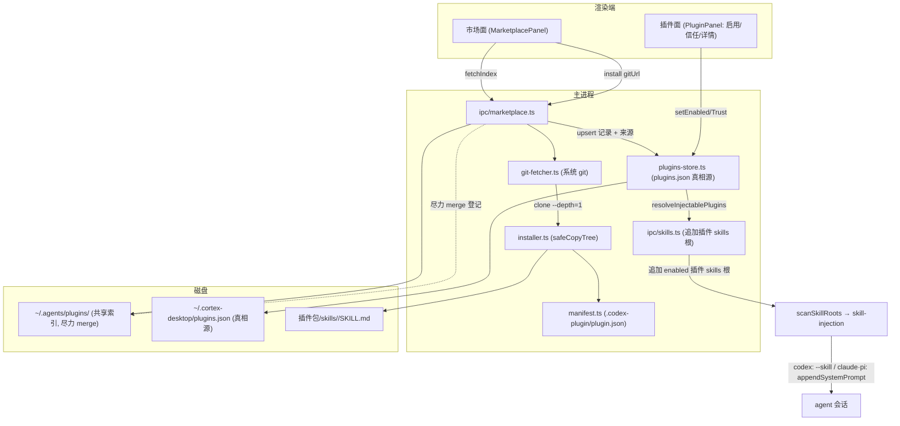
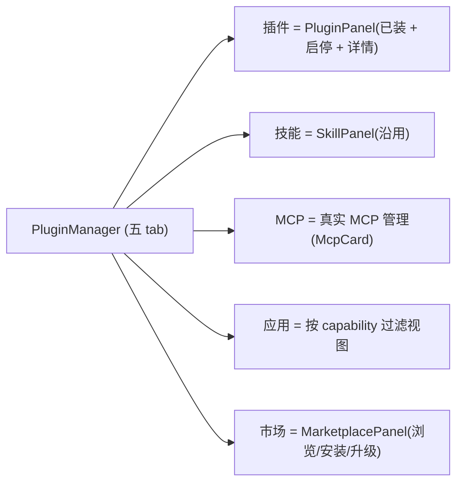

# feat: 统一插件市场 — 采用 Claude Code 插件市场标准

## Summary

cortex 采用 Claude Code 插件市场标准(Codex/Claude/Cursor 共享)作为统一扩展模型:主进程用**系统 git** 从 git URL 安装插件包到共享标准目录 `~/.agents/plugins/`(与 Codex 互通),解析 `.codex-plugin/plugin.json` manifest,经现有 skill 扫描 + 跨 agent 注入让 codex 原生、claude/pi 尽力复用;UI 重构为「插件/应用/MCP/技能/市场」五面,一键启用、信任门、浏览/安装/升级。复用 M3-B 的 installer/store/manifest 与本仓库刚建的 `skill-injection.ts`,新增 git-fetcher + marketplace IPC + 五面 UI。

---

## Problem Frame

见 origin(`docs/brainstorms/2026-06-22-unified-plugin-marketplace-requirements.md`)。要点:市面已有通用插件市场规范(Claude Code `.claude-plugin/marketplace.json` + 插件包,Codex/Cursor 共消费),继续自造格式 = 重复发明轮子。本计划落地「采用规范、共享生态、不发明轮子」,取代上一轮自造的两 tab IA;其跨 agent 注入核心(`skill-injection.ts`)保留复用。

**前置依赖现状**(研究确认):
- `packages/core/personal/skill-injection.ts` 与五面 UI 的两 tab 前身,在分支 `feat/consolidate-agent-extension-surfaces`(上一轮收敛,已实现未合并)。本计划建于该分支之上:复用注入核心,把两 tab 重构为五面。
- M3-B 的 `apps/desktop/src/main/plugins/{installer,plugins-store,manifest}.ts` 与 `ipc/plugins.ts` 在分支 `feat/agent-cli-m3-integration`(未合并)。本计划把这些**港/复用**进来(installer/store 近乎照搬,manifest 扩展读 Codex 格式),不带入 M3-B 的自造 `cortex-plugin.json` / `plugins.json` 对外格式语义。

---

## Requirements

承接 origin R1–R15。分组:

### 规范采用与互通
- R1. 解析 Claude Code 插件 manifest(`.codex-plugin/plugin.json` 优先,回退 `.claude-plugin/plugin.json`,再回退 `SKILL.md`),读 name/version/description/category/capabilities/skills/defaultPrompt。
- R2. 插件落盘共享标准目录 `~/.agents/plugins/`,与 Codex/Claude/Cursor 互通;cortex 安装登记进共享索引(尽力 merge,见 KTD4 并发策略)。
- R3. 复用现有 SKILL.md 解析(`apps/desktop/src/main/skills/`):插件包 `skills/<name>/SKILL.md` 结构与现有 skill 一致,直接服用。

### 市场生命周期
- R4. 浏览:从 marketplace.json(git 仓库注册表 / 已订阅)列出可用插件 + 元数据。
- R5. 安装:经 git URL,系统 git clone → 落盘(安全约束)→ 记安装来源(gitUrl + revision)。
- R6. 升级:据安装来源 git fetch/checkout 新 revision,比较 SHA 后更新。
- R7. 一键启用/禁用(cortex 本地 opt-in 启用集)。

### 呈现(五面)
- R8. 五面:插件(已装 + 启停)、技能、MCP(独立通道,占位改真实)、应用(按能力元数据过滤的视图)、市场(浏览/安装/升级)。
- R9. 插件详情页:富元数据(displayName/描述/开发者/类别/版本/能力/defaultPrompt/隐私·条款链接)+「在对话中试用」入口。

### 跨 agent
- R10. 已启用插件对 codex 会话原生完整生效。
- R11. claude/pi 复用插件可移植部分:`skills/` 经现有跨 agent 注入(`skill-injection.ts`),MCP 经 MCP 通道;codex 专属 runtime 能力不可用且 UI 标注。
- R12. 跨 agent 注入沿用现有启用/信任 gate(`disabledSkills` / `trustedWorkspaceSkillDirs` / `useOwnSkills` 短路),不绕过安全边界。

### 信任与安全
- R13. git 安装的三方插件**默认未授信、未启用**,需用户显式启用;信任门落在「启用」时刻(对齐 pi 扩展市场 spike 结论)。
- R14. 落盘遵守安全约束:拒符号链接、拒 `..` 穿越、≤50MiB(复用 M3-B `safeCopyTree`)。
- R15. cortex 内置几个默认插件,首启即可用。

---

## Key Technical Decisions

- KTD1 — 采用 Claude Code 插件规范,manifest 走 `.codex-plugin/plugin.json` 优先链。`parsePluginFolder` 扩展:优先 `.codex-plugin/plugin.json`(字段最全:`skills`/`interface{category,capabilities,defaultPrompt,displayName}`),回退 `.claude-plugin/plugin.json`,再回退 `SKILL.md` frontmatter(向后兼容第一方 skill)。不带入 M3-B 自造的 `cortex-plugin.json` 对外语义。

- KTD2 — git 用**系统 git**(`child_process.execFile`),不引 npm git 库。理由:避开 electron-builder/asar 对 node_modules 的打包坑(系统 git 是原生二进制,不走 asar);参考 `apps/desktop/src/main/ipc/fs.ts` 的 `runGit` 封装。`git clone --depth=1` 安装、`git fetch` + `checkout <revision>` 升级;`ENOENT` → 提示装 git(对齐 agent CLI detect)。

- KTD3 — 复用 M3-B 的 installer/store,扩展溯源字段。`safeCopyTree` + `installLocalFolder` 框架直接复用(安装语境改为「clone 临时目录 → installLocalFolder」);`plugins-store.ts`(原子写、启用集、信任门、`resolveInjectablePlugins`)近乎照搬;`InstalledPluginRecord.source` 加 `"marketplace"` + 可选 `marketplaceRef{gitUrl,revision}` 供升级溯源,store 逻辑不改。

- KTD4 — 共享索引并发:cortex 自有索引为真相源 + 尽力 merge 进共享索引(解阻塞项)。cortex 的安装/启用状态以自有 `~/.cortex-desktop/plugins.json` 为唯一真相源(原子写,完全受控);对共享 `~/.agents/plugins/marketplace.json` 仅做**尽力的读-改-写 merge 登记**(原子写 + 失败不阻断安装)。这把 cortex 状态与 codex 写竞争解耦,既互通又不依赖外部写锁。codex 写法(追加 vs 全量重写)在实现期 spike 验证以定 merge 细节(见 Open Questions)。

- KTD5 — 插件 skill 注入复用现有链,主进程自动追加根。已装+已启用插件的 `<安装路径>/skills/` 子目录,由主进程在 `pi-skills:list` handler 据 `resolveInjectablePlugins()` 自动追加为扫描根(渲染端无需感知插件态)→ 流入现有 `scanSkillRoots` → `resolveEnabledSkillRecords`/`skill-injection.ts`:codex 走 skillPaths(`--skill`)、claude/pi 走 `renderSkillBlock` 并入 `appendSystemPrompt`(沿用上一轮收敛的两路互斥 + 清洗 + 信任 gate)。

- KTD6 — 信任门在启用时刻,默认未授信未启用(R13)。安装只落盘入库;首次代码/指令执行在「启用 → 注入」时刻(pi spike 实测)。UI 是启用集唯一真相源,共享 marketplace.json 只是库存。

- KTD7 — MCP 面独立,不由插件喂入(规范 manifest 无 MCP 声明)。现有 `PluginManager.tsx` 的 `McpPlaceholder` 改为真实 MCP 管理(复用现有 `McpCard` + `mcp-config.ts` 注入),与插件安装解耦。

- KTD8 — 不新建 `packages/*` 共享包(沿用 M3-B KTD1)。能力几乎全在主进程;渲染端只需类型镜像 + IPC + 设置 UI。IPC 类型三处镜像(`ipc/types.ts` + `core/desktop/types.ts` + `preload/index.ts`)+ `bridge.ts` 可选方法。

---

## High-Level Technical Design

### 安装 / 升级 / 注入数据流



不变量:cortex 状态以 `plugins.json` 为真相源(KTD4);插件代码/指令首次生效在「启用 → 注入」(KTD6);跨 agent 注入过同一信任 gate(R12)。

### 五面信息架构(取代两 tab)



---

## Output Structure

```text
apps/desktop/src/main/plugins/
  installer.ts        # 港自 M3-B:safeCopyTree / installLocalFolder / pluginsRoot
  plugins-store.ts    # 港自 M3-B:plugins.json 真相源 / 启用集 / 信任门
  manifest.ts         # 港 + 扩展:读 .codex-plugin/plugin.json
  git-fetcher.ts      # 新:系统 git clone/upgrade 封装
apps/desktop/src/main/ipc/
  marketplace.ts      # 新:fetchIndex/install/upgrade/listCached + 共享索引 merge
  skills.ts           # 改:pi-skills:list 追加 enabled 插件 skills 根
  register.ts         # 改:registerMarketplaceHandlers()
  types.ts            # 改:市场/插件类型 + InstalledPluginRecord 扩展
packages/core/desktop/
  types.ts            # 改:镜像市场/插件类型
  bridge.ts           # 改:市场可选方法
apps/desktop/src/preload/
  index.ts            # 改:market IPC 绑定
packages/views/cortex-desktop/personal/
  PluginManager.tsx   # 改:两 tab → 五 tab
  MarketplacePanel.tsx # 新:市场浏览/安装/升级
  PluginPanel.tsx     # 新:已装插件 + 启用/信任 + 详情页
apps/desktop/resources/plugins/   # 新:内置默认插件(R15)
```

---

## Implementation Units

> 阶段 A(U1–U7)= 后端管线;阶段 B(U8)= 五面 UI;阶段 C(U9)= 默认插件。建于分支 `feat/consolidate-agent-extension-surfaces`(含 `skill-injection.ts`)。

### U1. 类型契约:市场/插件类型三处镜像 + 溯源字段

- Goal:定义市场与插件类型,三处镜像;`InstalledPluginRecord` 加市场来源与溯源。
- Requirements:R1, R5, R6
- Dependencies:无
- Files:`apps/desktop/src/main/ipc/types.ts`、`packages/core/desktop/types.ts`、`packages/core/desktop/bridge.ts`、`apps/desktop/src/preload/index.ts`
- Approach:新增 `MarketplaceIndex`/`MarketplacePlugin`(name/description/source/category/version/author/homepage)、`PluginManifest`(id/name/version/description/skills/interface{category,capabilities,defaultPrompt,displayName})、`MarketplaceInstallResult`;`InstalledPluginRecord.source: "local" | "marketplace"` + 可选 `marketplaceRef{gitUrl,revision}`。`bridge.ts` 加可选方法(`marketplaceFetchIndex?`/`marketplaceInstall?`/`marketplaceUpgrade?`/`pluginList?`/`pluginSetEnabled?`/`pluginSetTrust?`/`pluginUninstall?`);preload 绑定。
- Patterns:M3-B `InstalledPluginRecord`;三处镜像约定(CLAUDE.md / M3-B KTD1)。
- Test scenarios:`Test expectation: none` —— 纯类型/契约;由下游单元的编译 + 单测间接验证(desktop typecheck 必须过)。
- Verification:`pnpm --filter @cortex-work/desktop typecheck`(node+web)通过;三处类型一致。

### U2. plugins-store 港入(本地启用/信任真相源)

- Goal:把 M3-B 的 `plugins-store.ts` 港入,作为 cortex 自有 `plugins.json` 真相源(KTD4)。
- Requirements:R7, R13
- Dependencies:U1
- Files:`apps/desktop/src/main/plugins/plugins-store.ts`、`apps/desktop/src/main/plugins/plugins-store.test.ts`
- Approach:从 `feat/agent-cli-m3-integration` 港 `plugins-store.ts`(`pluginsStorePath` → `~/.cortex-desktop/plugins.json`、`readPluginSettings`(降级 + 悬空 id 过滤)、原子写、`upsertInstalled`/`removeInstalled`/`setEnabled`、`resolveInjectablePlugins` = `enabled.has(id) && trust!=="restricted"`)。近乎照搬,仅适配 U1 的 `source`/`marketplaceRef` 字段。
- Patterns:M3-B `plugins-store.ts`;团队原子写(tmp + rename)惯例。
- Test scenarios:
  - 读不存在/非法 JSON → 降级空配置,不抛。
  - `upsertInstalled` 同 id 替换、异 id 追加。
  - `setEnabled` 未安装 id 不可启用;`enabled` 集维护正确。
  - `resolveInjectablePlugins` 仅返回 `enabled ∩ trust!=="restricted"`。
  - 原子写:tmp + rename,写中途失败不破坏旧文件。
- Verification:`pnpm --filter @cortex-work/desktop test` 相关单测通过。

### U3. manifest 解析:读 Codex `.codex-plugin/plugin.json`

- Goal:`parsePluginFolder` 读 Claude Code 插件 manifest,映射到 `PluginManifest`,带回退链。
- Requirements:R1, R3
- Dependencies:U1
- Files:`apps/desktop/src/main/plugins/manifest.ts`、`apps/desktop/src/main/plugins/manifest.test.ts`
- Approach:港 M3-B `manifest.ts` 并扩展:优先探测 `.codex-plugin/plugin.json`(读 name/version/description/skills/interface 字段),回退 `.claude-plugin/plugin.json`,再回退现有 `SKILL.md` frontmatter。`skills` 指向 `./skills/`(下层各子目录含 SKILL.md);`agents/` 记录但 v1 不消费。
- Patterns:M3-B `parsePluginFolder` + `readSidecar`;现有 `skills/frontmatter.ts`。
- Test scenarios:
  - 含 `.codex-plugin/plugin.json` → 正确映射 name/version/category/capabilities/defaultPrompt。
  - 无 `.codex-plugin/` 有 `.claude-plugin/plugin.json` → 回退解析(精简字段)。
  - 二者皆无、有 `SKILL.md` → 回退 frontmatter(第一方兼容)。
  - manifest JSON 非法 → 容错降级,不抛。
  - `interface.capabilities` 缺省 → 空数组/默认。
- Verification:相关单测通过。

### U4. installer 港入:安全落盘(safeCopyTree)

- Goal:港 M3-B `installer.ts`,提供安全落盘到 `~/.agents/plugins/`(改 root)。
- Requirements:R5, R14
- Dependencies:U1, U3
- Files:`apps/desktop/src/main/plugins/installer.ts`、`apps/desktop/src/main/plugins/installer.test.ts`
- Approach:港 `safeCopyTree`(拒符号链接 / 拒 `..`·分隔符目录名 / 累计 ≤50MiB 中止)、`installLocalFolder`(stat 验源 → parse 取 id → dest = `root/<id>` → 覆盖先 rm → safeCopyTree → 重解析 dest)。`pluginsRoot()` 改指向**共享标准目录**(`~/.agents/plugins/plugins/<id>` 或与 Codex 对齐的落点,实现期据 KTD4 spike 定);失败清半成品。
- Patterns:M3-B `installer.ts`。
- Test scenarios:
  - 正常目录 → 拷贝成功,返回记录。
  - 含符号链接 → 拒绝/中止。
  - 含 `..` 或路径分隔符的子目录名 → 拒绝。
  - 超 50MiB → 中止并清半成品。
  - 覆盖安装 → 先删旧再拷,不残留。
- Verification:相关单测通过。

### U5. git-fetcher:系统 git clone / upgrade

- Goal:封装系统 git 的 clone(安装)与 fetch+checkout(升级)。
- Requirements:R5, R6
- Dependencies:无(独立,可并行)
- Files:`apps/desktop/src/main/plugins/git-fetcher.ts`、`apps/desktop/src/main/plugins/git-fetcher.test.ts`
- Approach:`cloneOrUpdate(gitUrl, revision, destDir)` 用 `child_process.execFile("git", ...)`:首装 `clone --depth=1`(必要时 `fetch` 指定 revision);升级 `fetch` + `checkout <revision>` + 比较 HEAD/revision。30s 超时 + `AbortController` 取消。`ENOENT` → 抛「git 未安装」可识别错误(对齐 agent CLI detect)。参考 `apps/desktop/src/main/ipc/fs.ts` 的 `runGit`、`ipc/pi-extensions-market.ts` 的 spawn-收全量模式。
- Patterns:`runGit`(fs.ts);`PiRunResult`(pi-extensions-market.ts)。
- Test scenarios:
  - 成功 clone 到 destDir(可用本地 fixture 仓库或 mock execFile)。
  - revision 指定 → checkout 到该 SHA。
  - 升级:远端无新 revision → 报「已最新」;有则更新。
  - git 缺失(execFile ENOENT)→ 抛可识别「需安装 git」错误。
  - 超时 → AbortController 取消,清半成品。
- Execution note:execFile 可注入/mock,优先对 cloneOrUpdate 写可控单测(不依赖真实网络)。
- Verification:相关单测通过。

### U6. marketplace IPC:fetchIndex / install / upgrade + 共享索引 merge

- Goal:市场 IPC,串起 git-fetcher → installer → store,并尽力登记共享索引。
- Requirements:R2, R4, R5, R6, R13
- Dependencies:U1, U2, U3, U4, U5
- Files:`apps/desktop/src/main/ipc/marketplace.ts`、`apps/desktop/src/main/ipc/register.ts`、`apps/desktop/src/main/ipc/marketplace.test.ts`
- Approach:`registerMarketplaceHandlers()`:
  - `marketplace:fetchIndex` → Node `fetch()` 读 marketplace.json(远程/已订阅),解析 `plugins[]`。
  - `marketplace:install`({gitUrl, revision?}) → git-fetcher cloneOrUpdate → installLocalFolder → upsertInstalled(source="marketplace", marketplaceRef)→ **默认 enabled=false / trust 未授信**(R13)→ 尽力 merge 登记共享 `~/.agents/plugins/marketplace.json`(原子写,失败不阻断)。
  - `marketplace:upgrade`(id) → 读 marketplaceRef → git fetch/checkout 新 revision → 重 installLocalFolder → 更新记录 revision。
  - `marketplace:listCached` → 读共享/缓存状态。
  - 在 `register.ts` 加 `registerMarketplaceHandlers()`。
- Patterns:M3-B `ipc/plugins.ts` handler 形状;`register.ts` 注册模式;原子写。
- Test scenarios:
  - install:clone→落盘→记录 source/marketplaceRef→默认未启用未授信。Covers R13。
  - install:共享索引 merge 失败 → 安装仍成功(不阻断)。
  - upgrade:有新 revision → 更新记录;无 → 报已最新。
  - fetchIndex:解析 marketplace.json 的 plugins[](顶层与包内两种 schema)。
  - git 缺失 → install 返回可识别错误,不留半成品。
- Verification:相关单测通过;`registerMarketplaceHandlers` 已注册。

### U7. 插件 skill 跨 agent 注入接线

- Goal:已启用插件的 `skills/` 自动并入注入链,codex 原生 / claude·pi 尽力,过同一信任 gate。
- Requirements:R3, R10, R11, R12
- Dependencies:U2, U6(依赖 `resolveInjectablePlugins`)
- Files:`apps/desktop/src/main/ipc/skills.ts`、`apps/desktop/src/main/skills/locate.ts`、相关 `.test.ts`
- Approach:在 `pi-skills:list` handler(主进程已知安装态)据 `resolveInjectablePlugins()` 把每个 enabled∩trusted 插件的 `<安装路径>/skills/` 追加为扫描根(scope 标注,使其经现有 `disabledSkills`/`trustedWorkspaceSkillDirs`/`useOwnSkills` gate)→ 经现有 `scanSkillRoots` → 渲染端 `resolveEnabledSkillRecords`/`skill-injection.ts`:codex skillPaths(`--skill`)、claude/pi `renderSkillBlock` 并入 `appendSystemPrompt`(两路互斥、name/description 清洗、信任 gate,沿用 `feat/consolidate-agent-extension-surfaces` 的 U1/U2 成果)。
- Patterns:`skills/registry.ts` `scanSkillRoots`、`locate.ts` `pluginSkillRoots`;`packages/core/personal/skill-injection.ts`(收敛分支)。
- Test scenarios:
  - enabled 插件的 skills 子目录被扫描根纳入;disabled 插件不纳入。Covers R12。
  - 未授信(trust=restricted)插件 skill 不注入。Covers R12, R13。
  - codex 会话:插件 skill 经 skillPaths 注入。Covers R10。
  - claude/pi 会话:插件 skill 经 appendSystemPrompt 渲染块注入。Covers R11。
  - `useOwnSkills===false` → 插件 skill 也不注入。Covers R12。
- Verification:相关单测通过;切 agent 注入随之变化。

### U8. 五面 UI 重构:插件/应用/MCP/技能/市场

- Goal:`PluginManager` 从两 tab 重构为五面;新增市场与插件面 + 详情页。
- Requirements:R4, R6, R7, R8, R9, R13
- Dependencies:U6, U7
- Files:`packages/views/cortex-desktop/personal/PluginManager.tsx`、`MarketplacePanel.tsx`(新)、`PluginPanel.tsx`(新)、对应 `.test.tsx`
- Approach:`Tab` 扩展为 `plugin | app | mcp | skill | marketplace`。**插件面**(PluginPanel):列已装插件 + 启用/禁用开关 + 信任操作 + 进入详情;**详情页**展示 R9 富元数据 +「在对话中试用」(注入该插件后发 defaultPrompt);**市场面**(MarketplacePanel):粘贴 git URL / 浏览 marketplace.json 列表 → 安装(默认未启用未授信,提示 R13)→ 升级入口;**MCP 面**:占位改真实(复用 `McpCard`,KTD7);**应用面**:按插件 `capabilities`/`category` 过滤的视图。拆为独立文件避免 `PluginManager.tsx` 超 1200 行。文案硬编码 zh(沿用既有约定)。
- Patterns:现有 `PluginManager.tsx` tab 容器、`SkillPanel`/`ExtensionPanel`、`McpCard`;Codex 详情页布局(origin 截图)。
- Test scenarios:
  - 五个 tab 渲染;切换正确。Covers R8。
  - 市场面粘贴 git URL → 调 `marketplaceInstall` bridge;安装后插件出现在插件面、默认未启用。Covers R4, R5, R13。
  - 插件面切启用开关 → 调 `pluginSetEnabled`;未授信插件需先授信。Covers R7, R13。
  - 详情页渲染元数据 + defaultPrompt 试用入口。Covers R9。
  - 升级入口对有 marketplaceRef 的插件可见 → 调 `marketplaceUpgrade`。Covers R6。
  - 应用面按 capability 过滤出子集。Covers R8。
- Verification:`pnpm --filter @cortex-work/views test` 相关测试通过;typecheck 过。

### U9. 内置默认插件

- Goal:打包几个默认插件,首启可用(R15)。
- Requirements:R15
- Dependencies:U2, U3, U6
- Files:`apps/desktop/resources/plugins/`(新)、首启注册逻辑落点(`apps/desktop/src/main/plugins/` 或 app 初始化)、相关 `.test.ts`
- Approach:在 `resources/plugins/` 放几个符合规范的插件包(具体清单见 Open Questions);首启时把它们登记为已安装(source 标 bundled / trust=bundled),默认启用与否待定(倾向默认启用少量无害 skill 型)。electron-builder `extraResources` 打包;路径解析对齐既有 bun 二进制/资源做法。
- Patterns:`apps/desktop/scripts/build-pi-binary.mjs` 资源打包;M3-B trust tier。
- Test scenarios:
  - 首启 → 默认插件出现在已装列表,trust=bundled。Covers R15。
  - 默认插件的 skill 可被注入(若默认启用)。
  - 重复首启不重复登记。
- Verification:相关单测通过;打包后默认插件资源就位(仓库外验证)。

---

## Scope Boundaries

### 暂缓(后续可做)
- 插件**创作/发布**作者端工具链(cortex v1 只做消费方)。
- cortex 自有远端策展市场注册表(复用既有 git 生态,不自建后端)。
- 让 codex-runtime 专属能力(Computer Use 等)在 claude/pi 工作(明确「尽力而为」)。
- 插件内 `agents/`(sub-agent 定义)的消费(v1 仅记录不消费)。

### 不属于本产品身份
- 自造 cortex 私有插件格式(已被「采用共享标准」取代;M3-B 的 `cortex-plugin.json`/`plugins.json` 对外语义不带入)。
- 上一轮两 tab 自造 IA / od 预设 UI(让位于五面 + 市场;跨 agent 注入核心保留)。

### Deferred to Follow-Up Work
- 与 `feat/consolidate-agent-extension-surfaces`、`feat/agent-cli-m3-integration` 的合并次序整理(见 Open Questions);本计划在合并基线上实现。

---

## Risks & Dependencies

- RISK-1 — 共享目录与 codex 并发写。**缓解**:KTD4 以自有 `plugins.json` 为真相源,共享索引仅尽力 merge(原子写、失败不阻断);实现期 spike codex 写法定 merge 细节。
- RISK-2 — 信任 / prompt-injection。git 三方插件 = 外部指令/代码。**缓解**:R13 默认未授信未启用、信任门在启用时刻;R12 跨 agent 注入过同一 gate;manifest `name`/`description` 进 system prompt 前清洗(沿用收敛 U1 RISK-5)。
- RISK-3 — 打包态 git/资源。**缓解**:KTD2 用系统 git(原生二进制不走 asar);默认插件资源走 `extraResources`,验证必须仓库外(复制到 /tmp 跑,见 docs/lessons.md)。
- RISK-4 — 前置分支未合并。`skill-injection.ts`(收敛分支)与 M3-B installer/store/manifest(集成分支)均未合并。**缓解**:本计划建于收敛分支并港入 M3-B 文件;合并次序见 Open Questions。
- 依赖 — 系统 `git` 存在(缺失则 install/upgrade 降级报错)。

---

## Open Questions

### Resolve Before Planning(实现首步 spike)
- 共享索引 `~/.agents/plugins/marketplace.json` 的 codex 写行为:**追加写还是全量重写?** 决定 KTD4 的 merge 是「读-改-写 + 原子 rename 足够」还是需文件锁。实现第一步用一次小 spike(装一个插件经 codex、观察文件 diff)确认;在确认前,install 的共享 merge 走「读-改-写 + 原子写 + 失败不阻断」保守实现。

### Deferred to Planning/实现
- 默认内置哪几个插件(R15 清单)及是否默认启用。
- 升级检查触发时机(手动 / 启动 / 后台)。
- 「应用」面的确切过滤规则(用哪些 capability/category)。
- `pluginsRoot()` 的确切落点(与 Codex 完全同位 vs cortex 子目录)——据共享并发 spike 定。
- 前置分支合并次序:先合 `feat/consolidate-agent-extension-surfaces`(带 skill-injection)再起本计划分支,还是本计划分支从收敛分支拉出并港入 M3-B 文件。

---

## Sources / Research

- origin 需求:`docs/brainstorms/2026-06-22-unified-plugin-marketplace-requirements.md`(决策、R1–R15、共享目录格式 scout 结论)。
- 可复用代码(集成分支 `feat/agent-cli-m3-integration`):`apps/desktop/src/main/plugins/installer.ts`(`safeCopyTree`/`installLocalFolder`/`pluginsRoot`)、`plugins-store.ts`(原子写/启用集/信任门/`resolveInjectablePlugins`)、`manifest.ts`(`parsePluginFolder`/`readSidecar`)、`ipc/plugins.ts`(IPC 骨架)。
- 现有接入点(master):`apps/desktop/src/main/skills/{registry,locate,frontmatter}.ts`(`scanSkillRoots`/`pluginSkillRoots`,可直接扫插件 `skills/`)、`apps/desktop/src/main/ipc/{fs,cli,mcp-config,skills,register,types}.ts`、`apps/desktop/src/main/ipc/pi-extensions-market.ts`(spawn-收全量模式)。
- git 现实路径:`apps/desktop/package.json` 无 git 库;`ipc/fs.ts` 有 `runGit`(execFile 系统 git)。→ 系统 git,不引依赖(打包教训 `docs/lessons.md`)。
- 跨 agent 注入复用:`packages/core/personal/skill-injection.ts` 与两路互斥/清洗/信任 gate(分支 `feat/consolidate-agent-extension-surfaces`,本会话已实现:`docs/plans/2026-06-21-009-feat-consolidate-agent-extension-surfaces-plan.md`)。
- 信任模型既往结论:`docs/brainstorms/2026-06-17-pi-install-extension-runtime-requirements.md`(装≠启用、信任门在启用、`-a` 会话级);`docs/plans/2026-06-17-003-feat-pi-skill-plugin-manager-plan.md`(工作区 skill 默认禁用 P0)。
- IPC 三处镜像 + 不新建共享包:`docs/plans/2026-06-21-007-feat-agent-cli-m3-plugin-framework-plan.md`(KTD1)、`CLAUDE.md`。
