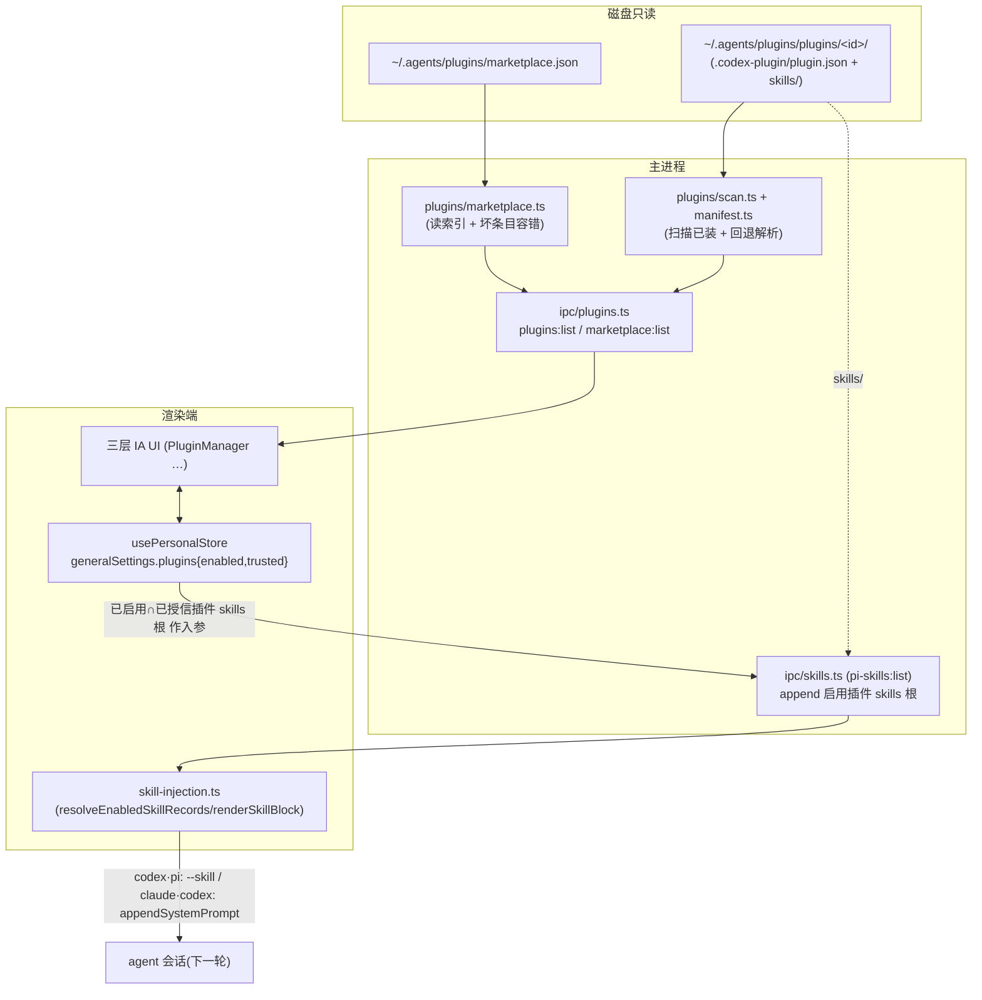
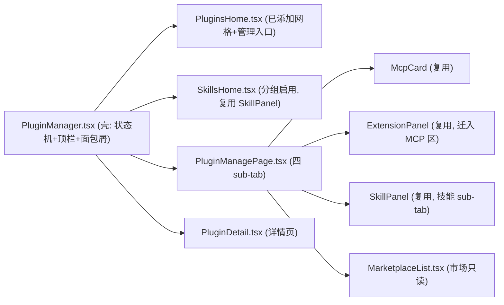

# feat: 插件模块三层 IA（Codex 风格）+ agents 标准只读消费与启停（第一期）

## Summary

把 cortex 的「agent 能力扩展」模块从已落地的「技能 / 插件两 tab」升级为 Codex 风格三层信息架构（设计稿 `Plugins.dc.html`）：顶栏 **插件 / 技能** 两大类首页 → **管理页**四 sub-tab（插件 / MCP / 技能 / 市场）→ **插件详情页**。后端引入新实体「**plugin = agents 标准捆绑包**（含 skills，未来含 mcp / apps）」，数据源采纳本机已存的 agents 共享标准 `~/.agents/plugins/`（与 codex 互通），**本期纯只读消费**：扫描已装插件 + 读 `marketplace.json` 索引，渲染端叠加 opt-in 启停态，已启用插件的 `skills/` 复用本仓已建的跨 agent 注入链（`skill-injection.ts`）生效。**git 安装 / 升级 / 删除、默认内置插件、「应用」面**本期不做，明确为后续阶段（见 `supersedes` 指向的 unified-plugin-marketplace 全量计划）。

本计划建于当前分支 `feat/consolidate-agent-extension-surfaces`（含 `skill-injection.ts` 与两 tab PluginManager），取代其两 tab IA，复用其注入核心。

---

## Problem Frame

cortex 现有「插件」只是 UI 把 MCP + pi 扩展归类的两 tab（`PluginManager.tsx`），**后端无 plugin 实体**（全仓无 `marketplace` / `.agents/plugins` 引用）。但本机已存在一套真实的 agents 标准插件系统——`~/.agents/plugins/marketplace.json`（1.6KB 索引）+ `plugins/<id>/` 已装包，且 `~/.codex/plugins/` 有 appserver/cache——这是 codex/Claude Code/Cursor 共享、磁盘上已就绪的标准。Codex 对「plugin」的定义是**捆绑包**（skills + apps + mcp，经 marketplace 分发），与 cortex 现有的「插件 = MCP+pi扩展」归类是两个不同模型。

存在一份全量计划 `docs/plans/2026-06-22-001-feat-unified-plugin-marketplace-plan.md`（采用同一 agents/Claude Code 标准，但 IA 为扁平五面、范围含 git 安装/升级/默认插件）。本计划**重定方向**：以设计稿 `Plugins.dc.html` 的三层嵌套 IA 取代其扁平五面，并把范围收敛为**第一期「只读 + 启停」**——先把「读懂已装插件、按 Codex 心智呈现、能在 cortex 里启停并跨 agent 生效」这条最小可用闭环落稳，把写盘类高风险动作（git 安装、共享索引并发 merge、升级、删除）整体推迟。

本期的核心简化：**纯消费方、绝不写 `~/.agents/plugins/`**，从根本上规避全量计划 RISK-1（与 codex 并发写共享目录）。

---

## Requirements

> 承接 origin（`2026-06-22-unified-plugin-marketplace-requirements.md`，R1–R15）并按「只读 + 启停 + 三层 IA」重定范围。本计划需求重新编号。

### 规范采用与只读读取

- R1. 扫描 agents 标准已装插件：枚举 `~/.agents/plugins/plugins/<id>/`，解析 manifest，回退链 `.codex-plugin/plugin.json` 优先 → `.claude-plugin/plugin.json` → `SKILL.md` frontmatter；读 name / version / description / category / capabilities / defaultPrompt / displayName + `skills` 引用。
- R2. 读取 `~/.agents/plugins/marketplace.json` 索引，列出条目（异构 schema：`source{source,path}` 本地 / `gitUrl` 远端 / 仅 id+name）；对坏条目（缺 `source` 等）**容错不崩**，并标记为可呈现的错误项（对齐设计稿「部分插件市场无法加载」错误卡）。
- R3. 复用现有 SKILL.md 解析（`apps/desktop/src/main/skills/{frontmatter,registry}.ts`）：插件包 `skills/<name>/SKILL.md` 与 cortex 现有 skill 同构，直接服用、无需转换。
- R4. 纯只读消费：本期**不写** `~/.agents/plugins/`（不安装、不 merge 索引、不删除），共享目录仅作只读真相源。

### 启停与跨 agent 生效

- R5. 一键启用 / 禁用已装插件：cortex 本地 opt-in 启停集，叠加在共享只读库存之上，不写回共享标准语义。
- R6. 已启用插件的 `skills/` 经本仓既有跨 agent 注入链生效：codex / pi 走 `--skill`（skillPaths），claude/codex 经 `renderSkillBlock` 并入 `appendSystemPrompt`；过同一 `disabledSkills` / `useOwnSkills` gate，沿用两路互斥与 name/description 清洗。
- R7. 启停态变更下一轮会话生效（不在当前轮即时注入），与现有 skill 启停时序一致。

### 呈现（三层 IA，取代两 tab）

- R8. 顶栏两大类首页：**插件** / **技能**（设计稿 `showTopNav`，含 `+` 占位）。
- R9. 插件首页：「已添加」已装插件网格 + 「管理」入口（Featured / 分类区本期以已装为主或留占位，因无市场安装）。
- R10. 技能首页：按来源（个人 / 工作区名）分组的 skill 列表 + 勾选启用（复用 SkillPanel 数据与启停逻辑）。
- R11. 管理页四 sub-tab：**插件 / MCP / 技能 / 市场**，各带实时计数；标准列表行（图标 / 名 / 描述 / 来源 / 齿轮 / 开关）。
- R12. pi 原生扩展并入 **MCP sub-tab 同级**：管理页无独立扩展 tab；ExtensionPanel 内容迁入 MCP sub-tab 作「pi 原生扩展（pi 专属）」区，与 McpCard 并列。
- R13. 市场 sub-tab 只读：列出 `marketplace.json` 条目 + 坏条目错误卡；安装 / 升级 / 删除入口本期**占位禁用**并标注「即将支持」，不误导。
- R14. 插件详情页：富元数据（名称 / 描述 / 开发者 / 类别 / 版本 / 能力 / 本地路径）+ 捆绑 `skills` chips + 启停开关 + 「在对话中试用」入口（启用插件 + 预填 `defaultPrompt`；自动发送可后续）。

### 收敛与边界

- R15. 三层 IA 取代现「技能 / 插件」两 tab：撤旧两 tab 容器、迁移其子组件、过时文案归位。
- R16. 「应用」本期不做：管理页无「应用」sub-tab；manifest 的 `capabilities` / `category` 先读取保留，供后续「应用」视图按能力过滤。

---

## Key Technical Decisions

- **KTD1 — 采纳 agents 标准、纯只读消费（本期）。** 数据源为本机 `~/.agents/plugins/`（`marketplace.json` + `plugins/<id>/` 已装包），与 codex 共享互通。本期只读：不 git 安装、不写共享索引、不升级 / 删除。这彻底规避全量计划的 RISK-1（与 codex 并发写）。安装 / 升级 / 删除是后续阶段，沿用 `supersedes` 指向的 unified-plugin-marketplace 计划的 git-fetcher / installer / plugins-store 设计，本计划不实现、仅引用。

- **KTD2 — manifest 回退链，只读子集。** `parsePluginManifest(dir)`：探测 `.codex-plugin/plugin.json`（字段最全：`skills`、`interface{displayName,category,capabilities,defaultPrompt}`）→ 回退 `.claude-plugin/plugin.json`（精简字段）→ 回退 `SKILL.md` frontmatter（第一方单 skill 兼容）。仅读取映射，不引 M3-B 的 installer / git-fetcher / safeCopyTree（写盘类，属后续阶段）。回退链与全量计划 U3 一致，便于后续阶段平滑接续。

- **KTD3 — 启停 / 信任态放渲染端 store，主进程保持只读。** 在 `usePersonalStore` 的 `generalSettings` 下新增 `plugins: { enabled: string[]; trusted: string[] }`（仿 `piExtensions` / `piSkills` 模式），setter 走 `setGeneralSettings`。主进程 `plugins:list` 只扫盘、**不读 store**（守 CLAUDE.md「main 不读 store」约定）。注入接线：渲染端把「已启用 ∩ 已授信插件的 `skills/` 根」作为额外扫描根，经扩展后的 `pi-skills:list` 入参传给主进程，主进程 append 进现有 `scanSkillRoots`。这样**零注入层改动**即复用整条 skill-injection 链。本期**不港 M3-B `plugins.json`**（无安装溯源需求）——安装溯源是后续阶段才需要的真相源。

- **KTD4 — 插件默认未启用、视为已授信。** 沿用团队「装 ≠ 启用」约定（启用集是注入唯一 gate，opt-in）；但已装插件落在用户本机的**全局共享目录**（`~/.agents/plugins/`），类比全局 skill（默认 trusted），故 `trusted` 本期对已装插件默认置真，启停由用户显式控制。工作区级 / git 三方装的「默认未授信」严格信任门留给后续阶段（届时引入来源分层）。

- **KTD5 — 三层 IA 拆多文件守 1200 行上限。** `PluginManager.tsx` 重构为「壳」（视图状态机 home/manage/detail + 顶栏 + 面包屑），子页拆独立文件：`PluginsHome.tsx` / `SkillsHome.tsx` / `PluginManagePage.tsx` / `PluginDetail.tsx` / `MarketplaceList.tsx`。复用现有 `SkillPanel` / `McpCard` / `ExtensionPanel`，不重写其内部逻辑。

- **KTD6 — pi 原生扩展并入 MCP sub-tab 同级。** ExtensionPanel 逻辑不改，迁到管理页 MCP sub-tab 作「pi 原生扩展（pi 专属）」区，与「MCP 工具」（McpCard）并列。设计稿管理 tab（插件 / MCP / 技能 / 市场）无独立扩展项；pi 扩展是 cortex 自生成的 pi 运行时胶水（非用户可装捆绑包），归位到 pi 专属工具区最自洽。

- **KTD7 — 市场 sub-tab 只读 + 错误卡。** 读 `marketplace.json` 列条目；坏条目以错误卡呈现（对齐设计稿）。安装 / 升级 / 删除按钮**占位禁用** + tooltip「即将支持」，从 UI 层就守住「本期不写盘」边界，避免用户点击触发未实现路径。

- **KTD8 — IPC 类型三处镜像 + bridge 可选方法。** 新增类型在 `apps/desktop/src/main/ipc/types.ts` ↔ `packages/core/desktop/types.ts` 逐字镜像，`preload/index.ts` 绑定 `plugins:list` / `marketplace:list`，`bridge.ts` 加可选方法（`pluginList?` / `marketplaceList?`）。沿用现有 `pi-skills:list` 的「渲染端把配置作为入参传入、主进程不读 store」范式。

---

## High-Level Technical Design

### 三层 IA 视图状态机（取代两 tab，KTD5）

```mermaid
stateDiagram-v2
  [*] --> Home
  state Home {
    [*] --> PluginsHome
    PluginsHome --> SkillsHome: 顶栏「技能」
    SkillsHome --> PluginsHome: 顶栏「插件」
  }
  Home --> Manage: 插件首页「管理」
  state Manage {
    [*] --> 插件
    插件 --> MCP
    MCP --> 技能
    技能 --> 市场
    note right of MCP: MCP 工具(McpCard) + pi 原生扩展(ExtensionPanel) 并列
    note right of 市场: 只读列表 + 错误卡; 安装/升级占位禁用
  }
  Home --> Detail: 点已装插件
  Manage --> Detail: 点列表行
  Detail --> Home: 面包屑返回
  Detail --> Manage: 面包屑返回
  Detail: 富元数据 + 捆绑 skills + 启停 + 在对话中试用
```



不变量：顶栏仅在 Home 显示（`showTopNav = view==='home'`）；详情页面包屑按来源回跳（manage / 插件首页 / 技能首页）；启停开关在任意层均写同一 store 启停集。

### 只读数据流 + 启用插件 skills 注入接线（KTD1 / KTD3）



不变量：主进程只扫盘、不读 store（KTD3）；启停集是注入唯一 gate（KTD4）；注入复用本仓 `skill-injection.ts` 两路互斥 + 清洗 + 信任 gate，零改动。

### 文件 / 组件映射



---

## Output Structure

```text
apps/desktop/src/main/plugins/            # 新目录(只读子集)
  manifest.ts        # parsePluginManifest: .codex-plugin → .claude-plugin → SKILL.md 回退链
  manifest.test.ts
  scan.ts            # scanInstalledPlugins: 枚举 ~/.agents/plugins/plugins/<id>/ + 解析
  scan.test.ts
  marketplace.ts     # readMarketplaceIndex: 读 marketplace.json + 坏条目容错
  marketplace.test.ts
  locate.ts          # agentsPluginsRoot()/installedPluginsRoot()/marketplaceIndexPath()
apps/desktop/src/main/ipc/
  plugins.ts         # 新: registerPluginHandlers() — plugins:list / marketplace:list (只读)
  plugins.test.ts
  register.ts        # 改: 注册 registerPluginHandlers()
  skills.ts          # 改: pi-skills:list 入参追加「启用插件 skills 根」
  types.ts           # 改: Plugin/Marketplace 只读类型(+ 与 core 镜像注释)
packages/core/desktop/
  types.ts           # 改: 镜像 Plugin/Marketplace 类型
  bridge.ts          # 改: pluginList? / marketplaceList? 可选方法
packages/core/store/
  personal.ts        # 改: generalSettings.plugins{enabled,trusted} + togglePlugin/trustPlugin
apps/desktop/src/preload/
  index.ts           # 改: plugins:list / marketplace:list 绑定
packages/core/personal/
  skill-injection.ts # 改(轻): resolveEnabledSkillRecords 接受额外插件 skills 根
  messages.ts        # 改(接线): 把启用插件 skills 根接入注入装配(不堆逻辑)
packages/views/cortex-desktop/personal/
  PluginManager.tsx  # 改: 两 tab → 三层壳
  PluginsHome.tsx    # 新
  SkillsHome.tsx     # 新
  PluginManagePage.tsx # 新
  PluginDetail.tsx   # 新
  MarketplaceList.tsx  # 新
  SettingsMenu.tsx   # 改: 挂载新 PluginManager(撤旧独立 McpCard 挂载, 若有)
```

---

## Implementation Units

> 阶段 A（U1–U4）= 后端只读数据层；阶段 B（U5–U6）= 启停态 + 跨 agent 注入；阶段 C（U7–U10）= 三层 IA UI。U1–U4 可先行并打通 typecheck，UI 单元建于其上。

### U1. 类型契约：plugin / marketplace 只读类型三处镜像

- **Goal**：定义本期只读所需的 plugin / marketplace 类型，三处镜像 + bridge 可选方法 + preload 绑定占位。
- **Requirements**：R1, R2, R14
- **Dependencies**：无
- **Files**：
  - `apps/desktop/src/main/ipc/types.ts`
  - `packages/core/desktop/types.ts`
  - `packages/core/desktop/bridge.ts`
  - `apps/desktop/src/preload/index.ts`
- **Approach**：新增——
  - `PluginManifest`：`{ id; name; displayName?; version?; description?; category?; capabilities?: string[]; defaultPrompt?; skillsRef?: string }`（`skillsRef` 指向 `./skills/`）。
  - `InstalledPlugin`：`{ manifest: PluginManifest; installPath; skillsDir?: string; manifestKind: "codex"|"claude"|"skill-fallback" }`。
  - `MarketplaceEntry`：`{ id?; name; description?; category?; version?; sourceKind: "local"|"git"|"unknown"; sourcePath?; gitUrl?; ok: boolean; error?: string }`（坏条目 `ok=false` + `error`，对齐设计稿错误卡）。
  - `PluginListResult` / `MarketplaceListResult`：`{ items: ...[]; rootExists: boolean }`。
  - `bridge.ts`：加可选 `pluginList?(): Promise<PluginListResult>`、`marketplaceList?(): Promise<MarketplaceListResult>`（可选 `?` 保证 web / 旧壳降级）。
  - `preload/index.ts`：`personal` 对象加 `pluginList: () => ipcRenderer.invoke("plugins:list")`、`marketplaceList: () => ipcRenderer.invoke("marketplace:list")`。
  - 两侧类型加「与 `packages/core/desktop/types.ts` 逐字镜像」注释。
- **Patterns to follow**：现有 `SkillMeta` / `PluginSkill` / `McpServerConfig` 的镜像约定；M3-B `InstalledPluginRecord`（仅借字段命名，不带入其写盘语义）；unified-plugin-marketplace U1 的类型形状（保持后续阶段可扩展 `source`/`marketplaceRef`）。
- **Test scenarios**：`Test expectation: none —— 纯类型 / 契约单元`。由下游单元编译 + `pnpm --filter @cortex-work/desktop typecheck`（node + web 两套）间接验证。
- **Verification**：typecheck 通过；三处类型一致；bridge 方法可选不破坏现有 Web 构建。

### U2. 已装插件扫描 + manifest 回退解析（主进程）

- **Goal**：扫描 `~/.agents/plugins/plugins/<id>/`，按回退链解析 manifest，定位 `skills/` 子目录。
- **Requirements**：R1, R3
- **Dependencies**：U1
- **Files**：
  - `apps/desktop/src/main/plugins/locate.ts`（`agentsPluginsRoot()` = `~/.agents/plugins`；`installedPluginsRoot()` = `<root>/plugins`；`marketplaceIndexPath()` = `<root>/marketplace.json`；`expandTilde` 复用 skills/locate 同款）
  - `apps/desktop/src/main/plugins/manifest.ts` + `manifest.test.ts`
  - `apps/desktop/src/main/plugins/scan.ts` + `scan.test.ts`
- **Approach**：
  - `parsePluginManifest(dir) => InstalledPlugin | null`：依次探测 `.codex-plugin/plugin.json` → `.claude-plugin/plugin.json` → `SKILL.md`；JSON 非法 → 容错降级（跳过该 manifest 源、继续回退），全失败返回 `null`。映射 `interface{displayName,category,capabilities,defaultPrompt}` 与 `skills`（`./skills/` → 拼 `skillsDir`，存在才置）。
  - `scanInstalledPlugins() => InstalledPlugin[]`：枚举 `installedPluginsRoot()` 一层子目录，逐个 `parsePluginManifest`；root 不存在 → 返回空 + `rootExists=false`，不抛。
  - **安全**：`skillsDir` 须经 resolve 校验在插件目录内（`isInside`），防 manifest 用 `../` 指向目录外（沿用 skills/ipc 的 `isInside` 白名单姿态）。
- **Patterns to follow**：`apps/desktop/src/main/skills/{locate,registry,frontmatter}.ts`（`expandTilde` / 浅扫一层 / `parseFrontmatter` 直接复用于 SKILL.md 回退）；M3-B `manifest.ts` 的 `parsePluginFolder` / `readSidecar` 回退形态。
- **Test scenarios**：
  - 含 `.codex-plugin/plugin.json` → 正确映射 id/name/displayName/version/category/capabilities/defaultPrompt + `skillsDir`。Covers R1。
  - 无 `.codex-plugin/`、有 `.claude-plugin/plugin.json` → 回退解析精简字段。
  - 二者皆无、有 `SKILL.md` → 回退 frontmatter（`manifestKind: "skill-fallback"`）。Covers R3。
  - manifest JSON 非法 → 容错降级到下一源 / 返回 null，不抛。
  - `skills` 指向 `../outside` → `skillsDir` 拒置（`isInside` 失败），插件其余元数据仍解析。
  - `installedPluginsRoot()` 不存在 → 空数组 + `rootExists=false`。
- **Verification**：`pnpm --filter @cortex-work/desktop test`（scan / manifest 单测）通过。

### U3. marketplace.json 只读解析（坏条目容错）

- **Goal**：读 `~/.agents/plugins/marketplace.json`，解析异构 `plugins[]`，坏条目可呈现错误。
- **Requirements**：R2, R4
- **Dependencies**：U1, U2（复用 locate）
- **Files**：`apps/desktop/src/main/plugins/marketplace.ts` + `marketplace.test.ts`
- **Approach**：`readMarketplaceIndex() => MarketplaceListResult`：读 `marketplaceIndexPath()`；JSON 非法 / 文件缺失 → 返回 `{ items: [], rootExists }` + 顶层 `error`（供 UI 错误卡）。逐条映射 `plugins[]`：识别 `source{source:"local",path}` → `sourceKind:"local"`；`gitUrl` → `"git"`；缺关键字段（如本机真实样本中 `cowart` 有 `source` 但 `plugin-x` 仅 `gitUrl`、个别缺 `source`）→ `ok:false` + `error:"missing field source"`（对齐设计稿错误文案）。**只读，绝不写回**（R4）。
- **Patterns to follow**：`apps/desktop/src/main/ipc/pi-extensions-market.ts` 的「读全量 → 解析 → 容错」模式；本机真实样本 `~/.agents/plugins/marketplace.json`（已 scout：混合 `source` / `gitUrl` / 裸 id schema）。
- **Test scenarios**：
  - 含 `source{source:"local",path}` 条目 → `sourceKind:"local"` + `sourcePath`。Covers R2。
  - 含 `gitUrl` 条目 → `sourceKind:"git"` + `gitUrl`。
  - 缺 `source` / 关键字段条目 → `ok:false` + `error`（错误卡数据）。Covers R2。
  - 文件缺失 → 空列表 + `rootExists=false`，不抛。
  - 整文件 JSON 非法 → 顶层 `error`，不抛。
  - 验证函数无任何写盘副作用。Covers R4。
- **Verification**：`pnpm --filter @cortex-work/desktop test` 通过；可对真实样本文件跑一遍快照确认不崩。

### U4. plugins / marketplace 只读 IPC 注册 + bridge 接线

- **Goal**：暴露 `plugins:list` / `marketplace:list` 两个只读 channel，串起 U2/U3。
- **Requirements**：R1, R2
- **Dependencies**：U1, U2, U3
- **Files**：
  - `apps/desktop/src/main/ipc/plugins.ts`（`registerPluginHandlers()`）+ `plugins.test.ts`
  - `apps/desktop/src/main/ipc/register.ts`（调用 `registerPluginHandlers()`）
- **Approach**：`ipcMain.handle("plugins:list", () => scanInstalledPlugins())`、`ipcMain.handle("marketplace:list", () => readMarketplaceIndex())`；在 `register.ts` 的 `registerIpcHandlers()` 内 import 并调用。channel 命名遵循 `<domain>:<action>`。注：当前 worktree 无 `main/plugins/` 与 `ipc/plugins.ts`（M3-B 的同名文件在未合并的集成分支，本计划不依赖）——本单元为 greenfield 新建，不与之冲突。
- **Patterns to follow**：`apps/desktop/src/main/ipc/skills.ts` 的 `registerSkillsHandlers()`；`register.ts` 的统一注册模式。
- **Test scenarios**：
  - `plugins:list` 返回扫描结果（mock fs / 临时目录）。Covers R1。
  - `marketplace:list` 返回索引解析结果。Covers R2。
  - root 不存在 → 返回空 + `rootExists=false`，handler 不抛。
- **Verification**：`pnpm --filter @cortex-work/desktop test` 通过；`registerPluginHandlers` 已在 `register.ts` 注册（grep 确认）。

### U5. plugin 启停 / 信任态持久化（渲染端 store）

- **Goal**：在 personal store 持久化插件启停 / 信任集，提供 setter。
- **Requirements**：R5
- **Dependencies**：U1
- **Files**：`packages/core/store/personal.ts` + 对应 `*.test.ts`
- **Approach**：`generalSettings` 下新增 `plugins: { enabled: string[]; trusted: string[] }`（默认 `{ enabled: [], trusted: [] }`）；setter `togglePlugin(id, on)` 写 `enabled`、`trustPlugin(id, on)` 写 `trusted`，均经 `setGeneralSettings` 持久化。**默认未启用、已装插件视为已授信**（KTD4）：UI 读取时若插件未在 `trusted` 集且属已装全局插件，视为 trusted（或初次扫描时把已装 id 注入 `trusted`，二选一在实现期定，倾向「读取时默认 trusted、仅记录显式撤信」以免 store 膨胀）。
- **Patterns to follow**：现有 `togglePiSkill` / `trustWorkspaceSkill`（`disabledSkills` / `trustedWorkspaceSkillDirs`）；`piExtensions` 的 `{ installed, enabled[], trusted[] }` 形态。
- **Test scenarios**：
  - `togglePlugin(id, true)` → `enabled` 含 id；`false` → 移除。Covers R5。
  - `trustPlugin` 同上维护 `trusted`。
  - 持久化往返（序列化 / 反序列化）保持集合。
  - 缺省 `plugins` 字段（旧持久化）→ 降级为空集合，不崩。
- **Verification**：`pnpm --filter @cortex-work/core test` 通过。

### U6. 已启用插件 skills 并入跨 agent 注入链

- **Goal**：已启用 ∩ 已授信插件的 `skills/` 作为额外扫描根注入，复用现有跨 agent 链，过同一 gate。
- **Requirements**：R6, R7
- **Dependencies**：U2, U4, U5
- **Files**：
  - `apps/desktop/src/main/ipc/skills.ts`（`pi-skills:list` 入参追加插件 skills 根）
  - `packages/core/personal/skill-injection.ts`（`resolveEnabledSkillRecords` 接受 / 透传额外插件 skills 根）
  - `packages/core/personal/messages.ts`（接线：把 store 的启用插件 skills 根并入注入装配，仅 import 接线、不堆逻辑——该文件已 2× 超 1200 行）
  - 对应 `*.test.ts`
- **Approach**：渲染端在解析注入时，据 `bridge.pluginList()` 得已装插件 + store `plugins.enabled/trusted` 算出「已启用 ∩ 已授信插件的 `skillsDir`」列表，作为额外根传入 `resolveEnabledSkillRecords`（或经扩展后的 `PiSkillsListArgs` 让主进程 append 进 `scanSkillRoots`）。两条等价路径择一（倾向**主进程 append 根**：与 `pi-skills:list` 既有「渲染端传配置、主进程扫盘」范式一致，且 pi 的 skillPaths 与 claude/codex 的 records 自然同源）。注入后续完全复用本仓 U1/U2 成果：codex/pi → `--skill`、claude/codex → `appendSystemPrompt`，两路互斥、name/description 清洗、`disabledSkills` / `useOwnSkills` gate（R6）。改动同时覆盖 `editResend` 派发分支（见 Open Questions）。
- **Patterns to follow**：`apps/desktop/src/main/skills/registry.ts` `scanSkillRoots`、`locate.ts` `pluginSkillRoots`（带 scope 的多根）；`packages/core/personal/skill-injection.ts`（`resolveEnabledSkillRecords` / `renderSkillBlock`）。
- **Execution note**：先写一条失败的集成测试钉住「启用某插件 → 其 skill 出现在 claude `appendSystemPrompt` 块 / pi `skillPaths`」契约，再实现。
- **Test scenarios**：
  - 启用插件的 `skills/` 子目录被纳入扫描；禁用插件不纳入。Covers R6。
  - 未授信（显式撤信）插件 skill 不注入。Covers R6。
  - codex / pi 会话：插件 skill 经 `skillPaths`（`--skill`）注入。
  - claude / codex 会话：插件 skill 经 `renderSkillBlock` 并入 `appendSystemPrompt`。
  - `useOwnSkills === false` → 插件 skill 也不注入（与现有 skill 一致）。
  - 插件 skill 与第一方 skill 同名时去重规则不破坏（沿用现有 name 去重）。
  - `editResend` 派发分支同样注入并过同一 gate。
- **Verification**：`pnpm --filter @cortex-work/core test` 与 desktop 单测通过；切换会话 agent / 启停插件后注入随之变化。

### U7. PluginManager 三层壳：视图状态机 + 顶栏 + 面包屑（取代两 tab）

- **Goal**：把 `PluginManager` 从两 tab 重构为三层壳，承载 home/manage/detail 路由与顶栏导航。
- **Requirements**：R8, R15
- **Dependencies**：U4, U5
- **Files**：
  - `packages/views/cortex-desktop/personal/PluginManager.tsx`（重构为壳）
  - `packages/views/cortex-desktop/personal/SettingsMenu.tsx`（确认挂载新壳；撤旧独立 McpCard 挂载，若存在）
- **Approach**：壳持 `view: "home"|"manage"|"detail"`、`homeTab: "plugins"|"skills"`、`manageTab`、`selectedPlugin`、`ret`（返回快照），对齐设计稿 `state` 机。顶栏（`showTopNav = view==='home'`）渲染 插件 / 技能 两 tab + `+` 占位；详情 / 管理页渲染面包屑按 `ret` 回跳。子页以 props 注入数据 / 回调（启停回调写 store，详情打开 `openDetail(plugin)`）。删除旧 `Tab = "skill"|"plugin"` 两 tab 结构。
- **Patterns to follow**：设计稿 `Plugins.dc.html` 的 `snap()` / `openDetail()` / `goBack()` 状态机；现有 `PluginManager.tsx` 的 bridge 取用与 store 订阅。
- **Test scenarios**：
  - 初始渲染 Home + 插件首页；顶栏两 tab 可切到技能首页。Covers R8。
  - 从插件首页「管理」进 Manage；从列表 / 网格进 Detail；面包屑可回跳到来源页。
  - 不再渲染旧「技能 / 插件」两 tab 容器。Covers R15。
- **Verification**：`pnpm --filter @cortex-work/views test` 相关测试通过；typecheck 过；手测三层跳转与面包屑。

### U8. 两首页：插件首页 + 技能首页

- **Goal**：实现插件首页（已添加网格 + 管理入口）与技能首页（分组启用）。
- **Requirements**：R9, R10
- **Dependencies**：U7
- **Files**：
  - `packages/views/cortex-desktop/personal/PluginsHome.tsx`（新）
  - `packages/views/cortex-desktop/personal/SkillsHome.tsx`（新）
- **Approach**：
  - **插件首页**：标题「插件」+ 副标题 + 搜索框；「已添加」= `bridge.pluginList()` 已装插件图标网格（点进详情）+ 右侧「管理」入口（进 Manage）；Featured / 分类区因本期无市场安装，**以已装为主或留占位**（不堆假数据）。
  - **技能首页**：标题「技能」+ 搜索；按来源（个人 / 工作区名）分组列出 skill + 勾选启用——**复用 `SkillPanel` 的扫描 / 启停数据流**（`bridge.piSkillsList` + store 启停），仅换分组 / 勾选样式以对齐设计稿。
- **Patterns to follow**：设计稿 `isPluginsHome` / `isSkillsHome` 区块布局；现有 `SkillPanel` 的数据流（扫描 + `disabledSkills` 叠加 + 乐观 toggle）。
- **Test scenarios**：
  - 插件首页渲染已装插件网格；空时给空态而非假占位。Covers R9。
  - 「管理」入口切到 Manage。
  - 技能首页按来源分组渲染；勾选启用写 store、即时翻转。Covers R10。
- **Verification**：views 测试通过；手测两首页与启停。

### U9. 管理页四 sub-tab（插件 / MCP / 技能 / 市场）

- **Goal**：实现管理页四 sub-tab + 计数 + 列表 / 开关；pi 扩展并入 MCP 同级；市场只读。
- **Requirements**：R11, R12, R13, R16
- **Dependencies**：U7, U4, U5
- **Files**：
  - `packages/views/cortex-desktop/personal/PluginManagePage.tsx`（新；四 sub-tab 容器）
  - `packages/views/cortex-desktop/personal/MarketplaceList.tsx`（新；市场只读）
  - 复用 `McpSection.tsx`（`McpCard`）、`ExtensionPanel.tsx`、`SkillPanel.tsx`
- **Approach**：sub-tab `插件 / MCP / 技能 / 市场`，标签带实时计数（插件 = 已装数；MCP = server 数；技能 = skill 数；市场 = 索引条目数）。
  - **插件**：已装插件标准列表行（图标 / 名 / 描述 / 来源 / 启停开关 / 点进详情）。
  - **MCP**：渲染「MCP 工具」（`McpCard`）+「pi 原生扩展（pi 专属）」（`ExtensionPanel`）两个并列区（R12）；加作用域提示「pi 原生扩展仅 pi 会话生效」。
  - **技能**：渲染 `SkillPanel`（沿用）。
  - **市场**：`MarketplaceList` 读 `bridge.marketplaceList()` 列条目 + 坏条目错误卡（对齐设计稿）；安装 / 升级 / 删除按钮**占位禁用** + tooltip「即将支持」（R13）。
  - **无「应用」sub-tab**（R16）。
- **Patterns to follow**：设计稿 `isManage` 的 `manageTabs` / `manageList` / `isMarket` 分支；现有 `McpCard` / `ExtensionPanel` / `SkillPanel` props 不变。
- **Test scenarios**：
  - 渲染四 sub-tab（无应用），计数正确。Covers R11, R16。
  - MCP sub-tab 同时渲染 MCP 工具区与 pi 原生扩展区。Covers R12。
  - 插件 sub-tab 行开关写 store 启停；点行进详情。
  - 市场 sub-tab 列条目 + 坏条目错误卡；安装 / 升级按钮禁用且有「即将支持」提示。Covers R13。
- **Verification**：views 测试通过；手测四 sub-tab、MCP 双区、市场只读与错误卡。

### U10. 插件详情页

- **Goal**：实现详情页——富元数据 + 捆绑 skills chips + 启停 + 在对话中试用入口。
- **Requirements**：R14
- **Dependencies**：U7, U2
- **Files**：`packages/views/cortex-desktop/personal/PluginDetail.tsx`（新）
- **Approach**：头部（图标 / 名 / 描述 / ··· / 启停或「在对话中试用」）；渐变 banner（点击 = 试用）；长描述；**技能区**（manifest `skills` → chips，对齐设计稿「技能 N」）；**信息区**（功能 = capabilities / 开发者 / 类别 / 版本 / 网站·隐私·条款链接如有）；**本地路径卡**（`installPath`，对齐设计稿；升级 / 删除按钮占位禁用，本期不实装）。**在对话中试用**：启用该插件 + 预填 `defaultPrompt` 到 composer；**自动发送 / 新建会话留后续**（本期到「启用 + 预填」为止，避免牵动 compose 主链路）。
- **Patterns to follow**：设计稿 `isDetail` 区块（header / banner / skills / info / 本地路径）；现有 composer 预填入口（实现期定位）。
- **Test scenarios**：
  - 渲染 manifest 富元数据 + 本地路径。Covers R14。
  - `skills` → chips 列表，数量与 `skillCount` 一致。
  - 启停开关写 store；面包屑回跳来源页。
  - 「在对话中试用」→ 启用插件 + 预填 `defaultPrompt`（自动发送未实装，给占位 / 提示）。
  - 升级 / 删除按钮禁用 + 「即将支持」提示。
- **Verification**：views 测试通过；手测详情页各区与启停 / 试用入口。

---

## Scope Boundaries

### 暂缓（后续阶段，见 supersedes 指向的 unified-plugin-marketplace 计划）
- **git 安装 / 升级 / 删除**：粘贴 git URL 安装、据 revision 升级、删除已装包——需 git-fetcher（系统 git）+ installer（safeCopyTree）+ 写盘，属第二期。本期市场 / 详情的对应入口占位禁用。
- **写共享索引 / 并发 merge**：cortex 安装登记进 `~/.agents/plugins/marketplace.json` 的尽力 merge（及其 codex 并发写 spike）——本期纯只读，整体推迟。
- **安装溯源真相源**：M3-B `plugins.json`（安装来源 / revision）——本期无安装、不需要。
- **内置默认插件**（`extraResources` 打包 + 首启注册）——第二期。
- **「应用」面**：按 capabilities/category 过滤的应用视图，以及对接 Photoshop / Apple Music 等外部应用平台——明确不做；本期仅读取保留元数据。

### 不属于本产品身份
- 自造 cortex 私有插件格式（已被「采用 agents 共享标准」取代）。
- 上一轮两 tab 自造 IA（让位于三层 Codex IA；跨 agent 注入核心 `skill-injection.ts` 保留复用）。
- 让 codex-runtime 专属能力（Computer Use 等）在 claude / pi 工作（跨 agent 仅复用可移植的 `skills/`，明确「尽力而为」）。

### Deferred to Follow-Up Work
- 与 `feat/unified-plugin-marketplace` 计划的最终对账：本计划 supersede 其扁平五面 IA 后，第二期是在本三层 IA 上叠加安装 / 升级（推荐），还是另起——待第一期落地后定。
- `MarketplaceList` 与 `PluginManagePage` 若有可抽公共「标准列表行」组件，作独立清理项，不进本期主 diff。

---

## Risks & Dependencies

> 风险用 `RISK-N` 命名，与需求 ID `R1..R16` 区分。

- **RISK-1 — 跨 agent prompt-injection 面（已装插件 manifest）。** 插件 `name`/`description`/`defaultPrompt` 来自第三方插件包，启用后其 `skills/` 的 name/description 进入 claude/codex system prompt。**缓解**：复用本仓 `renderSkillBlock` 的换行 + 前导 `#` 清洗（收敛分支 RISK-5）；启用集是 opt-in gate（KTD4）；详情页「在对话中试用」预填的 `defaultPrompt` 须经同款清洗或仅落 composer 由用户确认发送。
- **RISK-2 — 信任模型本期弱化。** 已装插件本期默认视为已授信（KTD4），未对「经 codex 装的三方插件」做来源分层。**缓解**：本期只读、启用集仍需用户显式打开；严格来源信任门随第二期 git 安装一并引入；文档标注本期信任假设。
- **RISK-3 — `messages.ts` 超行注入接线。** 该文件已 2× 超 1200 行，U6 接线易诱使继续堆叠。**缓解**：插件 skills 根的解析逻辑落在 `skill-injection.ts`，`messages.ts` 仅 import 接线（KTD3 / U6 Execution note）。
- **RISK-4 — 共享目录 schema 漂移。** `~/.agents/plugins/marketplace.json` 与插件 manifest 由 Anthropic/OpenAI 外部演进，字段可能增删（本机样本已见混合 schema：`source` / `gitUrl` / 裸 id）。**缓解**：U3 坏条目容错 + 错误卡（不崩）；U2 manifest 回退链；cortex 作消费方容忍未知字段。
- **RISK-5 — 与两 tab 既有测试 / 文案冲突。** 重构 `PluginManager` 会动现有 `PluginManager.test.tsx` 等。**缓解**：U7 同步更新 / 重写受影响测试；过时「仅对 pi 生效」类文案随 SkillsHome / SkillPanel 归位。
- **依赖** — 本机存在 `~/.agents/plugins/`（缺失 → 列表空 + 空态，不报错）；建于当前分支 `feat/consolidate-agent-extension-surfaces` 的 `skill-injection.ts` 与两 tab PluginManager。

---

## Open Questions

- **`editResend`（编辑后重发）派发分支**：`messages.ts` 有独立分支，U6 的插件 skills 注入须同时覆盖，否则重发漏注入 / 绕过 gate。实现期把注入接线合并为同一装配函数覆盖该分支（非阻塞，U6 内解决）。
- **启用插件 skills 注入的两条等价路径择一**（非阻塞，U6 实现期定）：①主进程 `pi-skills:list` append 插件 skills 根（推荐，与既有范式一致）；②渲染端直接把根传给 `resolveEnabledSkillRecords`。倾向 ①。
- **`trusted` 集的存储策略**（非阻塞，U5 实现期定）：「读取时默认 trusted、仅记录显式撤信」vs「扫描时把已装 id 写入 trusted」。倾向前者以免 store 膨胀。
- **「在对话中试用」的落点深度**（非阻塞，U10）：本期到「启用 + 预填 defaultPrompt」为止；自动发送 / 新建会话牵动 composer 主链路，留后续。
- **插件首页 Featured / 分类区**（非阻塞，U8）：本期无市场安装，该区以已装为主还是留占位骨架——倾向已装为主、不堆假数据。

---

## Sources / Research

- **设计稿（UI 真相源）**：claude.ai/design 项目「插件管理页面设计」`Plugins.dc.html`（已读全文）——三层 IA（顶栏两首页 / 管理页四 sub-tab / 详情页）、状态机（`snap`/`openDetail`/`goBack`）、管理 tab `插件 10 / MCP 2 / 技能 109 / 市场 1`、市场错误卡、详情页捆绑 skills + 本地路径布局。
- **Codex plugin 定义**：`https://developers.openai.com/codex/plugins`——plugin = skills + apps + mcp 的捆绑包，经 marketplace 分发；skills/apps/mcp 可独立亦可被 plugin 打包。
- **磁盘真实样本（scout）**：`~/.agents/plugins/marketplace.json`（混合 `source{source,path}` / `gitUrl` / 裸 id schema）、`~/.agents/plugins/plugins/cowart/`（已装包）、`~/.codex/plugins/`（appserver/cache）。
- **上游需求 / 全量计划（origin / supersedes）**：`docs/brainstorms/2026-06-22-unified-plugin-marketplace-requirements.md`（R1–R15、共享目录格式 scout）、`docs/plans/2026-06-22-001-feat-unified-plugin-marketplace-plan.md`（五面 / git 安装 / installer / git-fetcher / plugins-store 设计——本计划 supersede 其 IA、引用其后续阶段设计）。
- **可复用前序成果（当前分支）**：`packages/core/personal/skill-injection.ts`（`renderSkillBlock` / `resolveEnabledSkillRecords`，两路互斥 + 清洗 + 信任 gate）、`docs/plans/2026-06-21-009-feat-consolidate-agent-extension-surfaces-plan.md`（两 tab 收敛、RISK-5 清洗）。
- **后端模式（master）**：`apps/desktop/src/main/skills/{locate,registry,frontmatter}.ts`（多根扫描 / `expandTilde` / `parseFrontmatter` / `isInside` 白名单）、`apps/desktop/src/main/ipc/{skills,mcp-config,register,types}.ts`（IPC 注册 / 三处镜像 / 渲染端传配置范式）、`packages/core/store/personal.ts`（`generalSettings` / `togglePiSkill` / `piExtensions`）、`packages/core/desktop/{types,bridge}.ts` 与 `apps/desktop/src/preload/index.ts`（DesktopBridge 注入链）。
- **信任 / 注入既往约定**：`docs/plans/2026-06-17-003-feat-pi-skill-plugin-manager-plan.md`（工作区 skill 默认禁用 P0、`disabledSkills` 复合键、`--no-skills` + 显式 `--skill`）、`docs/brainstorms/2026-06-17-pi-install-extension-runtime-requirements.md`（装 ≠ 启用、信任门在启用时刻）。
- **硬规则**：`CLAUDE.md`（单文件 1200 行上限、`packages/core` 不依赖 react-dom/localStorage/process.env、core/views 只经 `desktopBridge`、main 不读 store、IPC 类型三处镜像、zh-Hans 注释、Conventional Commits）。
